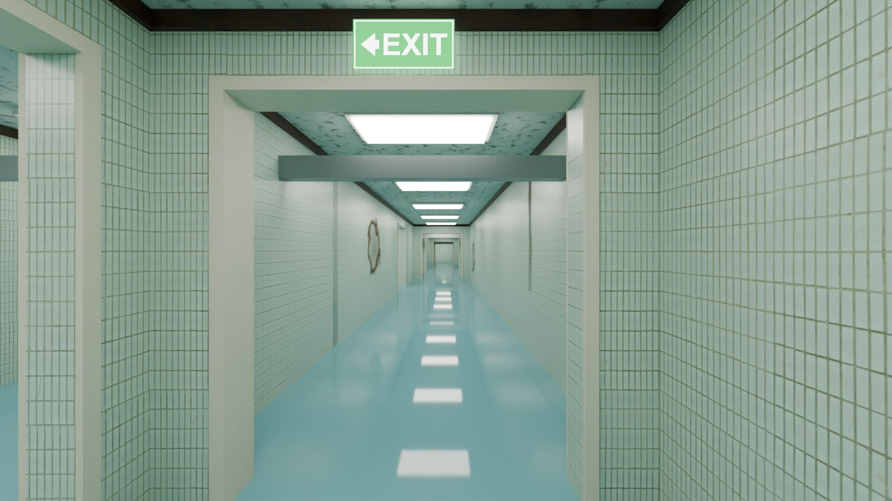
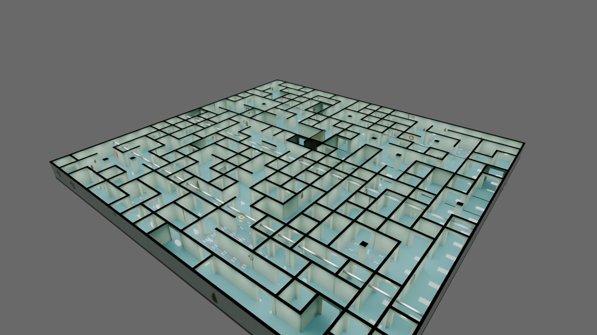
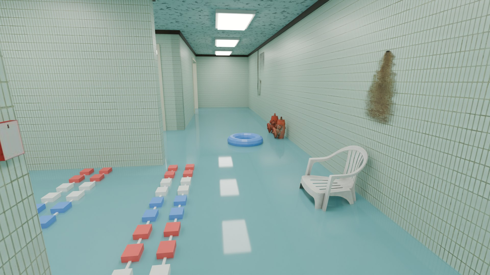

# B1: the store's rebake (flooded pools)

The first floor of the store's rebake (`docs/BLENDER.md`, R4, group A). B1 is the flooded basement: a maze of tiled corridors under fluorescent panels, with a few centimetres of water over every floor, lane ropes, pool toys and a few lost props. It now carries baked light: four lightmaps on a new second UV set. **Nothing else in the model changed**: no vertex, normal, UV0, index, node, door, camera, skin or animation, and the water keeps its see-through surface.

| File | What it is |
|---|---|
| `world/B1.glb` | the same model with `TEXCOORD_1` on the 50 baked primitives and `lightmap` / `lightmap_intensity` in 38 materials' extras: 5.54 MB (5 804 728 bytes; main's was 5 376 032, +8.0 %) |
| `world/lightmaps/B1_0.webp` .. `B1_3.webp` | the baked light, four 2048 x 2048 maps, 8-bit WebP q90 (204, 926, 419 and 968 KB) |
| `tools/blender/bake_store.py` | the bake, the review stills and the geometry proof (Blender, runs without the store file) |
| `tools/store_lightmap_glb.py` | writes a bake into the shipped GLB without touching what is there (plain Python with numpy and Pillow) |
| `docs/renders/B1/` | the three review stills, `bake.json` (the bake's own report), `caps.json` (the small props' intensity caps) and this file |

`blender/Look_Over_There.blend` is **not changed**, and neither are `split_scenes.py`, `index.html`, `shared/`, the manifest or the tests.

## How the geometry stays the same

`split_scenes.py` cannot be used for this: it imports a `backrooms_export` module that is not in the repo, and re-exporting from the store file through Blender would re-encode the Draco data and could move every vertex. So the bake works from the shipped GLB instead:

1. `bake_store.py --stage bake` reads `world/B1.glb`, decodes each primitive's Draco block with the glTF add-on's own Draco library, and builds one Blender mesh per primitive whose vertex *i* is the glTF vertex *i* (no merging). It gives each mesh the GLB's own material (base colour, texture, alpha, emission).
2. The lightmap UV is cut only where the GLB already splits its vertices: `smart_project` first, and any piece it would cut through a shared vertex is unwrapped whole instead. So every glTF vertex has exactly one lightmap UV (the script asserts this).
3. Faces that look out of the building (the outer skin of the shell and the slabs, 5 946 m2 of the 21 911 m2 baked) are found by ray casts and shrunk to 0.12 of the density, so the room gets the texels.
4. Cycles bakes on the GPU (OptiX), and `tools/store_lightmap_glb.py` appends each primitive's `TEXCOORD_1` (unsigned short, normalized) as a new accessor on a new buffer view at the end of the binary chunk. three's `GLTFLoader` reads an attribute that is not in the Draco block as a plain accessor (checked in r160, the page's version: 175 meshes load, the 50 baked ones carry `uv1` with as many entries as positions).

The proof, both ways:
- `store_lightmap_glb.py` asserts that the old binary chunk is a byte-for-byte prefix of the new one and that every old buffer view, accessor, primitive (bar the added `TEXCOORD_1`), node, skin, camera and animation, and every material apart from its extras, is unchanged.
- `bake_store.py --stage compare` decodes main's `B1.glb` and the new one and compares POSITION, NORMAL, TEXCOORD_0, JOINTS_0, WEIGHTS_0 and the indices of every primitive: **154 of 154 primitives identical**, 114 meshes, nodes, cameras, skins and animations equal, `TEXCOORD_1` added on 50.

One more change to the JSON, on purpose: the scene's extras held an add-on's script list (`sl_group`) with absolute paths of the exporting machine's user folder. The page never reads it; the tool drops it so the public file carries no such path. The other scene extras (`bk_doors`, `bk_loops` and the rest) are untouched.

## What is baked and what is not

Baked (the page draws them unlit, as texture x base colour x lightmap): the floor, the walls, the ceiling, the trims and door frames, the fixture housings, the pipes, the stair door, the stains, the lane ropes and ladders (`M_X_*`), the pool toys, and the single props (chair, stool, bins, hydrants, lifebuoy, life jacket, extinguisher body, wet-floor sign).

Not baked, as exported (the page's lights still light them):
- `M_Water`, the flood's surface (alpha blend): kept see-through, so the tiles show through it;
- `M_Fluorescent` (the lit panels) and `M_X_exit` (the EXIT signs): they glow;
- the glass (`wall_clock_glass`, the extinguisher's glass and paper);
- the security cameras (skinned: the page turns them) and their glass;
- the fire alarms and the wall clocks: one mesh drawn in 14 and 5 places, so they cannot hold a lightmap of their own.

## Light

The store file has no lamp objects on B1: the light is the floor's own glowing panels (`M_Fluorescent`, at the GLB's emissive strength), plus the store file's world (a flat grey 0.0509). Bounces use the GLB's materials (metalness set to 0 for the bake: a metal's diffuse pass is black, and the page shows base colour x light anyway). Cycles, 512 samples, diffuse direct and indirect without colour, 8 px margin (4 px on maps 1 and 3, which hold thousands of small islands), OIDN denoise. The bake stage took 179 s on a rented RTX PRO 5000 (the four maps 29, 20, 25 and 74 s).

| Map | Texel density (inside faces) | Margin | White point | `lightmap_intensity` | On it |
|---|---|---|---|---|---|
| `B1_0` | 29.0 px/m | 8 px | 0.795 | 6.9955 | the floor (and the stair's floor), the stains, the stair door, the pipes |
| `B1_1` | 19.0 px/m | 4 px | 0.249 | 2.1943 | the ceiling (and the stair's), the trims |
| `B1_2` | 12.6 px/m | 8 px | 0.485 | 4.2630 | the walls (and the stair's) |
| `B1_3` | 24.1 px/m | 4 px | 0.543 | 4.7773 | the door frames, the housings, the dead panel, the ropes, ladders, toys and props |

B1 is large (about 52 x 50 m, 15 960 m2 of inside faces baked), so the density is below R1's 32 px/m: four 2048 maps are the limit. Each map's white point is the 99.5th percentile of its inside faces' texels by area, with the lamp housings and the dead panel left out (they sit against the glowing panels and may clip). `lightmap_intensity` = pi x white point x exposure, lowered for 13 small prop materials (below).

### How bright

The page draws a baked material unlit: three r160's `MeshBasicMaterial` shows texture x base colour x lightmap texel x `lightmap_intensity` / pi, with no tone mapping, so anything over 1.0 clips to white. At the panels' exported strength the floor came out very dark in the page (the walls' 90th percentile at 0.23, the floor's median at 0.03), much darker than the hemisphere light the page used to light B1 with. So the whole bake carries one **exposure of 2.8** (the same as panels 2.8 times as strong; one factor for all four maps, so their light still matches): the brightest large surface, the stair's walls, then reaches a 99th percentile of 0.97, just under the 0.98 limit.

What the page shows (`lab_display.py`: area-weighted samples over each material's triangles, max channel; the areas include the faces that look out of the building, which are never seen):

| Surface | m2 | p50 | p90 | p99 | at white |
|---|---|---|---|---|---|
| `M_D_ceil_B1` (ceiling) | 7884 | 0.08 | 0.26 | 0.33 | 0 |
| `M_D_wall_B1` (walls) | 7191 | 0.26 | **0.63** | 0.80 | 0 |
| `M_D_floor_B1` (floor, under the water) | 2811 | 0.08 | 0.10 | 0.13 | 0 |
| `M_D_trim` (trims) | 1867 | 0.00 | 0.01 | 0.01 | 0 |
| `M_D_frame` (door frames) | 875 | 0.12 | 0.58 | 0.72 | 0 |
| `M_Fixture_Housing` (lamp housings) | 701 | 0.19 | 0.94 | 0.94 | 0 |
| `M_D_stains` | 195 | 0.00 | 0.11 | 0.18 | 0 |
| `M_Pipes` | 114 | 0.19 | 0.77 | 0.80 | 0 |
| `M_D_wall_L1` (stair walls) | 97 | 0.08 | 0.43 | **0.97** | 0.6 % |
| `M_D_ceil_L1` (stair ceiling) | 35 | 0.13 | 0.33 | 0.61 | 0 |
| `M_Door` | 5 | 0.08 | 0.52 | 0.78 | 0 |

Every main surface keeps p90 at or under 1.0 and p99 at or under 0.98. The ceiling and the floor read darker than the walls: the panels sit in the ceiling and light down and sideways, and the floor's tiles are dark under the water's tint. The trims are almost black: most of their area is hidden against walls and ceiling.

Small props: at the room's exposure the lane ropes' red, white and blue blocks, the rope, the pool toys, the chair and the life jacket clipped (p99 1.07 to 1.49, up to 38 % at white). Their materials' `lightmap_intensity` is capped (`caps.json`: 13 materials, factors 0.65 to 0.91, each = 0.97 / its p99 at exposure 2.8), which brings each one's own displayed p99 to 0.97. No rebake: only those extras changed. The room keeps 2.8.

| Capped prop | factor | `lightmap_intensity` | p90 | p99 (before the cap) |
|---|---|---|---|---|
| `M_X_red` (rope blocks) | 0.750 | 3.5839 | 0.84 | 0.97 (1.29) |
| `M_X_blue` | 0.764 | 3.6489 | 0.82 | 0.97 (1.27) |
| `M_X_white` | 0.671 | 3.2070 | 0.90 | 0.97 (1.45) |
| `M_X_rope` | 0.870 | 4.1563 | 0.28 | 0.97 (1.12) |
| `M_D_toy_red` | 0.750 | 3.5839 | 0.81 | 0.97 (1.29) |
| `M_D_toy_white` | 0.671 | 3.2070 | 0.96 | 0.97 (1.45) |
| `M_D_toy_blue` | 0.750 | 3.5839 | 0.90 | 0.97 (1.29) |
| `M_D_toy_pink` | 0.671 | 3.2070 | 0.94 | 0.97 (1.45) |
| `M_D_toy_yellow` | 0.651 | 3.1100 | 0.93 | 0.97 (1.49) |
| `M_D_toy_orange` | 0.651 | 3.1100 | 0.92 | 0.97 (1.49) |
| `M_D_toy_green` | 0.851 | 4.0650 | 0.67 | 0.97 (1.14) |
| `plastic_monobloc_chair_01` | 0.885 | 4.2279 | 0.78 | 0.97 (1.10) |
| `life_jacket` | 0.910 | 4.3469 | 0.75 | 0.97 (1.07) |

Every other baked material is uncapped and already under 0.98 (the brightest, `M_X_chrome`, 0.96). The owner sheet has the full table.

## Review stills (Cycles, OptiX, 128 samples adaptive, OIDN, 1920 x 1080, AgX, exposure +1.49 EV = x2.8, like the page)

| | |
|---|---|
| `1_arrival.jpg` (269 KB) | B1 has no fixed arrival (the page spawns you on an open spot; the stair from L1 lands on the stair itself): the east hall's south end (25, 21), eye height, facing north down its 40 m run |
| `2_wide.jpg` (229 KB) | the whole floor from above the south-east corner, the ceiling hidden from the camera (its panels still light it) |
| `3_detail.jpg` (287 KB) | the flooded north-east room: the lane ropes, the blue ring and the chair in the water |





These are Blender renders with Cycles' real light, reflections and the water's surface; the page shows the same light without the reflections, and the 13 capped props a little darker than here. The stills' JPEG comment and APP1 segments were stripped.

## Sources

Nothing new: the geometry, the textures and the materials are the store's own, read from `world/B1.glb`. No download, no generated image, no paid service. Tools: Blender 5.2.1 LTS (GPL) with Cycles, OpenImageDenoise and the glTF add-on's Draco library; Python with numpy and Pillow.

## Budgets and checks

| | Limit | Measured |
|---|---|---|
| `world/B1.glb` | main's size + about 10 %, at most 8 MB | **5.54 MB**, +8.0 % (`glb_inspect.py --budget tris=300000,mb=8`: `pass tris`, `pass mb`) |
| triangles | at most 300 000 | **204 788** (unchanged) |
| lightmaps | at most 4, at most 2048 x 2048 | **4** at 2048 x 2048 |
| every baked primitive has `TEXCOORD_1` | | **50 of 50** |
| geometry | identical to main's | **154 of 154 primitives identical** (decoded) |
| `verify_world.py` | passes unchanged | run on the store file on the box (the file is unchanged; output below) |
| `node tools/worlddoc.mjs check world/B1.json` | | `OK`, 591 colliders, 0 errors, 0 warnings (the collision file is untouched) |
| `node --test shared/*.test.js` | all pass | **297 of 297** |

`verify_world.py`, unchanged, on the unchanged store file (Blender 5.2.1 on the box), B1's part:

```
"B1": {"floor_pts": 10369, "no_ceiling": 0, "no_ceiling_at": [], "ceiling_overlaps": [], "stair_hits": [], "n_stair_hits": 0, "dupes": {}, "kinds": 18}
```

L1, L3 and L4 are clean too. L2 reports one stair hit (`Stair_L2_L3_lower_wallLo` against `Detail_Trim_L2`, overlap 14 x 4 x 9 cm); that is main's store file as it is, untouched here, and belongs to L2's rebake.

## Rebuild

From the repo root, with Blender 5.2 and Python with numpy and Pillow. Start from main's GLB (the tool refuses a GLB that already has `TEXCOORD_1`):

```
git checkout <main> -- world/B1.glb && cp world/B1.glb <main glb>      # the shipped model before the bake (Git LFS)
blender -b --factory-startup --python tools/blender/bake_store.py -- --scene B1 --stage bake --samples 512 --work <work>
python tools/store_lightmap_glb.py B1 <work> --base <main glb> --exposure 2.8 --caps docs/renders/B1/caps.json
blender -b --factory-startup --python tools/blender/bake_store.py -- --scene B1 --stage compare --a <main glb> --b world/B1.glb --work <work>
blender -b --factory-startup --python tools/blender/bake_store.py -- --scene B1 --stage render --render-samples 128 --exposure-ev 1.49 --work <work>
```

The bake, the stills and the comparison open no `.blend` (the world grey is set in the script; the store file has no lamp on B1). A GPU is used when Cycles finds one. `--stage compare` also writes `<work>/B1_decoded.glb`, a Draco-free copy for brightness tools that cannot decode Draco. The exposure and the caps change only the extras, so they can be retuned with `store_lightmap_glb.py` alone, without a rebake (a cap is 0.98-or-less / the material's p99 at the chosen exposure, measured with a brightness tool on `B1_decoded.glb`).

## For L1 to L4 and Exterior

The method carries: `bake_store.py --scene <floor>` reads that floor's GLB the same way. Each floor needs its own `GROUPS` entry (which materials share a map), its `NEVER` set (glass, lit panels, the L4 showroom's glass doors) and its exposure, and its own three `VIEWS`. Exterior already has a second UV set (R4 says to check what it is for first); `store_lightmap_glb.py` refuses a GLB that has one, so Exterior needs that decision before it can go through.

## What the coordinator does

Nothing in the page needs to change: `world/B1.glb` is already in the manifest, and `applyLightmaps` finds the extras and the `uv1` attribute. The baked materials no longer answer to the page's hemisphere light or the torch; the water, the panels, the EXIT signs, the glass, the cameras, the fire alarms and the clocks still do.
