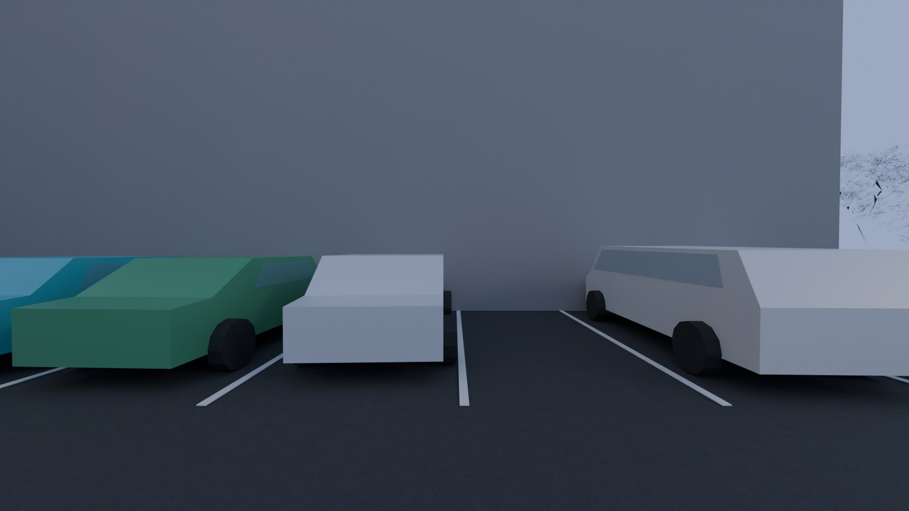
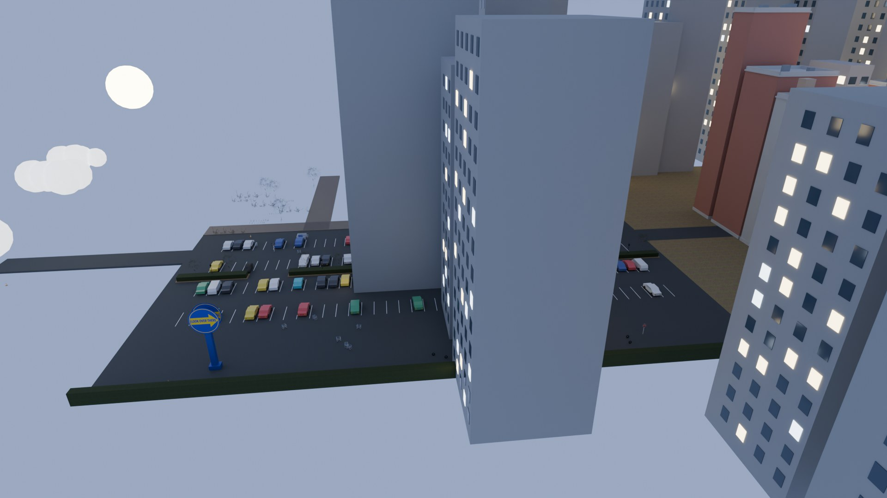
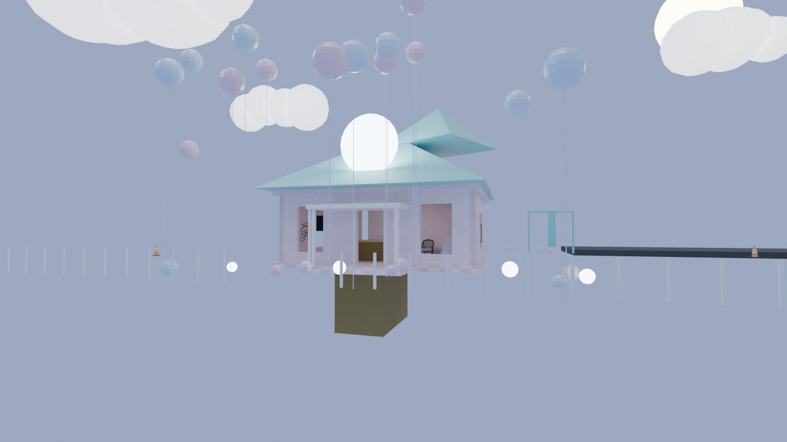

# Exterior: the store's rebake (the lot, the roads, the street, the house)

The store's outside (`docs/BLENDER.md`, R4, group A), done with B1's method. `world/Exterior.glb` is the model the page loads with L4 for the parking lot, `parking_lot` and `gbi_L4_4`: the lot and its cars, the sidewalk, the two roads, the city and the Intern street at the east end, and the dreamcore house at the west end, all under a sky dome. It now carries baked light: four lightmaps on a new second UV set. **Nothing else in the model changed**: no vertex, normal, UV0, index, node, door or existing UV set.

| File | What it is |
|---|---|
| `world/Exterior.glb` | the same model with `TEXCOORD_1` on the 56 baked primitives and `lightmap` / `lightmap_intensity` in 41 materials' extras: 4.29 MB (4 500 924 bytes; main's was 4 241 228, +6.1 %) |
| `world/lightmaps/Exterior_0.webp` .. `Exterior_3.webp` | the baked light, 8-bit WebP q90: 2048, 2048, 2048 and 1280 px square (138, 71, 273 and 234 KB) |
| `tools/blender/bake_store.py` | B1's bake, stills and geometry proof, with the Exterior's settings added (below) |
| `tools/store_lightmap_glb.py` | B1's writer, with one general change for the Exterior's existing UV1 (below) |
| `docs/renders/Exterior/` | the three review stills, `bake.json` (the bake's own report), `caps.json` (the intensity caps) and this file |

`blender/Look_Over_There.blend` is **not changed**, and neither are `split_scenes.py`, `index.html`, `shared/`, the manifest or the tests.

## The second UV set that was already there

`Exterior.glb` on main already has `TEXCOORD_1` on three primitives, and only those: the small tree (`BezierCurve.002`, its branches, leaves and trunk), one mesh drawn in **28 places** (the lot's trees and the street's). Decoded on the box, it is not a lightmap UV:

- the branches' UV1 runs a little outside 0..1 (v from -0.03 to 1.04) and is a tiling detail UV: 51 units of UV area on 0.13 m2, and 98 % of the texels it covers are covered more than once;
- the leaves' (86 238 vertices) and the trunk's UV1 is one point, (0, 1), for every vertex: zero area.

Nothing reads it. The page's only use of a second UV set is `applyLightmaps` in `index.html`, which acts on a material with `lightmap` or `aomap` in its extras and always sets `channel = 1`; the tree's materials have no extras, and `shared/` has no UV or lightmap code at all. three r160 ignores `uv1` on a material without a light or AO map.

**Decision: (c), leave it exactly as it is and bake around it.** (a) is out: the set overlaps, leaves the 0..1 square and has zero area on two of the three primitives, and the tree is drawn 28 times, so one lightmap UV could not serve it anyway (the floors leave such meshes out too). (b) is out: the page has no set index to point at (`channel = 1` is fixed in `index.html`, which this work does not touch). So the tree is not baked and keeps its UV1 byte for byte, and none of the 56 baked primitives had a second UV set, so their `TEXCOORD_1` is appended the same way as on B1. The two tools now say so: `bake_store.py` never bakes a primitive that already has `TEXCOORD_1`, and `store_lightmap_glb.py` refuses only when a primitive it would write already has one (B1's whole-file refusal stopped the Exterior), and asserts that an existing `TEXCOORD_1` is still the same accessor. B1 runs through both unchanged.

## How the geometry stays the same

As B1: the bake builds one Blender mesh per glTF primitive from the shipped GLB (Draco decoded with the glTF add-on's own library, vertex *i* = glTF vertex *i*), cuts lightmap islands only where the GLB already splits vertices, and `store_lightmap_glb.py` appends each baked primitive's `TEXCOORD_1` (unsigned short, normalized) on a new buffer view at the end of the binary chunk.

The proof, both ways:
- `store_lightmap_glb.py` asserts that the old binary chunk is a byte-for-byte prefix of the new one and that every old buffer view, accessor, primitive (bar an added `TEXCOORD_1`), node, skin, camera and animation, and every material apart from its extras, is unchanged.
- `bake_store.py --stage compare` decodes main's `Exterior.glb` and the new one and compares POSITION, NORMAL, TEXCOORD_0, the tree's TEXCOORD_1 and the indices of every primitive: **157 of 157 primitives identical**, 112 meshes, nodes equal, `TEXCOORD_1` added on 56.
- three r160 (the page's version) loads both: 637 meshes each; main has `uv1` on 84 (the 28 trees x 3), the new file on 140 (84 + 56), every `uv1` as long as its positions, every lightmapped mesh has `uv1`.

As on B1, the scene's extras lose `sl_group`, an add-on's script list holding the exporting machine's user folder; nothing on the page reads it. The other scene extras are untouched.

## What changed in the tools, and why (all general; B1's settings are as they were)

- `GROUPS`, `NEVER`, `PAGE_MARGIN`, `HOT`, `VIEWS`: Exterior entries (per scene, as on L1 to L3).
- `DENSITY` per scene: 16 px/m asked for the Exterior (R1 says 8 to 12 outdoors; 16 lets the small things get more). It settles at 12.5, 5.8, 2.4 and 21.3 px/m on the four maps.
- `GROUND_Z`: outdoors there is no "out of the building". B1's ray test (nothing within 60 m in front) would have marked the whole lot as outside, so for the Exterior only faces that look down from at or below the ground (the slabs' and the terrain's undersides) are shrunk to 0.12. 46 % of the ground's and the grass's area is such undersides.
- `WHITE_PCT`: which percentile of a map's texels is its white (default 99.5). On the city's map the walls right round the lit windows are 15 to 30 times the walls' median, so its white is the 97th percentile and those rims clip (they read as the windows' glow).
- `CLIP_END` for the stills (the sky dome is 360 m out), and the texel statistics' sample count capped at 4 million per object (the terrain alone is about 60 000 m2; B1's numbers are under the cap).

## What is baked and what is not

Baked: the lot's asphalt, sidewalk, curb, bay and yellow lines; the grass and the hedges; the two roads; the city's walls, roofs and street (`M_City_*` but the glass and the glowing parts) and the Intern street's buildings, road and walks (`PhotorealArch_SR_*`); the dreamcore house (walls, floor, roof, trim, door, swing, balloons, flowers) and its furniture; the two gates' walls and door leaves; the benches and the pylon.

Not baked, as exported (the page's lights still light them):
- everything that glows: the sky dome (`M_U_sky`), the lit windows, neon, lamps, the house's glow, sun and clouds, the Intern street's unlit props (`LowPolyProp_SR_*`), the gate's lit panel;
- glass (the cars', the lamps', the clock's, the picture's);
- every mesh drawn in more than one place: the cars, the trolleys, the trees (with their UV1), the shrubs, the street lamps, the bins, the tyres, the cones, the covered cars; and `M_U_steel`, `M_U_rubber`, `M_U_yellow`, which those share with the posts;
- `M_City_glassdark`, the city's dark window glass: 72 500 vertices of a far backdrop, whose lightmap UVs alone would put the GLB over +10 %;
- `M_City_red`, `M_Gate_Step`, `coffee_table_round_01` and `hanging_picture_frame_01_artwork`: the first bake gave them no light at all (0 at the 99th percentile), which the page would show as black, so they stay lit as before.

## Light

The store file has no lamp for the lot, the roads, the street or the house (the only lamp in it is a default point light outside every level), so as on the floors the light is the model's own: the sky dome (its sky picture as emission at strength 1, as exported), every glowing material at its exported strength, and the store file's world (a flat grey, 0.0509). Cycles, 512 samples, diffuse direct and indirect without colour, 8 px margin (4 px on map 3), OIDN; metalness 0 for the bake. The bake stage took 227 s on the rented RTX PRO 5000.

| Map | Size | Texel density | White point | `lightmap_intensity` | On it |
|---|---|---|---|---|---|
| `Exterior_0` | 2048 | 12.5 px/m | 0.785 | 8.6317 | the lot's asphalt, sidewalk, curb and lines; the roads; the city's and the Intern street's road and walks |
| `Exterior_1` | 2048 | 5.8 px/m | 0.235 | 2.5867 | the grass and the hedges |
| `Exterior_2` | 2048 | 2.4 px/m | 1.130 (97th pct) | 12.4195 | the city's and the Intern street's buildings |
| `Exterior_3` | 1280 | 21.3 px/m | 0.468 | 5.1508 | the house and its things, the gates, the benches, the pylon |

### How bright: exposure 3.5

The page draws a baked material unlit (texture x base colour x texel x `lightmap_intensity` / pi, no tone mapping). At the model's own sky the lot is very dark (asphalt p90 0.015, grass 0.03). **The exposure is 3.5**, for one reason: the parking lot, the one scene where you walk in this model, shows the model's sky at 3.5 times its exported strength (`SKY = {parking_lot: 3.5}` in `index.html`, "clear and bright"), and nearly all of the lot's light comes from that sky. So exposure 3.5 is the bake under the sky the parking lot shows. Open ground then gets about 0.8 of full light; the lot still reads darkish because its textures are dark (asphalt's albedo about 0.06, the sidewalk's and the grass's about 0.15). `--exposure` changes only the extras, so it can be retuned without a rebake.

At 3.5, 13 materials went over 0.98 at p99: the city's walls with their window rims, the Intern street's buildings, the city's white paint and walks, the house's roof and trim beside its glow, and the balloons. Each one's `lightmap_intensity` is capped by 0.97 / its p99 (`caps.json`, factors 0.39 to 0.76), which brings its own p99 to 0.97. That includes `M_City_concrete`, the largest surface; its walls keep p90 0.20 and the lit windows' rims stay at the top.

What the page shows (`lab_display.py`'s method: area-weighted samples, max channel; with the base texture's `KHR_texture_transform` applied and one uniform sample density, 16 per m2, because the terrain is too big for 4000 per m2; the areas include the undersides, which are never seen, so p50 is low on the ground):

| Surface | m2 | map | `lightmap_intensity` | p50 | p90 | p99 |
|---|---|---|---|---|---|---|
| `M_City_concrete` (capped) | 185633 | 2 | 8.47 | 0.11 | 0.20 | 0.97 |
| `M_U_grass` | 86334 | 1 | 2.5867 | 0.00 | 0.11 | 0.17 |
| `M_City_brick` (capped) | 25718 | 2 | 6.7686 | 0.05 | 0.17 | 0.97 |
| `M_City_stone` | 23062 | 2 | 12.4195 | 0.01 | 0.33 | 0.53 |
| `M_U_asphalt` (the lot) | 19322 | 0 | 8.6317 | 0.05 | 0.05 | 0.06 |
| `M_City_brick2` (capped) | 12974 | 2 | 5.5391 | 0.02 | 0.15 | 0.97 |
| `M_U_pavement` (sidewalk, curb) | 3593 | 0 | 8.6317 | 0.09 | 0.12 | 0.15 |
| `PhotorealArch_SR_Tower.001` (capped) | 2190 | 2 | 8.47 | 0.12 | 0.92 | 0.97 |
| `PhotorealArch_SR_BrickR.001` (capped) | 1688 | 2 | 7.2529 | 0.01 | 0.35 | 0.97 |
| `M_U_hedge` | 1559 | 1 | 2.5867 | 0.01 | 0.02 | 0.03 |
| `PhotorealArch_SR_BrickL.001` (capped) | 1448 | 2 | 7.2529 | 0.02 | 0.35 | 0.97 |
| `M_City_asphalt` | 1027 | 0 | 8.6317 | 0.00 | 0.07 | 0.16 |
| `M_City_walk` (capped) | 821 | 0 | 5.8609 | 0.03 | 0.77 | 0.97 |
| `PhotorealArch_SR_Road.001` | 677 | 0 | 8.6317 | 0.00 | 0.13 | 0.25 |
| `M_City_metal` | 614 | 2 | 12.4195 | 0.00 | 0.00 | 0.27 |
| `PhotorealArch_SR_Sidewalk.001` | 531 | 0 | 8.6317 | 0.00 | 0.00 | 0.34 |
| `M_RDW_wall` | 455 | 3 | 5.1508 | 0.23 | 0.69 | 0.82 |
| `M_RDW_roof` (capped) | 341 | 3 | 3.9042 | 0.43 | 0.85 | 0.97 |
| `M_U_line` | 243 | 0 | 8.6317 | 0.00 | 0.53 | 0.71 |
| `M_RDW_floor` | 223 | 3 | 5.1508 | 0.45 | 0.58 | 0.70 |
| `M_Gate_Concrete` | 124 | 3 | 5.1508 | 0.00 | 0.34 | 0.40 |
| `M_RDW_trim` (capped) | 82 | 3 | 3.111 | 0.45 | 0.65 | 0.97 |
| `M_Gate_Alcove` | 73 | 3 | 5.1508 | 0.04 | 0.55 | 0.56 |
| `M_City_white` (capped) | 64 | 0 | 3.3836 | 0.00 | 0.90 | 0.97 |
| `M_U_blue` (pylon) | 61 | 3 | 5.1508 | 0.12 | 0.21 | 0.24 |
| `M_City_paint` (capped) | 29 | 0 | 3.3836 | 0.15 | 0.53 | 0.97 |
| `M_RDW_balloon2` (capped) | 24 | 3 | 3.0749 | 0.57 | 0.82 | 0.97 |
| `M_RDW_balloon` (capped) | 22 | 3 | 3.5848 | 0.60 | 0.88 | 0.97 |

The rest (the doors, the benches, the house's furniture) are under 0.98 too; the owner sheet has them. Every material is at or under 0.97 at p99. The Intern street's sidewalk and part of the city's road read near 0 where they lie under the city's own walk and asphalt (the two sets of street overlap in the model); what shows is the one on top.

## Review stills (Cycles, OptiX, 128 samples adaptive, OIDN, 1920 x 1080, AgX, exposure +1.81 EV = x3.5, like the page)

The store building itself is in `L4.glb`, not in this model, so it is missing from the stills.

| | |
|---|---|
| `1_arrival.jpg` (88 KB) | where the walk out of the store lands you (the manifest's arrival, -8, 43.6, by the table), eye height, looking south across the lot (the store is behind you) |
| `2_wide.jpg` (127 KB) | the whole lot from high above its south side, the city at the right |
| `3_detail.jpg` (76 KB) | the dreamcore house past the lot's west end: its porch, fence and balloons |





These show Cycles' real light under the exported sky at x3.5; the page shows the same light on the baked materials, the capped ones a little darker, and the unbaked ones under its hemisphere light. JPEG comment and APP1 segments stripped.

## Sources

Nothing new: the geometry, textures and materials are the model's own, read from `world/Exterior.glb`. No download, no generated image, no paid service. Tools: Blender 5.2 (GPL) with Cycles, OpenImageDenoise and the glTF add-on's Draco library; Python with numpy and Pillow.

## Budgets and checks

| | Limit | Measured |
|---|---|---|
| `world/Exterior.glb` | main's size + about 10 %, at most 8 MB | **4.29 MB**, +6.1 % (`glb_inspect.py --budget tris=300000,mb=8`: `pass mb`) |
| triangles | at most 300 000 | **1 443 500, unchanged from main** (`glb_inspect` reports `OVER tris` for main's file too: the 28 trees' leaves alone are 42 080 x 28; the geometry may not change here) |
| lightmaps | at most 4, at most 2048 x 2048 | **4** (three 2048, one 1280) |
| every baked primitive has `TEXCOORD_1` | | **56 of 56**; the tree keeps its own on 3 |
| geometry | identical to main's | **157 of 157 primitives identical** (decoded) |
| `node tools/worlddoc.mjs check` | | there is no `world/Exterior.json`; the scenes that load this model: `parking_lot.json` OK (235 colliders), `L4.json` OK (234), `gbi_L4_4.json` OK (235), 0 errors, 0 warnings (all untouched) |
| `node --test shared/*.test.js` | all pass | **297 of 297** |
| three r160 load | | both files load; `uv1` on 84 (main) and 140 (new) meshes, no count mismatch |

## Rebuild

From the repo root, with Blender 5.2 and Python with numpy and Pillow. Start from main's GLB:

```
git checkout <main> -- world/Exterior.glb && cp world/Exterior.glb <main glb>
blender -b --factory-startup --python tools/blender/bake_store.py -- --scene Exterior --stage bake --samples 512 --work <work>
python tools/store_lightmap_glb.py Exterior <work> --base <main glb> --exposure 3.5 --caps docs/renders/Exterior/caps.json
blender -b --factory-startup --python tools/blender/bake_store.py -- --scene Exterior --stage compare --a <main glb> --b world/Exterior.glb --work <work>
blender -b --factory-startup --python tools/blender/bake_store.py -- --scene Exterior --stage render --render-samples 128 --exposure-ev 1.81 --work <work>
```

## What the coordinator may want to know

- One light set serves three scenes. The parking lot shows the sky at x3.5 and gets light to match; in L4 and `gbi_L4_4` the sky dome keeps its dusk strength, so the ground seen through the glass doors is brighter than that sky. If that shows, the page could give those scenes a lower intensity, or a second set (`lightmap_night`), which is a page change and not made here.
- The baked materials no longer answer to the page's hemisphere light; everything listed under "not baked" still does, so the lot's cars, trees and lamps stay lit as before beside baked ground.
- The house's furniture bakes dim (the sofa near black at 0.01 at p99, the TV and frame under 0.15): the house's own glow is the only light inside. Left baked as the model lights it; they could join `NEVER` with a rebake if the page should keep lighting them.
