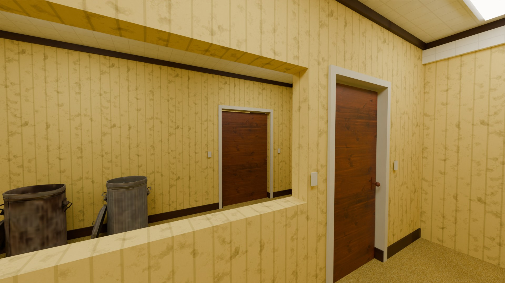
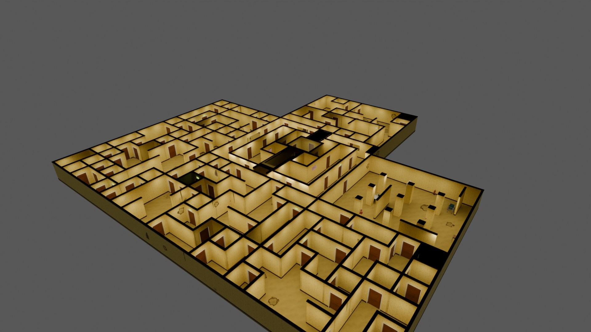
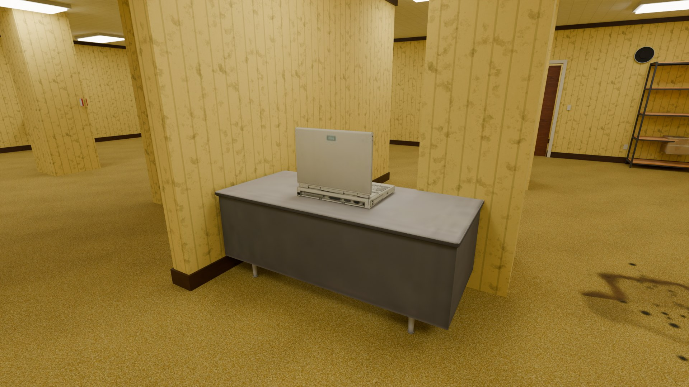

# L1: the store's rebake (the office maze)

The second floor of the store's rebake (`docs/BLENDER.md`, R4, group A), done the way B1 and L2 were. L1 is the office maze: wallpapered corridors, small offices and an open pillared hall under fluorescent panels, with 126 wooden doors. It now carries baked light: four lightmaps on a new second UV set. **Nothing else in the model changed**: no vertex, normal, UV0, index, node, door, camera, skin or animation.

| File | What it is |
|---|---|
| `world/L1.glb` | the same model with `TEXCOORD_1` on the 208 baked primitives and `lightmap` / `lightmap_intensity` in 18 materials' extras: 6.65 MB (6 975 144 bytes; main's was 6 400 636, +9.0 %) |
| `world/lightmaps/L1_0.webp` .. `L1_3.webp` | the baked light, four 2048 x 2048 maps, 8-bit WebP q90 (222, 694, 355 and 404 KB) |
| `tools/blender/bake_store.py` | L2's version of B1's bake (doors closed for the bake, per-floor settings), with L1's settings added (below) |
| `tools/store_lightmap_glb.py` | B1's tool, unchanged |
| `docs/renders/L1/` | the three review stills, `bake.json` (the bake's own report) and this file |

`blender/Look_Over_There.blend` is **not changed**, and neither are `index.html`, `shared/`, the manifest, the tests or `world/L1.json`.

## What changed in `bake_store.py`

Only L1's entries: `GROUPS`, `PAGE_MARGIN`, `NEVER` (with `PROPS_L1`), `CEILING_CUT` (2.25) and `VIEWS`. B1 and L2 run as before. As on L2, the bake reads the doors from `world/L1.json` and closes all 126 leaves in the bake scene only (the export holds most of them open or ajar; the page closes every leaf when it loads the floor), so the walls carry the shadows of shut doors. The GLB's nodes are not touched.

## How the geometry stays the same

As on B1: the bake builds one Blender mesh per glTF primitive from the shipped `world/L1.glb` (Draco decoded with the glTF add-on's own library, vertex *i* = glTF vertex *i*), cuts lightmap islands only where the GLB already splits vertices, and `store_lightmap_glb.py` appends each `TEXCOORD_1` as a new accessor at the end of the binary chunk, asserting that the old binary is a byte-identical prefix and that every old buffer view, accessor, primitive, node, skin, camera, animation and material (bar its extras) is unchanged.

`bake_store.py --stage compare` on main's `L1.glb` and the new one: **320 of 320 primitives identical** (POSITION, NORMAL, TEXCOORD_0, JOINTS_0, WEIGHTS_0, indices), 281 meshes, nodes, cameras, skins and animations equal, `TEXCOORD_1` added on 208.

The scene extras' `sl_group` (an add-on's script list holding the exporting machine's user-folder paths) is dropped, as on B1 and L2; the other scene extras are untouched.

## What is baked and what is not

Baked: the floor, the walls and ceiling (and the stairwells' `M_D_*_L2` pieces and the slab's underside `M_D_ceil_B1`), the side walls `M_Wall_1E_SE` / `_SW`, the trims, the stains, the 126 door leaves (`M_D_door`), the door frames, the stair doors (`M_Door`), the lamp housings, the dead panel, the rails (`M_X_steel`, `M_X_dark`).

Not baked, as exported (the page's lights still light them):
- `M_Fluorescent` (the lit panels) and `M_X_exit` (the EXIT signs): they glow;
- the glass (`wall_clock_glass`, the extinguisher's glass and paper) and the broom's bristles (alpha blend);
- the security cameras (skinned) and their glass; the fire alarms and the wall clocks (one mesh drawn in 18 and 7 places);
- **the loose props** (the same set L2 leaves out, plus the school desk, the dartboard, the monobloc chair and the wheelchair, `lambert1`). Their lightmap UVs would take the GLB to about +12 %, over the budget of about 10 %; the 126 door leaves alone carry 64 000 vertices of lightmap UV. The props still cast light and shadow in the bake.

## Light

The store file has no lamp on L1 (one lamp in the whole file, in a general collection, not on any floor): the light is the floor's own glowing panels (`M_Fluorescent`, at the GLB's emissive strength), plus the store file's world (a flat grey 0.0509). Cycles OptiX, 512 samples, diffuse direct and indirect without colour, OIDN. The bake stage took 1 125 s on the rented RTX PRO 5000, shared with another job (the four maps 114, 42, 252 and 617 s).

| Map | Texel density (inside faces) | Margin | White point | `lightmap_intensity` | On it |
|---|---|---|---|---|---|
| `L1_0` | 31.5 px/m | 8 px | 0.634 | 3.981 | the floor, the stairwells' floor, the slab's underside, the stains, the stair doors |
| `L1_1` | 20.6 px/m | 4 px | 0.354 | 2.221 | the ceiling (and the stairwell's), the trims |
| `L1_2` | 14.7 px/m | 8 px | 0.763 | 4.795 | the walls (and the stairwell's) |
| `L1_3` | 21.3 px/m | 4 px | 0.543 | 3.411 | the door leaves, the frames, the housings, the dead panel, the rails |

### How bright

The page draws a baked material unlit: texture x base colour x texel x `lightmap_intensity` / pi, no tone mapping. At the panels' exported strength the walls' 90th percentile came out at 0.30, so the floor carries **one exposure of 2.0** (`lightmap_intensity` = pi x white point x 2.0), which puts the walls' p90 at 0.61, as on B1 and L2. At that exposure no material's p99 is above 0.98, so **no caps** were needed (no `caps.json`).

What the page shows (`lab_display.py` on a Draco-free copy of the final GLB, written by the compare stage: area-weighted samples over each material's triangles, max channel; the areas include faces that look out of the building):

| Surface | m2 | p50 | p90 | p99 | at white |
|---|---|---|---|---|---|
| `M_D_wall_L1` (walls) | 6509 | 0.27 | **0.61** | 0.91 | 0.6 % |
| `M_D_ceil_L1` (ceiling) | 5302 | 0.09 | 0.35 | 0.47 | 0 |
| `M_D_floor_L1` (carpet) | 2312 | 0.20 | 0.39 | 0.56 | 0 |
| `M_D_ceil_B1` (the slab's underside, never seen) | 2044 | 0.06 | 0.06 | 0.06 | 0 |
| `M_D_trim` (trims) | 1504 | 0.00 | 0.02 | 0.02 | 0 |
| `M_D_door` (door leaves) | 685 | 0.06 | 0.10 | 0.13 | 0 |
| `M_Fixture_Housing` | 549 | 0.00 | 0.67 | 0.67 | 0 |
| `M_D_frame` (door frames) | 503 | 0.01 | 0.33 | 0.66 | 0 |
| `M_D_stains` | 230 | 0.00 | 0.11 | 0.16 | 0 |
| `M_D_wall_L2` (stairwell walls) | 104 | 0.02 | 0.06 | 0.19 | 0 |
| `M_X_steel` | 43 | 0.00 | 0.17 | 0.28 | 0 |
| `M_X_dark` | 39 | 0.00 | 0.00 | 0.00 | 0 |
| `M_D_ceil_L2` | 38 | 0.04 | 0.04 | 0.27 | 0 |
| `M_Fluorescent_Dead` | 26 | 0.00 | 0.12 | 0.18 | 0 |
| `M_D_floor_L2` | 12 | 0.00 | 0.02 | 0.04 | 0 |
| `M_Door` (stair doors) | 10 | 0.04 | 0.17 | 0.42 | 0 |
| `M_Wall_1E_SE` | 2.5 | 0.16 | 0.36 | 0.54 | 0 |
| `M_Wall_1E_SW` | 2.5 | 0.15 | 0.32 | 0.39 | 0 |

The door leaves read dark in the numbers: their wood texture is a deep red-brown, and the leaves are shut against frames in narrow corridors. The trims are almost black in the numbers because most of their area is hidden against walls and ceiling (as on B1 and L2).

## Review stills (Cycles, OptiX, 128 samples adaptive, OIDN, 1920 x 1080, AgX, exposure +1.0 EV = x2.0, like the page)

| | |
|---|---|
| `1_arrival.jpg` (243 KB) | `PlayerStart` (-5.0, -4.97 in `world/L1.json`), eye height, facing its longest open run |
| `2_wide.jpg` (221 KB) | the whole floor from above the south-east corner, the ceiling hidden from the camera (its panels still light it) |
| `3_detail.jpg` (334 KB) | the east hall: the metal desk with the laptop (a loose prop, on the page's lights in the game) |





The stills show the doors shut, as the page does on arrival. Their JPEG comment and APP1 segments were stripped.

## Budgets and checks

| | Limit | Measured |
|---|---|---|
| `world/L1.glb` | main's size + about 10 %, at most 8 MB | **6.65 MB**, +9.0 % (`glb_inspect.py --budget tris=300000,mb=8`: `pass tris`, `pass mb`) |
| triangles | at most 300 000 | **250 157** (unchanged from main) |
| lightmaps | at most 4, at most 2048 x 2048 | **4** at 2048 x 2048 |
| every baked primitive has `TEXCOORD_1` | | **208 of 208** (18 materials) |
| geometry | identical to main's | **320 of 320 primitives identical** (decoded) |
| three r160 | loads | `GLTFLoader` + `DRACOLoader` (the page's versions): 349 meshes load from both files, 208 carry `uv1` with as many entries as positions, every mesh of the 18 lightmapped materials has `uv1`, 1 animation and 24 cameras as on main |
| `verify_world.py` | passes unchanged | clean for L1 (below) |
| `node tools/worlddoc.mjs check world/L1.json` | | `OK`, 490 colliders, 126 doors, 0 errors, 0 warnings (the collision file is untouched) |
| `node --test shared/*.test.js` | all pass | **297 of 297** |

`verify_world.py`, unchanged, on the unchanged store file (run on the box during B1's rebake; the file and the script are the same here), L1's part:

```
"L1": {"floor_pts": 8060, "no_ceiling": 0, "no_ceiling_at": [], "ceiling_overlaps": [], "stair_hits": [], "n_stair_hits": 0, "dupes": {}}
```

## Rebuild

From the repo root, with Blender 5.2 and Python with numpy and Pillow. Start from main's GLB:

```
git checkout <main> -- world/L1.glb && cp world/L1.glb <main glb>
blender -b --factory-startup --python tools/blender/bake_store.py -- --scene L1 --stage bake --samples 512 --work <work>
python tools/store_lightmap_glb.py L1 <work> --base <main glb> --exposure 2.0
blender -b --factory-startup --python tools/blender/bake_store.py -- --scene L1 --stage compare --a <main glb> --b world/L1.glb --work <work>
blender -b --factory-startup --python tools/blender/bake_store.py -- --scene L1 --stage render --render-samples 128 --exposure-ev 1.0 --work <work>
```

The exposure changes only the extras, so it can be retuned with `store_lightmap_glb.py` alone, without a rebake.

## Sources

Nothing new: the geometry, the textures and the materials are the store's own, read from `world/L1.glb`; the door poses come from `world/L1.json`. No download, no generated image, no paid service. Tools: Blender 5.2.1 LTS (GPL) with Cycles, OpenImageDenoise and the glTF add-on's Draco library; Python with numpy and Pillow.

## What the coordinator does

Nothing in the page needs to change: `world/L1.glb` is already in the manifest, and `applyLightmaps` finds the extras and the `uv1` attribute. The baked materials no longer answer to the page's hemisphere light or the torch; the panels, the EXIT signs, the glass, the cameras, the fire alarms, the clocks and the loose props still do. A door leaf the player opens carries the light it had shut.
