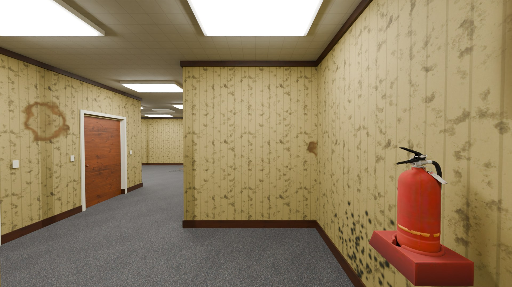
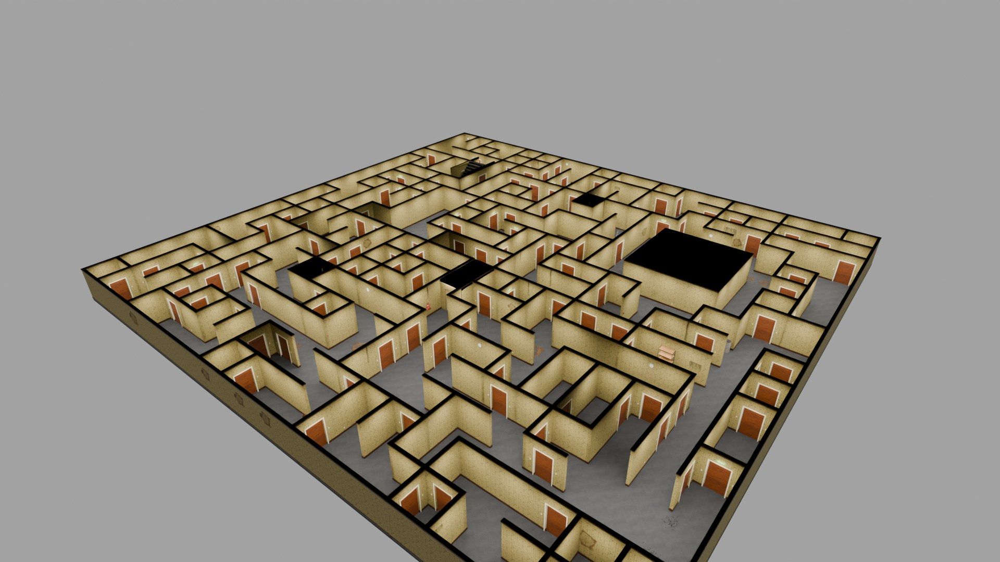
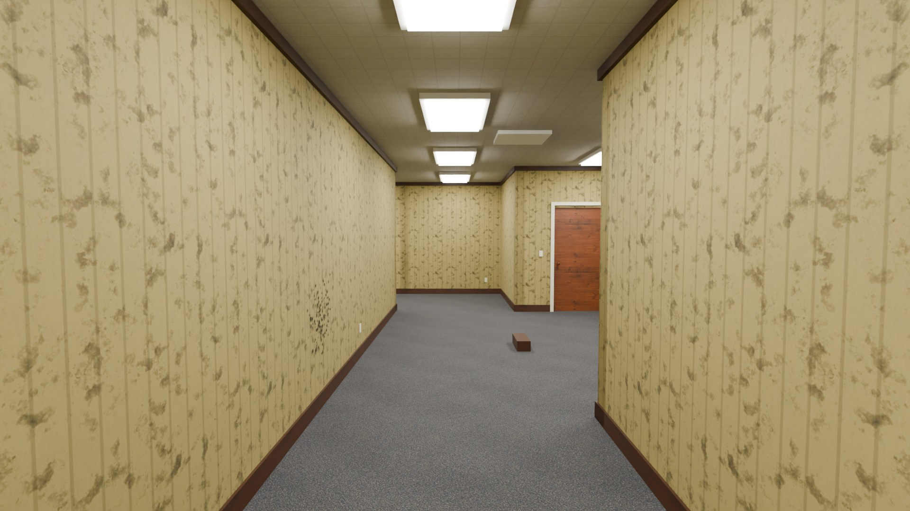

# L2: the store's rebake (the loop)

The third floor of the store's rebake (`docs/BLENDER.md`, R4, group A), done the way B1 was. L2 is the loop: a maze of wallpapered corridors and small rooms under fluorescent panels, with 150 wooden doors. It now carries baked light: four lightmaps on a new second UV set. **Nothing else in the model changed**: no vertex, normal, UV0, index, node, door, camera, skin or animation.

| File | What it is |
|---|---|
| `world/L2.glb` | the same model with `TEXCOORD_1` on the 176 baked primitives and `lightmap` / `lightmap_intensity` in 16 materials' extras: 6.92 MB (7 257 312 bytes; main's was 6 614 032, +9.7 %) |
| `world/lightmaps/L2_0.webp` .. `L2_3.webp` | the baked light, four 2048 x 2048 maps, 8-bit WebP q90 (227, 756, 407 and 362 KB) |
| `tools/blender/bake_store.py` | B1's bake, stills and geometry proof, with L2's settings added (below) |
| `tools/store_lightmap_glb.py` | B1's tool, unchanged |
| `docs/renders/L2/` | the three review stills, `bake.json` (the bake's own report), `caps.json` (the per-material caps) and this file |

`blender/Look_Over_There.blend` is **not changed**, and neither are `index.html`, `shared/`, the manifest, the tests or `world/L2.json`.

## What changed in `bake_store.py` (B1 still runs as before)

- L2's entries in `GROUPS`, `PAGE_MARGIN`, `NEVER` and `VIEWS`; `PAGE_MARGIN` and `NEVER` are now per floor (B1's values are the same as before).
- `CEILING_CUT`: the height above which the plan still hides the ceiling, per floor (B1 keeps -0.75; L2 uses 5.45).
- **The doors are baked shut.** The export holds 126 of L2's door leaves open or ajar, but the page closes every leaf when it loads a floor (`index.html`: the leaf's rotation becomes `closed_yaw_deg` about +Y). The bake now reads the floor's `world/<floor>.json` doors and closes the leaves the same way in the bake scene only, so the walls and floors carry the shadows of shut doors and the leaves carry the light they get shut. The GLB's nodes are not touched (the compare stage proves it). On B1 this changes nothing: its one door is exported shut at yaw 0.

## How the geometry stays the same

As on B1: the bake builds one Blender mesh per glTF primitive from the shipped `world/L2.glb` (Draco decoded with the glTF add-on's own library, vertex *i* = glTF vertex *i*), cuts lightmap islands only where the GLB already splits vertices, and `store_lightmap_glb.py` appends each `TEXCOORD_1` as a new accessor at the end of the binary chunk, asserting that the old binary is a byte-identical prefix and that every old buffer view, accessor, primitive, node, skin, camera, animation and material (bar its extras) is unchanged.

`bake_store.py --stage compare` on main's `L2.glb` and the new one: **321 of 321 primitives identical** (POSITION, NORMAL, TEXCOORD_0, JOINTS_0, WEIGHTS_0, indices), 276 meshes, nodes, cameras, skins and animations equal, `TEXCOORD_1` added on 176.

The scene extras' `sl_group` (an add-on's script list holding the exporting machine's user-folder paths) is dropped, as on B1; the other scene extras are untouched.

## What is baked and what is not

Baked: the floor, the walls and ceiling (and the stairwells' `M_D_*_L3`, `M_D_ceil_L1` pieces), the trims, the stains, the 150 door leaves (`M_D_door`), the door frames, the stair doors (`M_Door`), the lamp housings, the dead panel, the rails (`M_X_steel`, `M_X_dark`).

Not baked, as exported (the page's lights still light them):
- `M_Fluorescent` (the lit panels) and `M_X_exit` (the EXIT signs): they glow;
- the glass (`wall_clock_glass`, the extinguisher's glass and paper) and the broom's bristles (alpha blend);
- the security cameras (skinned) and their glass; the fire alarms and the wall clocks (one mesh drawn in 20 and 8 places);
- **the loose props** (the chair, wet-floor sign, box, laptop, dustpan, hydrants, cart, extinguisher body, payphone, desk, trash cans, broom, plunger, shelves, bucket). Their lightmap UVs would take the GLB to +12.1 %, over the budget of about 10 %: the 150 door leaves alone carry 78 000 vertices of lightmap UV, and the doors and frames matter more to the floor. The props still cast light and shadow in the bake.

## Light

The store file has no lamp on L2 (one lamp in the whole file, in a general collection, not on any floor): the light is the floor's own glowing panels (`M_Fluorescent`, at the GLB's emissive strength), plus the store file's world (a flat grey 0.0509). Cycles OptiX, 512 samples, diffuse direct and indirect without colour, OIDN. The bake stage took 424 s on the rented RTX PRO 5000, shared with another bake (the four maps 33, 19, 25 and 315 s).

| Map | Texel density (inside faces) | Margin | White point | `lightmap_intensity` | On it |
|---|---|---|---|---|---|
| `L2_0` | 30.9 px/m | 8 px | 0.450 | 11.736 (M_D_floor_L3 6.924, M_Door 7.159) | the floor, the stairwells' floor, the slab's underside, the stains, the stair doors |
| `L2_1` | 19.5 px/m | 4 px | 0.168 | 4.393 (M_D_ceil_L3 3.031) | the ceiling (and the stairwell's), the trims |
| `L2_2` | 13.1 px/m | 8 px | 0.392 | 10.234 (M_D_wall_L3 4.196) | the walls (and the stairwell's) |
| `L2_3` | 17.3 px/m | 4 px | 0.376 | 9.816 (housings and frames 4.908) | the door leaves, the frames, the housings, the dead panel, the rails |

### How bright

The page draws a baked material unlit: texture x base colour x texel x `lightmap_intensity` / pi, no tone mapping. At the panels' exported strength the walls' 90th percentile came out at 0.07 (the wallpaper is darker than B1's tiles and the corridors are narrow), so the floor carries **one exposure of 8.3** (`lightmap_intensity` = pi x white point x 8.3), which puts the walls' p90 at 0.60, as on B1. Then six small or bright materials have their own intensity capped (`caps.json`) so that their p99 is at most 0.98: the lamp housings and the door frames (x0.5, the frames' tops sit at the panels), and the stairwell pieces next to the stair's lamp (`M_D_wall_L3` x0.41, `M_D_ceil_L3` x0.69, `M_D_floor_L3` x0.59, `M_Door` x0.61).

What the page shows (`lab_display.py` on a Draco-free copy of the final GLB, written by the compare stage: area-weighted samples over each material's triangles, max channel; the areas include faces that look out of the building):

| Surface | m2 | p50 | p90 | p99 | at white |
|---|---|---|---|---|---|
| `M_D_wall_L2` (walls) | 7736 | 0.25 | **0.60** | 0.84 | 0 |
| `M_D_ceil_L2` (ceiling) | 5314 | 0.16 | 0.18 | 0.28 | 0 |
| `M_D_floor_L2` (carpet) | 2844 | 0.05 | 0.15 | 0.31 | 0 |
| `M_D_ceil_L1` (the slab's underside, never seen) | 2603 | 0.37 | 0.38 | 0.38 | 0 |
| `M_D_trim` (trims) | 1808 | 0.00 | 0.03 | 0.05 | 0 |
| `M_D_door` (door leaves) | 864 | 0.16 | 0.28 | 0.38 | 0 |
| `M_Fixture_Housing` | 680 | 0.00 | 0.97 | 0.97 | 0 |
| `M_D_frame` (door frames) | 608 | 0.00 | 0.43 | 0.97 | 0.15 % |
| `M_D_stains` | 229 | 0.00 | 0.25 | 0.44 | 0 |
| `M_D_wall_L3` (stairwell walls) | 92 | 0.09 | 0.56 | 0.96 | 0 |
| `M_D_ceil_L3` | 33 | 0.29 | 0.79 | 0.96 | 0 |
| `M_X_steel` | 28 | 0.00 | 0.01 | 0.24 | 0 |
| `M_Fluorescent_Dead` | 26 | 0.00 | 0.09 | 0.15 | 0 |
| `M_X_dark` | 26 | 0.00 | 0.00 | 0.00 | 0 |
| `M_D_floor_L3` | 12 | 0.09 | 0.67 | 0.97 | 0.3 % |
| `M_Door` (stair doors) | 10 | 0.08 | 0.63 | 0.96 | 0 |

No material is above 0.98 at p99. The ceiling and the carpet read darker than the walls: the panels sit in the ceiling, and the carpet's texture is a dark grey. The trims are almost black in the numbers because most of their area is hidden against walls and ceiling (as on B1).

## Review stills (Cycles, OptiX, 128 samples adaptive, OIDN, 1920 x 1080, AgX, exposure +3.05 EV = x8.3, like the page)

| | |
|---|---|
| `1_arrival.jpg` (298 KB) | where the stair from L1 lands (the manifest's arrival, -0.007, 9.7), eye height, looking south into the floor |
| `2_wide.jpg` (255 KB) | the whole floor from above the south-east corner, the ceiling hidden from the camera (its panels still light it) |
| `3_detail.jpg` (278 KB) | a corridor of the loop (8.6, -2.0), looking east to a shut door |





The stills show the doors shut, as the page does on arrival. Their JPEG comment and APP1 segments were stripped.

## Budgets and checks

| | Limit | Measured |
|---|---|---|
| `world/L2.glb` | main's size + about 10 %, at most 8 MB | **6.92 MB**, +9.7 % (`glb_inspect.py --budget tris=300000,mb=8`: `pass tris`, `pass mb`) |
| triangles | at most 300 000 | **298 865** (unchanged from main) |
| lightmaps | at most 4, at most 2048 x 2048 | **4** at 2048 x 2048 |
| every baked primitive has `TEXCOORD_1` | | **176 of 176** (16 materials) |
| geometry | identical to main's | **321 of 321 primitives identical** (decoded) |
| three r160 | loads | `GLTFLoader` + `DRACOLoader` (the page's versions): 354 meshes load from both files, 176 carry `uv1` with as many entries as positions, every mesh of the 16 lightmapped materials has `uv1`, 1 animation and 35 cameras as on main |
| `verify_world.py` | passes unchanged | see below |
| `node tools/worlddoc.mjs check world/L2.json` | | `OK`, 560 colliders, 152 doors, 0 errors, 0 warnings (the collision file is untouched) |
| `node --test shared/*.test.js` | all pass | **297 of 297** |

`verify_world.py`, unchanged, on the unchanged store file (run on the box during B1's rebake; the file and the script are the same here), L2's part:

```
"L2": {"floor_pts": 10312, "no_ceiling": 0, "no_ceiling_at": [], "ceiling_overlaps": [], "stair_hits": [["Stair_L2_L3_lower_wallLo", "Detail_Trim_L2", [-18.0, 11.34, 6.11, -17.73, 12.2, 6.2], [0.14, 0.04, 0.09]]], "n_stair_hits": 1, "dupes": {}}
```

The one stair hit is **pre-existing and left as it is**: the stairwell's lower wall (`Stair_L2_L3_lower_wallLo`) and the floor's trim (`Detail_Trim_L2`) overlap by 14 x 4 x 9 cm. Both are geometry of the store file and of `world/L2.glb`, which this rebake must not change; fixing it means editing the store file and re-exporting L2, a separate job.

## Rebuild

From the repo root, with Blender 5.2 and Python with numpy and Pillow. Start from main's GLB:

```
git checkout <main> -- world/L2.glb && cp world/L2.glb <main glb>
blender -b --factory-startup --python tools/blender/bake_store.py -- --scene L2 --stage bake --samples 512 --work <work>
python tools/store_lightmap_glb.py L2 <work> --base <main glb> --exposure 8.3 --caps docs/renders/L2/caps.json
blender -b --factory-startup --python tools/blender/bake_store.py -- --scene L2 --stage compare --a <main glb> --b world/L2.glb --work <work>
blender -b --factory-startup --python tools/blender/bake_store.py -- --scene L2 --stage render --render-samples 128 --exposure-ev 3.05 --work <work>
```

The exposure and the caps change only the extras, so they can be retuned with `store_lightmap_glb.py` alone, without a rebake.

## Sources

Nothing new: the geometry, the textures and the materials are the store's own, read from `world/L2.glb`; the door poses come from `world/L2.json`. No download, no generated image, no paid service. Tools: Blender 5.2.1 LTS (GPL) with Cycles, OpenImageDenoise and the glTF add-on's Draco library; Python with numpy and Pillow.

## What the coordinator does

Nothing in the page needs to change: `world/L2.glb` is already in the manifest, and `applyLightmaps` finds the extras and the `uv1` attribute. The baked materials no longer answer to the page's hemisphere light or the torch; the panels, the EXIT signs, the glass, the cameras, the fire alarms, the clocks and the loose props still do. A door leaf the player opens carries the light it had shut.
