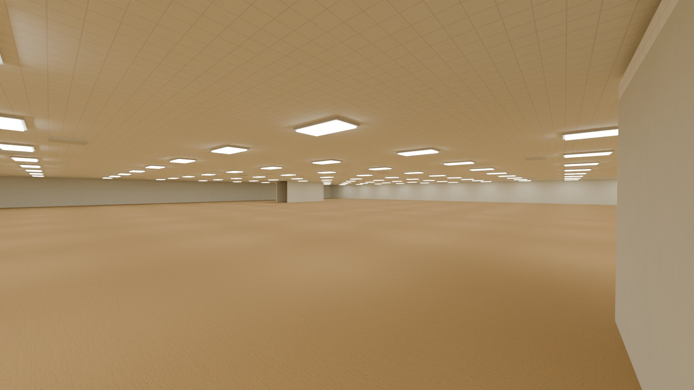
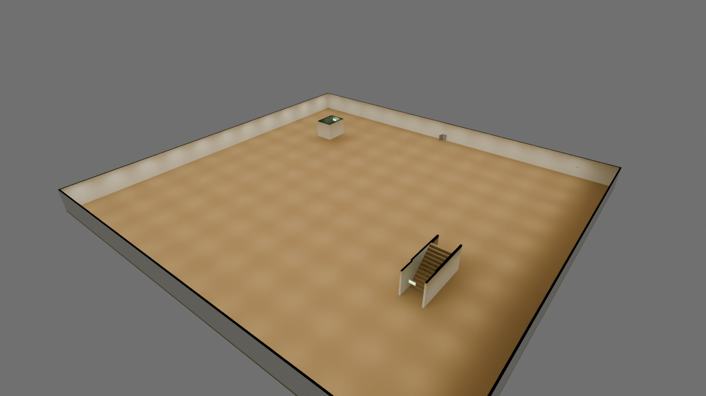
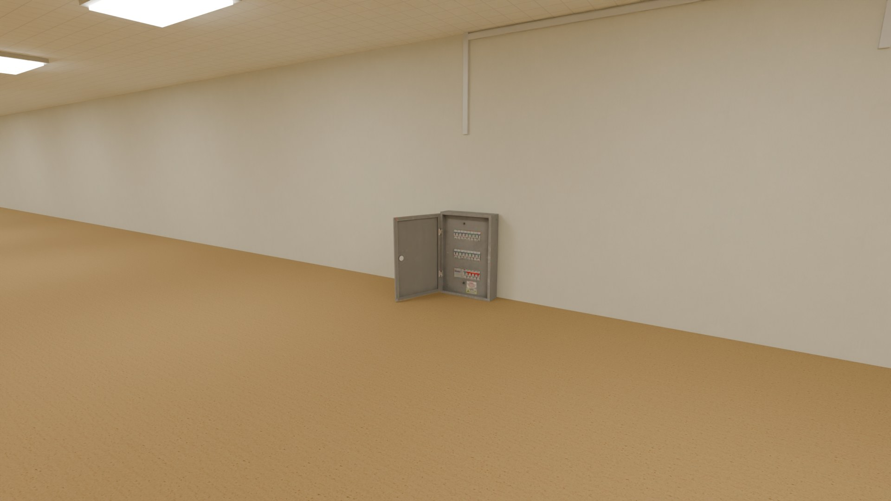

# L3: the store's rebake (the white plaster room)

The store's rebake (`docs/BLENDER.md`, R4, group A), floor L3. L3 is one big white plaster room, about 52 x 50 m and 3 m high, under a grid of fluorescent panels. It holds the power box on the north wall, the stair up from L2 in its own box, and the stair to L4. It now carries baked light: four lightmaps on a new second UV set. **Nothing else in the model changed**: no vertex, normal, UV0, index, node, door, camera, skin or animation. The method is B1's (`docs/renders/B1/README.md` on B1's branch), unchanged.

| File | What it is |
|---|---|
| `world/L3.glb` | the same model with `TEXCOORD_1` on the 25 baked primitives and `lightmap` / `lightmap_intensity` in 13 materials' extras: 2.03 MB (2 132 716 bytes; main's was 2 077 984, +2.6 %) |
| `world/lightmaps/L3_0.webp` .. `L3_3.webp` | the baked light, 8-bit WebP q90: 2048², 2048², 1792² and 512² (63, 257, 59 and 38 KB) |
| `tools/blender/bake_store.py` | B1's bake, stills and geometry proof, with L3 added (below) |
| `tools/store_lightmap_glb.py` | B1's tool, byte for byte |
| `docs/renders/L3/` | the three review stills, `bake.json` (the bake's own report) and this file |

`blender/Look_Over_There.blend` is **not changed**, and neither are `split_scenes.py`, `index.html`, `shared/`, the manifest or the tests.

### What changed in `bake_store.py` (general; B1 runs as before)
- An `L3` entry in `GROUPS` and `VIEWS`.
- `NEVER` and `PAGE_MARGIN` are now per floor. B1's values are unchanged.
- `FLOOR_Y` per floor. The plan still hides what hangs more than 2.25 m above the floor, which is still -0.75 for B1. `pool_view` uses the same height.

## The proof

- `store_lightmap_glb.py` asserts that the old binary chunk is a byte-for-byte prefix of the new one. It also asserts that every old buffer view, accessor, primitive (apart from the added `TEXCOORD_1`), node, skin, camera and animation is unchanged, and that every material is unchanged apart from its extras.
- `bake_store.py --stage compare`, main's `L3.glb` against the new one, decoded: **33 of 33 primitives identical**. The 29 meshes, the nodes, the 2 cameras, the 2 skins and the animation are all equal. `TEXCOORD_1` is added on 25 primitives.
- The scene's extras lose `sl_group`, an add-on's script list holding the exporting machine's user path. Nothing on the page reads it. The other scene extras are untouched.

## What is baked and what is not

Baked:
- the floor, the slab's underside (L2's ceiling, which faces out and is shrunk), the ceiling, the vents (`M_X_steel`, `M_X_dark`) and the lamp housings;
- the walls;
- the stair to L4 (`M_D_floor_L4`, `M_D_ceil_L4`, `M_U_wall_L4`);
- the two stair doors, the power box and the conduit.

Not baked, as exported (the page's lights still light them):
- `M_Fluorescent`, the lit panels;
- `M_X_exit`, the EXIT signs;
- the security cameras and their glass (skinned: the page turns them);
- the fire alarms: one mesh drawn in three places, so it cannot hold a lightmap of its own.

The page still adds the power box's lever and lamp in code.

## Light

The store file has no lamp objects on L3 (checked on the box: every `Level_*` collection has none). The light comes from the room's own panels at the GLB's emissive strength, plus the store file's world, a flat grey of 0.0509. The bake used Cycles (OptiX, 512 samples, diffuse direct and indirect without colour, OIDN), with metalness set to 0 as on B1. The bake stage took 145 s on the rented box (the four maps took 34, 36, 23 and 3 s). Faces that look out of the building (5 896 m²) get 0.12 of the density.

| Map | Size | Texel density (inside faces) | Margin | White point | `lightmap_intensity` | On it |
|---|---|---|---|---|---|---|
| `L3_0` | 2048 | 33.3 px/m | 8 px | 0.4068 | 4.0899 | the floor, the stair landing, the slab's underside |
| `L3_1` | 2048 | 29.3 px/m | 8 px | 0.1905 | 1.9147 | the ceiling (and the stair's), the vents, the housings |
| `L3_2` | 1792 | 33.8 px/m | 8 px | 0.3248 | 3.2649 | the walls (and the stair's) |
| `L3_3` | 512 | 79.7 px/m | 4 px | 0.6049 | 6.0815 | the stair doors, the power box, the conduit |

`lightmap_intensity` = pi x white point x exposure. The exposure is **3.2**, one factor for all four maps.

### How bright

The page shows texture x base colour x texel x `lightmap_intensity` / pi, unlit, with no tone mapping. At exposure 1 the walls' p90 was 0.19. An exposure of 3.2 brings it to 0.59. Measured with `lab_display.py` on the final GLB, decoded: area-weighted, max channel. The areas include the faces that look out of the building, which are never seen. That is why the walls' p50 is low.

| Surface | m² | p50 | p90 | p99 | at white |
|---|---|---|---|---|---|
| `M_D_ceil_L3` (ceiling) | 5305 | 0.16 | 0.47 | 0.54 | 0 |
| `M_D_floor_L3` (floor) | 2841 | 0.45 | 0.52 | 0.57 | 0 |
| `M_D_ceil_L2` (slab underside, faces out) | 2605 | 0.06 | 0.06 | 0.07 | 0 |
| `M_D_wall_L3` (walls) | 1506 | 0.12 | **0.59** | 0.71 | 0 |
| `M_Fixture_Housing` | 245 | 0.28 | 0.38 | 0.38 | 0 |
| `M_U_wall_L4` (stair walls) | 93 | 0.12 | 0.49 | 0.80 | 0 |
| `M_D_ceil_L4` (stair ceiling) | 33 | 0.01 | 0.02 | 0.04 | 0 |
| `M_X_steel` (vents) | 17 | 0.27 | 0.33 | 0.39 | 0 |
| `M_X_dark` (vent slots) | 15 | 0.00 | 0.00 | 0.00 | 0 |
| `M_D_floor_L4` (stair landing) | 12 | 0.03 | 0.18 | 0.39 | 0 |
| `M_Door` | 10 | 0.09 | 0.39 | 0.80 | 0 |
| `M_U_steel` (conduit) | 1 | 0.07 | 0.33 | 0.48 | 0 |
| `power_box_01` | 1 | 0.13 | 0.18 | 0.36 | 0 |

Every material's p99 is 0.80 or below, so **no cap is needed** and none is given (`--caps` is not passed). The room reads white and even, as R4 asks.

Two surfaces are very dark:
- The vent slots (`M_X_dark`, base colour 0.03) get no light in the bake.
- The L4 stair's ceiling sits right above its own downward-facing tube.

## Review stills (Cycles, OptiX, 128 samples adaptive, OIDN, 1920 x 1080, AgX, exposure +1.68 EV = x3.2, like the page)

| | |
|---|---|
| `1_arrival.jpg` | beside the stair door from L2 (it lands you at -16.48, -14.28), at eye height, looking south-east across the room; the stair's box is at the right |
| `2_wide.jpg` | the whole room from above the south-east corner, with the ceiling hidden from the camera (its panels still light the room) |
| `3_detail.jpg` | the power box on the north wall, with the conduit above it |





The stills' JPEG comment and APP1 segments were stripped.

## Sources

Nothing new: the geometry, textures and materials are the store's own, read from `world/L3.glb`. No download, no generated image, no paid service. Tools: Blender 5.2.1 LTS with Cycles, OIDN and the glTF add-on's Draco library; Python with numpy and Pillow.

## Budgets and checks

| | Limit | Measured |
|---|---|---|
| `world/L3.glb` | main's size + about 10 %, at most 8 MB | **2.03 MB**, +2.6 % (`glb_inspect.py --budget tris=300000,mb=8`: `pass tris`, `pass mb`) |
| triangles | at most 300 000 | **20 648** (unchanged) |
| lightmaps | at most 4, at most 2048² | **4** |
| every baked primitive has `TEXCOORD_1` | | **25 of 25** |
| geometry | identical to main's | **33 of 33 primitives identical** (decoded) |
| three r160 load | | 35 meshes load, 25 carry `uv1` with as many entries as positions, 13 lightmapped materials, none without `uv1`, 1 animation, 2 cameras (same as main) |
| `verify_world.py` | passes unchanged | L3: `{"floor_pts": 10382, "no_ceiling": 0, "ceiling_overlaps": [], "stair_hits": [], "n_stair_hits": 0}` (unchanged store file, on the box) |
| `node tools/worlddoc.mjs check world/L3.json` | | `OK`, 48 colliders, 0 errors, 0 warnings |
| `node --test shared/*.test.js` | all pass | **297 of 297** |

## Rebuild

From the repo root, starting from main's GLB:

```
blender -b --factory-startup --python tools/blender/bake_store.py -- --scene L3 --stage bake --samples 512 --work <work>
python tools/store_lightmap_glb.py L3 <work> --base <main glb> --exposure 3.2
blender -b --factory-startup --python tools/blender/bake_store.py -- --scene L3 --stage compare --a <main glb> --b world/L3.glb --work <work>
blender -b --factory-startup --python tools/blender/bake_store.py -- --scene L3 --stage render --render-samples 128 --exposure-ev 1.68 --work <work>
```

## What the coordinator does

Nothing in the page needs to change. `applyLightmaps` finds the extras and `uv1`. `gbi_L3_1` reuses this model, so it gets the same light.
