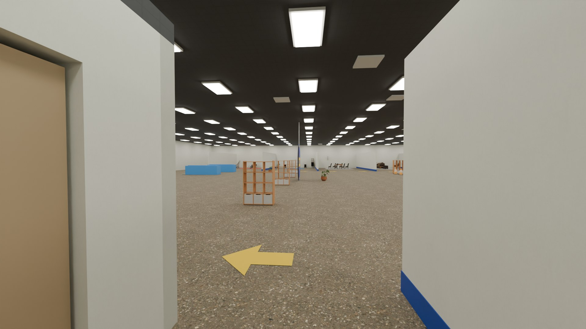
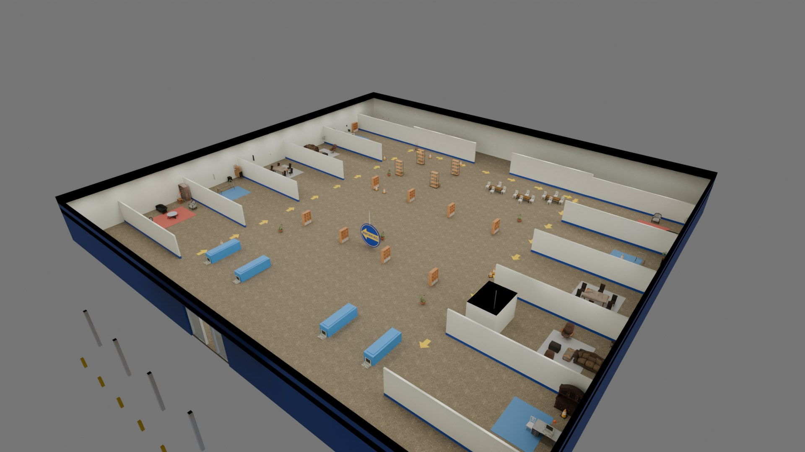
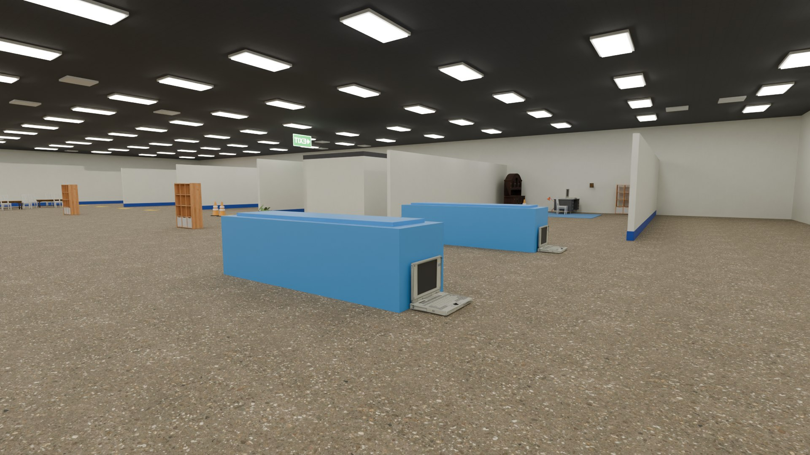

# L4: the store's rebake (the furniture store)

The store's rebake (`docs/BLENDER.md`, R4, group A), floor L4. L4 is the furniture store: one hall about 52 x 50 m and 4.5 m high under a dark ceiling with a grid of fluorescent panels. White partitions with a blue base split it into show rooms, with shelves, checkout counters and the stair down to L3 in its own box. It now carries baked light: four lightmaps on a new second UV set. **Nothing else in the model changed**: no vertex, normal, UV0, index, node, door, camera, skin or animation. The method is B1's (`docs/renders/B1/README.md` on B1's branch), unchanged.

| File | What it is |
|---|---|
| `world/L4.glb` | the same model with `TEXCOORD_1` on the 35 baked primitives and `lightmap` / `lightmap_intensity` in 15 materials' extras: 5.32 MB (5 576 096 bytes; main's was 5 516 848, +1.1 %) |
| `world/lightmaps/L4_0.webp` .. `L4_3.webp` | the baked light, 8-bit WebP q90, all four 2048² (107, 304, 92 and 103 KB) |
| `tools/blender/bake_store.py` | B1's bake, stills and geometry proof, as L3 left it, with L4 added (below) |
| `tools/store_lightmap_glb.py` | B1's tool, byte for byte |
| `docs/renders/L4/` | the three review stills, `bake.json` (the bake's own report) and this file |

`blender/Look_Over_There.blend` is **not changed**, and neither are `split_scenes.py`, `index.html`, `shared/`, the manifest or the tests.

### What changed in `bake_store.py` (general; B1 and L3 run as before)
- An `L4` entry in `GROUPS`, `NEVER`, `PAGE_MARGIN` and `VIEWS` (L3's per-floor `NEVER`, `PAGE_MARGIN` and `FLOOR_Y` are kept as they are).

## The proof

- `store_lightmap_glb.py` asserts that the old binary chunk is a byte-for-byte prefix of the new one. It also asserts that every old buffer view, accessor, primitive (apart from the added `TEXCOORD_1`), node, skin, camera and animation is unchanged, and that every material is unchanged apart from its extras.
- `bake_store.py --stage compare`, main's `L4.glb` against the new one, decoded: **98 of 98 primitives identical**. The 78 meshes, the nodes, the cameras, the 4 skins and the animation are all equal. `TEXCOORD_1` is added on 35 primitives.
- The scene's extras lose `sl_group`, an add-on's script list holding the exporting machine's user path. Nothing on the page reads it. The other scene extras are untouched.

## What is baked and what is not

Baked:
- the floor, the three rugs, the stair landing and the slab's underside (L3's ceiling, which faces out and is shrunk);
- the ceiling (and the stair's), the vents (`M_X_steel`) and the lamp housings;
- the walls and partitions (`M_U_wall_L4`, with the stair's walls);
- the blue base and the blue and yellow shop front (`M_U_blue`, `M_U_yellow`), the steel frames, posts and roof units (`M_U_steel`), the checkout counters (`M_U_bluepaint`), the stair door and the hand truck.

Not baked, as exported (the page's lights still light them):
- `M_Fluorescent`, the lit panels, and the desk lamps' bulbs (glowing);
- `M_X_exit`, the EXIT signs;
- the glass (`M_U_glass`), the floor arrows (`M_U_arrow`) and the logo signs (`M_U_logo`): alpha blended;
- the security cameras and their glass (skinned: the page turns them);
- the furniture (sofas, chairs, tables, shelves, boxes, laptops, plants, frames, ...), the fire alarms and the traffic cones (`M_X_orange`, `M_X_white`, `M_X_dark`): each mesh is drawn in more than one place, so it cannot hold a lightmap of its own. They still cast light and shadow in the bake.

## Light

The store file has no lamp objects on L4 (checked on the box: every `Level_*` collection has none). The light comes from the hall's own panels and the desk lamps at the GLB's emissive strength, plus the store file's world, a flat grey of 0.0509. The bake used Cycles (OptiX, 512 samples, diffuse direct and indirect without colour, OIDN), with metalness set to 0 as on B1. The bake stage took 213 s on the rented box (the four maps took 31, 27, 31 and 49 s). Faces that look out of the building (5 791 m²) get 0.12 of the density.

| Map | Size | Texel density (inside faces) | Margin | White point | `lightmap_intensity` | On it |
|---|---|---|---|---|---|---|
| `L4_0` | 2048 | 31.6 px/m | 8 px | 0.3684 | 4.0507 | the floor, the rugs, the stair landing, the slab's underside |
| `L4_1` | 2048 | 29.2 px/m | 8 px | 0.1476 | 1.6234 | the ceiling (and the stair's), the vents, the housings |
| `L4_2` | 2048 | 29.3 px/m | 8 px | 0.3402 | 3.7407 | the walls and partitions (and the stair's) |
| `L4_3` | 2048 | 23.7 px/m | 4 px | 0.2195 | 2.4132 | the blue base and shop front, the yellow, the steel, the counters, the door, the hand truck |

`lightmap_intensity` = pi x white point x exposure. The exposure is **3.5**, one factor for all four maps. (A first bake put the blue and yellow paint on the walls' map; the walls then got only 17 px/m, so the paint moved to the last map.)

### How bright

The page shows texture x base colour x texel x `lightmap_intensity` / pi, unlit, with no tone mapping. At exposure 1 the walls' p90 was 0.17. An exposure of 3.5 brings it to 0.59. Measured with `lab_display.py` on the final GLB, decoded: area-weighted, max channel. The areas include the faces that look out of the building, which are never seen (the roof, the outer shell, most of the shop front); that is why the paint's and the walls' p50 are low.

| Surface | m² | p50 | p90 | p99 | at white |
|---|---|---|---|---|---|
| `M_D_ceil_L4` (ceiling) | 5291 | 0.01 | 0.02 | 0.03 | 0 |
| `M_U_blue` (blue base, shop front) | 3250 | 0.03 | 0.07 | 0.17 | 0 |
| `M_U_wall_L4` (walls, partitions) | 3014 | 0.25 | **0.59** | 0.74 | 0 |
| `M_D_floor_L4` (floor) | 2712 | 0.18 | 0.31 | 0.73 | 0.19 % |
| `M_D_ceil_L3` (slab underside, faces out) | 2605 | 0.17 | 0.18 | 0.18 | 0 |
| `M_U_yellow` | 753 | 0.00 | 0.12 | 0.13 | 0 |
| `M_Fixture_Housing` | 372 | 0.15 | 0.32 | 0.32 | 0 |
| `M_U_steel` | 162 | 0.07 | 0.13 | 0.51 | 0 |
| `M_U_rug_grey` | 142 | 0.00 | 0.41 | 0.48 | 0 |
| `M_U_rug_blue` | 88 | 0.00 | 0.44 | 0.49 | 0 |
| `M_U_bluepaint` (checkouts) | 81 | 0.39 | 0.58 | 0.58 | 0 |
| `M_U_rug_red` | 58 | 0.06 | 0.56 | 0.61 | 0 |
| `M_X_steel` (vents) | 26 | 0.14 | 0.24 | 0.29 | 0 |
| `M_Door` | 5 | 0.05 | 0.31 | 0.32 | 0 |
| `hand_truck` | 1 | 0.01 | 0.14 | 0.23 | 0 |

Every material's p99 is 0.74 or below, so **no cap is needed** and none is given (`--caps` is not passed). The few floor samples at white (0.19 %) are under the p99.

Two surfaces read dark, by their own texture:
- The ceiling's texture is a dark grey (linear mean 0.055) and it faces away from the downward panels; it shows near black, as in the stills.
- The rugs' and the paint's low p50 is their undersides and outward faces.

## Review stills (Cycles, OptiX, 128 samples adaptive, OIDN, 1920 x 1080, AgX, exposure +1.81 EV = x3.5, like the page)

| | |
|---|---|
| `1_arrival.jpg` | beside the stair door from L3 (it lands you at 16.0, 8.0), at eye height, looking west across the shop floor |
| `2_wide.jpg` | the whole floor from above the south-east corner, with the ceiling hidden from the camera (its panels still light the room) |
| `3_detail.jpg` | the checkout counters by the shop's front |





The stills' JPEG comment and APP1 segments were stripped.

## Sources

Nothing new: the geometry, textures and materials are the store's own, read from `world/L4.glb`. No download, no generated image, no paid service. Tools: Blender 5.2.1 LTS with Cycles, OIDN and the glTF add-on's Draco library; Python with numpy and Pillow.

## Budgets and checks

| | Limit | Measured |
|---|---|---|
| `world/L4.glb` | main's size + about 10 %, at most 8 MB | **5.32 MB**, +1.1 % (`glb_inspect.py --budget tris=300000,mb=8`: `pass mb`) |
| triangles | at most 300 000 | **303 484** drawn, unchanged from main (main's `L4.glb` already reads `OVER tris` in `glb_inspect`; the rebake may not touch the geometry) |
| lightmaps | at most 4, at most 2048² | **4** |
| every baked primitive has `TEXCOORD_1` | | **35 of 35** |
| geometry | identical to main's | **98 of 98 primitives identical** (decoded) |
| three r160 load | | 242 meshes load, 35 carry `uv1` with as many entries as positions, 15 lightmapped materials, none without `uv1`, 1 animation, 4 cameras (same as main) |
| `verify_world.py` | passes unchanged | L4: `{"floor_pts": 10220, "no_ceiling": 0, "ceiling_overlaps": [], "stair_hits": [], "n_stair_hits": 0}` (the store file is unchanged; this is the box run made during L3's rebake, which checks every floor, L4 included) |
| `node tools/worlddoc.mjs check world/L4.json` | | `OK`, 234 colliders, 0 errors, 0 warnings |
| `node --test shared/*.test.js` | all pass | **297 of 297** |

## Rebuild

From the repo root, starting from main's GLB:

```
blender -b --factory-startup --python tools/blender/bake_store.py -- --scene L4 --stage bake --samples 512 --work <work>
python tools/store_lightmap_glb.py L4 <work> --base <main glb> --exposure 3.5
blender -b --factory-startup --python tools/blender/bake_store.py -- --scene L4 --stage compare --a <main glb> --b world/L4.glb --work <work>
blender -b --factory-startup --python tools/blender/bake_store.py -- --scene L4 --stage render --render-samples 128 --exposure-ev 1.81 --work <work>
```

## What the coordinator does

Nothing in the page needs to change. `applyLightmaps` finds the extras and `uv1`. `gbi_L4_4` reuses this model, so it gets the same light.
