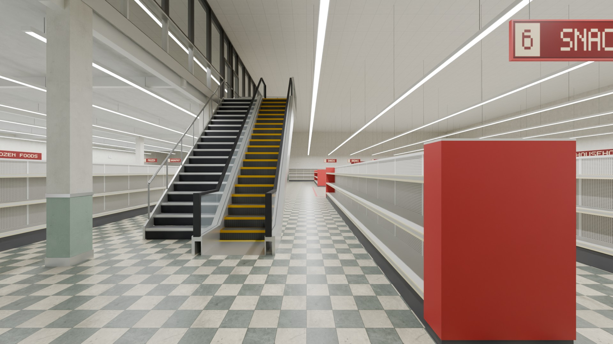
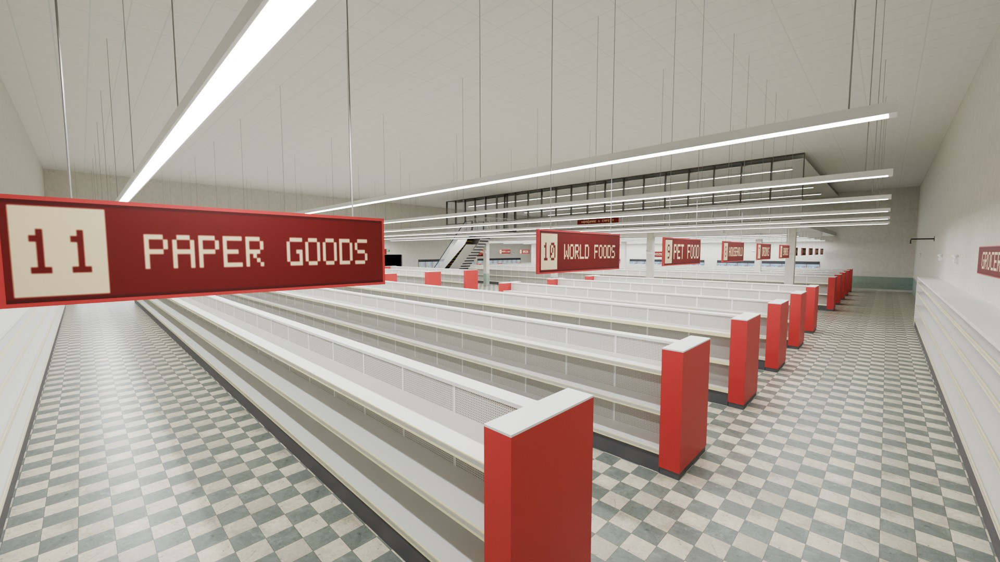
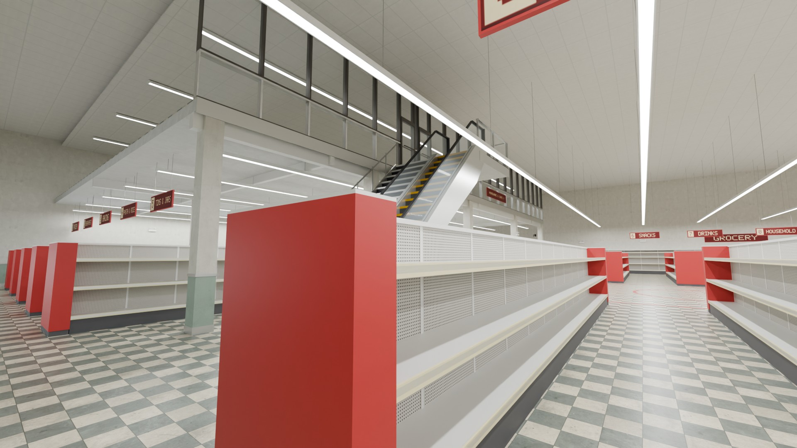

# aisles: the grocery's long aisles

The grocery's second scene (`docs/BLENDER_AREAS.md`, section 2, step 2: dress and light), built round the greybox (`claude/blender-grocery-greybox`, draft PR #108). It is the bigger, repeating version of part 1's `main_floor`, and it uses main_floor's look so the two read as one store. Built in Blender 5.2.1 by `tools/blender/build_grocery_front.py --scene aisles`, baked twice (a day set and a night set on the same lightmap UVs, as the mall entrance and the hotel lobby do) and exported as art only. There are no reference photos: IMG_3027 (the red-cart clearing) is a label only.

| File | What it is |
|---|---|
| `world/aisles.glb` | the art: 2.02 MB, 18598 triangles, 37 draw calls (one primitive per material, and the two glass door leaves as their own nodes), 33 materials, textures as WebP |
| `world/aisles.json` | the layout, written by `tools/blender/export_scene.py` from the `.blend`: 112 colliders, 2 doors, 1 marker, 3 links, 34 spots. It is the greybox's file unchanged (`build_grocery_greybox.py --preview` writes the same) |
| `world/lightmaps/aisles_0.webp`, `aisles_1.webp` | the day set (second UV set, `TEXCOORD_1`): the shell, the fittings |
| `world/lightmaps/aisles_2.webp`, `aisles_3.webp` | the night set on the same UVs |
| `blender/scenes/aisles.blend` | the saved scene (Git LFS): `Art` (the unmerged pieces), `Doors` (the two leaves, origin at the hinge), `Layout` (the `COL_` boxes and the empties), `Export` (merged by material, with the lightmap UVs), `Standins` (the arrival marker), `Lights_Day`, `Lights_Night`, `Lights_Always` |
| `tools/blender/build_grocery_front.py` | the re-runnable build for `aisles` and `second_floor`; it imports the greybox model, so no coordinate of the layout is typed in |
| `docs/renders/aisles/` | the three review stills (this folder) |

The shared tools are used unchanged: `tools/blender/export_scene.py`, `tools/blender/check_layout.py`, `tools/blender/pack_scene.py`, `tools/webp_glb.py`. main_floor is not touched: its three textures are read from `blender/textures/main_floor/` as they are.

## Review stills (Cycles, 128 samples adaptive, OIDN, 1920 x 1080 JPEG, AgX, exposure 0, the day set)

| | |
|---|---|
| `1_arrival.jpg` | the arrival point from main_floor (0, -10.6) at eye height 1.6 m, facing its `face` (north), 75 degrees vertical |
| `2_wide.jpg` | the whole hall from the north-east corner, 3.3 m up: the aisle boards, the mezzanine's glazed front, the coolers on the south wall |
| `3_detail.jpg` | the stairs and the stopped escalator up to the landing, the mezzanine's underside and front |





These are Blender renders with Blender's lights; the page shows the lightmaps instead (see "Brightness"). Night stills, a view under the mezzanine and a plan were rendered for the owner's sheet only. The food and the carts are the page's and are not in the stills.

## What is in it

The hall is the greybox's 48 m by 40 m by 8.5 m room north of main_floor (x -24 to 24, z -49.2 to -9.2). From main_floor's opening, looking north:

- **main_floor's look, carried on:** the cream and grey-green checker tiles (0.3 m), the sage band to 1.2 m under a steel rail with a steel kick plate, cream paint above, the white lay-in ceiling, fluorescent strips (`Lamp_Emit`) on rods over every aisle, white gondolas with pegboard spines, price rails and red end panels, glass-door coolers with the same lit insides, red department boards in the same pixel lettering, the same EXIT sign over the opening.
- **The gondolas:** the greybox's 14 runs (six lines east of the stairs, the three nearest broken by the clearing into two runs each; five under the mezzanine), each in its collider: a dark base, boards both sides with their tops at the page's food heights (0.35, 0.95, 1.55 m), a pegboard spine with an upright every metre, a price rail on every board's edge; each end is the greybox's 0.3 m `Endcap_` box as a red end panel with a white cap. The shelves are left empty: the page puts the food on them (`Spot_food_*`).
- **Wall shelving** on the north and east walls (the greybox's `Wall_Shelving_N`, `_E`): one-sided, pegboard back, the same three boards plus one at 1.95 m, a canopy.
- **Coolers and freezers, flat on the walls** (5 cm, no collider): dairy coolers on the south wall either side of the opening (33 doors in four banks, none behind the cart corral), freezers on the west wall under the mezzanine (27 doors in three banks, frosted blue insides). They glow by day and by night.
- **Aisle number boards** hung over both ends of every aisle, both faces painted: 1 FROZEN (the west wall aisle) to 11 PAPER GOODS (the east wall aisle); wall boards FROZEN FOODS, DAIRY & CHILLED (two), GROCERY, HOUSEHOLD, and HOMEWARE & CAFE with an arrow up on the mezzanine's balustrade.
- **The red-cart clearing** in the middle is kept open: a red painted square border and ring on the floor, where the page parks its eight red carts (`Spot_cart_1` to `_8`). The cart corral by the opening is a steel tube rail round its collider, open to the north where the page's three carts stand.
- **The mezzanine's underside:** the slab's painted soffit, steel beams over the column lines, a steel fascia, the eight columns (sage band, cream, the steel rail ring), strips on short rods under the slab. Its front is a glass balustrade (steel posts, a steel handrail, glass) with the glazed screen above it in aluminium mullions, the two glass doors' frames, and behind the glass a drop ceiling with strips (art only: the second floor is its own scene).
- **The stairs and the escalator** side by side up to the landing at y 5: the stairs with rubber treads and steel nosings, steel stringers, a sloped soffit and a handrail; the escalator stopped, as the hotel's: grooved treads with yellow edges, cleated risers, steel skirts, glass balustrades, black handrails, a clad truss, comb plates top and bottom. The landing has a tiled top, a soffit and glass balustrades on its north and east.
- **The glass door leaves** (`DoorLeaf_glass_stairs`, `_escalator`, at y 5): aluminium stiles and rails, a glass pane, a push bar each side.
- **Brackets** for the page's three camera heads (`Spot_camhead_1` to `_3`, at their `mount_height`): a wall plate, an arm, a drop to the head's top.
- **Emergency fittings** (twin heads, the mall entrance's): 9 on the walls at 3 m, 2 on the west wall under the slab, 2 on the front columns. Their lenses are `Emergency_Emit`.

The page draws the food, the carts, the checkout (main_floor's), the camera heads and the night threats (`Spot_monster_*`); every one of their spots is left clear.

## Light

| Set | Light | Maps | Material property |
|---|---|---|---|
| day | the strips (`Lamp_Emit` on), the coolers' and freezers' glow, the EXIT sign | `aisles_0`, `aisles_1` | `lightmap`, `lightmap_intensity` |
| night | the emergency heads (`Emergency_Emit` on, `Lamp_Emit` off), the coolers' and freezers' glow, the EXIT sign | `aisles_2`, `aisles_3` | `lightmap_night`, `lightmap_night_intensity` |

The page: by day `Lamp_Emit` on and `Emergency_Emit` off; at night `Lamp_Emit` off and `Emergency_Emit` on, with `lightmap_night`. `Cooler_Lit`, `Freezer_Lit` and `Sign_Glow` (EXIT) glow at every hour.

| Map | Set | Size | Materials | Density | Samples, GPU time | WebP |
|---|---|---|---|---|---|---|
| `aisles_0` | day | 2048 | the shell: floor, walls, ceiling, trims, soffit | 26.7 px/m | 512, 40 s | 151 KB |
| `aisles_1` | day | 2048 | the fittings: gondolas, shelving, stairs, escalator, signs, frames, the two leaves | 15.2 px/m | 512, 75 s | 309 KB |
| `aisles_2` | night | 2048 | as `aisles_0` | the same UVs | 768, 70 s | 145 KB |
| `aisles_3` | night | 2048 | as `aisles_1` | the same UVs | 768, 64 s | 300 KB |

Cycles on the GPU, diffuse (direct and indirect, no colour), OIDN; 8 px margins on the shell's map, 4 px on the fittings'. The glass is hidden while baking.

**The shoulder and the exposure.** Each map is written as texel = G L / (C + G L) from the bake's light L, and every baked material's intensity is pi C, so the page shows texture x G L where the light is ordinary and rolls off toward texture x C, never clipping. C is 1.15 for both sets, so a white surface (albedo 0.8) stays under 0.95. G is set per set so that the walls' median texel reads (`TARGET` in the build: day 0.8, night 0.4): day G 1.2178, night G 7.0739.

**Density.** The shell's map holds 3310 m2 at 26.7 px/m (the ceiling 8.5 m up at 9.3, the walls above 3.6 m at 16, the soffit at 18.7). The fittings' map holds the gondolas, shelving, stairs, escalator and signs at 15.2 px/m (the boards 12.9, the spines and rails about 9.5). Faces never seen are dropped first (the shell's outer skin, faces against a wall or the floor, the shelving's undersides, and every face buried inside another piece's box: 1039 of them); thin faces (under 5 cm: a board's edge, an upright's side) get no island of their own and take the light at the edge of the broad face beside them. Rods, cooler handles and tube rails (`Rod_Steel`) are too thin to hold texels and carry no lightmap.

## Brightness, as the page shows it

The page draws a baked material unlit: texture x base colour x texel x intensity / pi, no tone mapping. Measured with `lab_display.py` (area-weighted samples over each material's triangles, the brightest channel; `>=1` is the share that clips):

Day (`lightmap`):

```
material                m2           map       k    p50    p90    p99     >=1
Floor_Tile          2564.9      aisles_0  3.6128  0.154  0.437  0.536   0.00%
Ceiling_Tile        2549.4      aisles_0  3.6128  0.202  0.369  0.394   0.00%
Shelf_Paint         1689.1      aisles_1  3.6128  0.420  0.638  0.665   0.00%
Shelf_Back          1109.3      aisles_1  3.6128  0.252  0.410  0.467   0.00%
Wall_High            866.3      aisles_0  3.6128  0.240  0.297  0.460   0.00%
Shelf_Kick           646.2      aisles_1  3.6128  0.000  0.060  0.071   0.00%
Soffit_Paint         641.9      aisles_0  3.6128  0.312  0.355  0.384   0.00%
Wall_Paint           463.6      aisles_0  3.6128  0.293  0.471  0.531   0.00%
Price_Rail           367.1      aisles_1  3.6128  0.267  0.509  0.576   0.00%
Light_Housing        295.8      aisles_1  3.6128  0.345  0.918  0.926   0.00%
Wall_Lower           223.2      aisles_0  3.6128  0.130  0.216  0.260   0.00%
EndCap_Red           215.1      aisles_1  3.6128  0.183  0.336  0.359   0.00%
Esc_Clad              66.7      aisles_1  3.6128  0.087  0.380  0.505   0.00%
Frame_Alu             65.1      aisles_1  3.6128  0.041  0.055  0.062   0.00%
Trim_Steel            57.9      aisles_0  3.6128  0.199  0.321  0.403   0.00%
Sign_Dept             52.6      aisles_1  3.6128  0.102  0.556  0.642   0.00%
Cooler_Frame          44.2      aisles_1  3.6128  0.033  0.041  0.042   0.00%
Metal_Dark            33.7      aisles_1  3.6128  0.009  0.021  0.028   0.00%
Stair_Tread           22.0      aisles_1  3.6128  0.003  0.079  0.096   0.00%
Rail_Steel            20.0      aisles_1  3.6128  0.218  0.264  0.311   0.00%
Esc_Tread             16.5      aisles_1  3.6128  0.000  0.125  0.270   0.00%
Handrail_Black         5.5      aisles_1  3.6128  0.009  0.019  0.021   0.00%
Esc_Riser              4.9      aisles_1  3.6128  0.000  0.000  0.080   0.00%
Plastic_White          3.4      aisles_1  3.6128  0.380  0.566  0.655   0.00%
Comb_Yellow            0.2      aisles_1  3.6128  0.000  0.354  0.358   0.00%
Plastic_Black          0.2      aisles_1  3.6128  0.013  0.016  0.019   0.00%
```

Night (`lightmap_night`):

```
material                m2           map       k    p50    p90    p99     >=1
Floor_Tile          2564.9      aisles_2  3.6128  0.043  0.215  0.567   0.00%
Ceiling_Tile        2549.4      aisles_2  3.6128  0.092  0.309  0.403   0.00%
Shelf_Paint         1689.1      aisles_3  3.6128  0.115  0.370  0.686   0.00%
Shelf_Back          1109.3      aisles_3  3.6128  0.079  0.263  0.564   0.00%
Wall_High            866.3      aisles_2  3.6128  0.141  0.301  0.399   0.00%
Shelf_Kick           646.2      aisles_3  3.6128  0.000  0.027  0.103   0.00%
Soffit_Paint         641.9      aisles_2  3.6128  0.205  0.447  0.499   0.00%
Wall_Paint           463.6      aisles_2  3.6128  0.179  0.499  0.613   0.00%
Price_Rail           367.1      aisles_3  3.6128  0.054  0.271  0.783   0.00%
Light_Housing        295.8      aisles_3  3.6128  0.082  0.331  0.503   0.00%
Wall_Lower           223.2      aisles_2  3.6128  0.060  0.342  0.389   0.00%
EndCap_Red           215.1      aisles_3  3.6128  0.076  0.367  0.478   0.00%
Esc_Clad              66.7      aisles_3  3.6128  0.063  0.193  0.294   0.00%
Frame_Alu             65.1      aisles_3  3.6128  0.011  0.026  0.064   0.00%
Trim_Steel            57.9      aisles_2  3.6128  0.070  0.247  0.505   0.00%
Sign_Dept             52.6      aisles_3  3.6128  0.062  0.246  0.650   0.00%
Cooler_Frame          44.2      aisles_3  3.6128  0.032  0.041  0.049   0.00%
Metal_Dark            33.7      aisles_3  3.6128  0.005  0.021  0.047   0.00%
Stair_Tread           22.0      aisles_3  3.6128  0.002  0.032  0.053   0.00%
Rail_Steel            20.0      aisles_3  3.6128  0.068  0.128  0.354   0.00%
Esc_Tread             16.5      aisles_3  3.6128  0.000  0.052  0.221   0.00%
Handrail_Black         5.5      aisles_3  3.6128  0.007  0.012  0.016   0.00%
Esc_Riser              4.9      aisles_3  3.6128  0.000  0.000  0.063   0.00%
Plastic_White          3.4      aisles_3  3.6128  0.342  0.635  0.897   0.00%
Comb_Yellow            0.2      aisles_3  3.6128  0.000  0.154  0.183   0.00%
Plastic_Black          0.2      aisles_3  3.6128  0.019  0.031  0.032   0.00%
```

By day every material is under p90 0.92 and p99 0.93 (the brightest is `Light_Housing`, the strips' housings beside the diffusers); the cream walls read at p50 0.293. At night the walls read at p50 0.179 round the emergency heads and the coolers' glow, the floor's p50 is 0.043 (dark between the pools of light, as meant). Nothing clips in either set. `Shelf_Kick` (the dark bases) and the dark metals are dark by their own colour.

## The layout

Colliders, doors, links, the marker and every spot are where the greybox put them; nothing was added or moved, so `world/aisles.json` is the greybox's file, written again from the `.blend` and identical. The art that has no collider is passable and named `decor_`: the stairs' stringers, soffit and handrail, the escalator's balustrades and truss, the clearing's paint, the drop ceiling behind the mezzanine's glass. The coolers and freezers stand at most 5 cm off their walls. Each stair and escalator step is built from pieces under 0.2 m tall, since the steps' colliders hang in the air.

`blender -b blender/scenes/aisles.blend --python tools/blender/build_grocery_front.py -- --scene aisles --stage check` (`tools/blender/check_layout.py` on `Art`): **PASS: 114 of 114 checks passed** (112 COVER, STRAY: every tall solid piece over a collider, CLEAR: the spawn clear within 0.28 m).

`python tools/blender/build_grocery_greybox.py --check .`:

```
GATE links: 4 pairs, 8 sides, 3 that leave this set; 11 links in the files
  off this set: aisles.main_floor -> main_floor
  off this set: back_of_house.main_floor -> main_floor
  off this set: back_of_house.secret_ops -> secret_ops/service_entry
GATE steps: 54 step boxes, the highest rise 0.267 m (at most 0.27 m)
GATE corridors: 30 corridor, aisle and doorway rects, the narrowest 1.68 m (at least 1.6 m), none blocked
GATE cameras: aisles 0, second_floor 0, back_of_house 5, basement 2
GATES PASS
```

`node tools/worlddoc.mjs check world/aisles.json` (the warnings are the new scene and its links, new to the manifest):

```
warning: scene aisles is not in the world manifest yet: a new scene to add
  warning: link escalator_up: the manifest has no link from this door yet: a new link to add
  warning: link main_floor: the manifest has no link from this door yet: a new link to add
  warning: link stairs_up: the manifest has no link from this door yet: a new link to add
OK world/aisles.json: 112 colliders, 2 doors, 1 markers, 3 links, 0 zones, 34 spots, 0 errors, 4 warnings
```

`glb_inspect.py --budget tris=300000,mb=8`: `pass tris: 18598 triangles`, `pass mb: 1.92 MB`.

The axes were checked with a marker cube at the arrival point (`--stage axes`): game (0, 0.1, -10.6) is glTF (0, 0.1, -10.6).

## Sources and licences

| Asset | Used for | Source | Licence |
|---|---|---|---|
| main_floor's `floor_tiles_diff.jpg`, `ceiling_tile_diff.jpg`, `wall_paint_diff.jpg` (made from Poly Haven's `floor_tiles_06`, `polystyrene` and `painted_plaster_wall`; see `docs/renders/main_floor/README.md`) | the floor, the ceiling, every painted wall, the soffit | `blender/textures/main_floor/`, read as they are | CC0 1.0 |

Nothing was downloaded for this scene. Everything else is own work, made by `build_grocery_front.py`: all geometry, and seven generated images drawn with numpy from fixed seeds: main_floor's pegboard, cooler interior and EXIT sign (the same code), a frosted freezer interior, the escalator's tread and riser, and the sign atlas (the aisle boards and the wall boards, in main_floor's 5 x 7 pixel font, extended to the whole alphabet). No Meshy, no Higgsfield, no paid service, no photograph.

Tools: Blender 5.2.1 LTS (GPL) with Cycles, OpenImageDenoise and the glTF I/O add-on; Python with numpy and Pillow. The bakes and the stills ran on a rented GPU.

## Rebuild

From the repo root, with Blender 5.2 and Python with Pillow:

```
blender -b --python tools/blender/build_grocery_front.py -- --scene aisles --stage art,bake,export,axes,render
blender -b blender/scenes/aisles.blend --python tools/blender/build_grocery_front.py -- --scene aisles --stage render --set night --work-stills
python tools/blender/pack_scene.py aisles --work work/aisles       # WebP lightmaps and textures -> world/
```

`--stage` takes one stage or a comma list: `art` (also writes `world/aisles.json` and runs the layout check), `layout`, `check`, `bake`, `export`, `axes`, `render`. The work folder is `work/aisles` (not committed). The build keeps only the four light properties on materials and the layout's own on the layout objects (and each art piece's `cull` mode and `occ` boxes, which the bake reads), makes every image path relative, clears the last-used operators' file paths, turns the render stamps off and strips the JPEG comment and APP1 segments.

## For the coordinator

- Add `world/aisles.glb` and its links: `main_floor` (main_floor's north wall gap, x -1.8 to 1.8, needs cutting there: F at (0, 0, -8.3), arrive at (0, 0, -7.8) facing (0, 1), as the greybox README says), `stairs_up` and `escalator_up` to `second_floor`'s `stairs_down` and `escalator_down`. `applyLightmaps` handles the four maps as for the mall entrance.
- Light set: `setLightSet("night")` by the store's clock. Night: `Lamp_Emit` off, `Emergency_Emit` on. Day: the reverse.
- The two leaves are nodes `DoorLeaf_glass_stairs` and `DoorLeaf_glass_escalator` at y 5, origin at the hinge, two primitives each (`Frame_Alu`, baked; `Window_Glass`).
- The page draws the food on the gondolas (`Spot_food_*`), the carts (`Spot_cart_*`), the camera heads under their brackets (`Spot_camhead_*`) and the night threats (`Spot_monster_*`).

## Open

- **Density** of the fittings' map is 15.2 px/m (the boards about 13): the 14 gondolas hold some 2600 m2 that is seen, and the night set needs the other two maps. The light along a shelf is smooth, so it reads; a fifth map would be needed for more.
- **No food in the stills:** the shelves look bare until the page fills them.
