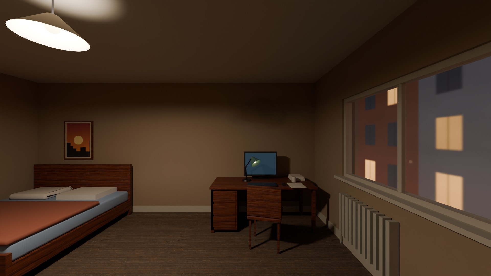
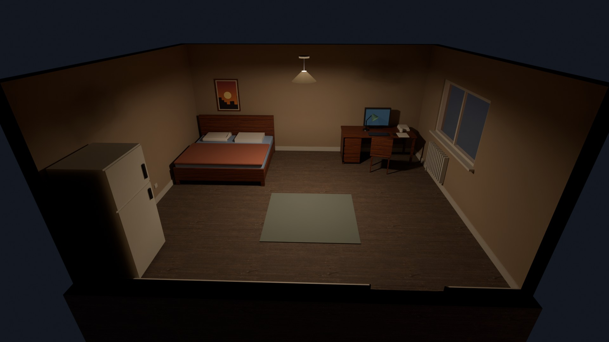
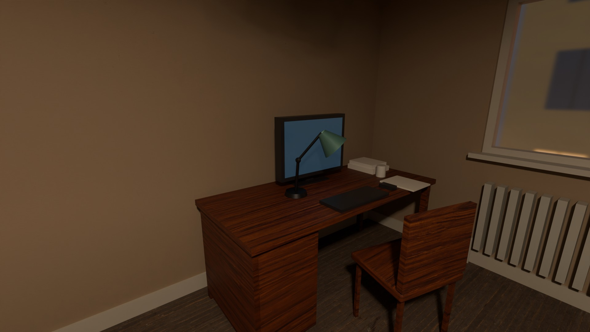

# apartment: the Blender pilot

The first scene of the Blender plan (`docs/BLENDER.md`, "1. apartment"). A small, worn city studio: one ceiling lamp, a desk lamp, the city's glow through the east window. Built in Blender 5.2.1 from `blender/layout/apartment.json`, baked in full (the room is lit the same by day and by night) and exported as art only.

| File | What it is |
|---|---|
| `world/apartment.glb` | the art: 0.95 MB, 3016 triangles, 24 draw calls, textures as WebP |
| `world/lightmaps/apartment_0.webp`, `apartment_1.webp` | the baked light, 640 x 640 each (second UV set, `TEXCOORD_1`) |
| `blender/scenes/apartment.blend` | the saved scene (0.84 MB, Git LFS): `Art` (the unmerged pieces), `Export` (merged by material, with the lightmap UVs), `Standins`, `Lights` |
| `tools/blender/build_apartment.py` | the re-runnable build (reads the layout; no hand-copied coordinates) |
| `tools/blender/check_layout.py`, `check_layout_test.py` | the layout check, written for every scene, and its test |
| `tools/blender/pack_scene.py` | lightmap PNG to WebP, GLB textures to WebP (through `tools/webp_glb.py`) |
| `blender/textures/apartment/` | the six CC0 texture files the build reads |
| `docs/renders/apartment/` | the three review stills (this file's folder) |

## Review stills (Cycles, 1024 samples, OIDN denoise, 1920 x 1080 JPEG)

| | |
|---|---|
| `1_arrival.jpg` (150 KB) | the arrival point (1.5, 1.4) at eye height 1.6 m, facing the scene's `face` (north, -z), 75 degrees vertical like the page's camera |
| `2_wide.jpg` (127 KB) | the whole room from outside, the south wall, the ceiling and the street backdrop hidden from the camera only (they still light and shade the room) |
| `3_detail.jpg` (147 KB) | the desk: the lamp, the monitor shell (the screen is a stand-in here), the window |





These are Blender renders with Blender's real lights. The GLB with its lightmaps was also loaded in three.js r186 in a browser page (flipY false, channel 1, sRGB, `lightmap_intensity`) from the arrival point: the same shading, the lamp pools and shadows in the same places. That page is not in the repo; the coordinator's in-game screenshot from the same spot is the comparison the plan asks for.

## Sources and licences

| Material | Used for | Source | Author (Poly Haven) | Licence |
|---|---|---|---|---|
| `old_wood_floor`: diffuse, roughness, normal (GL), 1k | floor | https://polyhaven.com/a/old_wood_floor | Guillaume Monsergent | CC0 1.0 |
| `beige_wall_001`: diffuse, 1k | walls | https://polyhaven.com/a/beige_wall_001 | Dimitrios Savva (photography), Rico Cilliers (processing) | CC0 1.0 |
| `dark_wood`: diffuse, 1k | desk, bed frame, door, chair | https://polyhaven.com/a/dark_wood | Dario Barresi, Dimitrios Savva, Rico Cilliers | CC0 1.0 |
| `rough_linen`: diffuse, resized to 512 | bed linen | https://polyhaven.com/a/rough_linen | colormass, Rico Cilliers | CC0 1.0 |

The textures came from a local cache of earlier Poly Haven downloads (1k JPEG maps), not downloaded again: **0 of the 8 allowed downloads were used**. They were re-saved as JPEG quality 88 into `blender/textures/apartment/` (the linen was also resized to 512). The authors above come from Poly Haven's public info API (one metadata request per texture, with a generic client name, no other data sent).

Everything else is own work, made by `build_apartment.py`: all geometry, and three generated images (a street of lit and dark windows at dusk for the window's backdrop, a poster, a damp stain), drawn with numpy from fixed seeds. No Meshy, no paid service, no photograph.

Tools: Blender 5.2.1 LTS (GPL) with Cycles, OpenImageDenoise (Apache-2.0, through the compositor's Denoise node) and the glTF I/O add-on; Python with numpy (in Blender) and Pillow (the WebP step); three r186 for the load check; the bake and the final stills ran on a rented RTX 4090.

## Budgets (measured)

| | Limit | Measured |
|---|---|---|
| `world/apartment.glb`, lightmaps aside | at most 8 MB | **0.95 MB** (949376 bytes; 2.35 MB from Blender, then `tools/webp_glb.py`: textures 2.1 to 0.72 MB, geometry bytes asserted identical) |
| triangles | at most 300 000 | **3016** (`glb_inspect.py`: 3016 drawn) |
| draw calls, merged by material | at most 250 | **24** (one primitive per material, 24 materials) |
| textures | WebP | **9 images, all `image/webp`** (largest 2048 x 1024: the street backdrop) |
| lightmaps | at most 4, at most 2048 x 2048, 8-bit WebP q90 | **2**: `apartment_0` 640 x 640 (35 KB, 33.3 px/m: walls, floor, ceiling, trim, poster, stain), `apartment_1` 640 x 640 (49 KB, 37.7 px/m: furniture, props) |

Bake: Cycles on the RTX 4090, 1024 samples, diffuse (direct and indirect, no colour), 8 px margin, OIDN denoise. The three.js check below is `glb_check`; `glb_inspect.py` says `pass tris`, `pass mb`.

```
three r186; world/apartment.glb (0.95 MB)
PASS 24 meshes (draw calls), 24 materials
PASS 3016 triangles
INFO Backdrop_Street: no lightmap (emissive)
PASS Bed_Linen: lightmap world/lightmaps/apartment_1.webp x2.7328, uv1 206 verts
PASS Bed_Throw: lightmap world/lightmaps/apartment_1.webp x2.7328, uv1 193 verts
PASS Ceiling_Paint: lightmap world/lightmaps/apartment_0.webp x2.5851, uv1 4 verts
PASS Ceramic_White: lightmap world/lightmaps/apartment_1.webp x2.7328, uv1 96 verts
PASS Decal_Grime: lightmap world/lightmaps/apartment_0.webp x2.5851, uv1 8 verts
PASS Desk_Wood: lightmap world/lightmaps/apartment_1.webp x2.7328, uv1 432 verts
PASS Door_Wood: lightmap world/lightmaps/apartment_1.webp x2.7328, uv1 804 verts
PASS Floor_Wood: lightmap world/lightmaps/apartment_0.webp x2.5851, uv1 4 verts
PASS Fridge_Enamel: lightmap world/lightmaps/apartment_1.webp x2.7328, uv1 96 verts
INFO Lamp_Emit: no lightmap (emissive)
PASS Lamp_Shade: lightmap world/lightmaps/apartment_1.webp x2.7328, uv1 60 verts
PASS Metal_Brass: lightmap world/lightmaps/apartment_1.webp x2.7328, uv1 144 verts
PASS Metal_Dark: lightmap world/lightmaps/apartment_1.webp x2.7328, uv1 340 verts
PASS Paper: lightmap world/lightmaps/apartment_1.webp x2.7328, uv1 24 verts
PASS Pillow_Cotton: lightmap world/lightmaps/apartment_1.webp x2.7328, uv1 626 verts
PASS Plastic_Black: lightmap world/lightmaps/apartment_1.webp x2.7328, uv1 252 verts
PASS Poster_Print: lightmap world/lightmaps/apartment_0.webp x2.5851, uv1 4 verts
PASS Radiator_Paint: lightmap world/lightmaps/apartment_0.webp x2.5851, uv1 312 verts
PASS Rug_Wool: lightmap world/lightmaps/apartment_1.webp x2.7328, uv1 24 verts
PASS Shade_Paper: lightmap world/lightmaps/apartment_1.webp x2.7328, uv1 60 verts
PASS Trim_Paint: lightmap world/lightmaps/apartment_0.webp x2.5851, uv1 488 verts
PASS Wall_Plaster: lightmap world/lightmaps/apartment_0.webp x2.5851, uv1 44 verts
INFO Window_Glass: no lightmap (transparent)
PASS world/lightmaps/apartment_1.webp exists (49 KB), used by 14 meshes
PASS world/lightmaps/apartment_0.webp exists (35 KB), used by 7 meshes
PASS 2 lightmap image(s), at most four
PASS material Lamp_Emit present
PASS material Window_Glass present
PASS no computer-screen material in the GLB
INFO collision bounds (-3.20, -1.00, -2.70) .. (3.20, 3.00, 2.70)
INFO art bounds (without the street backdrop and the glass) (-3.20, 0.00, -2.70) .. (3.20, 2.80, 2.70)
INFO whole GLB bounds (-3.20, -4.00, -20.00) .. (12.00, 12.00, 20.00)
PASS art lies inside the collision bounds (+5 cm)
PASS room height: art y 0.00..2.80 (floor top 0, ceiling underside 2.8)
PASS art x/z span equals the colliders' x/z span (within 5 cm)
INFO window glass (3.08, 1.06, -1.34) .. (3.08, 2.14, 0.54) (the layout's window: x 2.98, z -1.4..0.6, y 1..2.2)
PASS glass sits in the window opening
PASS backdrop plane at x 12.0, (12.00, -4.00, -20.00)..(12.00, 12.00, 20.00)
PASS: all checks
```

## The layout check

`blender -b blender/scenes/apartment.blend --python tools/blender/check_layout.py -- --scene apartment` (exit code 0 on PASS, 1 on any FAIL; its test, `python tools/blender/check_layout_test.py`, runs 13 cases without Blender):

```
layout check: scene apartment, 45 visible meshes, 9 colliders
PASS  COVER  Floor_Apartment: 11 mesh(es) cover it (39325 sample points, every one within 5 cm of art)
PASS  COVER  Ceiling_Apartment: 7 mesh(es) cover it (10725 sample points, every one within 5 cm of art)
PASS  COVER  Wall_N: 9 mesh(es) cover it (5655 sample points, every one within 5 cm of art)
PASS  COVER  Wall_S: 11 mesh(es) cover it (5655 sample points, every one within 5 cm of art)
PASS  COVER  Wall_W: 9 mesh(es) cover it (4437 sample points, every one within 5 cm of art)
PASS  COVER  Wall_E: 9 mesh(es) cover it (4437 sample points, every one within 5 cm of art)
PASS  COVER  Bed: 6 mesh(es) cover it (3087 sample points, every one within 5 cm of art)
PASS  COVER  Desk: 11 mesh(es) cover it (1539 sample points, every one within 5 cm of art)
PASS  COVER  Fridge: 7 mesh(es) cover it (1520 sample points, every one within 5 cm of art)
PASS  STRAY  21 tall solid mesh(es), each over a collider; 5 decor_* mesh(es) exempt
PASS  CLEAR  marker Spawn_door (1.50, 1.40): clear within 0.28 m
PASS  CLEAR  marker Computer (1.80, -1.00): clear within 0.28 m
PASS  CLEAR  constants.arrive (1.50, 1.40): clear within 0.28 m
PASS  CLEAR  door.at (1.50, 2.10): clear within 0.28 m
PASS  CLEAR  computer.at (1.80, -1.00): clear within 0.28 m
PASS  CLEAR  fridge.at (-1.75, 2.00): clear within 0.28 m
PASS: 16 of 16 checks passed
```

It compares each visible mesh's world box (game coordinates) with `world/apartment.json`: every collider is covered by art within 5 cm (sampled every 10 cm through its volume); no solid art over 0.2 m tall stands where no collider does (the passable pieces are named `decor_*`: the chair, the rug, the radiator, its pipe and the street backdrop); the arrival point, the door spot, the computer spot and the fridge spot are clear of art and colliders by the walker's radius (0.28 m). It scans the unmerged `Art` collection: the GLB merges by material, so names and boxes of single pieces are only there. The axes were checked once with a marker cube at the arrival point (`--stage axes`): game (1.5, 0.1, 1.4) is Blender (1.5, -1.4, 0.1) is glTF (1.5, 0.1, 1.4).

## Rebuild

From the repo root, with node, Blender 5.2 and Python with Pillow:

```
node tools/blender/dump_layout.mjs apartment                    # writes blender/layout/apartment.json (git ignores that folder)
blender -b --python tools/blender/build_apartment.py -- --stage all --samples 1024      # art, bake, export, axes check, stills
python tools/blender/pack_scene.py apartment                    # WebP lightmaps and WebP textures -> world/
```

`--stage art|bake|export|axes|render` run one step on the saved `.blend` (`blender -b blender/scenes/apartment.blend --python ... -- --stage bake`). `--device cpu` forces the CPU (est. over half an hour for the 1024-sample bake on a 14-thread laptop: a 32-sample bake took about 70 s there). The whole `--stage all` run on the RTX 4090 took about 6 minutes, most of it the four 1080p stills at 1024 samples. The work folder defaults to the system temp folder's `farway_apartment`; `--work <dir>` changes it. The review stills are written straight into `docs/renders/apartment/`.

## What the coordinator does to wire it in

1. Add `world/apartment.glb` to the `apartment` scene's files in `shared/farway.manifest.js`. The collision file `world/apartment.json` is untouched and still the code's.
2. Hide the code blockout: `apartmentProps(root)` in `index.html` (floor, ceiling, walls, window, door, bed, desk, computer, chair, fridge). Keep what the page owns: the computer's screen, the prompts and `CITY.mats`.
3. Apply the lightmaps. For each mesh material with `userData.lightmap` (glTF extras: `lightmap` is the path, `lightmap_intensity` the factor; 2 images, 21 materials):
   ```js
   const tex = new THREE.TextureLoader().load(mat.userData.lightmap);
   tex.flipY = false;                        // glTF's UV convention, the images are written for it
   tex.colorSpace = THREE.SRGBColorSpace;    // the PNGs hold sRGB-encoded light
   tex.channel = 1;                          // TEXCOORD_1
   mat.lightMap = tex; mat.lightMapIntensity = mat.userData.lightmap_intensity;
   ```
   `lightmap_intensity` is 2.5852 for `apartment_0` and 2.7329 for `apartment_1` (it is pi times each image's white point, so a texel times it is the irradiance three.js wants). **Remove the blockout's `PointLight`** and add no other light to this scene: the lamps and the window's glow are already in the lightmaps, and a second light would light the room twice. The light is the same by day and by night, so the page does not toggle it (it can still switch a map off with `mat.lightMap = null`).
4. The materials the page may touch, named as the plan asks where it names them: `Lamp_Emit` (the two bulbs, emissive, always on), `Window_Glass` (a transparent pane in the window's frame; tint it with the sky of the hour as the blockout's window did, or leave it), `Backdrop_Street` (the street plane behind the window, emissive, a fixed dusk; tint or hide it by the clock if the day should show). None of them carries a lightmap. The plan's `Window_Lit` and `Emergency_Emit` do not occur in this scene.
5. Run every suite one at a time, merge.

## Stand-ins, and what is not exported

- **The computer's screen** (code keeps it): a hidden stand-in `standin_screen` in the `Standins` collection marks the place: a 0.60 x 0.42 m plane facing south (+z), x 1.5 to 2.1, y 0.88 to 1.30, at z -2.1595 (just in front of the monitor shell's bezel, whose opening is 0.60 x 0.42). Put the code's screen there. It glows faintly blue in the Blender stills only; it did not light the bake.
- **The arrival marker** `standin_arrival_marker`: a 20 cm cube at the arrival point (the axes check), never rendered or exported.
- **Lights** (`Ceiling_Light` 220 W point with the bulb at y 2.45, `Desk_Light` 45 W spot on the desk lamp's bulb): used for the bake and the stills, not exported (`export_lights` is off). In the GLB the bulbs are `Lamp_Emit` meshes.
- **Not in the GLB:** the screen and the prompts (code), anything that moves, the door's leaf as a mechanism (the door is a closed leaf and frame; the page's door prompt at the spot is unchanged), the street beyond the backdrop.

## Things to know

- **Axes and scale:** metres, y up, the room's origin at the middle of the floor; the exporter's y-up output equals the game's axes, with identity node transforms. Art x/z span equals the colliders (-3.2 to 3.2, -2.7 to 2.7); the interior is x -3 to 3, z -2.5 to 2.5, y 0 to 2.8.
- **Skin:** the walls, floor and ceiling carry only the faces that look into the room (the outer skin is dropped), so their boxes in the GLB are the room's inner faces plus the slabs' hidden edges. Each is one quad per face, merged by material: `Floor_Wood` is 2 triangles.
- **The street backdrop** `Backdrop_Street` is a 40 x 16 m plane at x = 12 (y -4 to 12, z -20 to 20), facing the room: from anywhere the player can stand, the window shows only a slice of it. It makes the whole GLB's bounding box 15.2 x 16 x 40 m: use the collision file for anything that needs the room's bounds, or exclude this mesh from a bounds computation.
- **Passable props without colliders** (by design, from the contract): the chair at the desk, the rug, the radiator under the window. Their pieces are inside the merged meshes (`Door_Wood`, `Rug_Wool`, `Radiator_Paint`); the layout check sees them by name in the `.blend`.
- **The window:** the glass is inside the wall's 20 cm thickness (x 3.08); the opening is z -1.4 to 0.6, y 1.0 to 2.2 as in `APARTMENT.window` (the blockout put the pane at x 2.98, the colliders' wall still closes it).
- **Lightmap resolution** is 33.3 and 37.7 px/m (the plan says about 32): the smallest square page that reaches 30 px/m.
- **The `.blend`** opens with the textures found by relative path (`//../textures/apartment/`), so keep the folder layout. The three generated images are packed in it.
- **`blender/layout/` is in `.gitignore`**, so `apartment.json` is not part of the commit unless it is added with `git add -f`; the build needs it (run `dump_layout.mjs` first).

## Open

- Whether the window should show the hour's sky as the blockout did (this build shows a fixed dusk street, and the baked light matches it: warm lamps against a cool window).
- Whether the code's chair, rug and radiator want colliders (the contract says passable; the player can walk through the chair).
