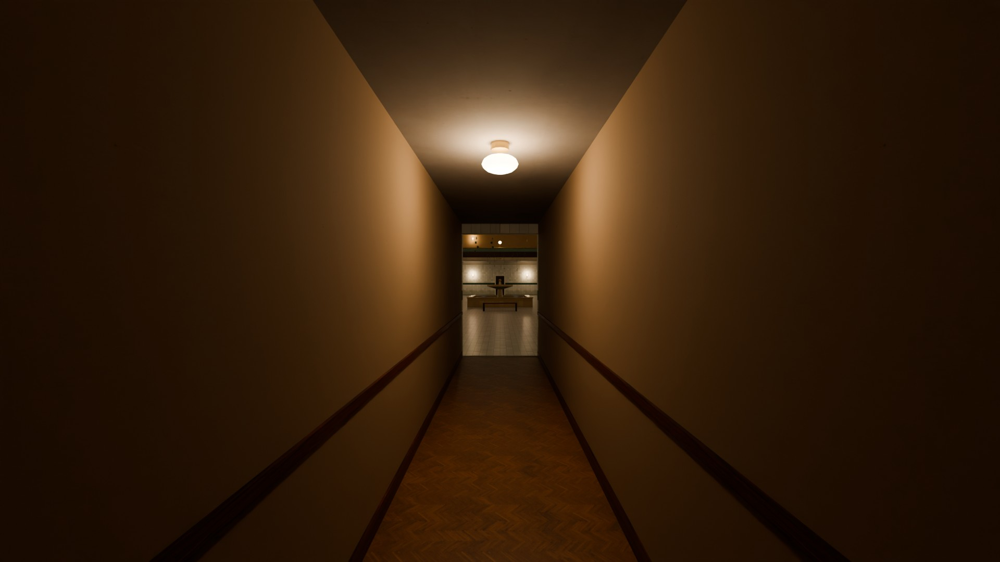
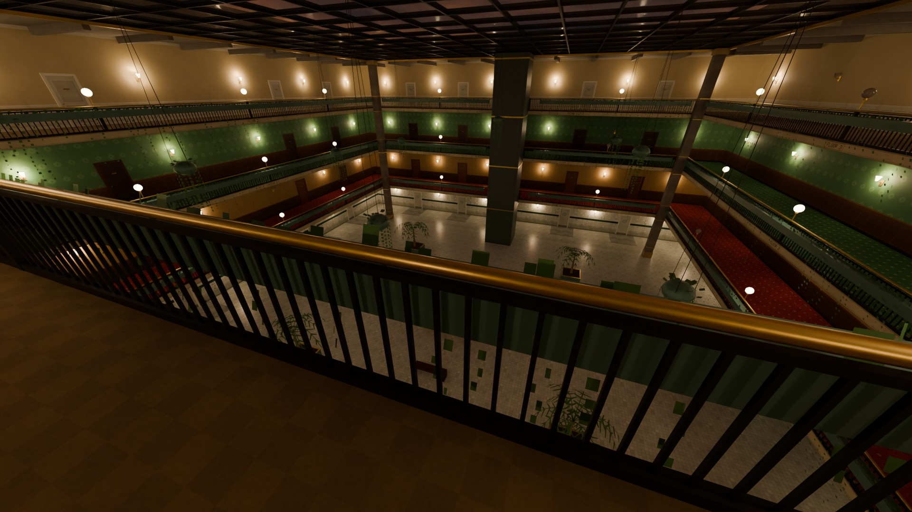
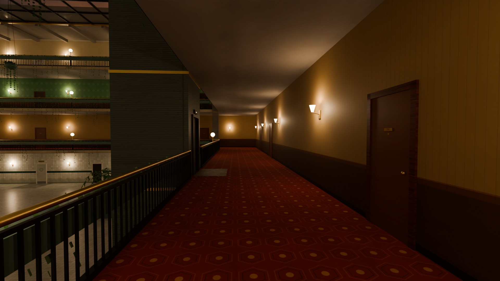

# atrium: the hotel's hub

The hotel atrium dressed and lit (`docs/BLENDER_AREAS.md`, section 1, step 2), built round the greybox (`claude/blender-hotel-greybox`, draft PR #93) and the connector kit (`claude/blender-hotel-kit`, draft PR #96). A vast, liminal hotel atrium at night: off and empty, but seemingly normal. Built in Blender 5.2.1 by `tools/blender/build_atrium.py`, baked once (night) and exported as art only. There are no reference photos; everything follows the written descriptions in `docs/WORLD.md` ("Hotel tower") and `docs/BLENDER_AREAS.md`.

| File | What it is |
|---|---|
| `world/atrium.glb` | the art: 6.62 MB (6.32 MiB as glb_inspect counts), 77 452 triangles, 34 materials, 56 draw calls (34 meshes merged by material, and the 22 door leaves as their own nodes, one mesh per kind of leaf), 22 WebP textures |
| `world/atrium.json` | the layout, written by `tools/blender/export_scene.py` from the `.blend`: 124 colliders, 26 doors, 1 marker, 26 links, 5 spots. It is exactly what the greybox model writes (`build_hotel_greybox.py --preview`); see "The layout" for what changed in the greybox and why |
| `world/lightmaps/atrium_0.webp` .. `atrium_3.webp` | the night set (second UV set, `TEXCOORD_1`), 2048 px each |
| `blender/scenes/atrium.blend` | the saved scene (Git LFS): `Art` (the unmerged pieces), `Doors` (the 22 hinged leaves, origin at the hinge), `Layout` (`COL_` boxes, the empties, the kit's records), `Kit` (the kit elevator's stand-ins), `Export` (merged by material, with the lightmap UVs), `Lights` |
| `tools/blender/build_atrium.py` | the re-runnable build; it imports the greybox model, so no coordinate of the layout is typed in |
| `blender/textures/atrium/` | the CC0 photo maps the build reads (below); every other picture is drawn by the build (numpy) |
| `docs/renders/atrium/` | the three review stills (this folder) |

Shared tools reused unchanged: `export_scene.py`, `check_layout.py`, `pack_scene.py`, `tools/webp_glb.py`. `tools/blender/kit_place.py` got the one-line fix from `claude/blender-hotel-floor3-roof` (32ac313): appended objects start from `matrix_basis` (the kit's door records and spots used to land on `at`).

## Review stills (Cycles, 128 samples adaptive, OIDN, 1920 x 1080 JPEG, AgX, exposure +0.5, Blender's own lights)

| | |
|---|---|
| `1_arrival.jpg` | the arrival point in the narrow hall from the lobby (26.6, 0, 0), eye height 1.6 m, facing its `face` (west, into the atrium) |
| `2_wide.jpg` | from floor 3's gallery at the south rail, down across the void: all four galleries, the fountain, the palms, the shaft |
| `3_detail.jpg` | floor 1's gallery (the motel): the balustrade with its ivy trough and globe lamps, the red carpet, a numbered room door, the sconces |

The page shows the lightmaps, not these lights (see "Brightness"). A floor view and a view up to the skylight were rendered for the owner's sheet only.

## What is in it

The greybox's 36 m by 36 m, 16 m high hall, galleries 4 m deep on all four sides at y 4, 8 and 12 round a 28 m void, the shaft in the void at the north gallery's edge, the narrow hall east to the lobby.

- **Sub floor (y 0):** white 15 cm floor tile, clean in the void and the east, damp under the north, west and south galleries (toward the pools: grimy grout, grey blooms), wet and darker in front of every pool door. White glazed wall tile to 3.4 m with a green band at 1.2 m and rising damp, stained plaster above. Eleven white pool doors with frosted portholes and brass POOL plaques; the maze's one-way door, a plain dark wood door with no sign; the maze exit, a grey door with no handle on this side (it opens from the maze only).
- **Floor 1 (y 4): the motel.** Two-tone vinyl walls (brown below a wood chair rail, ochre above), a red hex-lattice carpet, teak-look room doors numbered 101 to 108.
- **Floor 2 (y 8): green carpet.** Green damask paper over dark panelling, a green carpet with gold fleurons, six-panel mahogany doors numbered 201 to 208.
- **Floor 3 (y 12): the apartments.** Cream paint over white panelling, tan carpet, white apartment doors 3A to 3H.
- The room doors on the upper galleries (eight a gallery, on the north and west walls, above the pool doors) are flush and do not open: places for later features, as the lobby's facade doors. The real doors are the greybox's.
- **Every gallery:** tulip sconces on brass plates every 6 m (four of 94 are dead), a black iron balustrade with a brass handrail, iron posts with globe lamps, a planter trough hung on the void side of every rail run with ivy trailing over the fascia, and FLOOR 1/2/3 on the fascia on all four sides.
- **The stairs and escalators** (separate scenes) leave by grey steel doors on the south wall at every level: STAIRS and ESCALATORS signs, an EXIT sign over every stairs door and over the way to the lobby.
- **The void:** four plaster columns with marble plinths and capitals and brass rings at each gallery; a quiet fountain (still water in a marble basin, a fluted pedestal and a still bowl, a faint light under the water); four kentia palms in square planters; four backless benches facing the fountain; eight hanging baskets on chains from the skylight's grid.
- **The skylight:** the ceiling round floor 3's gallery is beamed plaster; over the void a 2 m iron grid with a brass rim and faint glass, a light well, and a night sky of low cloud lit amber by the city.
- **The elevator:** the shaft is dark green painted steel with brass bands at each gallery and guide rails inside. The car and the four landings are the connector kit's: the page draws `world/kit/elevator.glb` at each stop and moves the car.
- **The narrow hall:** beige walls with a dado and skirting, herringbone parquet, one ceiling bowl lamp.

## The elevator (the connector kit)

`tools/blender/kit_place.py` places the kit elevator at the four stops, `at` (0, y, -14) and `yaw` 180 for y = 0, 4, 8 and 12, as `blender/kit/README.md` says. Kept in the layout: the four landings' colliders (`COL_Landing_*_L<y>`), the four door records (`DoorLeaf_lift_L<y>`: the kit's, plus the greybox's `stop`), the call buttons (`Spot_call_1_L<y>`), and at the ground stop only the car's colliders (`COL_Car_*_L0`) and its panel (`Spot_panel_1_L0`): there is one car, parked at the ground stop, and the page moves it and its colliders. Left out: the kit's own `Link_`/`Arrive_` (the greybox's links stay, arriving 1.3 m out from the wall) and `Marker_Landing`. The kit's art is in the `.blend` as stand-ins only (the `Kit` collection: in the bake, the layout check and the stills, not in the GLB), so the shaft is baked with the car at the ground stop.

## The layout

`world/atrium.json` is the greybox model's, unchanged in every link, door, the shaft and the stops. Two changes in `tools/blender/build_hotel_greybox.py`'s `atrium()`, both on purpose:
1. **The elevator is the kit's:** `atrium_kit_elevator()` places the kit's layout as `kit_place.py` does (the placeholder `Lift_Car` box goes; 12 car and 16 landing colliders, the door records' kit properties and 5 spots come in). The door records land exactly on the greybox's (hinge (-0.6, y, -14), `closed_yaw_deg` 0).
2. **The solid furniture on the floor of the void,** each with its collider: four palm planters (1.4 m square, 0.75 m high) and four benches (1.8 m by 0.5 m, 0.45 m high). The fountain uses the greybox's `Planter` box (4 m square, 0.6 m high) as its basin.

The atrium's stair doors (`stairs_L*`) lead to `other_stairs`, a scene of its own; `blender/kit/README.md` does not list them among the kit's stair doors, so they stay 0.94 m plain doors here.

## Light

One night set, baked in Cycles on the rented GPU (384 samples, OIDN), on the materials' `lightmap` and `lightmap_intensity` (there is no day set: the brief bakes the galleries at night). The light: 90 sconces (four of the 94 are dead), 28 lit globe lamps on the rail posts (a few are dead), the hall's bowl lamp, the EXIT signs' faint green, a glow under the fountain's water, and the skylight's sky panel (the city's amber glow on low cloud). `Lamp_Emit` (every lamp's shade or globe, exported at strength 6) and `Emergency_Emit` (the EXIT signs, strength 2, with an emission map) are on in the bake; the page should keep both on here. `Skylight_Sky` is the sky's own emissive picture (strength 1, not switched). `Glass_Skylight` is alpha-blended and has no lightmap.

| Map | Materials | Density |
|---|---|---|
| `atrium_0` | Ceiling_Plaster, Shaft_Steel, Floor_Tile_Wet, Shaft_Inner, Doors (and the leaves) | 29.9 px/m |
| `atrium_1` | Floor_Tile, Wall_Apart, Carpet_Green, Carpet_Motel, Column_Plaster, Marble, Trim_White | 29.4 px/m |
| `atrium_2` | Wall_Green, Wall_Motel, Wall_Sub, Carpet_Apart, Floor_Tile_Damp, Planter, Hall_Wall, Hall_Floor, Wood_Dark, Water_Still, Soil | 28.7 px/m |
| `atrium_3` | the cell page: Plant_Leaf, Iron_Black, Bulb_Dead, Brass, Fascia, Sign_Paint, Palm_Trunk; every face its own 12 px cell, filled with its mean | one value a face |

The cell page exists because the packer cannot place tens of thousands of tiny islands (ivy leaves, balusters, brass fittings) with an 8 px margin each: it shrank the whole page. One light value a face suits leaves, balusters and fittings. The four leaf meshes (and the maze exit's handle-less one) are each baked from one leaf (`BAKE_LEAF`); the others reuse it.

## Brightness

Measured with the brief's `lab_display.py` (displayed = texture x base colour x texel x intensity / pi, area-weighted). Curve `CURVE = (8.0, 1.15)` (texel = G L / (C + G L), intensity = pi C). Three dark materials are lifted with a factor over 1 on their intensity (`CAP`): `Wall_Green` 1.4, `Carpet_Green` 1.5, `Hall_Wall` 1.6. Every wall's p50 is 0.15 or more, every p90 0.61 or less, every p99 0.80 or less; nothing reaches 1.

| Material | m2 | Map | intensity | p50 | p90 | p99 |
|---|---|---|---|---|---|---|
| `Ceiling_Plaster` | 2482.8 | atrium_0 | 3.6128 | 0.157 | 0.213 | 0.257 |
| `Floor_Tile` | 935.2 | atrium_1 | 3.6128 | 0.322 | 0.374 | 0.514 |
| `Iron_Black` | 765.9 | atrium_3 | 3.6128 | 0.017 | 0.020 | 0.024 |
| `Wall_Green` | 579.1 | atrium_2 | 5.0580 | 0.159 | 0.260 | 0.356 |
| `Wall_Motel` | 579.1 | atrium_2 | 3.6128 | 0.193 | 0.285 | 0.360 |
| `Wall_Apart` | 578.7 | atrium_1 | 3.6128 | 0.379 | 0.521 | 0.647 |
| `Wall_Sub` | 575.9 | atrium_2 | 3.6128 | 0.375 | 0.605 | 0.793 |
| `Carpet_Apart` | 514.9 | atrium_2 | 3.6128 | 0.119 | 0.141 | 0.157 |
| `Carpet_Green` | 514.9 | atrium_1 | 5.4192 | 0.085 | 0.105 | 0.375 |
| `Carpet_Motel` | 514.9 | atrium_1 | 3.6128 | 0.138 | 0.172 | 0.274 |
| `Planter` | 354.1 | atrium_2 | 3.6128 | 0.073 | 0.099 | 0.171 |
| `Floor_Tile_Damp` | 312.8 | atrium_2 | 3.6128 | 0.369 | 0.453 | 0.514 |
| `Brass` | 180.2 | atrium_3 | 3.6128 | 0.327 | 0.431 | 0.672 |
| `Shaft_Steel` | 158.7 | atrium_0 | 3.6128 | 0.048 | 0.061 | 0.072 |
| `Column_Plaster` | 153.6 | atrium_1 | 3.6128 | 0.128 | 0.163 | 0.188 |
| `Shaft_Inner` | 148.3 | atrium_0 | 3.6128 | 0.000 | 0.002 | 0.031 |
| `Fascia` | 98.4 | atrium_3 | 3.6128 | 0.283 | 0.327 | 0.353 |
| `Doors` | 73.8 | atrium_0 | 3.6128 | 0.065 | 0.304 | 0.364 |
| `Marble` | 69.7 | atrium_1 | 3.6128 | 0.108 | 0.244 | 0.321 |
| `Floor_Tile_Wet` | 63.4 | atrium_0 | 3.6128 | 0.241 | 0.277 | 0.296 |
| `Hall_Wall` | 59.8 | atrium_2 | 5.7805 | 0.153 | 0.391 | 0.485 |
| `Plant_Leaf` | 57.6 | atrium_3 | 3.6128 | 0.075 | 0.111 | 0.168 |
| `Wood_Dark` | 33.9 | atrium_2 | 3.6128 | 0.032 | 0.067 | 0.099 |
| `Trim_White` | 24.6 | atrium_1 | 3.6128 | 0.415 | 0.508 | 0.645 |
| `Hall_Floor` | 20.4 | atrium_2 | 3.6128 | 0.076 | 0.150 | 0.201 |
| `Water_Still` | 16.3 | atrium_2 | 3.6128 | 0.031 | 0.034 | 0.037 |
| `Soil` | 14.0 | atrium_2 | 3.6128 | 0.000 | 0.036 | 0.043 |
| `Sign_Paint` | 4.4 | atrium_3 | 3.6128 | 0.228 | 0.333 | 0.392 |
| `Palm_Trunk` | 4.0 | atrium_3 | 3.6128 | 0.146 | 0.169 | 0.180 |
| `Bulb_Dead` | 1.7 | atrium_3 | 3.6128 | 0.152 | 0.182 | 0.193 |

The iron, the water, the shaft's dark lining and the soil are dark on purpose (near-black materials, or never lit: the shaft's lining is seen only through an open lift door). Low p50s on Doors and Marble are the leaves' edges and the fountain's undersides.

## Checks

- `tools/blender/check_layout.py` (Art and the kit's stand-ins; the kit's sliding leaves left out, as the greybox's leaves are): **PASS, 126 of 126** (124 colliders covered, every tall mesh over a collider, the spawn clear).
- `python tools/blender/build_hotel_greybox.py --check .`: GATES PASS (47 link pairs, 235 step boxes with the highest rise 0.25 m, 421 corridor rects, the narrowest 1.60 m, none blocked).
- `export_scene.py` writes the same `world/atrium.json` as `build_hotel_greybox.py --preview` (compared entry by entry).
- `node tools/worlddoc.mjs check world/atrium.json`: OK, 0 errors, 26 warnings (each a link the manifest does not have yet).
- `glb_inspect.py --budget tris=300000,mb=8`: pass (77 452 triangles; 6.32 MiB).
- The axes check (`--stage axes`): PASS, game (x, y, z) = Blender (x, -z, y) = glTF (x, y, z).
- `node --test shared/*.test.js`: 297 pass, 0 fail.
- The stills have no comment or APP1 segments; the `.blend` is scrubbed (`scrub_private`).

## Sources and licences

| Map | Used for | Source | Author | Licence |
|---|---|---|---|---|
| `plastered_wall_04`: diffuse, 1k | ceilings, soffits, columns, the light well | https://polyhaven.com/a/plastered_wall_04 | Rob Tuytel | CC0 1.0 |
| `marble_01`: diffuse, 1k | the fountain, the column plinths and capitals | https://polyhaven.com/a/marble_01 | Rob Tuytel | CC0 1.0 |
| `dark_wood`: diffuse, 1k | casings, benches, the hall's dado | https://polyhaven.com/a/dark_wood | Dario Barresi, Dimitrios Savva, Rico Cilliers | CC0 1.0 |
| `painted_metal_shutter`: diffuse, 1k | the shaft's steel | https://polyhaven.com/a/painted_metal_shutter | Charlotte Baglioni, Dario Barresi, Rico Cilliers | CC0 1.0 |
| `beige_wall_001`: diffuse, 1k | the narrow hall's walls | https://polyhaven.com/a/beige_wall_001 | Dimitrios Savva, Rico Cilliers | CC0 1.0 |
| `herringbone_parquet`: diffuse, 1k | the narrow hall's floor | https://polyhaven.com/a/herringbone_parquet | Sergej Majboroda, Jenelle van Heerden | CC0 1.0 |
| The floor tiles, the four gallery walls, the three carpets, the fascia, the doors, the signs, the EXIT sign, the night sky | everything else | drawn by `build_atrium.py` (numpy, fixed seeds) | this repo | CC0 1.0 |

The six maps were already in the repo (`blender/textures/galleries/` and `blender/textures/kit/`) and are copied to `blender/textures/atrium/` unchanged. Nothing was downloaded or bought; no Meshy or Higgsfield model is used. The kit elevator's own sources are in `blender/kit/README.md`.
