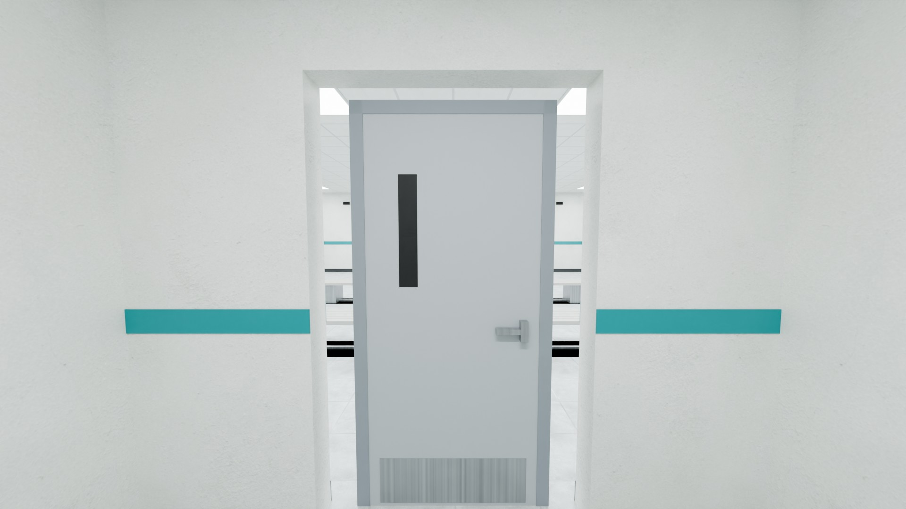
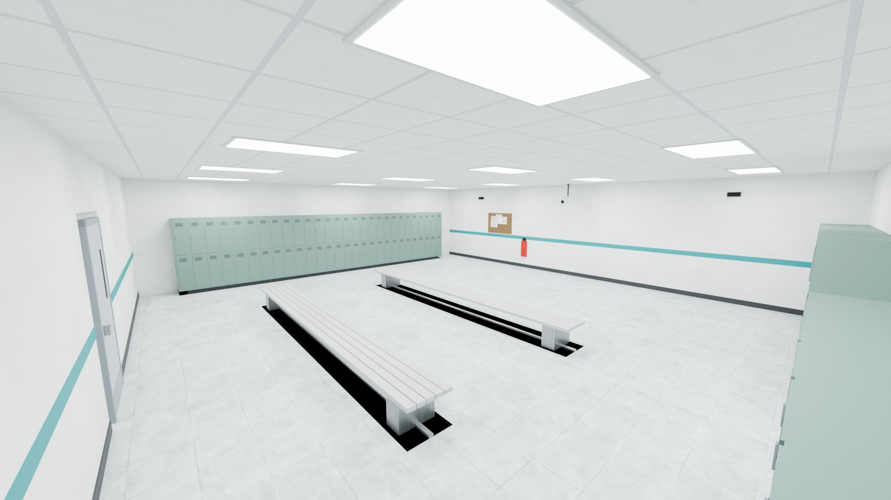
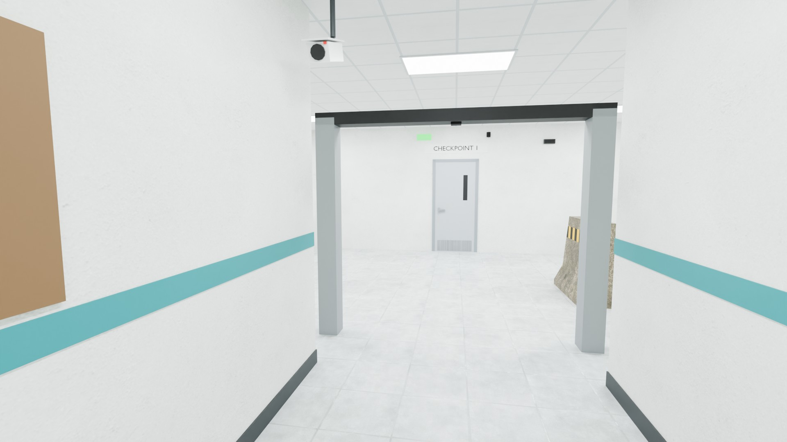
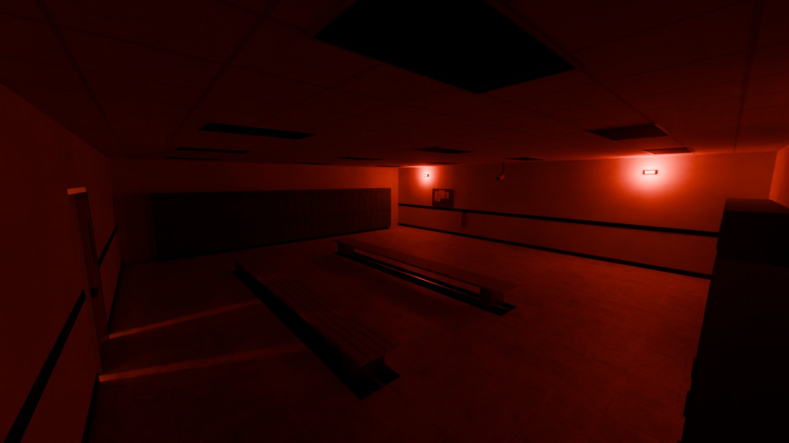
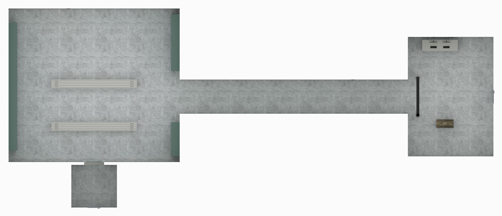

# b2_entry: dressed and lit (Secret Operations, step 2)

Behind the laboratory's sealed B2 door: a white airlock, the staff locker room (three banks of lockers, two benches), the sterile corridor and the scan room with its scanner arch, a desk and a barrier. White walls, the laboratory's teal stripe.

Built by `tools/blender/build_secretops_dress.py` around the greybox's layout (`tools/blender/build_secretops_greybox.py`): the layout objects are rebuilt from the same model, so `world/b2_entry.json` is the greybox's file, unchanged. The method, the light sets, the removable parts and the sources are in `docs/renders/registrar_hall/README.md` (shared by all 13 scenes).

| File | What it is |
|---|---|
| `world/b2_entry.glb` | the art only: 1.81 MB, 10462 triangles, 31 nodes drawn (27 meshes), 27 materials, WebP textures |
| `world/lightmaps/b2_entry_0.webp`, `_1.webp` | the normal set (`lightmap`): the shell page and the props page |
| `world/lightmaps/b2_entry_2.webp`, `_3.webp` | the alarm set (`lightmap_night`): the same two pages |
| `world/b2_entry.json` | the layout, as the greybox wrote it: 36 colliders, 3 doors, 3 cameras, 2 links, 1 zones, 9 spots |
| `blender/scenes/b2_entry.blend` | the saved scene (Git LFS): `Art` (Props, Separate, and Arch: one box per shell collider, for the layout check only), `Shell`, `Doors`, `Layout`, the two light collections, `Export` |
| `docs/renders/b2_entry/` | `1_arrival.jpg`, `2_wide.jpg`, `3_detail.jpg` (normal light), `4_alarm.jpg` (the wide view in the alarm set), `plan.jpg`, `bake.json`, `caps.json` |







## Bake

| Map | Set | Page | Size | px/m | Gain G | Shown gain (caps) |
|---|---|---|---|---|---|---|
| `b2_entry_0` | normal | shell | 2048 | 63.0 | 0.26637 | 0.7252 |
| `b2_entry_1` | normal | props | 1536 | 53.1 | 0.26637 | 0.7252 |
| `b2_entry_2` | alarm | shell | 2048 | 63.0 | 1.8756 | 0.8201 |
| `b2_entry_3` | alarm | props | 1536 | 53.1 | 1.8756 | 0.8201 |

Cycles on the rented GPU (GPU), 512 samples, diffuse direct and indirect, OIDN, 8 px margin; 108 s for both sets. Texel = G L / (C + G L) with C = 1.2 and lightmap intensity pi C, G set so the median wall texel shows 0.34 (normal) or 0.26 (alarm) of its light; `caps.json` then scales each set's intensity so the walls show p50 0.19 (normal) or 0.155 (alarm) and caps any material that would pass p90 0.88 or p99 0.97.

## Brightness (`lab_display.py`, as the page shows it)

Normal set:

```
material                m2           map       k    p50    p90    p99     >=1
Wall_Lab             303.5    b2_entry_0  2.7339  0.190  0.236  0.265   0.00%
Ceiling_Tile         228.0    b2_entry_0  2.7339  0.157  0.186  0.290   0.00%
Floor_Lab            209.1    b2_entry_0  2.7339  0.170  0.204  0.232   0.00%
Locker_Paint         104.5    b2_entry_1  2.7339  0.000  0.062  0.075   0.00%
Laminate              23.3    b2_entry_1  2.7339  0.059  0.171  0.178   0.00%
Lamp_Housing          18.9    b2_entry_1  2.7339  0.321  0.321  0.324   0.00%
Paint_Dark            13.4    b2_entry_1  2.7339  0.000  0.004  0.005   0.00%
Skirting               9.3    b2_entry_1  2.7339  0.008  0.010  0.011   0.00%
Stripe_Teal            9.3    b2_entry_1  2.7339  0.061  0.074  0.077   0.00%
Paint_Grey             7.6    b2_entry_1  2.7339  0.026  0.053  0.063   0.00%
Steel                  5.9    b2_entry_1  2.7339  0.048  0.087  0.117   0.00%
Door_Steel             4.4    b2_entry_1  2.7339  0.000  0.156  0.163   0.00%
Plastic_Black          4.2    b2_entry_1  2.7339  0.001  0.001  0.001   0.00%
Concrete_Prop          3.8    b2_entry_1  2.7339  0.040  0.083  0.144   0.00%
Door_Frame             3.7    b2_entry_1  2.7339  0.049  0.086  0.099   0.00%
Plastic_Grey           3.7    b2_entry_1  2.7339  0.071  0.082  0.086   0.00%
Notice                 2.0    b2_entry_1  2.7339  0.048  0.227  0.233   0.00%
Hazard                 0.8    b2_entry_1  2.7339  0.000  0.199  0.209   0.00%
Sign_Plate             0.6    b2_entry_1  2.7339  0.156  0.248  0.254   0.00%
Stripe_Red             0.6    b2_entry_1  2.7339  0.091  0.117  0.121   0.00%
Cam_Body               0.4    b2_entry_1  2.7339  0.148  0.177  0.188   0.00%
Clock_Face             0.2    b2_entry_1  2.7339  0.234  0.254  0.263   0.00%
Steel_Dark             0.2    b2_entry_1  2.7339  0.014  0.017  0.020   0.00%
```

Alarm set (`lightmap_night`):

```
material                m2           map       k    p50    p90    p99     >=1
Wall_Lab             303.5    b2_entry_2  3.0917  0.155  0.296  0.590   0.00%
Ceiling_Tile         228.0    b2_entry_2  3.0917  0.076  0.265  0.639   0.00%
Floor_Lab            209.1    b2_entry_2  3.0917  0.090  0.188  0.259   0.00%
Locker_Paint         104.5    b2_entry_3  3.0917  0.000  0.019  0.038   0.00%
Laminate              23.3    b2_entry_3  3.0917  0.013  0.050  0.163   0.00%
Lamp_Housing          18.9    b2_entry_3  3.0917  0.000  0.089  0.313   0.00%
Paint_Dark            13.4    b2_entry_3  3.0917  0.000  0.001  0.002   0.00%
Skirting               9.3    b2_entry_3  3.0917  0.005  0.008  0.011   0.00%
Stripe_Teal            9.3    b2_entry_3  3.0917  0.004  0.008  0.014   0.00%
Paint_Grey             7.6    b2_entry_3  3.0917  0.022  0.041  0.057   0.00%
Steel                  5.9    b2_entry_3  3.0917  0.009  0.036  0.099   0.00%
Door_Steel             4.4    b2_entry_3  3.0917  0.000  0.135  0.179   0.00%
Plastic_Black          4.2    b2_entry_3  3.0917  0.000  0.001  0.003   0.00%
Concrete_Prop          3.8    b2_entry_3  3.0917  0.034  0.081  0.153   0.00%
Door_Frame             3.7    b2_entry_3  3.0917  0.022  0.100  0.171   0.00%
Plastic_Grey           3.7    b2_entry_3  3.0917  0.055  0.080  0.128   0.00%
Notice                 2.0    b2_entry_3  3.0917  0.051  0.243  0.273   0.00%
Hazard                 0.8    b2_entry_3  3.0917  0.000  0.170  0.204   0.00%
Sign_Plate             0.6    b2_entry_3  3.0917  0.324  0.625  0.721   0.00%
Stripe_Red             0.6    b2_entry_3  3.0917  0.038  0.127  0.136   0.00%
Cam_Body               0.4    b2_entry_3  3.0917  0.042  0.101  0.107   0.00%
Clock_Face             0.2    b2_entry_3  3.0917  0.233  0.258  0.273   0.00%
Steel_Dark             0.2    b2_entry_3  3.0917  0.009  0.016  0.024   0.00%
```

## Gates

```
check_layout (Blender): PASS: 41 of 41 checks passed
greybox --check: GATES PASS
layout JSON: IDENTICAL: world/b2_entry.json is byte for byte the greybox's
worlddoc: OK world/b2_entry.json: 36 colliders, 3 doors, 0 markers, 2 links, 1 zones, 9 spots, 0 errors, 3 warnings
glb_inspect: pass       tris: 10462 triangles, budget 300000 / pass       mb: 1.73 MB, budget 8
privacy: privacy grep: 14 files, 0 with hits
```

