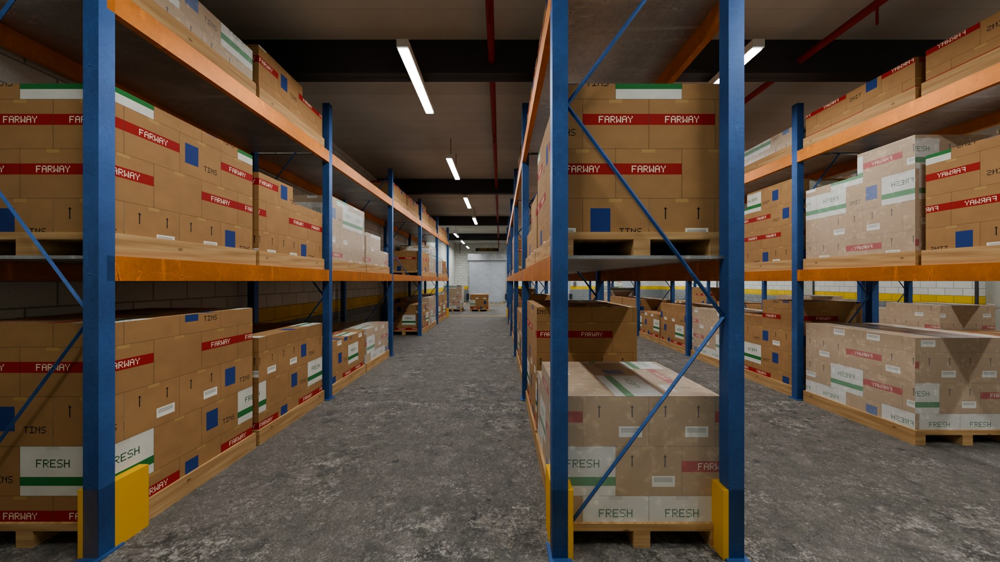
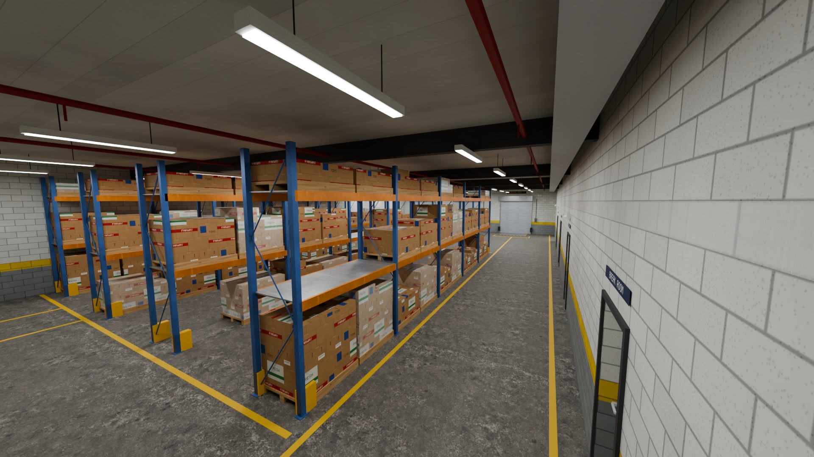
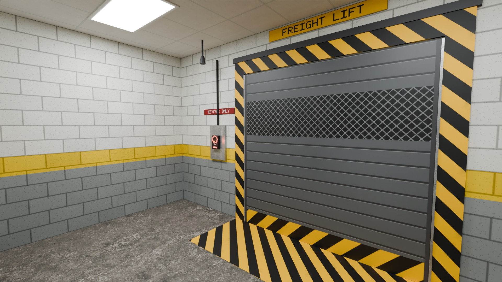

# back_of_house: the grocery's back of house

The grocery's restricted staff side, behind part 1's `main_floor` (`docs/BLENDER_AREAS.md`, section 2), dressed and lit round the greybox (`claude/blender-grocery-greybox`, draft PR #108). Off and empty but seemingly normal: a working stockroom left as it was at closing. Built in Blender 5.2.1 by `tools/blender/build_grocery_back.py`, baked twice (a day set and a night set on the same lightmap UVs, as the mall entrance and the hotel lobby do) and exported as art only. There are no reference photos; everything follows the written descriptions.

| File | What it is |
|---|---|
| `world/back_of_house.glb` | the art: 2.81 MB, 18 146 triangles drawn, 31 materials, 37 meshes of one primitive each (one per material, and the door leaves as their own nodes), 25 WebP textures; glb_inspect: pass tris, pass mb (2.68 MiB as it counts) |
| `world/back_of_house.json` | the layout, written by `tools/blender/export_scene.py` from the `.blend`: 65 colliders, 7 doors, 5 cameras, 1 marker, 4 links, 1 zone, 16 spots. It is exactly what the greybox model writes (`build_grocery_greybox.py --preview`), with the collider(s) this dressing added (see "The layout") |
| `world/lightmaps/back_of_house_0.webp`, `back_of_house_1.webp` | the day set (second UV set, `TEXCOORD_1`): the shell, the props |
| `world/lightmaps/back_of_house_2.webp`, `back_of_house_3.webp` | the night set on the same UVs |
| `blender/scenes/back_of_house.blend` | the saved scene (Git LFS, 4.4 MB): `Art` (the unmerged pieces), `Doors` (the leaves, origin at the hinge), `Layout` (the `COL_` and `Zone_` boxes and the empties: `Link_`/`Arrive_`, `Marker_`, `SecCam_`, `Spot_`), `Export` (merged by material, with the lightmap UVs), `Standins`, `Lights_Day`, `Lights_Night`, `Lights_Both` |
| `tools/blender/build_grocery_back.py` | the re-runnable build for both staff scenes (`--scene back_of_house` or `--scene basement`); it imports the greybox model, so no coordinate of the layout is typed in |
| `docs/renders/back_of_house/` | the three review stills (this folder) |

The shared tools are reused unchanged: `tools/blender/export_scene.py`, `tools/blender/check_layout.py`, `tools/blender/pack_scene.py`, `tools/webp_glb.py`. `main_floor` is not touched.

## Review stills (Cycles, 128 samples adaptive, OIDN, 1920 x 1080 JPEG, AgX, exposure 0, the day set)

| | |
|---|---|
| `1_arrival.jpg` | the arrival from main_floor's staff door (13.5, -5.5) at eye height 1.6 m, facing its `face` (east, down the racking) |
| `2_wide.jpg` | the hall from the south-west corner, over the forklift aisle to the dock |
| `3_detail.jpg` | the freight lift's gate and the keycard reader |





These are Blender renders with Blender's lights; the page shows the lightmaps instead (see "Brightness"). Night stills (rendered 1.5 stops brighter so they can be looked at), more views and a plan were rendered for the owner's sheet only.

## What is in it

The hall is the greybox's 30 m by 24 m by 4.5 m room east of `main_floor` (x 12.2 to 42.2, z -9 to 15); its west wall is main_floor's east wall.

- **The staff door (west):** main_floor's closed pair seen from behind, so it reads as the same building: the same blue-grey leaves (`Staff_Door`'s colour) with steel kick plates, small dark windows and push plates, in a dark aluminium frame, and over it **SHOP FLOOR** on main_floor's deep red board in its cream letters, an EXIT sign and an emergency light.
- **Shell:** bare concrete floor with yellow walkway lines; painted concrete block walls, mid-grey to 0.95 m, a **safety-yellow band** to 1.2 m and light grey above; a board-marked painted soffit at 4.5 m with four dark steel beams, red sprinkler mains with drops, a ventilation duct, and twin-tube fluorescent battens on chains.
- **Stockroom:** four rows of pallet racking (blue upright frames every 2.88 m with bracing, orange beams at 1.6 and 3.2 m, wire decks, yellow guards at the row ends), loaded on three levels with pallets of cartons (printed kraft and white board, some shrink-wrapped), a few bays empty.
- **Loading dock (east):** three **shut roller doors** in galvanised guides under their drum housings, **dock levellers** (tread plate with hazard-striped edges), black rubber **bumpers**, an up/down/stop box and conduit by each door, LOADING DOCK 1 to 3 boards, floor boxes painted in front, pallets waiting (one load, one short stack, one empty pallet) and a hand pallet truck (passable).
- **Break room:** a laminate table and four blue plastic chairs (mugs, a newspaper, a lunch box), a counter of white cupboards with a steel sink and tap, a kettle and the **microwave**, wall cupboards, the **fridge**, a red vending machine with a lit strip, the **noticeboard** (STAFF NOTICES, pinned papers), the staff rota and a clock; vinyl floor, lay-in ceiling with troffers (main_floor's ceiling tile).
- **Lockers:** two banks of **grey** two-tier lockers (louvres, number plates, hasps) on plinths, a slatted bench with a hi-vis vest and a jacket left on it, boots under it.
- **Manager's office:** a steel desk (desk lamp, phone, a red logbook, papers, a mug), a pushed-back office chair (passable), a grey filing cabinet, a waste bin, a clock and a calendar, and the **bank of CRT camera monitors**: 27 beige CRTs in three rows on a steel rack over a long console (keyboard, microphone, a stack of video recorders, tapes). Their screens are `Screen_CRT`, an emissive picture of 24 grainy grey-green camera views (CAM 01 to 24, a time), two NO SIGNAL and one snow: lit at every hour, and they light the office in both bakes.
- **Stairs:** the stair door by the office, a landing with a yellow tubular rail, and past it the basement's flight going down into the dark (art only, behind the rail).
- **The freight lift (the way to Secret Operations):** in its lobby, the gate opening framed in **black-and-yellow hazard stripes** under a steel lintel, FREIGHT LIFT over it, a hatched floor box in front, and the **keycard reader** beside the gate: a steel back plate, a black reader with ACCESS and a card mark, its **ring and status bar glowing red** (`Reader_Glow`, at every hour), KEYCARD ONLY over it, a conduit, and its own small lamp that lights it in both bakes, so it is the brightest thing in the lobby at night. The gate (`DoorLeaf_freight_lift`, 2.4 m) is heavy ribbed steel with a mesh band and hazard stripes at its foot. Behind it the car: tread-plate floor, galvanised lining, timber bump rails, the button panel and a ceiling light.
- **Emergency lights and exits:** twin-spot emergency units over the doors, along the hall and in each room; maintained EXIT signs over the staff door and the stair door.

The page draws the security cameras' heads (`SecCam_`: only a ceiling rod and a plate are built at each), the night threats, the food, carts and every moving part. Every spot, link and arrival is left clear.

## Light

| Set | Light | Maps | Material property |
|---|---|---|---|
| day | the fluorescent battens over the hall, the troffers in the staff rooms and the lift car, and the steady glows | `back_of_house_0`, `back_of_house_1` | `lightmap`, `lightmap_intensity` |
| night | abandoned: the emergency lights only, with the EXIT signs, the CRT monitors and the keycard reader's own lamp (the fluorescents are off) | `back_of_house_2`, `back_of_house_3` | `lightmap_night`, `lightmap_night_intensity` |

The glowing materials carry no lightmap; the page shows them as exported:

| Material | What | When it glows | Lightmap |
|---|---|---|---|
| `Lamp_Emit` | the fluorescent tubes, the troffers, the vending machine's strip | exported on; the page should switch it **off at night** (the place is abandoned) | none |
| `Emergency_Emit` | the twin-spot emergency lights' heads | exported on; the page should switch it **on at night only**, as in the mall | none |
| `Exit_Glow` | the EXIT signs (maintained) | always | none |
| `Screen_CRT` | the 27 camera monitors (a picture of 24 feeds) | always | none |
| `Reader_Glow` | the keycard reader's ring and status bar | always | none |


| Map | Set | Size | Materials | Density | Curve | Samples, GPU time | WebP |
|---|---|---|---|---|---|---|---|
| `back_of_house_0` | day | 2048 | the shell: floors, walls, ceilings | 36.0 px/m (Ceiling_Soffit 16.2, Ceiling_Tile 21.6) | G 2.443, C 1.3 | 512, 39 s | 151 KB |
| `back_of_house_1` | day | 2048 | everything in it, and the door leaves | 14.6 px/m (Paint_Palette 10.2, Floor_Paint 4.4, Hazard 11.7) | G 2.443, C 1.3 | 512, 56 s | 562 KB |
| `back_of_house_2` | night | 2048 | the shell: floors, walls, ceilings | 36.0 px/m (Ceiling_Soffit 16.2, Ceiling_Tile 21.6) | G 6.8797, C 1.1 | 1024, 58 s | 111 KB |
| `back_of_house_3` | night | 2048 | everything in it, and the door leaves | 14.6 px/m (Paint_Palette 10.2, Floor_Paint 4.4, Hazard 11.7) | G 6.8797, C 1.1 | 1024, 63 s | 416 KB |

**The shoulder.** As in the hotel lobby: each map is written as texel = G L / (C + G L) from the bake's light L, and every baked material's intensity is pi C, so the page shows texture x G L where the light is ordinary and rolls off toward texture x C under a lamp, never clipping. G comes from the shell map's median light (`TARGET` in the build: a white wall at the median shows 0.9 by day, 0.25 at night; the night's G is held to at most 30 x the day's); C is 1.3 by day and 1.1 at night. The page needs nothing new: `lightmap` x `lightmap_intensity`, and `lightmap_night` x `lightmap_night_intensity`.

Cycles on the GPU, diffuse (direct and indirect, no colour), 8 px margin, OIDN. Faces nobody sees are dropped before the UVs are made: the shell's outer skin, the floor's sides and underside, the walls' tops and the joints between their bands, the ceilings' tops, the bottoms of things on the floor, faces pressed against the outer walls, the cartons' bottoms, and the props' faces looking up from above 1.7 m. Smart projection fits each object to the unit square on its own, so every object is brought back to metres before one pack (Blender's island averaging over this many objects broke the packer; `lightmap_uv()` in the build).

## Brightness, as the page shows it

Measured with `lab_display.py` (area-weighted samples over each material's triangles, the brightest channel; `>=1` is the share that clips). A p50 near 0 on a material means half of its area is out of the light (the back faces of loads in the racks, the dark side of a box), not that what you see is black.

Day (`lightmap`):

```
material                m2           map       k    p50    p90    p99     >=1
Wall_Block           812.3 back_of_house_0  4.0841  0.169  0.465  0.574   0.00%
Ceiling_Soffit       741.8 back_of_house_0  4.0841  0.129  0.238  0.450   0.00%
Floor_Concrete       630.1 back_of_house_0  4.0841  0.084  0.148  0.250   0.00%
Paint_Palette        432.0 back_of_house_1  4.0841  0.006  0.250  0.914   0.00%
Pallet_Wood          337.4 back_of_house_1  4.0841  0.001  0.242  0.400   0.00%
Carton_Load          261.3 back_of_house_1  4.0841  0.191  0.292  0.511   0.00%
Ceiling_Tile         240.0 back_of_house_0  4.0841  0.284  0.419  0.923   0.04%
Steel_Galv           225.2 back_of_house_1  4.0841  0.075  0.176  0.291   0.00%
Wall_Lower           218.2 back_of_house_0  4.0841  0.099  0.176  0.203   0.00%
Floor_Vinyl          162.8 back_of_house_0  4.0841  0.314  0.434  0.509   0.00%
Wrap_Load            107.9 back_of_house_1  4.0841  0.264  0.422  0.573   0.00%
Steel_Orange          79.3 back_of_house_1  4.0841  0.144  0.493  0.610   0.00%
Steel_Blue            78.0 back_of_house_1  4.0841  0.123  0.214  0.276   0.00%
Steel_Grey            72.5 back_of_house_1  4.0841  0.000  0.076  0.206   0.00%
Wall_Band             57.4 back_of_house_0  4.0841  0.292  0.529  0.602   0.00%
Doors                 37.7 back_of_house_1  4.0841  0.150  0.310  0.376   0.00%
Shutter               28.4 back_of_house_1  4.0841  0.384  0.477  0.514   0.00%
Floor_Plate           28.0 back_of_house_1  4.0841  0.163  0.197  0.320   0.00%
Wood_Light            25.9 back_of_house_1  4.0841  0.175  0.443  0.538   0.00%
Locker_Front          23.5 back_of_house_1  4.0841  0.238  0.265  0.479   0.00%
Floor_Paint           10.5 back_of_house_1  4.0841  0.522  0.641  0.710   0.00%
Hazard                10.3 back_of_house_1  4.0841  0.005  0.742  0.773   0.00%
Signs                  4.5 back_of_house_1  4.0841  0.211  0.648  0.732   0.00%
Steel_Yellow           3.3 back_of_house_1  4.0841  0.000  0.179  0.251   0.00%
Rubber_Black           2.7 back_of_house_1  4.0841  0.013  0.019  0.019   0.00%
Steel_Dark             0.8 back_of_house_1  4.0841  0.000  0.024  0.040   0.00%
```

Night (`lightmap_night`):

```
material                m2           map       k    p50    p90    p99     >=1
Wall_Block           812.3 back_of_house_2  3.4558  0.002  0.224  0.418   0.00%
Ceiling_Soffit       741.8 back_of_house_2  3.4558  0.019  0.086  0.163   0.00%
Floor_Concrete       630.1 back_of_house_2  3.4558  0.019  0.077  0.143   0.00%
Paint_Palette        432.0 back_of_house_3  3.4558  0.001  0.091  0.347   0.00%
Pallet_Wood          337.4 back_of_house_3  3.4558  0.000  0.033  0.163   0.00%
Carton_Load          261.3 back_of_house_3  3.4558  0.024  0.111  0.249   0.00%
Ceiling_Tile         240.0 back_of_house_2  3.4558  0.070  0.304  0.402   0.00%
Steel_Galv           225.2 back_of_house_3  3.4558  0.006  0.034  0.182   0.00%
Wall_Lower           218.2 back_of_house_2  3.4558  0.011  0.097  0.136   0.00%
Floor_Vinyl          162.8 back_of_house_2  3.4558  0.069  0.284  0.371   0.00%
Wrap_Load            107.9 back_of_house_3  3.4558  0.042  0.192  0.339   0.00%
Steel_Orange          79.3 back_of_house_3  3.4558  0.029  0.115  0.266   0.00%
Steel_Blue            78.0 back_of_house_3  3.4558  0.015  0.087  0.212   0.00%
Steel_Grey            72.5 back_of_house_3  3.4558  0.000  0.000  0.151   0.00%
Wall_Band             57.4 back_of_house_2  3.4558  0.065  0.306  0.425   0.00%
Doors                 37.7 back_of_house_3  3.4558  0.025  0.128  0.223   0.00%
Shutter               28.4 back_of_house_3  3.4558  0.103  0.207  0.284   0.00%
Floor_Plate           28.0 back_of_house_3  3.4558  0.051  0.140  0.204   0.00%
Wood_Light            25.9 back_of_house_3  3.4558  0.000  0.226  0.317   0.00%
Locker_Front          23.5 back_of_house_3  3.4558  0.000  0.000  0.000   0.00%
Floor_Paint           10.5 back_of_house_3  3.4558  0.124  0.388  0.559   0.00%
Hazard                10.3 back_of_house_3  3.4558  0.003  0.453  0.565   0.00%
Signs                  4.5 back_of_house_3  3.4558  0.088  0.328  0.474   0.00%
Steel_Yellow           3.3 back_of_house_3  3.4558  0.000  0.000  0.000   0.00%
Rubber_Black           2.7 back_of_house_3  3.4558  0.005  0.011  0.016   0.00%
Steel_Dark             0.8 back_of_house_3  3.4558  0.000  0.002  0.011   0.00%
```

By day every material is at or under p90 0.9 and p99 0.98, and the walls read (`Wall_Block` p50 0.169). At night the place is abandoned, as asked: most of it is dark, with pools under the emergency lights; nothing clips.

## The layout

Colliders, doors, links, markers, zones, cameras and spots stay where the greybox put them. Two changes were made in the greybox script itself (`back_of_house()` in `tools/blender/build_grocery_greybox.py`), and so in `world/back_of_house.json`; nothing else in the file changed:

- **`Break_Fridge` added** (x 12.2 to 12.95, z 7.4 to 8.3, 1.85 m): the brief's fridge, at the counter's north end, clear of the door and `Spot_hide_1`.
- **`Monitor_Shelf` deepened** from z 13.6 to z 13.2, under the monitor bank: the CRTs stand on the console, and the layout check needs the art standing on the floor over a collider that stands on the floor (the bank's own collider starts at 0.8 m).

The greybox's plan, still and GLB for back_of_house (and basement) in `docs/renders/grocery_greybox/` were rendered again with them, and its README and CHECKS updated (65 colliders). The other two scenes' sheets are unchanged.

Passable art (`decor_`): the floor lines, the dock levellers and their hazard edges, the dock controls, the pallet truck, the reader's body and face (proud of the wall), the hatched floor box, the car's floor plate, the office chair and bin.

`blender -b blender/scenes/back_of_house.blend --python tools/blender/build_grocery_back.py -- --scene back_of_house --stage check` (`tools/blender/check_layout.py` on `Art`; the cover lines are cut short here):

```
PASS  COVER  Break_Chair: 3 mesh(es) cover it (360 sample points, every one within 5 cm of art)
PASS  COVER  Break_Chair_2: 3 mesh(es) cover it (360 sample points, every one within 5 cm of art)
PASS  COVER  Break_Chair_3: 3 mesh(es) cover it (360 sample points, every one within 5 cm of art)
PASS  COVER  Break_Chair_4: 3 mesh(es) cover it (360 sample points, every one within 5 cm of art)
PASS  COVER  Break_Counter: 5 mesh(es) cover it (5670 sample points, every one within 5 cm of art)
PASS  COVER  Break_Fridge: 7 mesh(es) cover it (1800 sample points, every one within 5 cm of art)
...
PASS  STRAY  131 tall solid mesh(es), each over a collider; 14 decor_* mesh(es) exempt
PASS  CLEAR  marker Spawn (13.50, -5.50): clear within 0.28 m
PASS: 67 of 67 checks passed
```

Objects that gather pieces from several colliders (the palette props, the racking's parts, the signs) are cut into one object per collider before the check (`split_for_layout()`), because the check reads each object's box.

`python tools/blender/build_grocery_greybox.py --check .`:

```
GATE links: 4 pairs, 8 sides, 3 that leave this set; 11 links in the files
  off this set: aisles.main_floor -> main_floor
  off this set: back_of_house.main_floor -> main_floor
  off this set: back_of_house.secret_ops -> secret_ops/service_entry
GATE steps: 54 step boxes, the highest rise 0.267 m (at most 0.27 m)
GATE corridors: 30 corridor, aisle and doorway rects, the narrowest 1.68 m (at least 1.6 m), none blocked
GATE cameras: aisles 0, second_floor 0, back_of_house 5, basement 2
GATES PASS
```

`node tools/worlddoc.mjs check world/back_of_house.json`:

```
warning: link basement_stairs: the manifest has no link from this door yet: a new link to add
  warning: link freight_down: the manifest has no link from this door yet: a new link to add
  warning: link main_floor: the manifest has no link from this door yet: a new link to add
  warning: link secret_ops: the manifest has no link from this door yet: a new link to add
OK world/back_of_house.json: 65 colliders, 7 doors, 1 markers, 4 links, 1 zones, 16 spots, 0 errors, 4 warnings
```

The axes were checked with a marker cube at the spawn (`--stage axes`): game (x, y, z) = glTF (x, y, z).

## Sources and licences

| Asset | Used for | Source | Author (Poly Haven) | Licence |
|---|---|---|---|---|
| `hangar_concrete_floor` (`blender/textures/factory_floor/concrete_floor_diff.jpg`, already in the repo) | the bare concrete floors, the steps | https://polyhaven.com/a/hangar_concrete_floor | Dimitrios Savva | CC0 1.0 |
| `green_metal_rust`, neutral (`blender/textures/factory_floor/paint_grime_diff.jpg`, already in the repo) | the painted steel: racking (blue uprights, orange beams), lockers' bodies, the desk, the galvanised parts, the yellow nosings | https://polyhaven.com/a/green_metal_rust | Rob Tuytel | CC0 1.0 |
| main_floor's lay-in ceiling tile (`blender/textures/main_floor/ceiling_tile_diff.jpg`, from `polystyrene`, already in the repo) | the staff rooms' ceilings, as main_floor's | https://polyhaven.com/a/polystyrene | Dimitrios Savva, Dario Barresi | CC0 1.0 |
| the laboratory's vinyl (`blender/textures/laboratory/floor_vinyl_diff.jpg`, already in the repo) | the staff rooms' floors | see `docs/renders/laboratory/README.md` | | CC0 1.0 |

Nothing was downloaded for this job: the four maps above were already in the repo and are read where they are. Everything else is own work, made by `tools/blender/build_grocery_back.py`: all geometry, and sixteen images drawn with numpy from fixed seeds (packed into the `.blend`): the painted block (0.4 x 0.2 m in running bond), the board-marked soffit, the roller-shutter slats, pallet pine, frost, the insulated freezer panel, tread plate, hazard hatching, a carton atlas, two pallet-load faces (cartons, and cartons under shrink-wrap), a locker column, the doors' atlas (main_floor's blue-grey staff door, a steel stair door with wired glass, a laminate room door, a louvred plant-room door, an insulated freezer door, the freight lift's ribbed steel gate), the signs' atlas (a 5 x 7 pixel font of the build's own: SHOP FLOOR on main_floor's deep red, LOADING DOCK, BREAK ROOM, KEYCARD ONLY, COLD STORE, DANGER 415 V and the rest; the noticeboard, the rota, the breaker board, the EXIT sign, the reader's face, a clock, a calendar, the -22 C readout, the lift's buttons), 24 camera feeds for the CRTs, and a palette of flat swatches. No Meshy, no Higgsfield, no paid service, no photograph.

Tools: Blender 5.2.1 LTS (GPL) with Cycles, OpenImageDenoise and the glTF I/O add-on; Python with numpy and Pillow. The bakes and the stills ran on a rented GPU.

## Rebuild

From the repo root, with Blender 5.2 and Python with Pillow (each bake takes about a minute on a GPU; `--device cpu` works, slowly):

```
blender -b --python tools/blender/build_grocery_back.py -- --scene back_of_house --stage art,bake,export,axes,render --samples 512
blender -b blender/scenes/back_of_house.blend --python tools/blender/build_grocery_back.py -- --scene back_of_house --stage render --set night
python tools/blender/pack_scene.py back_of_house --work work/back_of_house       # WebP lightmaps and textures -> world/
```

`art` also writes `world/back_of_house.json` and runs the layout check. The work folder (`work/back_of_house`, not committed) also keeps each bake's raw light (`back_of_house_<n>_raw.npz`), so the curve can be changed without baking again. The build strips every custom property except the light properties on materials and the layout's own on the layout objects, makes every image path relative, clears the last-used operators' file paths, turns the render stamps off and strips the JPEG comment and APP1 segments.

## For the coordinator

- Add `world/back_of_house.glb` to the scene's files and its links to the manifest (`main_floor` arrives through the staff door; `basement_stairs`, `freight_down` and `secret_ops` leave, `secret_ops` being `grocery.backhouse>secret_ops`, which needs `keycard_tier_1`; the reader is `Spot_keycard_1`). `applyLightmaps` handles the four maps as for the mall entrance.
- Light sets: `setLightSet("night")` by the clock. At night switch `Lamp_Emit` **off** and `Emergency_Emit` **on**; by day the reverse. `Exit_Glow`, `Screen_CRT` and `Reader_Glow` stay on at every hour.
- `Screen_CRT` is one material on the 27 screens (UVs into a 4 x 6 atlas of feeds). If the page shows the `SecCam_` feeds on the monitors (`Spot_monitor_1`), it can swap that material's map.
- The seven leaves are nodes `DoorLeaf_staff_A`, `_B`, `DoorLeaf_break`, `_lockers`, `_office`, `_basement_stairs` and `_freight_lift`, origin at the hinge, one material (`Doors`, baked closed).
- main_floor's own side of the staff door is unchanged (its east wall still needs the opening cut, as the greybox said).

## Open

- **Density:** the props' map is 14.6 px/m, under the 32 px/m guide: the racks hold about a hundred pallets and loads, and the packer keeps an 8 px margin round every island. The shell is at 36 px/m. More would need more maps (four is the limit, and the night set needs two).
- **Night:** most of the hall is dark at night (the walls' p50 is near 0; pools under the emergency lights reach 0.2 to 0.4). That is the brief's "abandoned"; `TARGET["night"]` in the build lifts it, and the raw bakes are kept to re-tone without baking.
- **The page's grocery light sets:** which hours count as night here is the coordinator's call (the mall switches at 20:00).
