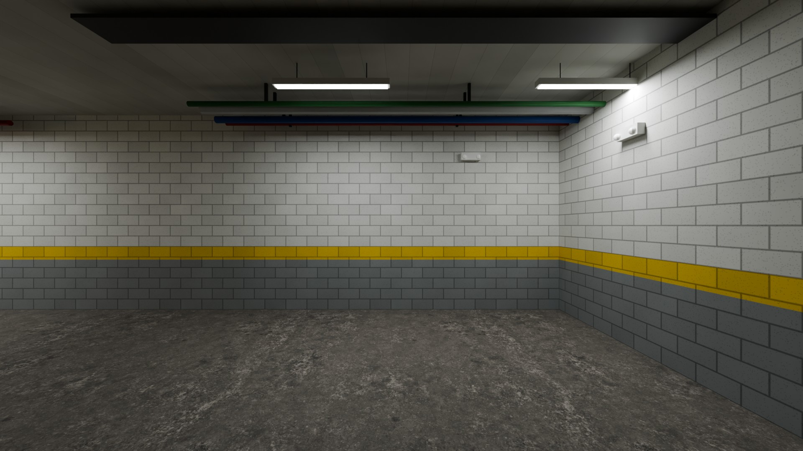
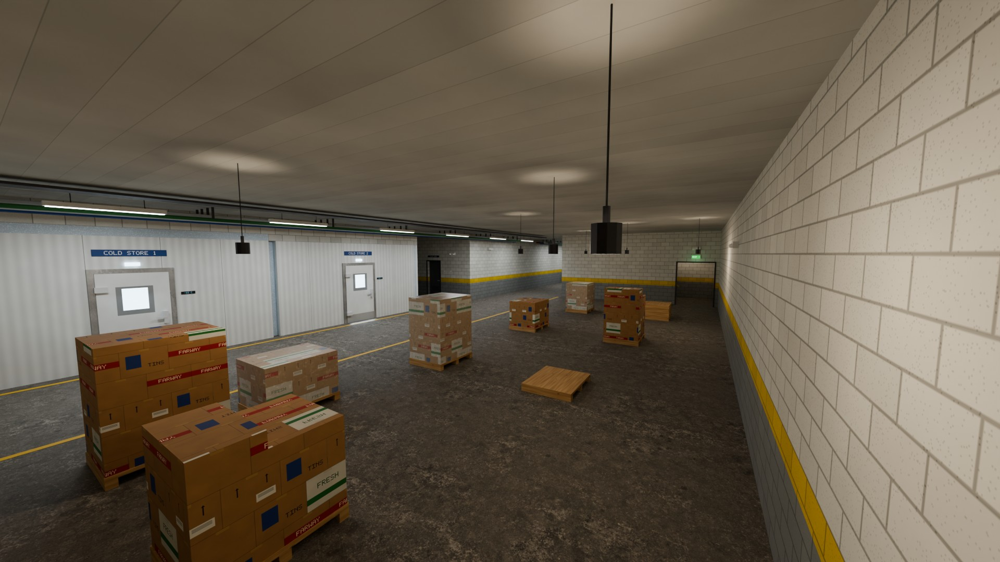
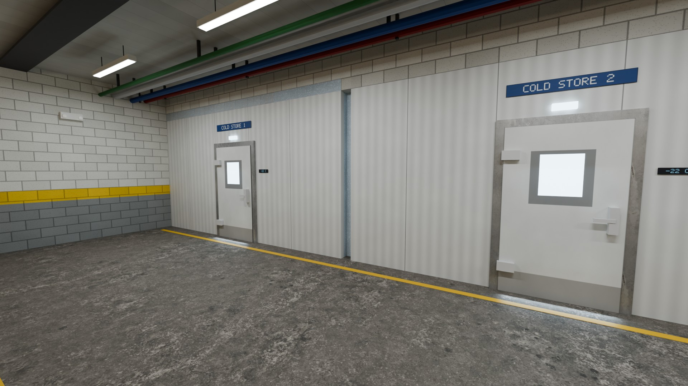

# basement: the grocery's basement

The grocery's restricted basement, under `back_of_house` (`docs/BLENDER_AREAS.md`, section 2), dressed and lit round the greybox (`claude/blender-grocery-greybox`, draft PR #108): cold, humming, off and empty but seemingly normal. Built in Blender 5.2.1 by the same `tools/blender/build_grocery_back.py` as back_of_house (`--scene basement`), baked twice (a day set and a night set on the same lightmap UVs) and exported as art only. There are no reference photos; everything follows the written descriptions.

| File | What it is |
|---|---|
| `world/basement.glb` | the art: 1.70 MB, 10 614 triangles drawn, 26 materials, 30 meshes of one primitive each (one per material, and the door leaves as their own nodes), 21 WebP textures; glb_inspect: pass tris, pass mb (1.62 MiB as it counts) |
| `world/basement.json` | the layout, written by `tools/blender/export_scene.py` from the `.blend`: 75 colliders, 5 doors, 2 cameras, 1 marker, 2 links, 1 zone, 7 spots. It is exactly what the greybox model writes (`build_grocery_greybox.py --preview`), with the collider(s) this dressing added (see "The layout") |
| `world/lightmaps/basement_0.webp`, `basement_1.webp` | the day set (second UV set, `TEXCOORD_1`): the shell, the props |
| `world/lightmaps/basement_2.webp`, `basement_3.webp` | the night set on the same UVs |
| `blender/scenes/basement.blend` | the saved scene (Git LFS, 4.2 MB): `Art` (the unmerged pieces), `Doors` (the leaves, origin at the hinge), `Layout` (the `COL_` and `Zone_` boxes and the empties: `Link_`/`Arrive_`, `Marker_`, `SecCam_`, `Spot_`), `Export` (merged by material, with the lightmap UVs), `Standins`, `Lights_Day`, `Lights_Night`, `Lights_Both` |
| `tools/blender/build_grocery_back.py` | the re-runnable build for both staff scenes (`--scene back_of_house` or `--scene basement`); it imports the greybox model, so no coordinate of the layout is typed in |
| `docs/renders/basement/` | the three review stills (this folder) |

The shared tools are reused unchanged: `tools/blender/export_scene.py`, `tools/blender/check_layout.py`, `tools/blender/pack_scene.py`, `tools/webp_glb.py`. `main_floor` is not touched.

## Review stills (Cycles, 128 samples adaptive, OIDN, 1920 x 1080 JPEG, AgX, exposure 0, the day set)

| | |
|---|---|
| `1_arrival.jpg` | the arrival from the freight lift (39.2, 8.8) at eye height 1.6 m, facing its `face` (north, toward the plant room) |
| `2_wide.jpg` | the basement from the south-west corner, over the pallets to the freezers and the plant room |
| `3_detail.jpg` | the two walk-in freezers' doors |





These are Blender renders with Blender's lights; the page shows the lightmaps instead (see "Brightness"). Night stills (rendered 1.5 stops brighter so they can be looked at), more views and a plan were rendered for the owner's sheet only.

## What is in it

The greybox's 30 m by 20 m by 3.7 m room (x 12.2 to 42.2, z -5 to 15), back_of_house's floor 4 m above.

- **Shell:** bare concrete floor with yellow lines along the service corridor; the same painted block walls as back of house (mid-grey dado, **safety-yellow band**, light grey above); a painted soffit with pipes on brackets (red, blue, green and a lagged main) and cable trays along the corridor; fluorescent battens over the corridor and in the plant room.
- **Cold storage:** **two walk-in freezers** of white insulated panel (seams every 1.2 m), each with a heavy insulated door (chrome hinges and latch, a steel kick plate, a **window that glows cold**), a steel door trim, COLD STORE 1 and 2 boards, a **-22 C** readout and a status lamp over the door, and a cold glow spilling under the door and through the window (`Freezer_Glow`, at every hour, and lights in both bakes). Inside: frost on the walls, floor and ceiling, frosted wire shelving with frozen cartons, an evaporator under the roof, strip curtains in the doorway, and their own cold lights.
- **Plant room:** two floor-standing boilers (enamelled cases, controls, lagged flues and flow and return pipes to the soffit), the chiller (fans on top, louvres, chilled-water pipes), a **pump set** of three blue pumps on a plinth with valves, gauges and a header, the **breaker board** (three grey cabinets, one showing its rows of breakers and the red MAIN switch, cable trunking up), DANGER 415 V, PLANT ROOM and NO SMOKING signs, and the **sump**: a tread-plate pit cover in a hazard frame with the pump's riser and float box on the wall.
- **Pallets:** nine pallet stacks in the south-west, cartons and shrink-wrapped loads at their greybox heights, a single pallet and a stack of empties, under **bare bulbs** in wire cages on their flexes.
- **Stairs:** concrete steps with yellow nosings up the stairwell to the landing at 4 m and back of house's stair door, a sloping soffit under the flight, a wall handrail, a rail on the landing, bulbs, an EXIT sign and emergency lights.
- **The freight lift:** the same gate, hazard frame and car as upstairs, FREIGHT LIFT and BASEMENT boards and a call panel (no reader down here: the keycard is upstairs).
- **Emergency lights:** twin-spot units along the corridor, by the stairs, the lift and the plant room.

The page draws the security cameras' heads (`SecCam_`: only a ceiling rod and a plate are built at each), the night threats, the food, carts and every moving part. Every spot, link and arrival is left clear.

## Light

| Set | Light | Maps | Material property |
|---|---|---|---|
| day | the fluorescent battens, the bare bulbs over the pallets and in the stairwell, and the steady glows | `basement_0`, `basement_1` | `lightmap`, `lightmap_intensity` |
| night | abandoned: the freezers' glow (inside, round their doors and their windows) and the emergency lights, with the EXIT sign (the battens and bulbs are off) | `basement_2`, `basement_3` | `lightmap_night`, `lightmap_night_intensity` |

The glowing materials carry no lightmap; the page shows them as exported:

| Material | What | When it glows | Lightmap |
|---|---|---|---|
| `Lamp_Emit` | the fluorescent tubes, the troffers, the bare bulbs, the vending machine's strip | exported on; the page should switch it **off at night** (the place is abandoned) | none |
| `Emergency_Emit` | the twin-spot emergency lights' heads | exported on; the page should switch it **on at night only**, as in the mall | none |
| `Exit_Glow` | the EXIT signs (maintained) | always | none |
| `Freezer_Glow` | the freezers' door windows, status lamps and inside lights | always | none |


| Map | Set | Size | Materials | Density | Curve | Samples, GPU time | WebP |
|---|---|---|---|---|---|---|---|
| `basement_0` | day | 2048 | the shell: floors, walls, ceilings, the freezers' panels and frost | 33.7 px/m (Ceiling_Soffit 15.2) | G 4.0056, C 1.3 | 512, 39 s | 143 KB |
| `basement_1` | day | 2048 | everything in it, and the door leaves | 43.2 px/m (Paint_Palette 30.3, Floor_Paint 13.0, Hazard 34.6) | G 4.0056, C 1.3 | 512, 46 s | 508 KB |
| `basement_2` | night | 2048 | the shell: floors, walls, ceilings, the freezers' panels and frost | 33.7 px/m (Ceiling_Soffit 15.2) | G 4.5088, C 1.1 | 1024, 57 s | 117 KB |
| `basement_3` | night | 2048 | everything in it, and the door leaves | 43.2 px/m (Paint_Palette 30.3, Floor_Paint 13.0, Hazard 34.6) | G 4.5088, C 1.1 | 1024, 57 s | 390 KB |

**The shoulder.** As in the hotel lobby: each map is written as texel = G L / (C + G L) from the bake's light L, and every baked material's intensity is pi C, so the page shows texture x G L where the light is ordinary and rolls off toward texture x C under a lamp, never clipping. G comes from the shell map's median light (`TARGET` in the build: a white wall at the median shows 0.9 by day, 0.25 at night; the night's G is held to at most 30 x the day's); C is 1.3 by day and 1.1 at night. The page needs nothing new: `lightmap` x `lightmap_intensity`, and `lightmap_night` x `lightmap_night_intensity`.

Cycles on the GPU, diffuse (direct and indirect, no colour), 8 px margin, OIDN. Faces nobody sees are dropped before the UVs are made: the shell's outer skin, the floor's sides and underside, the walls' tops and the joints between their bands, the ceilings' tops, the bottoms of things on the floor, faces pressed against the outer walls, the cartons' bottoms, and the props' faces looking up from above 1.7 m. Smart projection fits each object to the unit square on its own, so every object is brought back to metres before one pack (Blender's island averaging over this many objects broke the packer; `lightmap_uv()` in the build).

## Brightness, as the page shows it

Measured with `lab_display.py` (area-weighted samples over each material's triangles, the brightest channel; `>=1` is the share that clips). A p50 near 0 on a material means half of its area is out of the light (the back faces of loads in the racks, the dark side of a box), not that what you see is black.

Day (`lightmap`):

```
material                m2           map       k    p50    p90    p99     >=1
Wall_Block           709.5    basement_0  4.0841  0.164  0.475  0.638   0.00%
Ceiling_Soffit       620.2    basement_0  4.0841  0.176  0.289  0.445   0.00%
Floor_Concrete       590.1    basement_0  4.0841  0.072  0.145  0.249   0.00%
Frost_Panel          313.2    basement_0  4.0841  0.413  0.619  0.803   0.03%
Steel_Galv           216.5    basement_1  4.0841  0.108  0.281  0.410   0.00%
Paint_Palette        208.6    basement_1  4.0841  0.088  0.393  0.914   0.00%
Wall_Lower           193.6    basement_0  4.0841  0.070  0.178  0.217   0.00%
Freezer_Panel        112.2    basement_0  4.0841  0.007  0.573  0.643   0.00%
Floor_Frost           94.4    basement_0  4.0841  0.626  0.728  0.931   0.20%
Carton                93.3    basement_1  4.0841  0.158  0.469  0.632   0.00%
Wall_Band             50.9    basement_0  4.0841  0.231  0.539  0.650   0.00%
Pallet_Wood           42.2    basement_1  4.0841  0.010  0.274  0.368   0.00%
Doors                 33.5    basement_1  4.0841  0.074  0.568  0.665   0.00%
Carton_Load           25.3    basement_1  4.0841  0.220  0.300  0.540   0.00%
Wrap_Load             17.5    basement_1  4.0841  0.325  0.459  0.582   0.00%
Floor_Plate           13.9    basement_1  4.0841  0.171  0.207  0.334   0.00%
Wood_Light             8.3    basement_1  4.0841  0.130  0.362  0.406   0.00%
Hazard                 6.8    basement_1  4.0841  0.003  0.356  0.814   0.00%
Floor_Paint            4.3    basement_1  4.0841  0.615  0.654  0.724   0.00%
Steel_Yellow           3.5    basement_1  4.0841  0.000  0.204  0.290   0.00%
Signs                  2.3    basement_1  4.0841  0.242  0.659  0.751   0.00%
Steel_Dark             1.2    basement_1  4.0841  0.020  0.037  0.057   0.00%
```

Night (`lightmap_night`):

```
material                m2           map       k    p50    p90    p99     >=1
Wall_Block           709.5    basement_2  3.4558  0.001  0.190  0.410   0.00%
Ceiling_Soffit       620.2    basement_2  3.4558  0.043  0.102  0.168   0.00%
Floor_Concrete       590.1    basement_2  3.4558  0.019  0.068  0.127   0.00%
Frost_Panel          313.2    basement_2  3.4558  0.398  0.563  0.728   0.00%
Steel_Galv           216.5    basement_3  3.4558  0.001  0.235  0.357   0.00%
Paint_Palette        208.6    basement_3  3.4558  0.000  0.054  0.477   0.00%
Wall_Lower           193.6    basement_2  3.4558  0.002  0.073  0.109   0.00%
Freezer_Panel        112.2    basement_2  3.4558  0.006  0.258  0.423   0.00%
Floor_Frost           94.4    basement_2  3.4558  0.566  0.653  0.834   0.00%
Carton                93.3    basement_3  3.4558  0.164  0.447  0.574   0.00%
Wall_Band             50.9    basement_2  3.4558  0.007  0.226  0.395   0.00%
Pallet_Wood           42.2    basement_3  3.4558  0.003  0.108  0.187   0.00%
Doors                 33.5    basement_3  3.4558  0.031  0.296  0.431   0.00%
Carton_Load           25.3    basement_3  3.4558  0.075  0.160  0.277   0.00%
Wrap_Load             17.5    basement_3  3.4558  0.112  0.170  0.260   0.00%
Floor_Plate           13.9    basement_3  3.4558  0.000  0.000  0.000   0.00%
Wood_Light             8.3    basement_3  3.4558  0.000  0.000  0.000   0.00%
Hazard                 6.8    basement_3  3.4558  0.003  0.404  0.464   0.00%
Floor_Paint            4.3    basement_3  3.4558  0.235  0.417  0.520   0.00%
Steel_Yellow           3.5    basement_3  3.4558  0.000  0.200  0.362   0.00%
Signs                  2.3    basement_3  3.4558  0.000  0.207  0.283   0.00%
Steel_Dark             1.2    basement_3  3.4558  0.005  0.011  0.043   0.00%
```

By day every material is at or under p90 0.9 and p99 0.98, and the walls read (`Wall_Block` p50 0.164). At night the place is abandoned, as asked: most of it is dark, with pools under the emergency lights and round the freezers; nothing clips.

## The layout

Colliders, doors, links, markers, zones, cameras and spots stay where the greybox put them. One collider was added, in the greybox script itself (`basement()` in `tools/blender/build_grocery_greybox.py`), and so in `world/basement.json`; nothing else in the file changed:

- **`Pump_Set` added** (x 32.6 to 35.4, z 0.8 to 1.8, 1.1 m): the brief's pumps, on their plinth in the plant room, clear of the path from the door to the breaker board (`Spot_breaker_1`) and of `Spot_hide_2`.

The greybox's plan, still and GLB for basement were rendered again with it, and its README and CHECKS updated (75 colliders).

Passable art (`decor_`): the floor lines, the strip curtains, the sump's cover, frame and riser, the stair soffit, stringer and handrail.

`blender -b blender/scenes/basement.blend --python tools/blender/build_grocery_back.py -- --scene basement --stage check` (`tools/blender/check_layout.py` on `Art`; the cover lines are cut short here):

```
PASS  COVER  Freezer_2_Ceiling: 16 mesh(es) cover it (14337 sample points, every one within 5 cm of art)
PASS  COVER  Freezer_2_Shelf_N: 10 mesh(es) cover it (8855 sample points, every one within 5 cm of art)
PASS  COVER  Freezer_2_Shelf_W: 8 mesh(es) cover it (10787 sample points, every one within 5 cm of art)
PASS  COVER  Freezer_2_Wall_S_1: 15 mesh(es) cover it (2232 sample points, every one within 5 cm of art)
PASS  COVER  Freezer_2_Wall_S_2: 15 mesh(es) cover it (390 sample points, every one within 5 cm of art)
PASS  COVER  Freezer_2_Wall_S_3: 15 mesh(es) cover it (2232 sample points, every one within 5 cm of art)
...
PASS  STRAY  104 tall solid mesh(es), each over a collider; 10 decor_* mesh(es) exempt
PASS  CLEAR  marker Spawn (39.20, 8.80): clear within 0.28 m
PASS: 77 of 77 checks passed
```

Objects that gather pieces from several colliders (the palette props, the racking's parts, the signs) are cut into one object per collider before the check (`split_for_layout()`), because the check reads each object's box.

`python tools/blender/build_grocery_greybox.py --check .`:

```
GATE links: 4 pairs, 8 sides, 3 that leave this set; 11 links in the files
  off this set: aisles.main_floor -> main_floor
  off this set: back_of_house.main_floor -> main_floor
  off this set: back_of_house.secret_ops -> secret_ops/service_entry
GATE steps: 54 step boxes, the highest rise 0.267 m (at most 0.27 m)
GATE corridors: 30 corridor, aisle and doorway rects, the narrowest 1.68 m (at least 1.6 m), none blocked
GATE cameras: aisles 0, second_floor 0, back_of_house 5, basement 2
GATES PASS
```

`node tools/worlddoc.mjs check world/basement.json`:

```
warning: scene basement is not in the world manifest yet: a new scene to add
  warning: link back_of_house: the manifest has no link from this door yet: a new link to add
  warning: link freight_up: the manifest has no link from this door yet: a new link to add
OK world/basement.json: 75 colliders, 5 doors, 1 markers, 2 links, 1 zones, 7 spots, 0 errors, 3 warnings
```

The axes were checked with a marker cube at the spawn (`--stage axes`): game (x, y, z) = glTF (x, y, z).

## Sources and licences

| Asset | Used for | Source | Author (Poly Haven) | Licence |
|---|---|---|---|---|
| `hangar_concrete_floor` (`blender/textures/factory_floor/concrete_floor_diff.jpg`, already in the repo) | the bare concrete floors, the steps | https://polyhaven.com/a/hangar_concrete_floor | Dimitrios Savva | CC0 1.0 |
| `green_metal_rust`, neutral (`blender/textures/factory_floor/paint_grime_diff.jpg`, already in the repo) | the painted steel: racking (blue uprights, orange beams), lockers' bodies, the desk, the galvanised parts, the yellow nosings | https://polyhaven.com/a/green_metal_rust | Rob Tuytel | CC0 1.0 |
| main_floor's lay-in ceiling tile (`blender/textures/main_floor/ceiling_tile_diff.jpg`, from `polystyrene`, already in the repo) | the staff rooms' ceilings, as main_floor's | https://polyhaven.com/a/polystyrene | Dimitrios Savva, Dario Barresi | CC0 1.0 |
| the laboratory's vinyl (`blender/textures/laboratory/floor_vinyl_diff.jpg`, already in the repo) | the staff rooms' floors | see `docs/renders/laboratory/README.md` | | CC0 1.0 |

Nothing was downloaded for this job: the four maps above were already in the repo and are read where they are. Everything else is own work, made by `tools/blender/build_grocery_back.py`: all geometry, and sixteen images drawn with numpy from fixed seeds (packed into the `.blend`): the painted block (0.4 x 0.2 m in running bond), the board-marked soffit, the roller-shutter slats, pallet pine, frost, the insulated freezer panel, tread plate, hazard hatching, a carton atlas, two pallet-load faces (cartons, and cartons under shrink-wrap), a locker column, the doors' atlas (main_floor's blue-grey staff door, a steel stair door with wired glass, a laminate room door, a louvred plant-room door, an insulated freezer door, the freight lift's ribbed steel gate), the signs' atlas (a 5 x 7 pixel font of the build's own: SHOP FLOOR on main_floor's deep red, LOADING DOCK, BREAK ROOM, KEYCARD ONLY, COLD STORE, DANGER 415 V and the rest; the noticeboard, the rota, the breaker board, the EXIT sign, the reader's face, a clock, a calendar, the -22 C readout, the lift's buttons), 24 camera feeds for the CRTs, and a palette of flat swatches. No Meshy, no Higgsfield, no paid service, no photograph.

Tools: Blender 5.2.1 LTS (GPL) with Cycles, OpenImageDenoise and the glTF I/O add-on; Python with numpy and Pillow. The bakes and the stills ran on a rented GPU.

## Rebuild

From the repo root, with Blender 5.2 and Python with Pillow (each bake takes about a minute on a GPU; `--device cpu` works, slowly):

```
blender -b --python tools/blender/build_grocery_back.py -- --scene basement --stage art,bake,export,axes,render --samples 512
blender -b blender/scenes/basement.blend --python tools/blender/build_grocery_back.py -- --scene basement --stage render --set night
python tools/blender/pack_scene.py basement --work work/basement       # WebP lightmaps and textures -> world/
```

`art` also writes `world/basement.json` and runs the layout check. The work folder (`work/basement`, not committed) also keeps each bake's raw light (`basement_<n>_raw.npz`), so the curve can be changed without baking again. The build strips every custom property except the light properties on materials and the layout's own on the layout objects, makes every image path relative, clears the last-used operators' file paths, turns the render stamps off and strips the JPEG comment and APP1 segments.

## For the coordinator

- Add `world/basement.glb` to the scene's files and its links to the manifest (`back_of_house` up the stairs, `freight_up` by the lift); `applyLightmaps` handles the four maps.
- Light sets: at night switch `Lamp_Emit` **off** and `Emergency_Emit` **on**; by day the reverse. `Exit_Glow` and `Freezer_Glow` stay on at every hour.
- The five leaves are nodes `DoorLeaf_back_of_house` (on the landing, y 4), `DoorLeaf_freezer_1`, `_freezer_2`, `DoorLeaf_plant_room` and `DoorLeaf_freight_lift`, origin at the hinge. The freezer leaves carry two materials: `Doors` (baked) and their glowing window (`Freezer_Glow`, no lightmap).

## Open

- **Night:** the freezers' glow is the brightest thing at night, as asked; the rest is dark between the emergency lights (the walls' p50 is near 0). `TARGET["night"]` in the build lifts it; the raw bakes are kept to re-tone without baking.
- **The page's grocery light sets:** which hours count as night is the coordinator's call.
