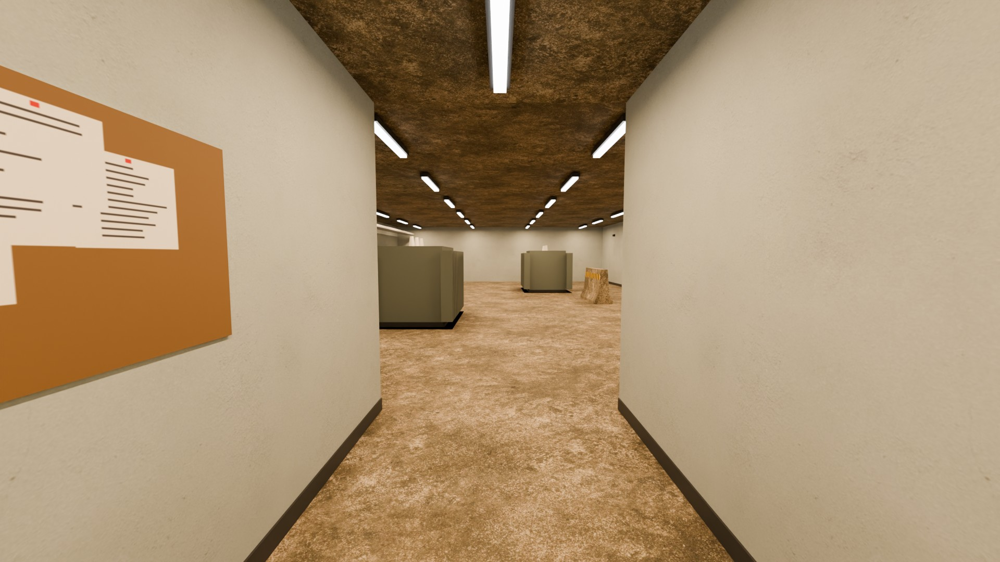
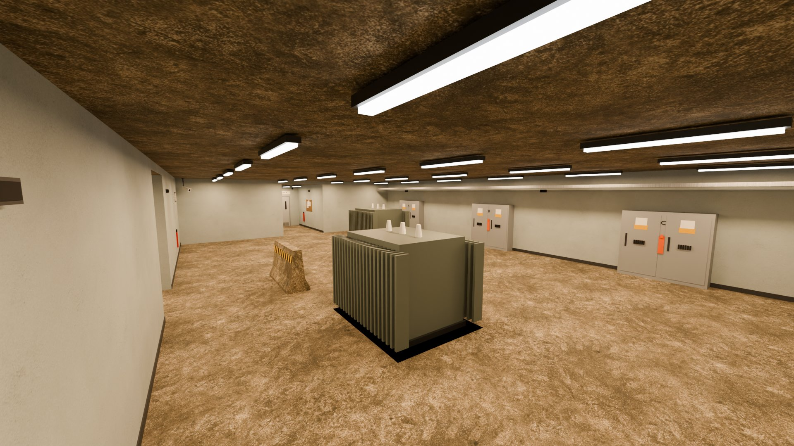
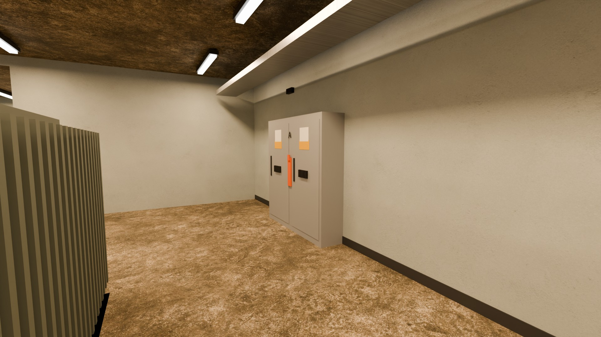
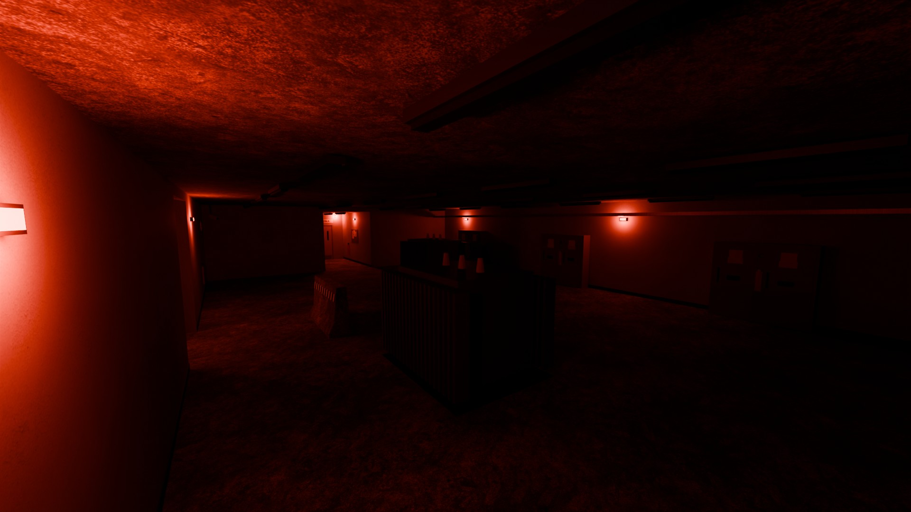
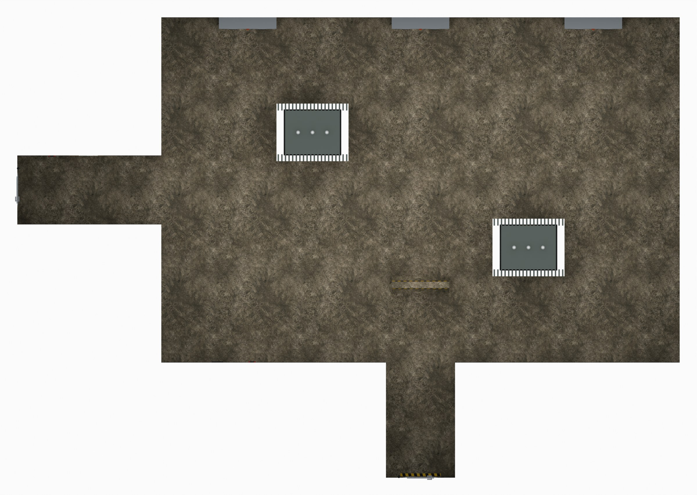

# breaker_room: dressed and lit (Secret Operations, step 2)

The plant room: three grey breaker cabinets with orange levers (circuits A, B and C, lettered), two transformers with cooling fins and insulators, a cable tray along the panels, caged battens in warm orange light, two ways in.

Built by `tools/blender/build_secretops_dress.py` around the greybox's layout (`tools/blender/build_secretops_greybox.py`): the layout objects are rebuilt from the same model, so `world/breaker_room.json` is the greybox's file, unchanged. The method, the light sets, the removable parts and the sources are in `docs/renders/registrar_hall/README.md` (shared by all 13 scenes).

| File | What it is |
|---|---|
| `world/breaker_room.glb` | the art only: 1.14 MB, 5746 triangles, 27 nodes drawn (27 meshes), 27 materials, WebP textures |
| `world/lightmaps/breaker_room_0.webp`, `_1.webp` | the normal set (`lightmap`): the shell page and the props page |
| `world/lightmaps/breaker_room_2.webp`, `_3.webp` | the alarm set (`lightmap_night`): the same two pages |
| `world/breaker_room.json` | the layout, as the greybox wrote it: 25 colliders, 2 doors, 1 cameras, 2 links, 1 zones, 8 spots |
| `blender/scenes/breaker_room.blend` | the saved scene (Git LFS): `Art` (Props, Separate, and Arch: one box per shell collider, for the layout check only), `Shell`, `Doors`, `Layout`, the two light collections, `Export` |
| `docs/renders/breaker_room/` | `1_arrival.jpg`, `2_wide.jpg`, `3_detail.jpg` (normal light), `4_alarm.jpg` (the wide view in the alarm set), `plan.jpg`, `bake.json`, `caps.json` |







## Bake

| Map | Set | Page | Size | px/m | Gain G | Shown gain (caps) |
|---|---|---|---|---|---|---|
| `breaker_room_0` | normal | shell | 1536 | 47.5 | 0.42316 | 1.7323 |
| `breaker_room_1` | normal | props | 1536 | 55.9 | 0.42316 | 1.7323 |
| `breaker_room_2` | alarm | shell | 1536 | 47.5 | 7.83837 | 1.6667 |
| `breaker_room_3` | alarm | props | 1536 | 55.9 | 7.83837 | 1.6667 |

Cycles on the rented GPU (GPU), 512 samples, diffuse direct and indirect, OIDN, 8 px margin; 67 s for both sets. Texel = G L / (C + G L) with C = 1.2 and lightmap intensity pi C, G set so the median wall texel shows 0.34 (normal) or 0.26 (alarm) of its light; `caps.json` then scales each set's intensity so the walls show p50 0.22 (normal) or 0.155 (alarm) and caps any material that would pass p90 0.88 or p99 0.97.

## Brightness (`lab_display.py`, as the page shows it)

Normal set:

```
material                m2           map       k    p50    p90    p99     >=1
Ceiling_Concrete     237.6 breaker_room_0  6.5306  0.036  0.076  0.125   0.00%
Wall_Service         234.0 breaker_room_0  6.5306  0.219  0.279  0.316   0.00%
Floor_Concrete       224.0 breaker_room_0  6.5306  0.132  0.268  0.437   0.00%
Trafo_Paint          101.2 breaker_room_1  6.5306  0.016  0.068  0.128   0.00%
Breaker_Paint         38.5 breaker_room_1  6.5306  0.001  0.192  0.220   0.00%
Steel                 27.1 breaker_room_1  6.5306  0.035  0.177  0.514   0.00%
Steel_Dark            19.3 breaker_room_1  6.5306  0.012  0.116  0.120   0.00%
Cable                 16.6 breaker_room_1  6.5306  0.000  0.002  0.003   0.00%
Paint_Dark             8.1 breaker_room_1  6.5306  0.000  0.005  0.009   0.00%
Concrete_Prop          5.7 breaker_room_1  6.5306  0.105  0.238  0.398   0.00%
Skirting               5.2 breaker_room_1  6.5306  0.018  0.021  0.024   0.00%
Door_Steel             4.4 breaker_room_1  6.5306  0.000  0.333  0.394   0.00%
Door_Keycard           4.4 breaker_room_1  6.5306  0.000  0.184  0.196   0.00%
Plastic_Black          1.7 breaker_room_1  6.5306  0.000  0.002  0.002   0.00%
Hazard                 1.6 breaker_room_1  6.5306  0.004  0.464  0.517   0.00%
Door_Frame             1.5 breaker_room_1  6.5306  0.108  0.182  0.232   0.00%
Sign_Plate             1.3 breaker_room_1  6.5306  0.342  0.633  0.785   0.00%
Notice                 1.0 breaker_room_1  6.5306  0.142  0.654  0.694   0.00%
Paint_Yellow           1.0 breaker_room_1  6.5306  0.001  0.534  0.548   0.00%
Stripe_Red             0.9 breaker_room_1  6.5306  0.201  0.288  0.305   0.00%
Plastic_White          0.6 breaker_room_1  6.5306  0.471  0.658  0.872   0.00%
Paint_Orange           0.5 breaker_room_1  6.5306  0.282  0.491  0.519   0.00%
Cam_Body               0.4 breaker_room_1  6.5306  0.153  0.244  0.464   0.00%
Clock_Face             0.2 breaker_room_1  6.5306  0.328  0.637  0.646   0.00%
```

Alarm set (`lightmap_night`):

```
material                m2           map       k    p50    p90    p99     >=1
Ceiling_Concrete     237.6 breaker_room_2  6.2833  0.032  0.161  0.471   0.01%
Wall_Service         234.0 breaker_room_2  6.2833  0.156  0.505  0.710   0.00%
Floor_Concrete       224.0 breaker_room_2  6.2833  0.066  0.182  0.398   0.00%
Trafo_Paint          101.2 breaker_room_3  6.2833  0.006  0.037  0.059   0.00%
Breaker_Paint         38.5 breaker_room_3  6.2833  0.002  0.087  0.429   0.00%
Steel                 27.1 breaker_room_3  6.2833  0.033  0.242  0.562   0.00%
Steel_Dark            19.3 breaker_room_3  6.2833  0.004  0.038  0.118   0.00%
Cable                 16.6 breaker_room_3  6.2833  0.000  0.001  0.003   0.00%
Paint_Dark             8.1 breaker_room_3  6.2833  0.000  0.003  0.005   0.00%
Concrete_Prop          5.7 breaker_room_3  6.2833  0.071  0.228  0.475   0.00%
Skirting               5.2 breaker_room_3  6.2833  0.009  0.027  0.035   0.00%
Door_Steel             4.4 breaker_room_3  6.2833  0.000  0.474  0.589   0.00%
Door_Keycard           4.4 breaker_room_3  6.2833  0.000  0.413  0.495   0.00%
Plastic_Black          1.7 breaker_room_3  6.2833  0.000  0.005  0.005   0.00%
Hazard                 1.6 breaker_room_3  6.2833  0.002  0.673  0.941   0.00%
Door_Frame             1.5 breaker_room_3  6.2833  0.210  0.351  0.441   0.00%
Sign_Plate             1.3 breaker_room_3  3.9748  0.146  0.860  0.970   0.00%
Notice                 1.0 breaker_room_3  4.8890  0.160  0.822  0.970   0.64%
Paint_Yellow           1.0 breaker_room_3  6.2833  0.001  0.205  0.239   0.00%
Stripe_Red             0.9 breaker_room_3  6.2833  0.094  0.529  0.737   0.00%
Plastic_White          0.6 breaker_room_3  6.2833  0.193  0.350  0.688   0.62%
Paint_Orange           0.5 breaker_room_3  6.2833  0.051  0.209  0.239   0.00%
Cam_Body               0.4 breaker_room_3  6.2833  0.064  0.158  0.188   0.00%
Clock_Face             0.2 breaker_room_3  6.2833  0.152  0.178  0.379   0.00%
```

## Gates

```
check_layout (Blender): PASS: 30 of 30 checks passed
greybox --check: GATES PASS
layout JSON: IDENTICAL: world/breaker_room.json is byte for byte the greybox's
worlddoc: OK world/breaker_room.json: 25 colliders, 2 doors, 0 markers, 2 links, 1 zones, 8 spots, 0 errors, 3 warnings
glb_inspect: pass       tris: 5746 triangles, budget 300000 / pass       mb: 1.09 MB, budget 8
privacy: privacy grep: 15 files, 0 with hits
```

