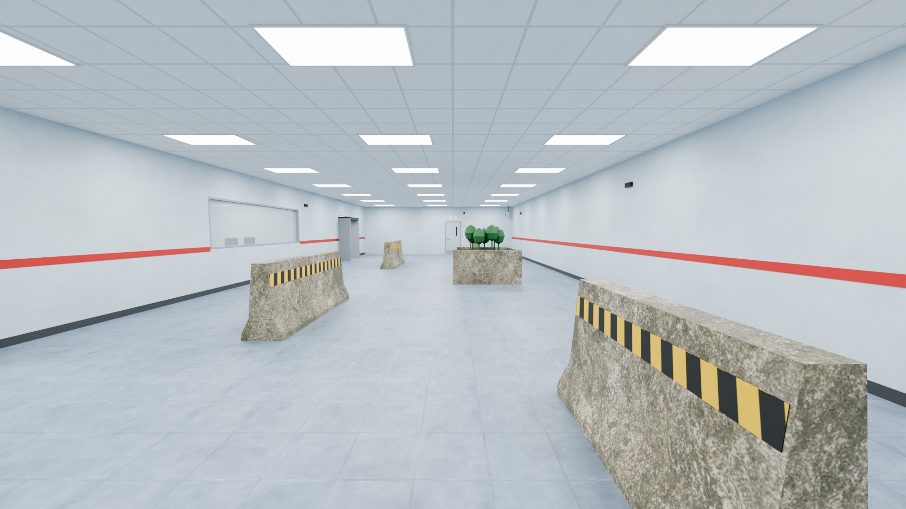
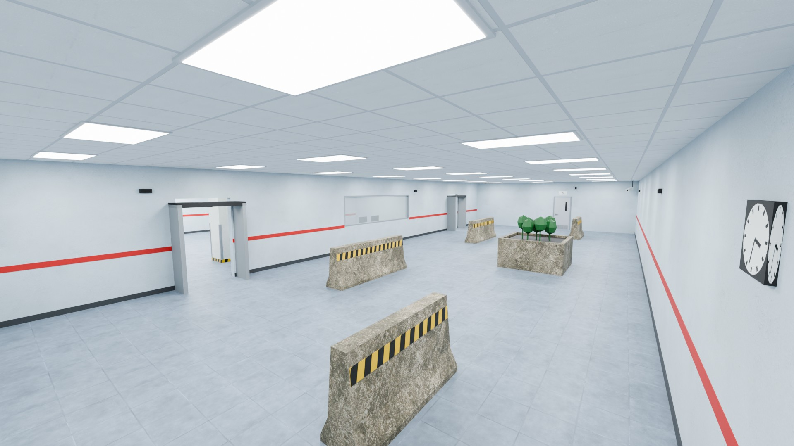
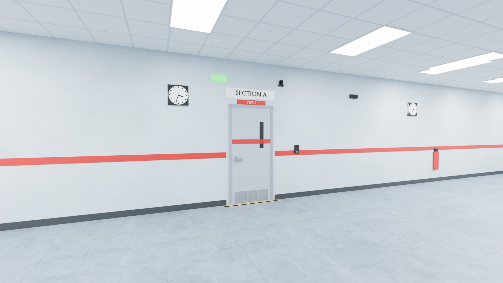
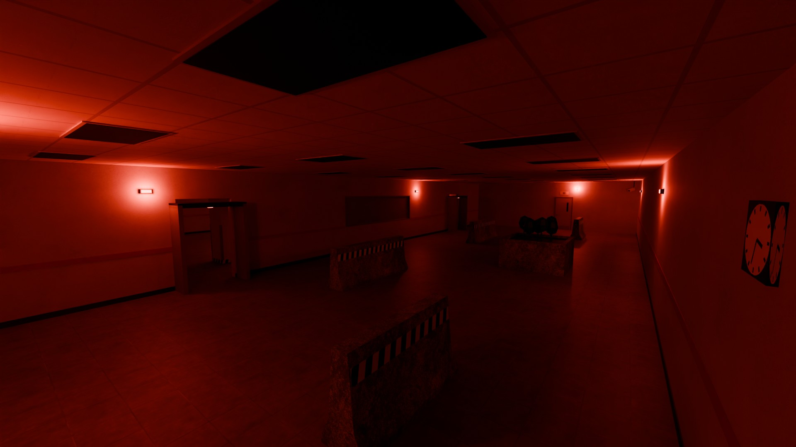
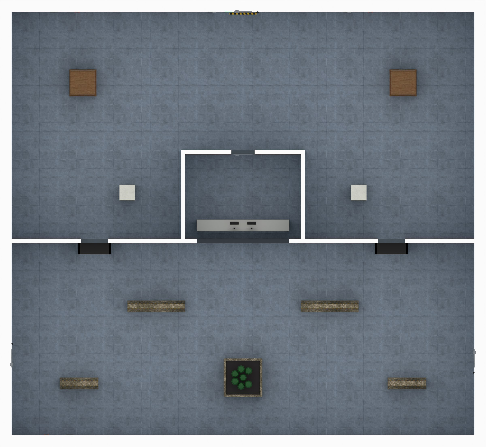

# checkpoint_1: dressed and lit (Secret Operations, step 2)

The outer hall the two keyed entries open into, two scanner lanes through metal-detector arches, the guard booth behind its window (a desk with two screens, nobody at it), the inner hall with crates and pillars, and the tier-1 door with its reader and hazard tape. Blue-grey walls with a red stripe, flat white troffer light.

Built by `tools/blender/build_secretops_dress.py` around the greybox's layout (`tools/blender/build_secretops_greybox.py`): the layout objects are rebuilt from the same model, so `world/checkpoint_1.json` is the greybox's file, unchanged. The method, the light sets, the removable parts and the sources are in `docs/renders/registrar_hall/README.md` (shared by all 13 scenes).

| File | What it is |
|---|---|
| `world/checkpoint_1.glb` | the art only: 1.84 MB, 6746 triangles, 35 nodes drawn (30 meshes), 30 materials, WebP textures |
| `world/lightmaps/checkpoint_1_0.webp`, `_1.webp` | the normal set (`lightmap`): the shell page and the props page |
| `world/lightmaps/checkpoint_1_2.webp`, `_3.webp` | the alarm set (`lightmap_night`): the same two pages |
| `world/checkpoint_1.json` | the layout, as the greybox wrote it: 36 colliders, 4 doors, 4 cameras, 3 links, 1 zones, 11 spots |
| `blender/scenes/checkpoint_1.blend` | the saved scene (Git LFS): `Art` (Props, Separate, and Arch: one box per shell collider, for the layout check only), `Shell`, `Doors`, `Layout`, the two light collections, `Export` |
| `docs/renders/checkpoint_1/` | `1_arrival.jpg`, `2_wide.jpg`, `3_detail.jpg` (normal light), `4_alarm.jpg` (the wide view in the alarm set), `plan.jpg`, `bake.json`, `caps.json` |







## Bake

| Map | Set | Page | Size | px/m | Gain G | Shown gain (caps) |
|---|---|---|---|---|---|---|
| `checkpoint_1_0` | normal | shell | 2048 | 44.2 | 0.26631 | 0.9406 |
| `checkpoint_1_1` | normal | props | 1536 | 47.2 | 0.26631 | 0.9406 |
| `checkpoint_1_2` | alarm | shell | 2048 | 44.2 | 5.08423 | 1.2917 |
| `checkpoint_1_3` | alarm | props | 1536 | 47.2 | 5.08423 | 1.2917 |

Cycles on the rented GPU (GPU), 512 samples, diffuse direct and indirect, OIDN, 8 px margin; 140 s for both sets. Texel = G L / (C + G L) with C = 1.2 and lightmap intensity pi C, G set so the median wall texel shows 0.34 (normal) or 0.26 (alarm) of its light; `caps.json` then scales each set's intensity so the walls show p50 0.19 (normal) or 0.155 (alarm) and caps any material that would pass p90 0.88 or p99 0.97.

## Brightness (`lab_display.py`, as the page shows it)

Normal set:

```
material                m2           map       k    p50    p90    p99     >=1
Ceiling_Tile         518.9 checkpoint_1_0  3.5460  0.139  0.203  0.225   0.00%
Wall_Checkpoint      511.0 checkpoint_1_0  3.5460  0.190  0.267  0.309   0.00%
Floor_Checkpoint     502.9 checkpoint_1_0  3.5460  0.121  0.159  0.185   0.00%
Lamp_Housing          57.9 checkpoint_1_1  3.5460  0.416  0.426  0.435   0.00%
Concrete_Prop         44.8 checkpoint_1_1  3.5460  0.036  0.090  0.158   0.00%
Wood_Crate            25.6 checkpoint_1_1  3.5460  0.063  0.105  0.153   0.00%
Pillar_Paint          20.5 checkpoint_1_1  3.5460  0.194  0.249  0.275   0.00%
Paint_Grey            16.1 checkpoint_1_1  3.5460  0.016  0.076  0.129   0.00%
Skirting              13.1 checkpoint_1_1  3.5460  0.011  0.016  0.017   0.00%
Stripe_Red            12.9 checkpoint_1_1  3.5460  0.131  0.185  0.193   0.00%
Plastic_Grey          11.9 checkpoint_1_1  3.5460  0.064  0.082  0.095   0.00%
Soil                   9.6 checkpoint_1_1  3.5460  0.000  0.003  0.003   0.00%
Hazard                 9.3 checkpoint_1_1  3.5460  0.000  0.189  0.222   0.00%
Plastic_Black          8.6 checkpoint_1_1  3.5460  0.001  0.001  0.001   0.00%
Door_Frame             8.0 checkpoint_1_1  3.5460  0.065  0.105  0.113   0.00%
Laminate               6.1 checkpoint_1_1  3.5460  0.055  0.155  0.162   0.00%
Steel                  5.6 checkpoint_1_1  3.5460  0.000  0.132  0.162   0.00%
Door_Steel             4.4 checkpoint_1_1  3.5460  0.000  0.157  0.167   0.00%
Door_Keycard           4.4 checkpoint_1_1  3.5460  0.000  0.168  0.170   0.00%
Plant                  4.0 checkpoint_1_1  3.5460  0.023  0.037  0.041   0.00%
Clock_Face             0.9 checkpoint_1_1  3.5460  0.237  0.404  0.419   0.00%
Sign_Plate             0.9 checkpoint_1_1  3.5460  0.226  0.304  0.309   0.00%
Cam_Body               0.4 checkpoint_1_1  3.5460  0.114  0.169  0.241   0.00%
Steel_Dark             0.2 checkpoint_1_1  3.5460  0.013  0.021  0.030   0.00%
Plastic_White          0.0 checkpoint_1_1  3.5460  0.023  0.251  0.262   0.00%
```

Alarm set (`lightmap_night`):

```
material                m2           map       k    p50    p90    p99     >=1
Ceiling_Tile         518.9 checkpoint_1_2  4.3846  0.148  0.467  0.970   0.63%
Wall_Checkpoint      511.0 checkpoint_1_2  4.8696  0.155  0.325  0.654   0.00%
Floor_Checkpoint     502.9 checkpoint_1_2  4.8696  0.076  0.134  0.173   0.00%
Lamp_Housing          57.9 checkpoint_1_3  4.8696  0.000  0.066  0.362   0.00%
Concrete_Prop         44.8 checkpoint_1_3  4.8696  0.046  0.123  0.244   0.00%
Wood_Crate            25.6 checkpoint_1_3  4.8696  0.041  0.110  0.150   0.00%
Pillar_Paint          20.5 checkpoint_1_3  4.8696  0.150  0.372  0.531   0.00%
Paint_Grey            16.1 checkpoint_1_3  4.8696  0.001  0.033  0.104   0.00%
Skirting              13.1 checkpoint_1_3  4.8696  0.010  0.015  0.021   0.00%
Stripe_Red            12.9 checkpoint_1_3  4.8696  0.158  0.251  0.317   0.00%
Plastic_Grey          11.9 checkpoint_1_3  4.8696  0.074  0.112  0.286   0.00%
Soil                   9.6 checkpoint_1_3  4.8696  0.000  0.002  0.002   0.00%
Hazard                 9.3 checkpoint_1_3  4.8696  0.000  0.243  0.497   0.00%
Plastic_Black          8.6 checkpoint_1_3  4.8696  0.000  0.003  0.004   0.00%
Door_Frame             8.0 checkpoint_1_3  4.8696  0.028  0.143  0.289   0.00%
Laminate               6.1 checkpoint_1_3  4.8696  0.004  0.039  0.056   0.00%
Steel                  5.6 checkpoint_1_3  4.8696  0.000  0.148  0.243   0.00%
Door_Steel             4.4 checkpoint_1_3  4.8696  0.000  0.265  0.368   0.00%
Door_Keycard           4.4 checkpoint_1_3  4.8696  0.000  0.211  0.290   0.00%
Plant                  4.0 checkpoint_1_3  4.8696  0.002  0.005  0.007   0.00%
Clock_Face             0.9 checkpoint_1_3  4.5370  0.234  0.719  0.970   0.89%
Sign_Plate             0.9 checkpoint_1_3  4.1601  0.470  0.850  0.970   0.08%
Cam_Body               0.4 checkpoint_1_3  4.8696  0.144  0.297  0.341   0.00%
Steel_Dark             0.2 checkpoint_1_3  4.8696  0.022  0.049  0.056   0.00%
Plastic_White          0.0 checkpoint_1_3  4.8696  0.149  0.658  0.796   0.00%
```

## Gates

```
check_layout (Blender): PASS: 43 of 43 checks passed
greybox --check: GATES PASS
layout JSON: IDENTICAL: world/checkpoint_1.json is byte for byte the greybox's
worlddoc: OK world/checkpoint_1.json: 36 colliders, 4 doors, 0 markers, 3 links, 1 zones, 11 spots, 0 errors, 4 warnings
glb_inspect: pass       tris: 6746 triangles, budget 300000 / pass       mb: 1.76 MB, budget 8
privacy: privacy grep: 15 files, 0 with hits
```

