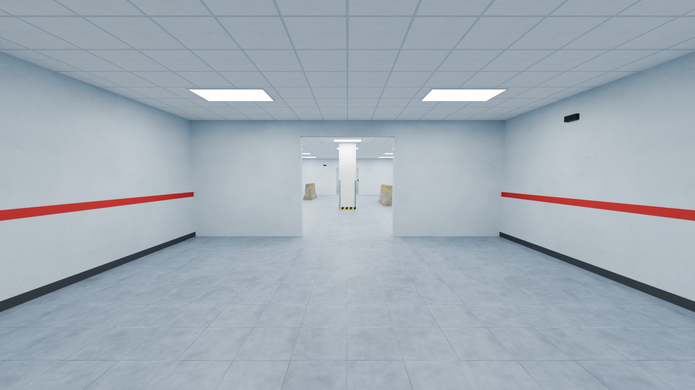
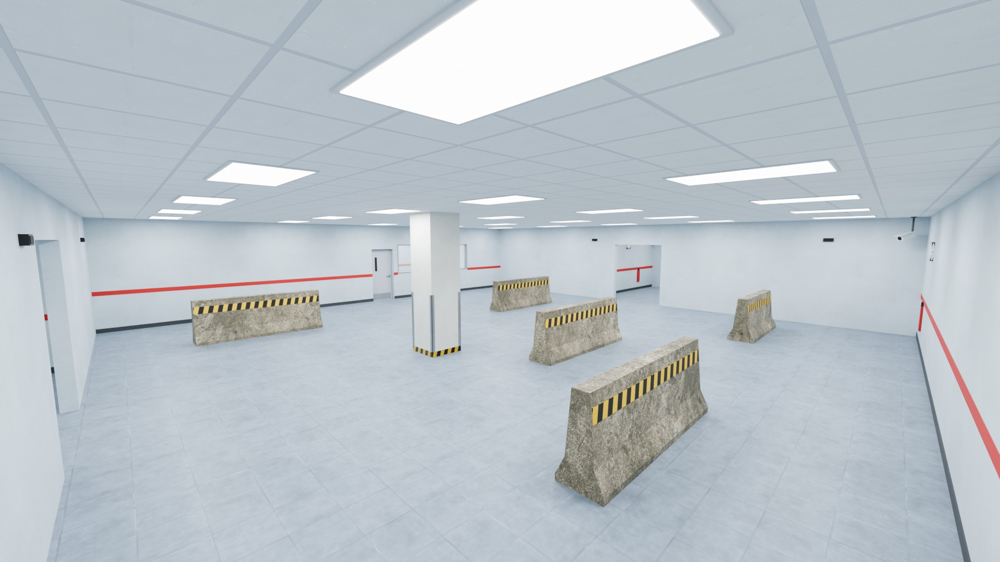
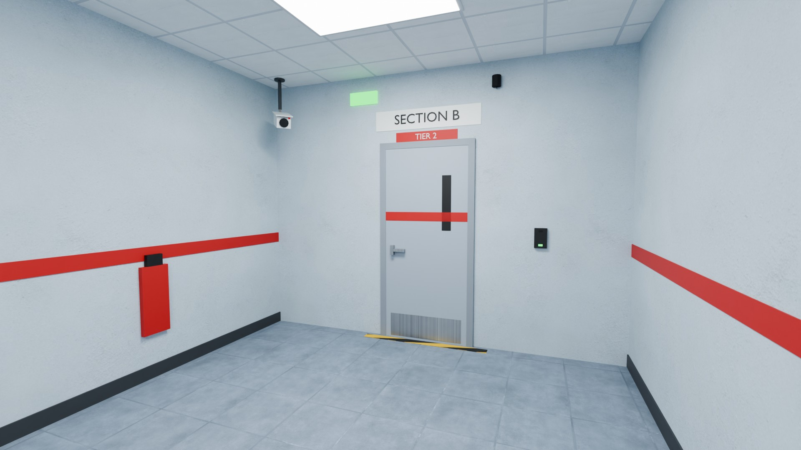
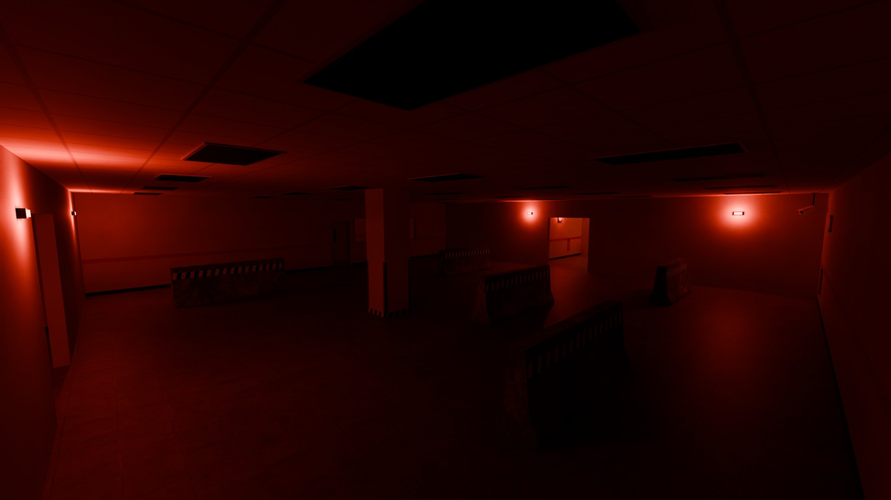
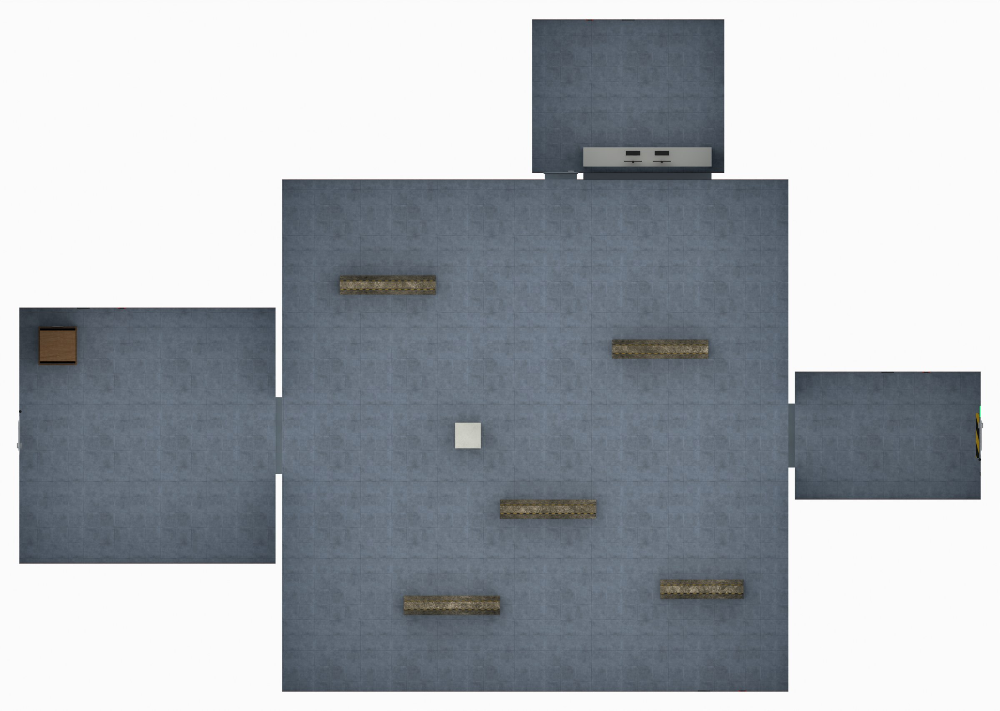

# checkpoint_2: dressed and lit (Secret Operations, step 2)

An antechamber, the screening hall with its chicane of concrete barriers round a pillar, the guard booth behind its window and the tier-2 vestibule. Blue-grey walls, a red stripe, flat light.

Built by `tools/blender/build_secretops_dress.py` around the greybox's layout (`tools/blender/build_secretops_greybox.py`): the layout objects are rebuilt from the same model, so `world/checkpoint_2.json` is the greybox's file, unchanged. The method, the light sets, the removable parts and the sources are in `docs/renders/registrar_hall/README.md` (shared by all 13 scenes).

| File | What it is |
|---|---|
| `world/checkpoint_2.glb` | the art only: 1.69 MB, 4804 triangles, 31 nodes drawn (27 meshes), 27 materials, WebP textures |
| `world/lightmaps/checkpoint_2_0.webp`, `_1.webp` | the normal set (`lightmap`): the shell page and the props page |
| `world/lightmaps/checkpoint_2_2.webp`, `_3.webp` | the alarm set (`lightmap_night`): the same two pages |
| `world/checkpoint_2.json` | the layout, as the greybox wrote it: 41 colliders, 3 doors, 4 cameras, 2 links, 1 zones, 10 spots |
| `blender/scenes/checkpoint_2.blend` | the saved scene (Git LFS): `Art` (Props, Separate, and Arch: one box per shell collider, for the layout check only), `Shell`, `Doors`, `Layout`, the two light collections, `Export` |
| `docs/renders/checkpoint_2/` | `1_arrival.jpg`, `2_wide.jpg`, `3_detail.jpg` (normal light), `4_alarm.jpg` (the wide view in the alarm set), `plan.jpg`, `bake.json`, `caps.json` |







## Bake

| Map | Set | Page | Size | px/m | Gain G | Shown gain (caps) |
|---|---|---|---|---|---|---|
| `checkpoint_2_0` | normal | shell | 2048 | 51.1 | 0.34659 | 1.5 |
| `checkpoint_2_1` | normal | props | 1536 | 59.5 | 0.34659 | 1.5 |
| `checkpoint_2_2` | alarm | shell | 2048 | 51.1 | 4.36586 | 1.3136 |
| `checkpoint_2_3` | alarm | props | 1536 | 59.5 | 4.36586 | 1.3136 |

Cycles on the rented GPU (GPU), 512 samples, diffuse direct and indirect, OIDN, 8 px margin; 192 s for both sets. Texel = G L / (C + G L) with C = 1.2 and lightmap intensity pi C, G set so the median wall texel shows 0.34 (normal) or 0.26 (alarm) of its light; `caps.json` then scales each set's intensity so the walls show p50 0.3 (normal) or 0.155 (alarm) and caps any material that would pass p90 0.88 or p99 0.97.

## Brightness (`lab_display.py`, as the page shows it)

Normal set:

```
material                m2           map       k    p50    p90    p99     >=1
Wall_Checkpoint      390.2 checkpoint_2_0  5.6548  0.300  0.393  0.441   0.00%
Ceiling_Tile         368.2 checkpoint_2_0  5.6548  0.265  0.294  0.672   0.00%
Floor_Checkpoint     356.6 checkpoint_2_0  5.6548  0.198  0.242  0.274   0.00%
Concrete_Prop         40.1 checkpoint_2_1  5.6548  0.083  0.183  0.309   0.00%
Lamp_Housing          30.7 checkpoint_2_1  5.6548  0.740  0.748  0.773   0.00%
Hazard                11.6 checkpoint_2_1  5.6548  0.000  0.376  0.417   0.00%
Paint_Grey            11.0 checkpoint_2_1  5.6548  0.046  0.085  0.134   0.00%
Pillar_Paint          10.2 checkpoint_2_1  5.6548  0.319  0.440  0.681   0.00%
Stripe_Red             9.4 checkpoint_2_1  5.6548  0.192  0.253  0.264   0.00%
Wood_Crate             9.4 checkpoint_2_1  5.6548  0.025  0.089  0.157   0.00%
Skirting               9.1 checkpoint_2_1  5.6548  0.018  0.022  0.025   0.00%
Door_Frame             6.1 checkpoint_2_1  5.6548  0.131  0.237  0.252   0.00%
Laminate               5.1 checkpoint_2_1  5.6548  0.146  0.397  0.412   0.00%
Door_Steel             4.4 checkpoint_2_1  5.6548  0.274  0.327  0.387   0.00%
Door_Keycard           4.4 checkpoint_2_1  5.6548  0.000  0.264  0.283   0.00%
Steel                  3.8 checkpoint_2_1  5.6548  0.000  0.211  0.245   0.00%
Plastic_Black          2.5 checkpoint_2_1  5.6548  0.001  0.002  0.003   0.00%
Clock_Face             0.9 checkpoint_2_1  5.6548  0.321  0.497  0.529   0.00%
Sign_Plate             0.7 checkpoint_2_1  5.6548  0.240  0.420  0.465   0.00%
Cam_Body               0.4 checkpoint_2_1  5.6548  0.126  0.166  0.220   0.00%
Steel_Dark             0.2 checkpoint_2_1  5.6548  0.016  0.027  0.036   0.00%
Plastic_White          0.0 checkpoint_2_1  5.6548  0.035  0.455  0.461   0.00%
```

Alarm set (`lightmap_night`):

```
material                m2           map       k    p50    p90    p99     >=1
Wall_Checkpoint      390.2 checkpoint_2_2  4.9521  0.155  0.355  0.644   0.00%
Ceiling_Tile         368.2 checkpoint_2_2  4.4272  0.106  0.438  0.970   0.70%
Floor_Checkpoint     356.6 checkpoint_2_2  4.9521  0.058  0.124  0.176   0.00%
Concrete_Prop         40.1 checkpoint_2_3  4.9521  0.029  0.077  0.155   0.00%
Lamp_Housing          30.7 checkpoint_2_3  4.9521  0.000  0.062  0.368   0.00%
Hazard                11.6 checkpoint_2_3  4.9521  0.000  0.148  0.324   0.00%
Paint_Grey            11.0 checkpoint_2_3  4.9521  0.013  0.056  0.195   0.00%
Pillar_Paint          10.2 checkpoint_2_3  4.9521  0.095  0.202  0.224   0.00%
Stripe_Red             9.4 checkpoint_2_3  4.9521  0.160  0.314  0.417   0.00%
Wood_Crate             9.4 checkpoint_2_3  4.9521  0.072  0.176  0.262   0.00%
Skirting               9.1 checkpoint_2_3  4.9521  0.007  0.017  0.023   0.00%
Door_Frame             6.1 checkpoint_2_3  4.9521  0.039  0.140  0.279   0.00%
Laminate               5.1 checkpoint_2_3  4.9521  0.031  0.120  0.179   0.00%
Door_Steel             4.4 checkpoint_2_3  4.9521  0.059  0.124  0.129   0.00%
Door_Keycard           4.4 checkpoint_2_3  4.9521  0.000  0.262  0.322   0.00%
Steel                  3.8 checkpoint_2_3  4.9521  0.000  0.101  0.211   0.00%
Plastic_Black          2.5 checkpoint_2_3  4.9521  0.000  0.004  0.004   0.00%
Clock_Face             0.9 checkpoint_2_3  3.3476  0.247  0.880  0.929   0.00%
Sign_Plate             0.7 checkpoint_2_3  4.0657  0.519  0.880  0.965   0.14%
Cam_Body               0.4 checkpoint_2_3  4.9521  0.341  0.663  0.733   0.00%
Steel_Dark             0.2 checkpoint_2_3  4.9521  0.031  0.061  0.070   0.00%
Plastic_White          0.0 checkpoint_2_3  4.9521  0.276  0.745  0.794   0.00%
```

## Gates

```
check_layout (Blender): PASS: 46 of 46 checks passed
greybox --check: GATES PASS
layout JSON: IDENTICAL: world/checkpoint_2.json is byte for byte the greybox's
worlddoc: OK world/checkpoint_2.json: 41 colliders, 3 doors, 0 markers, 2 links, 1 zones, 10 spots, 0 errors, 3 warnings
glb_inspect: pass       tris: 4804 triangles, budget 300000 / pass       mb: 1.61 MB, budget 8
privacy: privacy grep: 15 files, 0 with hits
```

