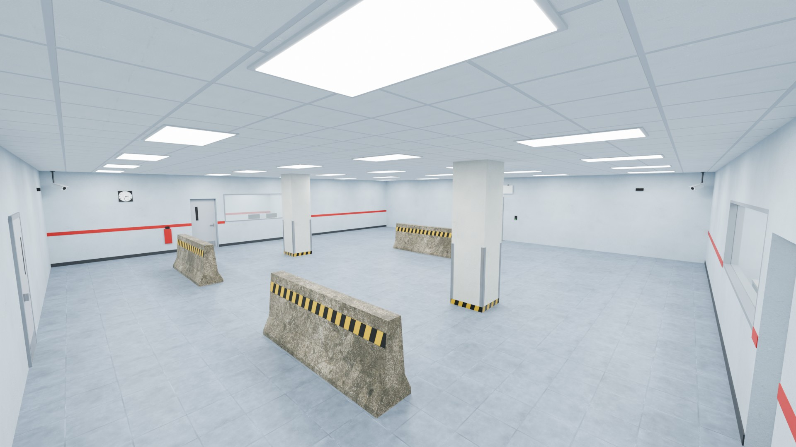
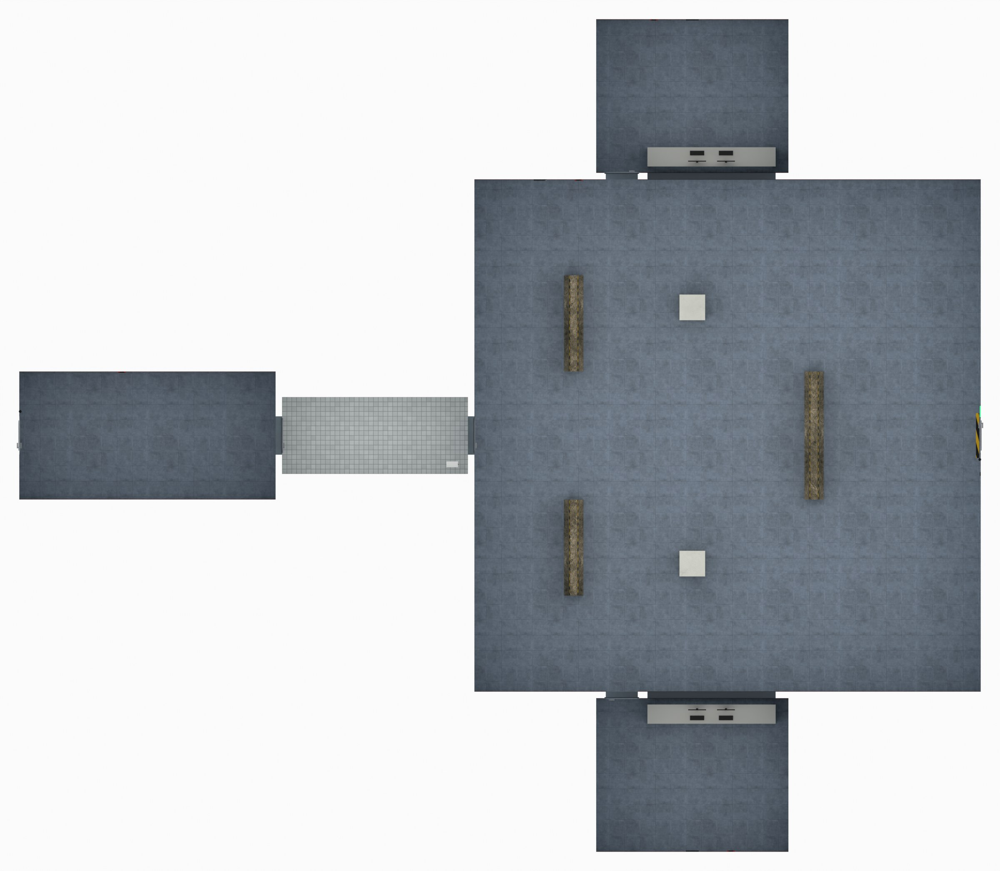

# checkpoint_3: dressed and lit (Secret Operations, step 2)

The approach, a white-tiled decontamination tunnel between two doors, the vault with twin guard booths and barriers, and the tier-3 door to the Registrar under its VAULT 3 sign.

Built by `tools/blender/build_secretops_dress.py` around the greybox's layout (`tools/blender/build_secretops_greybox.py`): the layout objects are rebuilt from the same model, so `world/checkpoint_3.json` is the greybox's file, unchanged. The method, the light sets, the removable parts and the sources are in `docs/renders/registrar_hall/README.md` (shared by all 13 scenes).

| File | What it is |
|---|---|
| `world/checkpoint_3.glb` | the art only: 1.40 MB, 5988 triangles, 36 nodes drawn (29 meshes), 29 materials, WebP textures |
| `world/lightmaps/checkpoint_3_0.webp`, `_1.webp` | the normal set (`lightmap`): the shell page and the props page |
| `world/lightmaps/checkpoint_3_2.webp`, `_3.webp` | the alarm set (`lightmap_night`): the same two pages |
| `world/checkpoint_3.json` | the layout, as the greybox wrote it: 49 colliders, 6 doors, 4 cameras, 2 links, 2 zones, 7 spots |
| `blender/scenes/checkpoint_3.blend` | the saved scene (Git LFS): `Art` (Props, Separate, and Arch: one box per shell collider, for the layout check only), `Shell`, `Doors`, `Layout`, the two light collections, `Export` |
| `docs/renders/checkpoint_3/` | `1_arrival.jpg`, `2_wide.jpg`, `3_detail.jpg` (normal light), `4_alarm.jpg` (the wide view in the alarm set), `plan.jpg`, `bake.json`, `caps.json` |







## Bake

| Map | Set | Page | Size | px/m | Gain G | Shown gain (caps) |
|---|---|---|---|---|---|---|
| `checkpoint_3_0` | normal | shell | 2048 | 52.0 | 0.29481 | 0.9143 |
| `checkpoint_3_1` | normal | props | 1536 | 48.1 | 0.29481 | 0.9143 |
| `checkpoint_3_2` | alarm | shell | 2048 | 52.0 | 5.33372 | 1.0804 |
| `checkpoint_3_3` | alarm | props | 1536 | 48.1 | 5.33372 | 1.0804 |

Cycles on the rented GPU (GPU), 512 samples, diffuse direct and indirect, OIDN, 8 px margin; 231 s for both sets. Texel = G L / (C + G L) with C = 1.2 and lightmap intensity pi C, G set so the median wall texel shows 0.34 (normal) or 0.26 (alarm) of its light; `caps.json` then scales each set's intensity so the walls show p50 0.19 (normal) or 0.155 (alarm) and caps any material that would pass p90 0.88 or p99 0.97.

## Brightness (`lab_display.py`, as the page shows it)

Normal set:

```
material                m2           map       k    p50    p90    p99     >=1
Wall_Checkpoint      374.6 checkpoint_3_0  3.4468  0.182  0.221  0.258   0.00%
Ceiling_Tile         355.0 checkpoint_3_0  3.4468  0.150  0.171  0.368   0.00%
Floor_Checkpoint     331.2 checkpoint_3_0  3.4468  0.114  0.137  0.154   0.00%
Wall_Tile             40.6 checkpoint_3_0  3.4468  0.265  0.317  0.344   0.00%
Lamp_Housing          31.5 checkpoint_3_1  3.4468  0.423  0.428  0.442   0.00%
Concrete_Prop         27.1 checkpoint_3_1  3.4468  0.045  0.100  0.169   0.00%
Pillar_Paint          20.5 checkpoint_3_1  3.4468  0.183  0.224  0.310   0.00%
Paint_Grey            16.8 checkpoint_3_1  3.4468  0.027  0.045  0.067   0.00%
Door_Frame            15.0 checkpoint_3_1  3.4468  0.069  0.129  0.137   0.00%
Floor_Tile            13.9 checkpoint_3_0  3.4468  0.292  0.321  0.335   0.00%
Laminate              10.2 checkpoint_3_1  3.4468  0.077  0.222  0.230   0.00%
Hazard                 9.3 checkpoint_3_1  3.4468  0.000  0.199  0.236   0.00%
Skirting               8.9 checkpoint_3_1  3.4468  0.011  0.012  0.014   0.00%
Stripe_Red             8.1 checkpoint_3_1  3.4468  0.119  0.139  0.148   0.00%
Steel                  5.6 checkpoint_3_1  3.4468  0.000  0.120  0.139   0.00%
Door_Steel             4.4 checkpoint_3_1  3.4468  0.148  0.176  0.208   0.00%
Door_Keycard           4.4 checkpoint_3_1  3.4468  0.000  0.168  0.173   0.00%
Plastic_Black          3.8 checkpoint_3_1  3.4468  0.001  0.001  0.001   0.00%
Sign_Plate             1.8 checkpoint_3_1  3.4468  0.213  0.271  0.291   0.00%
Notice                 1.0 checkpoint_3_1  3.4468  0.035  0.173  0.181   0.00%
Clock_Face             0.7 checkpoint_3_1  3.4468  0.247  0.303  0.319   0.00%
Cam_Body               0.4 checkpoint_3_1  3.4468  0.058  0.115  0.144   0.00%
Steel_Dark             0.2 checkpoint_3_1  3.4468  0.010  0.018  0.022   0.00%
Plastic_White          0.0 checkpoint_3_1  3.4468  0.024  0.270  0.277   0.00%
```

Alarm set (`lightmap_night`):

```
material                m2           map       k    p50    p90    p99     >=1
Wall_Checkpoint      374.6 checkpoint_3_2  4.0730  0.120  0.295  0.534   0.00%
Ceiling_Tile         355.0 checkpoint_3_2  4.0730  0.107  0.456  0.918   0.29%
Floor_Checkpoint     331.2 checkpoint_3_2  4.0730  0.049  0.109  0.151   0.00%
Wall_Tile             40.6 checkpoint_3_2  4.0730  0.479  0.614  0.919   0.30%
Lamp_Housing          31.5 checkpoint_3_3  4.0730  0.000  0.078  0.488   0.00%
Concrete_Prop         27.1 checkpoint_3_3  4.0730  0.037  0.104  0.212   0.00%
Pillar_Paint          20.5 checkpoint_3_3  4.0730  0.116  0.159  0.179   0.00%
Paint_Grey            16.8 checkpoint_3_3  4.0730  0.001  0.044  0.056   0.00%
Door_Frame            15.0 checkpoint_3_3  4.0730  0.021  0.105  0.174   0.00%
Floor_Tile            13.9 checkpoint_3_2  4.0730  0.510  0.598  0.630   0.00%
Laminate              10.2 checkpoint_3_3  4.0730  0.013  0.110  0.147   0.00%
Hazard                 9.3 checkpoint_3_3  4.0730  0.000  0.196  0.380   0.00%
Skirting               8.9 checkpoint_3_3  4.0730  0.006  0.015  0.020   0.00%
Stripe_Red             8.1 checkpoint_3_3  4.0730  0.117  0.259  0.343   0.00%
Steel                  5.6 checkpoint_3_3  4.0730  0.000  0.080  0.114   0.00%
Door_Steel             4.4 checkpoint_3_3  4.0730  0.097  0.120  0.126   0.00%
Door_Keycard           4.4 checkpoint_3_3  4.0730  0.000  0.152  0.186   0.00%
Plastic_Black          3.8 checkpoint_3_3  4.0730  0.000  0.002  0.003   0.00%
Sign_Plate             1.8 checkpoint_3_3  3.8698  0.494  0.877  0.970   0.00%
Notice                 1.0 checkpoint_3_3  4.0730  0.134  0.636  0.715   0.00%
Clock_Face             0.7 checkpoint_3_3  3.4959  0.007  0.869  0.970   0.00%
Cam_Body               0.4 checkpoint_3_3  4.0730  0.521  0.835  0.883   0.00%
Steel_Dark             0.2 checkpoint_3_3  4.0730  0.039  0.066  0.084   0.00%
Plastic_White          0.0 checkpoint_3_3  4.0730  0.020  0.245  0.261   0.00%
```

## Gates

```
check_layout (Blender): PASS: 54 of 54 checks passed
greybox --check: GATES PASS
layout JSON: IDENTICAL: world/checkpoint_3.json is byte for byte the greybox's
worlddoc: OK world/checkpoint_3.json: 49 colliders, 6 doors, 0 markers, 2 links, 2 zones, 7 spots, 0 errors, 3 warnings
glb_inspect: pass       tris: 5988 triangles, budget 300000 / pass       mb: 1.34 MB, budget 8
privacy: privacy grep: 15 files, 0 with hits
```

