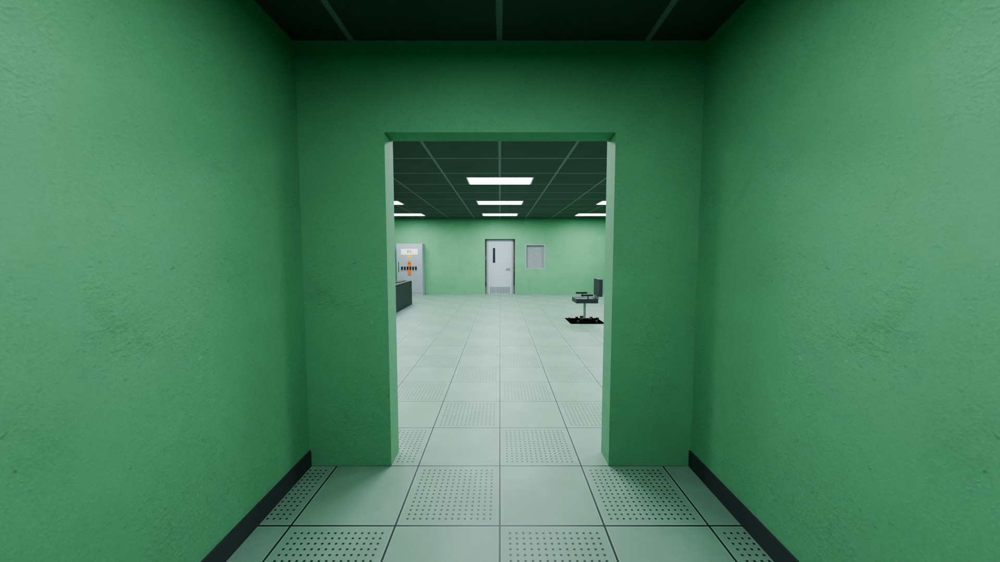
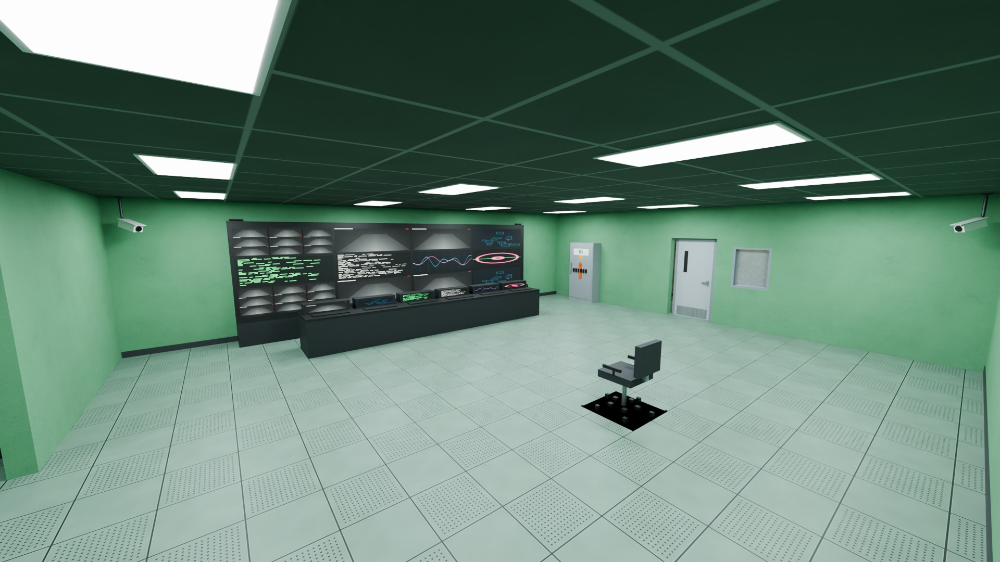
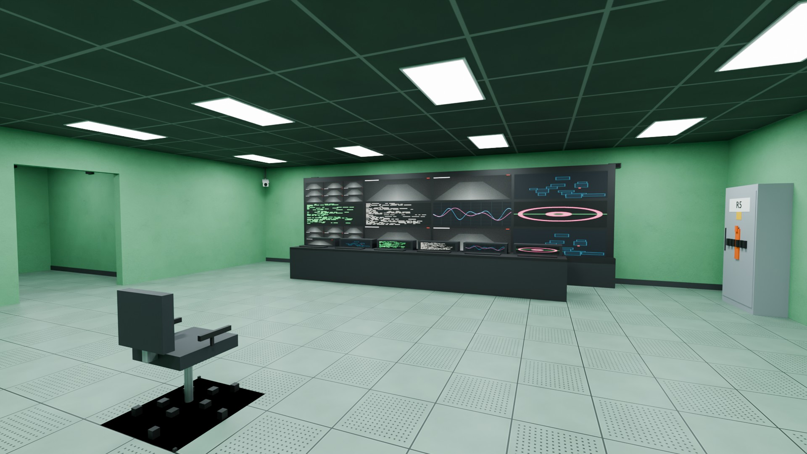
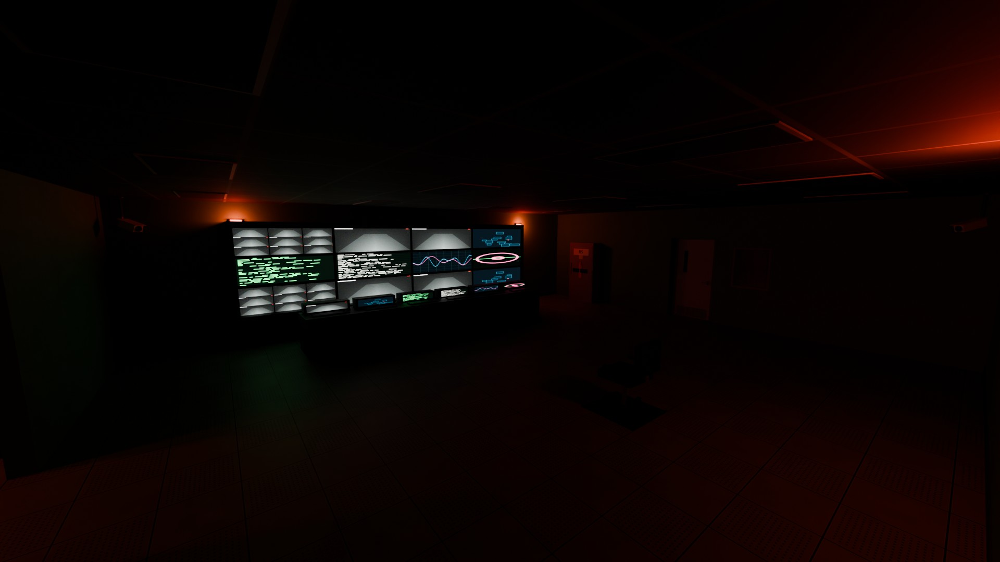
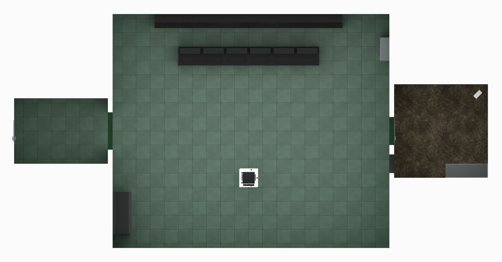

# control_room: dressed and lit (Secret Operations, step 2)

A green antechamber from the arena, the control room with its one chair facing a wall of twelve monitors and a console of six more, a server cabinet, the R5 breaker, and the cell beside it: grimy concrete, a steel bunk, a window into the control room, its locked door. Dim on purpose: the monitors' glow carries the room.

Built by `tools/blender/build_secretops_dress.py` around the greybox's layout (`tools/blender/build_secretops_greybox.py`): the layout objects are rebuilt from the same model, so `world/control_room.json` is the greybox's file, unchanged. The method, the light sets, the removable parts and the sources are in `docs/renders/registrar_hall/README.md` (shared by all 13 scenes).

| File | What it is |
|---|---|
| `world/control_room.glb` | the art only: 1.03 MB, 2994 triangles, 29 nodes drawn (26 meshes), 26 materials, WebP textures |
| `world/lightmaps/control_room_0.webp`, `_1.webp` | the normal set (`lightmap`): the shell page and the props page |
| `world/lightmaps/control_room_2.webp`, `_3.webp` | the alarm set (`lightmap_night`): the same two pages |
| `world/control_room.json` | the layout, as the greybox wrote it: 33 colliders, 2 doors, 3 cameras, 1 links, 2 zones, 10 spots |
| `blender/scenes/control_room.blend` | the saved scene (Git LFS): `Art` (Props, Separate, and Arch: one box per shell collider, for the layout check only), `Shell`, `Doors`, `Layout`, the two light collections, `Export` |
| `docs/renders/control_room/` | `1_arrival.jpg`, `2_wide.jpg`, `3_detail.jpg` (normal light), `4_alarm.jpg` (the wide view in the alarm set), `plan.jpg`, `bake.json`, `caps.json` |







## Bake

| Map | Set | Page | Size | px/m | Gain G | Shown gain (caps) |
|---|---|---|---|---|---|---|
| `control_room_0` | normal | shell | 1536 | 60.0 | 0.69923 | 1.821 |
| `control_room_1` | normal | props | 1536 | 101.1 | 0.69923 | 1.821 |
| `control_room_2` | alarm | shell | 1536 | 60.0 | 15.67865 | 5.2802 |
| `control_room_3` | alarm | props | 1536 | 101.1 | 15.67865 | 5.2802 |

Cycles on the rented GPU (GPU), 512 samples, diffuse direct and indirect, OIDN, 8 px margin; 70 s for both sets. Texel = G L / (C + G L) with C = 1.2 and lightmap intensity pi C, G set so the median wall texel shows 0.34 (normal) or 0.26 (alarm) of its light; `caps.json` then scales each set's intensity so the walls show p50 0.19 (normal) or 0.155 (alarm) and caps any material that would pass p90 0.88 or p99 0.97.

## Brightness (`lab_display.py`, as the page shows it)

Normal set:

```
material                m2           map       k    p50    p90    p99     >=1
Wall_Green           136.5 control_room_0  6.8650  0.234  0.309  0.337   0.00%
Ceiling_Server       129.2 control_room_0  6.8650  0.027  0.074  0.093   0.00%
Floor_Server         117.7 control_room_0  6.8650  0.278  0.316  0.411   0.00%
Plastic_Black         46.4 control_room_1  6.8650  0.000  0.003  0.004   0.00%
Wall_Cell             40.2 control_room_0  6.8650  0.043  0.097  0.174   0.00%
Paint_Dark            31.6 control_room_1  6.8650  0.003  0.014  0.023   0.00%
Ceiling_Concrete      16.0 control_room_0  6.8650  0.013  0.030  0.055   0.00%
Floor_Cell            14.9 control_room_0  6.8650  0.069  0.145  0.247   0.00%
Lamp_Housing          11.0 control_room_1  5.5291  0.880  0.880  0.898   0.00%
Server_Body            9.5 control_room_1  6.8650  0.017  0.091  0.478   0.04%
Breaker_Paint          7.4 control_room_1  6.8650  0.065  0.310  0.384   0.00%
Door_Steel             4.4 control_room_1  6.8650  0.291  0.470  0.488   0.00%
Door_Frame             4.0 control_room_1  6.8650  0.085  0.260  0.288   0.00%
Skirting               3.9 control_room_1  6.8650  0.022  0.034  0.038   0.00%
Steel                  3.7 control_room_1  6.8650  0.005  0.190  0.344   0.00%
Mattress               2.4 control_room_1  6.8650  0.010  0.184  0.215   0.00%
Fabric                 1.2 control_room_1  6.8650  0.018  0.026  0.027   0.00%
Steel_Dark             0.9 control_room_1  6.8650  0.004  0.142  0.142   0.00%
Sign_Plate             0.5 control_room_1  6.8121  0.356  0.879  0.921   0.00%
Cam_Body               0.4 control_room_1  6.8650  0.249  0.452  0.755   0.00%
Paint_Orange           0.2 control_room_1  6.8650  0.101  0.608  0.726   0.00%
Paint_Yellow           0.0 control_room_1  6.8650  0.000  0.691  0.726   0.00%
```

Alarm set (`lightmap_night`):

```
material                m2           map       k    p50    p90    p99     >=1
Wall_Green           136.5 control_room_2 14.6865  0.146  0.398  0.971   0.88%
Ceiling_Server       129.2 control_room_2 19.9058  0.048  0.216  0.577   0.29%
Floor_Server         117.7 control_room_2 19.9058  0.229  0.541  0.784   0.17%
Plastic_Black         46.4 control_room_3 19.9058  0.002  0.011  0.017   0.00%
Wall_Cell             40.2 control_room_2 19.9058  0.001  0.004  0.044   0.00%
Paint_Dark            31.6 control_room_3 19.9058  0.003  0.027  0.048   0.00%
Ceiling_Concrete      16.0 control_room_2 19.9058  0.001  0.002  0.004   0.00%
Floor_Cell            14.9 control_room_2 19.9058  0.001  0.002  0.008   0.00%
Lamp_Housing          11.0 control_room_3  6.1350  0.000  0.195  0.970   0.86%
Server_Body            9.5 control_room_3 19.9058  0.011  0.120  0.194   0.27%
Breaker_Paint          7.4 control_room_3 18.1939  0.148  0.715  0.968   0.60%
Door_Steel             4.4 control_room_3 19.9058  0.002  0.676  0.698   0.00%
Door_Frame             4.0 control_room_3 15.2996  0.012  0.537  0.970   0.63%
Skirting               3.9 control_room_3 19.9058  0.034  0.116  0.131   0.00%
Steel                  3.7 control_room_3 19.9058  0.000  0.351  0.661   0.07%
Mattress               2.4 control_room_3 19.9058  0.000  0.002  0.002   0.00%
Fabric                 1.2 control_room_3 19.9058  0.011  0.043  0.047   0.00%
Steel_Dark             0.9 control_room_3 19.9058  0.000  0.021  0.271   0.00%
Sign_Plate             0.5 control_room_3  3.8438  0.532  0.880  0.938   0.00%
Cam_Body               0.4 control_room_3 16.3984  0.166  0.699  0.968   0.65%
Paint_Orange           0.2 control_room_3  8.3147  0.095  0.880  0.957   0.00%
Paint_Yellow           0.0 control_room_3  7.3433  0.002  0.875  0.970   0.00%
```

## Gates

```
check_layout (Blender): PASS: 36 of 36 checks passed
greybox --check: GATES PASS
layout JSON: IDENTICAL: world/control_room.json is byte for byte the greybox's
worlddoc: OK world/control_room.json: 33 colliders, 2 doors, 0 markers, 1 links, 2 zones, 10 spots, 0 errors, 2 warnings
glb_inspect: pass       tris: 2994 triangles, budget 300000 / pass       mb: 0.98 MB, budget 8
privacy: privacy grep: 15 files, 0 with hits
```

