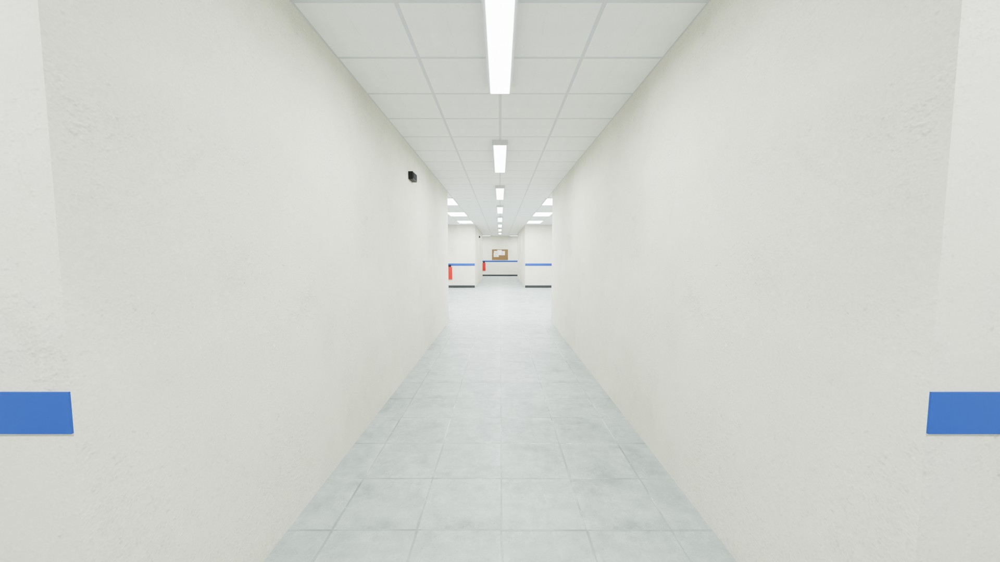
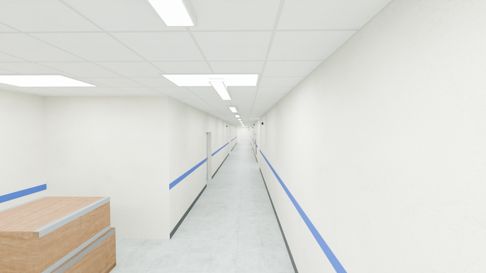
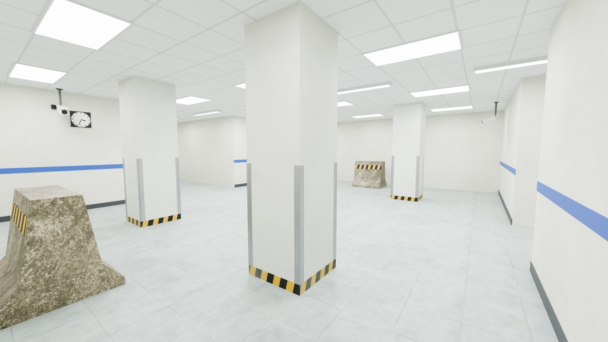
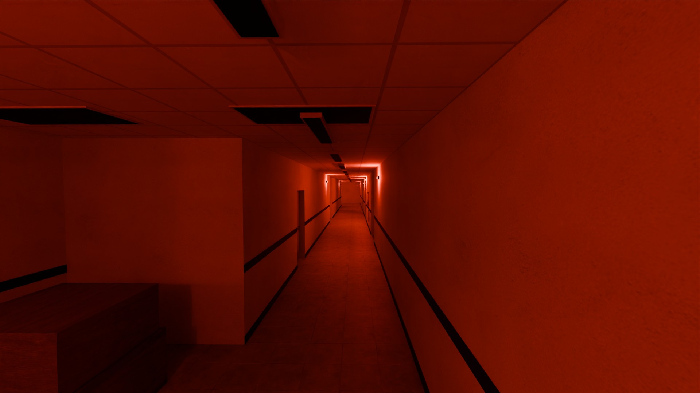
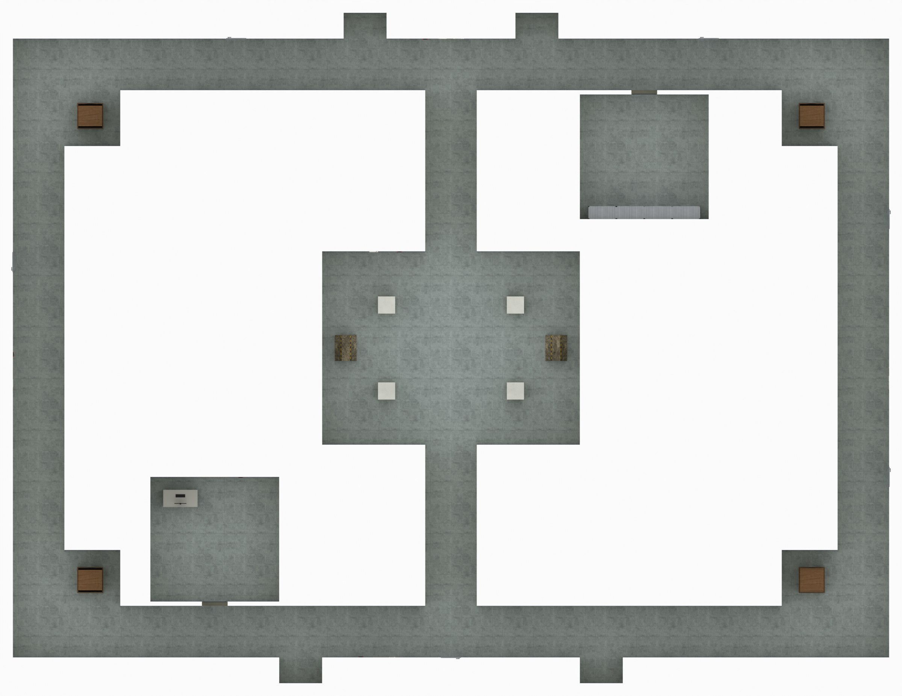

# corridors_a: dressed and lit (Secret Operations, step 2)

A ring of 2.4 m corridors round two blocks, a spine with an atrium of pillars, corner bays with crates, an office and a store. Pale walls with a blue stripe, continuous strip lights, signs over every door, notice boards and stopped clocks.

Built by `tools/blender/build_secretops_dress.py` around the greybox's layout (`tools/blender/build_secretops_greybox.py`): the layout objects are rebuilt from the same model, so `world/corridors_a.json` is the greybox's file, unchanged. The method, the light sets, the removable parts and the sources are in `docs/renders/registrar_hall/README.md` (shared by all 13 scenes).

| File | What it is |
|---|---|
| `world/corridors_a.glb` | the art only: 2.05 MB, 10138 triangles, 39 nodes drawn (27 meshes), 27 materials, WebP textures |
| `world/lightmaps/corridors_a_0.webp`, `_1.webp` | the normal set (`lightmap`): the shell page and the props page |
| `world/lightmaps/corridors_a_2.webp`, `_3.webp` | the alarm set (`lightmap_night`): the same two pages |
| `world/corridors_a.json` | the layout, as the greybox wrote it: 100 colliders, 8 doors, 6 cameras, 6 links, 1 zones, 11 spots |
| `blender/scenes/corridors_a.blend` | the saved scene (Git LFS): `Art` (Props, Separate, and Arch: one box per shell collider, for the layout check only), `Shell`, `Doors`, `Layout`, the two light collections, `Export` |
| `docs/renders/corridors_a/` | `1_arrival.jpg`, `2_wide.jpg`, `3_detail.jpg` (normal light), `4_alarm.jpg` (the wide view in the alarm set), `plan.jpg`, `bake.json`, `caps.json` |







## Bake

| Map | Set | Page | Size | px/m | Gain G | Shown gain (caps) |
|---|---|---|---|---|---|---|
| `corridors_a_0` | normal | shell | 2048 | 35.4 | 0.27477 | 0.852 |
| `corridors_a_1` | normal | props | 2048 | 71.0 | 0.27477 | 0.852 |
| `corridors_a_2` | alarm | shell | 2048 | 35.4 | 1.84867 | 0.9118 |
| `corridors_a_3` | alarm | props | 2048 | 71.0 | 1.84867 | 0.9118 |

Cycles on the rented GPU (GPU), 512 samples, diffuse direct and indirect, OIDN, 8 px margin; 237 s for both sets. Texel = G L / (C + G L) with C = 1.2 and lightmap intensity pi C, G set so the median wall texel shows 0.34 (normal) or 0.26 (alarm) of its light; `caps.json` then scales each set's intensity so the walls show p50 0.19 (normal) or 0.155 (alarm) and caps any material that would pass p90 0.88 or p99 0.97.

## Brightness (`lab_display.py`, as the page shows it)

Normal set:

```
material                m2           map       k    p50    p90    p99     >=1
Wall_Corridor       1115.4 corridors_a_0  3.2120  0.190  0.257  0.319   0.00%
Ceiling_Tile         558.7 corridors_a_0  3.2120  0.159  0.217  0.345   0.00%
Floor_Corridor       546.6 corridors_a_0  3.2120  0.132  0.180  0.212   0.00%
Lamp_Housing          61.2 corridors_a_1  3.2120  0.379  0.381  0.421   0.00%
Wood_Crate            38.5 corridors_a_1  3.2120  0.044  0.092  0.136   0.00%
Pillar_Paint          38.4 corridors_a_1  3.2120  0.195  0.249  0.273   0.00%
Steel                 34.1 corridors_a_1  3.2120  0.023  0.114  0.160   0.00%
Skirting              23.6 corridors_a_1  3.2120  0.009  0.013  0.015   0.00%
Stripe_Blue           23.6 corridors_a_1  3.2120  0.095  0.128  0.143   0.00%
Paint_Grey            19.4 corridors_a_1  3.2120  0.011  0.062  0.123   0.00%
Cardboard             17.9 corridors_a_1  3.2120  0.016  0.079  0.105   0.00%
Concrete_Prop          9.1 corridors_a_1  3.2120  0.044  0.105  0.190   0.00%
Door_Frame             8.8 corridors_a_1  3.2120  0.060  0.084  0.094   0.00%
Hazard                 5.8 corridors_a_1  3.2120  0.000  0.168  0.251   0.00%
Notice                 5.1 corridors_a_1  3.2120  0.054  0.260  0.273   0.00%
Door_Steel             4.4 corridors_a_1  3.2120  0.000  0.136  0.153   0.00%
Plastic_Black          3.0 corridors_a_1  3.2120  0.000  0.001  0.001   0.00%
Laminate               2.7 corridors_a_1  3.2120  0.079  0.196  0.204   0.00%
Sign_Plate             1.8 corridors_a_1  3.2120  0.201  0.249  0.295   0.00%
Stripe_Red             1.1 corridors_a_1  3.2120  0.107  0.146  0.154   0.00%
Cam_Body               0.4 corridors_a_1  3.2120  0.215  0.344  0.385   0.00%
Steel_Dark             0.4 corridors_a_1  3.2120  0.016  0.025  0.031   0.00%
Clock_Face             0.2 corridors_a_1  3.2120  0.197  0.274  0.278   0.00%
```

Alarm set (`lightmap_night`):

```
material                m2           map       k    p50    p90    p99     >=1
Wall_Corridor       1115.4 corridors_a_2  3.4374  0.155  0.291  0.570   0.00%
Ceiling_Tile         558.7 corridors_a_2  3.4374  0.141  0.370  0.746   0.00%
Floor_Corridor       546.6 corridors_a_2  3.4374  0.084  0.142  0.179   0.00%
Lamp_Housing          61.2 corridors_a_3  3.4374  0.000  0.168  0.435   0.00%
Wood_Crate            38.5 corridors_a_3  3.4374  0.025  0.064  0.094   0.00%
Pillar_Paint          38.4 corridors_a_3  3.4374  0.039  0.121  0.213   0.00%
Steel                 34.1 corridors_a_3  3.4374  0.000  0.007  0.076   0.00%
Skirting              23.6 corridors_a_3  3.4374  0.006  0.009  0.013   0.00%
Stripe_Blue           23.6 corridors_a_3  3.4374  0.003  0.007  0.011   0.00%
Paint_Grey            19.4 corridors_a_3  3.4374  0.000  0.033  0.070   0.00%
Cardboard             17.9 corridors_a_3  3.4374  0.000  0.000  0.000   0.00%
Concrete_Prop          9.1 corridors_a_3  3.4374  0.010  0.027  0.051   0.00%
Door_Frame             8.8 corridors_a_3  3.4374  0.026  0.108  0.190   0.00%
Hazard                 5.8 corridors_a_3  3.4374  0.000  0.040  0.086   0.00%
Notice                 5.1 corridors_a_3  3.4374  0.056  0.247  0.351   0.00%
Door_Steel             4.4 corridors_a_3  3.4374  0.000  0.155  0.205   0.00%
Plastic_Black          3.0 corridors_a_3  3.4374  0.002  0.003  0.003   0.00%
Laminate               2.7 corridors_a_3  3.4374  0.028  0.141  0.162   0.00%
Sign_Plate             1.8 corridors_a_3  3.4374  0.320  0.617  0.772   0.00%
Stripe_Red             1.1 corridors_a_3  3.4374  0.074  0.137  0.161   0.00%
Cam_Body               0.4 corridors_a_3  3.4374  0.112  0.251  0.262   0.00%
Steel_Dark             0.4 corridors_a_3  3.4374  0.012  0.046  0.077   0.00%
Clock_Face             0.2 corridors_a_3  3.4374  0.441  0.732  0.871   0.00%
```

## Gates

```
check_layout (Blender): PASS: 113 of 113 checks passed
greybox --check: GATES PASS
layout JSON: IDENTICAL: world/corridors_a.json is byte for byte the greybox's
worlddoc: OK world/corridors_a.json: 100 colliders, 8 doors, 0 markers, 6 links, 1 zones, 11 spots, 0 errors, 7 warnings
glb_inspect: pass       tris: 10138 triangles, budget 300000 / pass       mb: 1.96 MB, budget 8
privacy: privacy grep: 14 files, 0 with hits
```

