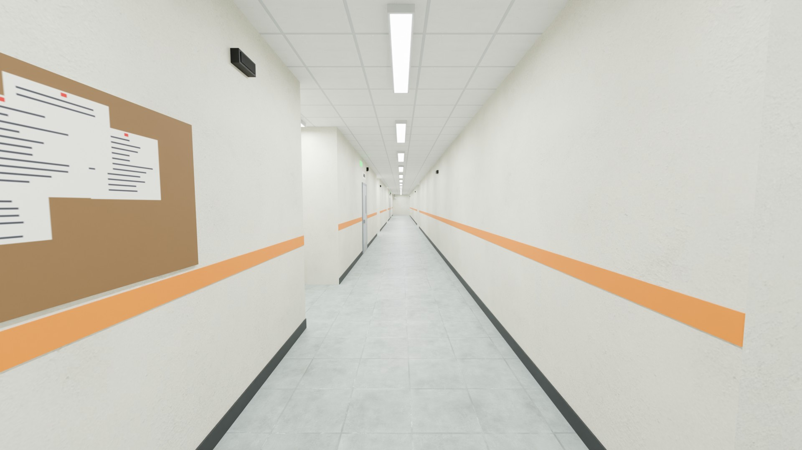
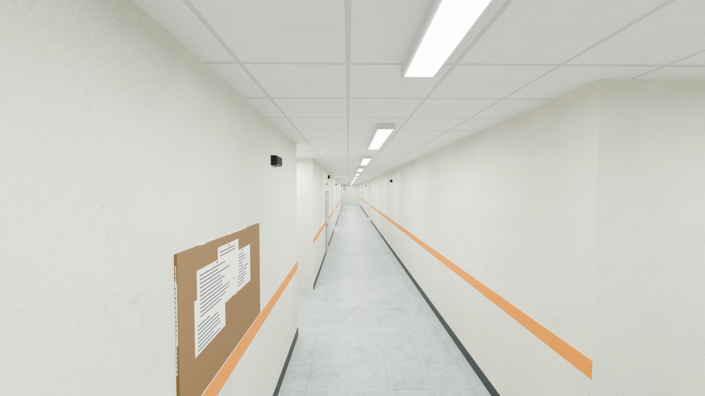
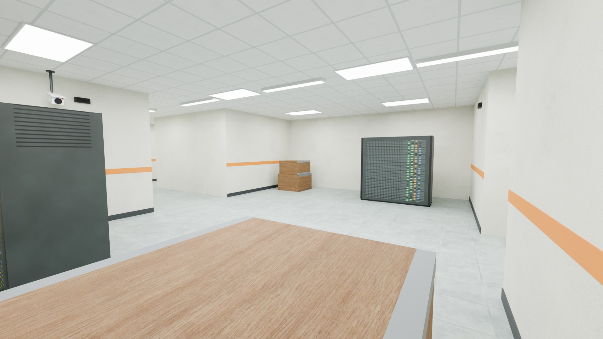
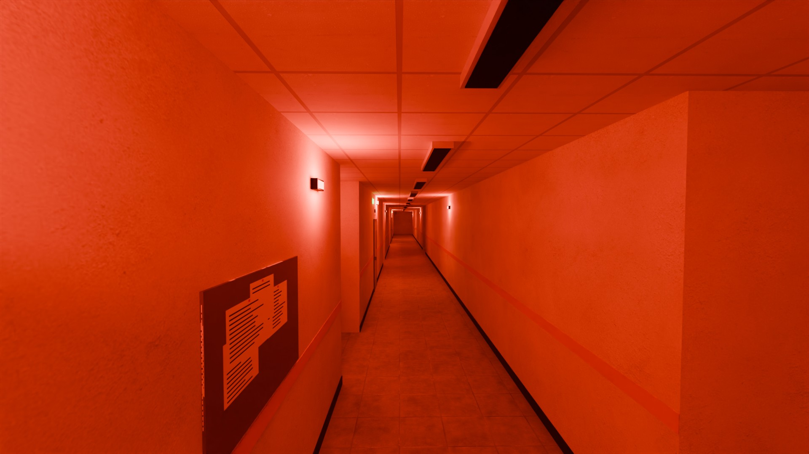
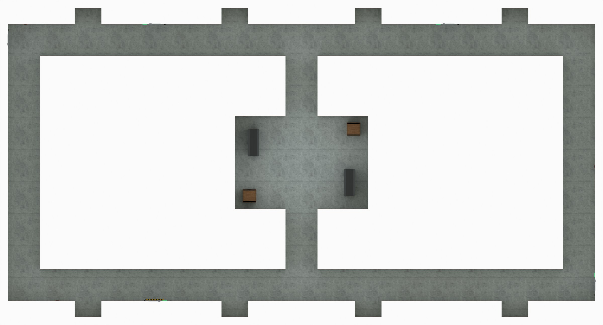

# corridors_b: dressed and lit (Secret Operations, step 2)

Two long corridors joined by three cross corridors, the middle one through a server closet with two humming cabinets. Pale walls with an amber stripe, strip lights, alcoves to step into.

Built by `tools/blender/build_secretops_dress.py` around the greybox's layout (`tools/blender/build_secretops_greybox.py`): the layout objects are rebuilt from the same model, so `world/corridors_b.json` is the greybox's file, unchanged. The method, the light sets, the removable parts and the sources are in `docs/renders/registrar_hall/README.md` (shared by all 13 scenes).

| File | What it is |
|---|---|
| `world/corridors_b.glb` | the art only: 1.37 MB, 7990 triangles, 31 nodes drawn (24 meshes), 25 materials, WebP textures |
| `world/lightmaps/corridors_b_0.webp`, `_1.webp` | the normal set (`lightmap`): the shell page and the props page |
| `world/lightmaps/corridors_b_2.webp`, `_3.webp` | the alarm set (`lightmap_night`): the same two pages |
| `world/corridors_b.json` | the layout, as the greybox wrote it: 86 colliders, 5 doors, 5 cameras, 5 links, 1 zones, 12 spots |
| `blender/scenes/corridors_b.blend` | the saved scene (Git LFS): `Art` (Props, Separate, and Arch: one box per shell collider, for the layout check only), `Shell`, `Doors`, `Layout`, the two light collections, `Export` |
| `docs/renders/corridors_b/` | `1_arrival.jpg`, `2_wide.jpg`, `3_detail.jpg` (normal light), `4_alarm.jpg` (the wide view in the alarm set), `plan.jpg`, `bake.json`, `caps.json` |







## Bake

| Map | Set | Page | Size | px/m | Gain G | Shown gain (caps) |
|---|---|---|---|---|---|---|
| `corridors_b_0` | normal | shell | 2048 | 42.0 | 0.3176 | 0.8444 |
| `corridors_b_1` | normal | props | 1536 | 67.9 | 0.3176 | 0.8444 |
| `corridors_b_2` | alarm | shell | 2048 | 42.0 | 1.73877 | 0.9118 |
| `corridors_b_3` | alarm | props | 1536 | 67.9 | 1.73877 | 0.9118 |

Cycles on the rented GPU (GPU), 512 samples, diffuse direct and indirect, OIDN, 8 px margin; 170 s for both sets. Texel = G L / (C + G L) with C = 1.2 and lightmap intensity pi C, G set so the median wall texel shows 0.34 (normal) or 0.26 (alarm) of its light; `caps.json` then scales each set's intensity so the walls show p50 0.19 (normal) or 0.155 (alarm) and caps any material that would pass p90 0.88 or p99 0.97.

## Brightness (`lab_display.py`, as the page shows it)

Normal set:

```
material                m2           map       k    p50    p90    p99     >=1
Wall_Corridor        904.8 corridors_b_0  3.1833  0.190  0.234  0.336   0.00%
Ceiling_Tile         398.8 corridors_b_0  3.1833  0.156  0.190  0.289   0.00%
Floor_Corridor       393.6 corridors_b_0  3.1833  0.129  0.158  0.189   0.00%
Lamp_Housing          32.7 corridors_b_1  3.1833  0.374  0.399  0.408   0.00%
Server_Body           28.4 corridors_b_1  3.1833  0.010  0.028  0.113   0.00%
Skirting              23.0 corridors_b_1  3.1833  0.009  0.011  0.013   0.00%
Stripe_Amber          22.9 corridors_b_1  3.1833  0.207  0.226  0.246   0.00%
Wood_Crate            14.6 corridors_b_1  3.1833  0.030  0.069  0.104   0.00%
Notice                 5.1 corridors_b_1  3.1833  0.055  0.264  0.279   0.00%
Door_Keycard           4.4 corridors_b_1  3.1833  0.000  0.134  0.149   0.00%
Door_Steel             4.4 corridors_b_1  3.1833  0.000  0.150  0.161   0.00%
Paint_Grey             3.9 corridors_b_1  3.1833  0.000  0.061  0.106   0.00%
Door_Frame             3.6 corridors_b_1  3.1833  0.069  0.095  0.104   0.00%
Paint_Dark             3.4 corridors_b_1  3.1833  0.000  0.001  0.004   0.00%
Plastic_Black          2.6 corridors_b_1  3.1833  0.000  0.001  0.002   0.00%
Steel                  1.9 corridors_b_1  3.1833  0.000  0.085  0.104   0.00%
Sign_Plate             1.5 corridors_b_1  3.1833  0.223  0.262  0.280   0.00%
Stripe_Red             1.3 corridors_b_1  3.1833  0.093  0.129  0.147   0.00%
Cam_Body               0.4 corridors_b_1  3.1833  0.127  0.226  0.258   0.00%
Steel_Dark             0.3 corridors_b_1  3.1833  0.011  0.017  0.024   0.00%
Hazard                 0.1 corridors_b_1  3.1833  0.166  0.212  0.218   0.00%
Plastic_White          0.0 corridors_b_1  3.1833  0.031  0.246  0.253   0.00%
```

Alarm set (`lightmap_night`):

```
material                m2           map       k    p50    p90    p99     >=1
Wall_Corridor        904.8 corridors_b_2  3.4374  0.155  0.298  0.581   0.00%
Ceiling_Tile         398.8 corridors_b_2  3.4374  0.160  0.403  0.753   0.00%
Floor_Corridor       393.6 corridors_b_2  3.4374  0.089  0.143  0.179   0.00%
Lamp_Housing          32.7 corridors_b_3  3.4374  0.015  0.226  0.502   0.00%
Server_Body           28.4 corridors_b_3  3.4374  0.004  0.015  0.025   0.00%
Skirting              23.0 corridors_b_3  3.4374  0.007  0.011  0.014   0.00%
Stripe_Amber          22.9 corridors_b_3  3.4374  0.182  0.277  0.346   0.00%
Wood_Crate            14.6 corridors_b_3  3.4374  0.008  0.031  0.045   0.00%
Notice                 5.1 corridors_b_3  3.4374  0.054  0.262  0.326   0.00%
Door_Keycard           4.4 corridors_b_3  3.4374  0.000  0.159  0.226   0.00%
Door_Steel             4.4 corridors_b_3  3.4374  0.000  0.168  0.218   0.00%
Paint_Grey             3.9 corridors_b_3  3.4374  0.000  0.018  0.028   0.00%
Door_Frame             3.6 corridors_b_3  3.4374  0.077  0.149  0.222   0.00%
Paint_Dark             3.4 corridors_b_3  3.4374  0.000  0.000  0.001   0.00%
Plastic_Black          2.6 corridors_b_3  3.4374  0.002  0.003  0.003   0.00%
Steel                  1.9 corridors_b_3  3.4374  0.000  0.101  0.135   0.00%
Sign_Plate             1.5 corridors_b_3  3.4374  0.418  0.744  0.824   0.00%
Stripe_Red             1.3 corridors_b_3  3.4374  0.057  0.180  0.392   0.00%
Cam_Body               0.4 corridors_b_3  3.4374  0.432  0.698  0.817   0.00%
Steel_Dark             0.3 corridors_b_3  3.4374  0.034  0.077  0.080   0.00%
Hazard                 0.1 corridors_b_3  3.4374  0.256  0.359  0.378   0.00%
Plastic_White          0.0 corridors_b_3  3.4374  0.355  0.646  0.671   0.00%
```

## Gates

```
check_layout (Blender): PASS: 97 of 97 checks passed
greybox --check: GATES PASS
layout JSON: IDENTICAL: world/corridors_b.json is byte for byte the greybox's
worlddoc: OK world/corridors_b.json: 86 colliders, 5 doors, 0 markers, 5 links, 1 zones, 12 spots, 0 errors, 6 warnings
glb_inspect: pass       tris: 7990 triangles, budget 300000 / pass       mb: 1.30 MB, budget 8
privacy: privacy grep: 14 files, 0 with hits
```

