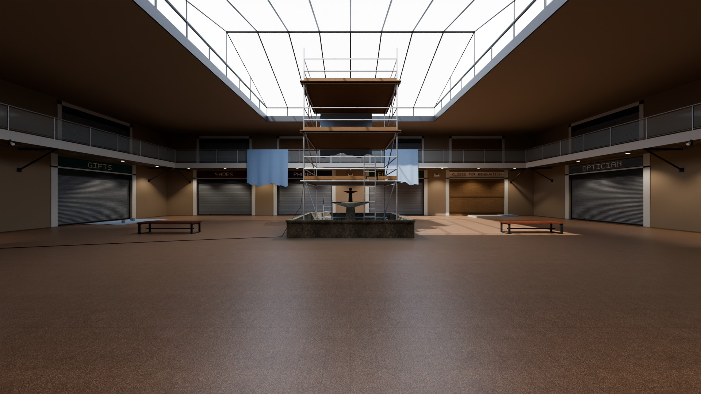
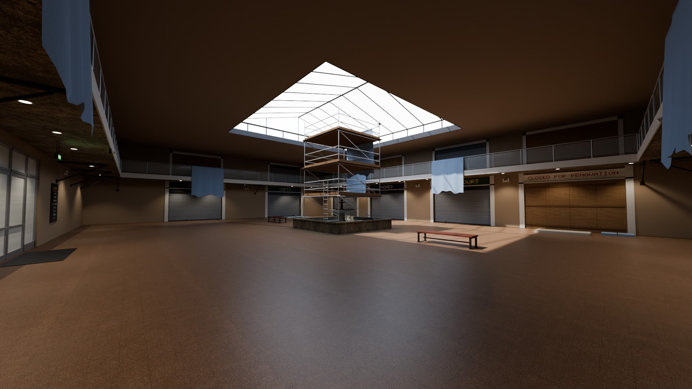
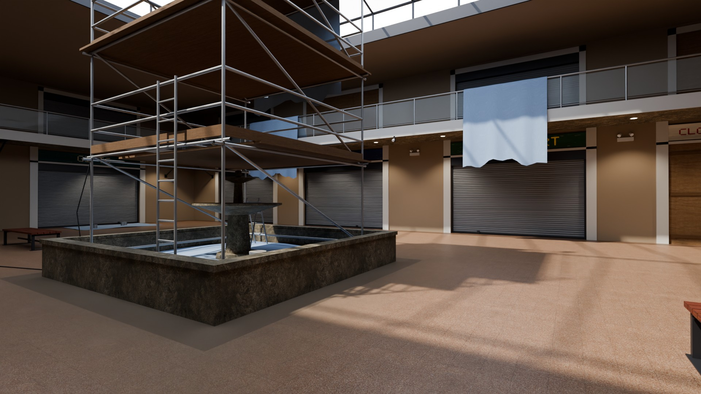

# entrance: the mall atrium

Scene 6 of the Blender plan (`docs/BLENDER.md`, "6. entrance (the mall atrium)"). The mall behind Hallam Row's MALL door, old and abandoned and halfway through a refit nobody finished: eight shuttered shopfronts with hand-painted signs (one boarded up, "CLOSED FOR RENOVATION"), a cantilevered gallery round the walls with dust sheets thrown over its handrail and shuttered or boarded shops on the upper level, a terrazzo floor in a dark border, two backless benches, a dry fountain with a scaffold tower standing in its basin up to a glazed skylight that is being repaired, and a whitewashed glass entrance. Built in Blender 5.2.1 from `blender/layout/entrance.json`, baked twice (day, and the emergency lights alone for when the mall locks at 20:00) and exported as art only. The structure follows the apartment pilot (`docs/renders/apartment/README.md`, `tools/blender/build_apartment.py`) and takes the galleries build's privacy scrub and fixed lightmap pages.

| File | What it is |
|---|---|
| `world/entrance.glb` | the art: 2.97 MB, 19004 triangles, 28 draw calls, textures as WebP |
| `world/lightmaps/entrance_0.webp`, `entrance_1.webp` | the day light (second UV set, `TEXCOORD_1`): the material's `lightmap` |
| `world/lightmaps/entrance_2.webp`, `entrance_3.webp` | the emergency light, the same UVs: the material's `lightmap_night` |
| `blender/scenes/entrance.blend` | the saved scene (1.75 MB, Git LFS): `Art` (the unmerged pieces), `Export` (merged by material, with the lightmap UVs), `Standins`, `Lights_Day`, `Lights_Night`, `Lights_Always` |
| `tools/blender/build_entrance.py` | the re-runnable build (reads the layout; no hand-copied coordinates) |
| `blender/textures/entrance/` | the seven CC0 texture files the build reads |
| `docs/renders/entrance/` | the three review stills (this file's folder) |

The shared tools are reused unchanged: `tools/blender/check_layout.py`, `tools/blender/pack_scene.py`, `tools/webp_glb.py`, `tools/blender/dump_layout.mjs`.

## Review stills (Cycles, 128 samples adaptive, OIDN denoise, 1920 x 1080 JPEG, AgX, exposure 0, the day set)

| | |
|---|---|
| `1_arrival.jpg` (304 KB) | the arrival point (0, 10.4) at eye height 1.6 m, facing the scene's `face` (north, -z), 75 degrees vertical like the page's camera |
| `2_wide.jpg` (254 KB) | the whole atrium from the floor in the south-east corner, just clear of the gallery, 78 degrees |
| `3_detail.jpg` (346 KB) | the dry fountain and the scaffold tower's foot, the north shops and the gallery behind |





These are Blender renders with Blender's real lights, at exposure 0, so they show the light the day lightmaps hold. The skylight's panes are seen by the camera but let the light through, as in the bake (where they are hidden); in the stills they glow with a fixed sky, in the page they show their lightmap (see "The skylight" below). A night still of the arrival point (the emergency set) was rendered for the owner's sheet only. The GLB was loaded with three.js r186 in node (below); it was not looked at in a browser, so the coordinator's in-game screenshot from the arrival point is the first look at it under the page's shading.

## Sources and licences

| Material | Used for | Source | Author (Poly Haven) | Licence |
|---|---|---|---|---|
| `terrazzo_tiles`: diffuse, 1k | the floor (tinted light), its border and the band round the fountain (tinted dark) | https://polyhaven.com/a/terrazzo_tiles | Amal Kumar | CC0 1.0 |
| `painted_metal_shutter`: diffuse, 1k | the roller shutters | https://polyhaven.com/a/painted_metal_shutter | Charlotte Baglioni (photography), Dario Barresi (baking), Rico Cilliers (processing) | CC0 1.0 |
| `plywood`: diffuse, 1k | the hoardings, the scaffold's boards and the battens (tinted) | https://polyhaven.com/a/plywood | Rob Tuytel | CC0 1.0 |
| `concrete_floor_02`: diffuse, 1k | the fountain's stone and basin, the gallery's soffit and fascia | https://polyhaven.com/a/concrete_floor_02 | Rob Tuytel | CC0 1.0 |
| `beige_wall_001`: diffuse, 1k | the walls (two tints: below and above the gallery) and the ceiling | https://polyhaven.com/a/beige_wall_001 | Dimitrios Savva (photography), Rico Cilliers (processing) | CC0 1.0 |
| `dark_wood`: diffuse, 1k | the benches' slats | https://polyhaven.com/a/dark_wood | Dario Barresi, Dimitrios Savva, Rico Cilliers | CC0 1.0 |
| `rough_linen`: diffuse, 512 | the dust sheets, the drop cloths, the cement bags | https://polyhaven.com/a/rough_linen | colormass, Rico Cilliers | CC0 1.0 |

**5 of the 8 allowed Poly Haven downloads were used**: `terrazzo_tiles`, `painted_metal_shutter`, `plywood`, `concrete_floor_02` and `worn_plaster_wall`, 1k JPEG diffuse maps from `https://dl.polyhaven.org/file/ph-assets/Textures/jpg/1k/...` (about 4.2 MB in all), with a generic client name and no other data sent. `worn_plaster_wall` was tried on the upper walls and dropped (its peeling read as camouflage at this scale), so it is not in the repo. `beige_wall_001`, `dark_wood` and `rough_linen` are copied from `blender/textures/apartment/` (the pilot's). The four new maps were re-saved as JPEG quality 88. Tints are multiplied in the material (a Multiply node the exporter writes as `baseColorFactor`). Authors come from Poly Haven's public info API.

Everything else is own work, made by `build_entrance.py`: all geometry, and seven generated images drawn with numpy from fixed seeds: the eight painted shop signs (one atlas; a 5 x 7 pixel font of the build's own, blurred and re-thresholded so the strokes round off like a brush's, with chipped and sun-bleached paint), the mall directory board, the EXIT sign, the whitewashed glass, the skylight's dirty wired glass, the dust round the fountain and the dried puddle under the skylight. No Meshy, no paid service, no photograph, no remote GPU.

Tools: Blender 5.2.1 LTS (GPL) with Cycles, OpenImageDenoise (Apache-2.0, through the compositor's Denoise node) and the glTF I/O add-on; Python with numpy (in Blender) and Pillow (the WebP step); three r186 for the load check. The bake and the stills ran on the laptop's CPU (Intel Core Ultra 7 155U, 14 threads): Cycles found no GPU it can use there.

## Budgets (measured)

| | Limit | Measured |
|---|---|---|
| `world/entrance.glb`, lightmaps aside | at most 8 MB | **2.97 MB** (2968796 bytes; 3.91 MB from Blender, then `tools/webp_glb.py`: textures 2.8 to 1.85 MB, geometry bytes asserted identical) |
| triangles | at most 300 000 | **19004** (`glb_inspect.py`: 19004 drawn) |
| draw calls, merged by material | at most 250 | **28** (one primitive per material) |
| textures | WebP | **14 images, all `image/webp`** (seven at 1024 x 1024, five at 512 x 512, one 512 x 768 directory board and the 256 x 96 EXIT sign) |
| lightmaps | at most 4, at most 2048 x 2048, 8-bit WebP q90 | **4**: two day maps and their two night twins, see below |

| Map | Set | Size | Materials | Density | White point (99.5th pct) | `..._intensity` in the GLB | Samples, CPU time | WebP |
|---|---|---|---|---|---|---|---|---|
| `entrance_0` | day | 2048 x 2048 | the shell: floor, walls, ceiling, the gallery's deck, trim, floor decals | 32.9 px/m (scaled: Ceiling_Paint 18.1) | 4.1206 | 12.9451 | 256, 494 s | 173 KB |
| `entrance_1` | day | 2048 x 2048 | everything in it: shopfronts, signs, fountain, benches, scaffold, sheets, fittings, the entrance | 32.5 px/m (scaled: Skylight_Glass 4.9) | 4.3265 | 13.5921 | 256, 248 s | 305 KB |
| `entrance_2` | night | 2048 x 2048 | the shell: floor, walls, ceiling, the gallery's deck, trim, floor decals | 32.9 px/m (scaled: Ceiling_Paint 18.1) | 0.2722 | 0.855 | 384, 892 s | 120 KB |
| `entrance_3` | night | 2048 x 2048 | everything in it: shopfronts, signs, fountain, benches, scaffold, sheets, fittings, the entrance | 32.5 px/m (scaled: Skylight_Glass 4.9) | 0.2167 | 0.6806 | 384, 390 s | 276 KB |

Bake: Cycles on the CPU, diffuse (direct and indirect, no colour), 8 px margin, OIDN denoise; the day set at 256 samples, the night set at 384 (it is lit by small sources and is the noisier one). The four bakes took 2024 s (34 minutes) of CPU time in all, each under 15 minutes. `glb_inspect.py --budget tris=300000,mb=8` says `pass tris` (19004 of 300000) and `pass mb` (2.83 MB as it counts, in MiB). A leak check (a scratch script, not in the repo: the saved `.blend`'s art alone, the world turned magenta, 768 flat Workbench views from 32 eye points inside the atrium at 0.3 to 5.5 m, the skylight's panes in place) found **0** magenta pixels, so the shell has no holes to the black outside.

**Texel density.** Both maps are fixed 2048 pages (`PAGES`). Everything is at about 32 px/m except two kinds of island packed smaller on purpose (`UV_SCALE` in the build): the ceiling, 7 m overhead and never seen up close (18.1 px/m), and the skylight's panes, whose lightmap is filled flat (see below). To make the props map fit, the build culls faces no one can see from the floor: faces that look up from higher than 2.2 m or down from lower than 0.8 m (the walker's eye is at 1.6 m; open sheets such as the dust sheets keep both sides), besides the faces flush against a wall, the floor or the ceiling. Thin pieces are open tubes, so each is one or a few islands.

**Why the scale numbers differ so much between the sets:** each map's white point is its 99.5th percentile texel. By day that is the sun's square under the skylight (about 4 W/m2 of baked irradiance); at night it is the pools under the emergency heads (about 0.2 to 0.3). `lightmap_intensity` and `lightmap_night_intensity` are pi times those, so the page shows texture x irradiance in both sets and the night is genuinely dark.

The three.js check (node, three r186 from a local `node_modules`; node cannot decode images, so the GLB's images are taken out of the JSON before three parses it and their types are read from the JSON):

```
three r186; world/entrance.glb (2.97 MB)
PASS 14 images, all image/webp: image/webp
PASS 28 meshes (draw calls), 28 materials; textured materials: Bench_Wood, Ceiling_Paint, Cloth_Sheet, Decal_Dust, Decal_Stain, Deck_Concrete, Directory_Board, Floor_Border, Floor_Terrazzo, Fountain_Basin, Fountain_Stone, Glass_Whitewash, Hoarding_Ply, Scaffold_Board, Shutter_Metal, Sign_Exit, Sign_Paint, Skylight_Glass, Wall_Plaster, Wall_Upper
PASS 19004 triangles
PASS Bench_Wood: lightmap world/lightmaps/entrance_1.webp x13.5921, night world/lightmaps/entrance_3.webp x0.6806, uv1 200 verts
PASS Ceiling_Paint: lightmap world/lightmaps/entrance_0.webp x12.9451, night world/lightmaps/entrance_2.webp x0.855, uv1 80 verts
PASS Cloth_Sheet: lightmap world/lightmaps/entrance_1.webp x13.5921, night world/lightmaps/entrance_3.webp x0.6806, uv1 4602 verts
PASS Clutter_Paint: lightmap world/lightmaps/entrance_1.webp x13.5921, night world/lightmaps/entrance_3.webp x0.6806, uv1 84 verts
PASS Decal_Dust: lightmap world/lightmaps/entrance_0.webp x12.9451, night world/lightmaps/entrance_2.webp x0.855, uv1 4 verts
PASS Decal_Stain: lightmap world/lightmaps/entrance_0.webp x12.9451, night world/lightmaps/entrance_2.webp x0.855, uv1 4 verts
PASS Deck_Concrete: lightmap world/lightmaps/entrance_0.webp x12.9451, night world/lightmaps/entrance_2.webp x0.855, uv1 48 verts
PASS Directory_Board: lightmap world/lightmaps/entrance_1.webp x13.5921, night world/lightmaps/entrance_3.webp x0.6806, uv1 4 verts
PASS Emergency_Emit: no lightmap (emissive, toggled by the page clock (on only while the mall is locked))
PASS Floor_Border: lightmap world/lightmaps/entrance_0.webp x12.9451, night world/lightmaps/entrance_2.webp x0.855, uv1 32 verts
PASS Floor_Terrazzo: lightmap world/lightmaps/entrance_0.webp x12.9451, night world/lightmaps/entrance_2.webp x0.855, uv1 16 verts
PASS Fountain_Basin: lightmap world/lightmaps/entrance_1.webp x13.5921, night world/lightmaps/entrance_3.webp x0.6806, uv1 20 verts
PASS Fountain_Stone: lightmap world/lightmaps/entrance_1.webp x13.5921, night world/lightmaps/entrance_3.webp x0.6806, uv1 881 verts
PASS Glass_Clear: no lightmap (transparent (the balustrade's glass))
PASS Glass_Whitewash: lightmap world/lightmaps/entrance_1.webp x13.5921, night world/lightmaps/entrance_3.webp x0.6806, uv1 20 verts
PASS Hoarding_Ply: lightmap world/lightmaps/entrance_1.webp x13.5921, night world/lightmaps/entrance_3.webp x0.6806, uv1 240 verts
PASS Lamp_Emit: no lightmap (emissive, toggled by the page clock (on by day, off while the mall is locked))
PASS Metal_Dark: lightmap world/lightmaps/entrance_1.webp x13.5921, night world/lightmaps/entrance_3.webp x0.6806, uv1 4120 verts
PASS Metal_Steel: lightmap world/lightmaps/entrance_1.webp x13.5921, night world/lightmaps/entrance_3.webp x0.6806, uv1 4612 verts
PASS Plastic_White: lightmap world/lightmaps/entrance_1.webp x13.5921, night world/lightmaps/entrance_3.webp x0.6806, uv1 1180 verts
PASS Scaffold_Board: lightmap world/lightmaps/entrance_1.webp x13.5921, night world/lightmaps/entrance_3.webp x0.6806, uv1 352 verts
PASS Shutter_Metal: lightmap world/lightmaps/entrance_1.webp x13.5921, night world/lightmaps/entrance_3.webp x0.6806, uv1 4492 verts
PASS Sign_Exit: no lightmap (emissive, always on)
PASS Sign_Paint: lightmap world/lightmaps/entrance_1.webp x13.5921, night world/lightmaps/entrance_3.webp x0.6806, uv1 32 verts
PASS Skylight_Glass: lightmap world/lightmaps/entrance_1.webp x13.5921, night world/lightmaps/entrance_3.webp x0.6806, uv1 26 verts
PASS Trim_Paint: lightmap world/lightmaps/entrance_0.webp x12.9451, night world/lightmaps/entrance_2.webp x0.855, uv1 1296 verts
PASS Wall_Plaster: lightmap world/lightmaps/entrance_0.webp x12.9451, night world/lightmaps/entrance_2.webp x0.855, uv1 360 verts
PASS Wall_Upper: lightmap world/lightmaps/entrance_0.webp x12.9451, night world/lightmaps/entrance_2.webp x0.855, uv1 528 verts
PASS world/lightmaps/entrance_1.webp exists (305 KB), used by 15 meshes
PASS world/lightmaps/entrance_3.webp exists (276 KB), used by 15 meshes
PASS world/lightmaps/entrance_0.webp exists (174 KB), used by 9 meshes
PASS world/lightmaps/entrance_2.webp exists (121 KB), used by 9 meshes
PASS 4 lightmap image(s) (day and night sets), at most four
PASS material Lamp_Emit present, emissive x10.00 (the strength the page switches on)
PASS material Emergency_Emit present, emissive x6.00 (the strength the page switches on)
PASS no Window_Lit (not used in this scene)
PASS extras present: materials.lightmap, materials.lightmap_intensity, materials.lightmap_night, materials.lightmap_night_intensity
INFO collision bounds (-16.20, -1.00, -12.20) .. (16.20, 7.20, 12.20)
INFO art bounds (the skylight's lantern over the ceiling slab aside) (-16.20, 0.00, -12.20) .. (16.20, 7.20, 12.20)
INFO the lantern (-6.06, 7.23, -8.06) .. (6.06, 9.65, 4.06); whole GLB (-16.20, 0.00, -12.20) .. (16.20, 9.65, 12.20)
PASS art lies inside the collision bounds (+5 cm)
PASS art x/z span equals the colliders' x/z span (within 5 cm)
PASS atrium height: floor top 0.00 (collider 0), ceiling underside 7.00 (collider 7)
PASS the lantern stands over the ceiling's opening, over the fountain
PASS every mesh has an identity transform (vertices in game coordinates)
PASS: all checks
```

## The layout check

`blender -b blender/scenes/entrance.blend --python tools/blender/check_layout.py -- --scene entrance` (exit code 0):

```
layout check: scene entrance, 126 visible meshes, 9 colliders
PASS  COVER  Floor_Mall: 30 mesh(es) cover it (186872 sample points, every one within 5 cm of art)
PASS  COVER  Ceiling_Mall: 8 mesh(es) cover it (231360 sample points, every one within 5 cm of art)
PASS  COVER  Wall_N: 45 mesh(es) cover it (69225 sample points, every one within 5 cm of art)
PASS  COVER  Wall_S: 16 mesh(es) cover it (69225 sample points, every one within 5 cm of art)
PASS  COVER  Wall_W: 28 mesh(es) cover it (51333 sample points, every one within 5 cm of art)
PASS  COVER  Wall_E: 28 mesh(es) cover it (51333 sample points, every one within 5 cm of art)
PASS  COVER  Fountain: 9 mesh(es) cover it (20808 sample points, every one within 5 cm of art)
PASS  COVER  Bench_0: 4 mesh(es) cover it (1200 sample points, every one within 5 cm of art)
PASS  COVER  Bench_1: 4 mesh(es) cover it (1200 sample points, every one within 5 cm of art)
PASS  STRAY  39 tall solid mesh(es), each over a collider; 15 decor_* mesh(es) exempt
PASS  CLEAR  marker Spawn_door (0.00, 10.40): clear within 0.28 m
PASS  CLEAR  constants.arrive (0.00, 10.40): clear within 0.28 m
PASS  CLEAR  door.at (0.00, 11.30): clear within 0.28 m
PASS: 13 of 13 checks passed
```

The passable pieces (`decor_*`) are the dust sheets on the gallery's handrail and on the scaffold, the drop cloths, the paint tins, the plasterboard stack and the cement bags (all 0.19 m or lower), the stepladder and the bucket (in the fountain's basin), the work lamp's cable and the entrance mat. Everything else that stands taller than 0.2 m below head height is a collider's art or lies within 5 cm of a wall: the shopfronts' pilasters and signs are 3.5 to 4.5 cm proud, the shutters and hoardings sit back inside the wall's thickness, and the scaffold tower stands inside the fountain's footprint (its boards reach x +-2.05, the footprint +-2.5). The axes were checked with a marker cube at the arrival point (`--stage axes`): game (0, 0.1, 10.4) is Blender (0, -10.4, 0.1) is glTF (0, 0.1, 10.4).

## Rebuild

From the repo root, with node, Blender 5.2 and Python with Pillow:

```
node tools/blender/dump_layout.mjs entrance                      # writes blender/layout/entrance.json (git ignores that folder)
blender -b --python tools/blender/build_entrance.py -- --stage all --samples 256 --night-samples 384 --render-samples 128     # art, bake, export, axes check, stills
python tools/blender/pack_scene.py entrance                      # WebP lightmaps (all four) and WebP textures -> world/
```

`--stage art|bake|export|axes|render` run one step on the saved `.blend` (`blender -b blender/scenes/entrance.blend --python ... -- --stage bake`). `--device cpu` forces the CPU; a GPU is used when Cycles finds one. `--stage render --set night` renders the emergency set (to the work folder); `--view Standard` renders without tone mapping, as the page draws, for judging brightness. The work folder defaults to the system temp folder's `farway_entrance` (`--work <dir>` changes it). The review stills are written straight into `docs/renders/entrance/`; the plan view and night stills go to the work folder. `blender/layout/` is in `.gitignore`, as for the pilot: rebuild the layout file first.

## What the coordinator does to wire it in

1. Add `world/entrance.glb` to the `entrance` scene's files in `shared/farway.manifest.js` (it lists only `world/entrance.json` today). The collision file is untouched and still the code's.
2. `mallProps(root)` in `index.html` already does the rest of the blockout's part when the scene has art (`hasArt`): it draws no slabs, no shopfronts or signs and no `PointLight`. Nothing else is to be hidden: the page draws nothing of its own in this scene (`docs/BLENDER.md`, contract 4), so the shop names are painted into the GLB. Note that with art, the glass doors' slab is skipped too: the GLB has its own (whitewashed) entrance.
3. Apply the lightmaps with `applyLightmaps` as for the apartment: 24 materials carry `lightmap`, `lightmap_intensity`, `lightmap_night` and `lightmap_night_intensity` in their extras (four images). `cityLook` already calls `setLightSet(lk ? "night" : "day")`, `artToggle("Emergency_Emit", lk)` and `artToggle("Lamp_Emit", !lk)` for the mall, which is exactly what this GLB expects.
4. The materials the page touches: `Lamp_Emit` (the working soffit downlights' lenses and the scaffold's work lamp, emissive strength 10: on by day, off while locked), `Emergency_Emit` (the emergency heads' lenses, strength 6: on only while locked). Others without a lightmap: `Sign_Exit` (the EXIT sign over the entrance, emissive, always on: it is in both bakes' light), `Glass_Clear` (the gallery's glass balustrade, transparent; lit by the page's hemisphere light). `Window_Lit` does not occur.
5. `cityLook` sets the hemisphere light to 1.25 by day and 0.32 locked; it does not touch the baked materials (they become unlit), only the players and what the page draws, which is right.
6. Run every suite one at a time, merge.

## Stand-ins, and what is not exported

- **Nothing the page draws:** there is nothing in this scene (no statues, signs or lamps of the page's own), so `Standins` holds only the arrival marker `standin_arrival_marker`, a 20 cm cube at the arrival point (the axes check), never rendered or exported.
- **Lights** (`Lights_Day`: the sun, about 8 W/m2 through the skylight from high in the south-west, the sky (the world, seen only through the skylight), 26 working soffit downlights at 150 W and the scaffold's 300 W work lamp; `Lights_Night`: 18 emergency heads at 180 W, two per fitting on the lower walls and one on each edge of the gallery's fascia; `Lights_Always`: the EXIT sign's glow). Used for the bakes and the stills, not exported (`export_lights` is off).
- **Not in the GLB:** the doors as a mechanism (the entrance is a closed double door in whitewashed glass; the page's prompt at `door.at` is unchanged), the street beyond (the glass is opaque), anything that moves.

## Things to know

- **Axes and scale:** metres, y up; identity node transforms, so vertices are in game coordinates. The atrium's inside is x -16 to 16, z -12 to 12, y 0 to 7; the art's bounds equal the colliders' (-16.2 to 16.2, -12.2 to 12.2) except the skylight's lantern, which rises over the ceiling slab to y 9.65 over the opening (x -6 to 6, z -8 to 4, centred on the fountain). Use the collision file for the room's bounds, or leave the lantern out of a bounds computation.
- **What sits where (derived from the layout, not typed in):** the shopfronts follow the blockout's rule in `mallProps` (four on the north wall at x = +-hx/4 and +-(hx - 5), two on each side wall at z = -hz/2 and +hz/3), each 4.8 x 3.2 m; the gallery reaches 2.2 m from the walls at 3.95 to 4.25 m; the skylight is 12 x 12 m over the fountain's centre; the scaffold tower stands in the fountain's basin; the entrance is 6 m wide on `door.at`'s x.
- **The skylight:** its panes (`Skylight_Glass`) are opaque in the GLB (the page's background in the mall is black, so a transparent pane would show black). Their lightmap texels are not baked but filled flat: white (the map's white point, so the panes read as a bright sky) in the day map and 3 % of the night map's white point at night. While baking they are hidden so the sun and the sky come in; in the stills the camera sees them but light passes them.
- **Two light sets on one UV set:** the night maps are bakes of the same atlas, so `lightmap_night` needs nothing but the swap. The night set is the emergency heads alone, as the plan asks: no moonlight through the skylight.
- **Skin:** the walls, floor and ceiling keep only the faces that look into the atrium (and the reveals of the openings); every other piece drops the faces against a wall, the floor or the ceiling, and the faces the walker can never see (see "Texel density").
- **The `.blend`** finds its textures by relative path (`//../textures/entrance/`); the seven generated images are packed in it.
- **Nothing local in the public files:** the build strips every custom property other add-ons put on the scene, the world and the other data before it exports with `export_extras` and before it saves, keeps only the four light properties on the materials, blanks Blender's fixed path buffers before writing relative texture paths and `//` for the render output, turns every `use_stamp_*` off and strips the JPEG comment segments Blender writes anyway (Cycles' render statistics).
- **Lightmap page sizes are fixed** (`PAGES`: 2048 and 2048) so a rebuild repeats; the intensities are each map's 99.5th percentile texel, so a rebuild moves them by a few per cent.

## Open

- **Brightness by day:** the light falls off from the skylight toward the walls, so the south end by the entrance and the shopfronts under the gallery are dim, lit by the soffit downlights (a third of which are dead on purpose). If it reads too dark in the game, the cheapest lifts are `SKY_STRENGTH`, `SUN_W` and `SOFFIT_W` in the build and a rebake (about 40 minutes for both sets on this laptop's CPU).
- **Night:** dark by design (emergency lights only); the pools under the gallery's four fascia heads are the brightest places. The bench at x +-8 is in half-light; the page's hemisphere light still lights the player.
- **Scaffolding:** the plan asks for scaffolding; to keep the layout unchanged it stands only in the fountain's basin (where the fountain's collider already blocks the walker). Scaffolding elsewhere on the floor would need colliders (a layout request) or be walk-through.
- **The page's glass-door slab:** `mallProps` skips it when the GLB is there (all slabs are skipped with art); the GLB's whitewashed entrance replaces it.
