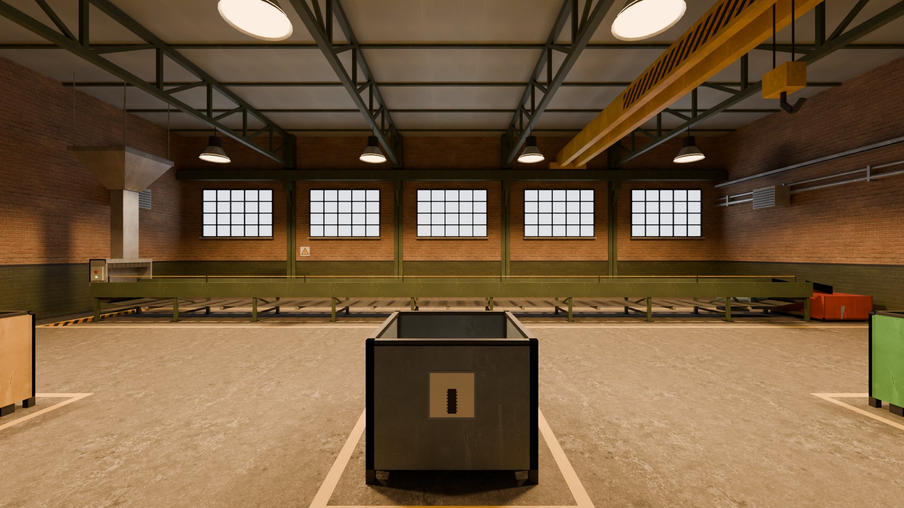
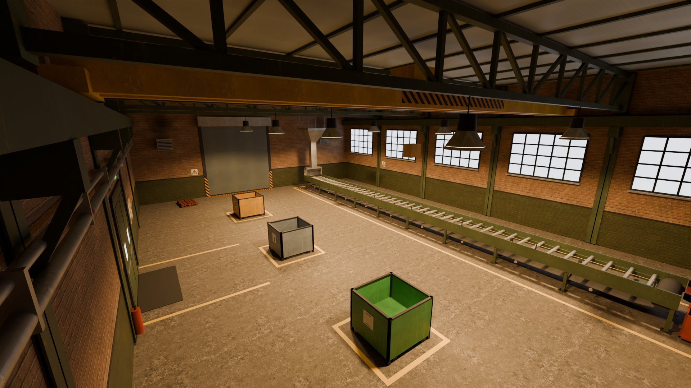
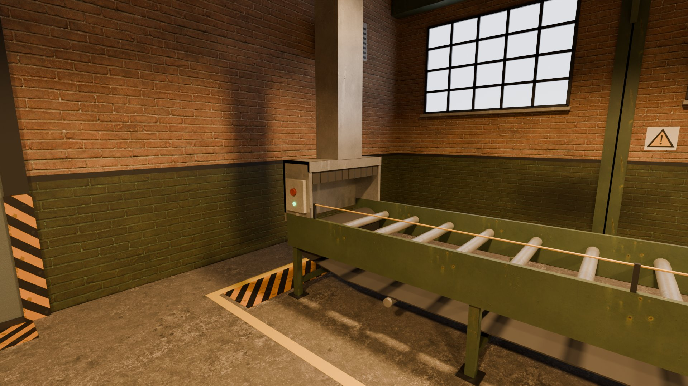

# factory_floor: the Blender build

Scene 4 of the Blender plan (`docs/BLENDER.md`, "4. factory_floor"), built the way the apartment pilot was. The works hall behind 330 Hallam Row: a brick hall 20 x 14 m and 6 m high under a steel truss roof, eight sodium high-bays, a painted green dado and yellow safety lines on a worn concrete floor, an overhead crane parked between two trusses, works windows high in the north wall. The conveyor's frame and rollers run along z = -3 under the page's belt surface, fed from a hopper through a hood at the west end and dropping into a red reject skip past the east end; the three bins (gears, bolts, springs) stand in the layout's squares in the page's colours. Built in Blender 5.2.1 from `blender/layout/factory_floor.json`, baked in full (the shift runs by day and the hall is lit the same throughout) and exported as art only.

| File | What it is |
|---|---|
| `world/factory_floor.glb` | the art: 2.42 MB (2.30 MiB, 2 415 364 bytes), 11 754 triangles, 26 draw calls, textures as WebP |
| `world/lightmaps/factory_floor_0.webp`, `_1.webp`, `_2.webp` | the baked light, 1536², 1792² and 1792² (second UV set, `TEXCOORD_1`) |
| `blender/scenes/factory_floor.blend` | the saved scene (0.82 MB, Git LFS): `Art` (the unmerged pieces), `Export` (merged by material, with the lightmap UVs), `Standins`, `Lights` |
| `tools/blender/build_factory_floor.py` | the re-runnable build (reads the layout; no hand-copied coordinates) |
| `blender/textures/factory_floor/` | the six texture files the build reads: four derived from CC0 Poly Haven downloads, one copied from the repo |
| `docs/renders/factory_floor/` | the three review stills (this file's folder) |

No shared tool was changed: `check_layout.py`, `pack_scene.py`, `dump_layout.mjs` and `tools/webp_glb.py` are used as the pilot left them. The build's helpers (bake, denoise, export, the `.blend` path scrub) follow `build_apartment.py` and the laboratory build.

## Review stills (Cycles on the CPU, 128 samples, OIDN denoise, 1920 x 1080 JPEG)

| | |
|---|---|
| `1_arrival.jpg` (322 KB) | the arrival point (0, 5.4) at eye height 1.6 m, facing the scene's `face` (north, -z), 75 degrees vertical like the page's camera: the bolts bin ahead, the belt beyond it, the windows high in the north wall |
| `2_wide.jpg` (316 KB) | the whole hall from high in the south-east corner (the crane's hook hidden from the camera only) |
| `3_detail.jpg` (332 KB) | the belt's feed end: the hopper and its duct, the hood the parts come out of (rubber curtain), the stop box with its red button and green run lamp, the hazard band, the roller shutter beyond |





These are Blender renders with Blender's lights. The belt's top surface, the parts and the bin signs are not in them: the page draws those (see below). Where the belt's surface goes, the stills show the carrying rollers under it.

## Sources and licences

| Texture | Used for | Source | Author (Poly Haven) | Licence |
|---|---|---|---|---|
| `factory_brick`: diffuse, 1k | walls (`brick_diff`), and the green dado (the same brick times a paint colour) | https://polyhaven.com/a/factory_brick | Rob Tuytel | CC0 1.0 |
| `hangar_concrete_floor`: diffuse, 1k | floor (`concrete_floor_diff`): lifted from near-black to a worn mid grey, its marks kept | https://polyhaven.com/a/hangar_concrete_floor | Dimitrios Savva | CC0 1.0 |
| `corrugated_iron`: diffuse, 1k | the roof sheets seen from below (`roof_sheet_diff`), and the roller shutter (times a blue-grey, turned a quarter) | https://polyhaven.com/a/corrugated_iron | Dimitrios Savva (photography), Jenelle van Heerden (processing) | CC0 1.0 |
| `green_metal_rust`: diffuse, 1k | the steel structure in works green (`paint_green_diff`); its marks and rust runs on a neutral grey (`paint_grime_diff`), times a colour for the bins, the crane, the motor, the skip, the galvanised parts | https://polyhaven.com/a/green_metal_rust | Rob Tuytel | CC0 1.0 |
| `dark_wood` (already in the repo: `blender/textures/apartment/dark_wood_diff_1k.jpg`) | the pallets (`wood_diff`, lightened by a colour factor) | https://polyhaven.com/a/dark_wood | Dario Barresi, Dimitrios Savva, Rico Cilliers | CC0 1.0 |

**4 of the 8 allowed Poly Haven textures were downloaded** (four 1k JPEG diffuse maps, 2.56 MB, from `dl.polyhaven.org`, with the asset list, file list and author info read from `api.polyhaven.com`, a generic client name, no other data sent). The local cache had no brick, concrete or metal, so nothing came from it. `build_factory_floor.py --stage textures --src <folder of the downloads>` makes the six files in `blender/textures/factory_floor/` from them and from the repo's `dark_wood` (JPEG quality 88).

Everything else is own work, made by `build_factory_floor.py`: all geometry, and four generated images drawn with numpy from fixed seeds: worn hazard stripes, an oil stain (alpha), the exit sign (a green pictogram: a door and an arrow) and one print atlas (safety pictograms with no words: a warning triangle, electric shock, ear protection, fire point; a plate for each bin with a gear, a bolt or a spring on white in the kind's colour; a clock face; a cork notice board with papers, a rota and a chart). No Meshy, no paid service, no photograph, no text.

Tools: Blender 5.2.1 LTS (GPL) with Cycles, OpenImageDenoise (Apache-2.0, through the compositor's Denoise node) and the glTF I/O add-on; Python with numpy (in Blender) and Pillow (the WebP step); three r186 for the load check. Everything ran on the laptop's CPU: Cycles found no GPU there (no remote GPU was used).

## Budgets (measured)

| | Limit | Measured |
|---|---|---|
| `world/factory_floor.glb`, lightmaps aside | at most 8 MB | **2.42 MB = 2.30 MiB** (2 415 364 bytes; `glb_inspect.py` prints MiB; 2.70 MB from Blender, then `tools/webp_glb.py`: 10 textures 1.8 to 1.52 MB, geometry bytes asserted identical) |
| triangles | at most 300 000 | **11 754** (`glb_inspect.py`: 11754 drawn, `pass tris`) |
| draw calls, merged by material | at most 250 | **26** (one primitive per material, 26 materials) |
| textures | WebP | **10 images, all `image/webp`** (`glb_inspect.py`: `requires EXT_texture_webp`; largest 1024 x 1024) |
| lightmaps | at most 4, at most 2048 x 2048, 8-bit WebP q90 | **3**: `factory_floor_0` 1536² (78 KB, 35.3 px/m: floor, walls, dado, roof, floor paint, hazard bands, decals, prints, shutter), `factory_floor_1` 1792² (286 KB, 36.6 px/m: bins, machines, galvanised and dark steel, paint, rubber, pallets), `factory_floor_2` 1792² (154 KB, 34.2 px/m: the green structure: trusses, purlins, columns, crane runway, belt frame) |

Bake: Cycles on the CPU, 256 samples, diffuse (direct and indirect, no colour), 8 px margin, OIDN denoise; the three maps in 487 s of baking (299, 113 and 75 s), 598 s (10 min) for the whole stage with the UV packing. The structure got a page of its own: the trusses and frames are thousands of small islands, and with the 8 px margin they reached only 23.7 px/m on a 2048 page shared with the machines. The light: eight sodium high-bays (1800 W spots, 150 degrees, pointing down, at 4.0 m under the truss bottom chords, in two rows: over the belt and over the bins) and the five north windows' frosted glass, emissive (cool daylight, strength 3). The baked texels' median is 0.47 on the shell, 0.22 on the machines and 0.17 on the structure (the light a white surface would show, before the base colour); the hot spots are the floor under each lamp.

The three.js check (`glb_check`, run with node on the exported file):

```
three r186; world/factory_floor.glb (2.42 MB)
PASS 10 images, all image/webp: image/webp
PASS 26 meshes (draw calls, at most 250), 26 materials
PASS 11754 triangles (at most 300 000)
PASS 11 textured materials carry a colour factor: Bin_Bolts, Bin_Gears, Bin_Springs, Motor_Paint, Paint_Red, Paint_Yellow, Panel_Grey, Shutter_Steel, Steel_Galv, Wall_Dado, Wood_Pallet
PASS Bin_Bolts: lightmap world/lightmaps/factory_floor_1.webp x24.4545, uv1 144 verts
PASS Bin_Gears: lightmap world/lightmaps/factory_floor_1.webp x24.4545, uv1 144 verts
PASS Bin_Springs: lightmap world/lightmaps/factory_floor_1.webp x24.4545, uv1 144 verts
PASS Decal_Grime: lightmap world/lightmaps/factory_floor_0.webp x22.7456, uv1 44 verts
PASS Decal_Print: lightmap world/lightmaps/factory_floor_0.webp x22.7456, uv1 80 verts
PASS Exit_Sign_Emit: no lightmap (emissive)
PASS Floor_Concrete: lightmap world/lightmaps/factory_floor_0.webp x22.7456, uv1 4 verts
PASS Floor_Hazard: lightmap world/lightmaps/factory_floor_0.webp x22.7456, uv1 144 verts
PASS Floor_Paint: lightmap world/lightmaps/factory_floor_0.webp x22.7456, uv1 432 verts
PASS Glass_Daylight: no lightmap (emissive)
PASS Indicator_Green: no lightmap (emissive)
PASS Lamp_Emit: no lightmap (emissive)
PASS Motor_Paint: lightmap world/lightmaps/factory_floor_1.webp x24.4545, uv1 136 verts
PASS Paint_Red: lightmap world/lightmaps/factory_floor_1.webp x24.4545, uv1 484 verts
PASS Paint_White: lightmap world/lightmaps/factory_floor_1.webp x24.4545, uv1 160 verts
PASS Paint_Yellow: lightmap world/lightmaps/factory_floor_1.webp x24.4545, uv1 192 verts
PASS Panel_Grey: lightmap world/lightmaps/factory_floor_1.webp x24.4545, uv1 408 verts
PASS Roof_Sheet: lightmap world/lightmaps/factory_floor_0.webp x22.7456, uv1 4 verts
PASS Rubber_Black: lightmap world/lightmaps/factory_floor_1.webp x24.4545, uv1 544 verts
PASS Shutter_Steel: lightmap world/lightmaps/factory_floor_0.webp x22.7456, uv1 4 verts
PASS Steel_Dark: lightmap world/lightmaps/factory_floor_1.webp x24.4545, uv1 5388 verts
PASS Steel_Galv: lightmap world/lightmaps/factory_floor_1.webp x24.4545, uv1 4552 verts
PASS Steel_Green: lightmap world/lightmaps/factory_floor_2.webp x23.6869, uv1 4824 verts
PASS Wall_Brick: lightmap world/lightmaps/factory_floor_0.webp x22.7456, uv1 16 verts
PASS Wall_Dado: lightmap world/lightmaps/factory_floor_0.webp x22.7456, uv1 144 verts
PASS Wood_Pallet: lightmap world/lightmaps/factory_floor_1.webp x24.4545, uv1 960 verts
PASS world/lightmaps/factory_floor_1.webp exists (286 KB), used by 12 meshes
PASS world/lightmaps/factory_floor_0.webp exists (78 KB), used by 9 meshes
PASS world/lightmaps/factory_floor_2.webp exists (154 KB), used by 1 meshes
PASS 3 lightmap image(s), at most four
PASS material Lamp_Emit present (the high-bays' lenses), emissive strength 10
PASS no stand-in, bin-sign, part or belt-surface material or mesh in the GLB (the exit sign's pictogram is art)
PASS belt surface: no vertex in its spot  (-8.50,0.84,-3.55 .. 8.50,1.20,-2.45)
PASS sign gears: no vertex in its spot  (-5.85,1.27,2.45 .. -4.15,1.73,2.55)
PASS sign bolts: no vertex in its spot  (-0.85,1.27,2.45 .. 0.85,1.73,2.55)
PASS sign springs: no vertex in its spot  (4.15,1.27,2.45 .. 5.85,1.73,2.55)
INFO collision bounds (-10.20, -1.00, -7.20) .. (10.20, 6.20, 7.20)
INFO art bounds (-10.20, 0.00, -7.20) .. (10.20, 6.00, 7.20)
PASS art lies inside the collision bounds (+5 cm)
PASS art x/z span equals the colliders' x/z span (within 5 cm)
PASS hall height: floor top 0.000 (collider 0), roof underside 6.000 (collider 6)
PASS every mesh has an identity transform (vertices in game coordinates)
PASS Bin_gears: 120 vertices of its body inside its box, top at 0.97 m
PASS Bin_bolts: 120 vertices of its body inside its box, top at 0.97 m
PASS Bin_springs: 120 vertices of its body inside its box, top at 0.97 m
PASS: all checks
```

`glb_inspect.py` (Pipelines-Plugin `studio/pipeline/glb_inspect.py`, `--budget tris=300000,mb=8`):

```
file       world\factory_floor.glb  (2.30 MB, Khronos glTF Blender I/O v5.2.40)
triangles  11754 drawn, in 26 mesh(es), 26 instance(s)
materials  26: Bin_Bolts, Bin_Gears, Bin_Springs, Decal_Grime, Decal_Print, Exit_Sign_Emit, Floor_Concrete, Floor_Hazard, Floor_Paint, Glass_Daylight, Indicator_Green, Lamp_Emit, Motor_Paint, Paint_Red, Paint_White, Paint_Yellow, Panel_Grey, Roof_Sheet, Rubber_Black, Shutter_Steel, Steel_Dark, Steel_Galv, Steel_Green, Wall_Brick, Wall_Dado, Wood_Pallet
textures   19, images: 1024x1024, 512x512, 1024x1024, 256x104, 1024x1024, 256x256, 1024x1024, 1024x1024, 1024x1024, 1024x1024
bbox       20.4 x 6.0 x 14.4 (x, y up, z), min [-10.2, 0.0, -7.2]
rig        0 skin(s); animations: none
requires   EXT_texture_webp
pass       tris: 11754 triangles, budget 300000
pass       mb: 2.30 MB, budget 8
```

## The layout check

`blender -b blender/scenes/factory_floor.blend --python tools/blender/check_layout.py -- --scene factory_floor` (exit code 0 on PASS, 1 on any FAIL; `python tools/blender/check_layout_test.py` still runs its 13 cases OK):

```
layout check: scene factory_floor, 137 visible meshes, 10 colliders
PASS  COVER  Floor_Factory: 50 mesh(es) cover it (172692 sample points, every one within 5 cm of art)
PASS  COVER  Ceiling_Factory: 6 mesh(es) cover it (89175 sample points, every one within 5 cm of art)
PASS  COVER  Wall_N: 33 mesh(es) cover it (37515 sample points, every one within 5 cm of art)
PASS  COVER  Wall_S: 39 mesh(es) cover it (37515 sample points, every one within 5 cm of art)
PASS  COVER  Wall_W: 25 mesh(es) cover it (25803 sample points, every one within 5 cm of art)
PASS  COVER  Wall_E: 21 mesh(es) cover it (25803 sample points, every one within 5 cm of art)
PASS  COVER  Belt: 17 mesh(es) cover it (22230 sample points, every one within 5 cm of art)
PASS  COVER  Bin_gears: 6 mesh(es) cover it (1859 sample points, every one within 5 cm of art)
PASS  COVER  Bin_bolts: 6 mesh(es) cover it (1859 sample points, every one within 5 cm of art)
PASS  COVER  Bin_springs: 6 mesh(es) cover it (1859 sample points, every one within 5 cm of art)
PASS  STRAY  54 tall solid mesh(es), each over a collider; 9 decor_* mesh(es) exempt
PASS  CLEAR  marker Spawn_door (0.00, 5.40): clear within 0.28 m
PASS  CLEAR  constants.arrive (0.00, 5.40): clear within 0.28 m
PASS  CLEAR  door.at (0.00, 6.30): clear within 0.28 m
PASS: 14 of 14 checks passed
```

It scans the unmerged `Art` collection (the GLB merges by material). Everything solid that stands on the floor stands on a collider: the belt's frame, legs, drums, motor, feed hood and stop box inside the belt's box (+5 cm), the bins inside theirs, and on the walls only what is within 5 cm of the brick below head height (the columns' flanges 4.5 cm, the door 4.5 cm, the switchgear 4.5 cm, the shutter's guides 4.5 cm). The pallets are 14.4 cm high (under the 20 cm the rule allows). The passable pieces are named `decor_*`: the reject chute and skip with three missed parts in it, the fire extinguisher, the door mat.

The build also checks the page's spots itself (`KEEPOUT` lines when the art stage runs): no art box reaches into the belt's surface and the space a part rides in (x -8.51 to 8.51, y 0.84 to 1.22, z -3.55 to -2.45), or the space round each bin's sign (1.6 x 0.36 m at 1.5 m over the bin); the feed hood ends at x -8.14, so a new part (centred on x -8) appears in its mouth. The axes were checked once with a marker cube at the arrival point (`--stage axes`): game (0, 0.1, 5.4) is Blender (0, -5.4, 0.1) is glTF (0, 0.1, 5.4).

## Rebuild

From the repo root, with node, Blender 5.2 and Python with Pillow:

```
node tools/blender/dump_layout.mjs factory_floor                # writes blender/layout/factory_floor.json (git ignores that folder)
blender -b --python tools/blender/build_factory_floor.py -- --stage all --samples 256      # art, bake, export, axes check, stills
python tools/blender/pack_scene.py factory_floor                # WebP lightmaps and WebP textures -> world/
```

`--stage art|bake|export|axes|render` run one step on the saved `.blend` (`blender -b blender/scenes/factory_floor.blend --python ... -- --stage bake`); `--stage textures --src <dir>` re-derives the textures from the Poly Haven downloads. `--device cpu` forces the CPU; `--lamp` (watts per high-bay) and `--day` (the windows' emission) set the light at the art stage. On the laptop's CPU the bake stage took 10 min at 256 samples and the four stills (three 1080p and the plan) 15.6 minutes (252, 241, 236 and 209 s) at 128 samples. The work folder defaults to the system temp folder's `farway_factory_floor`; `--work <dir>` changes it. The stills are written straight into `docs/renders/factory_floor/`, with Blender's metadata stamps off and every JPEG comment and APP1 to APP15 segment dropped afterwards. Every save scrubs the `.blend` of local paths (the generated images are packed under neutral `//gen/<name>.png` names, the repo textures keep relative paths, render paths and file-browser folders are emptied, add-on state on the scene is dropped), as the laboratory build does.

## What the coordinator does to wire it in

1. Add `world/factory_floor.glb` to the `factory_floor` scene's files in `shared/farway.manifest.js` (the `factory` area). The collision file `world/factory_floor.json` is untouched and still the code's.
2. The code blockout already steps aside: with a model, `factoryProps` in `index.html` draws only the slabs marked `keep` (the belt's top surface, `B.top - 0.06` to `B.top`) and adds no `PointLight`. It keeps drawing the bin signs and the parts, as the plan says. Nothing in `factoryProps` needs to change. The art's belt frame stops at 0.84 m under that surface; its skirt guards run either side of it (outside its z span, which is 5 cm in from the collider's sides) up to 0.93 m.
3. The lightmaps go through `applyLightmaps` unchanged: 22 materials carry `lightmap` and `lightmap_intensity` in their extras (`factory_floor_0`: 22.7456, `factory_floor_1`: 24.4545, `factory_floor_2`: 23.6869; pi times each image's white point). There is no night set and no AO map; the page sets no light set here. Add no lamp: the high-bays and the windows are already in the lightmaps.
4. Eleven materials pair a texture with a colour factor (`baseColorFactor`): the bins, the crane's yellow, the motor, the red paint, the panels, the galvanised steel, the shutter, the dado, the pallets. `applyLightmaps` already carries `color` and `map` over to the unlit material, so they keep their colours.
5. Materials the page may touch: `Lamp_Emit` (the high-bays' lenses, sodium orange, emissive strength 10; on all shift, so the page's clock need not switch it, and `artToggle` is not called for this scene). Not toggled and not baked: `Glass_Daylight` (the north windows and the door's vision panels, a fixed cool daylight; the shift is 08:00 to 16:00 at the latest start, so it can run to 20:00 with the windows still bright), `Exit_Sign_Emit` (the green pictogram over the door), `Indicator_Green` (the belt's run lamp). The plan's `Window_Lit` and `Emergency_Emit` do not occur in this scene.
6. The factory's `applySky` sets the hemisphere light to 1.3: it lights only the players, the parts, the belt surface and the signs. Leave it, or warm it toward the sodium if the parts look cold against the hall.
7. Run every suite one at a time, merge.

## Stand-ins, and what is not exported

- **What the page draws** (code keeps it; `docs/BLENDER.md`: "The parts, the belt's top surface and the bin signs"): hidden stand-ins in the `Standins` collection mark each spot: `standin_belt_surface` (the page's slab), `standin_part_0..3` (0.4 x 0.3 x 0.4 boxes on the surface, the first at the feed hood's mouth), `standin_sign_<kind>` (1.6 x 0.36 m at 1.5 m over each bin, facing +z). Never rendered, never exported, and the art keeps clear of them.
- **The arrival marker** `standin_arrival_marker`: a 20 cm cube at the arrival point (the axes check), never rendered or exported.
- **Lights** (`HighBay_0` ... `HighBay_7`, 1800 W spots): used for the bake and the stills, not exported (`export_lights` is off). In the GLB the lenses are `Lamp_Emit` meshes.
- **Not in the GLB:** the belt's top surface and the parts on it, the three bin signs (code), the prompts, the door's mechanism (the way out is a closed pair of steel leaves under the exit sign; the page's door prompt at (0, 6.3) is unchanged), anything beyond the walls (the windows are frosted, no view).

## Things to know

- **Axes and scale:** metres, y up, the hall's origin at the middle of the floor; identity node transforms. Art x/z span equals the colliders (-10.2 to 10.2, -7.2 to 7.2); the interior is x -10 to 10, z -7 to 7, y 0 to 6.
- **The belt:** frame, legs (10 pairs, end posts under the drums), 41 carrying rollers whose tops sit 5 mm under the page's surface, return rollers and the return run of the belt under the frame, rubber-lagged drums at both ends, a motor and gearbox under the head (east) end with a yellow chain guard, a pull-cord stop along the aisle side on posts on the guard (y 1.07, outside the surface's span), and the stop box at the feed end. At the feed end a hood stands over the belt's first 0.36 m with a rubber curtain at its mouth; a duct rises from it to a hopper hung from the roof, so the parts the page spawns at x -8 seem to come out of the hood.
- **The reject chute and skip** stand past the east end (x 8.52 to 9.75), where the blockout drew its chute. No collider is there, as in the blockout, so they are passable (`decor_`). Three part-sized boxes in the kinds' colours lie in the skip: missed parts, static art.
- **The bins** are steel stillages in their kind's colour (the page's `KINDS`: gears 0xc8a040, bolts 0x7a8aa0, springs 0x50a060, converted to linear), filling their collider's 1.2 m square to 1.0 m, open-topped, with fork skids, dark corner posts and a pictogram plate on the north and south faces; the page's sign hangs over each at 1.5 m.
- **The roof:** four Pratt trusses at x -6, -2, 2, 6 (every 4 m, from the hall's width) on steel columns set into the long walls, purlins under the corrugated sheets, a crane runway on corbels at 4.3 m along both long walls and a yellow double-girder crane parked between the middle trusses with its hook raised to 3.35 m.
- **Skin:** the walls, floor and roof carry only the faces that look into the hall, one quad each, merged by material: `Floor_Concrete` and `Roof_Sheet` are 2 triangles each.
- **Lightmap resolution** is 35.3, 36.6 and 34.2 px/m (the plan says about 32): the smallest square page from 512 up that reaches 30 px/m. Three of the four allowed maps are used.
- **The `.blend`** opens with the textures found by relative path (`//../textures/factory_floor/`), so keep the folder layout. The four generated images are packed in it.
- **`blender/layout/` is in `.gitignore`**, so `factory_floor.json` is not part of the commit unless it is added with `git add -f`; the build needs it (run `dump_layout.mjs` first).

## Open

- The reject chute and skip have no collider (the blockout's chute had none either), so the player can walk through them. If they should be solid, a box in `factoryColliders()` round x 8.5 to 9.8, z -3.75 to -2.25, up to 0.9 m would match the art (a request for the coordinator, not done here).
- The hall's floor is open apart from the belt and the bins: racks, a workbench or a forklift would make it feel more worked-in, and each would need a collider first.
- The windows show a fixed daylight. A shift started at 16:00 runs to 20:00; if the windows should dim with the clock, `Glass_Daylight` could become a toggled material (`Window_Lit` is the opposite: on at night).
- The sodium light is deliberately orange; the page's hemisphere light for the players is a cool white (0xf0f4ff). The coordinator may want to warm it so the player and the parts sit in the same light.
