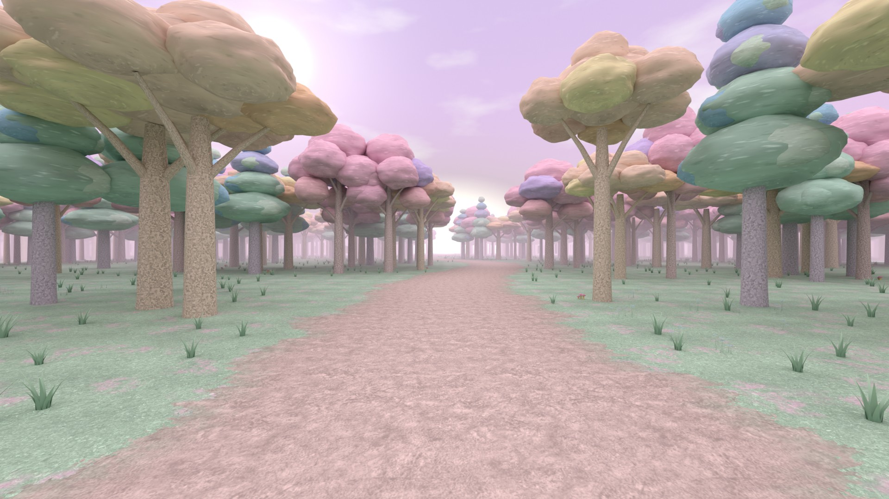
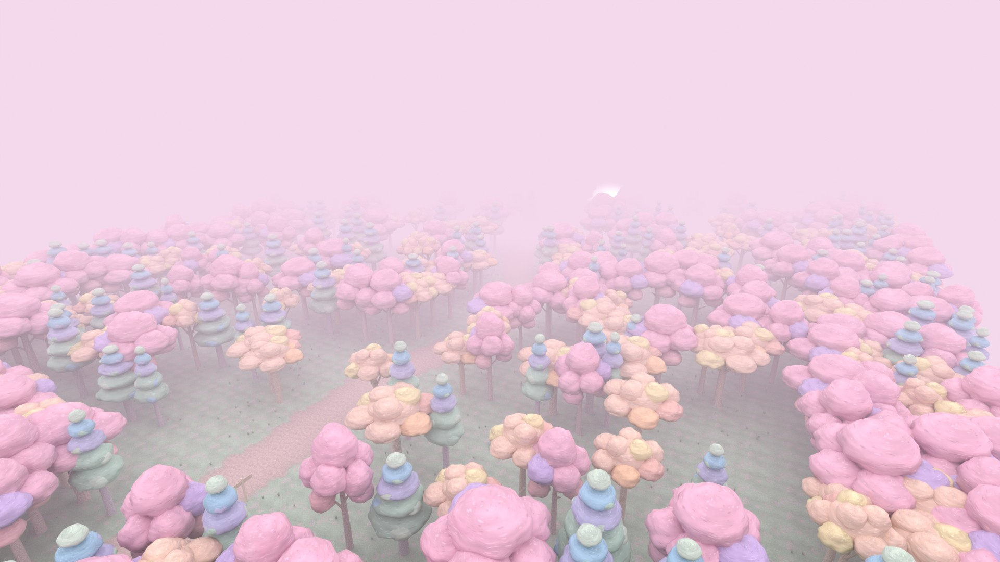
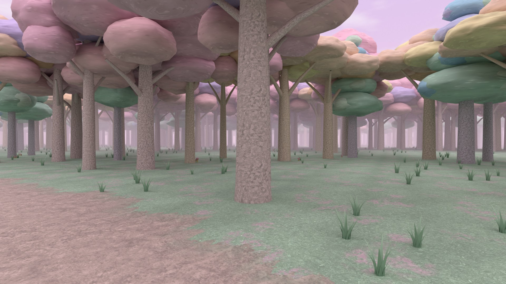
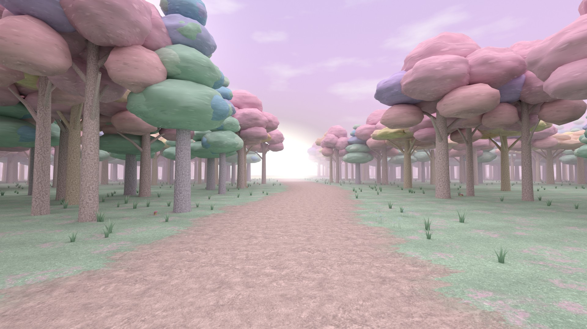
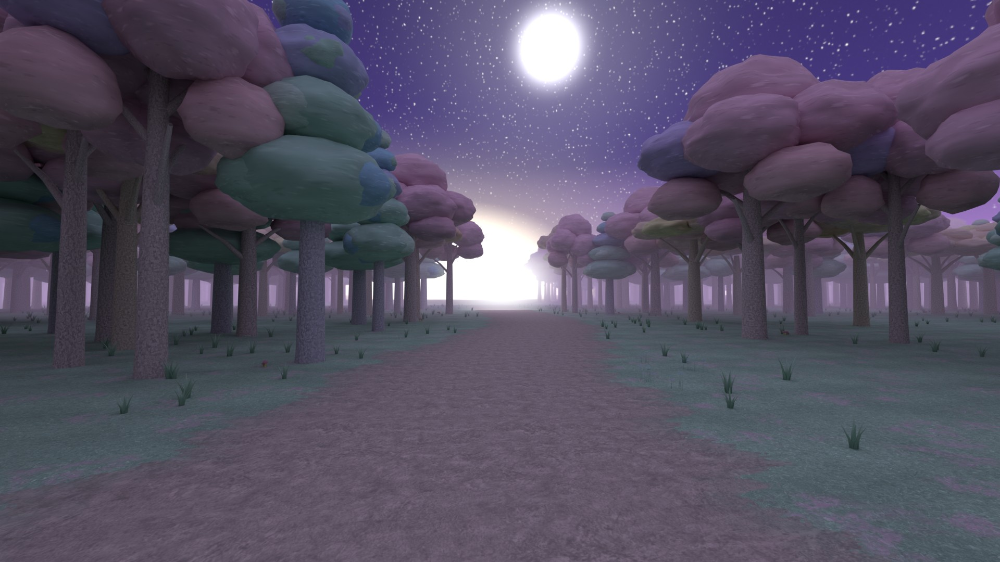

# forest: the dreamcore forest

The eighth scene of the Blender plan (`docs/BLENDER.md`, "8. forest"). A pastel dreamcore wood under pink haze: 260 trees in three soft, cloud-crowned variants (A blossom, B spire, C parasol) standing exactly on the layout's trunks, a peach-sand path winding north from the road's end to the bright gap, a mint lawn with drifts of pink petals, grass tufts, five-colour flower clumps and little pink mushrooms, and a ring of the same trees past the edge walls, open only where the road leaves (south) and behind the gap (north). Built in Blender 5.2.1 from `blender/layout/forest.json`, with an AO-only bake (the page lights the forest with its own hemisphere light and haze) and a day and a night backdrop of more forest, the sky and the glow at the gap.

| File | What it is |
|---|---|
| `world/forest.glb` | the art: 2.52 MB, 37 257 triangles, 11 draw calls, textures as WebP; the trees and the small things exported with `EXT_mesh_gpu_instancing` |
| `world/lightmaps/forest_0.webp` .. `forest_3.webp` | the baked ambient occlusion on the second UV set (`TEXCOORD_1`): the ground, and one map per tree variant |
| `world/backdrops/forest_day.webp`, `forest_night.webp` | the edge-of-world panoramas (R3), 4096 x 2048 equirect, the sky painted in |
| `blender/scenes/forest.blend` | the saved scene (2.2 MB, Git LFS): `LayoutCheck` (`Art`: the pieces the check reads; `PageDrawn`: the page's signpost post), `Export` (what ships), `Standins` |
| `tools/blender/build_forest.py` | the re-runnable build (reads the layout; no hand-copied coordinates) |
| `tools/blender/check_forest_glb.mjs` | the load check: the GLB's instanced trees against `shared/forest.js`'s 260 trees, without three and (with `--three`) through three's GLTFLoader |
| `blender/textures/forest/` | the build's textures, made by `--stage textures` from three downloaded CC0 maps and generated ones |
| `docs/renders/forest/` | the review stills (this file's folder) |

## Review stills (Cycles on the rented GPU, 128 samples adaptive, OIDN, 1920 x 1080 JPEG, Standard view transform)

| | |
|---|---|
| `1_arrival.jpg` | the arrival point (0, 6), eye height 1.6 m, facing the scene's `face` (north, -z), 75 degrees vertical |
| `2_wide.jpg` | the whole forest from 30 m up over the south-east corner (camera rays see the haze colour here, not the backdrop, which is taken at eye height in the middle) |
| `3_detail.jpg` | the trunk nearest the path between z -12 and -32 (`Tree_A`), with tufts, flowers, a mushroom and the path's edge |
| `4_day.jpg` | from the path at z -58 to the gap, with the page's glow (stand-in) and the day backdrop |
| `5_night.jpg` | the same view by night: the night backdrop, a dim lilac light, the haze darkened to mauve |







The stills are lit the way the page lights the forest, not with a Blender sun: `index.html` (`FOREST_LOOK`) has a hemisphere light of #fff0f8 over #f0c8dc at 1.55, a linear fog #f4d8ec from 22 to 105 m and no tone mapping, so the world here is that hemisphere gradient at strength 1.55, every material mixes toward #f4d8ec by view depth from 22 to 105 m for camera rays, and the view transform is Standard. The page draws the glow and the signpost itself; here they are stand-ins.

## Sources and licences

| Texture | Used for | Source | Author (Poly Haven) | Licence |
|---|---|---|---|---|
| `leafy_grass`: diffuse, 1k (downloaded) | the lawn (`grass.jpg`): its detail on a soft mint, its fallen leaves turned into drifts of pink petals | https://polyhaven.com/a/leafy_grass | Charlotte Baglioni | CC0 1.0 |
| `bark_platanus`: diffuse, 1k (downloaded) | the trunks and branches (`bark.jpg`, the detail on near white, tinted per variant: blush, lilac grey, cream) | https://polyhaven.com/a/bark_platanus | Dimitrios Savva | CC0 1.0 |
| `forrest_sand_01`: diffuse, 1k (downloaded) | the path (`path.png`: peach sand, lighter where trodden, a mossy fringe, a ragged edge in its alpha) | https://polyhaven.com/a/forrest_sand_01 | Rob Tuytel | CC0 1.0 |

**3 Poly Haven textures were downloaded** (three 1k JPEG diffuse maps, 3.0 MB, from `dl.polyhaven.org`, with the asset and file lists read from `api.polyhaven.com` under a generic client name, no other data sent). `build_forest.py --stage textures --src <folder of the three downloads>` makes `grass.jpg`, `bark.jpg` and `path.png` from them (plain Python with numpy and Pillow).

Everything else is own work, made by `build_forest.py` from fixed seeds: all geometry (the trunks, branches and noise-pushed icosphere puffs of the three variants, the ground, the path ribbon, the tufts, flowers and mushrooms, and the backdrop's hills); the crowns' atlas `crowns.jpg` (twelve pastels, the blockout's `CROWN_COLORS` and neighbours, with soft dappling); the small things' atlas `decor.png` (the page's five `FLOWER_COLORS`, blade green, butter, spotted pink); and the backdrops' sky, clouds, stars, sun, moon and glow (shader nodes). No Meshy, no Higgsfield, no paid service, no photograph.

Tools: Blender 5.2.1 LTS (GPL) with Cycles (OptiX on the rented GPU box), OpenImageDenoise (Apache-2.0, through the compositor's Denoise node) and the glTF I/O add-on; Python with numpy and Pillow (the texture, WebP and backdrop steps); node, and three r186 for the load check.

## Budgets (measured)

`python studio/pipeline/glb_inspect.py world/forest.glb --budget tris=300000,mb=8` (Pipelines-Plugin), exit code 0:

```
file       world/forest.glb  (2.52 MB, Khronos glTF Blender I/O v5.2.40)
triangles  37257 drawn, in 8 mesh(es), 8 instance(s)
  mesh     Decor_Flowers: 55 tris, 70 verts
  mesh     Decor_Tuft: 54 tris, 72 verts
  mesh     Decor_Mushrooms: 276 tris, 162 verts
  mesh     Ground: 8808 tris, 4803 verts
  mesh     Path: 296 tris, 298 verts
  mesh     TreeA: 8976 tris, 7312 verts
  mesh     TreeB: 8608 tris, 6885 verts
  mesh     TreeC: 10184 tris, 8019 verts
materials  9: Decor_Bloom, Ground_Grass, Path_Sand, Bark_A, Crown_A, Bark_B, Crown_B, Bark_C, Crown_C
textures   9, images: 512x64, 1024x1024, 1024x1024, 1024x1024, 1024x1024
bbox       112.0 x 10.0515 x 148.0 (x, y up, z), min [-56.0, -1.0, -118.0]
rig        0 skin(s); animations: none
requires   EXT_texture_webp
pass       tris: 37257 triangles, budget 300000
pass       mb: 2.52 MB, budget 8
```

| | Limit | Measured |
|---|---|---|
| `world/forest.glb`, AO maps aside | at most 8 MB | **2.52 MB** (4.26 MB from Blender, then `tools/webp_glb.py`, geometry bytes asserted identical) |
| triangles | at most 300 000 (instanced trees count once per variant) | **37 257** (the three variants 8976, 8608 and 10 184; the ground 8808) |
| draw calls, merged by material | at most 250 | **11** (8 meshes: the three trees have two primitives each, bark and crown; the trees and the small things are 6 instanced nodes) |
| instances | | 744 trees (279 A, 235 B, 230 C: the 260 on the layout, 94 A, 80 B, 86 C, and 484 past the edge walls), 2200 tufts, 529 flower clumps, 230 mushroom clusters |
| textures | WebP | **5 images, all `image/webp`** (1024 x 1024 and smaller) |
| AO maps | at most 4, at most 2048 x 2048 | **4** (below) |
| displayed albedo | p90 at most about 0.8 | **0.754 at worst** (`Bark_C`; the crowns 0.716, the lawn 0.61, the path 0.631, the small things 0.701). The page's hemisphere light is 1.55, so the crowns show the blockout's pastels (albedo = `CROWN_COLORS` / 1.5) |

`EXT_mesh_gpu_instancing` survives `tools/webp_glb.py` (it re-encodes the images only; the six instancing nodes and their accessors are byte for byte the same, which the load check below reads from the packed file).

| Map | Page | Texel density | WebP | What is on it |
|---|---|---|---|---|
| `forest_0` | 2048 | 13.7 px/m | 139 KB | the ground (`Ground_Grass`), baked with all 744 trees in place (AO distance 5 m: soft pools under the crowns, a dark ring at each trunk) |
| `forest_1` | 1024 | 41 px/m (mesh units) | 110 KB | variant A (`Bark_A`, `Crown_A`), baked alone over a ground plane (distance 2.5 m) |
| `forest_2` | 1024 | 53 px/m | 91 KB | variant B (`Bark_B`, `Crown_B`) |
| `forest_3` | 1024 | 50 px/m | 97 KB | variant C (`Bark_C`, `Crown_C`) |

Bake: Cycles AO on the GPU, 256 samples, 8 px margin, OIDN denoise; the four maps took 4, 3, 3 and 8 s. The maps hold linear AO (1 = open sky; the page loads them with `NoColorSpace`). Every baked material carries `aomap` (the map's path) and `aomap_intensity` (1.0 on the ground, 0.9 on the trees, so the pastels stay light) in its extras; no `lightmap` anywhere. Each tree's AO is its own (one map per variant, shared by all its instances): the occlusion one tree throws on another is not in it, by design of instancing; the ground's map has every tree. Not baked, on purpose: `Path_Sand` (the ribbon lies 2.5 cm over the ground, in the open, at least 4.4 m from any trunk, and Cycles' AO would see it as solid over the ground beneath its cut-out edge; the ground under it is baked without it) and `Decor_Bloom` (the small instanced things).

## The layout check

`blender -b blender/scenes/forest.blend --python tools/blender/check_layout.py -- --scene forest --collection LayoutCheck` (exit code 0; the 260 trunk lines shortened to their sum):

```
layout check: scene forest, 1007 visible meshes, 266 colliders
PASS  COVER  Ground_Forest: 263 mesh(es) cover it (240448 sample points, every one within 5 cm of art)
PASS  COVER  Trunk (x260): 3 to 8 mesh(es) cover each (every sample point within 5 cm of art)
PASS  COVER  Signpost_lot: 3 mesh(es) cover it (207 sample points, every one within 5 cm of art)
PASS  STRAY  261 tall solid mesh(es), each over a collider; 484 decor_* mesh(es) exempt
PASS  CLEAR  marker Spawn_road (0.00, 6.00): clear within 0.28 m
PASS  CLEAR  constants.arrive (0.00, 6.00): clear within 0.28 m
PASS  CLEAR  back.at (2.60, 8.40), reach 2.4: its walk-up spot (2.60, 8.02): clear within 0.28 m
PASS  CLEAR  fromMeadow.arrive (0.00, -86.00): clear within 0.28 m
PASS: 267 of 267 checks passed
```

**`--collection LayoutCheck`**: the check reads the `Art` collection and, beside it, `PageDrawn`, which holds one stand-in: the page's signpost post (`index.html` `signpost()`: 0.14 m square, 2.2 m tall, at `back.at`), so that the collider `Signpost_lot`, which only the page draws, is seen to be covered. It is never exported. The trunks in `Art` are not turned (the check reads boxes, and a trunk is a 12-gon: turned, its box would grow by up to 41 %); in the GLB every tree turns about the vertical.

**One change to the shared check, for the coordinator to review** (its own commit). `back.at` (2.6, 8.4) is the signpost's own spot, inside its collider, so the unchanged CLEAR rule fails it whatever the art. `check_layout.py` now treats a spot that has a `reach` (an F prompt that works from up to `reach` away) as clear when the nearest point within its reach that is clear of standing colliders is also clear of art; a spot that no collider covers is checked as before, under its old label. In the scenes there today this changes only the forest's `back.at` (the meadow's doors and the others keep their points), and `check_layout_test.py` passes unchanged (13 tests). It touches only `points_of`, not the lines the street's draft changes.

The axes were checked once with a marker cube at the arrival point (`--stage axes`): game (0, 0.1, 6) is Blender (0, -6, 0.1) is glTF (0, 0.1, 6).

## The load check: the trees stand on the trunks

`node tools/blender/check_forest_glb.mjs world/forest.glb --three <node_modules/three>` (three r186; the page loads three r160, whose GLTFLoader has handled `EXT_mesh_gpu_instancing` since r150), exit code 0:

```
PASS shared/forest.js gives 260 trees (the layout file's, if it is there)
PASS EXT_mesh_gpu_instancing used (not required: a loader without it still shows one of each)
PASS Decor_Flowers: 529 instances (passable small things)
PASS Decor_Grass: 2200 instances (passable small things)
PASS Decor_Mushrooms: 230 instances (passable small things)
PASS Trees_A: one mesh (Bark_A + Crown_A), 279 instances, identity holder; trunk base radius in the mesh 0.335 m, crown from 4.07 m
PASS Trees_B: one mesh (Bark_B + Crown_B), 235 instances, identity holder; trunk base radius in the mesh 0.335 m, crown from 2.99 m
PASS Trees_C: one mesh (Bark_C + Crown_C), 230 instances, identity holder; trunk base radius in the mesh 0.335 m, crown from 4.98 m
PASS 260 tree instances stand in the playable ground (x -40 .. 40, z -100 .. 12); 484 stand past the edge walls
PASS 260 of 260 trees have an instance at their [x, z] (within 5 mm)
PASS the worst instance is 0.00 mm from its tree (and stands at y 0)
PASS each trunk's base radius (the mesh's widest ring below the crowns / 1.08, times the instance's scale) is the layout's r (worst 0.0 mm off)
PASS no trunk reaches past its collider by more than 5 cm, root flare included (worst 3.2 cm)
PASS every tree only turns about the vertical, and its trunk is round (x scale = z scale)
PASS every crown starts above 2.2 m (lowest 2.70 m)
PASS three r186: 9 InstancedMeshes (6 of trees, 744 tree instances); 260 of 260 trees found at their [x, 0, z] (1 mm)
PASS three: the 6 tree InstancedMeshes carry userData.aomap and a uv1 (the page's applyLightmaps finds them: isMesh true)
RESULT PASS
```

## The layout file

`world/forest.json` is untouched (it is the code's, written by `tools/make_street.mjs`). `node tools/worlddoc.mjs check world/forest.json`:

```
OK world/forest.json: 266 colliders, 0 doors, 1 markers, 0 links, 0 zones, 0 spots, 0 errors, 0 warnings
```

## The backdrops (R3)

`world/backdrops/forest_day.webp` (521 KB) and `forest_night.webp` (590 KB), 4096 x 2048 equirect, rendered (`--stage backdrop`, Cycles, 96 samples adaptive, OIDN, Standard view transform) from the middle of the forest (0, 1.6, -44) with the playable area hidden: a flat lawn to the horizon; about 4950 of the same three trees from the art's edge out to 300 m, hazed toward #f4d8ec with distance; low lavender hills 420 to 750 m out; the road leaving south; and north, behind the gap, the meadow's lighter grass in a widening opening with a warm glow and a wide soft halo. The sky is painted in, as the plan asks (a backdrop replaces the page's own sun sprite and clouds): by day it rises from exactly #f4d8ec at the horizon (the page's haze, so the fogged trees meet it) to lavender, with soft clouds and the sun's glow where the page's `dreamSky` puts its sun (to the north-west, high); by night a violet sky with stars and a pale moon over a pink afterglow that is still #f4d8ec at the horizon. **The middle column faces north (-z) and the right-hand side east (+x)**: the stage renders three glowing markers first and asserts it (`ORIENT PASS: middle north (-z), right east (+x)`; the markers' columns 128 and 192 of 256). The lower half is lawn, which the scene's own ground covers.

## What the coordinator does to wire it in

1. `world/forest.glb` is added to the `forest` scene's files in `shared/farway.manifest.js` in this commit, with `pageScenes.forest` in `shared/manifest.test.js` (the deepEqual of all page scenes, line 26: the forest now has its GLB). No other test asserted that the forest has no GLB. `node --test shared/*.test.js`: 297 tests, 297 pass.
2. **The backdrops are not in the manifest yet.** To wire them: `backdrop: {day: "world/backdrops/forest_day.webp", night: "world/backdrops/forest_night.webp"}` on the `forest` scene, and the same `pageScenes` deepEqual if the registry carries it. With it, `forestProps` stops drawing `dreamSky` (its own sun and clouds). Note that the page calls `setBackdrop` by the clock only in the City (`cityLook`), so today the forest would show the day picture always; the night one is ready for when the forest gets a night.
3. The blockout steps aside already: `forestProps` checks `hasArt(FOREST_SCENE)` and then draws only the glow in the gap and the signpost. `applyLightmaps` reads `aomap`: the ground and the six tree primitives (InstancedMeshes, `isMesh` true) carry `TEXCOORD_1` and `aomap`; the path and the small things carry neither.
4. `tools/forest_test.mjs` counts InstancedMesh instances (> 400): with the GLB there are 744 x 2 tree instances plus the small things, so it should still pass; it was not run here (it needs Playwright).
5. Run every suite one at a time, merge.

## What is left out because the page draws it

- **The signpost back to the lot** (post and board): nothing of the art stands within 0.8 m of (2.6, 8.4); the tufts keep off it. Stand-ins: `standin_signpost_post` (in `PageDrawn`, for the check) and `standin_signpost_board`.
- **The glow in the gap and the walk-through**: the ring of trees past the north wall is open behind the gap (|x| under 7.5 m, widening), and the path runs on north through the edge to the art's end (z -118) into the backdrop's meadow light. Stand-in: `standin_glow` (14 x 9 m at y 3, z -98, as the page's sprite; the stills only).

## Things to know

- **Axes and scale:** metres, y up; identity node transforms (the six instancing holders included; each instance carries its own translation, turn about y and scale).
- **The trunks:** every variant's trunk has a base radius of 0.31 m in its mesh and a root flare of 8 % below 0.4 m; each instance is scaled by r / 0.31 across and 0.9 to 1.12 in height, so its base radius is the layout's r and the flare stays within 3.2 cm of the collider. The trunks are straight and round; branches start at 2.9 m. Crowns start above 2.70 m in the game (2.2 m is the plan's floor).
- **The ground:** flat (y 0) within 6.5 m of the path's middle line, a gentle roll of up to 5 cm among the trees and 12 cm past the edge walls; a skirt down to y -1 round its edge (the collider is a metre deep). It reaches x +-56 and z -118 to 30, past the edge walls, under the ring of trees. The trunks start at y -0.2, so no trunk floats.
- **The path** is a 7 m ribbon at y 0.025 with a ragged alpha edge (`alphaMode` MASK, cutoff 0.5) that leaves about 5.6 m of sand; the trees keep 4.2 m plus their radius from its middle line. It runs from z 30 (the road out, south) to z -118.
- **Passable things** (named `decor_*` in `Art`, or only in `Export`): the 484 trees past the edge walls (out of reach), the tufts, flowers and mushrooms (at most 0.38 m).
- **The `.blend`** finds its textures by relative path (`//../textures/forest/`). It holds no `Backdrop` collection (`--stage backdrop` builds it again), and no path, user name or e-mail (checked on a fully decompressed copy).
- **`blender/layout/` is in `.gitignore`:** run `node tools/blender/dump_layout.mjs forest` before a build.

## Rebuild

From the repo root, with node, Blender 5.2, and Python with numpy and Pillow:

```
node tools/blender/dump_layout.mjs forest
python tools/blender/build_forest.py --stage textures --src <folder with the three Poly Haven 1k diffuse JPEGs>    # only if the textures change
blender -b --python tools/blender/build_forest.py -- --stage art,axes,bake,export --work <work> --samples 256
blender -b blender/scenes/forest.blend --python tools/blender/check_layout.py -- --scene forest --collection LayoutCheck
blender -b blender/scenes/forest.blend --python tools/blender/build_forest.py -- --stage backdrop,render --work <work> --render-samples 128
python tools/blender/pack_scene.py forest --work <work>                     # WebP AO maps and WebP textures -> world/
python tools/blender/build_forest.py --stage pack-backdrops --work <work>    # WebP backdrops -> world/backdrops/
node tools/blender/check_forest_glb.mjs world/forest.glb [--three <node_modules/three>]
```

Each stage ran on a rented GPU (OptiX) in a few minutes, most of it upload; `--device cpu` forces the CPU.

## Open

- The backdrops need the manifest entry (above); the page shows a forest backdrop by day only until the forest has a clock.
- The light: the stills copy the page's hemisphere light and fog; the in-game check from the same spots is the comparison. `aomap_intensity` is 1.0 on the ground and 0.9 on the trees; turn it down if the canopy reads too dark.
- The canopy is dense (crowns up to 6 m across on trees 2.2 m apart): from the path the sky shows mainly over the path. Fewer B and more A or C, or smaller crowns, is a re-run of `--stage art` with the same trunks.
