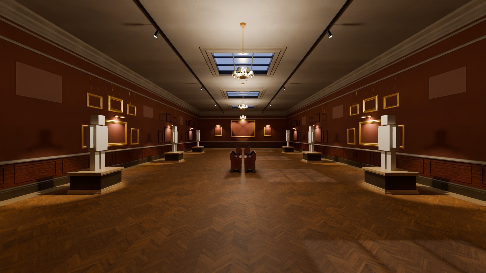
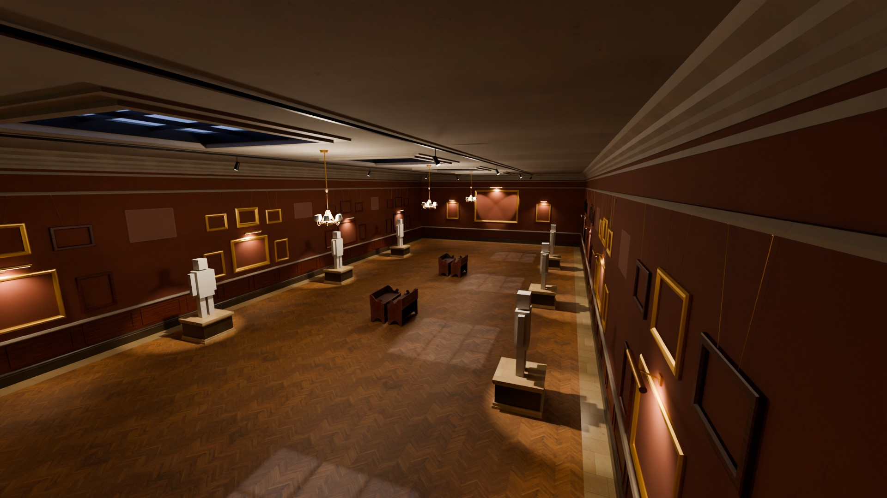
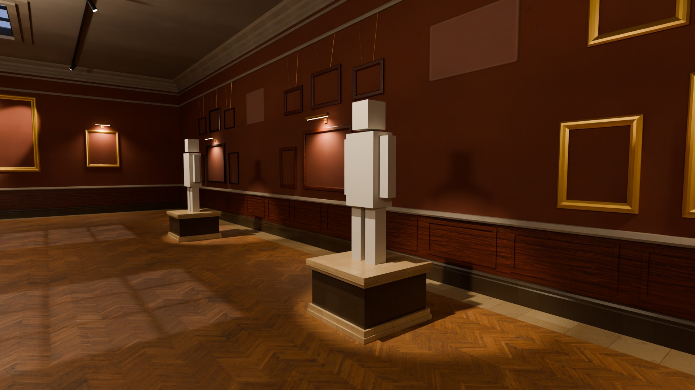

# galleries: the museum hall

The second scene of the Blender plan (`docs/BLENDER.md`, "2. galleries"). A small municipal museum after hours, as the night guard sees it on the 20:00 shift. Built in Blender 5.2.1 from `blender/layout/galleries.json`, baked in full at night (the scene is only ever played at night) and exported as art only. The structure follows the apartment pilot (`docs/renders/apartment/README.md`, `tools/blender/build_apartment.py`).

**Version 2** takes its look from the owner's Chronicle Museum (the Earth world build, `_Museum`), as the owner asked, and is brighter than version 1. The red gallery now has the Chronicle's mouldings and cornice, a panelled dark wood wainscot under a cream dado rail, and salon-grid hangs of empty frames whose style follows the era bay by bay. Picture lights hang over the main frames. Three chandeliers and two door sconces light the hall, the skylights sit in laylight coffers, the door has a Doric pediment surround, the plinths are marble pedestals, and two pairs of benches stand in the aisle. The layout, the colliders and every gate are unchanged.

| File | What it is |
|---|---|
| `world/galleries.glb` | the art: 4.16 MB, 78 997 triangles, 21 materials and 21 draw calls (one primitive each), 8 WebP textures |
| `world/lightmaps/galleries_0.webp` .. `galleries_3.webp` | the baked light, four maps (second UV set, `TEXCOORD_1`) |
| `blender/scenes/galleries.blend` | the saved scene (Git LFS): `Art` (the unmerged pieces), `Export` (merged by material, with the lightmap UVs), `Standins`, `Lights` |
| `tools/blender/build_galleries.py` | the re-runnable build (reads the layout; no hand-copied coordinates) |
| `blender/textures/galleries/` | the four CC0 texture files the build reads (`herringbone_parquet`, `marble_01`, `plastered_wall_04`, `dark_wood`) |
| `blender/models/galleries/ph-chandelier-02/`, `ph-bench/` | the two CC0 Poly Haven models the hall uses (glTF, bin, diffuse map), copied from the Chronicle Museum's `assets/models/` |
| `docs/renders/galleries/` | the three review stills (this file's folder) |

The shared tools are reused unchanged: `tools/blender/check_layout.py`, `tools/blender/pack_scene.py`, `tools/webp_glb.py`, `tools/blender/dump_layout.mjs`.

## What changed in version 2, and why

The owner said "For the museum use inspirations from my museum earth world build". The Chronicle Museum builds its rooms in `web/js/procroom.js` (geometry, mouldings, frames, fixtures, pedestals), `web/js/doors.js` (themed doors), `web/js/matlib.js` (materials) and `build_layout.py` (room styles, the salon packer, fixtures). These are the features carried over, each adapted to this hall's fixed layout and to the page's rules:

| Chronicle Museum feature | Where it is there | Here |
|---|---|---|
| Profile-swept mouldings, mitred at inside corners | `procroom.js` `PROFILES`, `extrudeRun` | the same skirting, dado and picture-rail profiles, and its room cornice scaled from 7 m to this 5 m hall (0.4 m tall, 0.29 m deep), swept along the walls and mitred; a frieze band under the cornice |
| Wall and trim colours | `build_layout.ROOM_STYLE`, `matlib.js` | the Classical Antiquity room's red (`#8b3a2f`), lifted for a night bake; cream painted trim (`#efe6d6`); white ceiling; dark marble skirting (the Grand Hall's) |
| Wainscot | the hall's dado | the dark wood wainscot of version 1, now panelled (bolection rings about 1.25 m apart) under a cream dado rail |
| Salon-grid hang | `build_layout._shelves` / `_vertical` | in each of the four bays of the long walls: a large frame centred at eye height, smaller ones either side, a row above bottom-aligned on a shared line at 2.75 m; the upper row hangs on brass wires from the picture rail |
| Bevelled frames chosen by era | `procroom.js` `frameGeometry`, `build_layout.frame_style` | cushion-moulding profiles swept round each frame. From the door north the bays run through the eras as the Chronicle's rooms do: gilt simple, gilt ornate, dark wood, black lacquer, with the small works in the era's lighter frame (`frame_small`: dark wood, gilt simple, dark wood, thin metal). A grand gilt ornate frame and two gilt simple ones on the north wall, two beside the door |
| Picture lights over large works | `FX picture_light` | brass hoods with lit tubes over every eye-row main frame, the north wall's three and the door's two (13 in all) |
| Chandeliers | `FX chandelier`, Poly Haven `Chandelier_02` in its hall | three `Chandelier_02` (CC0), one over each pair of plinths down the middle, on brass rods from ceiling roses, hanging from 4.15 to 3.30 m |
| Laylights | `FX laylight` (a lit pane in a painted trim frame) | the four skylights keep their moonlit panes and now sit in cream coffers of two stepped bands |
| Sconces by the doors | `FX sconce` | two brass sconces either side of the door at 2.6 m |
| Themed doors | `doors.js` `doric-pediment` | white marble casing, fluted pilasters with gilt capitals, an entablature and a pediment; the EXIT sign sits on the frieze |
| Pedestals | `procroom.js` props: `plinth` (dark marble under a white lip) and `column` | the six plinths are its block pedestals: a white marble base, a dark marble die, a white marble cap. Its column pedestals do not fit: the page hangs each statue's 1.6 m name plate on the plinth's face toward the hall, which needs a flat face, and a round shaft would leave the collider's corners bare |
| Benches | Poly Haven `painted_wooden_bench` in its hall | four, back to back in two pairs in the aisle under the second and third laylights, facing the salon walls |

**The frames stay empty.** `docs/WORLD.md` does not give the paintings a story, but `docs/BLENDER.md` sets the look as "parquet, picture rails and empty frames". Version 1's pale ghosts of removed paintings are still on the walls above the plinths. So no painting images were added, and no image licence comes into it.

**Brighter.** Version 1's stills were too dark at exposure 0. Version 2 adds the three chandeliers (380 W each) and the two sconces (45 W). The picture lights go from 90 to 140 W (280 W on the big north frame), the plinth spots from 950 to 1100 W, the moon from 1.4 to 2.6 W/m², and the night sky through the laylights from 25 to 40. The ceiling, trim and marble are now light, so they carry the light round the room. The stills are still rendered at exposure 0, so they show the level the lightmaps hold.

**Kept from version 1:** the hall shell, the herringbone parquet in its marble border, the gallery spots on their two tracks, the ghosts of removed paintings, the EXIT sign, the closed double door, the stand-in statues for the bake, and every gate (no change to `world/galleries.json`).

## Review stills (Cycles, 128 samples adaptive, OIDN denoise, 1920 x 1080 JPEG, AgX, exposure 0)

| | |
|---|---|
| `1_arrival.jpg` (266 KB) | the arrival point (0, 4.4) at eye height 1.6 m, facing the scene's `face` (north, -z), 75 degrees vertical like the page's camera |
| `2_wide.jpg` (249 KB) | the whole hall from high in the south-east corner, inside the room |
| `3_detail.jpg` (236 KB) | plinth 3 (east side, z -7) under its spot, with the salon bays either side |





These are Blender renders with Blender's real lights. The statues in them are the hidden stand-ins (the blockout's six-box figure, `Standins`); the page draws the real ones. The GLB was checked in node with three.js (below). Nobody has looked at it in a browser yet, so the coordinator's in-game screenshot from the arrival point will be the first look at it under the page's shading.

## Sources and licences

| Asset | Used for | Source | Author | Licence |
|---|---|---|---|---|
| `herringbone_parquet`: diffuse, 1k | the parquet field | https://polyhaven.com/a/herringbone_parquet | Sergej Majboroda (photography), Jenelle van Heerden (processing) | CC0 1.0 |
| `marble_01`: diffuse, 1k | the floor's border; the skirting and the plinth dies (tinted dark); the plinth bases and caps and the door surround (tinted white) | https://polyhaven.com/a/marble_01 | Rob Tuytel | CC0 1.0 |
| `plastered_wall_04`: diffuse, 1k | the walls (red), the ceiling (off-white), the trim, cornice, coffers and tympanum (cream) | https://polyhaven.com/a/plastered_wall_04 | Rob Tuytel | CC0 1.0 |
| `dark_wood`: diffuse, 1k | the wainscot and its panels, the door leaves, the dark wood frames | https://polyhaven.com/a/dark_wood | Dario Barresi, Dimitrios Savva, Rico Cilliers | CC0 1.0 |
| `Chandelier_02` (glTF 1k: mesh, diffuse map) | the three chandeliers | https://polyhaven.com/a/Chandelier_02 | Kirill Sannikov | CC0 1.0 |
| `painted_wooden_bench` (glTF 1k: mesh, diffuse map) | the four benches | https://polyhaven.com/a/painted_wooden_bench | Kirill Sannikov | CC0 1.0 |

The four textures are unchanged from version 1 (re-saved as JPEG quality 88). The two models were not downloaded again. They were copied from the Chronicle Museum's `assets/models/` (`ph-chandelier-02`, `ph-bench`), where its `fetch_models.py` had fetched them from Poly Haven; the authors come from Poly Haven's public info API. Their glTFs keep only the diffuse map. The page shows a baked material as texture x lightmap, so the normal and ARM maps would go unused. Both models keep their full geometry: 21 514 and 630 triangles. The Chronicle Museum's CC BY-NC "local" scans are not used anywhere.

Everything else is own work, made by `build_galleries.py`. That covers all the geometry (mouldings, frames, door surround, pedestals, sconces, coffers, tracks, spots) and two generated images drawn with numpy from fixed seeds: the EXIT sign, a pixel font on green, and the pale ghost of a removed painting. No Meshy, no paid service, no photograph, no remote GPU.

Tools: Blender 5.2.1 LTS (GPL) with Cycles, OpenImageDenoise (Apache-2.0, through the compositor's Denoise node) and the glTF I/O add-on; Python with numpy (in Blender) and Pillow (the WebP step); three r186 for the load check. The bake and the stills ran on the laptop's CPU (Intel Core Ultra 7 155U); Cycles found no GPU it can use there.

## Budgets (measured)

| | Limit | Measured |
|---|---|---|
| `world/galleries.glb`, lightmaps aside | at most 8 MB | **4.16 MB** (4 161 456 bytes; 4.78 MB from Blender, then `tools/webp_glb.py`: textures 1.4 to 0.79 MB, geometry bytes asserted identical) |
| triangles | at most 300 000 | **78 997** (64 542 of them the three chandeliers) |
| draw calls, merged by material | at most 250 | **21** (one primitive per material, 21 materials) |
| textures | WebP | **8 images, all `image/webp`** (the four 1k textures, the chandelier's and the bench's 1k diffuse maps, the ghost decal, the EXIT sign) |
| lightmaps | at most 4, at most 2048 x 2048, 8-bit WebP q90 | **4**: see the table below |

| Lightmap | Size | Density | File | `lightmap_intensity` | What is on it |
|---|---|---|---|---|---|
| `galleries_0` | 896 x 896 | 30.2 px/m | 23 KB | 11.1824 | parquet, marble border, ceiling |
| `galleries_1` | 1536 x 1536 | 32.9 px/m | 179 KB | 6.4393 | walls, wainscot and panels, trim (dado, picture rail, cornice, coffers), skirting, the ghost decals |
| `galleries_2` | 1024 x 1024 | 34.6 px/m | 82 KB | 25.8047 | white and dark marble (plinths, door surround), the three frame styles, the door leaves, the benches |
| `galleries_3` | 1152 x 1152 | 29.7 px/m | 58 KB | 81.1516 | dark metal and brass (tracks, spot heads, picture lights, sconces, wires, skylight frames) and the chandeliers (`Chandelier_Gilt`, own UVs in a corner square) |

Bake: Cycles on the CPU, 512 samples, diffuse (direct and indirect, no colour), 8 px margin, OIDN denoise. The four maps took 267, 258, 71 and 29 s. The `--stage all` run (art, bake, export, axes check, the three stills and the plan at 128 adaptive samples) took 1478 s, about 25 minutes. It found the page sizes; the final `--stage bake`, `export` and `axes` then ran with the fixed `PAGES` and `WHITE_CAP`, and that is what is in `world/`. Map 3 came out at 29.7 px/m on its fixed 1152 page, just under the 30 px/m aim; it held 30.5 px/m on the first run, and the packer is not exactly repeatable. `glb_inspect.py --budget tris=300000,mb=8` says `pass tris`, `pass mb`.

The three.js check (node, three r186; node cannot decode images, so the GLB's images are taken out of the JSON before three parses it and their types are read from the JSON), in short:

```
PASS size 4160692 <= 8 MB; no extras on scenes, nodes, meshes, images, textures, samplers, accessors, bufferViews or the root
PASS images 8: image/webp; EXT_texture_webp used
PASS 18 materials carry lightmap + lightmap_intensity and a uv1 (TEXCOORD_1); Lamp_Emit, Sign_Exit and Skylight_Glass carry none
PASS tris 78997; draw calls 21; the four lightmap files exist
PASS no stand-in, statue or plate nodes or materials; identity node transforms; no cameras, no lights
PASS three: 18 meshes with userData.lightmap, 18 with uv1
PASS art inside the collision bounds; art spans the colliders' x/z (-6.2 .. 6.2, -20.2 .. 6.2)
RESULT PASS
```

A scan of the GLB, the WebP files, the stills, the script, the README and the `.blend` (compressed, and an uncompressed copy) found no local path or user name.

## The layout check

`blender -b blender/scenes/galleries.blend --python tools/blender/check_layout.py -- --scene galleries` (exit code 0):

```
PASS  COVER  Floor_Museum: 21 mesh(es) cover it (178965 sample points, every one within 5 cm of art)
PASS  COVER  Ceiling_Museum: 11 mesh(es) cover it (99375 sample points, every one within 5 cm of art)
PASS  COVER  Wall_N: 21 mesh(es) cover it (19125 sample points, every one within 5 cm of art)
PASS  COVER  Wall_S: 28 mesh(es) cover it (19125 sample points, every one within 5 cm of art)
PASS  COVER  Wall_W: 45 mesh(es) cover it (39933 sample points, every one within 5 cm of art)
PASS  COVER  Wall_E: 45 mesh(es) cover it (39933 sample points, every one within 5 cm of art)
PASS  COVER  Plinth_0 .. Plinth_5: 5 mesh(es) each (700 sample points each, every one within 5 cm of art)
PASS  STRAY  56 tall solid mesh(es), each over a collider; 1 decor_* mesh(es) exempt
PASS  CLEAR  marker Spawn_door (0.00, 4.40): clear within 0.28 m
PASS  CLEAR  constants.arrive (0.00, 4.40): clear within 0.28 m
PASS  CLEAR  door.at (0.00, 5.30): clear within 0.28 m
PASS: 16 of 16 checks passed
```

The one exempt piece is `decor_benches`. The axes were checked with a marker cube at the arrival point (`--stage axes`): game (0, 0.1, 4.4) is Blender (0, -4.4, 0.1) is glTF (0, 0.1, 4.4).

## Rebuild

From the repo root, with node, Blender 5.2 and Python with Pillow:

```
node tools/blender/dump_layout.mjs galleries                     # writes blender/layout/galleries.json (git ignores that folder)
blender -b --factory-startup --python tools/blender/build_galleries.py -- --stage all --samples 512 --render-samples 128     # art, bake, export, axes check, stills
python tools/blender/pack_scene.py galleries                     # WebP lightmaps and WebP textures -> world/
```

`--stage art|bake|export|axes|render` runs one step on the saved `.blend` (`blender -b blender/scenes/galleries.blend --python ... -- --stage bake`). `--device cpu` forces the CPU; a GPU is used when Cycles finds one. The work folder defaults to `farway_galleries` in the system temp folder (`--work <dir>` changes it). The review stills are written straight into `docs/renders/galleries/`; the plan view goes to the work folder.

## What the coordinator does to wire it in

1. Add `world/galleries.glb` to the `galleries` scene's files in `shared/farway.manifest.js` (it lists only `world/galleries.json` today). The collision file is untouched and still the code's.
2. Hide the blockout in `museumProps(root)` (`index.html`): the floor and ceiling slabs, the four walls, the door slab and the six plinth slabs. **Keep** what the page owns: the six statue groups (`CITY.mu.figs`, moved by `placeStatues`) and the name plates (`signTexture`).
3. **Remove the four night `PointLight`s** that `museumProps` adds. The spots, the picture lights, the chandeliers, the sconces, the moon and the sky are in the lightmaps (`docs/BLENDER.md`, contract 4: in a scene with a model the page adds no lamp of its own). `cityLook` keeps the hemisphere light at 0.5 (`0x9aa8d0`) for the statues and the players.
4. Apply the lightmaps with `applyLightmaps` as for the apartment: every material except the three below carries `lightmap` and `lightmap_intensity` in its extras (four images); each intensity is pi times its image's white point.
5. The materials the page may touch: `Lamp_Emit` (the spot lenses, the picture-light tubes, the chandelier and sconce bulbs; emissive, strength 14; the museum is only played at night, so it can stay on), `Skylight_Glass` (the four frosted panes, transparent, faintly emissive blue), `Sign_Exit` (the EXIT sign, emissive). None carries a lightmap.
6. **Optional, a layout change for the coordinator:** the benches have no collider (the collision file has none), so they are `decor_benches` and passable. Two boxes would make them solid: x -0.62 to 0.62, y 0 to 0.9, z -4.6 to -3.4 and z -10.6 to -9.4.
7. Run every suite one at a time, merge.

## Stand-ins, and what is not exported

- **The statues** (the page draws them): `standin_statues` in `Standins` is the blockout's six-box figure on each plinth at 0.6 m, turned to face the hall as `placeStatues` turns them. It was in the bake, so each plinth top carries its statue's spot shadow (the only thing lost when one steps off, as the plan accepts), and it shows in the stills; it is never exported.
- **The name plates** (the page draws them): nothing is built on the plinth faces toward the hall. The page's plate is 1.6 m wide on a 0.9 m plinth, so it overhangs by 35 cm either side.
- **The arrival marker** `standin_arrival_marker`: a 20 cm cube at the arrival point (the axes check), never rendered or exported.
- **Lights** (`Lights`), used for the bake and the stills and not exported (`export_lights` is off):
  - six 1100 W plinth spots (34 degrees) and two 880 W spots on the north frame, on the two ceiling tracks;
  - 13 picture lights (140 W; 280 W on the big north frame);
  - three 380 W chandelier point lights and two 45 W sconces;
  - the moon (a 2.6 W/m² sun from high in the west-south-west), the night sky (the world, seen only through the laylights) and the EXIT sign's glow.

## Things to know

- **Axes and scale:** metres, y up; identity node transforms, so vertices are in game coordinates. The hall's inside is x -6 to 6, z -20 to 6, y 0 to 5 (the colliders' slabs reach 20 cm further).
- **Below head height, art stays within 5 cm of its wall**, because nothing else may stand where no collider is. This is why the frames are at most 4.5 cm deep, the door's columns are 3 to 4.5 cm pilasters (only the entablature and pediment, above 2.8 m, project 13 cm), and the skirting and wainscot panels are one piece per wall. The chandeliers, sconces and picture lights hang above 1.8 m. The benches are the one passable (`decor_*`) piece.
- **Chandelier lightmap:** its 64 500 triangles (three chandeliers) would make thousands of smart-project islands. So `Chandelier_Gilt` is lightmapped through the model's own UVs, fitted into a 16 % corner square of map 3, and the three chandeliers share those texels; they hang in the same light.
- **Lightmap white points:** each map's white point is its 99.5th percentile texel, capped at 12 x its 90th (`WHITE_CAP`). On the fittings' map the texels beside the bulbs run some 40 x hotter than the rest. Without the cap they would have pushed the other fittings into the bottom 8-bit levels; with it they clip.
- **Lightmap page sizes are fixed** (`PAGES`: 896, 1536, 1024, 1152): the smallest pages that gave at least 30 px/m on the first run, fixed because Blender's island packer is not exactly repeatable.
- **The `.blend`** finds its textures and models by relative path; the two generated images are packed in it. `blender/layout/` is in `.gitignore`: `galleries.json` is rebuilt by `dump_layout.mjs` before every build.
- **Nothing local in the public files:** the build strips custom properties other add-ons leave (some hold user-folder paths) before export and save, keeps only `lightmap` and `lightmap_intensity` on the materials, writes relative paths, unpacks the two models' textures (the glTF importer packs them under their absolute paths; the files are in `blender/models/galleries/`), turns every `use_stamp_*` off and strips the JPEG comment segments Blender writes into the stills. The checks below scan the GLB, the WebP files, the stills, the script and an uncompressed copy of the `.blend`.

## Open

- The hall in the game: the GLB and lightmaps passed the node check but have not been seen under the page's shading.
- The bench colliders (step 6 above) are the coordinator's call.
