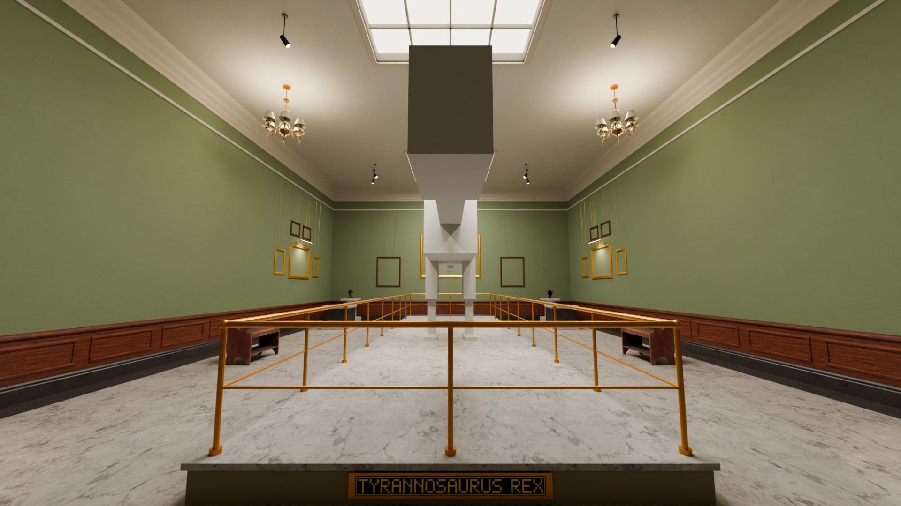
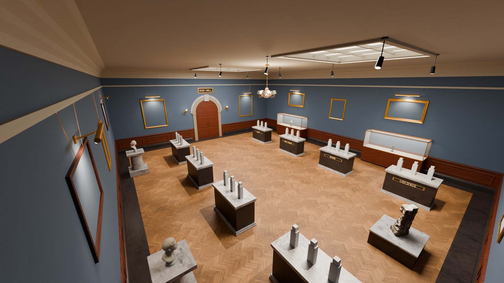
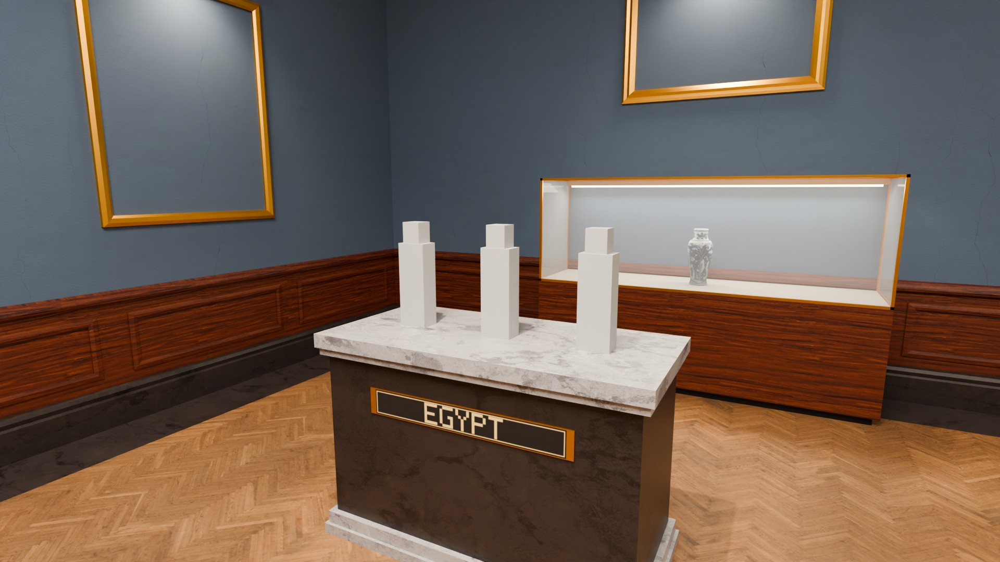

# galleries_wing: the museum's side galleries

A Blender-first scene (`docs/BLENDER_AREAS.md`, part 2) beside the museum hall (`galleries`, `docs/renders/galleries/README.md`): a natural-history hall behind the hall's west wall and a history gallery behind its east wall, each reached through a doorway in the middle bay of the hall's long walls (game z = -10). Both rooms are one scene, one GLB and one layout file, placed in the hall's own coordinates, so each doorway lines up with the hall's side of it. Built in Blender 5.2.1, baked in full at night (the museum is only played at night) and exported as art only. The figures that come alive at night (the T. rex, the 24 soldiers, the specimen creatures) are not in the GLB: the scene gives the page their places.

| File | What it is |
|---|---|
| `world/galleries_wing.glb` | the art: 3.73 MB (Draco), 267 375 triangles, 36 materials and 40 draw calls, 22 WebP textures, four door-leaf nodes |
| `world/lightmaps/galleries_wing_0.webp` .. `_3.webp` | the baked light, four maps (second UV set, `TEXCOORD_1`) |
| `world/galleries_wing.json` | the layout, written by `tools/blender/export_scene.py` from the `.blend`'s names: 44 colliders, 4 doors, 2 markers, 2 links, 0 zones, 29 spots |
| `blender/scenes/galleries_wing.blend` | the saved scene (Git LFS): `Art` (unmerged pieces), `Export` (merged by material, with the lightmap UVs), `Doors` (the four leaves), `Layout` (`COL_`, `Link_`, `Arrive_`, `Marker_`, `Spot_`), `Bake_Standins` (the T. rex), `Standins` (the soldiers, the axes marker), `Lights` |
| `tools/blender/build_galleries_wing.py` | the re-runnable build |
| `tools/blender/export_scene.py` | the layout exporter; `Spot_` entries now carry `yaw_deg` and `scale` (below) |
| `blender/models/galleries/` (`models_wing.json`) | the Chronicle Museum CC0 models the wing uses |
| `blender/textures/galleries/` | the CC0 textures (`Marble012`, `PaintedPlaster017`, `Metal048A`, and the hall's parquet and dark wood) |
| `docs/renders/galleries_wing/` | the three review stills (this folder) |

## The two rooms

| | Natural history (west) | History gallery (east) |
|---|---|---|
| Inside | x -24.4 to -6.4, z -16 to -4: 18 x 12 m, 6.5 m high | x 6.4 to 20.4, z -16 to -4: 14 x 12 m, 5 m high |
| Walls | sage green over a panelled dark wood wainscot, cream trim | slate blue, the same wainscot and trim |
| Floor | Marble012 stone in a dark marble border | the hall's herringbone parquet in a dark marble border |
| Door from the hall | Doric pediment surround, two closed leaves, 1.8 x 2.6 m, plaque MAIN HALL | round arch with keystone, two closed leaves to the springing line (1.8 x 2.1 m) under a wooden tympanum, plaque MAIN HALL |
| Centre | the T. rex platform: 13 x 4 x 0.3 m of sandstone with a white marble lip, 1 m from the west wall, a brass rail 15 cm in from its edge (1 m high) and a TYRANNOSAURUS REX plaque facing the door | eight era plinths (1.5 x 0.7 x 1.0 m, the hall's block pedestals) in two rows of four either side of the aisle, an era plaque on each |
| Around | four empty specimen plinths (1 x 1 x 0.9 m) along the long walls; the bull and horse heads and two vases on column pedestals in the corners; two benches; two chandeliers; salon frames | two vitrines on the north wall (a Kangxi baluster vase, a xianglu incense burner), two busts on column pedestals on the south wall, the kneeling winged monster on its plinth under the ornate mirror, a chandelier; frames |
| Light | two laylights, four spots on the platform, one on each specimen plinth, chandeliers, picture lights, door sconces | two laylights, a spot on each era plinth, the chandelier, vitrine case lights, picture lights, door sconces |

The look carries on the hall's (the owner's Chronicle Museum, `Earth_Worldbuild/_Museum`): the same moulding profiles mitred at the corners, the salon hang of empty bevelled frames by era with picture lights, laylights, chandeliers, column and block pedestals, themed doors (`doors.js`: `doric-pediment`, `round-arch-keystone`), and its CC0 models and textures.

## The places the page fills (`spots`)

| Spot | Where | Facing | Scale | Notes |
|---|---|---|---|---|
| `Spot_trex` | the platform's middle, on its top: (-16.9, 0.3, -10) | +x (the long axis, head toward the door): `yaw_deg` 90 | 1.0 | `models/characters/trex.glb` (branch `claude/characters-night-museum`) is already real size, 12 m long and 3.74 m tall; the platform's rail leaves 12.7 m inside it. The spot also carries `model`, `length_m`, `height_m`. |
| `Spot_warrior_01` .. `_24` | three on each era plinth's top (y 1.0), 45 cm apart | toward the aisle (`yaw_deg` 0 on the north row, 180 on the south row) | 1.0 | each carries `era`. **Scale decision:** the figures are 0.43 to 0.54 m miniatures, so they stand at scale 1 on 1 m plinths, their heads at eye height, as museum miniatures are shown, rather than scaled up on floor plinths. |
| `Spot_specimen_1` .. `_4` | the empty specimen plinths' tops (y 0.9) | toward the room's long axis | 1.0 | the Moonclaw-style creature cases: plinths only; the page puts a creature (and its glass, if it wants one) there |

The eras, in time order down the north row from the door and back up the south row: `egyptian_pharaoh` (EGYPT), `qin_terracotta` (QIN CHINA), `roman_legionary` (ROME), `viking_raider` (VIKINGS), `mongol_archer` (MONGOLS), `medieval_knight` (KNIGHTS), `japanese_samurai` (SAMURAI), `british_redcoat` (REDCOATS).

`export_scene.py` writes each spot as `{kind, name, position, face, yaw_deg, scale, ...}` plus the empty's other custom properties. `face` is the empty's -Y axis as game (x, z), the same as for `Arrive_`; `yaw_deg` is that direction as a three.js `rotation.y` in degrees (a model whose front is +z, given `rotation.y = yaw_deg * PI / 180`, faces `face`); `scale` is the empty's `scale` property (1 when it has none). Every other key of the file is as before.

## Doors and links

Each doorway is a pair of 0.9 m leaves (`DoorLeaf_<door>_A`, `_B`), their own nodes in the GLB with the origin at the hinge, so the page can find them by name and swing them; in the layout file they are `doors` entries (`state: "closed"`, `swing_deg` +-95 into the room). The opening behind them is cut out of the wall (the wall's `COL_` box is split into the piece either side and the head), with marble or stone reveal linings; the leaves' door boxes shut it.

| Door id | Room | Leaves | `Link_` (press F) | `Arrive_` (you arrive here from the hall) | face |
|---|---|---|---|---|---|
| `hall_w` | natural history, east wall (x -6.4) | `DoorLeaf_hall_w_A`/`_B`, hinges (-6.4, 0, -10.9) and (-6.4, 0, -9.1), 0.896 x 2.6 m | (-7.1, 0, -10) | (-7.8, 0, -10) | (-1, 0) |
| `hall_e` | history gallery, west wall (x 6.4) | `DoorLeaf_hall_e_A`/`_B`, hinges (6.4, 0, -10.9) and (6.4, 0, -9.1), 0.896 x 2.1 m | (7.1, 0, -10) | (7.8, 0, -10) | (1, 0) |

The hall's side of the same two doorways is in `build_galleries.py` (doors `wing_w` and `wing_e`, `docs/renders/galleries/README.md`, "Wing"): you come into the hall at (-4.6, 0, -10) facing (1, 0) from the west gallery, and at (4.6, 0, -10) facing (-1, 0) from the east one. The two `Marker_from_hall_*` are `Entrance` markers at the arrival points.

`node tools/worlddoc.mjs check world/galleries_wing.json` (run with `origin/main`'s `tools/worlddoc.mjs` and `shared/`, which this branch does not have yet):

```
  warning: scene galleries_wing is not in the world manifest yet: a new scene to add
  warning: link hall_e: the manifest has no link from this door yet: a new link to add
  warning: link hall_w: the manifest has no link from this door yet: a new link to add
OK world/galleries_wing.json: 44 colliders, 4 doors, 2 markers, 2 links, 0 zones, 29 spots, 0 errors, 3 warnings
```

The three warnings are the expected ones for a new scene.

The layout check, `blender -b blender/scenes/galleries_wing.blend --python tools/blender/check_layout.py -- --scene galleries_wing` (exit code 0): **`PASS: 47 of 47 checks passed`**, made up of 44 `COVER` (every collider), `STRAY` (661 tall solid meshes, each over a collider; 0 `decor_*`) and `CLEAR` for both arrival markers, `from_hall_e` (7.80, -10.00) and `from_hall_w` (-7.80, -10.00). The check works one box per object. A piece made of separate parts (a room's skirting runs and wainscot panels, a row of plinth dies, a door surround, the reveal linings, the mirror) has a box that spans floor with no collider, or covers an arrival point. Before this pass, 13 checks failed on such boxes. `split_for_check()` (the last step of `--stage art`, or `--stage split` on a saved file) cuts each such `Art` piece into its loose parts, using the check's own rules against the `COL_` boxes: 11 pieces, 1 481 visible meshes in all. Only `Art` is cut. The `Export` objects, the bake, the GLB and the layout file are the same either way: the saved `.blend` was cut after its bake, with `--stage split`.

## Review stills (Cycles, 128 samples adaptive, OIDN denoise, 1920 x 1080 JPEG, AgX, exposure 0)

| | |
|---|---|
| `1_arrival.jpg` (268 KB) | the arrival point from the hall's west door (-7.8, 1.6, -10), facing the room (west), 75 degrees vertical like the page's camera: the T. rex stand-in head-on over its plaque and rail |
| `2_wide.jpg` (300 KB) | the history gallery from high in its south-east corner: the era plinths, the vitrines, the arched door |
| `3_detail.jpg` (273 KB) | the EGYPT plinth with three figures' stand-ins, a vitrine behind |

The owner's sheet (the stills and an annotated plan of both rooms with every spot) was made with the build's plan render and is not in the repo.





These are Blender renders with Blender's real lights. The grey blocks are the stand-ins: the T. rex's (its real size) and the soldiers' (0.5 m). The page draws the real ones.

## Sources and licences

| Asset | Used for | Source | Licence |
|---|---|---|---|
| `Marble012` colour, 1k | the natural-history floor, every marble (tinted white, dark), the border | https://ambientcg.com/view?id=Marble012 (ambientCG) | CC0 1.0 |
| `PaintedPlaster017` colour, 1k | the walls (tinted green, blue), the ceilings, trim and cornices, the platform's sandstone | https://ambientcg.com/view?id=PaintedPlaster017 (ambientCG) | CC0 1.0 |
| `Metal048A` colour, 512 | gilt frames and brass | https://ambientcg.com/view?id=Metal048A (ambientCG) | CC0 1.0 |
| `herringbone_parquet`, `dark_wood` diffuse, 1k (the hall's) | the history gallery's parquet; the wainscot, doors, frames, vitrine stands | https://polyhaven.com/a/herringbone_parquet, https://polyhaven.com/a/dark_wood (Poly Haven) | CC0 1.0 |
| `Chandelier_01` (2), `Chandelier_02` (1) | chandeliers | https://polyhaven.com/a/Chandelier_01, https://polyhaven.com/a/Chandelier_02 | CC0 1.0 |
| `painted_wooden_bench` (2) | benches | https://polyhaven.com/a/painted_wooden_bench | CC0 1.0 |
| `bull_head`, `horse_head` (photoscans) | corner pedestals, natural history | https://polyhaven.com/a/bull_head, https://polyhaven.com/a/horse_head | CC0 1.0 |
| `brass_vase_01`, `antique_ceramic_vase_01` | corner pedestals, natural history | https://polyhaven.com/a/brass_vase_01, https://polyhaven.com/a/antique_ceramic_vase_01 | CC0 1.0 |
| `marble_bust_01`, `ornate_mirror_01` | the south wall bust, the mirror over the winged monster | https://polyhaven.com/a/marble_bust_01, https://polyhaven.com/a/ornate_mirror_01 | CC0 1.0 |
| George Washington (Houdon, c. 1786), National Portrait Gallery | south wall bust | https://3d.si.edu/object/3d/george-washington-houdon:ff28cb3a-ad00-43b3-a928-fa61ab0a288f | CC0 (Smithsonian Open Access) |
| Baluster vase, Kangxi reign | vitrine | https://3d.si.edu/object/3d/baluster-vase:d8c6393a-4ebc-11ea-b77f-2e728ce88125 | CC0 (Smithsonian Open Access) |
| Lidded incense burner (xianglu), Western Han | vitrine | https://3d.si.edu/object/3d/lidded-incense-burner-xianglu:ce850625-2cf1-4c6f-9086-0d5845d9a664 | CC0 (Smithsonian Open Access) |
| Kneeling winged monster, Northern Qi | plinth under the mirror | https://3d.si.edu/object/3d/kneeling-winged-monster:0dc68216-3651-44c7-99cf-18e5d4d1eb9f | CC0 (Smithsonian Open Access) |

The models were not downloaded again: they are copies of the Chronicle Museum's `assets/models/` (its `CREDITS.md` lists each one's source and licence; every one used here is CC0, and its CC BY-NC "local" scans are not used). Each keeps its full geometry: nothing is decimated (the per-model triangle counts are below). The glTF diffuse map is the only map kept, because the page shows a baked material as texture x lightmap. The Smithsonian textures are scaled to 1k in the GLB. `blender/models/galleries/` also holds `si-waterston-bust` and `si-kangxi-beaker-vase`, copied by the earlier start of this job; the wing does not use them (the triangle budget), and they can be removed.

Everything else is own work, made by `build_galleries_wing.py`: all the architecture, the platform and rail, the plinths, vitrines, frames, doors, the spot fittings, and three generated images (the plaques, an own pixel font drawn with numpy). No Meshy, no paid service, no remote GPU.

## Budgets (measured)

| | Limit | Measured |
|---|---|---|
| `world/galleries_wing.glb`, lightmaps aside | at most 8 MB | **3.73 MB** (3 728 236 bytes). Uncompressed it was 12.7 MB (11.3 MB after WebP), so it is exported with Draco (14-bit positions and UVs, 10-bit normals), as the store's floors are; the page has the Draco loader. `tools/webp_glb.py`: 22 textures 3.5 to 2.16 MB, geometry bytes identical |
| triangles | at most 300 000 | **267 375** (248 258 of them the 15 models) |
| draw calls, merged by material | at most 250 | **40** (36 materials; the leaves are four more nodes) |
| textures | WebP | **22 images, all `image/webp`** |
| lightmaps | at most 4, at most 2048, 8-bit WebP q90 | **4**, below |

`glb_inspect.py --budget tris=300000,mb=8`: `pass tris: 267375`, `pass mb: 3.56 MB` (MiB).

| Lightmap | Page (`PAGES`) | Density | File | `lightmap_intensity` | What is on it |
|---|---|---|---|---|---|
| `galleries_wing_0` | 1024 | 31.6 px/m | 25 KB | 11.5677 | floors, borders, ceilings |
| `galleries_wing_1` | 2048 | 33.9 px/m | 235 KB | 10.928 | walls, wainscot and panels, trim and cornices, dark marble |
| `galleries_wing_2` | 1792 | 39.9 px/m | 185 KB | 43.3054 | white marble, stone, frames, doors and the four leaves, plaques, brass and dark metal |
| `galleries_wing_3` | 1024 | each model's own UVs in a 256 px cell of a 4 x 4 grid | 51 KB | 19.0412 | the 13 model materials (`Prop_*`): a scan's 20 000 triangles would make thousands of smart-project islands, so each keeps its own UVs; the two chandeliers of a kind share a cell |

Bake: Cycles on the CPU (no GPU Cycles can use on the laptop), 512 samples, diffuse direct and indirect, 8 px margin, OIDN. The four maps took 417, 528, 365 and 174 s. A map's white point is its 99.5th percentile texel, at most 12 x its 90th (the hall's rule); `lightmap_intensity` is pi times it. The T. rex stand-in is in the bake (its contact shadow on the platform); the soldiers' stand-ins are not (each would leave a shadow behind when the figure walks off, and they are small).

The models, whole: Chandelier_01 26 860 (x2), Chandelier_02 21 514, brass vase 21 440, marble bust 17 456, bull head 17 148, ornate mirror 14 246, horse head 12 068, ceramic vase 9 408, the four Smithsonian scans 20 000 each (Houdon's Washington, the baluster vase, the xianglu, the winged monster), bench 630 (x2).

A scan of the GLB, the WebP files, the JSON, the stills, the scripts, `models_wing.json` and the decompressed `.blend` (zstandard, read across frames) found no user name, local path, e-mail address or session id.

## Rebuild

From the repo root, with node, Blender 5.2 and Python with Pillow:

```
node tools/blender/dump_layout.mjs galleries                     # blender/layout/galleries.json: the hall's numbers the wing is placed from
blender -b --factory-startup --python tools/blender/build_galleries_wing.py -- --stage art
blender -b --factory-startup blender/scenes/galleries_wing.blend --python tools/blender/build_galleries_wing.py -- --stage bake      # 512 samples
blender -b --factory-startup blender/scenes/galleries_wing.blend --python tools/blender/build_galleries_wing.py -- --stage export    # also world/galleries_wing.json
blender -b --factory-startup blender/scenes/galleries_wing.blend --python tools/blender/build_galleries_wing.py -- --stage axes
blender -b --factory-startup blender/scenes/galleries_wing.blend --python tools/blender/build_galleries_wing.py -- --stage render
python tools/blender/pack_scene.py galleries_wing                # WebP lightmaps and WebP textures -> world/
```

`--stage all` runs art to render in one go. `--stage size` lays out the lightmap UVs with no fixed page and prints the smallest page per map that gives 30 px/m: that is how `PAGES` was found. `--work <dir>` sets the work folder (default `farway_galleries_wing` in the system temp folder).

## Wiring it in, and the night-museum mode (for the coordinator)

1. **The scene.** Add `galleries_wing` to the `museum` area in `shared/farway.manifest.js`, `floorY` 0, files `world/galleries_wing.glb` and `world/galleries_wing.json`. Apply its lightmaps with `applyLightmaps` as for the hall (33 materials carry `lightmap` and `lightmap_intensity`; `Lamp_Emit`, `Laylight_Glass` and `Vitrine_Glass` carry none and stay as exported). Its GLB needs the Draco loader.
2. **The links**, four, `doors`, solo only like the hall's (`node tools/worlddoc.mjs links world/galleries_wing.json` prints the wing's two stanzas):
   - `museum.galleries.wing_w>galleries_wing`: from `galleries` door `wing_w`, to `galleries_wing` arrive (-7.8, 0, -10), face (-1, 0)
   - `museum.galleries.wing_e>galleries_wing`: from `galleries` door `wing_e`, to `galleries_wing` arrive (7.8, 0, -10), face (1, 0)
   - `museum.galleries_wing.hall_w>galleries`: from `galleries_wing` door `hall_w`, to `galleries` arrive (-4.6, 0, -10), face (1, 0)
   - `museum.galleries_wing.hall_e>galleries`: from `galleries_wing` door `hall_e`, to `galleries` arrive (4.6, 0, -10), face (-1, 0)

   The door entries in both files have no `link` yet: add one to each leaf of a pair (or the page's equivalent for a double door). Until then a leaf opens onto nothing: both scenes stop at their own wall, so the page should load the other scene (or show it through its portal) rather than let the player walk through.
3. **The night-museum mode** (`claude/characters-night-museum`): the page draws and animates everything alive.
   - `Spot_trex`: load `models/characters/trex.glb` at the spot's `position`, `rotation.y = yaw_deg * PI / 180` (90: the head toward the door), scale 1. It is real size; the rail (`NatHist_Rail_*`, 1.04 m above the platform top) keeps the player off the platform, and the skeleton fits inside it (12.7 m by 3.7 m inside the rail, 6.5 m ceiling). If it should walk at night, the platform top is y 0.3 and the room floor y 0. Its baked contact shadow stays on the platform.
   - `Spot_warrior_01..24`: three per era plinth, each with its `era` (the eight names above, matching the warrior models' names). Scale 1 on the plinth tops (y 1.0). At night they can step down (1 m) or walk the plinth top.
   - `Spot_specimen_1..4`: the creature cases; the plinths are empty, so a creature can stand at scale 1 on the top (y 0.9), or the page can add its own glass.
   - By day (if the wing is ever played by day) the same spots hold the figures still.
4. **Optional:** the hall's README lists the matching change to `shared/museum.js` (the code that writes `world/galleries.json`), so that `tools/make_street.mjs` keeps the doorways.

## Open

- Nothing here has been seen in the browser: the GLB and its lightmaps passed the checks above, not the page's shading.
- The links (wiring step 2) and what a player sees through an opened leaf are the coordinator's.
- `si-waterston-bust` and `si-kangxi-beaker-vase` in `blender/models/galleries/` are unused (kept out for the triangle budget).
- The Draco export is a change from the hall (which has no Draco): if the page's loader for these scenes lacks the Draco decoder, re-export without it, but then the GLB is over 8 MB and models would have to go.
