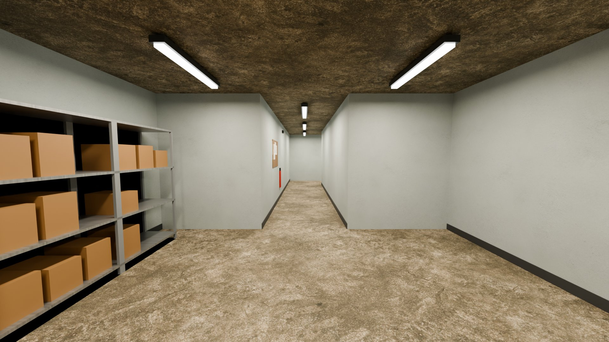
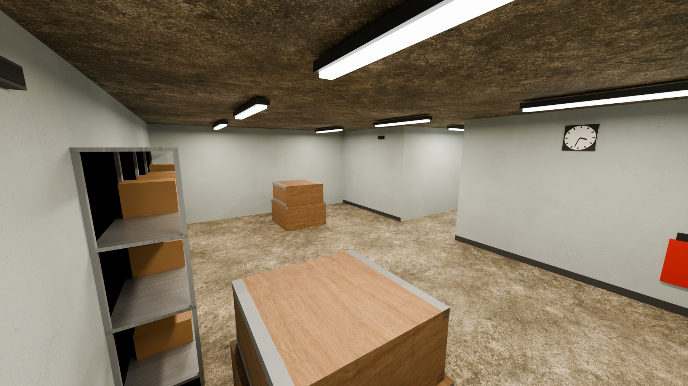
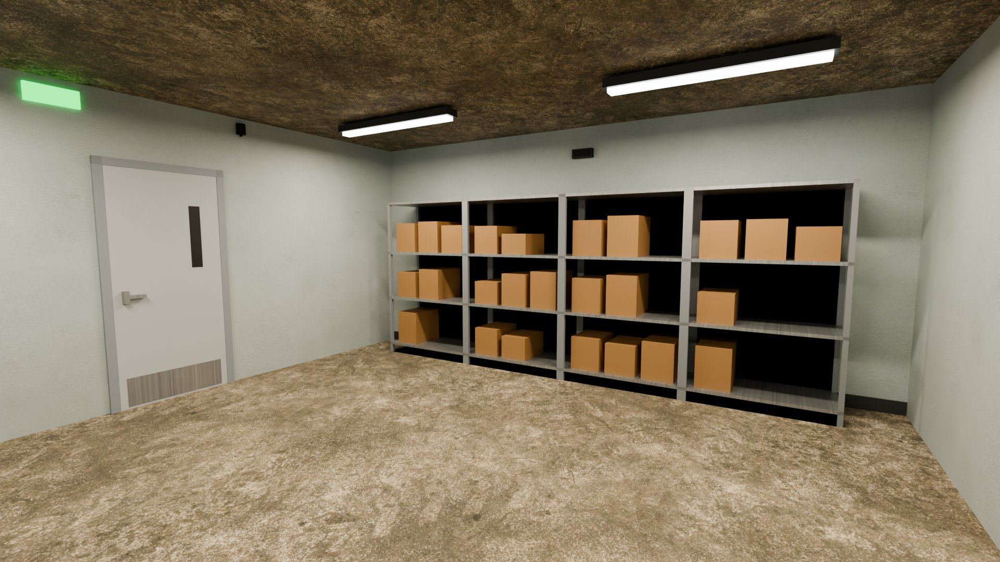
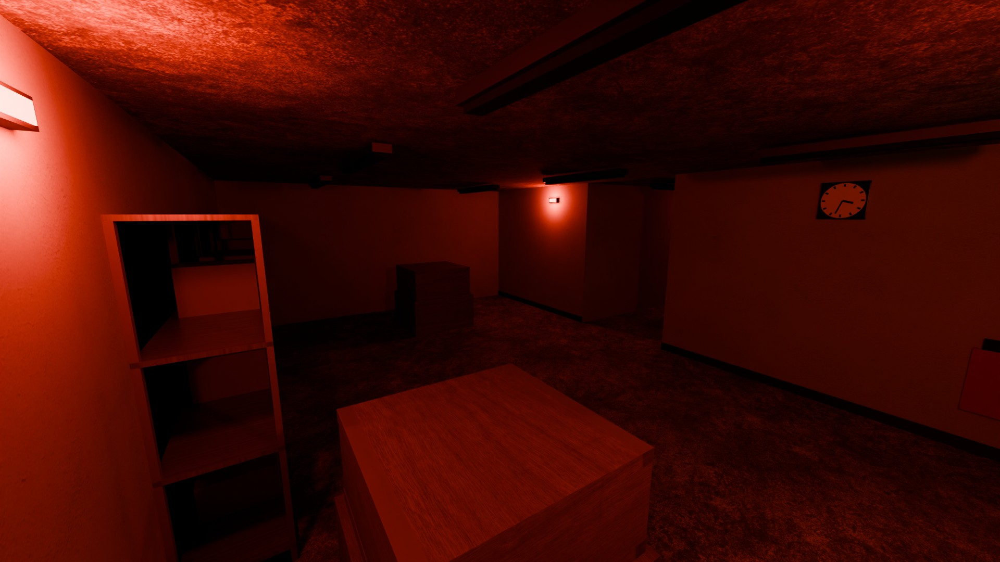
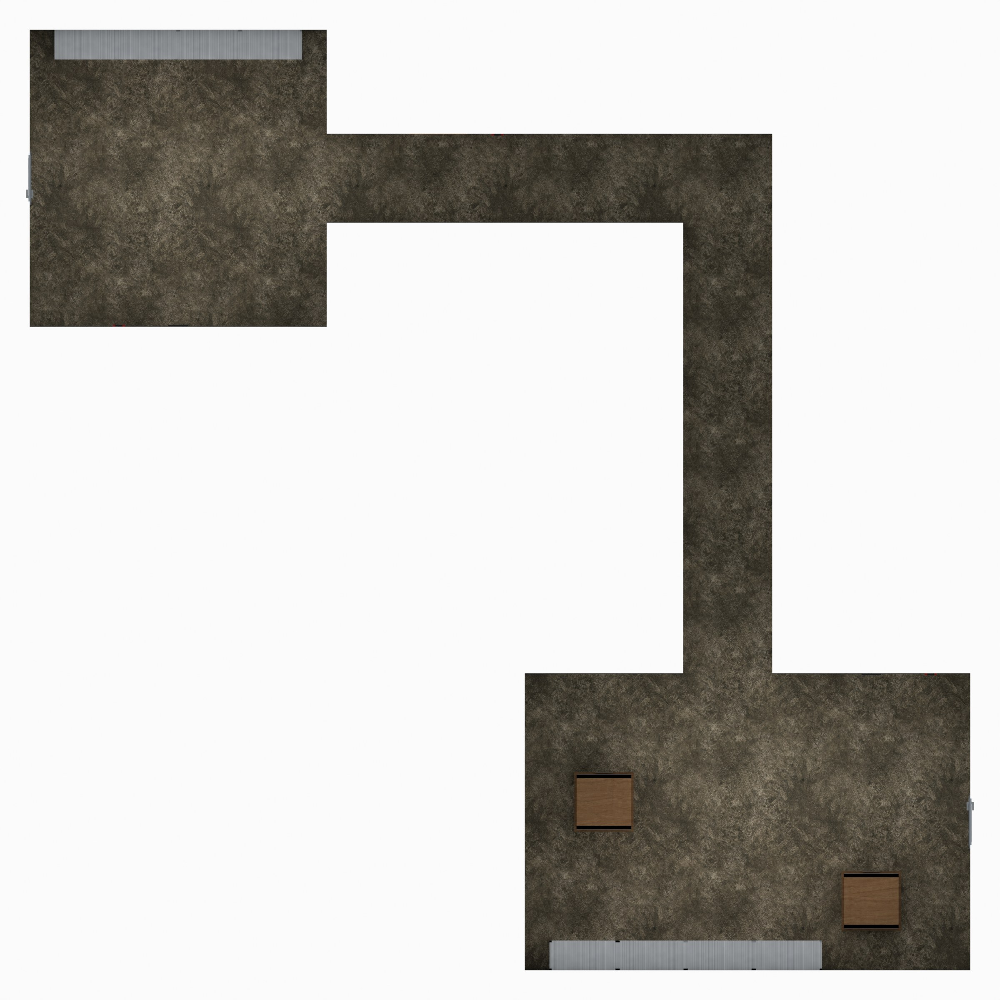

# hidden_entry: dressed and lit (Secret Operations, step 2)

The base's blind spot: a closet, a dog-leg maintenance passage and a storeroom, painted block over concrete, shelves and crates, caged battens in a warm, dim light, no cameras.

Built by `tools/blender/build_secretops_dress.py` around the greybox's layout (`tools/blender/build_secretops_greybox.py`): the layout objects are rebuilt from the same model, so `world/hidden_entry.json` is the greybox's file, unchanged. The method, the light sets, the removable parts and the sources are in `docs/renders/registrar_hall/README.md` (shared by all 13 scenes).

| File | What it is |
|---|---|
| `world/hidden_entry.glb` | the art only: 1.25 MB, 2754 triangles, 20 nodes drawn (19 meshes), 19 materials, WebP textures |
| `world/lightmaps/hidden_entry_0.webp`, `_1.webp` | the normal set (`lightmap`): the shell page and the props page |
| `world/lightmaps/hidden_entry_2.webp`, `_3.webp` | the alarm set (`lightmap_night`): the same two pages |
| `world/hidden_entry.json` | the layout, as the greybox wrote it: 28 colliders, 2 doors, 0 cameras, 2 links, 0 zones, 3 spots |
| `blender/scenes/hidden_entry.blend` | the saved scene (Git LFS): `Art` (Props, Separate, and Arch: one box per shell collider, for the layout check only), `Shell`, `Doors`, `Layout`, the two light collections, `Export` |
| `docs/renders/hidden_entry/` | `1_arrival.jpg`, `2_wide.jpg`, `3_detail.jpg` (normal light), `4_alarm.jpg` (the wide view in the alarm set), `plan.jpg`, `bake.json`, `caps.json` |







## Bake

| Map | Set | Page | Size | px/m | Gain G | Shown gain (caps) |
|---|---|---|---|---|---|---|
| `hidden_entry_0` | normal | shell | 1024 | 37.0 | 0.44037 | 1.4394 |
| `hidden_entry_1` | normal | props | 1024 | 49.9 | 0.44037 | 1.4394 |
| `hidden_entry_2` | alarm | shell | 1024 | 37.0 | 5.34908 | 1.6146 |
| `hidden_entry_3` | alarm | props | 1024 | 49.9 | 5.34908 | 1.6146 |

Cycles on the rented GPU (GPU), 512 samples, diffuse direct and indirect, OIDN, 8 px margin; 34 s for both sets. Texel = G L / (C + G L) with C = 1.2 and lightmap intensity pi C, G set so the median wall texel shows 0.34 (normal) or 0.26 (alarm) of its light; `caps.json` then scales each set's intensity so the walls show p50 0.19 (normal) or 0.155 (alarm) and caps any material that would pass p90 0.88 or p99 0.97.

## Brightness (`lab_display.py`, as the page shows it)

Normal set:

```
material                m2           map       k    p50    p90    p99     >=1
Wall_Service         220.4 hidden_entry_0  5.4264  0.190  0.268  0.344   0.00%
Ceiling_Concrete     122.6 hidden_entry_0  5.4264  0.031  0.065  0.111   0.00%
Floor_Concrete       113.4 hidden_entry_0  5.4264  0.105  0.216  0.353   0.00%
Steel                 52.9 hidden_entry_1  5.4264  0.033  0.158  0.244   0.00%
Cardboard             42.1 hidden_entry_1  5.4264  0.022  0.165  0.219   0.00%
Wood_Crate            18.8 hidden_entry_1  5.4264  0.050  0.131  0.223   0.00%
Paint_Grey            12.4 hidden_entry_1  5.4264  0.017  0.108  0.175   0.00%
Steel_Dark            11.4 hidden_entry_1  5.4264  0.010  0.098  0.101   0.00%
Skirting               4.5 hidden_entry_1  5.4264  0.013  0.015  0.021   0.00%
Door_Steel             4.4 hidden_entry_1  5.4264  0.000  0.215  0.225   0.00%
Door_Frame             1.5 hidden_entry_1  5.4264  0.095  0.127  0.129   0.00%
Notice                 1.0 hidden_entry_1  5.4264  0.123  0.621  0.693   0.00%
Plastic_Black          0.7 hidden_entry_1  5.4264  0.000  0.001  0.002   0.00%
Stripe_Red             0.6 hidden_entry_1  5.4264  0.213  0.236  0.246   0.00%
Sign_Plate             0.5 hidden_entry_1  5.4264  0.170  0.324  0.335   0.00%
Clock_Face             0.4 hidden_entry_1  5.4264  0.192  0.359  0.433   0.00%
```

Alarm set (`lightmap_night`):

```
material                m2           map       k    p50    p90    p99     >=1
Wall_Service         220.4 hidden_entry_2  6.0869  0.156  0.345  0.653   0.00%
Ceiling_Concrete     122.6 hidden_entry_2  6.0869  0.048  0.174  0.447   0.01%
Floor_Concrete       113.4 hidden_entry_2  6.0869  0.085  0.192  0.347   0.00%
Steel                 52.9 hidden_entry_3  6.0869  0.016  0.175  0.530   0.00%
Cardboard             42.1 hidden_entry_3  6.0869  0.011  0.124  0.268   0.00%
Wood_Crate            18.8 hidden_entry_3  6.0869  0.047  0.166  0.291   0.00%
Paint_Grey            12.4 hidden_entry_3  6.0869  0.013  0.116  0.245   0.00%
Steel_Dark            11.4 hidden_entry_3  6.0869  0.007  0.053  0.118   0.00%
Skirting               4.5 hidden_entry_3  6.0869  0.012  0.018  0.023   0.00%
Door_Steel             4.4 hidden_entry_3  6.0869  0.000  0.290  0.454   0.00%
Door_Frame             1.5 hidden_entry_3  6.0869  0.120  0.291  0.412   0.00%
Notice                 1.0 hidden_entry_3  6.0869  0.055  0.223  0.266   0.00%
Plastic_Black          0.7 hidden_entry_3  6.0869  0.002  0.005  0.005   0.00%
Stripe_Red             0.6 hidden_entry_3  6.0869  0.166  0.276  0.293   0.00%
Sign_Plate             0.5 hidden_entry_3  4.0094  0.325  0.864  0.969   0.05%
Clock_Face             0.4 hidden_entry_3  6.0869  0.329  0.577  0.593   0.00%
```

## Gates

```
check_layout (Blender): PASS: 33 of 33 checks passed
greybox --check: GATES PASS
layout JSON: IDENTICAL: world/hidden_entry.json is byte for byte the greybox's
worlddoc: OK world/hidden_entry.json: 28 colliders, 2 doors, 0 markers, 2 links, 0 zones, 3 spots, 0 errors, 2 warnings
glb_inspect: pass       tris: 2754 triangles, budget 300000 / pass       mb: 1.19 MB, budget 8
privacy: privacy grep: 14 files, 0 with hits
```

