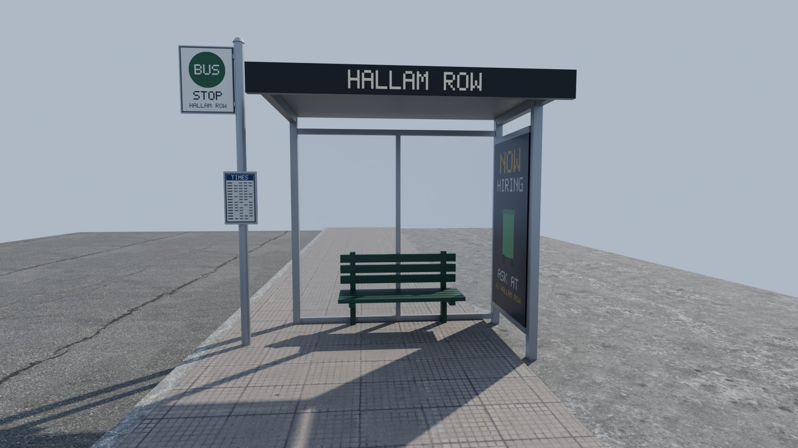
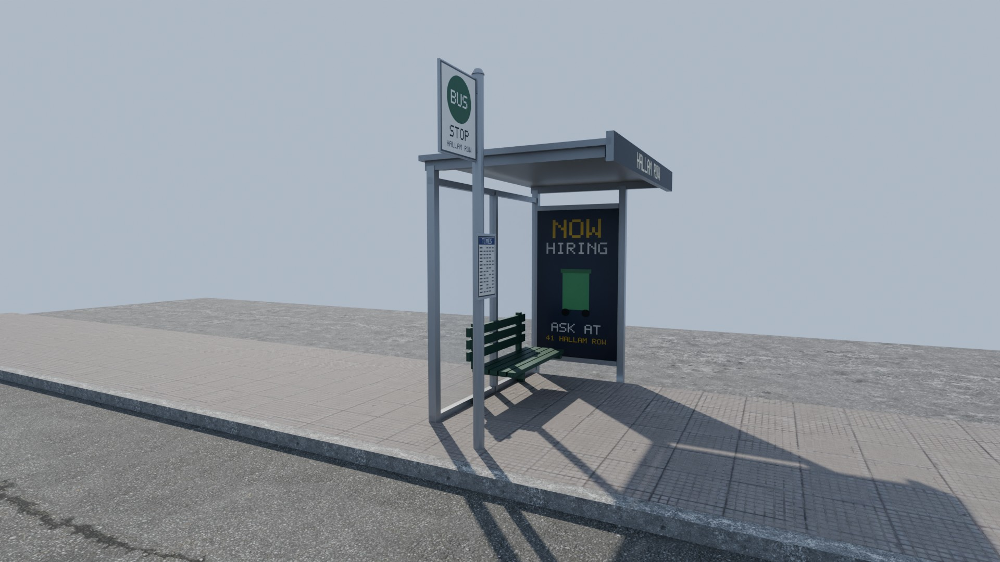
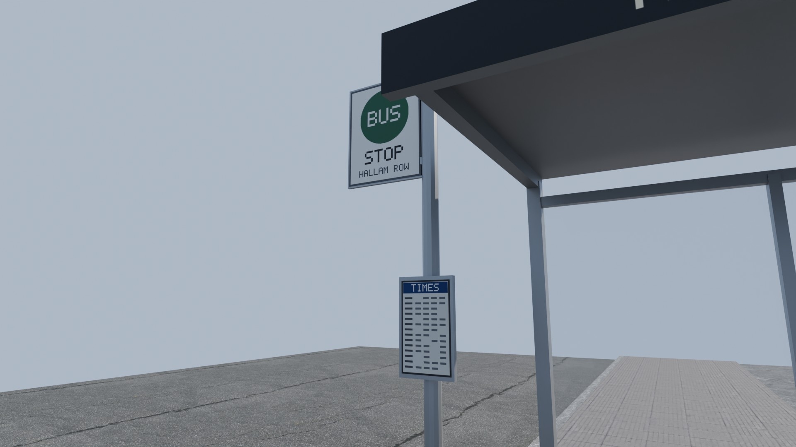

# City kit: `bus_stop`

`docs/BLENDER_AREAS.md` section 5: "`bus_stop`: the stop's shelter, bench and sign as one set." One set for both stops the game has: Hallam Row's (`shared/city.js` `BUS_STREET`) and the Overworld lot's (`BUS_LOT`), where the page draws a blockout shelter today (`index.html` `shelter()`).

| File | What it is |
|---|---|
| `world/kit/bus_stop.glb` | the art, art only: merged by material, six meshes |
| `world/kit/bus_stop.json` | the layout (scene `kit_bus_stop`), written by `tools/blender/export_scene.py` from the `.blend` |
| `world/lightmaps/kit_bus_stop_0.webp` | the ambient occlusion bake (second UV set, `TEXCOORD_1`, linear) |
| `blender/kit/bus_stop.blend` | the saved scene (Git LFS): `Art`, `Layout` (the `COL_` boxes and the link's empties), `Export` (merged by material, with the AO UVs), `Standins` (the street round it, for the stills only) |
| `tools/blender/build_city_kits.py --piece bus_stop` | the build (`build_bus_stop()`); `tools/blender/city_kits_pack.py bus_stop` packs it |
| `docs/renders/kit/bus_stop/` | this file and the three review stills |

## What is in it

- **The shelter:** a galvanised steel frame 2.44 m wide, two back posts and a mullion, a clear glass back (two panes), a cantilevered roof 2.3 m up that reaches 1.3 m out over the bench (no front posts, so the front stays open), a dark fascia with HALLAM ROW on both faces.
- **The east side panel:** a post at the front and an advert in a slim frame, both faces: NOW HIRING, ASK AT 41 HALLAM ROW, and a green wheelie bin (the trash truck job; own work).
- **The bench:** slatted dark green steel on two cantilever legs, inside the street's own bench box (1.4 m by 0.6 m, 0.9 m high).
- **The sign:** a round pole by the kerb with a cap, a timetable in a case at chest height, and the stop's flag over head height (BUS in a plain green disc, STOP, HALLAM ROW), standing out toward the road, away from the roof.

Not in it: the ground (the host's), the bus, the kerb's bus stop box (the street has its own paint).

## The frame and where it goes

Game axes (metres, y up; Blender (x, y, z) is game (x, -z, y)). **The origin is the middle of the bench, on the ground.** The shelter's back is to -z, its open side to +z, the road to -x. A placement is `at` and `yaw` as for the connector kit: a kit point (x, z) lands at (at.x + x cos yaw + z sin yaw, at.z - x sin yaw + z cos yaw).

| Stop | `at` | `yaw` | What lines up |
|---|---|---|---|
| Hallam Row | (7, 0, 5) (`BUS_STREET.shelter`) | 0 | `COL_Bench` is exactly `world/street.json`'s `Bench_BusStop`; the link `bus_stop` is `BUS_STREET` itself: `at` (6.2, 4.0), `arrive` (3.6, 0, 4.0) facing (0, -1); the pole stands at (5.45, 5.35), on the sidewalk 30 cm from the kerb |
| Overworld lot | (-43.4, floor, 46.4) (`BUS_LOT.shelter`, the lot's floor) | 0 | the bench box is the one `busStopLotProps` adds; the lot keeps its own F point (`BUS_LOT.at`, kit (1.0, -2.2), clear of the shelter) |

On the street the art's ground is the sidewalk, 6 cm over the collision floor, so the posts start 6 cm under it, as the street's own shelter does.

## The layout

`world/kit/bus_stop.json`: 5 colliders, 1 link.

| Collider | Box (kit frame) | Why |
|---|---|---|
| `Bench` | (-0.7, 0, -0.3) to (0.7, 0.9, 0.3) | the street's `Bench_BusStop` |
| `Shelter_Back` | (-1.22, 0, -0.38) to (1.22, 2.32, -0.28) | the posts and the glass back |
| `Shelter_Side` | (1.08, 0, -0.30) to (1.22, 2.32, 0.82) | the side panel and its front post |
| `Sign_Pole` | (-1.72, 0, 0.29) to (-1.38, 2.95, 0.45) | the pole and the timetable case |
| `Edge_Ground_host` | (-4, -1, -2) to (2.5, 0, 2) | the host's floor, so the file stands on its own (an `Edge_` box: invisible, the layout check does not ask for art over it; drop it when placing) |

Link `bus_stop`: `at` (-0.8, 0, -1.0), `arrive` (-3.4, 0, -1.0) facing (0, -1). The roof, the fascia and the flag are over head height and need no collider.

## Light: ambient occlusion only

As the street, the meadow, the forest and the playground (`docs/BLENDER.md` R1, AO-only scenes): the street has a day clock, so the baked materials carry `aomap` (`world/lightmaps/kit_bus_stop_0.webp`) and `aomap_intensity` 1.0 in their extras, on the second UV set, and no `lightmap`; the page keeps them lit by its sun and sky. One 1024 page, 99 px/m, Cycles AO on the rented GPU, 256 samples, 1.0 m reach, OIDN, 8 px margin, linear. The bake stands the set on a plain ground plane (removed after the bake, never exported), so its feet are occluded as they will be on the sidewalk or the lot. Not baked: `Shelter_Glass` (glass, 18 % alpha).

## Review stills (Cycles on the rented GPU, 128 samples adaptive, OIDN, 1920 x 1080, AgX, the street's sun and sky)

| | |
|---|---|
| `1_front.jpg` | from the sidewalk in front, at eye height |
| `2_side.jpg` | from the road, the flag pole by the kerb |
| `3_sign.jpg` | the flag and the timetable |





The road, kerb and sidewalk round it are stand-ins (the street's own materials, at the street's placement), for the stills only.

## Checks

Layout check (`tools/blender/check_layout.py`'s rules, run by the build on `Art` against `world/kit/bus_stop.json`):

```
layout check: scene kit_bus_stop, 12 visible meshes, 5 colliders
PASS  COVER  Bench: 2 mesh(es) cover it (1050 sample points, every one within 5 cm of art)
PASS  COVER  Shelter_Back: 5 mesh(es) cover it (1300 sample points, every one within 5 cm of art)
PASS  COVER  Shelter_Side: 4 mesh(es) cover it (975 sample points, every one within 5 cm of art)
PASS  COVER  Sign_Pole: 1 mesh(es) cover it (465 sample points, every one within 5 cm of art)
PASS  STRAY  6 tall solid mesh(es), each over a collider; 6 decor_* mesh(es) exempt
PASS  CLEAR  links.bus_stop.arrive (-3.40, -1.00): clear within 0.28 m
PASS  CLEAR  links.bus_stop.at (-0.80, -1.00): clear within 0.28 m
PASS: 7 of 7 checks passed
```

- The layout written again from the saved `.blend` after the bake and export (`--stage render` re-exports it): **the same** as `world/kit/bus_stop.json`.
- `node tools/worlddoc.mjs check world/kit/bus_stop.json`: **OK**, 5 colliders, 1 link, 0 errors, 2 warnings (the scene and its link are new to the manifest).
- `glb_inspect.py world/kit/bus_stop.glb --budget tris=300000,mb=8`: **pass**, 500 triangles, 0.10 MB (0.11 MB on disk), 6 materials, 6 draw calls.
- `node --test shared/*.test.js`: 297 of 297 pass.
- Privacy grep over the committed files (the `.blend` decompressed): clean.

## Brightness

AO-only materials are lit by the page, so this is what each shows under white light of 1: base colour (factor x texture) x AO texel x `aomap_intensity`, area-weighted, max channel (`lab_display.py` adapted to `aomap`):

```
material                m2           map       k    p50    p90    p99     >=1
Roof_Panel            10.3 kit_bus_stop_0  1.0000  0.307  0.320  0.320   0.00%
Steel_Grey             6.5 kit_bus_stop_0  1.0000  0.241  0.373  0.380   0.00%
Poster                 3.7 kit_bus_stop_0  1.0000  0.047  0.319  0.526   0.00%
Bench_Steel            3.4 kit_bus_stop_0  1.0000  0.036  0.085  0.097   0.00%
Signs                  1.8 kit_bus_stop_0  1.0000  0.014  0.710  0.807   0.00%
```

Nothing reaches 1; every p99 is under 0.81. The frame (the shelter's "walls") reads p50 0.24. The bench is dark green steel and the poster a dark advert on purpose; the signs' p50 is the fascia's dark ground.

## Sources and licences

No third-party asset is new here. Everything is own work, made by `tools/blender/build_city_kits.py`: all geometry; `blender/textures/city_kits/signs_city.png` (the flag, the timetable, the fascia, and the depot's and truck's signs, in the street's 5 x 7 pixel font, with the letters these signs add) and `ad_poster.png` (`--stage textures`, numpy). The stand-ins in the stills use the street's textures, copied unchanged from `blender/textures/street/` (claude/blender-street) to `blender/textures/city_kits/`: `road_asphalt.jpg` (Poly Haven `asphalt_02`, Rob Tuytel), `sidewalk_slab.jpg` (`square_concrete_pavers`, Amal Kumar), `concrete.jpg` (`hangar_concrete_floor`, Dimitrios Savva), all CC0 1.0 (the street's README lists them). No Meshy, no Higgsfield, nothing bought.

Tools: Blender 5.2.1 LTS with Cycles (OptiX on the rented GPU) and the glTF I/O add-on; Python with numpy and Pillow.

## Rebuild

```
python tools/blender/build_city_kits.py --stage textures                  # only if the generated textures change
blender -b --factory-startup --python tools/blender/build_city_kits.py -- --piece bus_stop --stage art,bake,export,render --samples 256 --work work/city_kits
python tools/blender/city_kits_pack.py bus_stop
```

## For the coordinator

- Not wired: the manifest and the page are yours. To use it on the street, draw `world/kit/bus_stop.glb` at (7, 0, 5) with yaw 0 and stop drawing the blockout `shelter()` there (`cityProps` already skips it when the street has art); add `COL_Shelter_Back`, `COL_Shelter_Side` and `COL_Sign_Pole` (moved by `at`) to the street's colliders if you want them solid (today only the bench is). The same at the lot with `BUS_LOT.shelter`.
- The flag reaches 8 cm past the kerb's face on the street, 2.3 m up, over the road's edge.
- In the lot there is already a stop post (`Post_stop2`); the kit brings its own pole. The pole is merged with the shelter's steel (one mesh), so hiding it alone needs a split.
