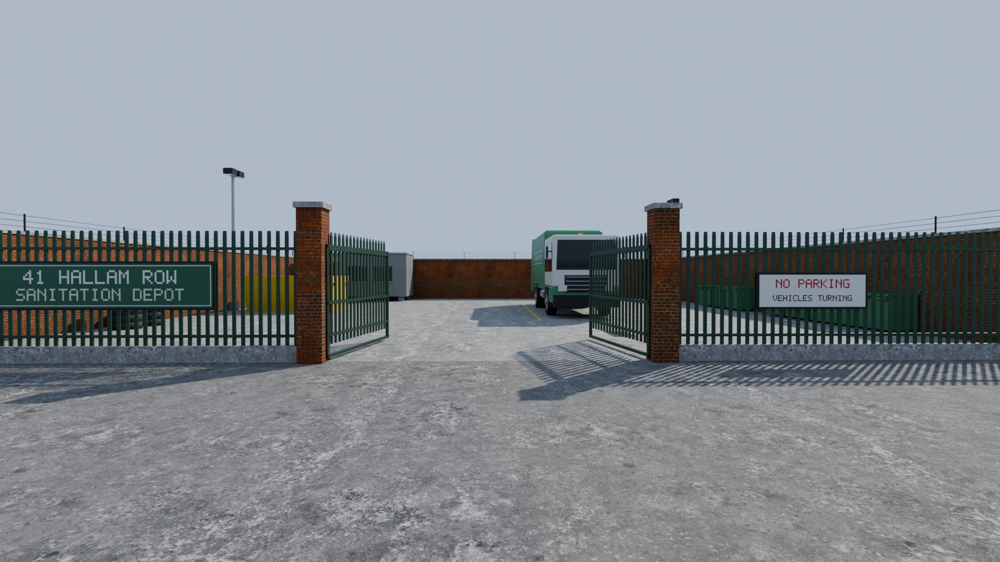
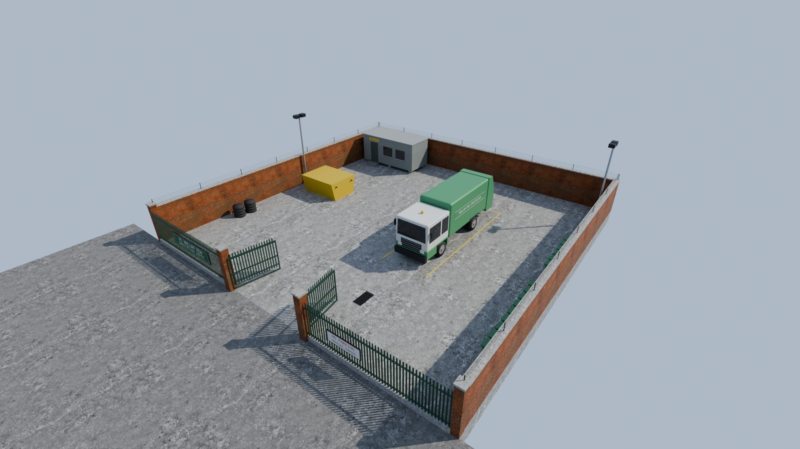
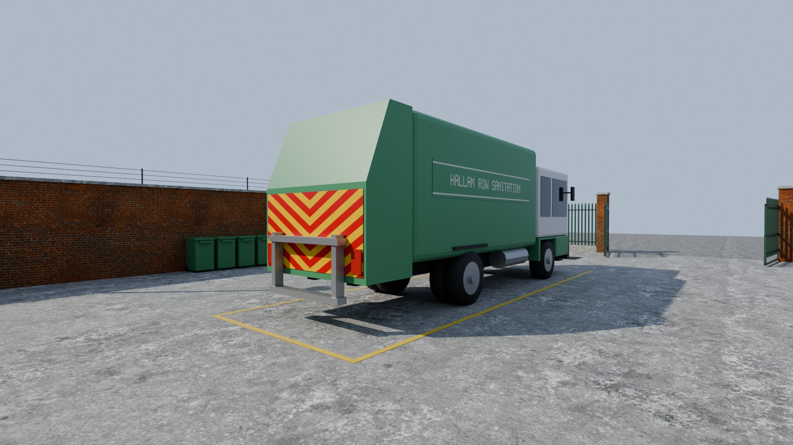

# City kit: `depot_yard`

`docs/BLENDER_AREAS.md` section 5: "A depot yard for 41 Hallam Row [DEFAULT]: the trash truck's yard and the truck itself, for when the route gets a truck." 41 Hallam Row is the trash truck worker's job (`docs/WORLD.md`, "Hallam Row, the jobs street"; `shared/trash.js`, `TRASH.depot` is `w41`). Today the route is walked and there is no truck; this kit is the yard behind 41 and the truck, ready for when the route gets one.

| File | What it is |
|---|---|
| `world/kit/depot_yard.glb` | the art, art only: the yard merged by material; the truck and the two gate leaves as their own nodes |
| `world/kit/depot_yard.json` | the layout (scene `kit_depot_yard`), written by `tools/blender/export_scene.py` from the `.blend` |
| `world/lightmaps/kit_depot_yard_0.webp`, `_1.webp` | the ambient occlusion bake (second UV set, `TEXCOORD_1`, linear): the yard's floor, and everything standing |
| `blender/kit/depot_yard.blend` | the saved scene (Git LFS): `Art`, `Truck`, `Leaves`, `Layout`, `Export`, `Standins` (the lane outside the gate, for the stills only) |
| `tools/blender/build_city_kits.py --piece depot_yard` | the build (`build_depot_yard()`, `build_truck()`); `tools/blender/city_kits_pack.py depot_yard` packs it |
| `docs/renders/kit/depot_yard/` | this file and the three review stills |

## What is in it

- **The yard:** 24 m by 24 m of worn concrete (the street's concrete with broad oil stains; own work from the CC0 map), the truck's bay painted in yellow, a wash-down drain.
- **The walls:** brick on three sides (the street's red brick), 2.6 m, with a concrete coping and three strands of barbed wire on brackets over them.
- **The front:** brick piers at the corners and at the gate, a green steel palisade on a concrete plinth either side, a 6 m vehicle gate of two palisade leaves, the depot's name board (41 HALLAM ROW / SANITATION DEPOT) on the fence and NO PARKING / VEHICLES TURNING on the other side.
- **The site office:** a steel cabin on blocks in the back corner (6 m by 2.6 m, 0.64 m clear of the walls), a door with two steps, two windows (one `Window_Lit`, switched by the page at night), DEPOT OFFICE over the door.
- **The bin store:** two rows of green wheelie bins against the east wall (15 in all; the route's bins are green).
- **A yellow skip, two stacks of tyres, two floodlight masts** (`Lamp_Emit` lenses, the page's switch).
- **The truck,** parked in its bay facing the gate (below).

## The truck

A rear-loading refuse truck, 9 m by 2.5 m, 3.45 m high: a white low-entry cab over a green band, a big windscreen, side windows, mirrors, a black bumper, a grille, lights and an amber beacon; a green body with HALLAM ROW SANITATION on both sides; the hopper at the back with red and yellow chevrons, tail lights and a bin lift; mudguards, a fuel tank, steps. Own materials (`Truck_*`), not baked: it moves.

| Node | Pivot (kit frame) | Moves | `extras` |
|---|---|---|---|
| `trash_truck` | (3.5, 0, -13): the middle of its footprint, on the ground | the whole truck (it faces +z, the gate) | `what`, `length_m` 9, `width_m` 2.5, `faces` +z, `parked` |
| `trash_truck_body` | child of `trash_truck`, at its pivot | with the truck | |
| `Truck_wheel_FL`, `Truck_wheel_FR` | on the front axle, 2.7 m ahead of the pivot, 0.52 m up | spin about x; steer about y | `axis` x, `motion` roll, `radius_m` 0.52, `steer` true |
| `Truck_wheel_RL`, `Truck_wheel_RR` | on the rear axle (twin tyres), 1.6 m behind the pivot | spin about x | `axis` x, `motion` roll, `radius_m` 0.52, `steer` false |
| `Truck_tailgate` | the body's top rear edge, 3.45 m up, 3.45 m behind the pivot | tilts up about x | `axis` x, `motion` tilt, `range_deg` 70 |

The wheels and the tailgate are children of `trash_truck`, so moving `trash_truck` moves them; each child's translation is its pivot in the truck's frame.

## The frame and where it goes

Game axes (metres, y up; Blender (x, y, z) is game (x, -z, y)). **The origin is the middle of the gate, on the ground, on the fence's line; the lane is on +z, the yard toward -z** (x -12 to 12, z 0 to -24), as the connector kit's pieces meet their host on +z.

**On Hallam Row:** `at` (-26, 0, -50), `yaw` 90 (a kit point (x, z) lands at (-26 + z, -50 - x)). The yard then stands behind 41 and the filler north of it: x -26 to -50, z -38 to -62, 2 m behind 41's back wall (x -24) and clear of the parking bays along the west edge (from x -54.5). The gate faces east, down the 4 m gap between 41 (z -34 to -48) and the filler `wfill1` (from z -52) to the road: the truck's way out and back is that gap, a straight 18 m run at z -50.

## The layout

`world/kit/depot_yard.json`: 20 colliders, 2 doors, 1 marker, 2 spots.

| Name | What |
|---|---|
| `Ground_Yard` | the floor, (-12, -1, -24) to (12, 0, 0) |
| `Wall_back`, `Wall_W`, `Wall_E` | the brick walls, 0.36 m thick, 2.6 m high |
| `Pier_corner_W`, `Pier_corner_E`, `Pier_gate_W`, `Pier_gate_E` | the brick piers, 2.8 m |
| `Fence_W`, `Fence_E` | the palisade runs and their signs, 2.4 m |
| `Office`, `Office_Steps` | the cabin (2.92 m) and its steps (0.25 m) |
| `Bins_1`, `Bins_2` | the two rows of bins, 1.06 m |
| `Skip`, `Tyres`, `Mast_1`, `Mast_2` | |
| `Truck_parked`, `Truck_parked_rear` | the parked truck (the cab and body; the hopper). They start 0.4 m up, over the wheels. When the page drives the truck, these two go with it or are dropped |
| `DoorLeaf_depot_gate_W` | hinge (-3, 0, 0), `width` 2.98, `height` 2.4, `closed_yaw_deg` 0, `swing_deg` 90 (into the yard), `state` closed, `kind` vehicle gate, `leaf` `Leaf_depot_gate_W` |
| `DoorLeaf_depot_gate_E` | hinge (3, 0, 0), the same with `closed_yaw_deg` 180, `swing_deg` -90 |
| `Marker_Gate` | `Entrance`, (0, 0, 1): outside the gate |
| `Spot_clock_1` | (-9.6, 0, -19.1) facing the office door: where the shift clocks in and out |
| `Spot_bins_1` | (10.14, 0, -10) facing the bins: the bin store |

The gate's leaves are GLB nodes `Leaf_depot_gate_W` and `Leaf_depot_gate_E`, each with its origin on its hinge, at rest shut; the page swings them as any door. The stills show them swung open 80 degrees.

## Light: ambient occlusion only

As the street (`docs/BLENDER.md` R1, AO-only scenes): the baked materials carry `aomap` and `aomap_intensity` 1.0 in their extras, on the second UV set, and no `lightmap`; the page keeps them lit by its sun and sky. `Lamp_Emit` (the floodlights) and `Window_Lit` (one office window) are the page's switched materials. The truck and the gate leaves are hidden during the bake, so the yard's floor holds no shadow of a truck that may have driven off; they are not baked (they move). Not baked either: `Metal_Dark` (wire, brackets, sign backs, lamp heads), `Paint_Yellow`, the windows. Faces never seen are left out before the bake (the wall tops under the coping, the cabin's top and underside, the walls' ends inside the piers). Cycles AO on the rented GPU, 256 samples, OIDN, 8 px margin, linear.

| Map | Page | AO reach | px/m | What |
|---|---|---|---|---|
| `kit_depot_yard_0` | 1024 | 2 m | 33.1 | the yard's floor and the drain |
| `kit_depot_yard_1` | 2048 | 1.2 m | 51.1 | everything standing: walls, piers, copings, fence, office, bins, skip, tyres, masts, signs |

## Review stills (Cycles on the rented GPU, 128 samples adaptive, OIDN, 1920 x 1080, AgX, the street's sun and sky, by day)

| | |
|---|---|
| `1_gate.jpg` | from the lane outside, the gates swung open |
| `2_wide.jpg` | the yard from above, south-east of the gate |
| `3_truck.jpg` | the truck from behind: the hopper, the chevrons, the bin lift |





The lane outside the gate is a stand-in (the street's back-lot concrete), for the stills only.

## Checks

Layout check (`tools/blender/check_layout.py`'s rules, run by the build on `Art` and `Truck` against `world/kit/depot_yard.json`; the gate leaves are skipped, as the page's doors collide them; the CLEAR point is the gate's marker):

```
layout check: scene kit_depot_yard, 52 visible meshes, 20 colliders (the gate leaves skipped: the page's doors collide them)
PASS  COVER  Bins_1: 4 mesh(es) cover it (7560 sample points, every one within 5 cm of art)
PASS  COVER  Bins_2: 4 mesh(es) cover it (5040 sample points, every one within 5 cm of art)
PASS  COVER  Fence_E: 8 mesh(es) cover it (6225 sample points, every one within 5 cm of art)
PASS  COVER  Fence_W: 8 mesh(es) cover it (6225 sample points, every one within 5 cm of art)
PASS  COVER  Ground_Yard: 22 mesh(es) cover it (192200 sample points, every one within 5 cm of art)
PASS  COVER  Mast_1: 3 mesh(es) cover it (1008 sample points, every one within 5 cm of art)
PASS  COVER  Mast_2: 3 mesh(es) cover it (1008 sample points, every one within 5 cm of art)
PASS  COVER  Office: 8 mesh(es) cover it (53816 sample points, every one within 5 cm of art)
PASS  COVER  Office_Steps: 4 mesh(es) cover it (384 sample points, every one within 5 cm of art)
PASS  COVER  Pier_corner_E: 7 mesh(es) cover it (1044 sample points, every one within 5 cm of art)
PASS  COVER  Pier_corner_W: 7 mesh(es) cover it (1044 sample points, every one within 5 cm of art)
PASS  COVER  Pier_gate_E: 5 mesh(es) cover it (1044 sample points, every one within 5 cm of art)
PASS  COVER  Pier_gate_W: 5 mesh(es) cover it (1044 sample points, every one within 5 cm of art)
PASS  COVER  Skip: 3 mesh(es) cover it (18734 sample points, every one within 5 cm of art)
PASS  COVER  Truck_parked: 6 mesh(es) cover it (85440 sample points, every one within 5 cm of art)
PASS  COVER  Truck_parked_rear: 2 mesh(es) cover it (6448 sample points, every one within 5 cm of art)
PASS  COVER  Tyres: 2 mesh(es) cover it (2000 sample points, every one within 5 cm of art)
PASS  COVER  Wall_E: 12 mesh(es) cover it (32130 sample points, every one within 5 cm of art)
PASS  COVER  Wall_W: 8 mesh(es) cover it (32130 sample points, every one within 5 cm of art)
PASS  COVER  Wall_back: 7 mesh(es) cover it (32535 sample points, every one within 5 cm of art)
PASS  STRAY  33 tall solid mesh(es), each over a collider; 7 decor_* mesh(es) exempt
PASS  CLEAR  marker Gate (0.00, 1.00): clear within 0.28 m
PASS: 22 of 22 checks passed
```

- The layout written again from the saved `.blend` after the bake and export: **the same** as `world/kit/depot_yard.json`.
- `node tools/worlddoc.mjs check world/kit/depot_yard.json`: **OK**, 20 colliders, 2 doors, 1 marker, 2 spots, 0 errors, 1 warning (the scene is new to the manifest).
- `glb_inspect.py world/kit/depot_yard.glb --budget tris=300000,mb=8`: **pass**, 8,590 triangles, 1.95 MB (2.04 MB on disk), 30 materials, 40 draw calls (the truck 20 of them, the gate's leaves 2), every texture WebP.
- `node --test shared/*.test.js`: 297 of 297 pass.
- Privacy grep over the committed files (the `.blend` decompressed): clean.

## Brightness

Base colour (factor x texture) x AO texel x `aomap_intensity`, area-weighted, max channel, for the baked materials:

```
material                m2           map       k    p50    p90    p99     >=1
Yard_Concrete        672.0 kit_depot_yard_0  1.0000  0.226  0.371  0.627   0.00%
Wall_Brick           391.5 kit_depot_yard_1  1.0000  0.155  0.279  0.366   0.00%
Bin_Green             65.9 kit_depot_yard_1  1.0000  0.005  0.167  0.195   0.00%
Trim_Concrete         57.1 kit_depot_yard_1  1.0000  0.273  0.447  0.743   0.00%
Fence_Steel           46.0 kit_depot_yard_1  1.0000  0.077  0.090  0.090   0.00%
Office_Panel          44.2 kit_depot_yard_1  1.0000  0.097  0.248  0.286   0.00%
Office_Trim           37.2 kit_depot_yard_1  1.0000  0.305  0.310  0.310   0.00%
Skip_Yellow           29.2 kit_depot_yard_1  1.0000  0.613  0.620  0.620   0.00%
Rubber_Black          14.8 kit_depot_yard_1  1.0000  0.000  0.023  0.030   0.00%
Steel_Grey             8.2 kit_depot_yard_1  1.0000  0.252  0.380  0.380   0.00%
Signs                  4.7 kit_depot_yard_1  1.0000  0.120  0.716  0.823   0.60%
Door_Leaf              3.7 kit_depot_yard_1  1.0000  0.072  0.090  0.090   0.00%
Drain_Iron             0.7 kit_depot_yard_0  1.0000  0.004  0.022  0.022   0.00%
```

The walls read p50 0.155 and the floor 0.23; every p90 is at or under 0.62 and every p99 under 0.83. Low p50s are faces in tight gaps, which the AO rightly darkens: the bins' sides (12 cm apart, and their backs 4 cm off the wall), the cabin's back and west side (0.64 m off the walls) and its front round the door and windows. The palisade is dark green steel. The 0.6 % of `Signs` at 1 are single texels of WebP ringing at the white letters' edges.

## Sources and licences

| Texture | Used for | Source | Licence |
|---|---|---|---|
| `brick_red.jpg` | the walls and piers | Poly Haven `red_bricks_04` (Rob Tuytel), the street's copy, unchanged | CC0 1.0 |
| `concrete.jpg` | the copings, plinths, pier caps; the stand-in lane | Poly Haven `hangar_concrete_floor` (Dimitrios Savva), the street's copy, unchanged | CC0 1.0 |
| `yard_concrete.jpg` | the yard's floor | made by `build_city_kits.py --stage textures` from `concrete.jpg`: broad oil stains and two worn bands | CC0 1.0 source; own work |
| `window_lit.jpg`, `drain.jpg` | the office's lit window, the drain | drawn by `tools/blender/build_street.py` (the street's) | own work |
| `signs_city.png`, `cabin_panel.jpg` | the depot's, office's and truck's signs and the chevrons; the cabin's cladding | drawn by `build_city_kits.py --stage textures` | own work |

Every model (the yard, the office, the bins, the skip, the masts, the gate and the truck) is built by `tools/blender/build_city_kits.py` from boxes, prisms and cylinders. No Meshy, no Higgsfield, nothing bought.

## Rebuild

```
blender -b --factory-startup --python tools/blender/build_city_kits.py -- --piece depot_yard --stage art,bake,export,render --samples 256 --work work/city_kits
python tools/blender/city_kits_pack.py depot_yard
```

## For the coordinator

- Not wired: the manifest and the page are yours. On the street, draw `world/kit/depot_yard.glb` at (-26, 0, -50) with yaw 90 and add its colliders, doors, marker and spots, turned and moved (`docs/WORLD.md` and `shared/trash.js` today walk the route with no truck).
- When the route gets a truck: drive `trash_truck` (its wheels roll by `radius_m`, the front pair steer), lift `Truck_tailgate` at a bin, and move or drop `COL_Truck_parked` and `COL_Truck_parked_rear` with it. Its way out is the gate, then the 4 m gap between 41 and `wfill1` (z -48 to -52 on the street) to the road.
- `Spot_clock_1` is a place for the shift's clock-in at the office; today the shift starts at 41's street door (`TRASH.depot`), which you may keep.
- The yard stands where the street's back lot is plain concrete (y 0); its floor is at the same height, so it can lie over the back lot without a step (the back lot's quads under it could be cut out to avoid two coplanar floors).
