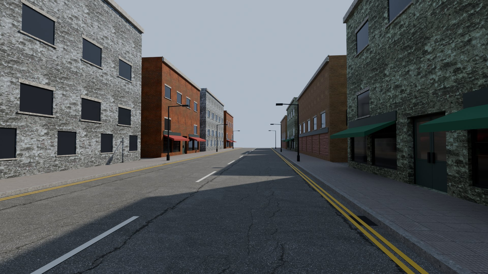
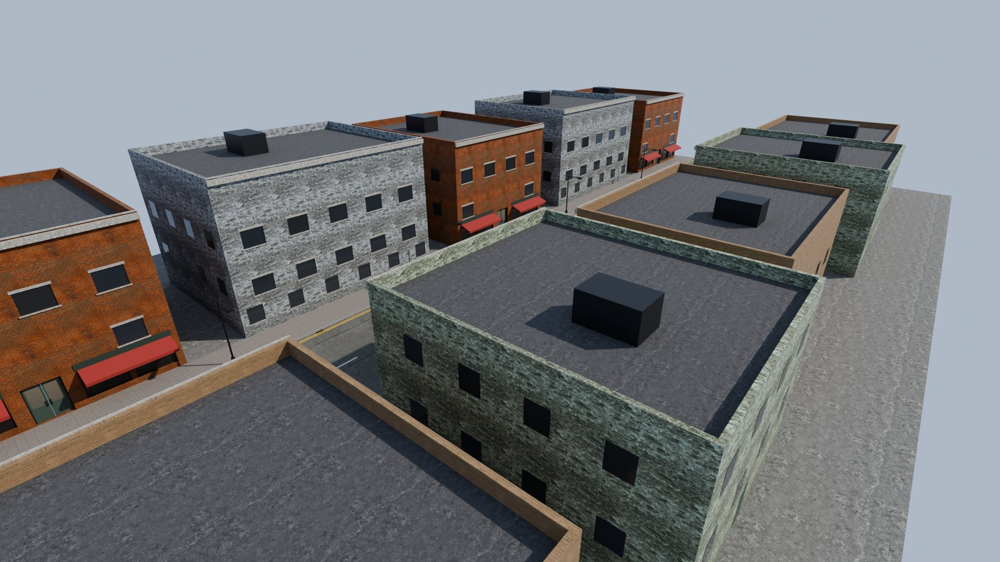
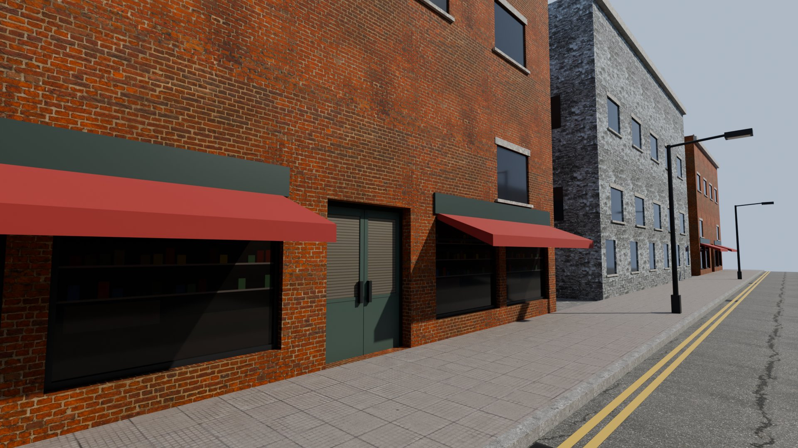

# City kit: `street_segment`

`docs/BLENDER_AREAS.md` section 5: "A street segment kit: a 40 m length of Hallam Row with two building slots, so the street can grow as addons unlock (`street_of_jobs`)." Hallam Row is code-first (`shared/city.js`, `tools/make_street.mjs`), so this is a piece to add north of it, not a new layout of the street.

| File | What it is |
|---|---|
| `world/kit/street_segment.glb` | the art, art only: the road, the sidewalks, the yards, four lamp posts and two filler buildings merged by material; each slot's building under its own node, `slot_W` and `slot_E` |
| `world/kit/street_segment.json` | the layout (scene `kit_street_segment`), written by `tools/blender/export_scene.py` from the `.blend` |
| `world/lightmaps/kit_street_segment_0.webp` .. `_2.webp` | the ambient occlusion bake (second UV set, `TEXCOORD_1`, linear) |
| `blender/kit/street_segment.blend` | the saved scene (Git LFS): `Art` (with `Slot_slot_W` and `Slot_slot_E`), `Layout`, `Export`, `Standins` (two more copies of the segment, north and south, for the stills only) |
| `tools/blender/build_city_kits.py --piece street_segment` | the build (`build_street_segment()`); `tools/blender/city_kits_pack.py street_segment` packs it |
| `docs/renders/kit/street_segment/` | this file and the three review stills |

## The look is the street's

Everything is built by the rules of `tools/blender/build_street.py` (claude/blender-street) and with its textures (copied unchanged to `blender/textures/city_kits/`), by the street's own material names, so a segment sits next to `world/street.glb` without a seam in style:

- the road (x -5 to 5, 6 cm under the collision floor), the 12 cm kerbs, the 3 m sidewalks (6 cm over the floor) out to the building fronts at x = +-8, double yellow lines along both kerbs, the centre dashes every 8 m (five a segment, so they run on from segment to segment), drains every 12 m, a manhole;
- the lamp posts every 20 m on both sides at x = +-5.5 (z 0 and -20; the next segment's z 0 is this one's -40), with `Lamp_Emit` lenses;
- each building as the street builds one: the front cut round the door, a 25 cm door recess with a pair of leaves at its back, **plain wall 1.6 m each side of the door's centre line and no fascia or awning within 1.55 m of it** (the page hangs each door's sign, status lamp and roller shutter there), shop panels with the street's shop glass, fascias and canvas awnings, the page's window slots (`shared/city.js` `windowSlots`) on the upper floors, about half `Window_Lit` and half `Window_Dark`, sills and lintels, flush windows and a back door on the back and sides, a parapet, a felt roof, a cornice and roof plant;
- the yards behind the buildings, flat concrete at y 0, out to x = +-30, with a skirt down to y -1 at their outer edge.

## The frame, the slots and how the street grows

**The origin is the road's centre line at the segment's south end, on the collision floor (y 0).** The segment runs 40 m north, to z -40, as Hallam Row runs (north is -z); x is the street's own x. Placed at (0, 0, z) with yaw 0 it continues the street north of z. A yaw of 180 turns it round (the slots then swap sides), so two segments in a row need not look alike.

| Plot | Side | z | Depth | Height | Door | Look | Node |
|---|---|---|---|---|---|---|---|
| `slot_W` | west (x -8 to -24) | -24 to -38 | 16 m | 10 m | z -31 | red brick, shopfront, red awnings | `slot_W` |
| `fill_W` | west (x -8 to -22) | -2 to -20 | 14 m | 11 m | none | painted render, house windows | merged |
| `slot_E` | east (x 8 to 24) | -2 to -16 | 16 m | 9 m | z -9 | painted render, shopfront, green awnings | `slot_E` |
| `fill_E` | east (x 8 to 22) | -20 to -38 | 14 m | 8 m | none | yellow brick, boarded shop | merged |

The plots are the street's own sizes: a job's building 14 m long and 16 m deep like 41, 108, 214 and 330; 2 m clear at each end of the segment, so two segments meet with a 4 m gap between buildings, as the street's plots do.

**A slot** is a job's building with a door, waiting for an addon (`street_of_jobs`). Its node carries what the page needs to add the job, as glTF `extras`: `slot`, `side`, `front_x`, `z0`, `z1`, `depth_m`, `height_m`, `door_z`, `door_w` (1.8) and `door_h` (2.5), the street's `DOOR_W` and `DOOR_H`. Unlocking a job is then one new entry in `shared/city.js` `BUILDINGS` with the slot's numbers (plus the segment's `at`), exactly like the entries there now: the page draws the door's sign, lamp and shutter on the slot's plain wall, and its window slots match the art's. Until a job is unlocked, the page can hide the slot's node and leave the plot as yard (its collider then goes too) or keep it as a shut building.

## The layout

`world/kit/street_segment.json`: 9 colliders, 2 links, 2 spots.

| Name | Box / point (kit frame) | What |
|---|---|---|
| `Ground_Segment` | (-30, -1, -40) to (30, 0, 0) | the collision floor, a metre thick, as `Ground_Street` |
| `Building_slot_W`, `Building_fill_W`, `Building_slot_E`, `Building_fill_E` | the plots above, from y 0 to the roof (the parapet stands 0.7 m over it, as on the street) | as `Building_<id>` on the street |
| `Lamp_Street_1` .. `_4` | 0.2 m by 0.2 m, 4.2 m high, at x = +-5.5, z 0 and -20 | as the street's `Lamp_Street` |
| link `slot_W` | `at` (-7.4, 0, -31), `arrive` (-6.9, 0, -31) facing (1, 0) | the slot's door: F 0.6 m in front of its face, where you stand coming out |
| link `slot_E` | `at` (7.4, 0, -9), `arrive` (6.9, 0, -9) facing (-1, 0) | the same on the east side |
| `Spot_bin_1`, `Spot_bin_2` | (-5.4, 0, -12), (5.4, 0, -30) | where the trash route (`shared/trash.js` `BINS`) can put a bin on this length: at the kerb, clear of the lamps and the doors |

## Light: ambient occlusion only

As the street (`docs/BLENDER.md` R1, AO-only scenes): every baked material carries `aomap` and `aomap_intensity` 1.0 in its extras, on the second UV set, and no `lightmap`; the page keeps them lit by its sun and sky. `Lamp_Emit` (the lenses, exported at the street's strength 6) and `Window_Lit` (the lit panes, 2.2 times their picture) are the page's switched materials, as on the street. Not baked, as on the street: `Window_Lit`, `Window_Dark`, `Shop_Glass`, `Lamp_Emit`, `Frame_Dark`, `Metal_Dark`, `Fascia_Paint`, and the road paint (narrower than a texel). Cycles AO on the rented GPU, 256 samples, OIDN, 8 px margin, linear; no AO island is longer than 20 m.

| Map | Page | AO reach | px/m | What |
|---|---|---|---|---|
| `kit_street_segment_0` | 2048 | 3 m | 45.5 | the ground: road, kerbs, sidewalks, yards, drains |
| `kit_street_segment_1` | 2048 | 3 m | 26.7 | the four buildings' faces and roofs |
| `kit_street_segment_2` | 1024 | 1 m | 37.3 | doors, boards, awnings, sills and cornices |

The segment is baked on its own: at its two ends the next segment's buildings (4 m away) are not there to occlude, so the end walls are a little lighter than they will be in a row.

## Review stills (Cycles on the rented GPU, 128 samples adaptive, OIDN, 1920 x 1080, AgX, the street's sun and sky, by day: the lamps and lit windows off)

| | |
|---|---|
| `1_street.jpg` | up the street at eye height from the segment's south end, with two more copies of it north and south (stand-ins) to show segments in a row |
| `2_wide.jpg` | from 20 m over the south-east |
| `3_slot.jpg` | slot W's door: the plain wall and piers either side of it where the page puts the door's sign, lamp and shutter |





## Checks

Layout check (`tools/blender/check_layout.py`'s rules, run by the build on `Art` against `world/kit/street_segment.json`; the CLEAR points are the two links' `at` and `arrive`):

```
layout check: scene kit_street_segment, 60 visible meshes, 9 colliders
PASS  COVER  Building_fill_E: 11 mesh(es) cover it (161700 sample points, every one within 5 cm of art)
PASS  COVER  Building_fill_W: 10 mesh(es) cover it (162540 sample points, every one within 5 cm of art)
PASS  COVER  Building_slot_E: 14 mesh(es) cover it (161460 sample points, every one within 5 cm of art)
PASS  COVER  Building_slot_W: 14 mesh(es) cover it (160776 sample points, every one within 5 cm of art)
PASS  COVER  Ground_Segment: 21 mesh(es) cover it (192000 sample points, every one within 5 cm of art)
PASS  COVER  Lamp_Street_1: 3 mesh(es) cover it (387 sample points, every one within 5 cm of art)
PASS  COVER  Lamp_Street_2: 3 mesh(es) cover it (387 sample points, every one within 5 cm of art)
PASS  COVER  Lamp_Street_3: 3 mesh(es) cover it (387 sample points, every one within 5 cm of art)
PASS  COVER  Lamp_Street_4: 3 mesh(es) cover it (387 sample points, every one within 5 cm of art)
PASS  STRAY  20 tall solid mesh(es), each over a collider; 0 decor_* mesh(es) exempt
PASS  CLEAR  links.slot_E.arrive (6.90, -9.00): clear within 0.28 m
PASS  CLEAR  links.slot_E.at (7.40, -9.00): clear within 0.28 m
PASS  CLEAR  links.slot_W.arrive (-6.90, -31.00): clear within 0.28 m
PASS  CLEAR  links.slot_W.at (-7.40, -31.00): clear within 0.28 m
PASS: 14 of 14 checks passed
```

- The layout written again from the saved `.blend` after the bake and export: **the same** as `world/kit/street_segment.json`.
- `node tools/worlddoc.mjs check world/kit/street_segment.json`: **OK**, 9 colliders, 2 links, 2 spots, 0 errors, 3 warnings (the scene and its two links are new to the manifest).
- `glb_inspect.py world/kit/street_segment.glb --budget tris=300000,mb=8`: **pass**, 3,706 triangles, 2.98 MB (3.13 MB on disk), 24 materials, 40 draw calls, every texture WebP.
- `node --test shared/*.test.js`: 297 of 297 pass.
- Privacy grep over the committed files (the `.blend` decompressed): clean.

## Brightness

Base colour (factor x texture) x AO texel x `aomap_intensity`, area-weighted, max channel: what each shows under white light of 1 (the page lights it with its sun and sky):

```
material                m2           map       k    p50    p90    p99     >=1
Roof_Felt            891.0 kit_street_segment_1  1.0000  0.058  0.095  0.159   0.00%
Backlot_Ground       888.0 kit_street_segment_0  1.0000  0.139  0.229  0.387   0.00%
Facade_fill_W        782.2 kit_street_segment_1  1.0000  0.167  0.457  0.650   0.00%
Facade_slot_W        671.3 kit_street_segment_1  1.0000  0.151  0.275  0.361   0.00%
Facade_slot_E        611.3 kit_street_segment_1  1.0000  0.169  0.453  0.609   0.00%
Facade_fill_E        579.1 kit_street_segment_1  1.0000  0.216  0.332  0.491   0.00%
Road_Asphalt         400.0 kit_street_segment_0  1.0000  0.100  0.193  0.381   0.00%
Sidewalk_Slab        229.0 kit_street_segment_0  1.0000  0.178  0.245  0.289   0.00%
Trim_Stone            90.2 kit_street_segment_2  1.0000  0.265  0.483  0.851   0.00%
Boarding              31.0 kit_street_segment_2  1.0000  0.282  0.426  0.579   0.00%
Kerb_Stone            21.6 kit_street_segment_0  1.0000  0.178  0.313  0.556   0.00%
Awning_Green          15.3 kit_street_segment_2  1.0000  0.145  0.150  0.150   0.00%
Awning_Red            15.3 kit_street_segment_2  1.0000  0.291  0.300  0.300   0.00%
Door_Leaf             14.2 kit_street_segment_2  1.0000  0.076  0.090  0.090   0.00%
Drain_Iron             1.8 kit_street_segment_0  1.0000  0.003  0.010  0.022   0.00%
```

The walls read p50 0.15 to 0.22, every p90 at or under 0.46 and every p99 under 0.86; nothing reaches 1. The two painted facades' colours were lightened once to get there (`fill_W` 0x8a96a2, `slot_E` 0x8a9a8c, from 0x6a7480 and 0x76847a: p50 0.10 and 0.12 before). The roofs' felt, the road and the door leaves are the street's own dark materials.

## Sources and licences

The street's textures, copied unchanged from `blender/textures/street/` (claude/blender-street) to `blender/textures/city_kits/` (sources as the street's README lists them, all CC0 1.0):

| Texture | Used for | Source | Author |
|---|---|---|---|
| `road_asphalt.jpg` | the road | Poly Haven `asphalt_02` | Rob Tuytel |
| `sidewalk_slab.jpg` | the sidewalks | Poly Haven `square_concrete_pavers` | Amal Kumar |
| `brick_red.jpg` | slot W | Poly Haven `red_bricks_04` | Rob Tuytel |
| `render_patchy.jpg` | fill W, slot E | Poly Haven `rough_plaster_brick` | Rob Tuytel |
| `brick_yellow.jpg` | fill E | Poly Haven `factory_brick` | Rob Tuytel |
| `concrete.jpg` | kerbs, yards, roofs, stone trim | Poly Haven `hangar_concrete_floor` | Dimitrios Savva |
| `wood.jpg` | the boarded shop | Poly Haven `dark_wood` | Dario Barresi, Dimitrios Savva, Rico Cilliers |
| `shop_atlas.jpg`, `window_lit.jpg`, `drain.jpg` | shop glass, lit windows, drains | drawn by `tools/blender/build_street.py` | own work |

Everything else (all geometry) is own work, made by `tools/blender/build_city_kits.py`. No Meshy, no Higgsfield, nothing bought.

## Rebuild

```
blender -b --factory-startup --python tools/blender/build_city_kits.py -- --piece street_segment --stage art,bake,export,render --samples 256 --work work/city_kits
python tools/blender/city_kits_pack.py street_segment
```

## For the coordinator

- Not wired: the manifest, `shared/city.js` and the page are yours. The street ends today at the road's z -140 with its north edge wall and the railway viaduct at z -150; a first segment placed at (0, 0, -140) needs that edge moved north by 40 m per segment (the viaduct, `Wall_N`, `WORLD.z0`, `ROAD.z0`) and the side edge rows and walls lengthened. The yards here run out to x = +-30; the street's own run on to its edge rows at +-60, so that strip (x 30 to 60) is the host's to fill.
- Colliders, links and spots are in kit coordinates: add `at` (and turn by `yaw`) when copying them into `world/street.json` (that file is written by `tools/make_street.mjs` from `shared/city.js`, so the slot buildings, the lamps and the ground most naturally go into `BUILDINGS`, `LAMP_ZS` and `WORLD` there).
- A slot's door link (`slot_W`, `slot_E`) is for a door that leads somewhere; on the street the doors are markers with a width (`Door_<id>`), which the street's code makes from `BUILDINGS`.
