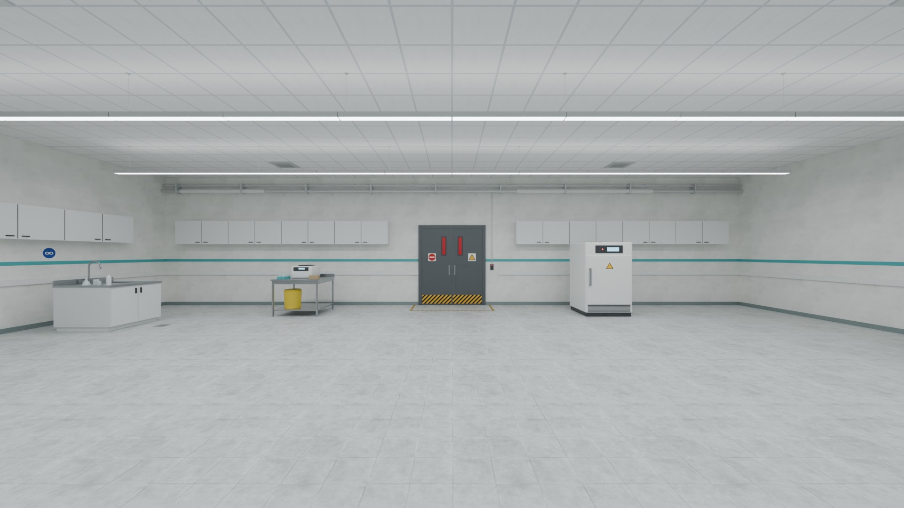
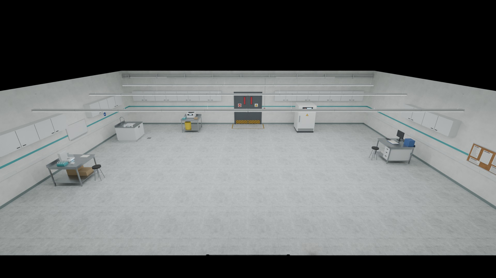
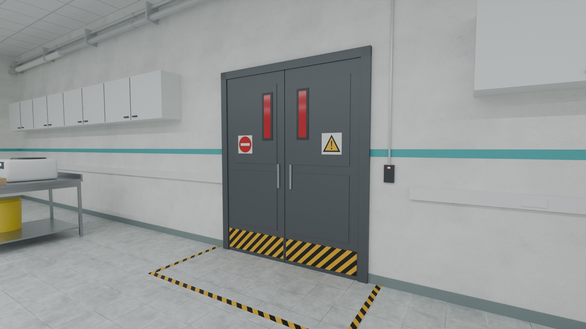

# laboratory: the Blender build

Scene 3 of the Blender plan (`docs/BLENDER.md`, "3. laboratory"), built the way the apartment pilot was. The lab behind 214 Hallam Row: a clinical white room 18 x 12 m and 4 m high, three rows of suspended strip lights, a steel bench (or the freezer) at each of the five stations, the way out to the south, and the sealed B2 door on the north wall built as a heavy steel door that does not open. Built in Blender 5.2.1 from `blender/layout/laboratory.json`, baked in full (the lab is lit the same all day) and exported as art only.

| File | What it is |
|---|---|
| `world/laboratory.glb` | the art: 1.43 MB (1.37 MiB, 1 432 304 bytes), 10 982 triangles, 31 draw calls, textures as WebP |
| `world/lightmaps/laboratory_0.webp`, `laboratory_1.webp` | the baked light, 1280 x 1280 each (second UV set, `TEXCOORD_1`) |
| `blender/scenes/laboratory.blend` | the saved scene (0.86 MB, Git LFS): `Art` (the unmerged pieces), `Export` (merged by material, with the lightmap UVs), `Standins`, `Lights` |
| `tools/blender/build_laboratory.py` | the re-runnable build (reads the layout; no hand-copied coordinates) |
| `blender/textures/laboratory/` | the five texture files the build reads, derived from three CC0 Poly Haven textures |
| `docs/renders/laboratory/` | the three review stills (this file's folder) |

No shared tool was changed: `check_layout.py`, `pack_scene.py`, `dump_layout.mjs` and `tools/webp_glb.py` are used as the pilot left them.

## Review stills (Cycles on the CPU, 128 samples, OIDN denoise, 1920 x 1080 JPEG)

| | |
|---|---|
| `1_arrival.jpg` (196 KB) | the arrival point (0, 4.4) at eye height 1.6 m, facing the scene's `face` (north, -z), 75 degrees vertical like the page's camera |
| `2_wide.jpg` (177 KB) | the whole room from the south, the south wall, its trim, the coats, the clock and the ceiling hidden from the camera only (they still light and shade the room) |
| `3_detail.jpg` (187 KB) | the sealed B2 door: steel leaves, the red glow behind its slits, the card reader and its conduit, the hazard tape on the floor; the centrifuge bench at the left |





These are Blender renders with Blender's lights. The station signs and the B2 sign are not in them: the page draws those (see below).

## Sources and licences

| Texture | Used for | Source | Author (Poly Haven) | Licence |
|---|---|---|---|---|
| `tiled_floor_001`: diffuse, normal (GL), roughness, 1k | floor (`floor_vinyl_*`): its terracotta turned a pale grey, its seams darker | https://polyhaven.com/a/tiled_floor_001 | Dimitrios Savva (photography), Rob Tuytel (processing) | CC0 1.0 |
| `white_plaster_02`: diffuse, 1k | walls (`wall_paint_diff`), lifted to an off-white | https://polyhaven.com/a/white_plaster_02 | Rob Tuytel | CC0 1.0 |
| `polystyrene`: diffuse, 1k | ceiling (`ceiling_tile_diff`): one 0.6 m tile cut from it, the grid's T-bar drawn round it | https://polyhaven.com/a/polystyrene | Dimitrios Savva (photography), Dario Barresi (processing) | CC0 1.0 |

**3 of the 8 allowed Poly Haven textures were downloaded** (five 1k JPEG maps, 2.2 MB, from `dl.polyhaven.org`, with the asset list, file list and author info read from `api.polyhaven.com`, a generic client name, no other data sent). The local cache had no clinical materials, so nothing came from it. `build_laboratory.py --stage textures --src <folder of the downloads>` makes the five files in `blender/textures/laboratory/` from them (JPEG quality 88).

Everything else is own work, made by `build_laboratory.py`: all geometry, and four generated images drawn with numpy from fixed seeds: brushed stainless steel, the hazard stripes, the exit sign (a green pictogram: a door and an arrow), and one print atlas (safety pictograms with no words: a warning triangle, a frost warning, eye protection, first aid, fire point, no entry; a clock face; the log book's two ruled pages; a cork notice board with papers). No Meshy, no paid service, no photograph, no text.

Tools: Blender 5.2.1 LTS (GPL) with Cycles, OpenImageDenoise (Apache-2.0, through the compositor's Denoise node) and the glTF I/O add-on; Python with numpy (in Blender) and Pillow (the WebP step); three r186 for the load check. Everything ran on the laptop's CPU (an Intel Core Ultra 7 155U, 14 threads): Cycles found no GPU there.

## Budgets (measured)

| | Limit | Measured |
|---|---|---|
| `world/laboratory.glb`, lightmaps aside | at most 8 MB | **1.43 MB = 1.37 MiB** (1 432 304 bytes; `glb_inspect.py` prints MiB; 2.55 MB from Blender, then `tools/webp_glb.py`: 9 textures 1.7 to 0.61 MB, geometry bytes asserted identical) |
| triangles | at most 300 000 | **10 982** (`glb_inspect.py`: 10982 drawn) |
| draw calls, merged by material | at most 250 | **31** (one primitive per material, 31 materials) |
| textures | WebP | **all `image/webp`** (`glb_inspect.py`: `requires EXT_texture_webp`; largest 1024 x 1024) |
| lightmaps | at most 4, at most 2048 x 2048, 8-bit WebP q90 | **2**: `laboratory_0` 1280 x 1280 (41 KB, 33.5 px/m: floor, walls, ceiling, trims, wall prints, hazard tape), `laboratory_1` 1280 x 1280 (210 KB, 30.5 px/m: benches, equipment, doors, cupboards, light housings, pipes) |

Bake: Cycles on the CPU, 256 samples, diffuse (direct and indirect, no colour), 8 px margin, OIDN denoise; both maps in 340 s of baking (271 s and 69 s), 6 min 40 s for the whole stage with the UV packing. The light: six area lights on the three strip rows, 126 W down and 22.5 W up each (a direct/indirect fitting; the first bake had 210 W and 45 W, see "How bright"). The baked texels' median is 0.47 on the shell and 0.30 on the content (the light a white surface would show, before the base colour).

### How bright (the relight)

The page draws a baked material unlit: three r160's `MeshBasicMaterial` shows texture x base colour x lightmap texel x `lightmap_intensity` / pi, with no tone mapping, so anything over 1.0 clips to white. At the first bake's 210 W down and 45 W up the floor, the ceiling and the white plastics clipped in the game (the floor's and the ceiling's 90th percentile over 1.0, 13 % and 15 % of them flat white) and the HUD was hard to read over them. The strips were turned down, the down light to 0.6 and the up light to 0.5 of the first bake (the ceiling, lit by the up light, was the hottest), and the room rebaked as a relight (`--stage bake --keep-uv`: the saved `Export` objects baked on their own lightmap UVs and pages, so the GLB's geometry, UVs and materials are byte for byte the first bake's; only the two maps and the 25 `lightmap_intensity` extras changed: `laboratory_0` 5.8711 to 3.4453, `laboratory_1` 4.9378 to 2.8536). Each map's white point is still its 99.5th percentile texel (1.097 and 0.908 now, 1.869 and 1.572 before).

What the page shows (area-weighted samples over each material's triangles, max channel of texture x base colour x lightmap x intensity / pi):

| Surface | p90 before | p99 before | at white before | p90 after | p99 after | at white after |
|---|---|---|---|---|---|---|
| `Floor_Vinyl` | 1.03 | 1.20 | 13.5 % | **0.61** | 0.71 | 0 |
| `Ceiling_Tile` | 1.13 | 1.41 | 15.1 % | **0.62** | 0.76 | 0 |
| `Wall_Paint` | 0.77 | 0.90 | 0.01 % | **0.45** | 0.53 | 0 |
| `Steel_Brushed` (bench tops) | 0.45 | 0.62 | 0 | **0.27** | 0.36 | 0 |
| `Steel_Painted` (bench frames, cupboards) | 0.77 | 0.85 | 0 | **0.45** | 0.50 | 0 |
| `Plastic_White` (equipment) | 0.97 | 1.21 | 7.4 % | **0.57** | 0.70 | 0 |
| `Trunking_PVC` | 0.76 | 0.85 | 0.01 % | **0.45** | 0.50 | 0 |

No baked material reaches 1.0 now; only the unbaked emissive parts (`Lamp_Emit` at strength 8, the exit sign, the displays, the red LEDs) do, as they should. The three review stills above were re-rendered after the relight, at the new light levels (Cycles with OptiX on a rented GPU, 128 samples), and `check_layout.py` was run again on the relit `.blend`: PASS, 15 of 15.

The three.js check (`glb_check`, run with node on the exported file):

```
three r186; world/laboratory.glb (1.43 MB)
PASS 31 meshes (draw calls, at most 250), 31 materials
PASS 10982 triangles (at most 300 000)
PASS every node has an identity transform (the art sits in game coordinates)
(per material: 25 carry a lightmap, uv1 present and inside 0..1, lightmap_intensity a number, no aomap or night set)
INFO B2_Slit_Glow, Display_Emit, Exit_Sign_Emit, Indicator_Red, Lamp_Emit: no lightmap (emissive)
INFO Glass_Clear: no lightmap (transparent)
PASS world/lightmaps/laboratory_1.webp exists (211 KB), used by 17 meshes
PASS world/lightmaps/laboratory_0.webp exists (41 KB), used by 8 meshes
PASS 2 lightmap image(s), at most four
PASS every opaque, non-glowing material is baked
PASS material Lamp_Emit present (the strip lights' diffusers)
PASS   Lamp_Emit emissive strength 8
PASS no sign material: the page draws the station signs and the B2 sign
INFO collision bounds (-9.20, -1.00, -6.20) .. (9.20, 4.20, 6.20)
INFO art bounds (-9.20, -0.00, -6.20) .. (9.20, 4.00, 6.20)
PASS art lies inside the collision bounds (+5 cm)
PASS room height: art y -0.00..4.00 (floor top 0, ceiling underside 4)
PASS art x/z span equals the colliders' x/z span (within 5 cm)
PASS Station_sink: 544 vertices of its bench/body inside its box, top near 0.95 m
PASS Station_scale: 1248 vertices of its bench/body inside its box, top near 0.95 m
PASS Station_centrifuge: 606 vertices of its bench/body inside its box, top near 0.95 m
PASS Station_freezer: 456 vertices of its bench/body inside its box, top near 1.9 m
PASS Station_log: 528 vertices of its bench/body inside its box, top near 0.95 m
PASS sign SINK: no vertex in its spot ((-8.45, 2.08, -3.85)..(-6.75, 2.52, -2.15))
PASS sign SCALE: no vertex in its spot ((-8.45, 2.08, 1.15)..(-6.75, 2.52, 2.85))
PASS sign CENTRIFUGE: no vertex in its spot ((-4.85, 2.08, -5.45)..(-3.15, 2.52, -3.75))
PASS sign FREEZER: no vertex in its spot ((3.15, 2.08, -5.45)..(4.85, 2.52, -3.75))
PASS sign LOG BOOK: no vertex in its spot ((6.75, 2.08, -0.85)..(8.45, 2.52, 0.85))
PASS sign B2: no vertex in its spot ((-1.15, 2.55, -5.98)..(1.15, 3.05, -5.75))
PASS: all checks
```

## The layout check

`blender -b blender/scenes/laboratory.blend --python tools/blender/check_layout.py -- --scene laboratory` (exit code 0 on PASS, 1 on any FAIL; `python tools/blender/check_layout_test.py` still runs its 13 cases OK):

```
layout check: scene laboratory, 128 visible meshes, 11 colliders
PASS  COVER  Floor_Lab: 20 mesh(es) cover it (175490 sample points, every one within 5 cm of art)
PASS  COVER  Ceiling_Lab: 8 mesh(es) cover it (69375 sample points, every one within 5 cm of art)
PASS  COVER  Wall_N: 30 mesh(es) cover it (22755 sample points, every one within 5 cm of art)
PASS  COVER  Wall_S: 24 mesh(es) cover it (22755 sample points, every one within 5 cm of art)
PASS  COVER  Wall_W: 21 mesh(es) cover it (14883 sample points, every one within 5 cm of art)
PASS  COVER  Wall_E: 19 mesh(es) cover it (14883 sample points, every one within 5 cm of art)
PASS  COVER  Station_sink: 10 mesh(es) cover it (1859 sample points, every one within 5 cm of art)
PASS  COVER  Station_scale: 10 mesh(es) cover it (1859 sample points, every one within 5 cm of art)
PASS  COVER  Station_centrifuge: 9 mesh(es) cover it (1859 sample points, every one within 5 cm of art)
PASS  COVER  Station_freezer: 10 mesh(es) cover it (3380 sample points, every one within 5 cm of art)
PASS  COVER  Station_log: 13 mesh(es) cover it (1859 sample points, every one within 5 cm of art)
PASS  STRAY  46 tall solid mesh(es), each over a collider; 10 decor_* mesh(es) exempt
PASS  CLEAR  marker Spawn_door (0.00, 4.40): clear within 0.28 m
PASS  CLEAR  constants.arrive (0.00, 4.40): clear within 0.28 m
PASS  CLEAR  door.at (0.00, 5.30): clear within 0.28 m
PASS: 15 of 15 checks passed
```

It scans the unmerged `Art` collection (the GLB merges by material). Long pieces that run round the room (skirting, the teal stripe, the trunking and its sockets, the cupboards) are one object per wall or per run, so their boxes stay against their walls. The passable pieces are named `decor_*`: two lab stools, three lab coats on their rail, the fire extinguisher, the first-aid box and its sign, and the hazard tape on the floor. Anything else on a wall below 1.8 m stands within 5 cm of it (the trunking 4 cm, the doors' frames 4.5 cm, the notice board 2 cm); the cupboards, the clock, the exit sign, the lights and the pipes are above head height.

The build also checks the sign spots itself (`SIGNS` lines when the art stage runs): no art box reaches into the space round each station's sign at 2.3 m or the B2 sign at 2.8 m. The axes were checked once with a marker cube at the arrival point (`--stage axes`): game (0, 0.1, 4.4) is Blender (0, -4.4, 0.1) is glTF (0, 0.1, 4.4).

## Rebuild

From the repo root, with node, Blender 5.2 and Python with Pillow:

```
node tools/blender/dump_layout.mjs laboratory                   # writes blender/layout/laboratory.json (git ignores that folder)
blender -b --python tools/blender/build_laboratory.py -- --stage all --samples 256      # art, bake, export, axes check, stills
python tools/blender/pack_scene.py laboratory                   # WebP lightmaps and WebP textures -> world/ (add the same --work <dir> as the build if you gave one)
```

`--stage art|bake|export|axes|render` run one step on the saved `.blend` (`blender -b blender/scenes/laboratory.blend --python ... -- --stage bake`); `--stage textures --src <dir>` re-derives the textures from the Poly Haven downloads. `--device cpu` forces the CPU; `--down` and `--up` set the strip rows' watts (the bake stage sets the saved lights to them, so a relight needs no art stage); `--stage bake --keep-uv` rebakes on the saved lightmap UVs and pages, leaving the geometry as it is. On the laptop's CPU the bake stage took 6 min 40 s at 256 samples and the four stills (three 1080p and the plan) 24.5 minutes (433, 289, 411 and 334 s) at 128 samples. The work folder defaults to the system temp folder's `farway_laboratory`; `--work <dir>` changes it. The review stills are written straight into `docs/renders/laboratory/`, with Blender's metadata stamps off and every JPEG comment and APP1 to APP15 segment dropped afterwards (`strip_jpeg_meta`, the pixels untouched), so a still never carries the `.blend`'s path or the render stats.

The `.blend` is public, so every save (`save_blend`) scrubs it of local paths, whatever the work folder is: the four generated images (`Print_Atlas`, `Steel_Brushed_Img`, `Hazard_Img`, `Exit_Sign_Img`) are packed from their bytes into fresh images named `//gen/<name>.png` (no file is needed there, the pixels are in the `.blend`); the repo textures keep their relative paths; the render output path and the file browsers' folders are emptied; and the state the builder's own Blender add-ons keep on the scene and the window manager is dropped (only Cycles' is kept), also just before the glTF export, which would otherwise copy it into the GLB's scene extras. Blender keeps a path in a fixed buffer, so a shorter new path would leave the old one's end in the file: each is overwritten with a neutral run first. Checked by decompressing the saved `.blend` and searching its bytes: no user name, user folder, temp folder or session id.

## What the coordinator does to wire it in

1. Add `world/laboratory.glb` to the `laboratory` scene's files in `shared/farway.manifest.js` (the `lab` area). The collision file `world/laboratory.json` is untouched and still the code's.
2. The code blockout already steps aside: with a model, `labProps` in `index.html` draws none of its slabs (no slab there is marked `keep`) and adds no `PointLight`. It keeps drawing the five station signs and the B2 sign, as the plan says. Nothing else in `labProps` needs to change.
3. The lightmaps go through `applyLightmaps` unchanged: 25 materials carry `lightmap` and `lightmap_intensity` in their extras (`laboratory_0`: 3.4453, `laboratory_1`: 2.8536 since the relight; pi times each image's white point). There is no night set and no AO map: the lab is lit the same all day, so the page sets no light set here. Add no lamp: the strip lights are already in the lightmaps.
4. Materials the page may touch: `Lamp_Emit` (the strip lights' diffusers, emissive strength 8, always on in the lab: the page's clock does not need to switch it here, and `artToggle` is not called for this scene). Not toggled and not baked: `Exit_Sign_Emit` (the green exit sign over the way out), `Display_Emit` (the balance's, the centrifuge's and the freezer's displays), `Indicator_Red` (the card reader's LED and the freezer's alarm light), `B2_Slit_Glow` (a dim red glow behind the B2 door's two slits), `Glass_Clear` (the balance's draught shield, transparent). The plan's `Window_Lit` and `Emergency_Emit` do not occur in this scene.
5. The lab's `applySky` sets the hemisphere light to 1.4: it lights only the players, what the page draws, and the few unbaked materials above. Leave it, or lower it if the emissive parts look washed.
6. Run every suite one at a time, merge.

## Stand-ins, and what is not exported

- **The signs the page draws** (code keeps them; `docs/BLENDER.md`: "The station signs and the B2 sign"): hidden stand-ins in the `Standins` collection mark each spot, `standin_sign_<station>` (1.6 x 0.34 m at 2.3 m over each station, turned to face the room's middle as the page turns it) and `standin_sign_b2` (2.2 x 0.4 m at 2.8 m, 10 cm off the north wall). Never rendered, never exported, and the art keeps clear of them.
- **The arrival marker** `standin_arrival_marker`: a 20 cm cube at the arrival point (the axes check), never rendered or exported.
- **Lights** (`Strip0_Down` ... `Strip2_Up`: six 14.95 x 0.09 m area lights on the three rows): used for the bake and the stills, not exported (`export_lights` is off). In the GLB the diffusers are `Lamp_Emit` meshes.
- **Not in the GLB:** the five station signs and the B2 sign (code), the prompts, the door's mechanism (the way out is a closed pair of leaves; the page's door prompt at (0, 5.3) is unchanged), anything behind the B2 door (its slits show a flat red glow, no room).

## Things to know

- **Axes and scale:** metres, y up, the room's origin at the middle of the floor; identity node transforms. Art x/z span equals the colliders (-9.2 to 9.2, -6.2 to 6.2); the interior is x -9 to 9, z -6 to 6, y 0 to 4.
- **The stations:** each one's front faces the room's middle, worked out from its place in the layout (the sink and the scale face east, the centrifuge and the freezer face south, the log book faces west). The sink is a cabinet with a stainless top, a basin and a gooseneck tap; the scale and the centrifuge are open steel benches with an undershelf; the freezer is an upright ultra-low freezer filling its 1.9 m box; the log book's bench has a drawer pedestal, the open book, a monitor and binders. All stay inside their collider's 1.2 m square, apart from a freezer handle and two stools (decor_) by the scale and the log book.
- **The sealed door** stands in the north wall at `b2.x`: a 1.9 m pair of dark steel leaves with raised panels, a hazard kick band, a no-entry and a warning pictogram, two slits glowing a dim red, a pull on each leaf, a card reader beside it (its LED red) with its conduit up to the pipes along the wall, and a hazard-taped box on the floor before it. It does not open; the page's B2 prompt and sign are unchanged.
- **Skin:** the walls, floor and ceiling carry only the faces that look into the room, one quad each, merged by material: `Floor_Vinyl` and `Ceiling_Tile` are 2 triangles each; the 0.6 m ceiling grid is in the ceiling's texture.
- **Lightmap resolution** is 33.5 and 30.5 px/m (the plan says about 32): the smallest square page from 512 up that reaches 30 px/m.
- **The `.blend`** opens with the textures found by relative path (`//../textures/laboratory/`), so keep the folder layout. The four generated images are packed in it.
- **`blender/layout/` is in `.gitignore`**, so `laboratory.json` is not part of the commit unless it is added with `git add -f`; the build needs it (run `dump_layout.mjs` first).

## Open

- The room is large for five stations, and the layout allows nothing more that stands on the floor without a collider. A central island bench, a fume cupboard or tall shelving would make it feel more worked-in; each would need a box in `labColliders()` first (a request for the coordinator, not done here).
- The lab coats, the fire extinguisher and the first-aid box are passable (`decor_`), as the pilot's radiator was; the player can walk through the coats and the stools.
- What lies behind the B2 door (Secret Operations) is not built; the slits show only a dim red light.
