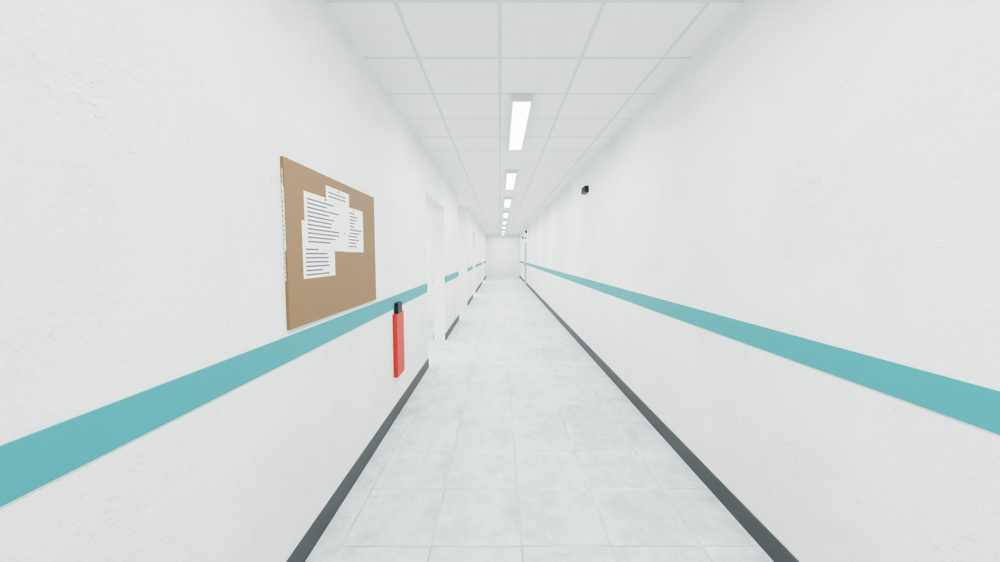
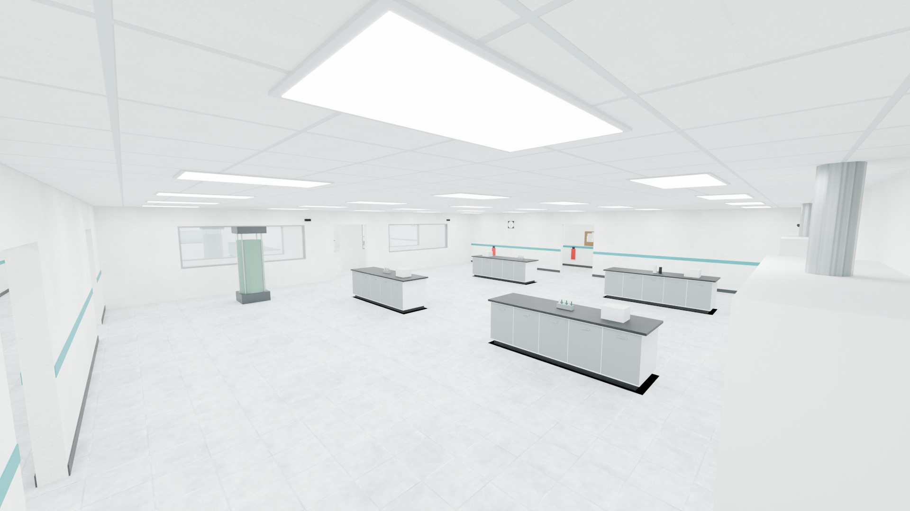
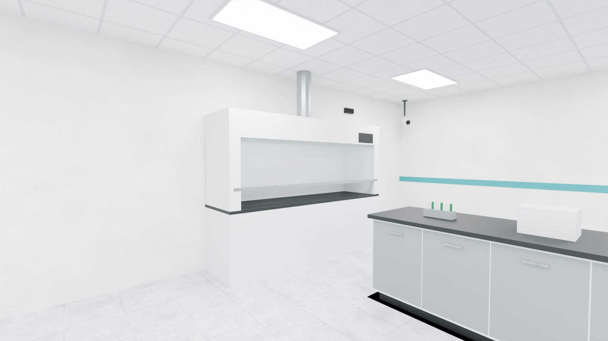
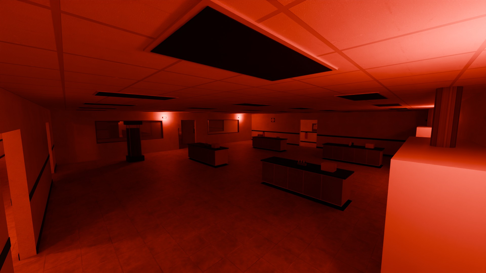
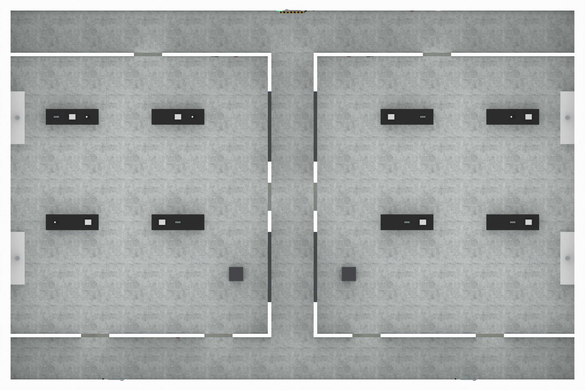

# labs_a: dressed and lit (Secret Operations, step 2)

Two white labs either side of a glazed spine: epoxy-topped benches with cases, tube racks and bottles, fume hoods with their ducts up to the ceiling, two specimen tanks of murky green liquid, a teal stripe like the laboratory's, troffers in a grid.

Built by `tools/blender/build_secretops_dress.py` around the greybox's layout (`tools/blender/build_secretops_greybox.py`): the layout objects are rebuilt from the same model, so `world/labs_a.json` is the greybox's file, unchanged. The method, the light sets, the removable parts and the sources are in `docs/renders/registrar_hall/README.md` (shared by all 13 scenes).

| File | What it is |
|---|---|
| `world/labs_a.glb` | the art only: 1.22 MB, 10656 triangles, 32 nodes drawn (28 meshes), 28 materials, WebP textures |
| `world/lightmaps/labs_a_0.webp`, `_1.webp` | the normal set (`lightmap`): the shell page and the props page |
| `world/lightmaps/labs_a_2.webp`, `_3.webp` | the alarm set (`lightmap_night`): the same two pages |
| `world/labs_a.json` | the layout, as the greybox wrote it: 66 colliders, 3 doors, 4 cameras, 3 links, 1 zones, 10 spots |
| `blender/scenes/labs_a.blend` | the saved scene (Git LFS): `Art` (Props, Separate, and Arch: one box per shell collider, for the layout check only), `Shell`, `Doors`, `Layout`, the two light collections, `Export` |
| `docs/renders/labs_a/` | `1_arrival.jpg`, `2_wide.jpg`, `3_detail.jpg` (normal light), `4_alarm.jpg` (the wide view in the alarm set), `plan.jpg`, `bake.json`, `caps.json` |







## Bake

| Map | Set | Page | Size | px/m | Gain G | Shown gain (caps) |
|---|---|---|---|---|---|---|
| `labs_a_0` | normal | shell | 2048 | 38.3 | 0.22956 | 1.1278 |
| `labs_a_1` | normal | props | 2048 | 59.4 | 0.22956 | 1.1278 |
| `labs_a_2` | alarm | shell | 2048 | 38.3 | 2.7925 | 0.8115 |
| `labs_a_3` | alarm | props | 2048 | 59.4 | 2.7925 | 0.8115 |

Cycles on the rented GPU (GPU), 512 samples, diffuse direct and indirect, OIDN, 8 px margin; 237 s for both sets. Texel = G L / (C + G L) with C = 1.2 and lightmap intensity pi C, G set so the median wall texel shows 0.34 (normal) or 0.26 (alarm) of its light; `caps.json` then scales each set's intensity so the walls show p50 0.3 (normal) or 0.155 (alarm) and caps any material that would pass p90 0.88 or p99 0.97.

## Brightness (`lab_display.py`, as the page shows it)

Normal set:

```
material                m2           map       k    p50    p90    p99     >=1
Wall_Lab             738.0      labs_a_0  4.2517  0.300  0.362  0.396   0.00%
Ceiling_Tile         653.8      labs_a_0  4.2517  0.265  0.292  0.411   0.00%
Floor_Lab            623.9      labs_a_0  4.2517  0.273  0.331  0.376   0.00%
Plastic_White        171.2      labs_a_1  4.2517  0.001  0.324  0.429   0.00%
Plastic_Grey          71.6      labs_a_1  4.2517  0.000  0.120  0.124   0.00%
Bench_Top             65.6      labs_a_1  4.2517  0.002  0.006  0.006   0.00%
Lamp_Housing          57.8      labs_a_1  4.2517  0.466  0.466  0.477   0.00%
Paint_Dark            22.3      labs_a_1  4.2517  0.000  0.005  0.006   0.00%
Skirting              21.1      labs_a_1  4.2517  0.013  0.017  0.018   0.00%
Stripe_Teal           21.0      labs_a_1  4.2517  0.093  0.119  0.124   0.00%
Door_Frame            15.1      labs_a_1  4.2517  0.115  0.147  0.153   0.00%
Steel                 10.1      labs_a_1  4.2517  0.082  0.176  0.220   0.00%
Liquid                 9.3      labs_a_1  4.2517  0.052  0.062  0.070   0.00%
Steel_Dark             7.4      labs_a_1  4.2517  0.031  0.041  0.053   0.00%
Door_Steel             4.4      labs_a_1  4.2517  0.000  0.186  0.188   0.00%
Door_Keycard           4.4      labs_a_1  4.2517  0.000  0.185  0.199   0.00%
Plastic_Black          2.5      labs_a_1  4.2517  0.000  0.001  0.002   0.00%
Notice                 2.0      labs_a_1  4.2517  0.071  0.343  0.362   0.00%
Stripe_Red             1.3      labs_a_1  4.2517  0.145  0.190  0.193   0.00%
Sign_Plate             0.8      labs_a_1  4.2517  0.279  0.325  0.344   0.00%
Clock_Face             0.4      labs_a_1  4.2517  0.316  0.375  0.386   0.00%
Cam_Body               0.4      labs_a_1  4.2517  0.223  0.263  0.311   0.00%
Specimen               0.3      labs_a_1  4.2517  0.002  0.002  0.003   0.00%
Hazard                 0.1      labs_a_1  4.2517  0.008  0.262  0.270   0.00%
```

Alarm set (`lightmap_night`):

```
material                m2           map       k    p50    p90    p99     >=1
Wall_Lab             738.0      labs_a_2  3.0593  0.155  0.322  0.591   0.00%
Ceiling_Tile         653.8      labs_a_2  3.0593  0.075  0.281  0.639   0.00%
Floor_Lab            623.9      labs_a_2  3.0593  0.072  0.196  0.279   0.00%
Plastic_White        171.2      labs_a_3  3.0593  0.002  0.121  0.432   0.00%
Plastic_Grey          71.6      labs_a_3  3.0593  0.000  0.033  0.045   0.00%
Bench_Top             65.6      labs_a_3  3.0593  0.000  0.001  0.002   0.00%
Lamp_Housing          57.8      labs_a_3  3.0593  0.000  0.101  0.371   0.00%
Paint_Dark            22.3      labs_a_3  3.0593  0.000  0.001  0.002   0.00%
Skirting              21.1      labs_a_3  3.0593  0.007  0.011  0.015   0.00%
Stripe_Teal           21.0      labs_a_3  3.0593  0.005  0.012  0.019   0.00%
Door_Frame            15.1      labs_a_3  3.0593  0.019  0.083  0.157   0.00%
Steel                 10.1      labs_a_3  3.0593  0.015  0.107  0.197   0.00%
Liquid                 9.3      labs_a_3  3.0593  0.001  0.003  0.004   0.00%
Steel_Dark             7.4      labs_a_3  3.0593  0.003  0.012  0.023   0.00%
Door_Steel             4.4      labs_a_3  3.0593  0.000  0.187  0.231   0.00%
Door_Keycard           4.4      labs_a_3  3.0593  0.000  0.138  0.174   0.00%
Plastic_Black          2.5      labs_a_3  3.0593  0.000  0.002  0.003   0.00%
Notice                 2.0      labs_a_3  3.0593  0.059  0.274  0.299   0.00%
Stripe_Red             1.3      labs_a_3  3.0593  0.102  0.169  0.275   0.00%
Sign_Plate             0.8      labs_a_3  3.0593  0.399  0.631  0.700   0.00%
Clock_Face             0.4      labs_a_3  3.0593  0.032  0.196  0.263   0.00%
Cam_Body               0.4      labs_a_3  3.0593  0.192  0.356  0.409   0.00%
Specimen               0.3      labs_a_3  3.0593  0.000  0.001  0.001   0.00%
Hazard                 0.1      labs_a_3  3.0593  0.011  0.357  0.392   0.00%
```

## Gates

```
check_layout (Blender): PASS: 73 of 73 checks passed
greybox --check: GATES PASS
layout JSON: IDENTICAL: world/labs_a.json is byte for byte the greybox's
worlddoc: OK world/labs_a.json: 66 colliders, 3 doors, 0 markers, 3 links, 1 zones, 10 spots, 0 errors, 4 warnings
glb_inspect: pass       tris: 10656 triangles, budget 300000 / pass       mb: 1.16 MB, budget 8
privacy: privacy grep: 15 files, 0 with hits
```

