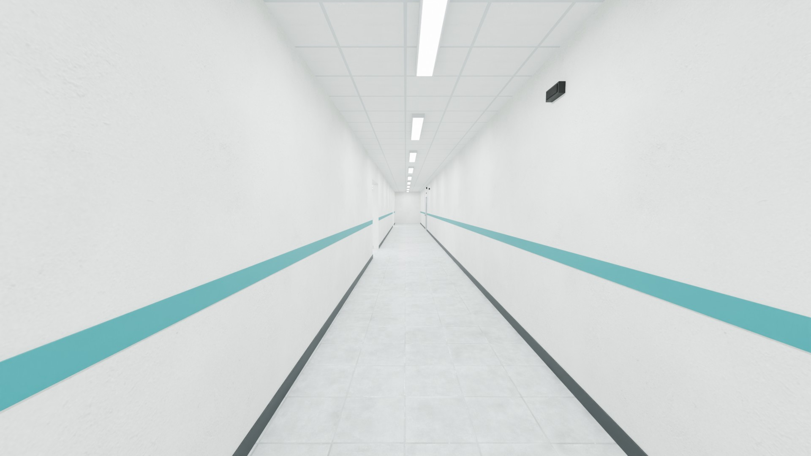
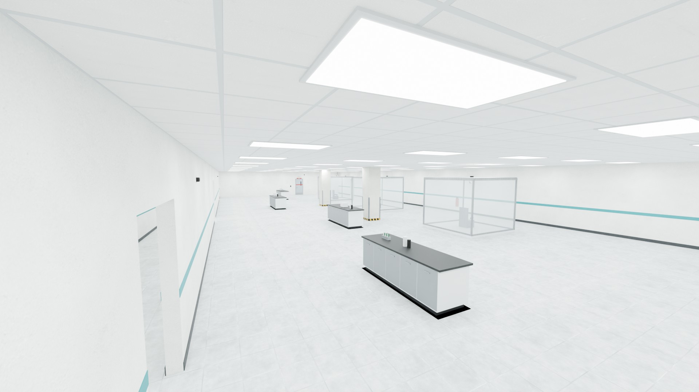
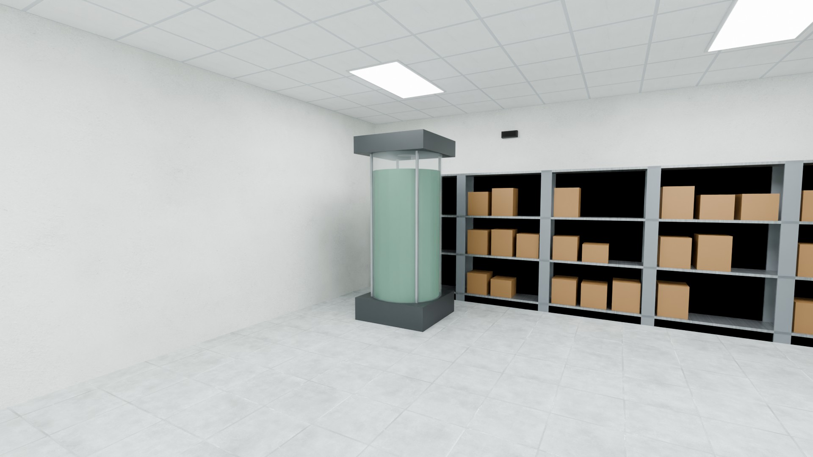
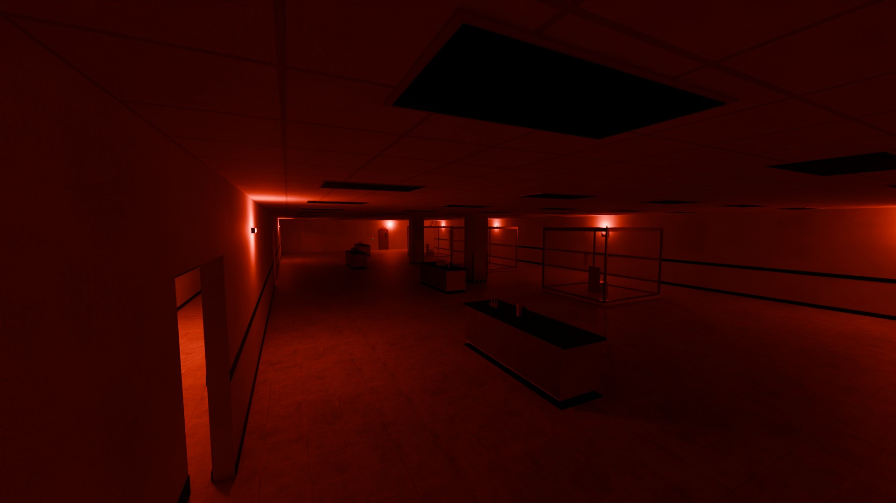
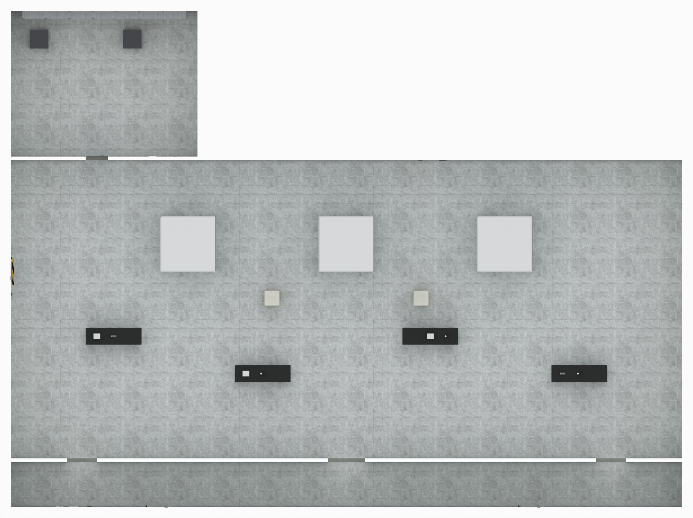

# labs_b: dressed and lit (Secret Operations, step 2)

One big white lab hall with three glass test cubicles (a bolted steel chair in each), benches, two pillars, the south hall, and the specimen room with its tanks and a shelf of boxes: something is kept here.

Built by `tools/blender/build_secretops_dress.py` around the greybox's layout (`tools/blender/build_secretops_greybox.py`): the layout objects are rebuilt from the same model, so `world/labs_b.json` is the greybox's file, unchanged. The method, the light sets, the removable parts and the sources are in `docs/renders/registrar_hall/README.md` (shared by all 13 scenes).

| File | What it is |
|---|---|
| `world/labs_b.glb` | the art only: 1.16 MB, 9944 triangles, 36 nodes drawn (31 meshes), 31 materials, WebP textures |
| `world/lightmaps/labs_b_0.webp`, `_1.webp` | the normal set (`lightmap`): the shell page and the props page |
| `world/lightmaps/labs_b_2.webp`, `_3.webp` | the alarm set (`lightmap_night`): the same two pages |
| `world/labs_b.json` | the layout, as the greybox wrote it: 35 colliders, 4 doors, 4 cameras, 3 links, 1 zones, 11 spots |
| `blender/scenes/labs_b.blend` | the saved scene (Git LFS): `Art` (Props, Separate, and Arch: one box per shell collider, for the layout check only), `Shell`, `Doors`, `Layout`, the two light collections, `Export` |
| `docs/renders/labs_b/` | `1_arrival.jpg`, `2_wide.jpg`, `3_detail.jpg` (normal light), `4_alarm.jpg` (the wide view in the alarm set), `plan.jpg`, `bake.json`, `caps.json` |







## Bake

| Map | Set | Page | Size | px/m | Gain G | Shown gain (caps) |
|---|---|---|---|---|---|---|
| `labs_b_0` | normal | shell | 2048 | 37.7 | 0.23544 | 0.7252 |
| `labs_b_1` | normal | props | 2048 | 60.1 | 0.23544 | 0.7252 |
| `labs_b_2` | alarm | shell | 2048 | 37.7 | 4.45318 | 0.799 |
| `labs_b_3` | alarm | props | 2048 | 60.1 | 4.45318 | 0.799 |

Cycles on the rented GPU (GPU), 512 samples, diffuse direct and indirect, OIDN, 8 px margin; 172 s for both sets. Texel = G L / (C + G L) with C = 1.2 and lightmap intensity pi C, G set so the median wall texel shows 0.34 (normal) or 0.26 (alarm) of its light; `caps.json` then scales each set's intensity so the walls show p50 0.19 (normal) or 0.155 (alarm) and caps any material that would pass p90 0.88 or p99 0.97.

## Brightness (`lab_display.py`, as the page shows it)

Normal set:

```
material                m2           map       k    p50    p90    p99     >=1
Ceiling_Tile         739.1      labs_b_0  2.7339  0.173  0.186  0.251   0.00%
Floor_Lab            697.1      labs_b_0  2.7339  0.174  0.208  0.234   0.00%
Wall_Lab             627.2      labs_b_0  2.7339  0.190  0.235  0.255   0.00%
Plastic_White        131.5      labs_b_1  2.7339  0.139  0.229  0.450   0.00%
Steel                 72.7      labs_b_1  2.7339  0.051  0.100  0.138   0.00%
Lamp_Housing          59.7      labs_b_1  2.7339  0.307  0.307  0.314   0.00%
Plastic_Grey          35.8      labs_b_1  2.7339  0.000  0.072  0.076   0.00%
Cardboard             26.9      labs_b_1  2.7339  0.006  0.049  0.064   0.00%
Bench_Top             22.8      labs_b_1  2.7339  0.002  0.004  0.004   0.00%
Pillar_Paint          20.5      labs_b_1  2.7339  0.165  0.198  0.331   0.00%
Skirting              18.6      labs_b_1  2.7339  0.009  0.011  0.012   0.00%
Stripe_Teal           18.5      labs_b_1  2.7339  0.060  0.075  0.077   0.00%
Liquid                12.0      labs_b_1  2.7339  0.014  0.027  0.035   0.00%
Paint_Dark            11.2      labs_b_1  2.7339  0.000  0.003  0.004   0.00%
Steel_Dark            10.4      labs_b_1  2.7339  0.010  0.027  0.052   0.00%
Paint_Grey             7.5      labs_b_1  2.7339  0.012  0.045  0.055   0.00%
Door_Frame             4.4      labs_b_1  2.7339  0.056  0.082  0.089   0.00%
Door_Steel             4.4      labs_b_1  2.7339  0.000  0.119  0.128   0.00%
Door_Keycard           4.4      labs_b_1  2.7339  0.000  0.133  0.135   0.00%
Hazard                 2.2      labs_b_1  2.7339  0.000  0.136  0.193   0.00%
Plastic_Black          1.8      labs_b_1  2.7339  0.000  0.001  0.001   0.00%
Stripe_Red             1.1      labs_b_1  2.7339  0.087  0.121  0.130   0.00%
Notice                 1.0      labs_b_1  2.7339  0.043  0.208  0.216   0.00%
Sign_Plate             0.8      labs_b_1  2.7339  0.191  0.218  0.225   0.00%
Clock_Face             0.4      labs_b_1  2.7339  0.149  0.237  0.247   0.00%
Cam_Body               0.4      labs_b_1  2.7339  0.134  0.161  0.212   0.00%
Specimen               0.3      labs_b_1  2.7339  0.001  0.001  0.002   0.00%
```

Alarm set (`lightmap_night`):

```
material                m2           map       k    p50    p90    p99     >=1
Ceiling_Tile         739.1      labs_b_2  3.0122  0.113  0.311  0.647   0.00%
Floor_Lab            697.1      labs_b_2  3.0122  0.105  0.220  0.338   0.00%
Wall_Lab             627.2      labs_b_2  3.0122  0.155  0.400  0.627   0.00%
Plastic_White        131.5      labs_b_3  3.0122  0.059  0.102  0.173   0.00%
Steel                 72.7      labs_b_3  3.0122  0.022  0.068  0.222   0.00%
Lamp_Housing          59.7      labs_b_3  3.0122  0.000  0.082  0.323   0.00%
Plastic_Grey          35.8      labs_b_3  3.0122  0.000  0.049  0.069   0.00%
Cardboard             26.9      labs_b_3  3.0122  0.005  0.050  0.066   0.00%
Bench_Top             22.8      labs_b_3  3.0122  0.000  0.001  0.002   0.00%
Pillar_Paint          20.5      labs_b_3  3.0122  0.064  0.119  0.131   0.00%
Skirting              18.6      labs_b_3  3.0122  0.006  0.015  0.019   0.00%
Stripe_Teal           18.5      labs_b_3  3.0122  0.005  0.018  0.030   0.00%
Liquid                12.0      labs_b_3  3.0122  0.002  0.004  0.012   0.00%
Paint_Dark            11.2      labs_b_3  3.0122  0.000  0.001  0.003   0.00%
Steel_Dark            10.4      labs_b_3  3.0122  0.008  0.025  0.048   0.00%
Paint_Grey             7.5      labs_b_3  3.0122  0.010  0.037  0.048   0.00%
Door_Frame             4.4      labs_b_3  3.0122  0.048  0.133  0.195   0.00%
Door_Steel             4.4      labs_b_3  3.0122  0.000  0.230  0.271   0.00%
Door_Keycard           4.4      labs_b_3  3.0122  0.000  0.139  0.185   0.00%
Hazard                 2.2      labs_b_3  3.0122  0.000  0.070  0.373   0.00%
Plastic_Black          1.8      labs_b_3  3.0122  0.000  0.002  0.003   0.00%
Stripe_Red             1.1      labs_b_3  3.0122  0.099  0.186  0.311   0.00%
Notice                 1.0      labs_b_3  3.0122  0.045  0.211  0.232   0.00%
Sign_Plate             0.8      labs_b_3  3.0122  0.481  0.670  0.717   0.00%
Clock_Face             0.4      labs_b_3  3.0122  0.462  0.799  0.828   0.00%
Cam_Body               0.4      labs_b_3  3.0122  0.254  0.350  0.385   0.00%
Specimen               0.3      labs_b_3  3.0122  0.000  0.001  0.001   0.00%
```

## Gates

```
check_layout (Blender): PASS: 42 of 42 checks passed
greybox --check: GATES PASS
layout JSON: IDENTICAL: world/labs_b.json is byte for byte the greybox's
worlddoc: OK world/labs_b.json: 35 colliders, 4 doors, 0 markers, 3 links, 1 zones, 11 spots, 0 errors, 4 warnings
glb_inspect: pass       tris: 9944 triangles, budget 300000 / pass       mb: 1.10 MB, budget 8
privacy: privacy grep: 14 files, 0 with hits
```

