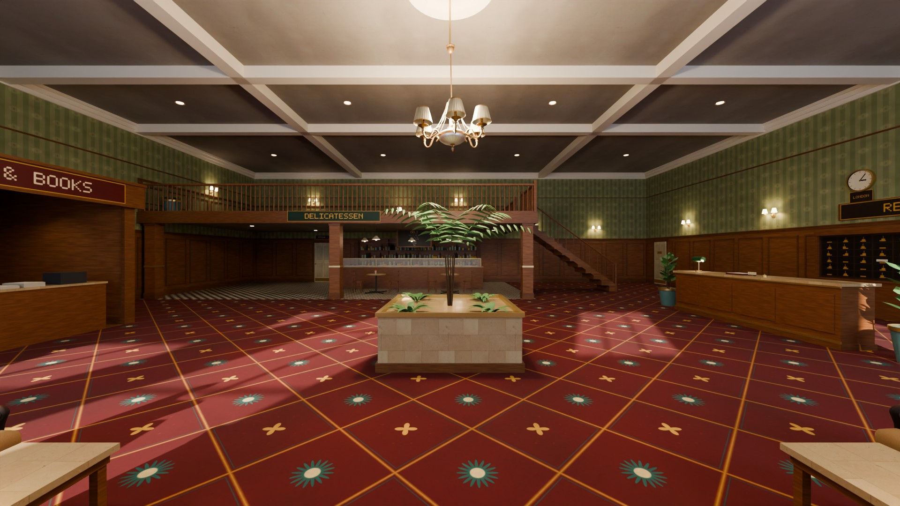
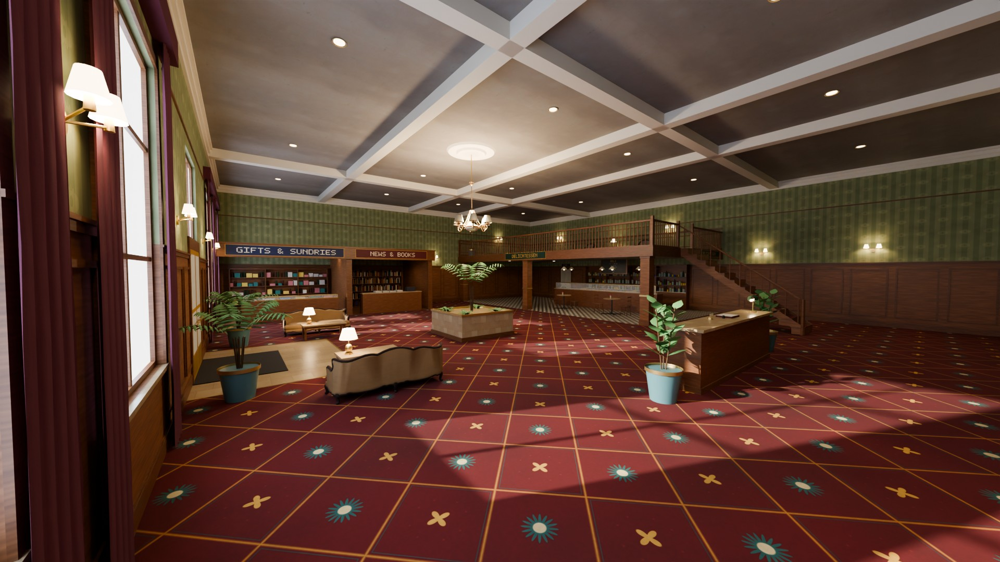
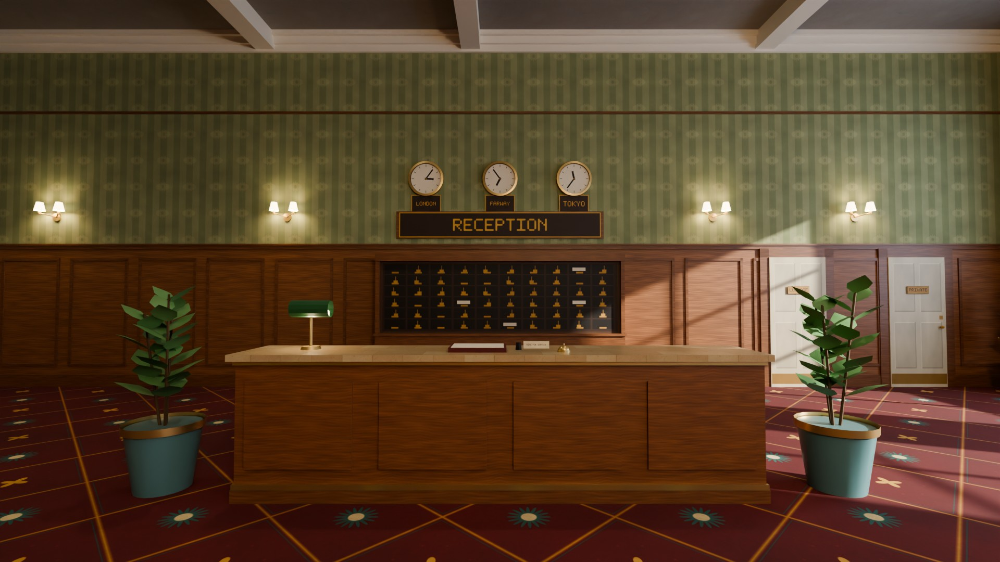

# lobby: the hotel lobby

The hotel's first dressed scene (`docs/BLENDER_AREAS.md`, section 1, step 2: dress and light), built round the greybox (`claude/blender-hotel-greybox`, draft PR #93). A peaceful, liminal old hotel lobby: off and empty, but seemingly normal. Built in Blender 5.2.1 by `tools/blender/build_lobby.py`, baked twice (a day set and a night set on the same lightmap UVs, as the mall entrance does) and exported as art only. There are no reference photos; everything follows the written descriptions in `docs/WORLD.md` ("Hotel tower") and `docs/BLENDER_AREAS.md`.

| File | What it is |
|---|---|
| `world/lobby.glb` | the art: 5.70 MB (5.43 MiB as glb_inspect counts), 82 422 triangles, 27 materials, 30 meshes of one primitive each (one per material, and the three door leaves as their own nodes), 16 WebP textures |
| `world/lobby.json` | the layout, written by `tools/blender/export_scene.py` from the `.blend`: 62 colliders, 3 doors, 1 marker, 2 links, 12 spots. It is exactly what the greybox model writes (`build_hotel_greybox.py --preview`), including the 18 furniture colliders this dressing added (see "The layout") |
| `world/lightmaps/lobby_0.webp`, `lobby_1.webp` | the day set (second UV set, `TEXCOORD_1`): the shell, the props |
| `world/lightmaps/lobby_2.webp`, `lobby_3.webp` | the night set on the same UVs |
| `blender/scenes/lobby.blend` | the saved scene (Git LFS, 7.2 MB): `Art` (the unmerged pieces), `Doors` (the three leaves, origin at the hinge), `Layout` (the `COL_` boxes and the empties), `Export` (merged by material, with the lightmap UVs), `Standins` (the arrival marker), `Lights_Lamps`, `Lights_Day`, `Lights_Night` |
| `tools/blender/build_lobby.py` | the re-runnable build; it imports the greybox model, so no coordinate of the layout is typed in |
| `blender/textures/lobby/`, `blender/models/lobby/` | the CC0 files the build reads (below) |
| `docs/renders/lobby/` | the three review stills (this folder) |

The shared tools are reused unchanged: `tools/blender/export_scene.py`, `tools/blender/check_layout.py`, `tools/blender/pack_scene.py`, `tools/webp_glb.py`.

## Review stills (Cycles, 128 samples adaptive, OIDN, 1920 x 1080 JPEG, AgX, exposure 0, the day set)

| | |
|---|---|
| `1_arrival.jpg` | the arrival point from the street (-9.6, -19) at eye height 1.6 m, facing its `face` (west), 75 degrees vertical |
| `2_wide.jpg` | the whole lobby from the north-east corner, by the windows |
| `3_detail.jpg` | reception: the desk, the key board, the clocks, two of the facade doors |





These are Blender renders with Blender's lights; the page shows the lightmaps instead (see "Brightness"). Night stills, a deli view and a plan were rendered for the owner's sheet only.

## What is in it

The hall is the greybox's 19.6 m by 21.6 m by 6 m room on the tower's footprint (x -27.8 to -8.2, z -29.8 to -8.2). From the street doors, looking west:

- **The street front (east wall):** a pair of glazed doors in brass frames under a fanlight, four tall frosted windows with marble sills, wooden glazing bars, deep red velvet drapes and pelmets, a marble apron inside the doors with brass edge strips and a door mat. The glass is opaque: the street is not built behind it, and the page's background is black. The panes' lightmap texels are filled flat: bright daylight by day, a dim sodium amber at night.
- **The walls:** wood panelling to the dado rail at 2.4 m (fielded panel frames, skirting, cap rail), sage damask paper above, a picture rail at 4.6 m and a stepped cornice. The ceiling is plaster in a grid of beams (coffers), with a medallion and the chandelier in the middle coffer.
- **The floor:** a burgundy hotel carpet (a gold diamond lattice, teal-and-cream rosettes, gold stars) over the hall and the loft, black-and-white tiles under the deli, herringbone parquet in the two shops.
- **The chandelier:** Poly Haven's `Chandelier_02` at twice its size, over the planter, hanging a degree off true. It is tired: two of its six lamps are dead (`Bulb_Dead`), the others glow.
- **Reception (north wall):** a panelled desk with a marble top and brass strips; on it a green banker's lamp, a bell, the register and a RING FOR SERVICE card. Behind it, the key board (pigeonholes with keys and the odd letter), a RECEPTION board and three clocks (LONDON, FARWAY, TOKYO, each at its own wrong hour). Potted plants either side.
- **The facade doors (north wall):** three painted panel doors that do not open, with casings, brass knobs and plaques: OFFICE, LUGGAGE, PRIVATE. They are the greybox's `Facade_Door` boxes and its `Spot_facade` places for later features.
- **The sitting area:** the greybox's two sofas (Poly Haven `Sofa_01`, in mustard velvet) face each other across the aisle from the doors, each with a marble-topped coffee table and a lamp. The planter in the middle is marble with a brass rim, a tall palm and four ferns.
- **The shops (south wall):** two bays under one canopy with painted fascia signs, NEWS & BOOKS (a counter with a till and stacks of newspapers, a bookcase) and GIFTS & SUNDRIES (a glass display counter, shelves of boxes and bottles), downlights in the canopy.
- **The deli under the loft (west):** a counter with a marble top and a brass-framed glass case of trays of food, back shelves of jars, tins and bottles, a chalk menu board hung from the loft, enamel pendants, two marble bistro tables with bentwood chairs, the DELICATESSEN sign on the loft's fascia. The back door to the atrium's narrow hall is past it, a painted panel door under an ATRIUM sign.
- **The loft (y 3):** carpeted, panelled to 4.2 m, a turned-baluster balustrade on its two open edges, stairs with a carpet runner up from the north, two armchairs (Poly Haven `ArmChair_01`) with a table lamp, a rug and a plant.
- **Lighting:** brass two-arm sconces with linen shades on every wall (and on the loft's), a downlight in each coffer, the deli's pendants, the shops' and the loft's downlights, the table lamps. Every glow is one material, `Lamp_Emit`.

The page draws the three dealers, the receptionist (`Spot_npc_1`) and every moving part. Their spots, the shop spots and the two puzzle spots are left clear.

## Light

| Set | Light | Map (shell, props) | Material property |
|---|---|---|---|
| day | the sun (low, from the east-south-east: a morning) and the sky through the street windows, and every lamp | `lobby_0`, `lobby_1` | `lightmap`, `lightmap_intensity` |
| night | every lamp, and the sodium glow of five street lamps outside the windows; a dark sky | `lobby_2`, `lobby_3` | `lightmap_night`, `lightmap_night_intensity` |

`Lamp_Emit` is on in both sets (the lamps are lit by day too). The page should keep it on in this scene at every hour. `Window_Lit` and `Emergency_Emit` do not occur.

| Map | Set | Size | Materials | Density | Samples, GPU time | WebP |
|---|---|---|---|---|---|---|
| `lobby_0` | day | 2048 | the shell: floors, walls, ceiling, trim | 24.4 px/m (ceiling 12.2, cornice and beams 17.1) | 512, 28 s | 387 KB |
| `lobby_1` | day | 2048 | everything in it, and the three door leaves | 23.4 px/m (palette goods and leaves 14.0; the chandelier in its own square, through its own UVs) | 512, 40 s | 636 KB |
| `lobby_2` | night | 2048 | as `lobby_0` | the same UVs | 768, 32 s | 392 KB |
| `lobby_3` | night | 2048 | as `lobby_1` | the same UVs | 768, 43 s | 649 KB |

Cycles on the GPU, diffuse (direct and indirect, no colour), 8 px margin, OIDN. The windows' panes and the clear glass are hidden while baking so the daylight and the street's glow come in; the panes' own texels are filled flat (day: white; night: a dim amber).

**The shoulder.** The lamp pools and the sun patches are 20 to 40 times brighter than the room's middle tones, so one scale cannot make the walls read without clipping the highlights. Each map is written as texel = G L / (C + G L) from the bake's light L, and every baked material's intensity is pi C: the page shows texture x G L where the light is ordinary, rolling off toward texture x C under a lamp, never clipping. Day: G 5, C 1.35; night: G 6, C 1.15 (`CURVE` in the build). `Trim_Paint` (the cornice and beams by the downlights) is capped at 0.95 by day. The page needs nothing new: it is the usual `lightmap` x `lightmap_intensity`.

**Density** is under the 32 px/m indoor guide: two 2048 maps per set hold 1586 m2 of shell and 510 m2 of props (four maps in all is the limit, and the night set needs two). Faces nobody sees are dropped first (the walls' outer skin, the floor's sides and underside, the ceiling's top, faces flush against a wall, the goods' bottoms and backs, faces looking up from above 4.7 m or down from below 0.8 m).

## Brightness, as the page shows it

The page draws a baked material unlit: texture x base colour x texel x intensity / pi, no tone mapping. Measured with `lab_display.py` (area-weighted samples over each material's triangles, the brightest channel; `>=1` is the share that clips):

Day (`lightmap`):

```
material                m2           map       k    p50    p90    p99     >=1
Ceiling_Plaster      699.5       lobby_0  4.2412  0.122  0.266  0.339   0.00%
Floor_Carpet         490.4       lobby_0  4.2412  0.077  0.117  0.448   0.00%
Wall_Paper           292.5       lobby_0  4.2412  0.172  0.282  0.384   0.00%
Wall_Panel           267.7       lobby_0  4.2412  0.091  0.208  0.311   0.00%
Trim_Wood            245.5       lobby_0  4.2412  0.057  0.169  0.228   0.00%
Wood_Furniture       198.7       lobby_1  4.2412  0.040  0.155  0.218   0.00%
Trim_Paint           146.4       lobby_0  4.0291  0.479  0.768  0.956   0.03%
Paint_Palette        119.3       lobby_1  4.2412  0.009  0.198  0.634   0.00%
Floor_Tile            98.0       lobby_0  4.2412  0.007  0.450  0.711   0.00%
Floor_Parquet         33.7       lobby_0  4.2412  0.155  0.269  0.378   0.00%
Window_Glass          32.9       lobby_1  2.9845  0.675  0.682  0.694   0.00%
Marble_Top            32.6       lobby_1  4.2412  0.294  0.506  0.593   0.00%
Fabric_Drape          30.9       lobby_1  4.2412  0.095  0.115  0.135   0.00%
Brass                 22.0       lobby_1  4.2412  0.392  0.757  0.822   0.00%
Doors                 21.2       lobby_1  4.2412  0.496  0.892  0.959   0.01%
Floor_Marble          12.0       lobby_0  4.2412  0.416  0.493  0.540   0.00%
Sofa_Fabric           10.7       lobby_1  4.2412  0.241  0.315  0.346   0.00%
Sign_Paint             9.2       lobby_1  4.2412  0.049  0.645  0.788   0.00%
Plant_Leaf             8.3       lobby_1  4.2412  0.134  0.267  0.299   0.00%
Plant_Pot              5.9       lobby_1  4.2412  0.116  0.204  0.301   0.00%
Armchair_Fabric        4.9       lobby_1  4.2412  0.031  0.176  0.241   0.00%
Key_Board              4.5       lobby_1  4.2412  0.004  0.052  0.522   0.00%
Chandelier_Gilt        3.8       lobby_1  4.2412  0.449  0.695  0.883   0.22%
Metal_Dark             0.7       lobby_1  4.2412  0.024  0.043  0.052   0.00%
Bulb_Dead              0.0       lobby_1  4.2412  0.302  0.356  0.394   0.00%
```

Night (`lightmap_night`):

```
material                m2           map       k    p50    p90    p99     >=1
Ceiling_Plaster      699.5       lobby_2  3.6128  0.105  0.212  0.284   0.00%
Floor_Carpet         490.4       lobby_2  3.6128  0.071  0.097  0.393   0.00%
Wall_Paper           292.5       lobby_2  3.6128  0.137  0.225  0.302   0.00%
Wall_Panel           267.7       lobby_2  3.6128  0.075  0.170  0.228   0.00%
Trim_Wood            245.5       lobby_2  3.6128  0.040  0.139  0.175   0.00%
Wood_Furniture       198.7       lobby_3  3.6128  0.032  0.134  0.177   0.00%
Trim_Paint           146.4       lobby_2  3.6128  0.409  0.703  0.873   0.00%
Paint_Palette        119.3       lobby_3  3.6128  0.009  0.156  0.495   0.00%
Floor_Tile            98.0       lobby_2  3.6128  0.005  0.414  0.502   0.00%
Floor_Parquet         33.7       lobby_2  3.6128  0.133  0.199  0.264   0.00%
Window_Glass          32.9       lobby_3  3.2987  0.287  0.297  0.304   0.00%
Marble_Top            32.6       lobby_3  3.6128  0.228  0.428  0.494   0.00%
Fabric_Drape          30.9       lobby_3  3.6128  0.085  0.104  0.122   0.00%
Brass                 22.0       lobby_3  3.6128  0.247  0.598  0.700   0.00%
Doors                 21.2       lobby_3  3.6128  0.337  0.623  0.694   0.00%
Floor_Marble          12.0       lobby_2  3.6128  0.368  0.419  0.459   0.00%
Sofa_Fabric           10.7       lobby_3  3.6128  0.147  0.258  0.281   0.00%
Sign_Paint             9.2       lobby_3  3.6128  0.033  0.556  0.679   0.00%
Plant_Leaf             8.3       lobby_3  3.6128  0.107  0.223  0.257   0.00%
Plant_Pot              5.9       lobby_3  3.6128  0.089  0.167  0.179   0.00%
Armchair_Fabric        4.9       lobby_3  3.6128  0.030  0.172  0.236   0.00%
Key_Board              4.5       lobby_3  3.6128  0.004  0.047  0.399   0.00%
Chandelier_Gilt        3.8       lobby_3  3.6128  0.389  0.592  0.768   0.00%
Metal_Dark             0.7       lobby_3  3.6128  0.022  0.037  0.047   0.00%
Bulb_Dead              0.0       lobby_3  3.6128  0.284  0.315  0.333   0.00%
```

By day every material is at or under p90 0.9 and p99 0.98, and the walls read (the paper's p50 is 0.17; the panelling below it is wood, 0.09). At night the room is dimmer, as meant: the paper's p50 is 0.14, everything is lit by its lamps and the windows glow amber. The carpet's p50 (0.08) is its own dark burgundy. `Window_Glass` is filled flat (0.68 by day, 0.29 at night). `Lamp_Emit` and `Glass_Clear` carry no lightmap.

## The layout

Colliders, doors, links, the marker and every spot stay where the greybox put them. The dressing needed solid furniture the greybox did not have, so **18 colliders were added**, in the greybox script itself (`lobby()` in `tools/blender/build_hotel_greybox.py`) and so in `world/lobby.json`; nothing else in the file changed:

- two coffee tables in front of the sofas (`Coffee_Table`, `_2`);
- five potted plants on the floor (`Plant_1` to `_5`: either side of the street doors, the north-east corner, either side of the desk) and one on the loft (`Plant_6`);
- the deli's back shelves on the west wall (`Deli_Shelf`) and four bistro chairs (`Deli_Chair` to `_4`);
- the two shops' back shelves on the south wall (`Shop_Shelf`, `_2`);
- on the loft: two armchairs and a table (`Loft_Armchair`, `_2`, `Loft_Table`).

Each keeps clear of the spots, links and the spawn (the nearest, `Plant_3`, is 0.8 m from `Spot_facade_3`). The greybox's lobby plan, still and GLB in `docs/renders/hotel_greybox/` were re-rendered with them. The windows do not touch the layout: they are holes in the art only, and the wall colliders stay whole.

Passable art (`decor_`): the plants' leaves, the drapes, the stair's stringers and balusters, the loft's rug, the door mat and the brass floor strips. Each stair step is a tread and a body, both under 0.2 m tall, since the steps' colliders start in the air.

`blender -b blender/scenes/lobby.blend --python tools/blender/build_lobby.py -- --stage check` (`tools/blender/check_layout.py` on `Art`):

```
PASS  COVER  Deli_Chair_4: 3 mesh(es) cover it (360 sample points, every one within 5 cm of art)
PASS  COVER  Deli_Counter: 8 mesh(es) cover it (5082 sample points, every one within 5 cm of art)
PASS  COVER  Deli_Shelf: 9 mesh(es) cover it (8250 sample points, every one within 5 cm of art)
PASS  COVER  Deli_Table: 5 mesh(es) cover it (729 sample points, every one within 5 cm of art)
PASS  COVER  Deli_Table_2: 5 mesh(es) cover it (729 sample points, every one within 5 cm of art)
PASS  COVER  Facade_Door: 7 mesh(es) cover it (506 sample points, every one within 5 cm of art)
PASS  COVER  Facade_Door_2: 7 mesh(es) cover it (506 sample points, every one within 5 cm of art)
PASS  COVER  Facade_Door_3: 7 mesh(es) cover it (506 sample points, every one within 5 cm of art)
PASS  COVER  Key_Board: 6 mesh(es) cover it (4715 sample points, every one within 5 cm of art)
PASS  COVER  Lobby_Ceiling: 13 mesh(es) cover it (133263 sample points, every one within 5 cm of art)
PASS  COVER  Lobby_Floor: 61 mesh(es) cover it (177684 sample points, every one within 5 cm of art)
PASS  COVER  Lobby_Wall_E_1: 31 mesh(es) cover it (18300 sample points, every one within 5 cm of art)
PASS  COVER  Lobby_Wall_E_2: 15 mesh(es) cover it (2052 sample points, every one within 5 cm of art)
PASS  COVER  Lobby_Wall_E_3: 34 mesh(es) cover it (18300 sample points, every one within 5 cm of art)
PASS  COVER  Lobby_Wall_N_1: 37 mesh(es) cover it (36783 sample points, every one within 5 cm of art)
PASS  COVER  Lobby_Wall_S_1: 42 mesh(es) cover it (36783 sample points, every one within 5 cm of art)
PASS  COVER  Lobby_Wall_W_1: 30 mesh(es) cover it (32025 sample points, every one within 5 cm of art)
PASS  COVER  Lobby_Wall_W_2: 23 mesh(es) cover it (1320 sample points, every one within 5 cm of art)
PASS  COVER  Lobby_Wall_W_3: 28 mesh(es) cover it (6405 sample points, every one within 5 cm of art)
PASS  COVER  Loft_Armchair: 6 mesh(es) cover it (810 sample points, every one within 5 cm of art)
PASS  COVER  Loft_Armchair_2: 6 mesh(es) cover it (810 sample points, every one within 5 cm of art)
PASS  COVER  Loft_Post: 8 mesh(es) cover it (725 sample points, every one within 5 cm of art)
PASS  COVER  Loft_Post_2: 9 mesh(es) cover it (725 sample points, every one within 5 cm of art)
PASS  COVER  Loft_Post_3: 8 mesh(es) cover it (725 sample points, every one within 5 cm of art)
PASS  COVER  Loft_Rail_E: 14 mesh(es) cover it (3036 sample points, every one within 5 cm of art)
PASS  COVER  Loft_Rail_N: 13 mesh(es) cover it (770 sample points, every one within 5 cm of art)
PASS  COVER  Loft_Rail_N_2: 11 mesh(es) cover it (506 sample points, every one within 5 cm of art)
PASS  COVER  Loft_Slab: 34 mesh(es) cover it (38364 sample points, every one within 5 cm of art)
PASS  COVER  Loft_Table: 7 mesh(es) cover it (343 sample points, every one within 5 cm of art)
PASS  COVER  Plant_1: 4 mesh(es) cover it (343 sample points, every one within 5 cm of art)
PASS  COVER  Plant_2: 4 mesh(es) cover it (343 sample points, every one within 5 cm of art)
PASS  COVER  Plant_3: 4 mesh(es) cover it (343 sample points, every one within 5 cm of art)
PASS  COVER  Plant_4: 4 mesh(es) cover it (343 sample points, every one within 5 cm of art)
PASS  COVER  Plant_5: 4 mesh(es) cover it (343 sample points, every one within 5 cm of art)
PASS  COVER  Plant_6: 9 mesh(es) cover it (343 sample points, every one within 5 cm of art)
PASS  COVER  Planter: 6 mesh(es) cover it (3969 sample points, every one within 5 cm of art)
PASS  COVER  Reception_Desk: 9 mesh(es) cover it (3444 sample points, every one within 5 cm of art)
PASS  COVER  Shop_A_Counter: 5 mesh(es) cover it (2046 sample points, every one within 5 cm of art)
PASS  COVER  Shop_B_Counter: 6 mesh(es) cover it (2376 sample points, every one within 5 cm of art)
PASS  COVER  Shop_Partition: 13 mesh(es) cover it (3348 sample points, every one within 5 cm of art)
PASS  COVER  Shop_Partition_2: 14 mesh(es) cover it (3348 sample points, every one within 5 cm of art)
PASS  COVER  Shop_Shelf: 7 mesh(es) cover it (4140 sample points, every one within 5 cm of art)
PASS  COVER  Shop_Shelf_2: 7 mesh(es) cover it (4830 sample points, every one within 5 cm of art)
PASS  COVER  Sofa: 2 mesh(es) cover it (1701 sample points, every one within 5 cm of art)
PASS  COVER  Sofa_2: 2 mesh(es) cover it (1701 sample points, every one within 5 cm of art)
PASS  COVER  Step_loft_00: 5 mesh(es) cover it (260 sample points, every one within 5 cm of art)
PASS  COVER  Step_loft_01: 7 mesh(es) cover it (260 sample points, every one within 5 cm of art)
PASS  COVER  Step_loft_02: 6 mesh(es) cover it (260 sample points, every one within 5 cm of art)
PASS  COVER  Step_loft_03: 6 mesh(es) cover it (260 sample points, every one within 5 cm of art)
PASS  COVER  Step_loft_04: 6 mesh(es) cover it (260 sample points, every one within 5 cm of art)
PASS  COVER  Step_loft_05: 7 mesh(es) cover it (260 sample points, every one within 5 cm of art)
PASS  COVER  Step_loft_06: 7 mesh(es) cover it (260 sample points, every one within 5 cm of art)
PASS  COVER  Step_loft_07: 7 mesh(es) cover it (260 sample points, every one within 5 cm of art)
PASS  COVER  Step_loft_08: 7 mesh(es) cover it (260 sample points, every one within 5 cm of art)
PASS  COVER  Step_loft_09: 6 mesh(es) cover it (260 sample points, every one within 5 cm of art)
PASS  COVER  Step_loft_10: 7 mesh(es) cover it (260 sample points, every one within 5 cm of art)
PASS  COVER  Step_loft_11: 13 mesh(es) cover it (260 sample points, every one within 5 cm of art)
PASS  STRAY  90 tall solid mesh(es), each over a collider; 17 decor_* mesh(es) exempt
PASS  CLEAR  marker Spawn (-9.60, -19.00): clear within 0.28 m
PASS: 64 of 64 checks passed
```

`python tools/blender/build_hotel_greybox.py --check .`:

```
GATE links: 47 pairs, 94 sides, 3 that leave the hotel or the scene; 97 links in the files
GATE steps: 235 step boxes, the highest rise 0.250 m (at most 0.27 m)
GATE corridors: 421 corridor and passage rects, the narrowest 1.60 m (at least 1.6 m), none blocked
GATES PASS
```

`node tools/worlddoc.mjs check world/lobby.json` (the warning is the street link, new to the manifest):

```
  warning: link street: the manifest has no link from this door yet: a new link to add
OK world/lobby.json: 62 colliders, 3 doors, 1 markers, 2 links, 0 zones, 12 spots, 0 errors, 1 warnings
```

The axes were checked with a marker cube at the arrival point (`--stage axes`): game (-9.6, 0.1, -19) is glTF (-9.6, 0.1, -19).

## Sources and licences

| Asset | Used for | Source | Author (Poly Haven) | Licence |
|---|---|---|---|---|
| `marble_01`: diffuse, 1k | the desk, counter and table tops, sills, the planter, the marble apron | https://polyhaven.com/a/marble_01 | Rob Tuytel | CC0 1.0 |
| `herringbone_parquet`: diffuse, 1k | the shops' floors | https://polyhaven.com/a/herringbone_parquet | Sergej Majboroda (photography), Jenelle van Heerden (processing) | CC0 1.0 |
| `plastered_wall_04`: diffuse, 1k | the ceiling, the loft's soffit, the shops' canopy | https://polyhaven.com/a/plastered_wall_04 | Rob Tuytel | CC0 1.0 |
| `rough_linen`: diffuse, 512 | the velvet drapes and pelmets (tinted) | https://polyhaven.com/a/rough_linen | colormass (photography), Rico Cilliers (processing) | CC0 1.0 |
| `Sofa_01`: glTF 1k, diffuse only | the two sofas (tinted mustard) | https://polyhaven.com/a/Sofa_01 | Kirill Sannikov | CC0 1.0 |
| `ArmChair_01`: glTF 1k, diffuse only | the loft's two armchairs | https://polyhaven.com/a/ArmChair_01 | Kirill Sannikov | CC0 1.0 |
| `Chandelier_02`: glTF 1k, diffuse only | the chandelier | https://polyhaven.com/a/Chandelier_02 | Kirill Sannikov | CC0 1.0 |

The four textures were copied from `blender/textures/galleries/` and `blender/textures/apartment/` (already in the repo) into `blender/textures/lobby/`; the chandelier is read from `blender/models/galleries/ph-chandelier-02/`. `Sofa_01` and `ArmChair_01` were downloaded from Poly Haven (1k glTF, its `.bin` and the diffuse map only; the glTF was rewritten to name only the diffuse map) into `blender/models/lobby/`, with a generic client name and no other data sent. Two plant models (`potted_plant_01`, `potted_plant_02`) were also fetched to look at and then not used: their leaves are alpha cards, so the plants here are built instead. Authors come from Poly Haven's public info API.

Everything else is own work, made by `build_lobby.py`: all other geometry (the shell, panelling, windows, doors, furniture, the plants, the sconces), and nine generated images drawn with numpy from fixed seeds: the carpet, the damask paper, the wood grain (the panelling, the trim and the furniture), the deli's tiles, the frosted glass, a palette of flat swatches for small things, the sign atlas (the painted signs, the plaques, the menu board, the clock faces; a 5 x 7 pixel font of the build's own), the key board, and the doors' atlas (the street door's brass and frosted glass, the painted panel door). No Meshy, no Higgsfield, no paid service, no photograph.

Tools: Blender 5.2.1 LTS (GPL) with Cycles, OpenImageDenoise and the glTF I/O add-on; Python with numpy and Pillow. The bakes and the stills ran on a rented GPU.

## Rebuild

From the repo root, with Blender 5.2 and Python with Pillow (the bakes take seconds on a GPU; `--device cpu` works, slowly):

```
blender -b --python tools/blender/build_lobby.py -- --stage art,bake,export,axes,render --samples 512 --night-samples 768
python tools/blender/pack_scene.py lobby --work work/lobby       # WebP lightmaps and textures -> world/
```

`--stage` takes one stage or a comma list: `art` (also writes `world/lobby.json` and runs the layout check), `layout`, `check`, `bake`, `export`, `axes`, `render` (`--set night` for the night stills, written to the work folder). The work folder is `work/lobby` (`--work` changes it; it is not committed). The build strips every custom property except the four light properties on materials and the layout's own on the layout objects, makes every image path relative (packed images too), clears the last-used operators' file paths, turns the render stamps off and strips the JPEG comment and APP1 segments.

## For the coordinator

- Add `world/lobby.glb` to the scene's files and its links (`city.street>hotel_lobby` arrives at `street`; `hotel.lobby>atrium` leaves by `back_hall`) to the manifest; `applyLightmaps` handles the four maps as for the mall entrance.
- Light set: `setLightSet("night")` by the City's clock (`lightmap_night` on every baked material). Keep `Lamp_Emit` on at every hour: the lamps are lit in both bakes.
- The three leaves are nodes `DoorLeaf_front_A`, `DoorLeaf_front_B`, `DoorLeaf_back_hall`, origin at the hinge, one material (`Doors`, baked closed).
- The page draws the dealers at `Spot_dealer_1` to `_3` (`_3` is on the loft, y 3), the receptionist at `Spot_npc_1`, the shopkeepers at `Spot_shop_1` to `_3` (`_3` is the deli), and whatever the puzzles and the facade spots become.

## Open

- **Density** is about 24 px/m, under the 32 px/m guide (see "Light"). More would need more than four maps.
- **Night walls** read at p50 0.14, a little under the day's 0.15 guide, on purpose (darker at night). `CURVE["night"]` lifts them.
- **Wood:** the panelling and the furniture use a generated grain; the photo `dark_wood` is too dark for an unlit page (albedo about 0.05) and is no longer used.
