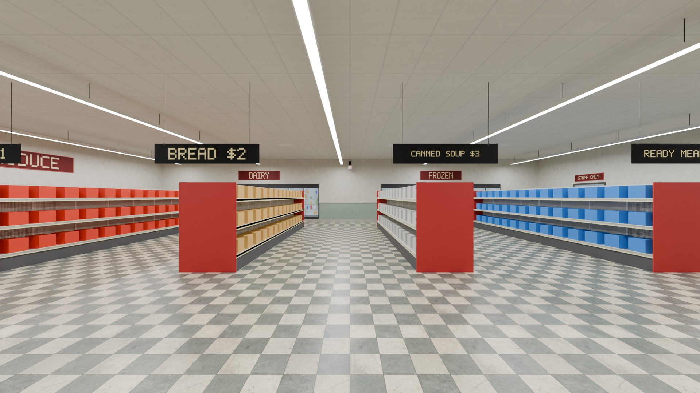
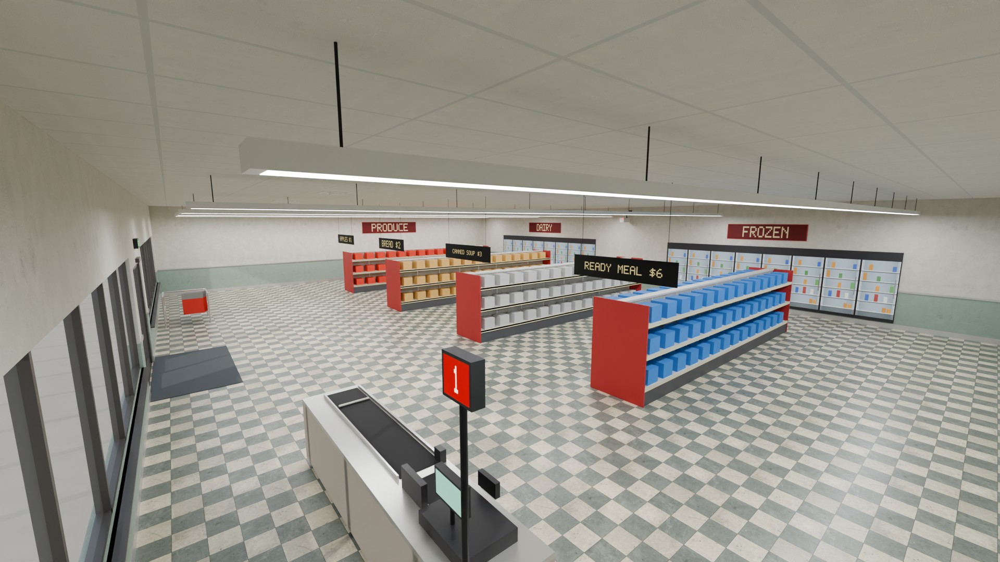
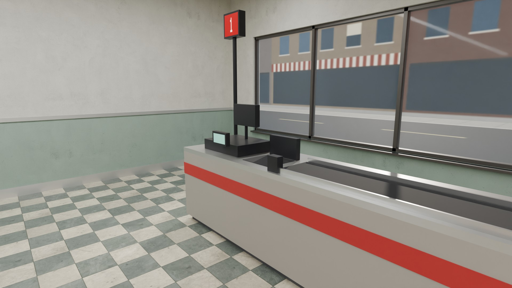

# main_floor: the grocery

The fifth scene of the Blender plan (`docs/BLENDER.md`, "5. main_floor"). The City's grocery behind Hallam Row's door, by day: a 24 x 18 m hall under fluorescent strip lights, a cream and grey-green checker tile floor, a sage band round the walls under a steel rail, four white gondolas with red end panels, glass-door coolers along the back wall, a checkout with its lane light by the storefront, the cart corral by the door, and the street across the road through the windows. Liminal, as `docs/WORLD.md` puts the grocery: "off and empty but seemingly normal". Built in Blender 5.2.1 from `blender/layout/main_floor.json`, baked in full by day (the store is only open by day: at closing you are shown out) and exported as art only. The structure follows the apartment pilot (`docs/renders/apartment/README.md`, `tools/blender/build_apartment.py`), with the galleries build's privacy scrub and fixed lightmap pages.

| File | What it is |
|---|---|
| `world/main_floor.glb` | the art: 0.90 MB, 4522 triangles, 28 draw calls, textures as WebP |
| `world/lightmaps/main_floor_0.webp` .. `main_floor_3.webp` | the baked light, four maps (second UV set, `TEXCOORD_1`) |
| `blender/scenes/main_floor.blend` | the saved scene (2.1 MB, Git LFS): `Art` (the unmerged pieces), `Export` (merged by material, with the lightmap UVs), `Standins`, `Lights` |
| `tools/blender/build_main_floor.py` | the re-runnable build (reads the layout; no hand-copied coordinates) |
| `blender/textures/main_floor/` | the three textures the build reads, made from three CC0 maps by `--stage textures` |
| `docs/renders/main_floor/` | the three review stills (this file's folder) |

The shared tools are used as they are on `main`: `tools/blender/check_layout.py`, `tools/blender/pack_scene.py`, `tools/webp_glb.py`, `tools/blender/dump_layout.mjs`. None was changed.

## Review stills (Cycles on the CPU, 128 samples adaptive, OIDN denoise, 1920 x 1080 JPEG, AgX, exposure 0)

| | |
|---|---|
| `1_arrival.jpg` (316 KB) | the arrival point (0, 7.4) just inside the door, at eye height 1.6 m, facing the scene's `face` (north, -z), 75 degrees vertical like the page's camera |
| `2_wide.jpg` (335 KB) | the whole store from high in the south-east corner, over the checkout |
| `3_detail.jpg` (216 KB) | the checkout's till from the shopper's spot (`checkout.at`): the belt, scanner, register, card reader, the lane light, the storefront and the street |





These are Blender renders with Blender's real lights, and they show the page's things as stand-ins (see below): the food boxes, the three carts, the camera's head and the four price signs, built as `groceryProps` builds them, so the stills read as the game will. The stills and the lightmaps come from the same lights.

## Sources and licences

| Material | Used for | Source | Author (Poly Haven) | Licence |
|---|---|---|---|---|
| `floor_tiles_06`: diffuse, 1k | floor (`floor_tiles_diff.jpg`): its grid moved to the image's edges, the light tiles turned a warm cream and the dark ones a grey-green, darker grout; 0.3 m tiles | https://polyhaven.com/a/floor_tiles_06 | Rob Tuytel | CC0 1.0 |
| `polystyrene`: diffuse, 1k | ceiling (`ceiling_tile_diff.jpg`): two 0.6 x 1.2 m lay-in tiles cut from it, the white grid drawn round them | https://polyhaven.com/a/polystyrene | Dimitrios Savva (photography), Dario Barresi (processing) | CC0 1.0 |
| `painted_plaster_wall`: diffuse, 1k | walls (`wall_paint_diff.jpg`): made neutral and light; each wall material tints it (cream above the rail, sage below) | https://polyhaven.com/a/painted_plaster_wall | Amal Kumar | CC0 1.0 |

**3 of the 8 allowed Poly Haven textures were downloaded** (three 1k JPEG diffuse maps, 1.7 MB, from `dl.polyhaven.org`, with the asset list, file list and author info read from `api.polyhaven.com`, under a generic client name, no other data sent). Eight small preview thumbnails from Poly Haven's CDN were looked at to choose them; none is used in the build. The local cache had no tile, ceiling or plain-plaster materials, so nothing came from it. `build_main_floor.py --stage textures --src <folder of the downloads>` makes the three files in `blender/textures/main_floor/` from them (JPEG quality 88).

Everything else is own work, made by `build_main_floor.py`: all geometry, and six generated images drawn with numpy from fixed seeds: the street across the road by day (the far side's shopfronts, awnings and flats, the pavements, the kerbs and the road), the cooler interior (lit, mostly empty), the department boards (PRODUCE, DAIRY, FROZEN, STAFF ONLY, in a 5 x 7 pixel font drawn in the script), the lit EXIT sign and the lane number, a pegboard, and the stand-in price signs (stills only). No Meshy, no paid service, no photograph, and the AI-generated reference photo (IMG_3027) was not used.

Tools: Blender 5.2.1 LTS (GPL) with Cycles, OpenImageDenoise (Apache-2.0, through the compositor's Denoise node) and the glTF I/O add-on; Python with numpy (in Blender) and Pillow (the WebP step); three r186 for the load check. The bake and the stills ran on the laptop's CPU: Cycles found no GPU it can use there (no CUDA or HIP library).

## Budgets (measured)

| | Limit | Measured |
|---|---|---|
| `world/main_floor.glb`, lightmaps aside | at most 8 MB | **0.90 MB** (899220 bytes; 2.74 MB from Blender, then `tools/webp_glb.py`: textures 2.3 to 0.49 MB, geometry bytes asserted identical) |
| triangles | at most 300 000 | **4522** (`glb_inspect.py`: 4522 drawn) |
| draw calls, merged by material | at most 250 | **28** (one primitive per material, 28 materials) |
| textures | WebP | **8 images (9 textures: the wall picture serves both wall paints), all `image/webp`** (largest 2048 x 1280: the street) |
| lightmaps | at most 4, at most 2048 x 2048, 8-bit WebP q90 | **4** (below) |

| Map | Page | Texel density | WebP | `lightmap_intensity` | What is on it |
|---|---|---|---|---|---|
| `main_floor_0` | 1152 x 1152 | 30.4 px/m | 21 KB | 5.4034 | the floor (with the door mat) and the ceiling |
| `main_floor_1` | 1024 x 1024 | 34.4 px/m | 89 KB | 4.3639 | the walls, their rail and kick plate, the cooler frames, the staff door, the department boards |
| `main_floor_2` | 1792 x 1792 | 38.3 px/m | 350 KB | 4.1298 | the gondolas, the checkout, the corral, the storefront frames and the EXIT box |
| `main_floor_3` | 768 x 768 | 40.6 px/m | 25 KB | 80.3629 | the strip lights' housings, their rods, the air vents, the sign hangers, the camera bracket and the checkout's poles |

Bake: Cycles on the CPU, 512 samples, diffuse (direct and indirect, no colour), 8 px margin, OIDN denoise; the four maps took 435, 255, 574 and 67 (22 minutes in all) s. The whole `--stage all` run (art, bake, export, axes check, the three stills and the plan at 128 adaptive samples) took about 45 minutes from an empty work folder. `glb_inspect.py --budget tris=300000,mb=8` says `pass tris`, `pass mb`.

Why four maps: each map's white point is its 99.5th percentile texel. The strip lights' housings sit a millimetre above the glowing diffusers, so their hidden undersides run some 18 times hotter than the room (map 3's white point is 25.6 against 1.3 to 1.7 for the others); with the rods and the other dark metal they get their own map and their own intensity, so they do not crush the room into a few 8-bit levels; the floor and the ceiling, the walls, and the fittings (shelves, checkout, corral, storefront frames) each fill one page at about 32 px/m. The page sizes are fixed in `PAGES` (1152, 1024, 1792, 768), because Blender's island packer is not exactly repeatable from run to run; `--pages auto` searches again.

How bright: the page draws a baked material unlit, as its texture times the lightmap, with no tone mapping, so a surface brighter than 1.0 clips to white. The light is set so the main surfaces stay below that: the floor-and-ceiling map's 90th percentile texel is 1.36 and the walls' 1.03 (`lightmaps.json`), so a cream floor tile shows at about 0.8 of white and a wall at about 0.35 (est., from the textures' linear albedo); only the sun patches inside the windows and the floor right under a strip reach white. The first bake, at twice the strip and sun power, would have clipped most of the floor in the page, so it was halved.

The three.js check (node, three r186 from a local `node_modules`; node cannot decode images, so the GLB's images are taken out of the JSON before three parses it and their types are read from the JSON):

```
three r186; world/main_floor.glb (0.90 MB)
PASS 8 images, all image/webp: image/webp
PASS material extras carry only lightmap, lightmap_intensity: {lightmap, lightmap_intensity}
PASS no extras on nodes, meshes, scenes or the asset (0)
PASS 28 meshes (draw calls, at most 250), 28 materials
PASS 4522 triangles (at most 300 000)
PASS Backdrop_Street: no lightmap (emissive)
PASS Belt_Rubber: lightmap world/lightmaps/main_floor_2.webp x4.1298, uv1 48 verts
PASS Ceiling_Tile: lightmap world/lightmaps/main_floor_0.webp x5.4034, uv1 4 verts
PASS Cooler_Frame: lightmap world/lightmaps/main_floor_1.webp x4.3639, uv1 440 verts
PASS Cooler_Lit: no lightmap (emissive)
PASS Counter_Laminate: lightmap world/lightmaps/main_floor_2.webp x4.1298, uv1 24 verts
PASS Counter_Top: lightmap world/lightmaps/main_floor_2.webp x4.1298, uv1 24 verts
PASS EndCap_Red: lightmap world/lightmaps/main_floor_2.webp x4.1298, uv1 264 verts
PASS Floor_Tile: lightmap world/lightmaps/main_floor_0.webp x5.4034, uv1 4 verts
PASS Frame_Alu: lightmap world/lightmaps/main_floor_2.webp x4.1298, uv1 608 verts
PASS Lamp_Emit: no lightmap (emissive)
PASS Light_Housing: lightmap world/lightmaps/main_floor_3.webp x80.3629, uv1 664 verts
PASS Mat_Rubber: lightmap world/lightmaps/main_floor_0.webp x5.4034, uv1 20 verts
PASS Metal_Dark: lightmap world/lightmaps/main_floor_3.webp x80.3629, uv1 1568 verts
PASS Plastic_Black: lightmap world/lightmaps/main_floor_2.webp x4.1298, uv1 204 verts
PASS Price_Rail: lightmap world/lightmaps/main_floor_2.webp x4.1298, uv1 576 verts
PASS Rail_Steel: lightmap world/lightmaps/main_floor_2.webp x4.1298, uv1 1996 verts
PASS Screen_Glow: no lightmap (emissive)
PASS Shelf_Back: lightmap world/lightmaps/main_floor_2.webp x4.1298, uv1 96 verts
PASS Shelf_Kick: lightmap world/lightmaps/main_floor_2.webp x4.1298, uv1 100 verts
PASS Shelf_Paint: lightmap world/lightmaps/main_floor_2.webp x4.1298, uv1 1536 verts
PASS Sign_Dept: lightmap world/lightmaps/main_floor_1.webp x4.3639, uv1 16 verts
PASS Sign_Glow: no lightmap (emissive)
PASS Staff_Door: lightmap world/lightmaps/main_floor_1.webp x4.3639, uv1 40 verts
PASS Trim_Steel: lightmap world/lightmaps/main_floor_1.webp x4.3639, uv1 272 verts
PASS Wall_Lower: lightmap world/lightmaps/main_floor_1.webp x4.3639, uv1 76 verts
PASS Wall_Paint: lightmap world/lightmaps/main_floor_1.webp x4.3639, uv1 92 verts
PASS Window_Glass: no lightmap (transparent)
PASS world/lightmaps/main_floor_2.webp exists (350 KB), used by 11 meshes
PASS world/lightmaps/main_floor_0.webp exists (21 KB), used by 3 meshes
PASS world/lightmaps/main_floor_1.webp exists (89 KB), used by 6 meshes
PASS world/lightmaps/main_floor_3.webp exists (25 KB), used by 2 meshes
PASS 4 lightmap image(s), at most four
PASS material Lamp_Emit present (the strip lights' diffusers), emissive strength 9
PASS no Window_Lit or Emergency_Emit (not in this scene's plan)
PASS no stand-in, food, cart, price-sign or camera material or mesh in the GLB
PASS 32 spots the page draws in (4 price signs, 24 food runs, 3 carts, the camera head's sweep): no art vertex in any
INFO collision bounds (-12.20, -1.00, -9.20) .. (12.20, 4.20, 9.20)
INFO art bounds (without the street backdrop and the glass) (-12.20, 0.00, -9.20) .. (12.20, 4.00, 9.20)
INFO whole GLB bounds (-45.00, 0.00, -9.20) .. (45.00, 32.00, 24.00)
PASS art lies inside the collision bounds (+5 cm)
PASS art x/z span equals the colliders' x/z span (within 5 cm)
PASS store height: floor top 0.000 (collider 0), ceiling underside 4.000 (collider 4)
PASS every mesh has an identity transform (vertices in game coordinates)
PASS Shelf_apple: art (-8.60, 0.00, -6.00) .. (-7.40, 1.90, 2.00), shelf tops at 0.35, 0.95, 1.55: true
PASS Shelf_bread: art (-3.60, 0.00, -6.00) .. (-2.40, 1.90, 2.00), shelf tops at 0.35, 0.95, 1.55: true
PASS Shelf_soup: art (1.40, 0.00, -6.00) .. (2.60, 1.90, 2.00), shelf tops at 0.35, 0.95, 1.55: true
PASS Shelf_meal: art (6.40, 0.00, -6.00) .. (7.60, 1.90, 2.00), shelf tops at 0.35, 0.95, 1.55: true
PASS: all checks
```

## The layout check

`blender -b blender/scenes/main_floor.blend --python tools/blender/check_layout.py -- --scene main_floor` (exit code 0):

```
layout check: scene main_floor, 78 visible meshes, 12 colliders
PASS  COVER  Floor_Grocery: 21 mesh(es) cover it (176472 sample points, every one within 5 cm of art)
PASS  COVER  Ceiling_Grocery: 7 mesh(es) cover it (135975 sample points, every one within 5 cm of art)
PASS  COVER  Wall_N: 22 mesh(es) cover it (30135 sample points, every one within 5 cm of art)
PASS  COVER  Wall_S: 15 mesh(es) cover it (30135 sample points, every one within 5 cm of art)
PASS  COVER  Wall_W: 12 mesh(es) cover it (22263 sample points, every one within 5 cm of art)
PASS  COVER  Wall_E: 16 mesh(es) cover it (22263 sample points, every one within 5 cm of art)
PASS  COVER  Shelf_apple: 8 mesh(es) cover it (21060 sample points, every one within 5 cm of art)
PASS  COVER  Shelf_bread: 8 mesh(es) cover it (21060 sample points, every one within 5 cm of art)
PASS  COVER  Shelf_soup: 8 mesh(es) cover it (21060 sample points, every one within 5 cm of art)
PASS  COVER  Shelf_meal: 8 mesh(es) cover it (21060 sample points, every one within 5 cm of art)
PASS  COVER  Checkout: 11 mesh(es) cover it (4059 sample points, every one within 5 cm of art)
PASS  COVER  Cart_corral: 4 mesh(es) cover it (1859 sample points, every one within 5 cm of art)
PASS  STRAY  47 tall solid mesh(es), each over a collider; 3 decor_* mesh(es) exempt
PASS  CLEAR  marker Spawn_door (0.00, 7.40): clear within 0.28 m
PASS  CLEAR  marker Checkout (6.50, 5.60): clear within 0.28 m
PASS  CLEAR  constants.arrive (0.00, 7.40): clear within 0.28 m
PASS  CLEAR  door.at (0.00, 8.30): clear within 0.28 m
PASS  CLEAR  cart.at (-4.50, 7.20): clear within 0.28 m
PASS  CLEAR  checkout.at (6.50, 5.60): clear within 0.28 m
PASS: 19 of 19 checks passed
```

The axes were checked once with a marker cube at the arrival point (`--stage axes`): game (0, 0.1, 7.4) is Blender (0, -7.4, 0.1) is glTF (0, 0.1, 7.4). The decor_* meshes the check exempts are the street backdrop, its ground and the door mat (12 mm). The storefront's sill ledge (3 cm tall), the checkout's red band (14 cm) and the corral's floor flanges (12 mm, their own piece `Corral_Feet`) are low enough not to count as standing art.

## Rebuild

From the repo root, with node, Blender 5.2 and Python with Pillow:

```
node tools/blender/dump_layout.mjs main_floor                    # writes blender/layout/main_floor.json (git ignores that folder)
blender -b --python tools/blender/build_main_floor.py -- --stage textures --src <folder with the three Poly Haven 1k diffuse JPEGs>   # only if the textures change
blender -b --python tools/blender/build_main_floor.py -- --stage all --samples 512 --render-samples 128       # art, bake, export, axes check, stills
python tools/blender/pack_scene.py main_floor                    # WebP lightmaps and WebP textures -> world/
```

`--stage art|bake|export|axes|render` run one step on the saved `.blend` (`blender -b blender/scenes/main_floor.blend --python ... -- --stage bake`). `--device cpu` forces the CPU; a GPU is used when Cycles finds one. The work folder defaults to the system temp folder's `farway_main_floor` (`--work <dir>` changes it). The review stills are written straight into `docs/renders/main_floor/`; the plan view goes to the work folder. The light levels are constants at the top of the lights section (`STRIP_W`, `SUN_W`, `WORLD_STRENGTH`).

## What the coordinator does to wire it in

1. Add `world/main_floor.glb` to the `main_floor` scene's files in `shared/farway.manifest.js`. The collision file `world/main_floor.json` is untouched and still the code's.
2. The blockout already steps aside: `groceryProps` checks `hasArt(GROCERY_SCENE)` and then draws only its `keep` slabs (the food boxes and the three carts), the price signs and the camera's head with its red light (the camera's own mount is not drawn when there is art: the GLB has the wall bracket), and adds no lamp. Nothing to change there unless the food models arrive.
3. Apply the lightmaps with `applyLightmaps` (it is already in the page): 22 materials carry `lightmap` and `lightmap_intensity` in their extras, on four images. Add no light of the scene's own: the strip lights, the sun and the coolers' glow are in the lightmaps. `cityLook`'s hemisphere light (1.35, `0xf4f8ff`) still lights the players, the food and the carts, and does not touch the baked materials.
4. The materials the page may touch: `Lamp_Emit` (the five strip lights' diffusers, emissive strength 9). It is in `ART_TOGGLES`, but `cityLook` returns early for the grocery before the clock's `artToggle` calls, so it stays on, as it should: the store is never shown at night. Not baked and not toggled: `Window_Glass` (the storefront, the door leaves and the cooler doors, transparent), `Cooler_Lit` (the coolers' lit insides, emissive), `Sign_Glow` (EXIT and the lane number, emissive), `Screen_Glow` (the till's two screens, emissive), `Backdrop_Street` (the street across the road and the ground in front of it, emissive, a fixed day). `Window_Lit` and `Emergency_Emit` do not occur in this scene.
5. Run every suite one at a time, merge.

## Stand-ins, and what is left out because the page draws it

The page draws these (`docs/BLENDER.md`, contract 4, and its table for `main_floor`), so none of them is in the GLB:

- **The food on the shelves**: `standin_food_apple` .. `_meal` in `Standins`, the blockout's boxes (0.35 x 0.3 x 0.35 m, both faces of each gondola, on the three shelf heights) in the blockout's colours. They were in the bake, so each shelf carries the food's contact shadow, and they show in the stills. The shelves' tops are at the blockout's heights (0.35, 0.95, 1.55 m) so the page's food sits on them; the check above confirms no art vertex stands in any food run.
- **The three carts in the corral**: `standin_carts` and `standin_cart_handles`, as the blockout places them; in the bake and the stills. The corral's west rail stands 2 cm outside the collider, because the page's first cart starts on the collider's west edge.
- **The camera's head and its red light**: `standin_camera` and `standin_camera_led` at rest (yaw 0), stills only (not baked: it sweeps). The GLB has only the wall bracket: a plate, an arm out to the pivot at `CAMERA.at` (0, 3.4, -8.7) and a short drop to the top of the head (y 3.5). The head's whole sweep (40 degrees each way) is clear of art.
- **The price signs**: `standin_sign_*`, a 2.2 x 0.42 m panel at y 2.5, 2 cm past each gondola's south end, with the page's text and colours; stills only. The GLB has two thin hangers from the ceiling down to each sign's top corners (x +-0.9 m, y 2.71 m); if the page moves its signs, the hangers are in `Metal_Dark` (map 3).
- **The arrival marker** `standin_arrival_marker` (the axes check), never rendered or exported.
- **Lights** (`Lights`): five 300 W area lights the length of the strip lights (0.14 x 16.3 m, pointing down), the sun (2 W/m2 from high in the south-east, through the storefront) and the sky (the world, seen through the storefront). Used for the bake and the stills, not exported (`export_lights` is off).

## Things to know

- **Axes and scale:** metres, y up, the store's origin at the middle of the floor; the exporter's y-up output equals the game's axes, with identity node transforms. Art x/z span equals the colliders (-12.2 to 12.2, -9.2 to 9.2); the inside is x -12 to 12, z -9 to 9, y 0 to 4.
- **Skin:** the walls, floor and ceiling carry only the faces seen from inside the store or through the south wall's openings (the outer skin, the floor's underside, the ceiling's top and the faces between the south wall's cut-up blocks are dropped); every other piece loses the faces that lie flat against a wall, the floor or the ceiling. `Floor_Tile` and `Ceiling_Tile` are 2 triangles each.
- **The storefront** is cut out of the south wall: the entrance (x -1.2 to 1.2, 2.5 m high: two closed sliding glass leaves; the page's door prompt at `door.at` is unchanged) and a window each side (x +-1.8 to +-11.2, y 0.75 to 2.75, six panes). The collider still closes the wall.
- **The street backdrop** (`Backdrop_Street`): a 90 x 32 m picture 15 m out from the wall (z 24) and the ground in front of it at y 0 (the pavement, the kerbs, the road). It makes the whole GLB's bounding box 90 x 32 x 33.2 m: use the collision file for the store's bounds, or leave this mesh out of a bounds computation.
- **Art without colliders, by design:** the coolers on the north wall, the staff door on the east wall, the department boards, the kick plates, the rail and the storefront frames all stand out of their wall by at most 5 cm, so they need no collider. The staff door is closed and does nothing (it is the way to `back_of_house`, `docs/BLENDER_AREAS.md`, not built). The door mat is passable.
- **The `.blend`** opens with the textures found by relative path (`//../textures/main_floor/`), so keep the folder layout. The six generated images are packed in it.
- **`blender/layout/` is in `.gitignore`**, so `main_floor.json` is not part of the commit; the build needs it (run `dump_layout.mjs` first).

## Open

- The light level: a bright, even fluorescent day with sun patches inside the windows. If the page reads it too bright or too dim, `STRIP_W` and `SUN_W` and a rebake (about 22 minutes for the bake stage on this laptop's CPU) change it.
- Whether the coolers, the staff door and the department boards want prompts or colliders (the contract says art only; they are flat on the walls).
- The street through the windows is a fixed day picture. The street scene's own art is not built yet; when it is, the backdrop can be re-rendered from it.
- The food is still the blockout's boxes (the plan says lighter food models come later); the shelves' heights are the page's, so new models only need to sit on them.
