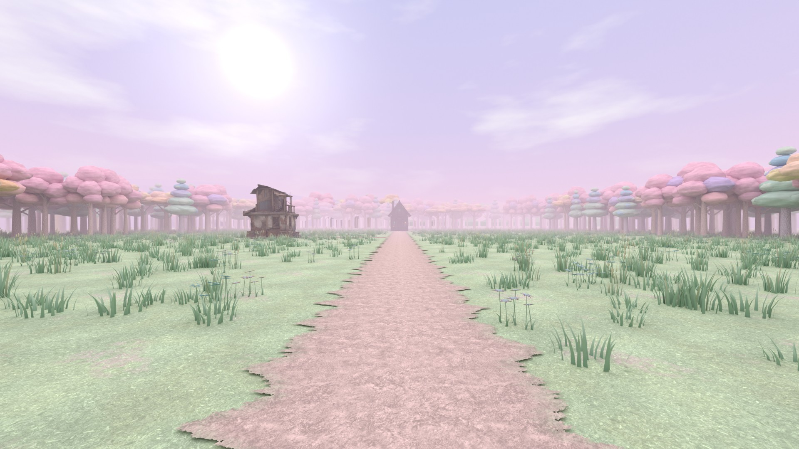
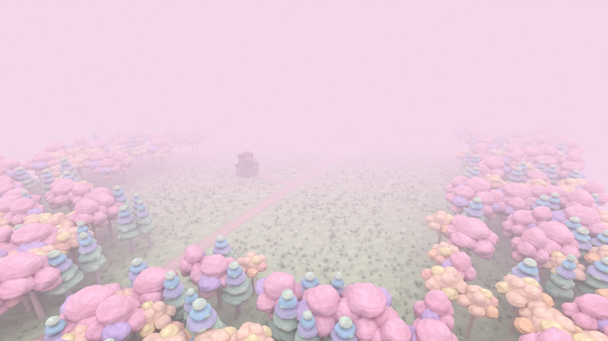
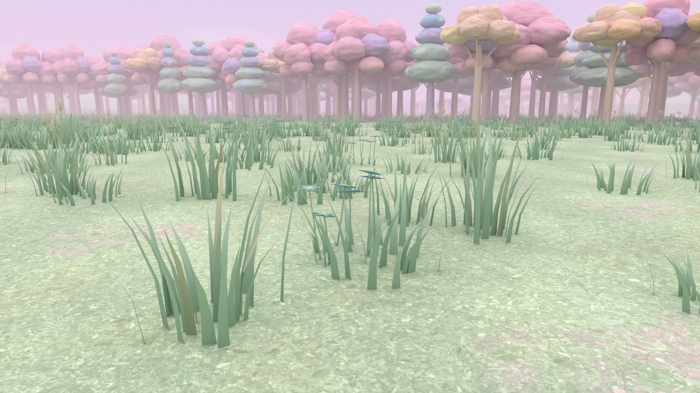
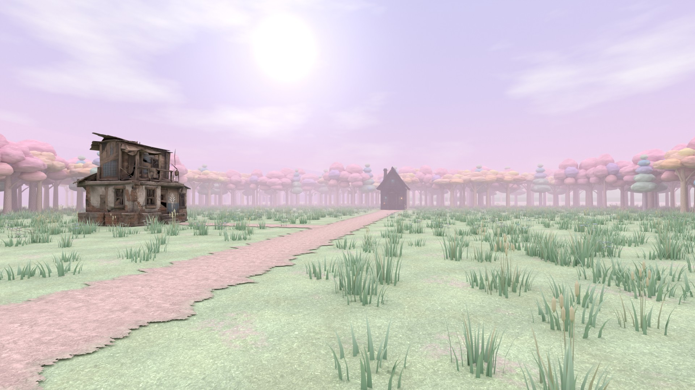
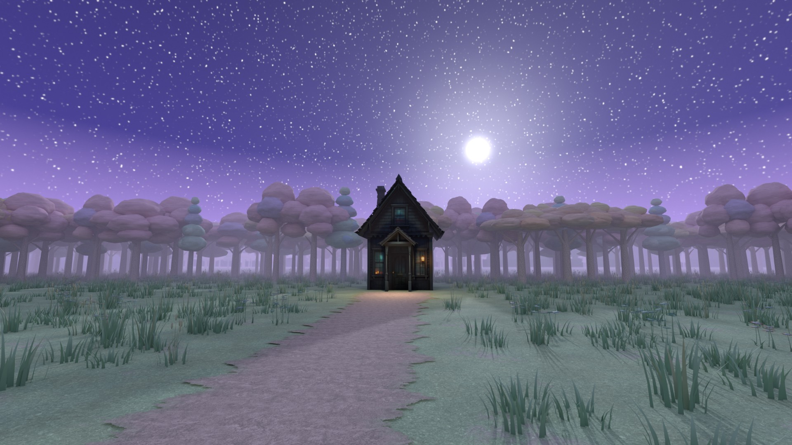

# meadow: the dreamcore meadow

This is the ninth scene of the Blender plan (`docs/BLENDER.md`, "9. meadow"). Past the forest's bright gap, the forest opens up into a wide pastel meadow:

- a lighter, sunnier mint lawn, with 8000 clumps of tall grass in three kinds;
- the layout's 420 flowers, in the page's five colours;
- a ring of 120 trees round the edge, standing exactly on the layout's trunks;
- a peach-sand path running straight north from the trees to the house's door, with a spur west to the shed's door;
- past the edge walls, more of the same trees: dense to the south, where the forest is, and a looser band round the other three sides.

The trees, their bark and crown pictures, the path's sand and the light are the forest's own (`tools/blender/build_forest.py` on `claude/blender-forest`). The tree variants are made by the same code from the same seeds, and `crowns.jpg` and `bark.jpg` are byte for byte the forest's. Walking through the gap from one scene to the other therefore reads as one place.

The scene was built in Blender 5.2.1 from `blender/layout/meadow.json`. It has an AO-only bake (the sun stays dynamic) and a day and a night backdrop. The owner's shed and house are the page's. They are imported here only as stand-ins, for the ground's contact AO and the stills.

| File | What it is |
|---|---|
| `world/meadow.glb` | The art: 2.79 MB, 38 529 triangles, 16 draw calls, textures as WebP. The trees, the flowers and the grass are exported with `EXT_mesh_gpu_instancing` |
| `world/lightmaps/meadow_0.webp` .. `meadow_3.webp` | The baked ambient occlusion on the second UV set (`TEXCOORD_1`): one map for the ground and one per tree variant |
| `world/backdrops/meadow_day.webp`, `meadow_night.webp` | The edge-of-world panoramas (R3), 4096 x 2048 equirect, with the sky painted in |
| `blender/scenes/meadow.blend` | The saved scene (2.5 MB, Git LFS), with three collections: `LayoutCheck` (`Art`, the pieces the check reads, and `PageDrawn`, the page's two building footprints), `Export` (what ships) and `Standins`. It holds no copy of the owner's models |
| `tools/blender/build_meadow.py` | The re-runnable build. It reads the layout; no coordinate is copied by hand |
| `tools/blender/check_meadow_glb.mjs` | The load check: the GLB's instanced trees and flowers against `shared/forest.js`'s 120 trees and 420 flowers |
| `blender/textures/meadow/` | The build's textures, made by `--stage textures` from three CC0 maps and generated ones |
| `docs/renders/meadow/` | The review stills (this file's folder) |

## Review stills (Cycles on the rented GPU, 128 samples adaptive, OIDN, 1920 x 1080 JPEG, Standard view transform)

| | |
|---|---|
| `1_arrival.jpg` | The arrival point (0, 6), eye height 1.6 m, facing the scene's `face` (north, -z), 75 degrees vertical. The path runs to the house, with the shed on the left |
| `2_wide.jpg` | The whole meadow from 34 m up over the south-east corner. Camera rays see the haze colour here, not the backdrop |
| `3_detail.jpg` | The layout flower nearest (3, -16) on the path's east side, low among the tall grass |
| `4_day.jpg` | The shed and the house by day from the path at z -12, with the day backdrop. The owner's models are stand-ins |
| `5_night.jpg` | The moonlit cabin: the house from the path at z -42, under the night backdrop's moon. A pale moonlight and the page's porch light are lit, and the exposure is +0.9 |







The stills are lit the way the page lights the meadow, which shares the forest's look (`index.html` `FOREST_LOOK`):

- the world is a hemisphere light of #fff0f8 over #f0c8dc, at strength 1.55;
- every material mixes toward the fog colour #f4d8ec by view depth, from 22 to 105 m, for camera rays;
- there is no tone mapping.

By night the world is a dim lilac hemisphere, plus a sun lamp from the moon's direction. There is also a point light where the page puts its porch light: `meadowProps`, #ffd8a0, at the house's door, 2.6 m up and 0.6 m out.

## Sources and licences

| Texture | Used for | Source | Author (Poly Haven) | Licence |
|---|---|---|---|---|
| `leafy_grass`: diffuse, 1k | The lawn (`grass.jpg`): its detail on a lighter, sunnier mint than the forest's, a little warm patchiness, and only a scatter of the forest's pink petals | https://polyhaven.com/a/leafy_grass | Charlotte Baglioni | CC0 1.0 |
| `bark_platanus`: diffuse, 1k | The trunks and branches (`bark.jpg`, the forest's, tinted per variant) | https://polyhaven.com/a/bark_platanus | Dimitrios Savva | CC0 1.0 |
| `forrest_sand_01`: diffuse, 1k | The path (`path.png`: peach sand, a grassy fringe, a ragged edge in its alpha) | https://polyhaven.com/a/forrest_sand_01 | Rob Tuytel | CC0 1.0 |

**Nothing new was downloaded for this scene.** The three Poly Haven 1k JPEG diffuse maps are the ones the forest's build downloaded. `build_meadow.py --stage textures --src <folder of the three>` makes the five files in `blender/textures/meadow/` from them, in plain Python with numpy and Pillow.

Everything else is my own work, made by `build_meadow.py` from fixed seeds:

- all geometry: the three tree variants (the forest's code), the ground, the path and spur ribbons, the three grass clumps, the five flower clumps, and the backdrop's hills;
- the crowns' atlas `crowns.jpg` (the forest's);
- the small things' atlas `decor.png`: the page's five `FLOWER_COLORS`, blade green, butter, and sage to straw;
- the backdrops' sky, clouds, stars, sun and moon (shader nodes).

No Meshy, no Higgsfield, no paid service and no photograph were used. The owner's `models/world/shed.glb` and `cottage.glb` appear only as stand-ins (below) and are not part of the build's output.

Tools: Blender 5.2.1 LTS (GPL) with Cycles (OptiX on the rented GPU box), OpenImageDenoise (Apache-2.0, through the compositor's Denoise node) and the glTF I/O add-on; Python with numpy and Pillow (the texture, WebP and backdrop steps); node (the GLB check).

## Budgets (measured)

`python studio/pipeline/glb_inspect.py world/meadow.glb --budget tris=300000,mb=8` (Pipelines-Plugin) exits with code 0:

```
file       world\meadow.glb  (2.79 MB, Khronos glTF Blender I/O v5.2.40)
triangles  38529 drawn, in 13 mesh(es), 13 instance(s)
  mesh     Flower_0: 234 tris, 204 verts
  mesh     Flower_1: 234 tris, 204 verts
  mesh     Flower_2: 234 tris, 204 verts
  mesh     Flower_3: 234 tris, 204 verts
  mesh     Flower_4: 234 tris, 204 verts
  mesh     Grass_Mid: 110 tris, 154 verts
  mesh     Grass_Seed: 195 tris, 193 verts
  mesh     Grass_Tall: 120 tris, 168 verts
  mesh     Ground: 8952 tris, 4875 verts
  mesh     Path: 214 tris, 218 verts
  mesh     TreeA: 8976 tris, 7312 verts
  mesh     TreeB: 8608 tris, 6885 verts
  mesh     TreeC: 10184 tris, 8019 verts
materials  9: Decor_Bloom, Ground_Grass, Path_Sand, Bark_A, Crown_A, Bark_B, Crown_B, Bark_C, Crown_C
textures   9, images: 512x64, 1024x1024, 1024x1024, 1024x1024, 1024x1024
bbox       124.0 x 10.0515 x 136.0 (x, y up, z), min [-62.0, -1.0, -104.0]
rig        0 skin(s); animations: none
requires   EXT_texture_webp
pass       tris: 38529 triangles, budget 300000
pass       mb: 2.79 MB, budget 8
```

| | Limit | Measured |
|---|---|---|
| `world/meadow.glb`, AO maps aside | At most 8 MB | **2.79 MB** (2 921 872 bytes; 4.4 MB from Blender, then `tools/webp_glb.py`, with the geometry bytes asserted identical) |
| Triangles | At most 300 000 (instanced meshes count once) | **38 529** (the three tree variants 8976, 8608 and 10 184; the ground 8952) |
| Draw calls, merged by material | At most 250 | **16** (13 meshes; each tree has two primitives, bark and crown; 11 instanced nodes) |
| Instances | | 540 trees (the 120 on the layout: 54 A, 32 B, 34 C; and 420 past the edge walls), 420 flowers, 8000 grass clumps (3000 tall, 4000 mid, 1000 with seed heads) |
| Textures | WebP | **5 images, all `image/webp`** (1024 x 1024 and smaller) |
| AO maps | At most 4, each at most 2048 x 2048 | **4** (below) |
| Displayed albedo | p90 at most about 0.8 | **0.754 at worst** (`Bark_C`). The crowns are 0.716, the lawn 0.638, the path 0.631 and the flowers and grass 0.68 |

`EXT_mesh_gpu_instancing` survives `tools/webp_glb.py`, which re-encodes the images only. The accessors of all 11 instancing nodes have the same bytes before and after (md5 compared), and the load check below reads the packed file.

The GPU draws about 1.0 M triangles per frame for the grass, 0.1 M for the flowers and 5.0 M for the 540 trees when all are in view. This is the same order as the forest (744 trees). If the page is heavy on small devices, fewer ring trees or grass clumps is a re-run of `--stage art`.

| Map | Page | Texel density | WebP | What is on it |
|---|---|---|---|---|
| `meadow_0` | 2048 | 14.9 px/m | 115 KB | The ground (`Ground_Grass`), baked with all 540 trees in place and the owner's shed and house standing where the page draws them (AO distance 5 m: soft pools under the crowns, a ring at each trunk, contact shadow round the buildings) |
| `meadow_1` | 1024 | 41 px/m (mesh units) | 110 KB | Variant A (`Bark_A`, `Crown_A`), baked alone over a ground plane (distance 2.5 m) |
| `meadow_2` | 1024 | 53 px/m | 91 KB | Variant B (`Bark_B`, `Crown_B`) |
| `meadow_3` | 1024 | 50 px/m | 97 KB | Variant C (`Bark_C`, `Crown_C`) |

How the bake ran and what the maps hold:

- **Settings:** Cycles AO on the GPU, 256 samples, 8 px margin, OIDN denoise. The four maps took 10, 5, 4 and 4 s.
- **Values:** the maps hold linear AO, where 1 means open sky; the page loads them with `NoColorSpace`.
- **Extras:** every baked material carries `aomap` (the map's path) and `aomap_intensity` in its extras: 1.0 on the ground, 0.9 on the trees. No material carries `lightmap`.
- **Not baked, on purpose:** `Path_Sand` (as in the forest) and `Decor_Bloom` (the instanced flowers and grass).

## The layout check

`blender -b blender/scenes/meadow.blend --python tools/blender/check_layout.py -- --scene meadow --collection LayoutCheck` exits with code 0. The 120 trunk lines are shortened here to their sum:

```
layout check: scene meadow, 664 visible meshes, 127 colliders
PASS  COVER  Ground_Meadow: 124 mesh(es) cover it (237888 sample points, every one within 5 cm of art)
PASS  COVER  Trunk (x120): 4 to 6 mesh(es) cover each, every sample point within 5 cm of art (120 PASS, 0 FAIL)
PASS  COVER  Shed: 3 mesh(es) cover it (163419 sample points, every one within 5 cm of art)
PASS  COVER  House: 3 mesh(es) cover it (158661 sample points, every one within 5 cm of art)
PASS  STRAY  122 tall solid mesh(es), each over a collider; 420 decor_* mesh(es) exempt
PASS  CLEAR  marker Spawn_path (0.00, 6.00): clear within 0.28 m
PASS  CLEAR  constants.arrive (0.00, 6.00): clear within 0.28 m
PASS  CLEAR  shed.door.at (-11.00, -30.00): clear within 0.28 m
PASS  CLEAR  house.door.at (0.00, -61.40): clear within 0.28 m
PASS  CLEAR  returnHouse.arrive (0.00, -57.50): clear within 0.28 m
PASS: 129 of 129 checks passed
```

Notes on the check:

- **`--collection LayoutCheck`:** the check reads `Art` and, beside it, `PageDrawn`, as the forest does. `PageDrawn` holds two boxes, `pagedrawn_shed_footprint` and `pagedrawn_house_footprint`, which are the colliders `Shed` and `House` themselves. The page draws the owner's models on them. They are never baked, rendered or exported.
- **Why boxes and not the models:** the owner's models, placed as `placeBuilding()` places them, do not fill their colliders to within 5 cm (see the coordinator notes).
- **Trunks:** the trunks in `Art` are not turned, because the check reads boxes. In the GLB every tree turns about the vertical.
- **The 420 `decor_*` meshes** are the ring trees past the edge walls, out of reach.

**One change to the shared check, for the coordinator to review** (its own commit). `shed.at` (-15, -30) and `house.at` (0, -66) are the buildings' own middles, inside their colliders, so the unchanged CLEAR rule fails them whatever the art. `check_layout.py` now skips an `at` whose object also has a `half`: a placed building's middle, not a spot to walk to. Rule 1 still covers its collider, and its `door.at` is still checked. In the scenes there today this changes only the meadow's two building middles.

`check_layout_test.py` passes unchanged (13 tests). The forest's draft changes the same `at` branch of `points_of` (a spot with a `reach`). The two merge by keeping both conditions.

The axes were checked once with a marker cube at the arrival point (`--stage axes`): game (0, 0.1, 6) is Blender (0, -6, 0.1) is glTF (0, 0.1, 6).

## The load check: the trees and flowers stand on the layout

`node tools/blender/check_meadow_glb.mjs world/meadow.glb` reads the packed GLB's instancing accessors directly and exits with code 0:

```
PASS shared/forest.js gives 120 trees and 420 flowers (the same as blender/layout/meadow.json's)
PASS EXT_mesh_gpu_instancing used (not required: a loader without it still shows one of each)
PASS 5 images, all WebP (EXT_texture_webp)
PASS Flowers_0: 82 instances, identity holder, 0.52 m tall in the mesh (passable small things)
PASS Flowers_1: 88 instances, identity holder, 0.54 m tall in the mesh (passable small things)
PASS Flowers_2: 93 instances, identity holder, 0.59 m tall in the mesh (passable small things)
PASS Flowers_3: 75 instances, identity holder, 0.57 m tall in the mesh (passable small things)
PASS Flowers_4: 82 instances, identity holder, 0.57 m tall in the mesh (passable small things)
PASS Grass_Mid: 4000 instances, identity holder, 0.39 m tall in the mesh (passable small things)
PASS Grass_Seed: 1000 instances, identity holder, 0.94 m tall in the mesh (passable small things)
PASS Grass_Tall: 3000 instances, identity holder, 0.74 m tall in the mesh (passable small things)
PASS Trees_A: one mesh (Bark_A + Crown_A), 222 instances, identity holder; trunk base radius in the mesh 0.335 m, crown from 4.07 m
PASS Trees_B: one mesh (Bark_B + Crown_B), 123 instances, identity holder; trunk base radius in the mesh 0.335 m, crown from 2.99 m
PASS Trees_C: one mesh (Bark_C + Crown_C), 195 instances, identity holder; trunk base radius in the mesh 0.335 m, crown from 4.98 m
PASS 120 tree instances stand in the playable ground (x -45 .. 45, z -84 .. 12); 420 stand past the edge walls
PASS 120 of 120 trees have exactly one instance at their [x, z] (within 5 mm)
PASS the worst tree instance is 0.00 mm from its tree (and stands at y 0)
PASS each trunk's base radius (the mesh's widest ring below the crowns / 1.08, times the instance's scale) is the layout's r (worst 0.0 mm off)
PASS no trunk reaches past its collider by more than 5 cm, root flare included (worst 3.2 cm)
PASS every tree only turns about the vertical, and its trunk is round (x scale = z scale)
PASS every crown starts above 2.2 m (lowest 2.70 m)
PASS the 420 trees past the edge walls all stand at least 1.5 m outside them (out of reach)
PASS 420 flower instances (82, 88, 93, 75, 82 in Flowers_0 .. Flowers_4)
PASS 420 of 420 flowers have exactly one instance at their [x, z] (within 5 mm), in the node of their colour (0 in another colour's)
PASS the worst flower instance is 0.00 mm from its spot (and stands at y 0)
PASS the flowers stand at most 0.71 m tall: small and passable (not solid: no collider, as the layout has none)
PASS no node, mesh or material of the owner's shed or house, and no stand-in (the page draws them)
PASS 7 materials carry aomap (Ground_Grass world/lightmaps/meadow_0.webp x1; Bark_A world/lightmaps/meadow_1.webp x0.9; Crown_A world/lightmaps/meadow_1.webp x0.9; Bark_B world/lightmaps/meadow_2.webp x0.9; Crown_B world/lightmaps/meadow_2.webp x0.9; Bark_C world/lightmaps/meadow_3.webp x0.9; Crown_C world/lightmaps/meadow_3.webp x0.9); none carries lightmap
RESULT PASS
```

## The layout file

`world/meadow.json` is untouched: it belongs to the code, written by `tools/make_street.mjs`. `node tools/worlddoc.mjs check world/meadow.json`:

```
OK world/meadow.json: 127 colliders, 0 doors, 1 markers, 0 links, 0 zones, 0 spots, 0 errors, 0 warnings
```

## The backdrops (R3)

`world/backdrops/meadow_day.webp` (525 KB) and `meadow_night.webp` (575 KB) are 4096 x 2048 equirect panoramas. They were rendered by `--stage backdrop` (Cycles, 96 samples adaptive, OIDN, Standard view transform) from the middle of the meadow (0, 1.6, -36), with the playable area hidden. They show:

- a flat lawn to the horizon;
- to the south, the forest: the forest's own jittered grid of the same three trees, ragged where it meets the meadow, out to 300 m, with the path going in;
- round the other three sides, open country: noise-gathered groves and a few lone trees, thinning out to 340 m;
- 18 low lavender and sage hills, 380 to 780 m out, from west through north to east.

About 2500 trees are hazed toward #f4d8ec with a softer haze than the forest's (a 120 m falloff where the forest uses 70 m), so the fields read further.

The sky is painted in, as the plan asks, because a backdrop replaces the page's own sun sprite and clouds:

- **By day** it rises from exactly #f4d8ec at the horizon (the page's haze, so the fogged trees meet it) through pink to a soft periwinkle. It has soft clouds, and the sun's glow sits where the page's `dreamSky` puts its sun: north-west and high.
- **By night** the sky is violet with stars over a pink afterglow that is still #f4d8ec at the horizon. A full moon with a wide halo stands 18 degrees up, a little east of north. From the path it hangs over the house, so the moonlit cabin is the night's focal point.

**The middle column faces north (-z) and the right-hand side east (+x).** The stage renders three glowing markers first and asserts it: `ORIENT PASS: middle north (-z), right east (+x)`, with the markers in columns 128 and 192 of 256. The lower half is lawn, which the scene's own ground covers.

## What the coordinator does to wire it in

1. **Manifest and tests (done in this commit):**
   - `world/meadow.glb` is added to the `meadow` scene's files in `shared/farway.manifest.js`.
   - `pageScenes.meadow` in `shared/manifest.test.js` now lists the GLB: this is the deepEqual of all page scenes, line 26.
   - No other test in `shared/` asserted that the meadow has no GLB. `tools/art_test.mjs` loads the meadow with its own fixture, so it does not read `world/meadow.glb`.
   - `node --test shared/*.test.js`: 297 tests, 297 pass.
2. **The backdrops are not in the manifest yet.** To wire them, add `backdrop: {day: "world/backdrops/meadow_day.webp", night: "world/backdrops/meadow_night.webp"}` on the `meadow` scene, and add the same to the `pageScenes` deepEqual if the registry carries it.
   - With it, `meadowProps` stops drawing `dreamSky`, its own sun and clouds.
   - The page calls `setBackdrop` by the clock only in the City, so the meadow would show the day picture always. The night one is ready for when the meadow gets a night.
3. **The blockout steps aside already.** `meadowProps` checks `hasArt(MEADOW_SCENE)` and then draws only the shed, the house and the porch light.
   - `applyLightmaps` reads `aomap`. The ground and the six tree primitives carry `TEXCOORD_1` and `aomap`. The tree primitives are InstancedMeshes (`isMesh` is true).
   - The path, the flowers and the grass carry neither.
4. **Tests that count instances:** `tools/forest_test.mjs` and similar Playwright suites now see the GLB's InstancedMeshes in the meadow: 540 x 2 tree instances, 420 flowers and 8000 grass clumps. They were not run here, because they need Playwright.
5. Run every suite one at a time, then merge.

## What is left out because the page draws it

- **The shed and the house:** nothing of the art stands on their footprints.
  - The path ends under the house's front, and the spur ends under the shed's front. Both are flat ribbons, hidden by the models.
  - The grass and the flowers keep off the footprints and the doors.
  - Stand-ins: the owner's `models/world/shed.glb` and `cottage.glb`, imported by the bake and render stages and placed exactly as `placeBuilding()` places them. They are scaled evenly to `height`, with the box's bottom on the floor and its middle over `at`, and turned by `yaw`.
  - They are never exported, changed or decimated, and never saved in the `.blend`: each stage imports them again and drops them before saving. The checks prove this: the GLB check finds no node of theirs, and the decompressed `.blend` holds no `shed.glb`, `cottage.glb` or `standin_shed`.
- **The porch light:** a stand-in point light for the night still only (`standin_porch_light`).
- **The door prompts:** the code's.

## Things to know

- **Axes and scale:** metres, y up, with identity node transforms. Each instance carries its own translation, turn about y and scale.
- **The trunks:** these are the forest's trees unchanged.
  - Each variant's trunk has a base radius of 0.31 m in its mesh and a root flare of 8 % below 0.4 m.
  - Each instance is scaled by r / 0.31 across and by 0.9 to 1.12 in height, so its base radius is the layout's r, and the flare stays within 3.2 cm of the collider.
  - Crowns start at 2.70 m or higher in the game.
  - Variant mix: 45 % A, 20 % B and 35 % C at the meadow's edge, so there are fewer spires than in the forest (40/30/30). The forest past the south edge uses the forest's mix.
- **The ground:**
  - It is flat (y 0) within 4 m of the path, round the spur and within 6 m of the buildings. Elsewhere it has a gentle roll of up to 4 cm in the field and 12 cm past the edge walls.
  - A skirt runs down to y -1 round its edge, because the collider is a metre deep.
  - It reaches x ±62 and z -104 to 32, past the edge walls, under the ring of trees.
- **The path:**
  - The ribbon is 3.6 m wide at y 0.025, with a ragged alpha edge that leaves about 2.9 m of sand. The flowers keep |x| ≥ 1.8.
  - It widens to the forest's 7 m past the south edge, where it meets the forest's path, and to 5 m in front of the house's door.
  - The spur to the shed is 2.4 m wide, at y 0.03.
- **Passable things:** the flowers (420 clumps of six blooms, at most 0.71 m), the grass (at most 0.94 m), and the 420 trees past the edge walls (`decor_ring_*` in `Art`, out of reach). They have no colliders, as the layout has none.
- **The `.blend`** finds its textures by relative path (`//../textures/meadow/`). It holds no `Backdrop` collection (`--stage backdrop` builds it again) and no path, user name or e-mail; this was checked on a fully decompressed copy.
- **`blender/layout/` is in `.gitignore`:** run `node tools/blender/dump_layout.mjs meadow` before a build.

## Rebuild

From the repo root, with node, Blender 5.2, and Python with numpy and Pillow:

```
node tools/blender/dump_layout.mjs meadow
python tools/blender/build_meadow.py --stage textures --src <folder with the three Poly Haven 1k diffuse JPEGs>    # only if the textures change
blender -b --python tools/blender/build_meadow.py -- --stage art,axes,bake,export --work <work> --samples 256
blender -b blender/scenes/meadow.blend --python tools/blender/check_layout.py -- --scene meadow --collection LayoutCheck
blender -b blender/scenes/meadow.blend --python tools/blender/build_meadow.py -- --stage backdrop,render --work <work> --render-samples 128
python tools/blender/pack_scene.py meadow --work <work>                     # WebP AO maps and WebP textures -> world/
python tools/blender/build_meadow.py --stage pack-backdrops --work <work>    # WebP backdrops -> world/backdrops/
node tools/blender/check_meadow_glb.mjs world/meadow.glb
```

Each stage ran on a rented GPU (OptiX) in a few minutes, most of it upload; `--device cpu` forces the CPU.

## Open

- **The backdrops** need the manifest entry (above). The page shows a meadow backdrop by day only, until the meadow has a clock.
- **The owner's models and their colliders:** placed as `placeBuilding()` places them, the models are a little smaller than their colliders. The shed spans x -17.89 .. -12.11 and z -33.08 .. -26.92, against a collider of -18 .. -12 and -33.2 .. -26.8. The house spans x -2.89 .. 2.89 and z -69.34 .. -62.66, against -3 .. 3 and -69.6 .. -62.4. So up to 11 cm (shed) and 26 cm (house) of invisible wall stands round them. That is a code question (`MEADOW.shed.half`, `MEADOW.house.half`), not an art one. Both models are taller than their colliders (6.2 and 7.5 m, against 4.96 and 6 m), which is as the code intends.
- **The light:** the stills copy the page's hemisphere light and fog; the in-game check from the same spots is the comparison. `aomap_intensity` is 1.0 on the ground and 0.9 on the trees.
- **The flowers** are the layout's 420. Over about 5000 m² of field they read as a scatter, not a carpet. More would be a layout change, which belongs to the code.
