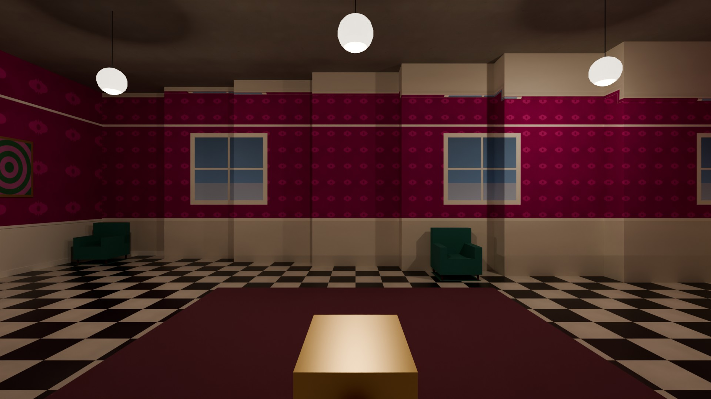
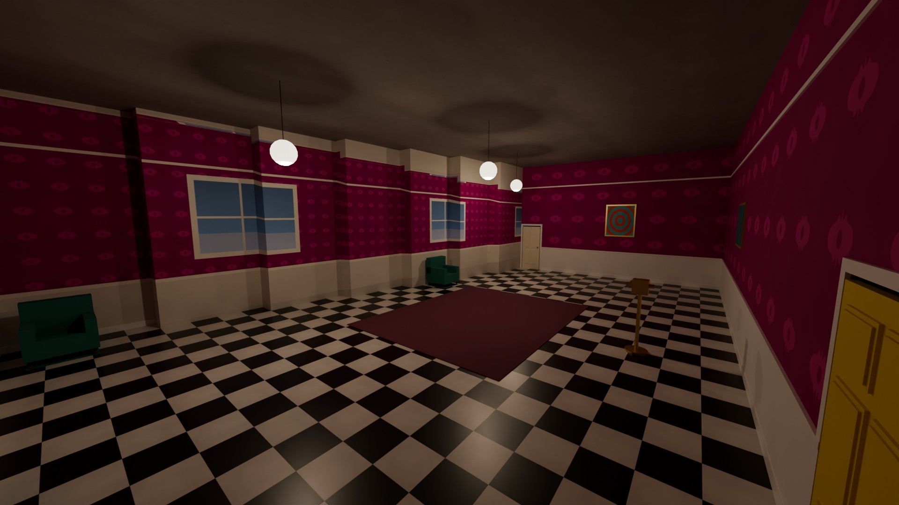
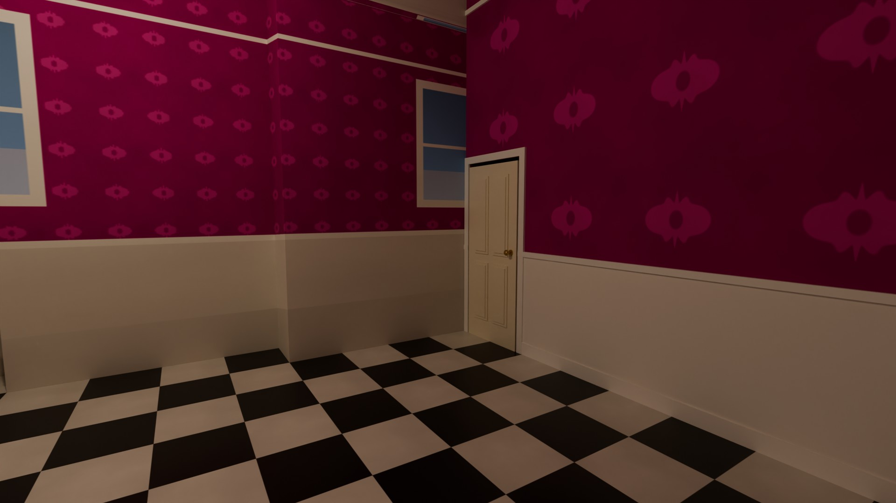

# rdwe_ames_room: The Ames room: you shrink across it

Right Door, Wrong Exit, Phase C room 19 (the teal wing), dressed and lit (`docs/BLENDER_AREAS.md`, section 7, step 2), round its greybox (`tools/blender/build_rdwe_greybox.py`, `c_ames_room()`). 14 m by 10 m, 4.5 m high. The room, from `ROOMS.md`: Perspective shifting: a trapezoid room that looks square from the peephole; walk to the short corner and you seem to grow until you fit its small door.

A trapezoid room dressed as a square one: magenta damask over a white dado, a black and white checker floor, a plaster ceiling. Its back wall steps from 10 m deep in the west corner to 7 m in the east; the paper on it is projected from the peephole (Spot_view_1), so through the brass viewer it is one flat wall with two square windows. Two identical armchairs, one in each corner: from the viewer the east one is a giant's chair.

Built in Blender 5.2.1 by `tools/blender/build_rdwe_rooms2.py` (the room's `dress_` function and spec) with the shared kit `tools/blender/rdwe_rooms2_kit.py`, baked on the GPU and graded by `tools/blender/rdwe_rooms2_pack.py`. There are no reference photos: it follows the room's line in `ROOMS.md` and the style of `docs/WORLD.md` (Super Liminal: nearly ordinary, saturated, a little wrong).

| File | What it is |
|---|---|
| `world/rdwe_ames_room.glb` | the art: 0.70 MB, 7842 triangles, 20 materials, 19 nodes (one mesh per material; the door leaves as their own nodes), 8 WebP textures |
| `world/rdwe_ames_room.json` | the layout, written by `tools/blender/export_scene.py` from the `.blend`: 24 colliders, 3 doors, 3 links, 3 spots; the same as `build_rdwe_greybox.py --preview` writes |
| `world/lightmaps/rdwe_ames_room_0.webp` | set `main` (`lightmap`): struct page, 2048 px, about 65.0 px/m |
| `world/lightmaps/rdwe_ames_room_1.webp` | set `main` (`lightmap`): props page, 1024 px, about 86.1 px/m |
| `blender/scenes/rdwe_ames_room.blend` | the saved scene (Git LFS): `Art` (one object per collider, unmerged), `Doors` (the leaves, origin at the hinge), `Layout` (`COL_` boxes, the empties), `Export` (merged by material, with the lightmap UVs), `Lights_*` (one collection per light set, and `Lights_all`) |
| `docs/renders/rdwe_ames_room/` | this README and the three review stills |





Review stills: Cycles, 96 samples adaptive, OIDN, 1920 x 1080 JPEG, AgX medium high contrast. They are Blender's renders with Blender's lights; the page shows the lightmaps (see Brightness).

## The trick's spots (for the page)

- `Spot_view_1` at (0, 4.2), facing (0, -1): the peephole: from here the room is square
- `Spot_view_2` at (-5.6, -2.6), facing (0, -1): the deep corner: stand here and, from the peephole, you are a giant's height
- `Spot_view_3` at (5.4, -0.4), facing (0, -1): the shallow corner by the small door: from the peephole you are a doll; here you fit the door

## Doors

- `DoorLeaf_grid` (0.9 x 2.16 m): stable (split) teal paint door, no handle. The leaf is built from its look (form, finish, handle), so it is visibly unlike every other door in the set.
- `DoorLeaf_small` (0.8 x 1.9 m): panelled cream gloss door, brass knob. The leaf is built from its look (form, finish, handle), so it is visibly unlike every other door in the set.
- `DoorLeaf_word` (1.12 x 2.04 m): six-panel mustard door, chrome lever. The leaf is built from its look (form, finish, handle), so it is visibly unlike every other door in the set.

## Light

| Set | Material properties | Maps |
|---|---|---|
| `main` | `lightmap`, `lightmap_intensity` | `rdwe_ames_room_0`, `rdwe_ames_room_1` |

Emissive materials (not baked, drawn as they are): `Shade_Glass`. `Lamp_Emit` is every ordinary lamp's glow.

## Sources and licences

| File (`blender/textures/rdwe_rooms2/`) | Source | Licence | Used by |
|---|---|---|---|
| `dark_wood_diff_1k.jpg` | Poly Haven, Dark Wood | CC0 | Wood_Dark |
| `plastered_wall_04_diff_1k.jpg` | Poly Haven, Plastered Wall 04 | CC0 | Ames_Ceiling |
| `rough_linen_diff_512.jpg` | Poly Haven, Rough Linen | CC0 | Rug_Red, Velvet_Green |

Every other material is a flat colour, or a picture the build generates with numpy (fixed seeds, own work, no licence needed): `Ames_Dado`, `Ames_Floor`, `Ames_Paper`, `Ames_Proj`, `Brass`, `Chrome`, `Door_Cream_Gloss`, `Door_Mustard`, `Door_Teal_Paint`, `Frame_Gilt`, `Glass_Door`, `Iron`, `Paintings`, `Shade_Glass`, `Trim_White`.
No Meshy, no Higgsfield, nothing bought.

## Brightness

Graded by `rdwe_rooms2_pack.py`: texel = G L / (C + G L), intensity = pi C (C = 1.15), G set so the shell page's median texel in the reference set is 1.2 (shared G); the page shows texture x base colour x texel x intensity / pi. The tables below are `lab_display.py` on the packed GLB.

```
brightness, set main (`lightmap`): lab_display.py (shown = texel x intensity / pi x base colour)
material                m2           map       k    p50    p90    p99     >=1
Ames_Paper           286.7 rdwe_ames_room_0  3.6128  0.000  0.218  0.354   0.00%
Ames_Floor           122.6 rdwe_ames_room_0  3.6128  0.003  0.502  0.565   0.00%
Ames_Ceiling         122.0 rdwe_ames_room_0  3.6128  0.140  0.172  0.194   0.00%
Ames_Proj             76.5 rdwe_ames_room_0  3.6128  0.267  0.497  0.676   0.00%
Ames_Dado             31.4 rdwe_ames_room_0  3.6128  0.456  0.546  0.585   0.00%
Rug_Red               18.4 rdwe_ames_room_1  3.6128  0.127  0.137  0.146   0.00%
Door_Mustard          14.7 rdwe_ames_room_1  3.6128  0.000  0.447  0.474   0.00%
Trim_White            12.8 rdwe_ames_room_0  3.6128  0.454  0.591  0.653   0.00%
Door_Teal_Paint        9.4 rdwe_ames_room_1  3.6128  0.000  0.240  0.264   0.00%
Velvet_Green           9.0 rdwe_ames_room_1  3.6128  0.054  0.098  0.114   0.00%
Door_Cream_Gloss       8.5 rdwe_ames_room_1  3.6128  0.000  0.552  0.597   0.00%
Paintings              2.9 rdwe_ames_room_1  3.6128  0.163  0.408  0.479   0.00%
Frame_Gilt             1.3 rdwe_ames_room_1  3.6128  0.359  0.443  0.484   0.00%
Brass                  0.7 rdwe_ames_room_1  3.6128  0.268  0.407  0.474   0.00%
Iron                   0.2 rdwe_ames_room_1  3.6128  0.038  0.069  0.089   0.00%
Chrome                 0.1 rdwe_ames_room_1  3.6128  0.000  0.000  0.001   0.00%
Wood_Dark              0.1 rdwe_ames_room_1  3.6128  0.014  0.045  0.091   0.00%
Glass_Door             0.0 rdwe_ames_room_1  3.6128  0.151  0.241  0.244   0.00%
```

## Gates

```
## python tools/blender/build_rdwe_greybox.py --check .
GATE links: 54 pairs with both sides built (108 sides, the one-way ones included), 2 that loop on their own room, 5 that leave the set; 115 links in the files, every one accounted for
GATE navigable: 43 of 43 rooms reachable from rdwe_dining; 42 can get back to it (no true exit: the finale's one way out is the ending)
GATE overlaps: 0 interpenetrating collider pairs of 35141 checked (none allowed)
GATE clearances: 344 links, arrivals, spots and spawns clear by 0.28 m with a floor under them; 248 door-front points (0.5 and 1 m in) clear
GATE steps: 56 step boxes in 6 flights, one box a step; the highest rise 0.250 m (at most 0.27 m)
GATE corridors: 14 corridor rects, the narrowest 2.00 m (at least 1.6 m), none blocked
GATE extent: the largest room is 50.4 m across (a store floor, about 52 m, at most)
GATE spots: every room has its trick's spot and the ones it needs; 10 SecCam; agent x6, beacon x1, book x3, buttons x3, cake x1, cart x1, change x3, clock x2, computer x4, dark x3, frame x1, grid x6, hide x12, hum x1, lamp x1, lap x1, locker x3, map x3, monitor x2, moon x2, note x1, notes x1, photo x5, scuff x1, seeker x1, statue x3, switch x4, ticket x3, tin x3, trick x21, tv x3, view x6, watch x1, window x1
GATE doors: 124 door leaves, no two with the same look; 103 exits with one Link_ each, 4 arrival-only, 17 that never open; every exit fixed
GATES PASS

## world/rdwe_ames_room.json (export_scene.py, from the .blend) against build_rdwe_greybox.py --preview
SAME (to 2.5 mm): 24 colliders, 3 doors, 3 links, 0 zones, 3 spots, 0 markers, 0 cameras

## node tools/worlddoc.mjs check world/rdwe_ames_room.json
warning: scene rdwe_ames_room is not in the world manifest yet: a new scene to add
  warning: link grid: the manifest has no link from this door yet: a new link to add
  warning: link small: the manifest has no link from this door yet: a new link to add
  warning: link word: the manifest has no link from this door yet: a new link to add
OK world/rdwe_ames_room.json: 24 colliders, 3 doors, 0 markers, 3 links, 0 zones, 3 spots, 0 errors, 4 warnings

## tools/blender/check_layout.py (rules COVER, STRAY, CLEAR on the Art collection; run on the box)
layout check: scene rdwe_ames_room, 53 visible meshes, 24 colliders
PASS  COVER  Beyond_grid: 1 mesh(es) cover it (1125 sample points, every one within 5 cm of art)
PASS  COVER  Beyond_small: 1 mesh(es) cover it (924 sample points, every one within 5 cm of art)
PASS  COVER  Beyond_word: 1 mesh(es) cover it (1296 sample points, every one within 5 cm of art)
PASS  COVER  Chair_Deep: 3 mesh(es) cover it (891 sample points, every one within 5 cm of art)
PASS  COVER  Chair_Shallow: 3 mesh(es) cover it (891 sample points, every one within 5 cm of art)
PASS  COVER  Room_Ceiling: 23 mesh(es) cover it (45675 sample points, every one within 5 cm of art)
PASS  COVER  Room_Floor: 25 mesh(es) cover it (60900 sample points, every one within 5 cm of art)
PASS  COVER  Room_Wall_E_1: 7 mesh(es) cover it (4416 sample points, every one within 5 cm of art)
PASS  COVER  Room_Wall_E_2: 4 mesh(es) cover it (810 sample points, every one within 5 cm of art)
PASS  COVER  Room_Wall_E_3: 5 mesh(es) cover it (8556 sample points, every one within 5 cm of art)
PASS  COVER  Room_Wall_N_1: 12 mesh(es) cover it (20010 sample points, every one within 5 cm of art)
PASS  COVER  Room_Wall_S_1: 5 mesh(es) cover it (3864 sample points, every one within 5 cm of art)
PASS  COVER  Room_Wall_S_2: 4 mesh(es) cover it (1014 sample points, every one within 5 cm of art)
PASS  COVER  Room_Wall_S_3: 5 mesh(es) cover it (14904 sample points, every one within 5 cm of art)
PASS  COVER  Room_Wall_W_1: 5 mesh(es) cover it (6486 sample points, every one within 5 cm of art)
PASS  COVER  Room_Wall_W_2: 4 mesh(es) cover it (792 sample points, every one within 5 cm of art)
PASS  COVER  Room_Wall_W_3: 5 mesh(es) cover it (6486 sample points, every one within 5 cm of art)
PASS  COVER  Slant_2: 7 mesh(es) cover it (5796 sample points, every one within 5 cm of art)
PASS  COVER  Slant_3: 9 mesh(es) cover it (10626 sample points, every one within 5 cm of art)
PASS  COVER  Slant_4: 9 mesh(es) cover it (15456 sample points, every one within 5 cm of art)
PASS  COVER  Slant_5: 9 mesh(es) cover it (20286 sample points, every one within 5 cm of art)
PASS  COVER  Slant_6: 9 mesh(es) cover it (25116 sample points, every one within 5 cm of art)
PASS  COVER  Slant_7: 8 mesh(es) cover it (29946 sample points, every one within 5 cm of art)
PASS  COVER  Viewer: 2 mesh(es) cover it (350 sample points, every one within 5 cm of art)
PASS  STRAY  25 tall solid mesh(es), each over a collider; 21 decor_* mesh(es) exempt
PASS  CLEAR  links.grid.arrive (-5.10, 0.00): clear within 0.28 m
PASS  CLEAR  links.grid.at (-6.25, 0.00): clear within 0.28 m
PASS  CLEAR  links.small.arrive (5.10, -1.50): clear within 0.28 m
PASS  CLEAR  links.small.at (6.25, -1.50): clear within 0.28 m
PASS  CLEAR  links.word.arrive (-4.00, 3.10): clear within 0.28 m
PASS  CLEAR  links.word.at (-4.00, 4.25): clear within 0.28 m
PASS  CLEAR  spots.Spot_view_1.at (0.00, 4.20): clear within 0.28 m
PASS  CLEAR  spots.Spot_view_2.at (-5.60, -2.60): clear within 0.28 m
PASS  CLEAR  spots.Spot_view_3.at (5.40, -0.40): clear within 0.28 m
PASS: 34 of 34 checks passed

## glb_inspect world/rdwe_ames_room.glb --budget tris=300000,mb=8
materials  20: Ames_Ceiling, Ames_Dado, Ames_Floor, Ames_Paper, Ames_Proj, Brass, Door_Teal_Paint, Iron, Door_Cream_Gloss, Chrome, Door_Mustard, Frame_Gilt, Glass_Door, Paintings, Rug_Red, Shade_Glass, Trim_White, Velvet_Green, Void_Black, Wood_Dark
textures   8, images: 1024x1024, 256x256, 256x256, 1024x1024, 1024x512, 512x512, 1024x1024
bbox       15.1 x 4.55 x 10.55 (x, y up, z), min [-7.55, -0.05, -5.0]
requires   EXT_texture_webp
pass       tris: 7842 triangles, budget 300000
pass       mb: 0.67 MB, budget 8

## node --test shared/*.test.js
tests 297
pass 297
fail 0

## sizes
world/rdwe_ames_room.glb  0.70 MB
world/rdwe_ames_room.json  0.01 MB
blender/scenes/rdwe_ames_room.blend  1.03 MB
world/lightmaps/rdwe_ames_room_0.webp  0.08 MB
world/lightmaps/rdwe_ames_room_1.webp  0.08 MB
docs/renders/rdwe_ames_room/1_arrival.jpg  0.18 MB
docs/renders/rdwe_ames_room/2_wide.jpg  0.21 MB
docs/renders/rdwe_ames_room/3_detail.jpg  0.13 MB

## privacy grep (user names, absolute paths, session ids, e-mail; the .blend decompressed)
privacy grep: 9 files, 0 with hits

```

Nothing is wired: the manifest, `games/rdwe/`, `index.html`, `shared/` and the tests are untouched.
