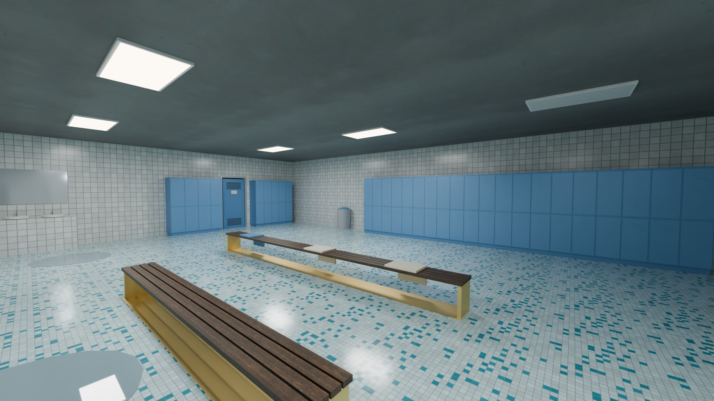
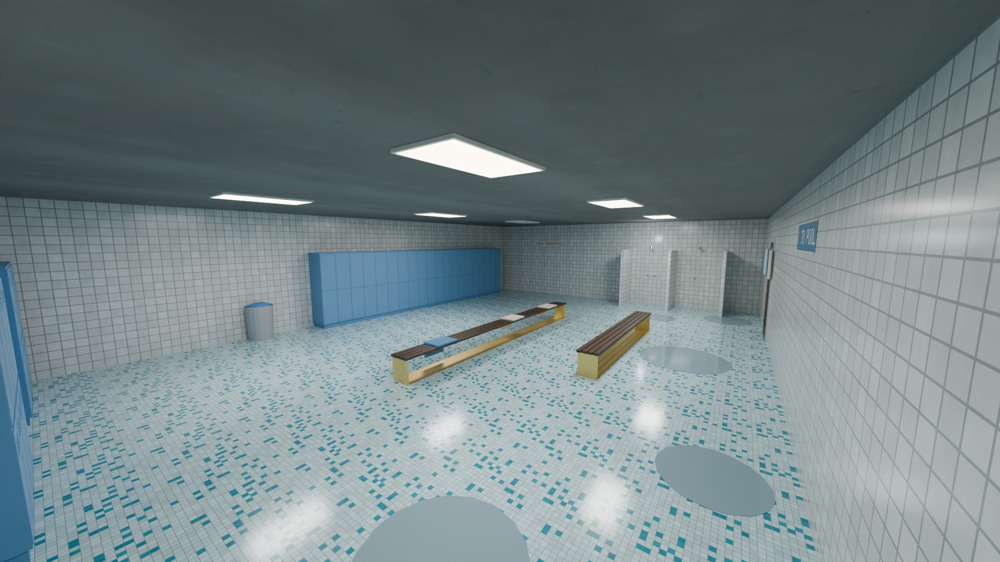
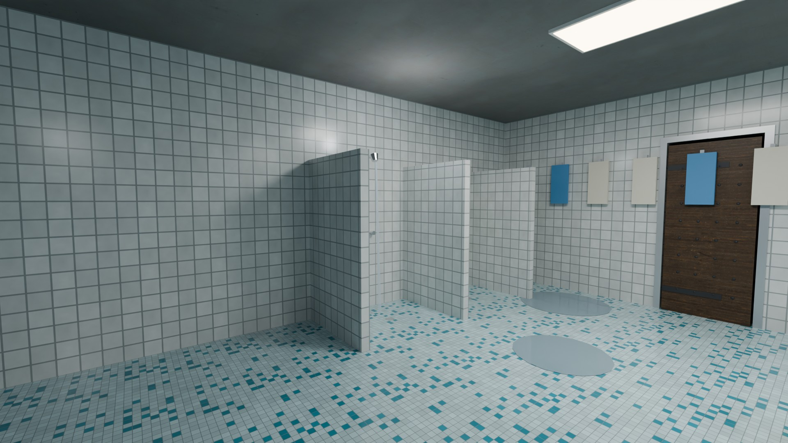

# rdwe_changing_rooms: The changing rooms: a pool that is not there

Right Door, Wrong Exit, Phase C room 27 (the institution), dressed and lit (`docs/BLENDER_AREAS.md`, section 7, step 2), round its greybox (`tools/blender/build_rdwe_greybox.py`, `c_changing_rooms()`). 14 m by 10 m, 3 m high. The room, from `ROOMS.md`: Environmental storytelling: wet changing rooms for a pool you never find, towels still damp, one locker big enough to walk into.

Wet changing rooms for a pool that is not there: white tiles to the ceiling, a small aqua mosaic floor that shines with water, blue lockers, slatted benches with damp towels, three showers (one still running), basins and a mirror, a TO POOL sign that points at a tiled wall, and locker 13, big enough to walk into.

Built in Blender 5.2.1 by `tools/blender/build_rdwe_rooms2.py` (the room's `dress_` function and spec) with the shared kit `tools/blender/rdwe_rooms2_kit.py`, baked on the GPU and graded by `tools/blender/rdwe_rooms2_pack.py`. There are no reference photos: it follows the room's line in `ROOMS.md` and the style of `docs/WORLD.md` (Super Liminal: nearly ordinary, saturated, a little wrong).

| File | What it is |
|---|---|
| `world/rdwe_changing_rooms.glb` | the art: 1.02 MB, 8968 triangles, 22 materials, 21 nodes (one mesh per material; the door leaves as their own nodes), 8 WebP textures |
| `world/rdwe_changing_rooms.json` | the layout, written by `tools/blender/export_scene.py` from the `.blend`: 22 colliders, 2 doors, 2 links, 3 spots, 1 zones; the same as `build_rdwe_greybox.py --preview` writes |
| `world/lightmaps/rdwe_changing_rooms_0.webp` | set `main` (`lightmap`): struct page, 2048 px, about 88.7 px/m |
| `world/lightmaps/rdwe_changing_rooms_1.webp` | set `main` (`lightmap`): props page, 1024 px, about 39.8 px/m |
| `blender/scenes/rdwe_changing_rooms.blend` | the saved scene (Git LFS): `Art` (one object per collider, unmerged), `Doors` (the leaves, origin at the hinge), `Layout` (`COL_` boxes, the empties), `Export` (merged by material, with the lightmap UVs), `Lights_*` (one collection per light set, and `Lights_all`) |
| `docs/renders/rdwe_changing_rooms/` | this README and the three review stills |





Review stills: Cycles, 96 samples adaptive, OIDN, 1920 x 1080 JPEG, AgX medium high contrast. They are Blender's renders with Blender's lights; the page shows the lightmaps (see Brightness).

## The trick's spots (for the page)

- `Spot_locker_1` at (-1, 3.4), facing (0, 1): every locker holds the same towel, still warm
- `Spot_locker_2` at (-6.2, -1.75), facing (1, 0): a shower still running warm, though nobody is in it
- `Spot_locker_3` at (5.6, 2), facing (1, 0): locker 13, man-sized: it opens on a laundromat

## Doors

- `DoorLeaf_flooded` (0.86 x 2.24 m): studded oak door, no handle. The leaf is built from its look (form, finish, handle), so it is visibly unlike every other door in the set.
- `DoorLeaf_locker` (0.9 x 2.04 m): a locker door, man-sized, number 13. The leaf is built from its look (form, finish, handle), so it is visibly unlike every other door in the set.

## Light

| Set | Material properties | Maps |
|---|---|---|
| `main` | `lightmap`, `lightmap_intensity` | `rdwe_changing_rooms_0`, `rdwe_changing_rooms_1` |

Emissive materials (not baked, drawn as they are): `Lamp_Emit`. `Lamp_Emit` is every ordinary lamp's glow.

## Sources and licences

| File (`blender/textures/rdwe_rooms2/`) | Source | Licence | Used by |
|---|---|---|---|
| `Metal048A_color_512.jpg` | ambientCG, Metal048A | CC0 | Steel |
| `old_wood_floor_diff_1k.jpg` | Poly Haven, Old Wood Floor | CC0 | Door_Oak, Wood_Oak |
| `plastered_wall_04_diff_1k.jpg` | Poly Haven, Plastered Wall 04 | CC0 | Ceiling_White |

Every other material is a flat colour, or a picture the build generates with numpy (fixed seeds, own work, no licence needed): `Chrome`, `Iron`, `Lamp_Off`, `Locker_Blue`, `Locker_Door`, `Mirror`, `Mosaic`, `Paint_Palette`, `Plastic_Grey`, `Porcelain`, `Sign_Locker13`, `Signs_Changing`, `Tile_White`, `Trim_Steel`, `Trim_White`, `Water_Fall`.
No Meshy, no Higgsfield, nothing bought.

## Brightness

Graded by `rdwe_rooms2_pack.py`: texel = G L / (C + G L), intensity = pi C (C = 1.15), G set so the shell page's median texel in the reference set is 0.95 (shared G); the page shows texture x base colour x texel x intensity / pi. The tables below are `lab_display.py` on the packed GLB.

```
brightness, set main (`lightmap`): lab_display.py (shown = texel x intensity / pi x base colour)
material                m2           map       k    p50    p90    p99     >=1
Ceiling_White        140.0 rdwe_changing_rooms_0  3.6128  0.115  0.136  0.156   0.00%
Tile_White           132.8 rdwe_changing_rooms_0  3.6128  0.324  0.495  0.554   0.00%
Mosaic               125.0 rdwe_changing_rooms_0  3.6128  0.479  0.613  0.667   0.00%
Locker_Blue           50.8 rdwe_changing_rooms_1  3.6128  0.001  0.292  0.372   0.00%
Locker_Door           41.0 rdwe_changing_rooms_1  3.6128  0.004  0.447  0.467   0.00%
Wood_Oak               6.6 rdwe_changing_rooms_1  3.6128  0.047  0.082  0.127   0.00%
Trim_White             5.7 rdwe_changing_rooms_1  2.9987  0.863  0.863  0.878   0.00%
Steel                  5.2 rdwe_changing_rooms_1  3.6128  0.489  0.621  0.655   0.00%
Door_Oak               4.1 rdwe_changing_rooms_1  3.6128  0.001  0.064  0.101   0.00%
Paint_Palette          3.9 rdwe_changing_rooms_1  3.6128  0.348  0.526  0.628   0.00%
Mirror                 1.6 rdwe_changing_rooms_1  3.6128  0.446  0.478  0.484   0.00%
Lamp_Off               1.5 rdwe_changing_rooms_1  3.6128  0.282  0.311  0.323   0.00%
Trim_Steel             1.3 rdwe_changing_rooms_0  3.6128  0.373  0.424  0.438   0.00%
Plastic_Grey           1.2 rdwe_changing_rooms_1  3.6128  0.246  0.325  0.336   0.00%
Signs_Changing         0.8 rdwe_changing_rooms_1  3.6128  0.195  0.473  0.575   0.00%
Iron                   0.7 rdwe_changing_rooms_1  3.6128  0.000  0.052  0.055   0.00%
Porcelain              0.7 rdwe_changing_rooms_1  3.6128  0.481  0.537  0.590   0.00%
Chrome                 0.3 rdwe_changing_rooms_1  3.6128  0.000  0.000  0.000   0.00%
Sign_Locker13          0.1 rdwe_changing_rooms_1  3.6128  0.087  0.509  0.515   0.00%
```

## Gates

```
## python tools/blender/build_rdwe_greybox.py --check .
GATE links: 54 pairs with both sides built (108 sides, the one-way ones included), 2 that loop on their own room, 5 that leave the set; 115 links in the files, every one accounted for
GATE navigable: 43 of 43 rooms reachable from rdwe_dining; 42 can get back to it (no true exit: the finale's one way out is the ending)
GATE overlaps: 0 interpenetrating collider pairs of 35141 checked (none allowed)
GATE clearances: 344 links, arrivals, spots and spawns clear by 0.28 m with a floor under them; 248 door-front points (0.5 and 1 m in) clear
GATE steps: 56 step boxes in 6 flights, one box a step; the highest rise 0.250 m (at most 0.27 m)
GATE corridors: 14 corridor rects, the narrowest 2.00 m (at least 1.6 m), none blocked
GATE extent: the largest room is 50.4 m across (a store floor, about 52 m, at most)
GATE spots: every room has its trick's spot and the ones it needs; 10 SecCam; agent x6, beacon x1, book x3, buttons x3, cake x1, cart x1, change x3, clock x2, computer x4, dark x3, frame x1, grid x6, hide x12, hum x1, lamp x1, lap x1, locker x3, map x3, monitor x2, moon x2, note x1, notes x1, photo x5, scuff x1, seeker x1, statue x3, switch x4, ticket x3, tin x3, trick x21, tv x3, view x6, watch x1, window x1
GATE doors: 124 door leaves, no two with the same look; 103 exits with one Link_ each, 4 arrival-only, 17 that never open; every exit fixed
GATES PASS

## world/rdwe_changing_rooms.json (export_scene.py, from the .blend) against build_rdwe_greybox.py --preview
SAME (to 2.5 mm): 22 colliders, 2 doors, 2 links, 1 zones, 3 spots, 0 markers, 0 cameras

## node tools/worlddoc.mjs check world/rdwe_changing_rooms.json
warning: scene rdwe_changing_rooms is not in the world manifest yet: a new scene to add
  warning: link flooded: the manifest has no link from this door yet: a new link to add
  warning: link locker: the manifest has no link from this door yet: a new link to add
OK world/rdwe_changing_rooms.json: 22 colliders, 2 doors, 0 markers, 2 links, 1 zones, 3 spots, 0 errors, 3 warnings

## tools/blender/check_layout.py (rules COVER, STRAY, CLEAR on the Art collection; run on the box)
layout check: scene rdwe_changing_rooms, 43 visible meshes, 22 colliders
PASS  COVER  Bench: 3 mesh(es) cover it (1830 sample points, every one within 5 cm of art)
PASS  COVER  Bench_2: 3 mesh(es) cover it (1230 sample points, every one within 5 cm of art)
PASS  COVER  Beyond_flooded: 1 mesh(es) cover it (1170 sample points, every one within 5 cm of art)
PASS  COVER  Beyond_locker: 1 mesh(es) cover it (1080 sample points, every one within 5 cm of art)
PASS  COVER  Lockers: 4 mesh(es) cover it (11907 sample points, every one within 5 cm of art)
PASS  COVER  Lockers_E1: 4 mesh(es) cover it (2268 sample points, every one within 5 cm of art)
PASS  COVER  Lockers_E2: 4 mesh(es) cover it (2520 sample points, every one within 5 cm of art)
PASS  COVER  Room_Ceiling: 9 mesh(es) cover it (45675 sample points, every one within 5 cm of art)
PASS  COVER  Room_Floor: 17 mesh(es) cover it (60900 sample points, every one within 5 cm of art)
PASS  COVER  Room_Wall_E_1: 7 mesh(es) cover it (6231 sample points, every one within 5 cm of art)
PASS  COVER  Room_Wall_E_2: 4 mesh(es) cover it (363 sample points, every one within 5 cm of art)
PASS  COVER  Room_Wall_E_3: 6 mesh(es) cover it (2511 sample points, every one within 5 cm of art)
PASS  COVER  Room_Wall_N_1: 5 mesh(es) cover it (2697 sample points, every one within 5 cm of art)
PASS  COVER  Room_Wall_N_2: 4 mesh(es) cover it (270 sample points, every one within 5 cm of art)
PASS  COVER  Room_Wall_N_3: 5 mesh(es) cover it (10137 sample points, every one within 5 cm of art)
PASS  COVER  Room_Wall_S_1: 7 mesh(es) cover it (13485 sample points, every one within 5 cm of art)
PASS  COVER  Room_Wall_W_1: 8 mesh(es) cover it (9393 sample points, every one within 5 cm of art)
PASS  COVER  Shower_Wall_1: 3 mesh(es) cover it (546 sample points, every one within 5 cm of art)
PASS  COVER  Shower_Wall_2: 3 mesh(es) cover it (546 sample points, every one within 5 cm of art)
PASS  COVER  Shower_Wall_3: 3 mesh(es) cover it (546 sample points, every one within 5 cm of art)
PASS  COVER  Sinks: 3 mesh(es) cover it (1470 sample points, every one within 5 cm of art)
PASS  COVER  Towel_Bin: 3 mesh(es) cover it (378 sample points, every one within 5 cm of art)
PASS  STRAY  21 tall solid mesh(es), each over a collider; 16 decor_* mesh(es) exempt
PASS  CLEAR  links.flooded.arrive (-4.00, -3.10): clear within 0.28 m
PASS  CLEAR  links.flooded.at (-4.00, -4.25): clear within 0.28 m
PASS  CLEAR  links.locker.arrive (5.10, 2.00): clear within 0.28 m
PASS  CLEAR  links.locker.at (6.25, 2.00): clear within 0.28 m
PASS  CLEAR  spots.Spot_locker_1.at (-1.00, 3.40): clear within 0.28 m
PASS  CLEAR  spots.Spot_locker_2.at (-6.20, -1.75): clear within 0.28 m
PASS  CLEAR  spots.Spot_locker_3.at (5.60, 2.00): clear within 0.28 m
PASS: 30 of 30 checks passed

## glb_inspect world/rdwe_changing_rooms.glb --budget tris=300000,mb=8
materials  22: Ceiling_White, Chrome, Door_Oak, Iron, Locker_Blue, Sign_Locker13, Lamp_Emit, Lamp_Off, Locker_Door, Mirror, Mosaic, Paint_Palette, Plastic_Grey, Porcelain, Signs_Changing, Steel, Tile_White, Trim_Steel, Trim_White, Void_Black, Water_Fall, Wood_Oak
textures   8, images: 1024x1024, 1024x1024, 512x512, 128x128, 1024x1024, 512x512, 256x256
bbox       14.5521 x 3.05 x 10.5631 (x, y up, z), min [-7.0021, -0.05, -5.55]
requires   EXT_texture_webp
pass       tris: 8968 triangles, budget 300000
pass       mb: 0.97 MB, budget 8

## node --test shared/*.test.js
tests 297
pass 297
fail 0

## sizes
world/rdwe_changing_rooms.glb  1.02 MB
world/rdwe_changing_rooms.json  0.00 MB
blender/scenes/rdwe_changing_rooms.blend  0.55 MB
world/lightmaps/rdwe_changing_rooms_0.webp  0.06 MB
world/lightmaps/rdwe_changing_rooms_1.webp  0.10 MB
docs/renders/rdwe_changing_rooms/1_arrival.jpg  0.33 MB
docs/renders/rdwe_changing_rooms/2_wide.jpg  0.34 MB
docs/renders/rdwe_changing_rooms/3_detail.jpg  0.34 MB

## privacy grep (user names, absolute paths, session ids, e-mail; the .blend decompressed)
privacy grep: 9 files, 0 with hits

```

Nothing is wired: the manifest, `games/rdwe/`, `index.html`, `shared/` and the tests are untouched.
