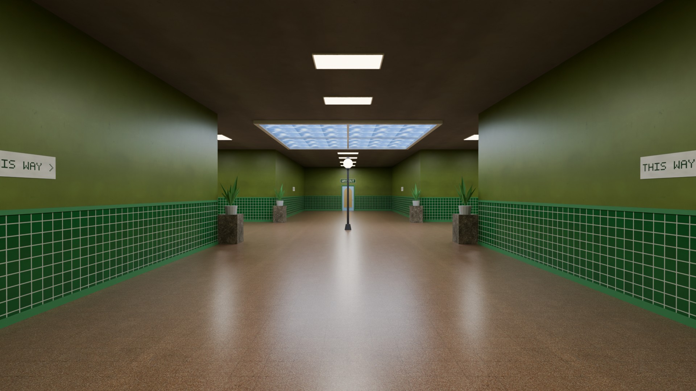
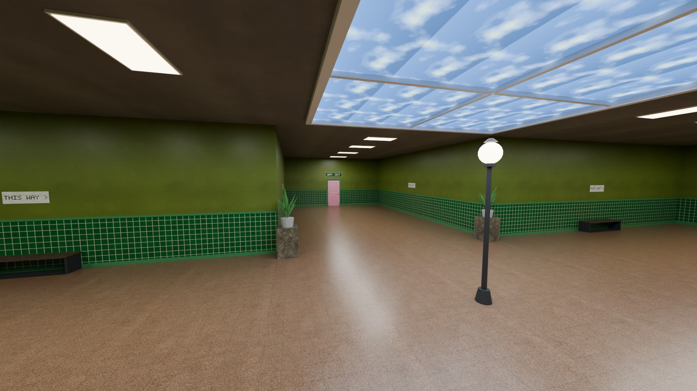
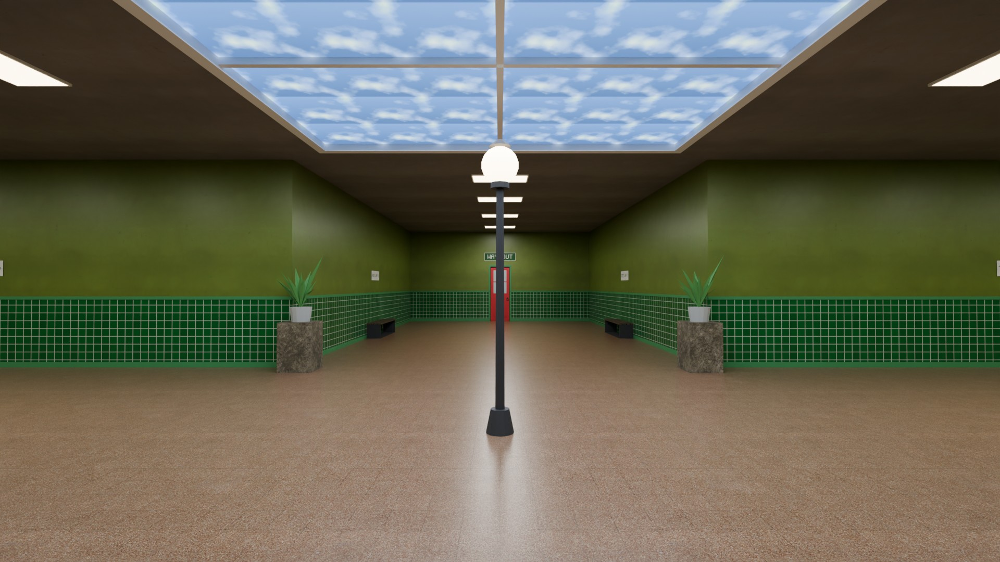

# rdwe_crossroads: The crossroads: four corridors

Right Door, Wrong Exit, Phase C room 26 (the institution), dressed and lit (`docs/BLENDER_AREAS.md`, section 7, step 2), round its greybox (`tools/blender/build_rdwe_greybox.py`, `c_crossroads()`). 32 m by 32 m, 4 m high. The room, from `ROOMS.md`: Multi-choice navigation: four corridors meet under a painted skylight, each ending in a door to a different part of the house.

Four institutional corridors meeting under a painted skylight: terrazzo, acid green gloss over green tile, a white ceiling with troffers down each arm, the same benches and the same WAY OUT sign at the end of every arm, an indoor street lamp in the middle and four planters. Only the doors differ.

Built in Blender 5.2.1 by `tools/blender/build_rdwe_rooms2.py` (the room's `dress_` function and spec) with the shared kit `tools/blender/rdwe_rooms2_kit.py`, baked on the GPU and graded by `tools/blender/rdwe_rooms2_pack.py`. There are no reference photos: it follows the room's line in `ROOMS.md` and the style of `docs/WORLD.md` (Super Liminal: nearly ordinary, saturated, a little wrong).

| File | What it is |
|---|---|
| `world/rdwe_crossroads.glb` | the art: 1.68 MB, 7538 triangles, 22 materials, 19 nodes (one mesh per material; the door leaves as their own nodes), 9 WebP textures |
| `world/rdwe_crossroads.json` | the layout, written by `tools/blender/export_scene.py` from the `.blend`: 31 colliders, 4 doors, 4 links, 2 spots; the same as `build_rdwe_greybox.py --preview` writes |
| `world/lightmaps/rdwe_crossroads_0.webp` | set `main` (`lightmap`): struct page, 2048 px, about 34.2 px/m |
| `world/lightmaps/rdwe_crossroads_1.webp` | set `main` (`lightmap`): props page, 1024 px, about 47.3 px/m |
| `blender/scenes/rdwe_crossroads.blend` | the saved scene (Git LFS): `Art` (one object per collider, unmerged), `Doors` (the leaves, origin at the hinge), `Layout` (`COL_` boxes, the empties), `Export` (merged by material, with the lightmap UVs), `Lights_*` (one collection per light set, and `Lights_all`) |
| `docs/renders/rdwe_crossroads/` | this README and the three review stills |





Review stills: Cycles, 96 samples adaptive, OIDN, 1920 x 1080 JPEG, AgX medium high contrast. They are Blender's renders with Blender's lights; the page shows the lightmaps (see Brightness).

## The trick's spots (for the page)

- `Spot_trick_1` at (2, 2), facing (0, -1): every arm looks like the one you came down
- `Spot_trick_2` at (0, -7), facing (0, -1): look down any arm: the same benches, the same sign, the same door at the end, until you reach it

## Doors

- `DoorLeaf_east` (1.06 x 2.24 m): round-topped sky blue door, chrome lever. The leaf is built from its look (form, finish, handle), so it is visibly unlike every other door in the set.
- `DoorLeaf_north` (0.82 x 2.4 m): half-glazed cherry red door, ring pull. The leaf is built from its look (form, finish, handle), so it is visibly unlike every other door in the set.
- `DoorLeaf_south` (0.9 x 2.04 m): ledged and braced black lacquer door, glass knob. The leaf is built from its look (form, finish, handle), so it is visibly unlike every other door in the set.
- `DoorLeaf_west` (1 x 2.16 m): louvred pink laminate door, chrome lever. The leaf is built from its look (form, finish, handle), so it is visibly unlike every other door in the set.

## Light

| Set | Material properties | Maps |
|---|---|---|
| `main` | `lightmap`, `lightmap_intensity` | `rdwe_crossroads_0`, `rdwe_crossroads_1` |

Emissive materials (not baked, drawn as they are): `Lamp_Emit`, `Sky_Painted`. `Lamp_Emit` is every ordinary lamp's glow.

## Sources and licences

| File (`blender/textures/rdwe_rooms2/`) | Source | Licence | Used by |
|---|---|---|---|
| `concrete_floor_02_diff_1k.jpg` | Poly Haven, Concrete Floor 02 | CC0 | Concrete_Planter |
| `old_wood_floor_diff_1k.jpg` | Poly Haven, Old Wood Floor | CC0 | Wood_Oak |
| `plastered_wall_04_diff_1k.jpg` | Poly Haven, Plastered Wall 04 | CC0 | Ceiling_White, Paint_Acid |
| `terrazzo_tiles_diff_1k.jpg` | Poly Haven, Terrazzo Tiles | CC0 | Terrazzo |

Every other material is a flat colour, or a picture the build generates with numpy (fixed seeds, own work, no licence needed): `Brass`, `Chrome`, `Door_Black_Lacquer`, `Door_Cherry_Red`, `Door_Pink_Laminate`, `Door_Sky_Blue`, `Glass_Door`, `Iron`, `Plant_Leaf`, `Pot_Clay`, `Signs_Cross`, `Sky_Painted`, `Tile_Green`, `Trim_Green`, `Trim_White`.
No Meshy, no Higgsfield, nothing bought.

## Brightness

Graded by `rdwe_rooms2_pack.py`: texel = G L / (C + G L), intensity = pi C (C = 1.15), G set so the shell page's median texel in the reference set is 2.2 (shared G); the page shows texture x base colour x texel x intensity / pi. The tables below are `lab_display.py` on the packed GLB.

```
brightness, set main (`lightmap`): lab_display.py (shown = texel x intensity / pi x base colour)
material                m2           map       k    p50    p90    p99     >=1
Paint_Acid           507.1 rdwe_crossroads_0  3.6128  0.144  0.209  0.232   0.00%
Terrazzo             444.8 rdwe_crossroads_0  3.6128  0.221  0.331  0.474   0.00%
Ceiling_White        412.0 rdwe_crossroads_0  3.6128  0.140  0.171  0.191   0.00%
Tile_Green           287.0 rdwe_crossroads_0  3.6128  0.089  0.135  0.526   0.00%
Trim_Green            46.5 rdwe_crossroads_0  3.6128  0.204  0.268  0.284   0.00%
Trim_White            27.8 rdwe_crossroads_1  2.9445  0.721  0.855  0.862   0.00%
Iron                  14.9 rdwe_crossroads_1  3.6128  0.032  0.075  0.087   0.00%
Door_Pink_Laminate    11.9 rdwe_crossroads_1  3.6128  0.001  0.856  0.925   0.02%
Door_Sky_Blue         11.0 rdwe_crossroads_1  3.6128  0.000  0.172  0.870   0.00%
Concrete_Planter      10.1 rdwe_crossroads_1  3.6128  0.104  0.214  0.356   0.00%
Door_Cherry_Red        6.9 rdwe_crossroads_1  3.6128  0.000  0.553  0.592   0.00%
Door_Black_Lacquer     5.5 rdwe_crossroads_1  3.6128  0.000  0.034  0.037   0.00%
Wood_Oak               5.5 rdwe_crossroads_1  3.6128  0.068  0.100  0.158   0.00%
Brass                  5.1 rdwe_crossroads_1  3.6128  0.000  0.001  0.002   0.00%
Signs_Cross            4.1 rdwe_crossroads_1  3.6128  0.699  0.771  0.856   0.00%
Plant_Leaf             2.5 rdwe_crossroads_1  3.6128  0.234  0.319  0.331   0.00%
Pot_Clay               1.9 rdwe_crossroads_1  3.6128  0.394  0.434  0.442   0.00%
Glass_Door             1.4 rdwe_crossroads_1  3.6128  0.003  0.612  0.624   0.00%
Chrome                 0.1 rdwe_crossroads_1  3.6128  0.000  0.000  0.000   0.00%
```

## Gates

```
## python tools/blender/build_rdwe_greybox.py --check .
GATE links: 54 pairs with both sides built (108 sides, the one-way ones included), 2 that loop on their own room, 5 that leave the set; 115 links in the files, every one accounted for
GATE navigable: 43 of 43 rooms reachable from rdwe_dining; 42 can get back to it (no true exit: the finale's one way out is the ending)
GATE overlaps: 0 interpenetrating collider pairs of 35141 checked (none allowed)
GATE clearances: 344 links, arrivals, spots and spawns clear by 0.28 m with a floor under them; 248 door-front points (0.5 and 1 m in) clear
GATE steps: 56 step boxes in 6 flights, one box a step; the highest rise 0.250 m (at most 0.27 m)
GATE corridors: 14 corridor rects, the narrowest 2.00 m (at least 1.6 m), none blocked
GATE extent: the largest room is 50.4 m across (a store floor, about 52 m, at most)
GATE spots: every room has its trick's spot and the ones it needs; 10 SecCam; agent x6, beacon x1, book x3, buttons x3, cake x1, cart x1, change x3, clock x2, computer x4, dark x3, frame x1, grid x6, hide x12, hum x1, lamp x1, lap x1, locker x3, map x3, monitor x2, moon x2, note x1, notes x1, photo x5, scuff x1, seeker x1, statue x3, switch x4, ticket x3, tin x3, trick x21, tv x3, view x6, watch x1, window x1
GATE doors: 124 door leaves, no two with the same look; 103 exits with one Link_ each, 4 arrival-only, 17 that never open; every exit fixed
GATES PASS

## world/rdwe_crossroads.json (export_scene.py, from the .blend) against build_rdwe_greybox.py --preview
SAME (to 2.5 mm): 31 colliders, 4 doors, 4 links, 0 zones, 2 spots, 0 markers, 0 cameras

## node tools/worlddoc.mjs check world/rdwe_crossroads.json
warning: scene rdwe_crossroads is not in the world manifest yet: a new scene to add
  warning: link east: the manifest has no link from this door yet: a new link to add
  warning: link north: the manifest has no link from this door yet: a new link to add
  warning: link south: the manifest has no link from this door yet: a new link to add
  warning: link west: the manifest has no link from this door yet: a new link to add
OK world/rdwe_crossroads.json: 31 colliders, 4 doors, 0 markers, 4 links, 0 zones, 2 spots, 0 errors, 5 warnings

## tools/blender/check_layout.py (rules COVER, STRAY, CLEAR on the Art collection; run on the box)
layout check: scene rdwe_crossroads, 66 visible meshes, 31 colliders
PASS  COVER  Bench_NE: 4 mesh(es) cover it (756 sample points, every one within 5 cm of art)
PASS  COVER  Bench_NW: 4 mesh(es) cover it (756 sample points, every one within 5 cm of art)
PASS  COVER  Bench_SE: 4 mesh(es) cover it (756 sample points, every one within 5 cm of art)
PASS  COVER  Bench_SW: 4 mesh(es) cover it (756 sample points, every one within 5 cm of art)
PASS  COVER  Beyond_east: 1 mesh(es) cover it (1326 sample points, every one within 5 cm of art)
PASS  COVER  Beyond_north: 1 mesh(es) cover it (1215 sample points, every one within 5 cm of art)
PASS  COVER  Beyond_south: 1 mesh(es) cover it (1080 sample points, every one within 5 cm of art)
PASS  COVER  Beyond_west: 1 mesh(es) cover it (1200 sample points, every one within 5 cm of art)
PASS  COVER  Block_NE: 8 mesh(es) cover it (164268 sample points, every one within 5 cm of art)
PASS  COVER  Block_NW: 8 mesh(es) cover it (164268 sample points, every one within 5 cm of art)
PASS  COVER  Block_SE: 8 mesh(es) cover it (164268 sample points, every one within 5 cm of art)
PASS  COVER  Block_SW: 8 mesh(es) cover it (164268 sample points, every one within 5 cm of art)
PASS  COVER  Lamp_Post: 2 mesh(es) cover it (432 sample points, every one within 5 cm of art)
PASS  COVER  Planter_NE: 3 mesh(es) cover it (490 sample points, every one within 5 cm of art)
PASS  COVER  Planter_NW: 3 mesh(es) cover it (490 sample points, every one within 5 cm of art)
PASS  COVER  Planter_SE: 3 mesh(es) cover it (490 sample points, every one within 5 cm of art)
PASS  COVER  Planter_SW: 3 mesh(es) cover it (490 sample points, every one within 5 cm of art)
PASS  COVER  Room_Ceiling: 17 mesh(es) cover it (254043 sample points, every one within 5 cm of art)
PASS  COVER  Room_Floor: 22 mesh(es) cover it (258064 sample points, every one within 5 cm of art)
PASS  COVER  Room_Wall_E_1: 6 mesh(es) cover it (19188 sample points, every one within 5 cm of art)
PASS  COVER  Room_Wall_E_2: 4 mesh(es) cover it (684 sample points, every one within 5 cm of art)
PASS  COVER  Room_Wall_E_3: 6 mesh(es) cover it (19188 sample points, every one within 5 cm of art)
PASS  COVER  Room_Wall_N_1: 6 mesh(es) cover it (19557 sample points, every one within 5 cm of art)
PASS  COVER  Room_Wall_N_2: 4 mesh(es) cover it (510 sample points, every one within 5 cm of art)
PASS  COVER  Room_Wall_N_3: 6 mesh(es) cover it (19557 sample points, every one within 5 cm of art)
PASS  COVER  Room_Wall_S_1: 6 mesh(es) cover it (19557 sample points, every one within 5 cm of art)
PASS  COVER  Room_Wall_S_2: 4 mesh(es) cover it (693 sample points, every one within 5 cm of art)
PASS  COVER  Room_Wall_S_3: 6 mesh(es) cover it (19557 sample points, every one within 5 cm of art)
PASS  COVER  Room_Wall_W_1: 6 mesh(es) cover it (19188 sample points, every one within 5 cm of art)
PASS  COVER  Room_Wall_W_2: 4 mesh(es) cover it (684 sample points, every one within 5 cm of art)
PASS  COVER  Room_Wall_W_3: 6 mesh(es) cover it (19188 sample points, every one within 5 cm of art)
PASS  STRAY  25 tall solid mesh(es), each over a collider; 31 decor_* mesh(es) exempt
PASS  CLEAR  links.east.arrive (14.10, 0.00): clear within 0.28 m
PASS  CLEAR  links.east.at (15.25, 0.00): clear within 0.28 m
PASS  CLEAR  links.north.arrive (0.00, -14.10): clear within 0.28 m
PASS  CLEAR  links.north.at (0.00, -15.25): clear within 0.28 m
PASS  CLEAR  links.south.arrive (0.00, 14.10): clear within 0.28 m
PASS  CLEAR  links.south.at (0.00, 15.25): clear within 0.28 m
PASS  CLEAR  links.west.arrive (-14.10, 0.00): clear within 0.28 m
PASS  CLEAR  links.west.at (-15.25, 0.00): clear within 0.28 m
PASS  CLEAR  spots.Spot_trick_1.at (2.00, 2.00): clear within 0.28 m
PASS  CLEAR  spots.Spot_trick_2.at (0.00, -7.00): clear within 0.28 m
PASS: 42 of 42 checks passed

## glb_inspect world/rdwe_crossroads.glb --budget tris=300000,mb=8
materials  22: Ceiling_White, Concrete_Planter, Brass, Chrome, Door_Sky_Blue, Door_Cherry_Red, Glass_Door, Iron, Door_Black_Lacquer, Door_Pink_Laminate, Lamp_Emit, Paint_Acid, Plant_Leaf, Pot_Clay, Signs_Cross, Sky_Painted, Terrazzo, Tile_Green, Trim_Green, Trim_White, Void_Black, Wood_Oak
textures   9, images: 1024x1024, 1024x1024, 1024x1024, 512x512, 1024x1024, 256x256, 1024x1024
bbox       33.1 x 4.05 x 33.1 (x, y up, z), min [-16.55, -0.05, -16.55]
requires   EXT_texture_webp
pass       tris: 7538 triangles, budget 300000
pass       mb: 1.60 MB, budget 8

## node --test shared/*.test.js
tests 297
pass 297
fail 0

## sizes
world/rdwe_crossroads.glb  1.68 MB
world/rdwe_crossroads.json  0.01 MB
blender/scenes/rdwe_crossroads.blend  0.52 MB
world/lightmaps/rdwe_crossroads_0.webp  0.11 MB
world/lightmaps/rdwe_crossroads_1.webp  0.12 MB
docs/renders/rdwe_crossroads/1_arrival.jpg  0.29 MB
docs/renders/rdwe_crossroads/2_wide.jpg  0.35 MB
docs/renders/rdwe_crossroads/3_detail.jpg  0.34 MB

## privacy grep (user names, absolute paths, session ids, e-mail; the .blend decompressed)
privacy grep: 9 files, 0 with hits

```

Nothing is wired: the manifest, `games/rdwe/`, `index.html`, `shared/` and the tests are untouched.
