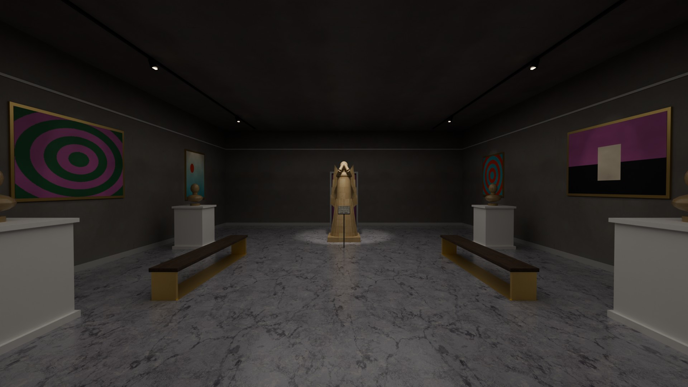
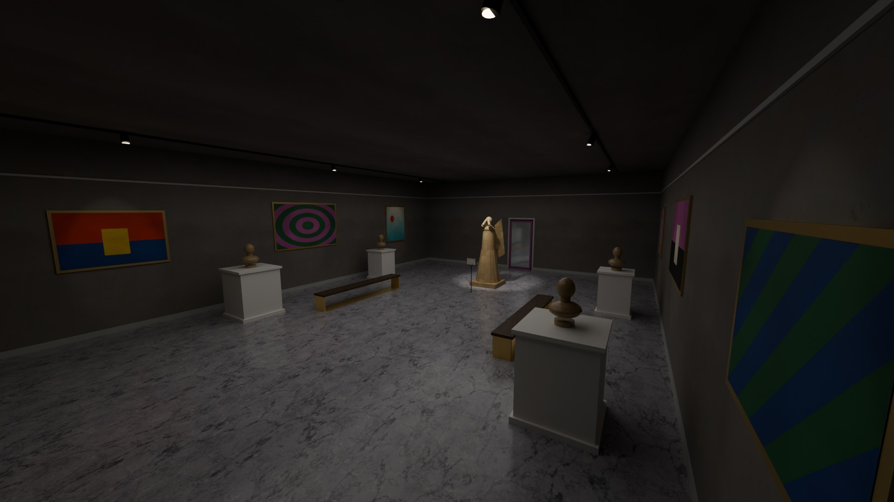
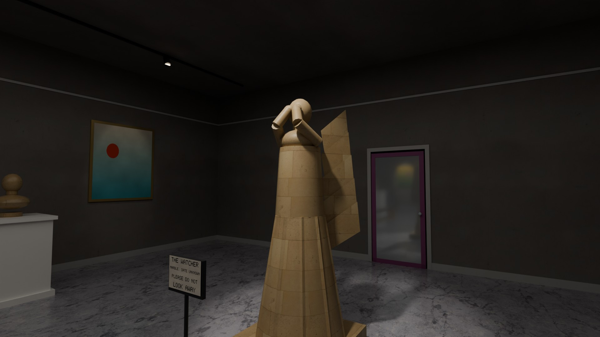

# rdwe_dont_look: Don't look away: the statue moves

Right Door, Wrong Exit, Phase C room 23 (the teal wing), dressed and lit (`docs/BLENDER_AREAS.md`, section 7, step 2), round its greybox (`tools/blender/build_rdwe_greybox.py`, `c_dont_look()`). 14 m by 10 m, 4 m high. The room, from `ROOMS.md`: Psychological puzzle: a gallery whose statue stands in front of the door and moves only when you are not looking; walk to the door backwards.

A white gallery on a marble floor: paintings under track lights, two benches, four plinths with busts, and the statue in front of the east door, a robed figure with her hands over her face. The statue is its own object (the page moves it when you look away), not baked; her collider is where she starts.

Built in Blender 5.2.1 by `tools/blender/build_rdwe_rooms2.py` (the room's `dress_` function and spec) with the shared kit `tools/blender/rdwe_rooms2_kit.py`, baked on the GPU and graded by `tools/blender/rdwe_rooms2_pack.py`. There are no reference photos: it follows the room's line in `ROOMS.md` and the style of `docs/WORLD.md` (Super Liminal: nearly ordinary, saturated, a little wrong).

| File | What it is |
|---|---|
| `world/rdwe_dont_look.glb` | the art: 1.48 MB, 10314 triangles, 19 materials, 16 nodes (one mesh per material; the door leaves, the moving objects as their own nodes), 9 WebP textures |
| `world/rdwe_dont_look.json` | the layout, written by `tools/blender/export_scene.py` from the `.blend`: 19 colliders, 2 doors, 2 links, 3 spots; the same as `build_rdwe_greybox.py --preview` writes |
| `world/lightmaps/rdwe_dont_look_0.webp` | set `main` (`lightmap`): struct page, 2048 px, about 78.2 px/m |
| `world/lightmaps/rdwe_dont_look_1.webp` | set `main` (`lightmap`): props page, 1024 px, about 58.8 px/m |
| `blender/scenes/rdwe_dont_look.blend` | the saved scene (Git LFS): `Art` (one object per collider, unmerged), `Doors` (the leaves, origin at the hinge), `Layout` (`COL_` boxes, the empties), `Export` (merged by material, with the lightmap UVs), `Lights_*` (one collection per light set, and `Lights_all`) |
| `docs/renders/rdwe_dont_look/` | this README and the three review stills |





Review stills: Cycles, 96 samples adaptive, OIDN, 1920 x 1080 JPEG, AgX medium high contrast. They are Blender's renders with Blender's lights; the page shows the lightmaps (see Brightness).

## The trick's spots (for the page)

- `Spot_statue_1` at (0, 0), facing (1, 0): it is closer every time you blink
- `Spot_statue_2` at (5.6, 0), facing (1, 0): the door behind the statue: walk to it backwards, watching her
- `Spot_statue_3` at (-4.4, 0), facing (1, 0): where she stands when you come in: hands over her face, three metres off

## Doors

- `DoorLeaf_mirror` (0.86 x 2.3 m): quilted orange vinyl door, ring pull. The leaf is built from its look (form, finish, handle), so it is visibly unlike every other door in the set.
- `DoorLeaf_statue` (1 x 2.16 m): mirror-faced plum door, glass knob. The leaf is built from its look (form, finish, handle), so it is visibly unlike every other door in the set.

## Light

| Set | Material properties | Maps |
|---|---|---|
| `main` | `lightmap`, `lightmap_intensity` | `rdwe_dont_look_0`, `rdwe_dont_look_1` |

Emissive materials (not baked, drawn as they are): none. `Lamp_Emit` is every ordinary lamp's glow.

## What the page moves (own nodes)

- `Statue` (not baked, `unbaked: true`; origin at its pivot): moves toward the east door's spot only while no one is looking at it; its collider starts here

## Sources and licences

| File (`blender/textures/rdwe_rooms2/`) | Source | Licence | Used by |
|---|---|---|---|
| `Marble012_color_1k.jpg` | ambientCG, Marble012 | CC0 | Marble_Floor |
| `Metal048A_color_512.jpg` | ambientCG, Metal048A | CC0 | Steel |
| `marble_01_diff_1k.jpg` | Poly Haven, Marble 01 | CC0 | Marble, Statue_Stone |
| `old_wood_floor_diff_1k.jpg` | Poly Haven, Old Wood Floor | CC0 | Wood_Oak |
| `plastered_wall_04_diff_1k.jpg` | Poly Haven, Plastered Wall 04 | CC0 | Ceiling_White, Plaster_White |

Every other material is a flat colour, or a picture the build generates with numpy (fixed seeds, own work, no licence needed): `Brass`, `Door_Orange_Vinyl`, `Door_Plum`, `Frame_Gilt`, `Glass_Door`, `Iron`, `Mirror`, `Paintings`, `Plinth_White`, `Signs_Gallery`, `Trim_Grey`.
No Meshy, no Higgsfield, nothing bought.

## Brightness

Graded by `rdwe_rooms2_pack.py`: texel = G L / (C + G L), intensity = pi C (C = 1.15), G set so the shell page's median texel in the reference set is 1.4 (shared G); the page shows texture x base colour x texel x intensity / pi. The tables below are `lab_display.py` on the packed GLB.

```
brightness, set main (`lightmap`): lab_display.py (shown = texel x intensity / pi x base colour)
material                m2           map       k    p50    p90    p99     >=1
Plaster_White        189.6 rdwe_dont_look_0  3.6128  0.157  0.196  0.214   0.00%
Ceiling_White        140.0 rdwe_dont_look_0  3.6128  0.135  0.161  0.175   0.00%
Marble_Floor         134.4 rdwe_dont_look_0  3.6128  0.335  0.436  0.500   0.00%
Plinth_White          24.6 rdwe_dont_look_1  3.6128  0.456  0.739  0.777   0.00%
Paintings             14.9 rdwe_dont_look_1  3.6128  0.338  0.531  0.708   0.00%
Door_Orange_Vinyl     10.6 rdwe_dont_look_1  3.6128  0.000  0.742  0.766   0.00%
Trim_Grey             10.6 rdwe_dont_look_0  3.6128  0.365  0.430  0.448   0.00%
Door_Plum              7.0 rdwe_dont_look_1  3.6128  0.000  0.136  0.293   0.00%
Mirror                 6.8 rdwe_dont_look_1  3.6128  0.000  0.616  0.616   0.00%
Frame_Gilt             4.3 rdwe_dont_look_1  3.6128  0.448  0.571  0.693   0.00%
Iron                   3.9 rdwe_dont_look_1  3.6128  0.031  0.045  0.064   0.00%
Steel                  3.6 rdwe_dont_look_1  3.6128  0.599  0.743  0.773   0.00%
Wood_Oak               3.1 rdwe_dont_look_1  3.6128  0.080  0.115  0.177   0.00%
Marble                 2.1 rdwe_dont_look_1  3.6128  0.264  0.374  0.405   0.00%
Signs_Gallery          0.1 rdwe_dont_look_1  3.6128  0.652  0.685  0.712   0.00%
Brass                  0.0 rdwe_dont_look_1  3.6128  0.000  0.474  0.500   0.00%
Glass_Door             0.0 rdwe_dont_look_1  3.6128  0.001  0.453  0.521   0.00%
```

## Gates

```
## python tools/blender/build_rdwe_greybox.py --check .
GATE links: 54 pairs with both sides built (108 sides, the one-way ones included), 2 that loop on their own room, 5 that leave the set; 115 links in the files, every one accounted for
GATE navigable: 43 of 43 rooms reachable from rdwe_dining; 42 can get back to it (no true exit: the finale's one way out is the ending)
GATE overlaps: 0 interpenetrating collider pairs of 35141 checked (none allowed)
GATE clearances: 344 links, arrivals, spots and spawns clear by 0.28 m with a floor under them; 248 door-front points (0.5 and 1 m in) clear
GATE steps: 56 step boxes in 6 flights, one box a step; the highest rise 0.250 m (at most 0.27 m)
GATE corridors: 14 corridor rects, the narrowest 2.00 m (at least 1.6 m), none blocked
GATE extent: the largest room is 50.4 m across (a store floor, about 52 m, at most)
GATE spots: every room has its trick's spot and the ones it needs; 10 SecCam; agent x6, beacon x1, book x3, buttons x3, cake x1, cart x1, change x3, clock x2, computer x4, dark x3, frame x1, grid x6, hide x12, hum x1, lamp x1, lap x1, locker x3, map x3, monitor x2, moon x2, note x1, notes x1, photo x5, scuff x1, seeker x1, statue x3, switch x4, ticket x3, tin x3, trick x21, tv x3, view x6, watch x1, window x1
GATE doors: 124 door leaves, no two with the same look; 103 exits with one Link_ each, 4 arrival-only, 17 that never open; every exit fixed
GATES PASS

## world/rdwe_dont_look.json (export_scene.py, from the .blend) against build_rdwe_greybox.py --preview
SAME (to 2.5 mm): 19 colliders, 2 doors, 2 links, 0 zones, 3 spots, 0 markers, 0 cameras

## node tools/worlddoc.mjs check world/rdwe_dont_look.json
warning: scene rdwe_dont_look is not in the world manifest yet: a new scene to add
  warning: link mirror: the manifest has no link from this door yet: a new link to add
  warning: link statue: the manifest has no link from this door yet: a new link to add
OK world/rdwe_dont_look.json: 19 colliders, 2 doors, 0 markers, 2 links, 0 zones, 3 spots, 0 errors, 3 warnings

## tools/blender/check_layout.py (rules COVER, STRAY, CLEAR on the Art collection; run on the box)
layout check: scene rdwe_dont_look, 49 visible meshes, 19 colliders
PASS  COVER  Bench_N: 3 mesh(es) cover it (930 sample points, every one within 5 cm of art)
PASS  COVER  Bench_S: 3 mesh(es) cover it (930 sample points, every one within 5 cm of art)
PASS  COVER  Beyond_mirror: 1 mesh(es) cover it (1170 sample points, every one within 5 cm of art)
PASS  COVER  Beyond_statue: 1 mesh(es) cover it (1200 sample points, every one within 5 cm of art)
PASS  COVER  Plinth_1: 2 mesh(es) cover it (1573 sample points, every one within 5 cm of art)
PASS  COVER  Plinth_2: 2 mesh(es) cover it (1573 sample points, every one within 5 cm of art)
PASS  COVER  Plinth_3: 2 mesh(es) cover it (972 sample points, every one within 5 cm of art)
PASS  COVER  Plinth_4: 2 mesh(es) cover it (972 sample points, every one within 5 cm of art)
PASS  COVER  Room_Ceiling: 9 mesh(es) cover it (45675 sample points, every one within 5 cm of art)
PASS  COVER  Room_Floor: 14 mesh(es) cover it (60900 sample points, every one within 5 cm of art)
PASS  COVER  Room_Wall_E_1: 5 mesh(es) cover it (5658 sample points, every one within 5 cm of art)
PASS  COVER  Room_Wall_E_2: 4 mesh(es) cover it (684 sample points, every one within 5 cm of art)
PASS  COVER  Room_Wall_E_3: 5 mesh(es) cover it (5658 sample points, every one within 5 cm of art)
PASS  COVER  Room_Wall_N_1: 5 mesh(es) cover it (17835 sample points, every one within 5 cm of art)
PASS  COVER  Room_Wall_S_1: 5 mesh(es) cover it (17835 sample points, every one within 5 cm of art)
PASS  COVER  Room_Wall_W_1: 5 mesh(es) cover it (5781 sample points, every one within 5 cm of art)
PASS  COVER  Room_Wall_W_2: 4 mesh(es) cover it (540 sample points, every one within 5 cm of art)
PASS  COVER  Room_Wall_W_3: 5 mesh(es) cover it (5781 sample points, every one within 5 cm of art)
PASS  COVER  Statue: 2 mesh(es) cover it (3025 sample points, every one within 5 cm of art)
PASS  STRAY  15 tall solid mesh(es), each over a collider; 28 decor_* mesh(es) exempt
PASS  CLEAR  links.mirror.arrive (-5.10, 0.00): clear within 0.28 m
PASS  CLEAR  links.mirror.at (-6.25, 0.00): clear within 0.28 m
PASS  CLEAR  links.statue.arrive (5.10, 0.00): clear within 0.28 m
PASS  CLEAR  links.statue.at (6.25, 0.00): clear within 0.28 m
PASS  CLEAR  spots.Spot_statue_1.at (0.00, 0.00): clear within 0.28 m
PASS  CLEAR  spots.Spot_statue_2.at (5.60, 0.00): clear within 0.28 m
PASS  CLEAR  spots.Spot_statue_3.at (-4.40, 0.00): clear within 0.28 m
PASS: 27 of 27 checks passed

## glb_inspect world/rdwe_dont_look.glb --budget tris=300000,mb=8
materials  19: Ceiling_White, Brass, Door_Orange_Vinyl, Iron, Door_Plum, Glass_Door, Mirror, Frame_Gilt, Marble, Marble_Floor, Paintings, Plaster_White, Plinth_White, Signs_Gallery, Statue_Stone, Steel, Trim_Grey, Void_Black, Wood_Oak
textures   9, images: 1024x1024, 1024x1024, 1024x1024, 1024x512, 1024x1024, 512x512, 1024x1024
bbox       15.1 x 4.05 x 10.0 (x, y up, z), min [-7.55, -0.05, -5.0]
requires   EXT_texture_webp
pass       tris: 10314 triangles, budget 300000
pass       mb: 1.41 MB, budget 8

## node --test shared/*.test.js
tests 297
pass 297
fail 0

## sizes
world/rdwe_dont_look.glb  1.48 MB
world/rdwe_dont_look.json  0.00 MB
blender/scenes/rdwe_dont_look.blend  0.75 MB
world/lightmaps/rdwe_dont_look_0.webp  0.06 MB
world/lightmaps/rdwe_dont_look_1.webp  0.10 MB
docs/renders/rdwe_dont_look/1_arrival.jpg  0.19 MB
docs/renders/rdwe_dont_look/2_wide.jpg  0.16 MB
docs/renders/rdwe_dont_look/3_detail.jpg  0.15 MB

## privacy grep (user names, absolute paths, session ids, e-mail; the .blend decompressed)
privacy grep: 9 files, 0 with hits

```

Nothing is wired: the manifest, `games/rdwe/`, `index.html`, `shared/` and the tests are untouched.
