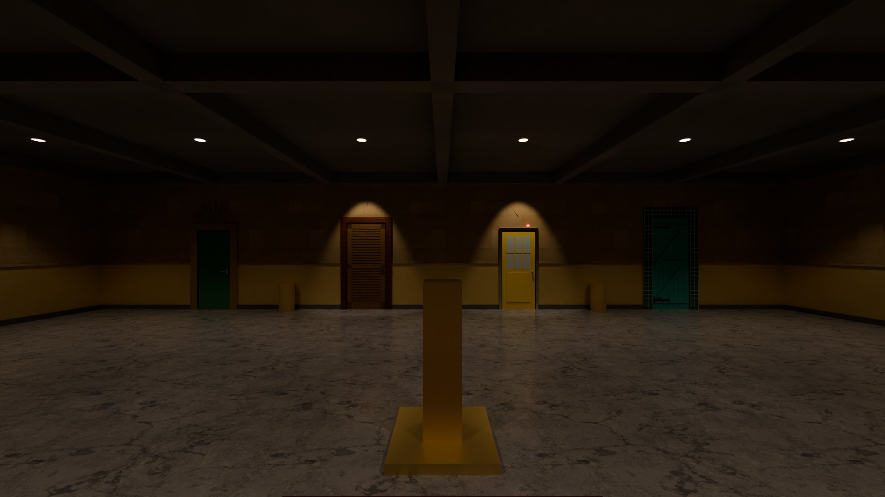
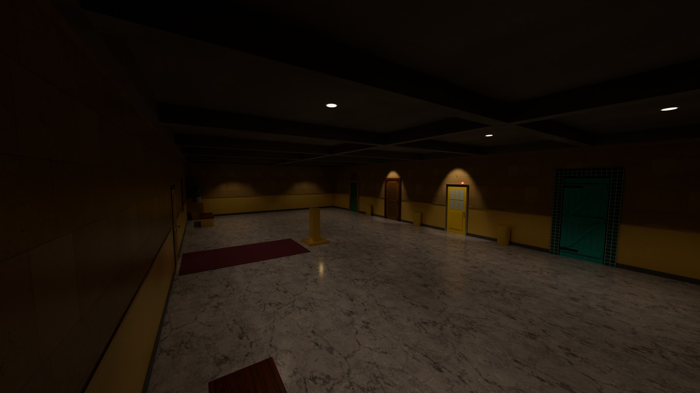
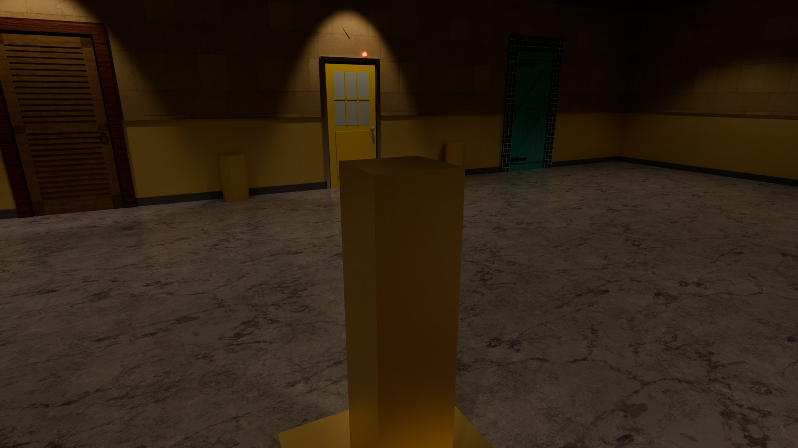

# rdwe_elevator_lobby: The elevator lobby: four lifts, four places

Right Door, Wrong Exit, Phase C room 31 (the institution), dressed and lit (`docs/BLENDER_AREAS.md`, section 7, step 2), round its greybox (`tools/blender/build_rdwe_greybox.py`, `c_elevator_lobby()`). 18 m by 10 m, 3.6 m high. The room, from `ROOMS.md`: Multi-choice navigation: four lift doors, no two alike, and a call button with no numbers; each lift opens somewhere else.

A marble lift lobby with steel walls and a coffered ceiling: four lift doors, no two alike in their surrounds (brass sunburst, walnut, steel with a red lamp, teal tile), each under a floor dial with no numbers whose needle the page can move, a call pillar with one blank button, benches, planters, ash bins and a directory board with every name gone.

Built in Blender 5.2.1 by `tools/blender/build_rdwe_rooms2.py` (the room's `dress_` function and spec) with the shared kit `tools/blender/rdwe_rooms2_kit.py`, baked on the GPU and graded by `tools/blender/rdwe_rooms2_pack.py`. There are no reference photos: it follows the room's line in `ROOMS.md` and the style of `docs/WORLD.md` (Super Liminal: nearly ordinary, saturated, a little wrong).

| File | What it is |
|---|---|
| `world/rdwe_elevator_lobby.glb` | the art: 1.48 MB, 5465 triangles, 26 materials, 27 nodes (one mesh per material; the door leaves, the moving objects as their own nodes), 11 WebP textures |
| `world/rdwe_elevator_lobby.json` | the layout, written by `tools/blender/export_scene.py` from the `.blend`: 29 colliders, 5 doors, 5 links, 3 spots; the same as `build_rdwe_greybox.py --preview` writes |
| `world/lightmaps/rdwe_elevator_lobby_0.webp` | set `main` (`lightmap`): struct page, 2048 px, about 61.5 px/m |
| `world/lightmaps/rdwe_elevator_lobby_1.webp` | set `main` (`lightmap`): props page, 1024 px, about 49.1 px/m |
| `blender/scenes/rdwe_elevator_lobby.blend` | the saved scene (Git LFS): `Art` (one object per collider, unmerged), `Doors` (the leaves, origin at the hinge), `Layout` (`COL_` boxes, the empties), `Export` (merged by material, with the lightmap UVs), `Lights_*` (one collection per light set, and `Lights_all`) |
| `docs/renders/rdwe_elevator_lobby/` | this README and the three review stills |





Review stills: Cycles, 96 samples adaptive, OIDN, 1920 x 1080 JPEG, AgX medium high contrast. They are Blender's renders with Blender's lights; the page shows the lightmaps (see Brightness).

## The trick's spots (for the page)

- `Spot_buttons_1` at (0, 2.2), facing (0, -1): the call button has no numbers
- `Spot_buttons_2` at (-6, -3.4), facing (0, -1): lift 1: the dial over it points past the last floor
- `Spot_buttons_3` at (6, -3.4), facing (0, -1): lift 4: its dial has no numbers either

## Doors

- `DoorLeaf_crossroads` (0.82 x 2.1 m): panelled brushed steel door, glass knob. The leaf is built from its look (form, finish, handle), so it is visibly unlike every other door in the set.
- `DoorLeaf_lift_1` (0.82 x 2.04 m): flush bottle green door, chrome lever. The leaf is built from its look (form, finish, handle), so it is visibly unlike every other door in the set.
- `DoorLeaf_lift_2` (1 x 2.24 m): louvred birch door, ring pull. The leaf is built from its look (form, finish, handle), so it is visibly unlike every other door in the set.
- `DoorLeaf_lift_3` (0.86 x 2.04 m): half-glazed mustard door, glass knob. The leaf is built from its look (form, finish, handle), so it is visibly unlike every other door in the set.
- `DoorLeaf_lift_4` (0.94 x 2.4 m): ledged and braced teal paint door, push plate. The leaf is built from its look (form, finish, handle), so it is visibly unlike every other door in the set.

## Light

| Set | Material properties | Maps |
|---|---|---|
| `main` | `lightmap`, `lightmap_intensity` | `rdwe_elevator_lobby_0`, `rdwe_elevator_lobby_1` |

Emissive materials (not baked, drawn as they are): `Button_Glow`, `Lamp_Emit`, `Lamp_Red`. `Lamp_Emit` is every ordinary lamp's glow.

## What the page moves (own nodes)

- `Dial_1_Needle` (not baked, `unbaked: true`; origin at its pivot): the lift's floor needle, turning about its pivot (the page)
- `Dial_2_Needle` (not baked, `unbaked: true`; origin at its pivot): the lift's floor needle, turning about its pivot (the page)
- `Dial_3_Needle` (not baked, `unbaked: true`; origin at its pivot): the lift's floor needle, turning about its pivot (the page)
- `Dial_4_Needle` (not baked, `unbaked: true`; origin at its pivot): the lift's floor needle, turning about its pivot (the page)

## Sources and licences

| File (`blender/textures/rdwe_rooms2/`) | Source | Licence | Used by |
|---|---|---|---|
| `Marble012_color_1k.jpg` | ambientCG, Marble012 | CC0 | Marble_Floor |
| `Metal048A_color_512.jpg` | ambientCG, Metal048A | CC0 | Door_Brushed_Steel, Steel, Steel_Wall |
| `dark_wood_diff_1k.jpg` | Poly Haven, Dark Wood | CC0 | Wood_Dark |
| `marble_01_diff_1k.jpg` | Poly Haven, Marble 01 | CC0 | Marble_Wall |
| `plastered_wall_04_diff_1k.jpg` | Poly Haven, Plastered Wall 04 | CC0 | Ceiling_White |
| `plywood_diff_1k.jpg` | Poly Haven, Plywood | CC0 | Door_Birch |
| `rough_linen_diff_512.jpg` | Poly Haven, Rough Linen | CC0 | Rug_Red |

Every other material is a flat colour, or a picture the build generates with numpy (fixed seeds, own work, no licence needed): `Brass`, `Button_Glow`, `Chrome`, `Dials`, `Door_Bottle_Green`, `Door_Mustard`, `Door_Teal_Paint`, `Glass_Door`, `Hand_Black`, `Iron`, `Lamp_Red`, `Plant_Leaf`, `Pot_Clay`, `Tile_Teal`, `Trim_Dark`.
No Meshy, no Higgsfield, nothing bought.

## Brightness

Graded by `rdwe_rooms2_pack.py`: texel = G L / (C + G L), intensity = pi C (C = 1.15), G set so the shell page's median texel in the reference set is 1.6 (shared G); the page shows texture x base colour x texel x intensity / pi. The tables below are `lab_display.py` on the packed GLB.

```
brightness, set main (`lightmap`): lab_display.py (shown = texel x intensity / pi x base colour)
material                m2           map       k    p50    p90    p99     >=1
Ceiling_White        267.4 rdwe_elevator_lobby_0  3.6128  0.151  0.186  0.212   0.00%
Steel_Wall           197.8 rdwe_elevator_lobby_0  3.6128  0.000  0.655  0.746   0.00%
Marble_Floor         178.4 rdwe_elevator_lobby_0  3.6128  0.379  0.446  0.508   0.00%
Marble_Wall          135.6 rdwe_elevator_lobby_0  3.6128  0.223  0.293  0.409   0.00%
Door_Teal_Paint       15.4 rdwe_elevator_lobby_1  3.6128  0.000  0.215  0.321   0.00%
Door_Birch            12.4 rdwe_elevator_lobby_1  3.6128  0.000  0.196  0.279   0.00%
Door_Brushed_Steel     9.9 rdwe_elevator_lobby_1  3.6128  0.000  0.515  0.694   0.00%
Steel                  9.7 rdwe_elevator_lobby_1  3.6128  0.646  0.828  0.902   0.26%
Brass                  7.8 rdwe_elevator_lobby_1  3.6128  0.302  0.516  0.598   0.00%
Trim_Dark              7.7 rdwe_elevator_lobby_0  3.6128  0.095  0.107  0.116   0.00%
Rug_Red                7.1 rdwe_elevator_lobby_1  3.6128  0.139  0.148  0.159   0.00%
Door_Mustard           6.1 rdwe_elevator_lobby_1  3.6128  0.001  0.768  0.861   0.00%
Wood_Dark              4.3 rdwe_elevator_lobby_1  3.6128  0.089  0.139  0.190   0.00%
Door_Bottle_Green      3.6 rdwe_elevator_lobby_1  3.6128  0.028  0.174  0.186   0.00%
Dials                  2.4 rdwe_elevator_lobby_1  3.6128  0.004  0.005  0.005   0.00%
Tile_Teal              2.0 rdwe_elevator_lobby_1  3.6128  0.077  0.371  0.546   0.00%
Plant_Leaf             1.8 rdwe_elevator_lobby_1  3.6128  0.037  0.073  0.101   0.00%
Glass_Door             1.3 rdwe_elevator_lobby_1  3.6128  0.003  0.617  0.647   0.00%
Pot_Clay               1.2 rdwe_elevator_lobby_1  3.6128  0.142  0.242  0.255   0.00%
Chrome                 0.8 rdwe_elevator_lobby_1  3.6128  0.000  0.000  0.001   0.00%
Iron                   0.2 rdwe_elevator_lobby_1  3.6128  0.000  0.067  0.068   0.00%
```

## Gates

```
## python tools/blender/build_rdwe_greybox.py --check .
GATE links: 54 pairs with both sides built (108 sides, the one-way ones included), 2 that loop on their own room, 5 that leave the set; 115 links in the files, every one accounted for
GATE navigable: 43 of 43 rooms reachable from rdwe_dining; 42 can get back to it (no true exit: the finale's one way out is the ending)
GATE overlaps: 0 interpenetrating collider pairs of 35141 checked (none allowed)
GATE clearances: 344 links, arrivals, spots and spawns clear by 0.28 m with a floor under them; 248 door-front points (0.5 and 1 m in) clear
GATE steps: 56 step boxes in 6 flights, one box a step; the highest rise 0.250 m (at most 0.27 m)
GATE corridors: 14 corridor rects, the narrowest 2.00 m (at least 1.6 m), none blocked
GATE extent: the largest room is 50.4 m across (a store floor, about 52 m, at most)
GATE spots: every room has its trick's spot and the ones it needs; 10 SecCam; agent x6, beacon x1, book x3, buttons x3, cake x1, cart x1, change x3, clock x2, computer x4, dark x3, frame x1, grid x6, hide x12, hum x1, lamp x1, lap x1, locker x3, map x3, monitor x2, moon x2, note x1, notes x1, photo x5, scuff x1, seeker x1, statue x3, switch x4, ticket x3, tin x3, trick x21, tv x3, view x6, watch x1, window x1
GATE doors: 124 door leaves, no two with the same look; 103 exits with one Link_ each, 4 arrival-only, 17 that never open; every exit fixed
GATES PASS

## world/rdwe_elevator_lobby.json (export_scene.py, from the .blend) against build_rdwe_greybox.py --preview
SAME (to 2.5 mm): 29 colliders, 5 doors, 5 links, 0 zones, 3 spots, 0 markers, 0 cameras

## node tools/worlddoc.mjs check world/rdwe_elevator_lobby.json
warning: scene rdwe_elevator_lobby is not in the world manifest yet: a new scene to add
  warning: link crossroads: the manifest has no link from this door yet: a new link to add
  warning: link lift_1: the manifest has no link from this door yet: a new link to add
  warning: link lift_2: the manifest has no link from this door yet: a new link to add
  warning: link lift_3: the manifest has no link from this door yet: a new link to add
  warning: link lift_4: the manifest has no link from this door yet: a new link to add
OK world/rdwe_elevator_lobby.json: 29 colliders, 5 doors, 0 markers, 5 links, 0 zones, 3 spots, 0 errors, 6 warnings

## tools/blender/check_layout.py (rules COVER, STRAY, CLEAR on the Art collection; run on the box)
layout check: scene rdwe_elevator_lobby, 67 visible meshes, 29 colliders
PASS  COVER  Bench_E: 3 mesh(es) cover it (882 sample points, every one within 5 cm of art)
PASS  COVER  Bench_W: 3 mesh(es) cover it (882 sample points, every one within 5 cm of art)
PASS  COVER  Beyond_crossroads: 1 mesh(es) cover it (1080 sample points, every one within 5 cm of art)
PASS  COVER  Beyond_lift_1: 1 mesh(es) cover it (1080 sample points, every one within 5 cm of art)
PASS  COVER  Beyond_lift_2: 1 mesh(es) cover it (1248 sample points, every one within 5 cm of art)
PASS  COVER  Beyond_lift_3: 1 mesh(es) cover it (1080 sample points, every one within 5 cm of art)
PASS  COVER  Beyond_lift_4: 1 mesh(es) cover it (1296 sample points, every one within 5 cm of art)
PASS  COVER  Bin_1: 3 mesh(es) cover it (200 sample points, every one within 5 cm of art)
PASS  COVER  Bin_2: 3 mesh(es) cover it (200 sample points, every one within 5 cm of art)
PASS  COVER  Bin_3: 3 mesh(es) cover it (200 sample points, every one within 5 cm of art)
PASS  COVER  Call_Pillar: 2 mesh(es) cover it (1134 sample points, every one within 5 cm of art)
PASS  COVER  Planter_E: 2 mesh(es) cover it (539 sample points, every one within 5 cm of art)
PASS  COVER  Planter_W: 2 mesh(es) cover it (539 sample points, every one within 5 cm of art)
PASS  COVER  Room_Ceiling: 15 mesh(es) cover it (58275 sample points, every one within 5 cm of art)
PASS  COVER  Room_Floor: 18 mesh(es) cover it (77700 sample points, every one within 5 cm of art)
PASS  COVER  Room_Wall_E_1: 5 mesh(es) cover it (11211 sample points, every one within 5 cm of art)
PASS  COVER  Room_Wall_N_1: 5 mesh(es) cover it (3219 sample points, every one within 5 cm of art)
PASS  COVER  Room_Wall_N_2: 5 mesh(es) cover it (510 sample points, every one within 5 cm of art)
PASS  COVER  Room_Wall_N_3: 6 mesh(es) cover it (3552 sample points, every one within 5 cm of art)
PASS  COVER  Room_Wall_N_4: 5 mesh(es) cover it (540 sample points, every one within 5 cm of art)
PASS  COVER  Room_Wall_N_5: 6 mesh(es) cover it (3552 sample points, every one within 5 cm of art)
PASS  COVER  Room_Wall_N_6: 5 mesh(es) cover it (510 sample points, every one within 5 cm of art)
PASS  COVER  Room_Wall_N_7: 6 mesh(es) cover it (3552 sample points, every one within 5 cm of art)
PASS  COVER  Room_Wall_N_8: 5 mesh(es) cover it (429 sample points, every one within 5 cm of art)
PASS  COVER  Room_Wall_N_9: 5 mesh(es) cover it (3108 sample points, every one within 5 cm of art)
PASS  COVER  Room_Wall_S_1: 5 mesh(es) cover it (9879 sample points, every one within 5 cm of art)
PASS  COVER  Room_Wall_S_2: 4 mesh(es) cover it (480 sample points, every one within 5 cm of art)
PASS  COVER  Room_Wall_S_3: 5 mesh(es) cover it (9879 sample points, every one within 5 cm of art)
PASS  COVER  Room_Wall_W_1: 5 mesh(es) cover it (11211 sample points, every one within 5 cm of art)
PASS  STRAY  22 tall solid mesh(es), each over a collider; 32 decor_* mesh(es) exempt
PASS  CLEAR  links.crossroads.arrive (0.00, 3.10): clear within 0.28 m
PASS  CLEAR  links.crossroads.at (0.00, 4.25): clear within 0.28 m
PASS  CLEAR  links.lift_1.arrive (-6.00, -3.10): clear within 0.28 m
PASS  CLEAR  links.lift_1.at (-6.00, -4.25): clear within 0.28 m
PASS  CLEAR  links.lift_2.arrive (-2.00, -3.10): clear within 0.28 m
PASS  CLEAR  links.lift_2.at (-2.00, -4.25): clear within 0.28 m
PASS  CLEAR  links.lift_3.arrive (2.00, -3.10): clear within 0.28 m
PASS  CLEAR  links.lift_3.at (2.00, -4.25): clear within 0.28 m
PASS  CLEAR  links.lift_4.arrive (6.00, -3.10): clear within 0.28 m
PASS  CLEAR  links.lift_4.at (6.00, -4.25): clear within 0.28 m
PASS  CLEAR  spots.Spot_buttons_1.at (0.00, 2.20): clear within 0.28 m
PASS  CLEAR  spots.Spot_buttons_2.at (-6.00, -3.40): clear within 0.28 m
PASS  CLEAR  spots.Spot_buttons_3.at (6.00, -3.40): clear within 0.28 m
PASS: 43 of 43 checks passed

## glb_inspect world/rdwe_elevator_lobby.glb --budget tris=300000,mb=8
materials  26: Brass, Button_Glow, Ceiling_White, Chrome, Hand_Black, Dials, Door_Brushed_Steel, Glass_Door, Door_Bottle_Green, Wood_Dark, Door_Birch, Iron, Door_Mustard, Door_Teal_Paint, Steel, Lamp_Emit, Lamp_Red, Marble_Floor, Marble_Wall, Plant_Leaf, Pot_Clay, Rug_Red, Steel_Wall, Tile_Teal, Trim_Dark, Void_Black
textures   11, images: 1024x1024, 1024x1024, 512x512, 1024x1024, 1024x1024, 1024x1024, 1024x1024, 512x512, 256x256
bbox       18.24 x 3.65 x 11.1 (x, y up, z), min [-9.12, -0.05, -5.55]
requires   EXT_texture_webp
pass       tris: 5465 triangles, budget 300000
pass       mb: 1.41 MB, budget 8

## node --test shared/*.test.js
tests 297
pass 297
fail 0

## sizes
world/rdwe_elevator_lobby.glb  1.48 MB
world/rdwe_elevator_lobby.json  0.01 MB
blender/scenes/rdwe_elevator_lobby.blend  0.35 MB
world/lightmaps/rdwe_elevator_lobby_0.webp  0.12 MB
world/lightmaps/rdwe_elevator_lobby_1.webp  0.11 MB
docs/renders/rdwe_elevator_lobby/1_arrival.jpg  0.17 MB
docs/renders/rdwe_elevator_lobby/2_wide.jpg  0.16 MB
docs/renders/rdwe_elevator_lobby/3_detail.jpg  0.22 MB

## privacy grep (user names, absolute paths, session ids, e-mail; the .blend decompressed)
privacy grep: 9 files, 0 with hits

```

Nothing is wired: the manifest, `games/rdwe/`, `index.html`, `shared/` and the tests are untouched.
