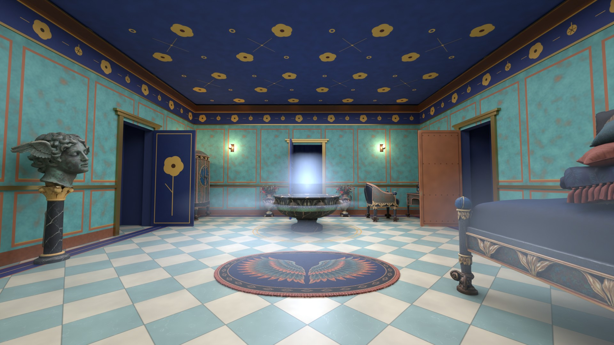
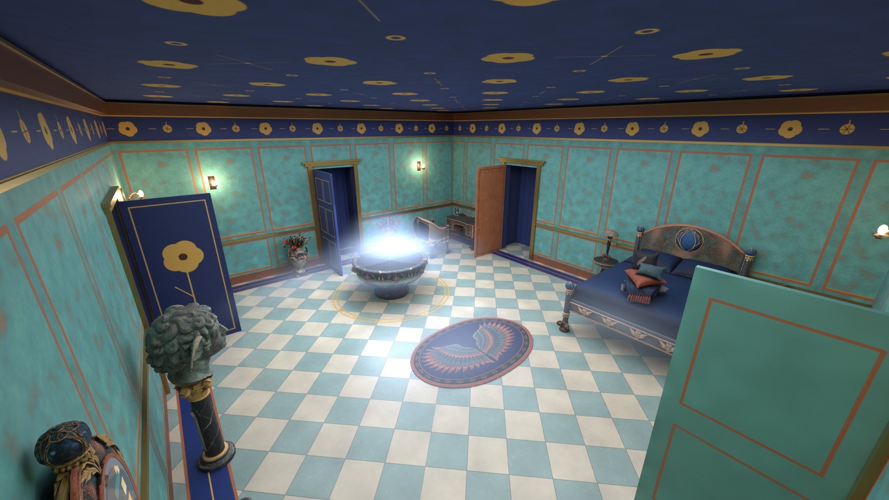
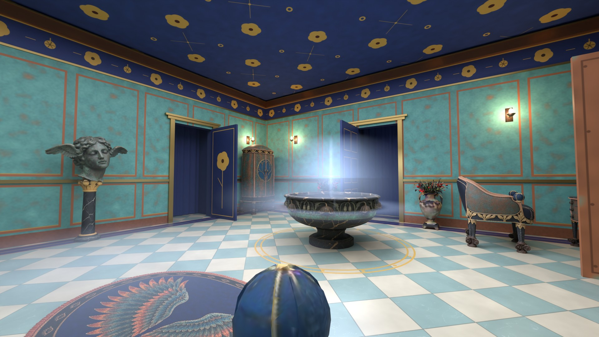
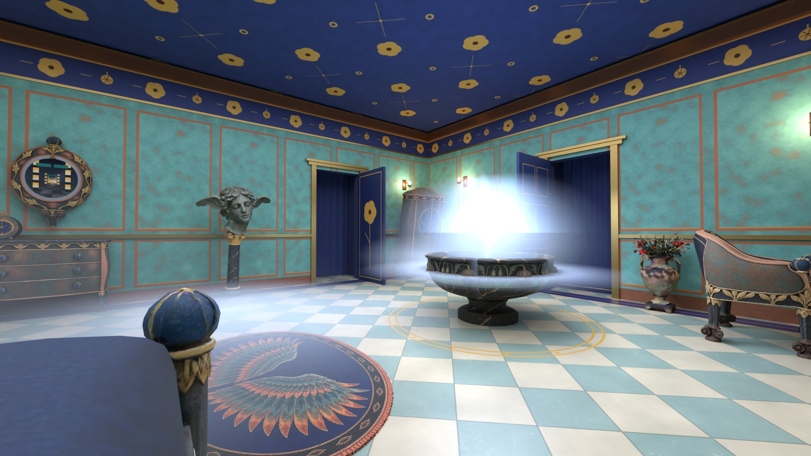

# rdwe_god_hypnos: Hypnos, The Drowsing Room

The third of the six Right Door, Wrong Exit god rooms (`docs/BLENDER_AREAS.md` section 7; the design plan's room 4.3, chapter J). A Blender-first scene built the way the Nyx room was: a 7 x 8 m bedchamber with walls 3.4 m and a low flat ceiling, dressed with the owner's NINETY-NINE Nocturne Hypnos set (13 pieces, as reduced game copies) and three Higgsfield props, baked at night (R1 lightmaps plus base colour) and exported as art only.

The look: verdigris-copper wall panels in copper frames with a gilt dado rail and a navy frieze of gold poppies and seed heads; a navy ceiling painted with gold poppies; a floor of cream limestone and grey-green marble on the diagonal in a navy and copper border; a gold ring round the Lethe basin, whose mist hangs over the middle of the room.

The trick (the room that puts you to sleep): the room has four doors (south, north, east, west), each standing open onto a short dark passage with a navy velvet veil hung across it. Walking through a veil puts you just inside the opposite door's veil, walking on into the same room with the yaw kept, so every door opens onto this room. Each pass the code thickens the mist, slows the clock and tips the leaning pieces 2 degrees more. After the third pass the objective changes to "LIE DOWN": the way out is the bed.

| File | What it is |
|---|---|
| `world/rdwe_god_hypnos.glb` | the art: 7.50 MB, 267 845 triangles, 46 draw calls, Draco geometry, WebP textures |
| `world/lightmaps/rdwe_god_hypnos_0.webp` .. `_3.webp` | the baked light, four maps on the second UV set (`TEXCOORD_1`) |
| `blender/scenes/rdwe_god_hypnos.blend` | the saved scene (36 MB, Git LFS): `Art`, `Export` (merged by material, with the lightmap UVs), `Layout` (the exporter's objects), `Lights` |
| `blender/models/rdwe_hypnos/*_game.glb`, `ledger.csv` | the 16 reduced game copies (13 furniture pieces, 3 props) and their ledger |
| `tools/blender/build_rdwe_hypnos.py` | the re-runnable build: copies, art, bake, export, render (adapted from `build_rdwe_nyx.py`) |
| `docs/renders/rdwe_god_hypnos/` | the four review stills (this folder) |

Nothing shared was changed: `tools/webp_glb.py` is used as it is on `main`; `index.html`, `shared/`, the manifest, the tests and `games/rdwe/` are untouched. `.gitignore` gains `blender/work/` (the build's work folder and the local copy of the originals; neither is committed).

## Review stills (Cycles on a rented GPU, 128 samples adaptive, OIDN, 1920 x 1080 JPEG, no metadata)

The page draws baked materials unlit with no tone mapping, so the stills use the Standard view transform at exposure 0, with the lights at the energies the lightmaps were normalised to. They are Blender path-traced: they show gloss and reflections the page will not, and the mist cards there are lit by the room's lights, where the page draws them with their own small emission.

| | |
|---|---|
| `1_arrival.jpg` (310 KB) | the arrival point (0, -3.3) inside the south door, at the walker's eye 0.95 m, facing north: the north door between the poppy urns, the basin, the rug, the winged head on the west wall |
| `2_wide.jpg` (300 KB) | the whole room from high in the south-west |
| `3_doors.jpg` (319 KB) | the north door (navy, six gilt panels) and the west door (navy, a gilt poppy), each standing open onto its veiled passage |
| `4_drowse.jpg` (326 KB) | the set piece: the room after four passes, the mist thicker (alpha x 3.4), the cabinet and the winged-head column tipped 8 degrees toward the room |






More stills were made for the owner sheet and are not committed: the same view as `4_drowse` at the first pass, the bed after four passes ("LIE DOWN"), the view through the north door to its veil, the clock and the mirror close up, and the plan.

## Sources and licences

| What | Source | Licence / owner |
|---|---|---|
| The 13 furniture pieces HY-00 .. HY-12 | the owner's Higgsfield NINETY-NINE Nocturne Hypnos set | the owner's own models; reduced copies made here by the owner's ruling ("God furniture: reduce it"); the originals were only read |
| P7 winged head of Hypnos on a column, P10 poppy urn (placed twice), P11 Lethe basin | Higgsfield image-to-3D props bought for the god rooms (plan section 7); nothing new was bought | the owner's |
| Floor, wall panels and frieze, ceiling, the four door leaves, the placard, the clock's dial, the mirror's picture of the Thanatos nave, the mist | generated with numpy in `build_rdwe_hypnos.py` from fixed seeds | own work |
| All architecture: shell, mouldings, cornice, architraves, passages, veils, sconces, the placard and its picture light, the clock's hands, the mist cards | modelled by the script | own work |

No Poly Haven or other download, no photograph, no Meshy, no paid service. Tools: Blender 5.2.1 LTS (GPL) with Cycles, OpenImageDenoise and the glTF I/O add-on, on a rented cloud GPU; Python with numpy and Pillow.

## The reduced game copies

`--stage copies` does what the Nyx build does: reads each original (about 1.9 M triangles and 70 MB for the big pieces), welds a copy and collapses it in two passes to its budget (plan section 5), gives it a fresh UV0 and bakes the original's base colour onto it (Cycles, selected to active, as emission). The props are scaled to the plan's height, except the basin, which came out wide and low and takes the plan's 1.4 m width (so it stands 0.71 m, not 0.9). Normal and metal-rough maps are dropped (R1). One change from Nyx: zero-area slivers are cut before the UV, and P10 (whose decimated flowers left many) gets a stricter cut and no island averaging; without it its islands packed to almost nothing and the urn baked black.

| Code | Piece | Original triangles | Game triangles | Base colour | GLB |
|---|---|---|---|---|---|
| HY-00 | lamp | 1 851 359 | 14 998 | 1024 | 1.07 MB |
| HY-01 | bedside table (placed twice, two meshes) | 1 994 809 | 14 998 | 1024 | 1.17 MB |
| HY-02 | armchair | 1 934 710 | 18 000 | 1024 | 1.25 MB |
| HY-03 | dresser | 1 898 261 | 17 999 | 1024 | 1.22 MB |
| HY-04 | tall cabinet | 1 854 296 | 18 000 | 1024 | 1.19 MB |
| HY-05 | bed | 1 925 954 | 23 999 | 2048 | 2.17 MB |
| HY-06 | wall mirror | 1 917 314 | 14 999 | 1024 | 1.03 MB |
| HY-07 | writing desk | 1 860 143 | 17 997 | 1024 | 1.31 MB |
| HY-08 | mantel clock | 681 132 | 14 999 | 512 | 0.61 MB |
| HY-09 | hourglass | 1 011 521 | 15 000 | 512 | 0.60 MB |
| HY-10 | vase | 1 264 783 | 15 000 | 512 | 0.74 MB |
| HY-11 | peacock-wing rug (a flat 12 mm slab: 2k triangles, below the 15k floor on purpose, as Nyx's runner) | 221 596 | 2 000 | 1024 | 0.47 MB |
| HY-12 | textiles | 1 172 742 | 15 000 | 1024 | 0.83 MB |
| P7 | winged head of Hypnos on a column (1.6 m) | 31 186 | 10 000 | 1024 | 0.87 MB |
| P10 | poppy urn (0.94 m; placed twice, two meshes) | 25 135 | 11 845 | 512 | 1.01 MB |
| P11 | Lethe basin (1.4 m across, 0.71 m) | 30 769 | 11 998 | 1024 | 0.94 MB |

`ledger.csv` has the same with dimensions, offsets and scales. Each copy's base colour is embedded and went through `python tools/webp_glb.py <copy> <copy> 90`.

## Budgets (measured)

| | Limit | Measured |
|---|---|---|
| `world/rdwe_god_hypnos.glb`, lightmaps aside | at most 8 MB | **7.50 MB** (13.7 MB from Blender with Draco, then `tools/webp_glb.py` q82: textures 10.2 to about 4.0 MB, geometry bytes asserted identical; geometry 3.5 MB). At q85, as Nyx used, it is 8.03 MB, so the room's base textures go at q82 |
| triangles | at most 300 000 | **267 845** in the file, all drawn once (furniture and props about 263 000, architecture, veils, sconces and mist about 5 000). `glb_inspect.py --budget tris=300000,mb=8`: pass, pass (it counts 7.16 MiB) |
| draw calls | at most 250 | **46** (35 materials; 46 nodes: the room merged by material, plus 4 door leaves, 4 veils, 8 mist cards, 2 leaning pieces and 2 clock hands as their own nodes) |
| textures | WebP | **27, all `image/webp`** (bed 2048, floor 2048, the rest 1024 or smaller) |
| lightmaps | at most 4, at most 2048, WebP q90 | **4**: 64 + 20 + 97 + 145 KB |

| Map | Page | Texel density | `lightmap_intensity` | On it |
|---|---|---|---|---|
| `_0` | 1280 | 53.9 px/m | 6.9275 | floor, walls, gilt and copper trim, the four door leaves, the placard, the clock's dial |
| `_1` | 512 | 26.0 px/m | 1.9109 | the ceiling, the passages, the veils |
| `_2` | 768 | 64.5 px/m | 6.2721 | bed, bedside tables, armchair, dresser, cabinet, desk, mirror, rug |
| `_3` | 2048 | 57.7 px/m | 18.3386 | lamp, clock, hourglass, vase, textiles, the three props |

Bake: Cycles on the GPU (OptiX), 512 samples, diffuse direct and indirect, 8 px margin, OIDN. The mist is hidden in the bake (it is the code's). The furniture's lightmap UV is each piece's own UV0 layout, shelf-packed per piece, as in Nyx.

### How bright: what the page will show

The page shows a baked material as base colour x lightmap x intensity, unlit, with no tone mapping; 1.0 is white. The exposure rule is Nyx's (`--target 0.9`, `--clip-cap 0.98`): the brightest main p90 goes to 0.9 unless a main surface's p99 would pass 0.98. Here the cap binds, on the floor (its p99, under the fill light): k = 1.23795. Measured again on the exported GLB with `lab_display.py` (on the non-Draco twin, same textures): the same numbers within 0.01.

The room was made to read in the game, unlike Nyx's first pass: light-coloured walls and floor, and the light spread evenly (a large soft panel under the ceiling, five copper sconces, the lamp under its shade, and a cool glow over the basin). **The walls' p50 is 0.153 and the floor's 0.298.** The furniture stays dark at p50 (navy lacquer, black marble and patinated copper in the set itself, and the undersides and backs count too), with its gilt and copper at p90 0.1 to 0.2.

| Material | p50 | p90 | p99 |
|---|---|---|---|
| Floor_Stone | 0.298 | 0.682 | 0.980 |
| Hypnos_HY-11_rug | 0.000 | 0.270 | 0.944 |
| Wall_Verdigris | 0.153 | 0.256 | 0.660 |
| Hypnos_HY-06_wall_mirror | 0.009 | 0.198 | 0.314 |
| Hypnos_P10_poppy_urn | 0.010 | 0.140 | 0.430 |
| Hypnos_HY-04_tall_cabinet | 0.013 | 0.139 | 0.482 |
| Hypnos_HY-02_armchair | 0.008 | 0.139 | 0.535 |
| Hypnos_P7_hypnos_head | 0.027 | 0.123 | 0.358 |
| Hypnos_HY-09_hourglass | 0.018 | 0.106 | 0.250 |
| Hypnos_HY-12_textiles | 0.007 | 0.098 | 0.286 |
| Hypnos_P11_lethe_basin | 0.011 | 0.080 | 0.263 |
| Hypnos_HY-03_dresser | 0.012 | 0.080 | 0.339 |
| Hypnos_HY-08_clock | 0.003 | 0.079 | 0.215 |
| Hypnos_HY-05_bed | 0.011 | 0.078 | 0.323 |
| Ceiling_Poppy | 0.044 | 0.054 | 0.208 |
| Hypnos_HY-10_vase | 0.004 | 0.052 | 0.214 |
| Hypnos_HY-07_writing_desk | 0.010 | 0.051 | 0.326 |
| Hypnos_HY-01_bedside_table | 0.006 | 0.041 | 0.188 |
| not held: Clock_Dial | 0.061 | 0.412 | 0.432 |
| not held: Gold_Trim | 0.020 | 0.232 | 0.298 |
| not held: Hypnos_HY-00_lamp | 0.036 | 0.195 | 0.468 |
| not held: Leaf_E / Leaf_In / Leaf_W / Leaf_N | 0.04 .. 0.12 | 0.10 .. 0.18 | 0.21 .. 0.33 |
| not held: Copper_Trim | 0.050 | 0.084 | 0.179 |
| not held: Veil_Navy | 0.043 | 0.064 | 0.068 |
| not held: Placard | 0.002 | 0.060 | 0.553 |
| not held: Passage_Navy | 0.000 | 0.020 | 0.037 |

**What clips:** under 1 % of the floor (its brightest specks under the fill) and of the rug; nothing else reaches 1.0. The rug's p50 of 0 is its underside, as with Nyx's runner.

Materials without a lightmap, which the page keeps as exported: `Haze` (the mist cards: alpha-blended, their picture's alpha the falloff, a small blue emission), `Mirror_Thanatos` (HY-06's glass shows a still of the Thanatos nave, as emission, so it keeps its own light), `Hand_Gilt` (the clock's hands, PBR gold), `Sconce_Copper` (the sconces and the placard light's brass, PBR), `Lamp_Emit` (the sconce bulbs and the lamp's glow, emissive 8), `Picture_Light_Emit` (the placard light's strip, emissive 4).

## The checks

`world/rdwe_god_hypnos.glb` read as the page would (JSON level; no three.js run here):

```
PASS GLB 7.50 MB (at most 8 MB, lightmaps aside)
PASS 267845 triangles in the file, 267845 drawn (at most 300 000)
PASS 46 draw calls (primitives over nodes), 35 materials, 46 meshes
PASS 27 images, all {'image/webp'}
PASS Draco geometry (KHR_draco_mesh_compression required: the loader needs a DRACOLoader)
PASS material extras carry only ['lightmap', 'lightmap_intensity']
PASS no extras on nodes, meshes, scenes or the asset (0)
PASS world/lightmaps/rdwe_god_hypnos_0.webp .. _3.webp exist; 4 lightmaps (at most four); 29 lightmapped materials
PASS door leaves are their own nodes: DoorLeaf_Hypnos_In, DoorLeaf_Hypnos_N, DoorLeaf_Hypnos_E, DoorLeaf_Hypnos_W
INFO decor nodes: decor_veil_In/N/E/W, decor_haze_00 .. 07, decor_lean_cabinet, decor_lean_column, decor_clock_hand_min, decor_clock_hand_hour
INFO materials without a lightmap: Hand_Gilt, Haze, Lamp_Emit, Mirror_Thanatos, Picture_Light_Emit, Sconce_Copper
PASS no layout object (COL_, Zone_, Marker_, Link_, Arrive_, Spot_) in the GLB
PASS privacy: no user name, absolute path or session id in the GLB, the copies or the decompressed .blend; the stills carry no COM or APP1 segment
```

**`world/rdwe_god_hypnos.json` and `worlddoc check`:** not produced, as with Nyx: `tools/blender/export_scene.py` is not on `main`. The exporter's objects are in the `.blend`'s `Layout` collection, named as BLENDER_AREAS part 2 asks: 36 `COL_` boxes (the floor; each wall as two boxes round its door plus one over the door head; each passage's two sides and back; one per standing piece, the leaning ones included), the markers, links, zones and spots below. Layout coordinates are Blender (x east, y north); game = (x, z, -y).

## What the coordinator must wire

RDWE does not load through the Farway manifest (its rooms are `games/rdwe/scenes/*.js`, registered in `walk.js` `SCENES` and played in `index.html` `RDWE_ORDER`), so `shared/farway.manifest.js` and `shared/manifest.test.js` are not changed here.

1. **The Blender-room loader** (plan section 6a), the same as Nyx's: `world/rdwe_god_hypnos.glb` through GLTFLoader with a **DRACOLoader** and `EXT_texture_webp`; the 29 materials whose extras carry `lightmap` and `lightmap_intensity` become unlit `MeshBasicMaterial` with `lightMap` on channel 1 (sRGB, `flipY = false`). `Haze` stays alpha-blended (`depthWrite = false` is advised), and is double-sided.
2. **`walk.js` `SCENES`:** `rdwe_god_hypnos: () => import('./scenes/rdwe_god_hypnos.js')` after `rdwe_god_selene` (chain order, plan 2.1), and **`RDWE_ORDER`** likewise. The scene module, with `meta.chapter` J (plan 2.4: "The Drowsing Room", "The Lull", rot -0.6deg, stamp "TIME: SLOWING", the caption and log), objective "LEAVE", then "LIE DOWN", is not part of this PR.
3. **The loops (plan 6c).** Each door stands open (as baked; leaves `DoorLeaf_Hypnos_*`, origin on the hinge, `swing_deg` 90). When the walker crosses a veil outward (enters `Zone_trigger_<door>`), add the shift to its position with `ctx.controls.setPosition`, keep the yaw, and count a pass:

   | Zone (Blender) | Link | Shift (Blender x, y) | Game shift (x, z) | Lands at |
   |---|---|---|---|---|
   | `Zone_trigger_N`, y 4.75 .. 5.3 | `Link_Hypnos_N` (0, 4.75) | (0, -9.5) | (0, +9.5) | `Arrive_Hypnos_S` (0, -4.70), facing north |
   | `Zone_trigger_E`, x 4.25 .. 4.8 | `Link_Hypnos_E` (4.25, 1.6) | (-8.5, 0) | (-8.5, 0) | `Arrive_Hypnos_W` (-4.20, 1.6), facing east |
   | `Zone_trigger_W`, x -4.8 .. -4.25 | `Link_Hypnos_W` (-4.25, 1.6) | (+8.5, 0) | (+8.5, 0) | `Arrive_Hypnos_E` (4.20, 1.6), facing west |
   | `Zone_trigger_S`, y -5.3 .. -4.75 | `Link_Hypnos_S` (0, -4.75) | (0, +9.5) | (0, -9.5) | `Arrive_Hypnos_N` (0, 4.70), facing south |

   The shift is exact, so the walker lands at the same place relative to the other veil; the frame before the jump shows the veil close up, the frame after shows the room through the far door. The fourth loop (back out through the south door you came in by) is my addition so every door behaves the same; the plan named three. A passage's back wall is a collider, so a missed teleport cannot leave the room.
4. **Each pass** (plan 4.3): the mist, `decor_haze_00 .. 07`: raise the `Haze` material's opacity (exported 0.30 x the picture's alpha; the stills use 0.30 x (1 + 0.6 x passes), at most 0.95) and the page fog. The clock: `decor_clock_hand_min` / `_hour` turn about their own X axis (game +x, the dial's normal; negative is clockwise as seen from the room), slower each pass. The lean: `decor_lean_cabinet` and `decor_lean_column` (origins on the front edge of their feet), set `rotation.z = -angle` in three.js (Blender +Y, game -Z), 2 degrees a pass, at most 10, which tips their tops east into the room. Their colliders may stay as they are (the tip is small and toward the room's middle).
5. **The way out (plan 6d).** After the third pass the objective reads "LIE DOWN" and `Spot_bed` (on the mattress, about (3.0, -2.0) Blender) becomes a play.js target "Lie down", usable from inside `Zone_use_bed` (beside the bed's foot). Its `use()` ends the room (sets `built.trigger` round the walker, or `ctx.exit()` if walk.js gains it), `exitPath` lowering the eye onto the pillow and through the mattress, `exitDuration` 3.5 s, `exitEase: 'in'`. `Link_Hypnos_Bed` names `rdwe_god_morpheus` / `Arrive_Morpheus_In`.
6. **Markers:** `Marker_Spawn` and `Arrive_Hypnos_In` at (0, -3.3) facing north (coming in from Selene's painted door); `Marker_Entrance` (0, -3.7); `Marker_Exit` at the bed.
7. **Lights:** add none for the room; the sconces, the lamp, the fill and the basin's glow are in the lightmaps.

## Rebuild

From the repo root, with Blender 5.2 and Python with numpy and Pillow (every Blender stage ran on the rented GPU with `--device auto`, OptiX):

```
# the 13 originals and P7, P10, P11 into the git-ignored blender/work/hypnos_source/ (read only)
blender -b --factory-startup --python tools/blender/build_rdwe_hypnos.py -- --stage copies
blender -b --factory-startup --python tools/blender/build_rdwe_hypnos.py -- --stage all --samples 512     # art, bake, export, render
for f in blender/models/rdwe_hypnos/*_game.glb; do python tools/webp_glb.py $f $f 90; done
python -c "from PIL import Image; import glob,os; [Image.open(p).convert('RGB').save('world/lightmaps/'+os.path.basename(p)[:-4]+'.webp','WEBP',quality=90,method=6) for p in glob.glob('blender/work/farway_rdwe_god_hypnos/rdwe_god_hypnos_[0-9].png')]"
python tools/webp_glb.py blender/work/farway_rdwe_god_hypnos/rdwe_god_hypnos_raw.glb world/rdwe_god_hypnos.glb 82
```

Timings on the box: copies 16 pieces in about 17 min; art about 1 min; the bake about 1.5 min; the stills about 3 min. The committed P10 copy came from a re-run of its copy alone after the sliver fix (`--stage copies --only P10`), then `--stage all`, then a re-render of `4_drowse` with a camera that shows the leaning cabinet (`--stage render --only 4_drowse,pass0,bed4`). The light levels are constants (`SCONCE_W`, `LAMP_W`, `BASIN_W`, `FILL_W`, `PLACARD_W`); `--target` and `--clip-cap` set the exposure.

## Choices made here (the plan left them open)

- **How a loop can be seamless.** A door that opens straight onto the room it leads to would need a second copy of the room behind it. Instead each door opens onto a short passage with a navy veil across it, and the teleport happens as the walker passes through the veil: just before, the veil fills the view; just after, the walker is past the far door's veil, walking into the room.
- **The doors stand open**, baked that way, so nothing needs opening; the leaves differ as the plan asks (south verdigris with copper panels, north navy with six gilt panels, east burnished copper with rivets, west navy with a gilt poppy).
- **The clock's hands** are new objects over a new dial on HY-08's face (the copy's own painted hands would have shown twice).
- **The mirror's still of the Thanatos nave** is painted with numpy (banded columns, teal valances, moonlight, a warm glow at the end), since the Thanatos room is not built yet; it can be swapped for a real render later.
- **The basin is 0.71 m tall**, not 0.9: the prop is wide and low, and kept its proportions at the plan's 1.4 m width.
- **The leaning pieces** are the tall cabinet (the log's "the wardrobe leans a little more") and the winged-head column.
- **A fourth loop** through the south door (above).

## Open

- **The mist on the page.** The cards are lit by the room in Cycles; on the page they show their own small emission over the environment light, so their density will want tuning in the scene code.
- **Map 3 is 2048** (the smalls and the props at 58 px/m). A lower `MIN_DENSITY` for it would give a 1280 or 1536 page if the lightmap download matters.
- **The coordinator's choices from the plan still open:** chapter letter J, the audio and the clips (`J.mp3`, `j.MP4`, `J.mp4`), and whether the fourth (south) loop stays.
