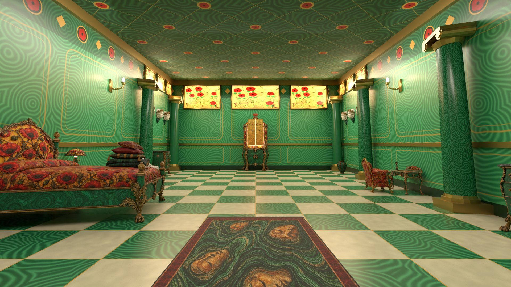
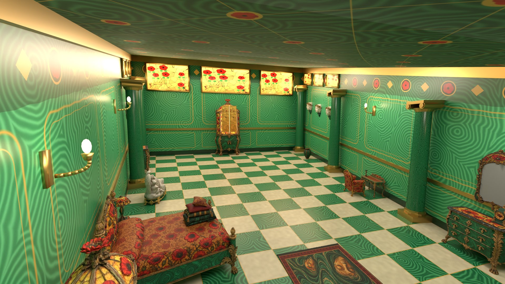
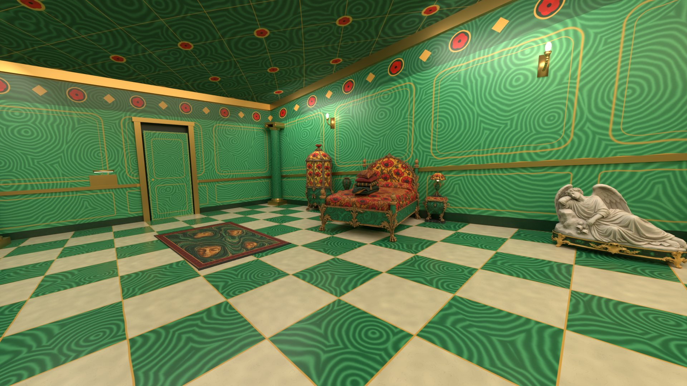
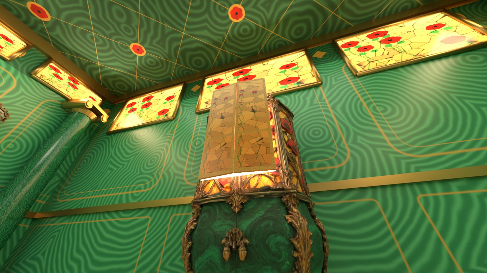

# rdwe_god_morpheus: Morpheus, The Shaping Hall

The fourth of the six Right Door, Wrong Exit god rooms (`docs/BLENDER_AREAS.md` section 7; the design plan's room 4.4, chapter K). A Blender-first scene built the same way as `rdwe_god_nyx`: a forced-perspective hall 18 m long, 6 m wide and 3.2 m tall at the door, 15 m wide and 8 m tall at the far wall, dressed with the owner's NINETY-NINE Nocturne Morpheus set (13 pieces, as reduced game copies) and two Higgsfield props, baked (R1 lightmaps plus base colour) and exported as art only.

The trick: from the door the hall reads as a normal green bedroom with a wardrobe across it. Every cross-section is the same 6 x 3.2 m room scaled by s = (y + 21) / 12 about a point 12 m behind the door, so the walls splay at 14.0 degrees and the ceiling climbs, and everything on them grows with distance: the floor squares, the wall panels, the mouldings, the columns, the sconces, the masks, the clerestory. The wardrobe at the far end is the set's tall cabinet at 2.5 times its size, 4.75 m tall. Its doors are open a crack with light inside, and they lead on to Oneiros.

| File | What it is |
|---|---|
| `world/rdwe_god_morpheus.glb` | the art: 7.45 MB, 293 945 triangles, 36 draw calls, Draco geometry, WebP textures |
| `world/lightmaps/rdwe_god_morpheus_0.webp` .. `_3.webp` | the baked light, four maps on the second UV set (`TEXCOORD_1`) |
| `blender/scenes/rdwe_god_morpheus.blend` | the saved scene (38 MB, Git LFS): `Art`, `Export` (merged by material, with the lightmap UVs), `Layout` (the exporter's objects), `Lights` |
| `blender/models/rdwe_morpheus/*_game.glb`, `ledger.csv` | the 15 reduced game copies (13 furniture pieces, 2 props) and their ledger |
| `tools/blender/build_rdwe_morpheus.py` | the re-runnable build: copies, art, bake, export, render (made from `build_rdwe_nyx.py`) |
| `tools/blender/pack_rdwe_morpheus.py` | the last step in plain Python: the lightmaps to WebP and the GLB's textures to WebP, geometry untouched |
| `docs/renders/rdwe_god_morpheus/` | the four review stills (this folder) |

Nothing shared was changed: `index.html`, `shared/`, the manifest, the tests, `games/rdwe/` and `tools/webp_glb.py` are untouched. `.gitignore` gains `blender/work/` (the build's work folder and the local copy of the originals; neither is committed).

## Review stills (Cycles on a rented GPU, 128 samples adaptive, OIDN, 1920 x 1080 JPEG, no metadata)

As for Nyx: the Standard view transform at exposure 0, with the lights at the energies the lightmaps were normalised to. The stills are path-traced, so they show gloss the page will not.

| | |
|---|---|
| `1_arrival.jpg` (387 KB) | the arrival point (0, -8.3) just inside the door, at the walker's eye 0.95 m, facing north, 72 degrees vertical: a normal room |
| `2_wide.jpg` (379 KB) | the whole hall from high by the door, looking to the far end |
| `3_bedchamber.jpg` (357 KB) | the near end at real size: the bed group on the west wall, the rug with faces, sleeping Morpheus (P6), the door and placard behind |
| `4_wardrobe.jpg` (326 KB) | the trick: 2.2 m from the far wardrobe at the walker's eye, looking up at it; 4.75 m tall, its poppy-glass doors ajar with light inside |






Two more stills went to the owner sheet and are not committed: the plan from above (ceiling off), and the view back from the wardrobe to the door, where the hall shows its real length.

## Sources and licences

| What | Source | Licence / owner |
|---|---|---|
| The 13 furniture pieces MO-00 .. MO-12 | the owner's Higgsfield NINETY-NINE Nocturne Morpheus set | the owner's own models; reduced copies made here by the owner's ruling ("God furniture: reduce it"); the originals were only read |
| P6 sleeping Morpheus, P12 sleeping mask | Higgsfield image-to-3D props bought for the god rooms (plan section 7); nothing new was bought | the owner's |
| Floor checker, malachite panelling, painted ceiling, column malachite, poppy glass, the door and wardrobe-leaf pictures, the placard | generated with numpy in `build_rdwe_morpheus.py` from fixed seeds | own work |
| All architecture: the hall, mouldings, Ionic columns (the plan's P16, modelled), sconces, clerestory, entrance door and frame, placard and its picture light, the wardrobe's door leaves | modelled by the script | own work |

No Poly Haven or other download, no photograph, no Meshy, no paid service. Tools: Blender 5.2.1 LTS (GPL) with Cycles, OpenImageDenoise and the glTF I/O add-on, on a rented cloud GPU; Python with numpy and Pillow.

## The reduced game copies

As Nyx's: `--stage copies` reads each original (about 2 M triangles and 70 to 80 MB for the big pieces), welds a copy, collapses it in two passes to its budget, gives it a fresh UV0 and bakes the original's base colour onto it (Cycles, selected to active, as emission). The props come normalised to 1.9 m tall and are scaled to the plan's height (P6 1.1 m, P12 0.45 m). The budgets and base-colour sizes are Nyx's. Each GLB then went through `python tools/webp_glb.py <copy> <copy> 90`.

| Code | Piece | Original triangles | Game triangles | Base colour | GLB |
|---|---|---|---|---|---|
| MO-00 | poppy-glass lamp | 1 949 614 | 15 000 | 1024 | 1.43 MB |
| MO-01 | bedside table (placed twice, two meshes) | 1 930 938 | 15 000 | 1024 | 1.36 MB |
| MO-02 | armchair | 1 926 892 | 18 000 | 1024 | 1.47 MB |
| MO-03 | dresser (also the far copy at 1.6x, decimated to 8 000) | 1 980 532 | 18 000 | 1024 | 1.50 MB |
| MO-04 | tall cabinet (also the far wardrobe at 2.5x, full 18 000) | 1 920 806 | 18 000 | 1024 | 1.60 MB |
| MO-05 | bed | 1 945 474 | 23 999 | 2048 | 3.05 MB |
| MO-06 | wall mirror | 1 942 393 | 14 999 | 1024 | 1.20 MB |
| MO-07 | writing desk | 1 964 564 | 18 000 | 1024 | 1.55 MB |
| MO-08 | bracket clock | 968 640 | 15 000 | 512 | 0.78 MB |
| MO-09 | hourglass | 1 245 966 | 14 999 | 512 | 0.78 MB |
| MO-10 | seed-head vase (also the far copy at 2.2x, decimated to 5 000) | 1 188 414 | 15 000 | 512 | 0.70 MB |
| MO-11 | rug with faces (a flat 12 mm slab: 2k triangles, as Nyx's runner) | 264 104 | 2 000 | 1024 | 0.52 MB |
| MO-12 | textiles | 1 296 285 | 14 999 | 1024 | 0.89 MB |
| P6 | sleeping Morpheus (1.1 m tall, 1.57 m long) | 30 486 | 14 997 | 1024 | 1.22 MB |
| P12 | sleeping mask (0.45 m; placed six times) | 31 058 | 3 499 | 512 | 0.32 MB |

`ledger.csv` has the same with dimensions, offsets and scales (its `glb_bytes` are the WebP copies' sizes; the build writes a `seconds` column that was dropped to match Nyx's ledger).

The far copies and the six masks each have their own mesh in the room (for their own lightmap texels: a shared mesh would share its light). That is why P12 is 3.5k triangles rather than the plan's 6k, and why the far dresser and vase are decimated: the room has to fit 300k.

## The design choices (the plan left these open)

- **Columns.** Ionic, malachite shafts on gilt bases and capitals, at normalised depths Y = 0.4, 3.8, 7.2, 10.6 (Y = 12 ln s), evenly spaced as the eye reads them from the door: scales 1.03, 1.37, 1.82, 2.42, the plan's 1.0x, 1.4x, 1.9x, 2.5x. The west 1.4x column is left out: the bed's headboard stands where it would be. Seven columns.
- **Walls.** Light malachite panelling with gilt rococo frames, a dado and a frieze of gilt-ringed poppy roundels; gilt dado rail and cornice as geometry. Malachite was lightened so the walls read (see "How bright").
- **Floor.** A checker of cream marble and malachite squares, 0.6 m at the door, 1.5 m at the far wall: the strongest forced-perspective cue.
- **Clerestory.** Nine poppy-glass panes high on the far half: three on each splayed wall, three over the wardrobe on the far wall. Emissive, each with an area light behind it in the bake.
- **Masks (P12).** Six, three on each splayed wall between the far columns, at y 2.3, 4.2, 6.3, centred at 1.75 s m up (3.4 to 4.0 m), scaled 1.94 to 2.27.
- **The wardrobe's doors.** The plan asked for 1.2 x 3.6 m leaves. On the 2.5x cabinet the glazed doors are its upper section, so the leaves (two of 0.6 m, hinged on the cabinet's sides, ajar 7 degrees) cover that: 1.2 x 2.14 m, from 2.0 to 4.14 m up. Full-height leaves floated in front of the bombe base below and read as a slab. Behind them, a glowing panel (`Cabinet_Light`) shows through the crack. The sill is 2 m up, so the exit path should rise into the doors (or the code swings them open as the walker arrives).
- **Light.** A night hall lit warm: four gilt sconces in the near half (scaled), the poppy-glass lamp, the clerestory, three broad fill lights under the ceiling, and six cove lights washing the splayed walls.

## Budgets (measured)

| | Limit | Measured |
|---|---|---|
| `world/rdwe_god_morpheus.glb`, lightmaps aside | at most 8 MB | **7.45 MB** (12.6 MB from Blender with Draco, then `pack_rdwe_morpheus.py`: furniture and prop textures re-encoded from their baked q90 JPEGs at WebP q75, the room's generated textures at q85; geometry bytes asserted identical; geometry 3.6 MB) |
| triangles | at most 300 000 | **293 945** in the file, all drawn once (furniture, props, far copies and masks 284 987; architecture, sconces and lights 8 958). `glb_inspect.py --budget tris=300000,mb=8`: pass, pass |
| draw calls | at most 250 | **36** (29 materials; 36 nodes: the hall merged by material, plus 3 door leaves, 6 masks and the far wardrobe) |
| textures | WebP | **23, all `image/webp`** (bed 2048, the rest 1024 or less) |
| lightmaps | at most 4, at most 2048, WebP q90 | **4**: 152 + 6 + 328 + 138 KB |

Draco is quantised at 13 bits for positions, 8 for normals and 12 for UVs (`--qpos`, `--qnorm`, `--quv`). The baked materials are drawn unlit, so their normals do not matter; at Nyx's 14/10/12 the file was 8.1 MB.

| Map | Page | Texel density | `lightmap_intensity` | On it |
|---|---|---|---|---|
| `_0` | 1536 | 35.2 px/m | 5.4403 | floor, walls, mouldings, columns, the doors, the wardrobe's leaves, the placard (714 m2) |
| `_1` | 512 | 26.4 px/m | 4.6713 | the ceiling |
| `_2` | 1280 | 59.6 px/m | 4.4371 | bed, bedside tables, armchair, dresser, cabinet, desk, mirror, rug, the far wardrobe and dresser |
| `_3` | 768 | 71.4 px/m | 5.4279 | lamp, clock, hourglass, vase, textiles, P6, the six masks, the far vase |

Bake: Cycles on the GPU (OptiX), 512 samples, diffuse direct and indirect, 8 px margin, OIDN; 19 + 2 + 18 + 16 s. Each map's white point is its 99.5th percentile texel. The furniture's lightmap UV is as Nyx's: each placed piece's own UV0 layout as one square, shelf-packed. The hall's own surfaces are packed differently from Nyx's: Blender's joint multi-object island pack collapsed this group to nothing (0 px/m), so each object is smart-projected alone and its 863 islands are shelf-packed by the script as rectangles in metres.

### How bright: what the page will show

The same rule as Nyx: displayed = base colour x lightmap texel x `lightmap_intensity` / pi, no tone mapping. The bake measures it per material and sets one exposure k: the brightest main p90 to `--target` 0.9, unless that puts a main surface's p99 over `--clip-cap` 0.98. The cap binds (the masks' white marble): **k = 0.17327**. Not held: the lamp's own body by its bulb, and the wardrobe's poppy-glass leaves, which are lit from inside and meant to glow. The gilt trim, the placard and the dark trim are reported, as for Nyx.

The walls reach **p50 0.152** and the floor **p50 0.287**, against the brief's 0.1 and "not near black". The first bake had the walls at p50 0.061, so the malachite's dark bands went from #1a6b45 to #298557, the frieze darkening from 0.55 to 0.72, and six cove lights now wash the splayed walls.

| Material | p50 | p90 | p99 |
|---|---|---|---|
| Floor_Marble | 0.287 | 0.703 | 0.771 |
| Morpheus_P12_mask | 0.067 | 0.595 | 0.980 |
| Morpheus_P6_sleeping_morpheus | 0.056 | 0.421 | 0.711 |
| Wall_Malachite | 0.152 | 0.351 | 0.661 |
| Morpheus_MO-05_bed | 0.030 | 0.320 | 0.538 |
| Morpheus_MO-02_armchair | 0.061 | 0.274 | 0.525 |
| Morpheus_MO-04_tall_cabinet | 0.028 | 0.249 | 0.854 |
| Door_Malachite | 0.042 | 0.233 | 0.330 |
| Morpheus_MO-07_writing_desk | 0.021 | 0.195 | 0.521 |
| Morpheus_MO-06_wall_mirror | 0.012 | 0.176 | 0.304 |
| Morpheus_MO-03_dresser | 0.015 | 0.161 | 0.855 |
| Morpheus_MO-11_rug | 0.000 | 0.155 | 0.489 |
| Morpheus_MO-12_textiles | 0.010 | 0.147 | 0.320 |
| Column_Malachite | 0.042 | 0.142 | 0.246 |
| Morpheus_MO-08_clock | 0.015 | 0.129 | 0.411 |
| Ceiling_Painted | 0.049 | 0.113 | 0.380 |
| Morpheus_MO-09_hourglass | 0.017 | 0.099 | 0.322 |
| Morpheus_MO-01_bedside_table | 0.005 | 0.084 | 0.369 |
| Morpheus_MO-10_vase | 0.013 | 0.069 | 0.205 |
| not held: Morpheus_MO-00_lamp | 0.062 | 0.602 | 0.963 |
| not held: Cabinet_Door | 0.345 | 0.562 | 1.189 |
| not held: Gold_Trim | 0.091 | 0.411 | 0.866 |
| not held: Placard | 0.002 | 0.046 | 0.437 |
| not held: Trim_Dark | 0.000 | 0.002 | 0.011 |

Measured again on the committed files (`lab_display`, on the no-Draco export with the same WebP textures and the WebP lightmaps): the same within 0.01 everywhere, walls p50 0.153, floor 0.284, ceiling 0.049. On the 8-bit lightmap the masks' brightest 1 % reaches 1.06 (1.6 % of their area clips) and the wardrobe's leaves 1.18 (2.3 %); nothing else clips.

**What clips:** the wardrobe's glowing leaves (not held, on purpose) and, on the 8-bit page copy only, a sliver of the masks' marble.

Materials without a lightmap, which the page keeps as exported: `Poppy_Glass` (the clerestory, its own picture as emission at 2.2), `Cabinet_Light` (the light in the wardrobe, emissive 9), `Lamp_Emit` (the sconce bulbs and the lamp's glow, emissive 8), `Picture_Light_Emit` (the placard light's strip), `Sconce_Gilt` (the sconces and the picture light's brass, PBR gold).

## The checks

`world/rdwe_god_morpheus.glb` read as the page would (JSON level; no three.js run here):

```
PASS GLB 7.45 MB (at most 8 MB, lightmaps aside)
PASS 293945 triangles in the file, 293945 drawn (at most 300 000)
PASS 36 draw calls (primitives over nodes), 29 materials, 36 meshes
PASS 23 images, all {'image/webp'}
PASS Draco geometry (KHR_draco_mesh_compression required)
PASS material extras carry only ['lightmap', 'lightmap_intensity']
PASS no extras on nodes, meshes, scenes or the asset (0)
PASS world/lightmaps/rdwe_god_morpheus_0.webp exists (152 KB), 8 materials
PASS world/lightmaps/rdwe_god_morpheus_1.webp exists (6 KB), 1 materials
PASS world/lightmaps/rdwe_god_morpheus_2.webp exists (328 KB), 8 materials
PASS world/lightmaps/rdwe_god_morpheus_3.webp exists (138 KB), 7 materials
PASS 4 lightmaps (at most four)
PASS every lightmapped primitive has TEXCOORD_1
PASS door leaves are their own nodes: DoorLeaf_Morpheus_Cabinet_L, DoorLeaf_Morpheus_Cabinet_R, DoorLeaf_Morpheus_In
PASS 6 decor_mask_* nodes
PASS Cabinet_Far is its own node
PASS no layout object in the GLB
INFO materials without a lightmap: Cabinet_Light, Lamp_Emit, Picture_Light_Emit, Poppy_Glass, Sconce_Gilt
PASS: all checks
```

Privacy: the committed files (the GLB, the lightmaps, the copies, the stills and the decompressed `.blend`) hold no user name, absolute path, session id or e-mail. The stills carry no JPEG comment or APP1 segment (APP0, DQT, SOF, DHT only).

**`world/rdwe_god_morpheus.json` and `worlddoc check`:** not produced, as for Nyx: `tools/blender/export_scene.py` is not on `main`. The exporter's objects are in the `.blend`'s `Layout` collection, named as BLENDER_AREAS part 2 asks:
- **99 `COL_` boxes:** the floor; each splayed wall as a row of 38 boxes of 0.5 m along its line, each as tall as the ceiling there; the far wall; the south wall in three round the door; one per standing piece (bed, both bedside tables, cabinet, dresser, desk, armchair, P6, the far wardrobe, the far dresser and vase); one per column. The far wardrobe's box starts behind its base front, so the zone in front is reached first.
- **Markers:** `Marker_Spawn` (0, -8.3) facing N, `Marker_Entrance` (0, -8.7), `Marker_Exit` (0, 7.15) facing N.
- **Links and spots:** `Arrive_Morpheus_In` (0, -8.3) facing N; `Link_Morpheus_Cabinet` (0, 7.2) with `to_scene` = `rdwe_god_oneiros` and `to_arrive` = `Arrive_Oneiros_In`; `Spot_cabinet` (0, 6.85), the first close look up.
- **Zone:** `Zone_trigger_cabinet`, x -0.6 .. 0.6, y 7.0 .. 7.5, in front of the wardrobe up to the top of its doors.

The art holds the other named objects:
- **Door leaves:** `DoorLeaf_Morpheus_In` (the malachite door, origin on its west edge, closed); `DoorLeaf_Morpheus_Cabinet_L` and `_R` (origins on the cabinet's west and east sides, `swing_deg` 95, ajar 7 degrees).
- **Masks:** `decor_mask_0` .. `_5`, each with its origin at its foot on the wall, so the code can turn it.
- **The far wardrobe:** `Cabinet_Far`, its own node with its origin at its base, for the optional Super Liminal step.

Layout coordinates are Blender (x east, y north); game = (x, z, -y). The GLB's bounds: x -7.5 .. 7.5, y 0 .. 8.0, z -9.03 .. 9.12 in game axes.

## What the coordinator must wire

As for Nyx, RDWE does not load through the Farway manifest, so `shared/farway.manifest.js` and its test are not changed.

1. **The Blender-room loader** (plan section 6a, the same one Nyx needs): GLTFLoader with a **DRACOLoader** and `EXT_texture_webp`, then the `applyLightmaps` treatment: the 24 materials whose extras carry `lightmap` and `lightmap_intensity` become unlit `MeshBasicMaterial` with `lightMap` on channel 1 (sRGB, `flipY = false`). Colliders, markers, links and zones come from the layout file once `export_scene.py` exists.
2. **`walk.js` `SCENES`:** `rdwe_god_morpheus: () => import('./scenes/rdwe_god_morpheus.js')` after `rdwe_god_hypnos` and before `rdwe_god_oneiros` (chain order, plan 2.1), and **`RDWE_ORDER`** in `index.html` likewise. The scene module is not part of this commit. Its `meta.chapter` is K (plan 2.4: "The Shaping Hall", "The Mask", rot 1.4deg, stamp "SCALE: UNRELIABLE", the caption and log), objective "REACH THE WARDROBE", arrive "IN".
3. **The trick in the scene's `update()`:**
   - The forced perspective is in the geometry and needs no code.
   - The masks: turn each `decor_mask_*` about its vertical axis to face the walker, clamped to about ±70 degrees from the wall's normal. The west masks face 14 degrees north of east and the east masks 14 degrees north of west.
   - Entering `Zone_trigger_cabinet` begins the exit to Oneiros. The `exitPath` should rise from the eye (0.95 m) into the doors, whose sill is 2.0 m up. Optionally, swing `DoorLeaf_Morpheus_Cabinet_L` / `_R` open (L negative about z, R positive) as the walker nears.
   - Optional (plan): hold `Cabinet_Far`'s angular size as the walker approaches, scaling the node about its origin. The mesh is already 2.5x, so scale it 0.4 to 1.
4. **Lights:** add none for the room; the sconces, the lamp, the clerestory, the fill and the wall washes are in the lightmaps.

## Rebuild

From the repo root, with Blender 5.2 and Python with numpy and Pillow (the box ran every Blender stage with `--device auto`, OptiX):

```
# the 13 originals and props P6, P12 into the git-ignored blender/work/morpheus_source/ (read only)
blender -b --factory-startup --python tools/blender/build_rdwe_morpheus.py -- --stage copies
for f in blender/models/rdwe_morpheus/*_game.glb; do python tools/webp_glb.py $f $f 90; done
blender -b --factory-startup --python tools/blender/build_rdwe_morpheus.py -- --stage all --samples 512     # art, bake, export, render
python tools/blender/pack_rdwe_morpheus.py                                                                  # lightmaps and GLB to WebP
```

The committed outputs come from one `--stage all` run of this script (art, bake and stills) and a final `--stage export` with the new quantisation, then the pack step. Timings on the box: copies, 15 pieces in about 15 min; art about 2 min; bake about 1 min; the six stills about 4 min. The light levels are constants (`SCONCE_W`, `LAMP_W`, `WINDOW_W`, `FILL_W`, `WASH_W`, `CAB_W`, `PLACARD_W`); `--target` and `--clip-cap` set the exposure.

## Open

- **The bedside tables and the lamp keep the display plinths of the originals** (a black slab under each, from the single-photo source). Left as made; trimming them is a copy-stage change.
- **The masks on the 8-bit page copy:** their brightest 1 % reaches 1.06, not 0.98 (the float bake says 0.980). A cap of 0.92 would bring them under, at about 6 % less light everywhere.
- **The wardrobe's doors are 1.2 x 2.14 m, not the plan's 1.2 x 3.6 m** (see the design choices above); the exit path has to rise 1 m.
- **Texture quality:** the furniture textures are WebP q75 in the room GLB (the copies are q90) to fit 8 MB. Nyx's are q85.
- **The coordinator's choices from the plan are still open:** chapter letter K; the audio and the clips (`K.mp3`, `k.MP4`, `K.mp4`); whether the masks turn, and the Super Liminal option.
