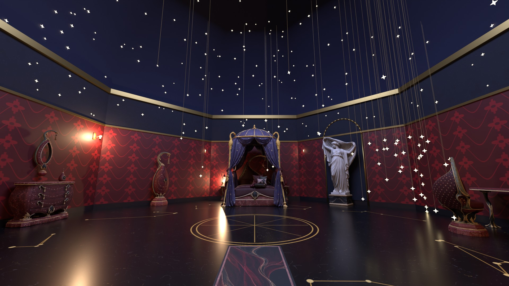
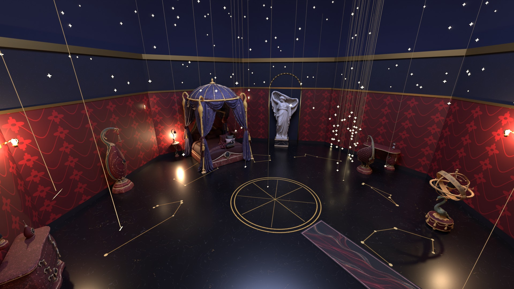
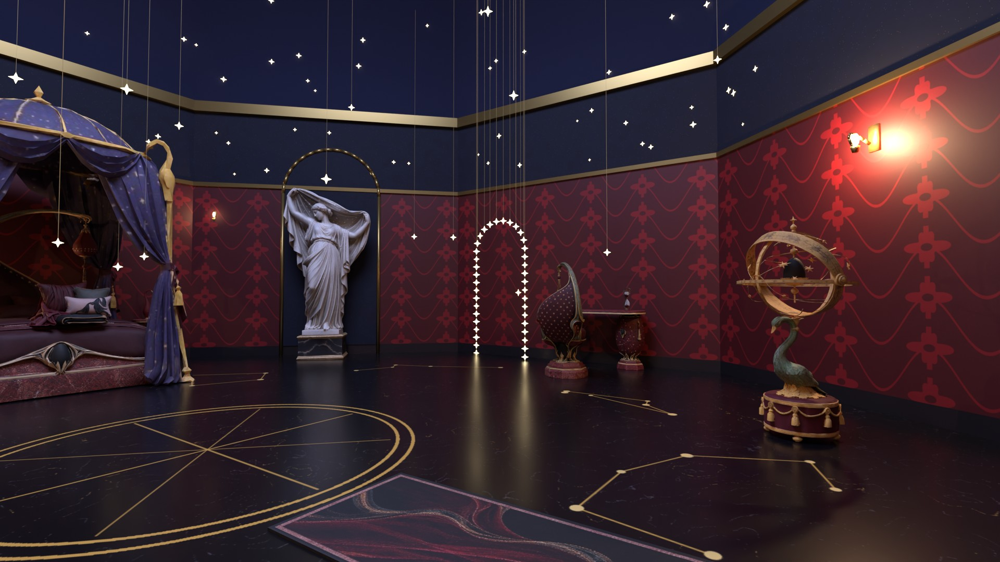

# rdwe_god_nyx: Nyx, The Vault of Night

The first of the six Right Door, Wrong Exit god rooms (`docs/BLENDER_AREAS.md` section 7; the design plan's room 4.1, chapter H). A Blender-first scene: an octagonal bedchamber 10 m across its flats, walls 4 m, a star dome to 7.5 m, dressed with the owner's NINETY-NINE Nocturne Nyx set (13 pieces, as reduced game copies) and four Higgsfield props, baked at night (R1 lightmaps plus base colour) and exported as art only.

The trick: about 400 gold stars hang on the dome, the upper walls and fine wires. From one spot only, the black egg inlaid in the floor at (-1.5, -3.2), at the walker's eye (0.95 m, RDWE_SCALE 1.7), 39 of them line up into the outline of a round-headed door on the east wall at (5, 1.2). The scene code then shows `DoorLeaf_Nyx_Star` and drops `COL_plug_nyx_star`, and the door leads on to Selene.

| File | What it is |
|---|---|
| `world/rdwe_god_nyx.glb` | the art: 7.45 MB, 270 422 triangles, 128 draw calls, Draco geometry, WebP textures |
| `world/lightmaps/rdwe_god_nyx_0.webp` .. `_3.webp` | the baked light, four maps on the second UV set (`TEXCOORD_1`) |
| `blender/scenes/rdwe_god_nyx.blend` | the saved scene (35 MB, Git LFS): `Art`, `Export` (merged by material, with the lightmap UVs), `Layout` (the exporter's objects), `Lights` |
| `blender/models/rdwe_nyx/*_game.glb`, `ledger.csv` | the 17 reduced game copies (13 furniture pieces, 4 props) and their ledger |
| `tools/blender/build_rdwe_nyx.py` | the re-runnable build: copies, art, bake, export, render |
| `docs/renders/rdwe_god_nyx/` | the three review stills (this folder) |

Nothing shared was changed: `tools/webp_glb.py` is used as it is on `main`; `index.html`, `shared/`, the manifest, the tests and `games/rdwe/` are untouched. `.gitignore` gains `blender/work/` (the build's work folder and the local copy of the originals; neither is committed).

## Review stills (Cycles on the rented GPU, 128 samples adaptive, OIDN, 1920 x 1080 JPEG, no metadata)

The page draws baked materials unlit with no tone mapping, so the stills use the Standard view transform at exposure 0, with the lights at the energies the lightmaps were normalised to (see "How bright"). They are Blender path-traced: they show gloss and reflections the page will not.

| | |
|---|---|
| `1_arrival.jpg` (291 KB) | the arrival point (0, -4.3) inside the velvet curtain, at the walker's eye 0.95 m, facing north, 72 degrees vertical (walk.js's camera) |
| `2_wide.jpg` (312 KB) | the whole room from high in the south-west |
| `3_align.jpg` (296 KB) | the trick: from the black egg at the walker's eye, looking at the east wall; the hanging stars and the wall stars make the door's outline |





Two more stills were made for the owner sheet and are not committed: the same view 0.2 m east of the spot (the outline only shifts, by about 1.5 degrees, as the plan worked out for the 0.2 m trigger radius) and the view with `DoorLeaf_Nyx_Star` shown.

## Sources and licences

| What | Source | Licence / owner |
|---|---|---|
| The 13 furniture pieces NX-00 .. NX-12 | the owner's Higgsfield NINETY-NINE Nocturne Nyx set (already public in a release) | the owner's own models; reduced copies made here by the owner's ruling ("reduce it"); the originals were only read |
| P4 statue of Nyx, P9 star orrery, P18 world egg, P20 veil canopy | Higgsfield image-to-3D props bought for the god rooms (plan section 7); nothing new was bought | the owner's |
| Floor marble and constellations, red damask, night-blue upper wall, the placard | generated with numpy in `build_rdwe_nyx.py` from fixed seeds | own work |
| All architecture: shell, dome, mouldings, curtain, sconces, niche, medallion, stars, star door | modelled by the script | own work |

No Poly Haven or other download, no photograph, no Meshy, no paid service. Tools: Blender 5.2.1 LTS (GPL) with Cycles, OpenImageDenoise and the glTF I/O add-on, on a rented RTX PRO 5000 (the owner's Vast.ai box); Python with numpy and Pillow.

## The reduced game copies

`--stage copies` reads each original (about 2 M triangles and 70 MB for the big pieces), welds a copy and collapses it in two passes to its budget (plan section 5), gives it a fresh UV0 (smart project), and bakes the original's base colour onto it (Cycles, selected to active, as emission, so the gilt keeps its colour). The props come normalised to 1.9 m tall and are scaled to the plan's height (the canopy to its 2.4 x 3.2 x 2.4 m box). Normal and metal-rough maps are dropped (R1: the page draws baked materials unlit). Each copy is centred, standing on z = 0.

| Code | Piece | Original triangles | Game triangles | Base colour | GLB |
|---|---|---|---|---|---|
| NX-00 | lamp | 1 975 428 | 15 000 | 1024 | 1.07 MB |
| NX-01 | bedside table (placed twice, two meshes) | 1 918 149 | 14 999 | 1024 | 1.06 MB |
| NX-02 | armchair | 1 867 084 | 18 000 | 1024 | 1.20 MB |
| NX-03 | dresser | 1 964 961 | 17 998 | 1024 | 1.25 MB |
| NX-04 | tall cabinet | 1 949 507 | 17 999 | 1024 | 1.13 MB |
| NX-05 | bed | 1 970 508 | 23 999 | 2048 | 1.63 MB |
| NX-06 | wall mirror | 1 943 010 | 15 000 | 1024 | 0.97 MB |
| NX-07 | writing desk | 1 926 323 | 17 999 | 1024 | 1.27 MB |
| NX-08 | table clock | 463 971 | 14 998 | 512 | 0.63 MB |
| NX-09 | hourglass | 718 091 | 14 999 | 512 | 0.60 MB |
| NX-10 | swan bud vase | 489 750 | 15 000 | 512 | 0.53 MB |
| NX-11 | runner (a flat 12 mm slab: 2k triangles, below the 15k floor on purpose) | 102 716 | 2 000 | 1024 | 0.26 MB |
| NX-12 | textiles | 1 459 135 | 14 999 | 1024 | 0.84 MB |
| P4 | statue of Nyx (2.6 m) | 30 527 | 14 999 | 1024 | 0.95 MB |
| P9 | star orrery (1.5 m) | 29 998 | 12 000 | 1024 | 1.02 MB |
| P18 | world egg on swan stand (1.1 m) | 31 248 | 7 998 | 512 | 0.52 MB |
| P20 | veil canopy (2.4 x 3.2 x 2.4 m) | 29 829 | 9 994 | 1024 | 0.96 MB |

`ledger.csv` has the same with dimensions, offsets and scales. Two steps happened after the copies stage on this run, both from its own output: the first run's GLBs came out without their texture (the image was reloaded from a path the exporter could not read), so each baked base-colour JPEG was attached to its GLB as `baseColorTexture` on UV0 by a small glTF edit; the script is fixed (it loads and packs the JPEG) so a re-run writes them complete. Then each copy went through `python tools/webp_glb.py <copy> <copy> 90`.

## Budgets (measured)

| | Limit | Measured |
|---|---|---|
| `world/rdwe_god_nyx.glb`, lightmaps aside | at most 8 MB | **7.45 MB** (11.6 MB from Blender with Draco, then `tools/webp_glb.py` q85: textures 8.3 to 4.22 MB, geometry bytes asserted identical; geometry 2.9 MB) |
| triangles | at most 300 000 | **270 422** in the file, all drawn once (furniture and props 262 980, architecture and stars about 7 400). `glb_inspect.py --budget tris=300000,mb=8`: pass, pass |
| draw calls | at most 250 | **128** (31 materials; 79 nodes: the room merged by material, plus 2 door leaves and 49 hanging stars with their wire as a second primitive) |
| textures | WebP | **21, all `image/webp`** (bed 2048, floor 2048, the rest 1024 or 512) |
| lightmaps | at most 4, at most 2048, WebP q90 | **4**: 51 + 18 + 80 + 206 KB |

| Map | Page | Texel density | `lightmap_intensity` | On it |
|---|---|---|---|---|
| `_0` | 1024 | 42.5 px/m | 23.2102 | floor, walls, mouldings, the curtain, the medallion, the placard |
| `_1` | 512 | 30.7 px/m | 5.957 | the dome |
| `_2` | 768 | 62.5 px/m | 7.3251 | bed, bedside tables, armchair, dresser, cabinet, desk, mirror, runner |
| `_3` | 1280 | 64.9 px/m | 14.5298 | lamp, clock, hourglass, vase, textiles, the four props |

Bake: Cycles on the GPU (OptiX), 512 samples, diffuse direct and indirect, 8 px margin, OIDN; 89 + 4 + 13 + 15 s. Each map's white point is its 99.5th percentile texel. The furniture's lightmap UV is each piece's own UV0 layout (from the copies stage), shelf-packed per piece by the script: Blender's island packer packs ~150k decimated triangles to nothing.

### How bright: what the page will show

The page shows a baked material as base colour x lightmap x intensity, unlit, with no tone mapping; 1.0 is white. The bake stage measures that per material (200 000 points spread by area, the base colour from its texture, the lightmap clipped as the page's 8-bit copy is), then sets one exposure so the brightest main surface's 90th percentile is 0.45 (a night room, well under the clip). Exposure k = 2.354, applied to every `lightmap_intensity` and to the lights saved in the `.blend` (so the stills hold the same light).

| Material | p50 | p90 | p99 |
|---|---|---|---|
| Nyx_P9_star_orrery | 0.070 | **0.450** | 0.988 |
| Nyx_P4_statue_nyx | 0.040 | 0.317 | 0.640 |
| Nyx_NX-01_bedside_table | 0.011 | 0.191 | 0.888 |
| Nyx_P18_world_egg | 0.017 | 0.175 | 0.421 |
| Nyx_NX-06_wall_mirror | 0.021 | 0.162 | 0.589 |
| Nyx_NX-09_hourglass | 0.023 | 0.160 | 0.246 |
| Nyx_NX-04_tall_cabinet | 0.031 | 0.157 | 0.435 |
| Wall_Damask | 0.040 | 0.144 | 0.630 |
| Nyx_NX-08_clock | 0.030 | 0.105 | 0.472 |
| Velvet_Curtain | 0.084 | 0.099 | 0.109 |
| Nyx_P20_veil_canopy | 0.005 | 0.098 | 0.493 |
| Nyx_NX-07_writing_desk | 0.006 | 0.086 | 0.299 |
| Nyx_NX-03_dresser | 0.008 | 0.077 | 0.272 |
| Nyx_NX-02_armchair | 0.012 | 0.068 | 0.214 |
| Nyx_NX-11_runner | 0.000 | 0.054 | 0.289 |
| Nyx_NX-12_textiles | 0.002 | 0.042 | 0.251 |
| Nyx_NX-10_vase | 0.011 | 0.040 | 0.165 |
| Nyx_NX-05_bed | 0.002 | 0.036 | 0.302 |
| Dome_Night | 0.016 | 0.025 | 0.028 |
| Wall_Upper | 0.013 | 0.016 | 0.021 |
| Floor_Marble | 0.005 | 0.006 | 0.191 |
| not held: Nyx_NX-00_lamp (inches from its bulb) | 0.119 | 1.596 | 3.517 |
| not held: Gold_Trim | 0.180 | 0.251 | 1.080 |
| not held: Placard, Trim_Black, Medallion_Egg | | 0.018, 0.006, 0.008 | |

Every main surface is at p90 <= 0.45, so nothing main clips. The lamp's body clips white round its bulb (it reads as lit), and the gilt rail clips in its hottest 1 %, near the sconces. The black marble floor is near black on the page (its gold constellation lines show, p99 0.19); the bed, under the canopy, is dark.

Materials without a lightmap, which the page keeps as exported: `Star_Emit` (the stars, emissive 6), `Star_Wire` (the wires, faint emission), `Star_Door` (the star door, emissive 3), `Lamp_Emit` (the sconce bulbs and the lamp's glow, emissive 8), `Sconce_Gilt` (the sconces, PBR gold: they sit inches from their bulbs, so baking them would set the map's white point).

## The checks

`world/rdwe_god_nyx.glb` read as the page would (JSON level; no three.js run here):

```
PASS GLB 7.45 MB (at most 8 MB, lightmaps aside)
PASS 270422 triangles in the file, 270422 drawn (at most 300 000)
PASS 128 draw calls (primitives over nodes), 31 materials, 79 meshes
PASS 21 images, all {'image/webp'}
PASS Draco geometry (KHR_draco_mesh_compression required: the loader needs a DRACOLoader)
PASS material extras carry only ['lightmap', 'lightmap_intensity']
PASS no extras on nodes, meshes, scenes or the asset (0)
PASS world/lightmaps/rdwe_god_nyx_0.webp exists (51 KB), 8 materials
PASS world/lightmaps/rdwe_god_nyx_1.webp exists (18 KB), 1 materials
PASS world/lightmaps/rdwe_god_nyx_2.webp exists (80 KB), 8 materials
PASS world/lightmaps/rdwe_god_nyx_3.webp exists (206 KB), 9 materials
PASS 4 lightmaps (at most four)
PASS every lightmapped primitive has TEXCOORD_1
PASS door leaves are their own nodes: DoorLeaf_Nyx_In, DoorLeaf_Nyx_Star
INFO 49 decor_star_* nodes (hanging stars, pivot at the wire's top), 25 of them in the door
INFO materials without a lightmap: Lamp_Emit, Sconce_Gilt, Star_Door, Star_Emit, Star_Wire
PASS no layout object (COL_, Zone_, Marker_, Link_, Arrive_, Spot_) in the GLB
PASS: all checks
```

**Draco and `tools/webp_glb.py`:** it works. `webp_glb.py` re-encodes only the images and asserted the geometry bytes identical on the Draco file (11.6 to 7.45 MB). The same room without Draco is 23.2 MB from Blender and 19.07 MB after WebP, over the 8 MB cap, so the Draco file is the deliverable and the RDWE loader needs a DRACOLoader.

**`world/rdwe_god_nyx.json` and `worlddoc check`:** not produced. `tools/blender/export_scene.py` is not on `main`, and none was written here. The exporter's objects are in the `.blend`'s `Layout` collection, named as BLENDER_AREAS part 2 asks, ready for it: 70 `COL_` boxes (the floor; the N and W walls as boxes; the S wall in three around the curtain; the E wall in three around the star door plus `COL_plug_nyx_star`; the four diagonal walls as rows of 12 boxes each; one per standing piece), `Marker_Spawn` (0, -4.3) facing N, `Marker_Entrance`, `Marker_Exit` (4.7, 1.2), `Arrive_Nyx_In` (0, -4.3) facing N, `Link_Nyx_Star` (4.65, 1.2) with `to_scene` = `rdwe_god_selene` and `to_arrive` = `Arrive_Selene_In`, `Zone_hint_align` (radius 0.5), `Zone_trigger_align` (radius 0.2), `Zone_trigger_star` (in the doorway), `Spot_puzzle_align` (-1.5, -3.2). The door leaves are in the art: `DoorLeaf_Nyx_In` (the pleated velvet curtain, origin on its west edge, closed) and `DoorLeaf_Nyx_Star` (origin on its south edge, hidden until the trick). Layout coordinates are Blender (x east, y north); game = (x, z, -y).

The axes: Blender metres, x east, y north, z up, the room's centre at the origin, the floor at z = 0. The exporter's +Y up turns Blender (x, y, z) into game (x, z, -y), so north is game -z, as everywhere in Farway; the GLB's bounds are x and z -5 .. 5, y 0 .. 7.56.

## What the coordinator must wire

RDWE does not load through the Farway manifest: its rooms are `games/rdwe/scenes/*.js`, registered in `walk.js` `SCENES` and played in `index.html` `RDWE_ORDER`, and the rdwe area lists rooms, not files. So `shared/farway.manifest.js` and `shared/manifest.test.js` are not changed here (the coordinator's rule for a scene that loads differently).

1. **A Blender-room loader for RDWE** (plan section 6a): `world/rdwe_god_nyx.glb` through GLTFLoader with a **DRACOLoader** (the file requires `KHR_draco_mesh_compression`) and `EXT_texture_webp`; then the page's `applyLightmaps` treatment (it is in `index.html`, not in `games/rdwe/`): the 26 materials whose extras carry `lightmap` and `lightmap_intensity` become unlit `MeshBasicMaterial` with `lightMap` on channel 1 (sRGB, `flipY = false`). The colliders, markers, links, zones and spots come from the layout file once `export_scene.py` exists.
2. **`walk.js` `SCENES`:** `rdwe_god_nyx: () => import('./scenes/rdwe_god_nyx.js')` between `trampoline` and `grocery` (chain order, plan 2.1), and **`RDWE_ORDER`** in `index.html` likewise. The scene module, with `meta.chapter` H (plan 2.4: "The Vault of Night", "The Dark", rot -1.2deg, stamp "STARS: 400 / DOORS: 0", the caption and log), is not part of this PR.
3. **The trick in the scene's `update()`:** inside `Zone_trigger_align` (0.4 m square round (-1.5, -3.2)) and with the camera within 8 degrees of the line to the door's centre (Blender (5, 1.2, 1.19), game (5, 1.19, -1.2)), show `DoorLeaf_Nyx_Star` (hide it at build) and drop `COL_plug_nyx_star` from the collider list; `Zone_hint_align` may light `Medallion_Egg`. The `decor_star_*` nodes may sway about their origins (the wire tops), but the 25 `decor_star_door_*` must stay put or near it, or the door will not form.
4. **Lights:** add none for the room; the sconces, the lamp and the dome's starlight are in the lightmaps.

## Rebuild

From the repo root, with Blender 5.2 and Python with numpy and Pillow (the GPU box ran every Blender stage with `--device auto`, OptiX):

```
# the originals and the props into the git-ignored blender/work/nyx_source/ (read only)
blender -b --factory-startup --python tools/blender/build_rdwe_nyx.py -- --stage copies --src blender/work/nyx_source
for f in blender/models/rdwe_nyx/*_game.glb; do python tools/webp_glb.py $f $f 90; done
blender -b --factory-startup --python tools/blender/build_rdwe_nyx.py -- --stage all --samples 512      # art, bake, export, render
python -c "from PIL import Image; import glob,os; [Image.open(p).convert('RGB').save('world/lightmaps/'+os.path.basename(p)[:-4]+'.webp','WEBP',quality=90,method=6) for p in glob.glob('blender/work/farway_rdwe_god_nyx/rdwe_god_nyx_[0-9].png')]"
python tools/webp_glb.py blender/work/farway_rdwe_god_nyx/rdwe_god_nyx_raw.glb world/rdwe_god_nyx.glb 85
```

`tools/blender/pack_scene.py` would do the last two in one step, but at one quality for both; the plan asks q90 for the lightmaps and q85 for the base textures, which is what brings the GLB under 8 MB. Timings on the box: copies 17 pieces in about 15 min; art about 2 min; the bake about 2 min; the six stills about 4 min. The light levels are constants (`SCONCE_W`, `LAMP_W`, `STARLIGHT_W`) and `--target` sets the exposure.

## Open

- **Brightness on the page.** A night room: walls at p50 0.04, the floor near black. If it reads too dark in the game, `--target 0.6` (and a rebake, about 2 minutes on the box) raises everything together; the main surfaces stay below the clip up to about 1.0.
- **The trick's tolerance.** At 0.2 m east of the spot the outline only shifts (about 1.5 degrees, as planned), so the look test and the 0.2 m zone are what gate it, not the picture. The plan's greybox proof is these two stills.
- **The placard** (by the curtain, 1 m up) is dimly lit (p90 0.02 on its text); a small light of its own or a brighter material would make it readable.
- **The copies' first-run texture attach** (above): the script is fixed but the fix itself has not been re-run; the committed copies are the first run's geometry with its own bakes.
- **The coordinator's choices from the plan still open:** chapter letter H, the audio and the clips (`H.mp3`, `h.MP4`, `H.mp4`), and whether the hanging stars sway.
- Some `decor_star_door_*` at the foot of the outline sit half below the floor line (the door's sill points are at z 0).
