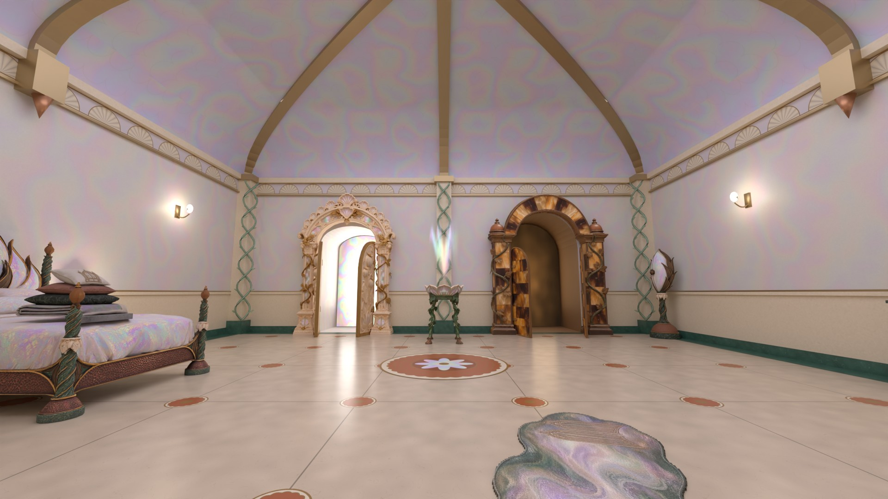
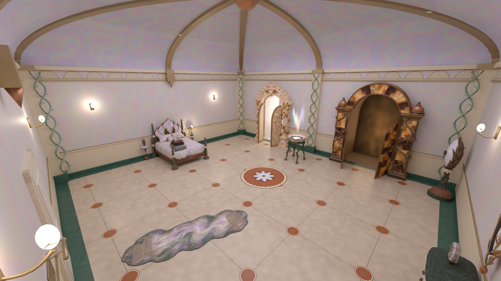
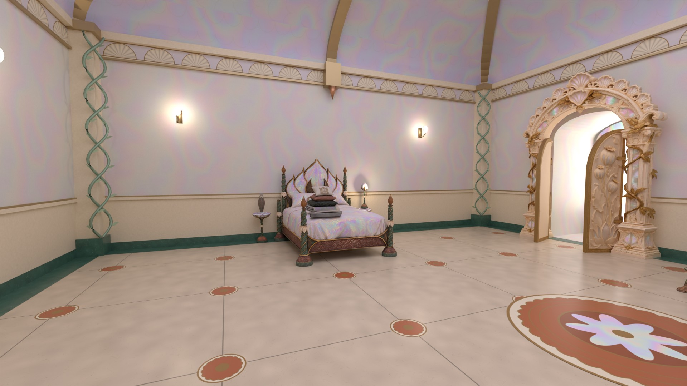
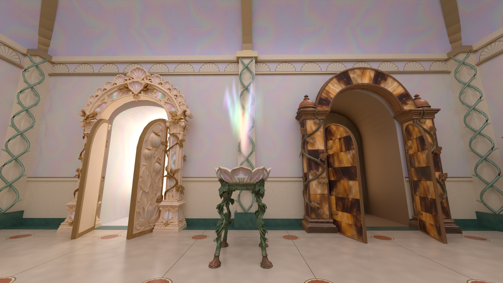

# rdwe_god_oneiros: Oneiros, The Gates of Horn and Ivory

The fifth of the six Right Door, Wrong Exit god rooms (`docs/BLENDER_AREAS.md` section 7; the design plan's room 4.5, chapter L), built the way `rdwe_god_nyx` and `rdwe_god_selene` were. A Blender-first scene: a pearl bedchamber 10 x 9 m, walls 3.8 m, an opal cloister vault to 5.5 m on bronze ribs, ivory pilasters wound with twisting verdigris-bronze vines, a scallop frieze, a cream marble floor set with terracotta-copper roundels and one great medallion. It is dressed with the owner's NINETY-NINE Nocturne Oneiros set (13 pieces, as reduced game copies) and five Higgsfield props (the two gates, their leaves, the brazier), baked at night (R1 lightmaps plus base colour) and exported as art only.

The trick, "two gates, one lies" (Penelope's dream, Odyssey 19): the north wall holds two gates. The Gate of Ivory (west) is carved, pearl-set and lit; through it a short passage ends in a bright pearl haze. The Gate of Horn (east) is plain and dull; its passage ends in an amber dusk. Ivory is the false dream: it loops the walker back in through the south door, and the room is a little more wrong each time (the furniture on the other side, the mirror empty, the clock face reversed). Horn is the true one, the way on to Thanatos. The hints: the runner's swirl points at the horn gate, and grains of sand rise out of the hourglass.

| File | What it is |
|---|---|
| `world/rdwe_god_oneiros.glb` | the art: 7.85 MB, 277 290 triangles drawn (every node counted; the file holds the same), 49 draw calls, Draco geometry, WebP textures |
| `world/lightmaps/rdwe_god_oneiros_0.webp` .. `_3.webp` | the baked light, four maps on the second UV set (`TEXCOORD_1`) |
| `blender/scenes/rdwe_god_oneiros.blend` | the saved scene (38 MB, Git LFS): `Art`, `Export` (merged by material, with the lightmap UVs, the furniture under `grp_furniture`), `Layout` (the exporter's objects), `Lights` |
| `blender/models/rdwe_oneiros/*_game.glb`, `ledger.csv` | the 18 reduced game copies (13 furniture pieces, 5 props) and their ledger |
| `tools/blender/build_rdwe_oneiros.py` | the re-runnable build: copies, art, bake, export, render (built on `build_rdwe_selene.py`) |
| `docs/renders/rdwe_god_oneiros/` | the four review stills (this folder) |

Nothing shared was changed: `tools/webp_glb.py` is used as it is on `main`; `index.html`, `shared/`, the manifest, the tests and `games/rdwe/` are untouched. `.gitignore` gains `blender/work/` (the build's work folder and the local copy of the originals; neither is committed).

## Review stills (Cycles on a rented GPU, 128 samples adaptive, OIDN, 1920 x 1080 JPEG, no metadata)

The page draws baked materials unlit with no tone mapping, so the stills use the Standard view transform at exposure 0, with the lights at the energies the lightmaps were normalised to. They are path-traced: they show gloss and the smoke's glow that the page draws more flatly.

| | |
|---|---|
| `1_arrival.jpg` (259 KB) | the arrival point (0, -3.9) inside the south door, at the walker's eye 0.95 m, facing north: the two gates, the brazier's opal smoke between them, the runner |
| `2_wide.jpg` (278 KB) | the whole room from high in the south-east |
| `3_bedchamber.jpg` (254 KB) | the bed on the west wall, the opal lamp on its vine table, the seed-pod vase, the textiles; the ivory gate on the right |
| `4_gates.jpg` (276 KB) | the trick: both gates from the medallion, eye height. Ivory (left) lit and pearly, its passage bright; horn (right) plain, its passage dim |






Five more were made for the owner sheet and are not committed: each gate close up, the wall mirror with its picture of the room, the first wrong room (the furniture mirrored, from the arrival point) and a plan cut at 3.3 m.

## Sources and licences

| What | Source | Licence / owner |
|---|---|---|
| The 13 furniture pieces ON-00 .. ON-12 | the owner's Higgsfield NINETY-NINE Nocturne Oneiros set | the owner's own models; reduced copies made here by the owner's ruling ("God furniture: reduce it"); the originals were only read |
| P1 Gate of Horn, P1L horn leaf, P2 Gate of Ivory, P2L ivory leaf, P15 tripod brazier | Higgsfield image-to-3D props bought for the god rooms (plan section 7); nothing new was bought | the owner's |
| Floor marble with roundels, verdigris marble, pearl, ivory, opal, the scallop frieze, the medallion, the placard, the two passage glows, the smoke | generated with numpy in `build_rdwe_oneiros.py` from fixed seeds | own work |
| The wall mirror's picture | rendered from the baked room by the script | own work |
| All architecture: shell, cloister vault, ribs and boss, pilasters and vines, corbels, mouldings, the door and its casing, the passages, sconces, the placard light, the medallion, the smoke cards, the sand | modelled by the script | own work |

No Poly Haven or other download, no photograph, no Meshy, no paid service. Tools: Blender 5.2.1 LTS (GPL) with Cycles, OpenImageDenoise and the glTF I/O add-on, on a rented cloud GPU; Python with numpy and Pillow.

## The reduced game copies

`--stage copies` reads each original (about 2 M triangles and 70 MB for the big pieces), welds a copy and collapses it in two passes to its budget (Nyx's ledger budgets), gives it a fresh UV0 (smart project), and bakes the original's base colour onto it (Cycles, selected to active, as emission). The props come normalised to 1.9 m: both gates are scaled to 3.3 m tall (so they read as a pair; the horn gate comes out 2.78 m wide, the ivory 2.32 m), the leaves to 2.4 m and the brazier to 1.1 m. Normal and metal-rough maps are dropped (R1). Each copy is centred, standing on z = 0. The gates were generated open (frame only), so nothing had to be cut.

| Code | Piece | Original triangles | Game triangles | Base colour | GLB |
|---|---|---|---|---|---|
| ON-00 | opal bud lamp | 1 972 006 | 15 000 | 1024 | 1.09 MB |
| ON-01 | bedside table (placed twice, two meshes) | 1 911 425 | 14 999 | 1024 | 1.06 MB |
| ON-02 | armchair | 1 981 419 | 17 999 | 1024 | 1.22 MB |
| ON-03 | dresser | 1 866 745 | 17 998 | 1024 | 1.26 MB |
| ON-04 | tall cabinet | 1 906 399 | 17 999 | 1024 | 1.15 MB |
| ON-05 | bed | 1 977 775 | 23 999 | 2048 | 2.39 MB |
| ON-06 | wall mirror | 1 977 630 | 15 000 | 1024 | 0.94 MB |
| ON-07 | writing desk | 1 906 582 | 17 999 | 1024 | 1.27 MB |
| ON-08 | table clock | 675 369 | 14 999 | 512 | 0.68 MB |
| ON-09 | hourglass | 682 833 | 15 000 | 512 | 0.65 MB |
| ON-10 | seed-pod vase | 756 872 | 14 999 | 512 | 0.66 MB |
| ON-11 | opal swirl runner (a flat 12 mm slab: 2k triangles, below the 15k floor on purpose, as Nyx's runner) | 115 880 | 2 000 | 1024 | 0.41 MB |
| ON-12 | textiles | 1 328 027 | 14 999 | 1024 | 0.75 MB |
| P1 | Gate of Horn, frame (2.78 x 3.30 x 0.53 m) | 28 449 | 11 999 | 1024 | 0.88 MB |
| P1L | horn leaf (used twice, two meshes) | 26 358 | 3 992 | 1024 | 0.48 MB |
| P2 | Gate of Ivory, frame (2.32 x 3.30 x 0.54 m) | 30 484 | 11 998 | 1024 | 1.11 MB |
| P2L | ivory leaf (used twice, two meshes) | 30 205 | 3 998 | 1024 | 0.45 MB |
| P15 | tripod brazier (0.80 x 1.10 m) | 30 986 | 8 972 | 1024 | 0.97 MB |

`ledger.csv` has the same with dimensions, offsets, scales and each file's bytes. Each GLB comes out of the copies stage with its baked base colour as JPEG and then went through `python tools/webp_glb.py <copy> <copy> 90`. To keep the room under 8 MB, five small or flat pieces have their base colour scaled to 512 px **in the room only** (`ROOM_TEX`: the lamp, the bedside tables, the wall mirror, both leaves); the game copies keep their ledger sizes.

## Budgets (measured)

| | Limit | Measured |
|---|---|---|
| `world/rdwe_god_oneiros.glb`, lightmaps aside | at most 8 MB | **7.85 MB** (14.8 MB from Blender with Draco, then `tools/webp_glb.py` q85: textures 11.3 to 4.38 MB, geometry bytes asserted identical) |
| triangles | at most 300 000 | **277 290 drawn**, every node counted, the four gate leaves and both bedside tables included (each has its own mesh; no node shares a mesh, so the file holds the same 277 290): furniture 217 989, props 48 949 (frames 23 997, four leaves 15 980, brazier 8 972), architecture and decor 10 352. `glb_inspect.py --budget tris=300000,mb=8`: **tris pass** (277 290), **mb pass** (7.49 MiB) |
| draw calls | at most 250 | **49** (44 materials, 48 meshes: the room merged by material, the door leaves and the `decor_` nodes their own) |
| textures | WebP | **30 images, all `image/webp`** (bed 2048, the rest 1024 or 512, the mirror's picture 320 x 595) |
| lightmaps | at most 4, at most 2048, WebP q90 | **4**: 55 + 169 + 107 + 122 KB |

| Map | Page | Texel density | `lightmap_intensity` | On it |
|---|---|---|---|---|
| `_0` | 1024 | 32.1 px/m | 5.2980 | floor, border, walls, dado, frieze, mouldings, the door and its casing and reveal, the placard, the medallion, both passages |
| `_1` | 1024 | 38.1 px/m | 2.1118 | the vault, its ribs and boss, the pilasters' capitals, the vines and leaves, the corbels' pods |
| `_2` | 768 | 64.5 px/m | 2.6765 | bed, bedside tables, armchair, dresser, cabinet, desk, wall mirror, runner |
| `_3` | 768 | 52.5 px/m | 3.6100 | lamp, clock, hourglass, vase, textiles, both gates, the four leaves, the brazier |

Bake: Cycles on the GPU (OptiX), 512 samples, diffuse direct and indirect, 8 px margin, OIDN; 31 + 23 + 21 + 18 s.

### How bright: what the page will show

Displayed value = base colour x lightmap texel x `lightmap_intensity` / pi, no tone mapping; 1.0 is white. The bake measures it per material (200 000 points by area); `scratchpad/lab_display.py` on the uncompressed export with the same lightmaps gives the same figures to the second decimal. One exposure k for all maps: the brightest main p90 to `--target 0.9` unless a main surface's p99 would pass `--clip-cap 0.98`. Here the cap binds (the pearl wall right by the sconces, p99 0.98): k = 0.5120. The room reads: **the walls' pearl p50 0.41, the floor's marble p50 0.40, the vault 0.28, the ivory dado 0.27**. Main surfaces are the shell's (floor, pearl, ivory, vault) and every furniture piece and prop, the lamp's own body aside.

| Material | p50 | p90 | p99 |
|---|---|---|---|
| Oneiros_P2L_gate_ivory_leaf | 0.308 | 0.656 | 0.736 |
| Oneiros_P2_gate_ivory | 0.297 | 0.613 | 0.914 |
| Floor_Stone | 0.404 | 0.517 | 0.565 |
| Wall_Pearl | 0.406 | 0.511 | 0.980 |
| Oneiros_ON-05_bed | 0.040 | 0.469 | 0.583 |
| Oneiros_ON-11_runner | 0.000 | 0.439 | 0.614 |
| Ivory | 0.267 | 0.422 | 0.529 |
| Oneiros_ON-06_wall_mirror | 0.051 | 0.373 | 0.596 |
| Vault_Opal | 0.280 | 0.350 | 0.422 |
| Oneiros_ON-01_bedside_table | 0.055 | 0.339 | 0.654 |
| Oneiros_ON-02_armchair | 0.059 | 0.286 | 0.382 |
| Oneiros_ON-08_clock | 0.103 | 0.260 | 0.380 |
| Oneiros_P15_brazier | 0.036 | 0.248 | 0.777 |
| Oneiros_ON-04_tall_cabinet | 0.031 | 0.238 | 0.465 |
| Oneiros_ON-12_textiles | 0.041 | 0.237 | 0.440 |
| Oneiros_ON-09_hourglass | 0.050 | 0.223 | 0.348 |
| Oneiros_P1L_gate_horn_leaf | 0.076 | 0.221 | 0.315 |
| Oneiros_ON-03_dresser | 0.021 | 0.211 | 0.380 |
| Oneiros_P1_gate_horn | 0.052 | 0.191 | 0.501 |
| Oneiros_ON-10_seed_pod_vase | 0.058 | 0.169 | 0.304 |
| Oneiros_ON-07_writing_desk | 0.021 | 0.134 | 0.357 |
| not held: Oneiros_ON-00_lamp | 0.103 | 0.520 | 0.806 |
| not held: Passage_Ivory | 0.822 | 1.240 | 1.334 |
| not held: Medallion | 0.351 | 0.681 | 0.761 |
| not held: Door_Ivory | 0.000 | 0.468 | 0.513 |
| not held: Scallop_Frieze | 0.351 | 0.469 | 0.519 |
| not held: Placard | 0.345 | 0.381 | 0.394 |
| not held: Bronze | 0.186 | 0.260 | 0.343 |
| not held: Copper | 0.209 | 0.256 | 0.405 |
| not held: Vine_Leaf | 0.126 | 0.226 | 0.268 |
| not held: Vine_Verdigris | 0.110 | 0.182 | 0.234 |
| not held: Passage_Horn | 0.094 | 0.126 | 0.148 |
| not held: Verdigris_Marble | 0.038 | 0.067 | 0.113 |
| not held: Reveal_Dark | 0.000 | 0.000 | 0.000 |

**What clips:** no main surface's p99 passes 0.98 (the highest is the pearl wall's, the cap). The ivory passage clips on purpose (28 % of it at 1.0 or more): it is the false dream's light, a white haze seen through the gate. A p50 near 0 on the furniture, the runner and the door leaf is their unlit undersides, backs and the faces against the walls. The verdigris marble (skirting, border, plinths) is a dark green by design.

**The light:** a 420 W lilac-white area light under the vault's crown is the even part; six 9 W warm vine sconces (two each on the west, east and south walls); the opal lamp at 12 W; the ivory passage's area light (55 W, warm pearl) out through its gate and a 55 W spot from the vault onto the ivory gate, so it glows; the horn passage's 18 W dull amber; a 7 W lilac glow in the brazier's bowl; a 0.09 W picture light on the placard. Light levels are constants in the script; the bake resets them first and saves them times k. The first pass had the ivory lights at 140 + 160 W: the ivory gate then held the exposure and everything else went dim (walls p50 0.17, k 0.23); the rebalance raised the room to the figures above.

Materials without a lightmap, which the page keeps as exported: `Lamp_Emit` (the sconces' opal buds), `Lamp_Bulb_Emit` (the lamp's glow, `decor_lamp_glow`), `Sconce_Bronze`, `Picture_Light_Emit`, `Glow_Ivory` and `Glow_Horn` (the passages' end walls, emissive textures 2.5 and 0.8), `Smoke_Opal` (the brazier's three smoke cards: RGBA texture, alpha blended, emissive), `Brazier_Glow`, `Mirror_View` (the wall mirror's picture, emissive 0.9) and `Sand_Glow`. The glows, the smoke, the picture and the sand are camera-only in the bake: they light nothing.

## The checks

`world/rdwe_god_oneiros.glb` read as the page would (JSON level; no three.js run here):

```
PASS GLB 7.85 MB (at most 8 MB, lightmaps aside)
PASS 277290 triangles drawn, every node counted (277290 in the file) (at most 300 000)
PASS 49 draw calls (primitives over nodes), 44 materials, 48 meshes
PASS 30 images, all {'image/webp'}
PASS Draco geometry (KHR_draco_mesh_compression required: the loader needs a DRACOLoader)
PASS material extras carry only ['lightmap', 'lightmap_intensity']
PASS no extras on nodes, meshes, scenes or the asset (0)
PASS world/lightmaps/rdwe_god_oneiros_0.webp exists (55 KB), 11 materials
PASS world/lightmaps/rdwe_god_oneiros_1.webp exists (169 KB), 5 materials
PASS world/lightmaps/rdwe_god_oneiros_2.webp exists (107 KB), 8 materials
PASS world/lightmaps/rdwe_god_oneiros_3.webp exists (121 KB), 10 materials
PASS 4 lightmaps (at most four)
PASS every lightmapped primitive has TEXCOORD_1
PASS door leaves are their own nodes: DoorLeaf_Oneiros_In, DoorLeaf_Oneiros_Ivory_L, DoorLeaf_Oneiros_Ivory_R, DoorLeaf_Oneiros_Horn_L, DoorLeaf_Oneiros_Horn_R
PASS grp_furniture: identity, 15 children (the 11 merged furniture meshes, decor_clock, decor_lamp_glow, decor_mirror_view, decor_sand_up)
INFO own nodes: decor_brazier_glow, decor_clock, decor_lamp_glow, decor_mirror_view, decor_sand_up, decor_smoke_0, decor_smoke_1, decor_smoke_2
INFO materials without a lightmap: Brazier_Glow, Glow_Horn, Glow_Ivory, Lamp_Bulb_Emit, Lamp_Emit, Mirror_View, Picture_Light_Emit, Sand_Glow, Sconce_Bronze, Smoke_Opal
PASS no layout object (COL_, Zone_, Marker_, Link_, Arrive_, Spot_) in the GLB
PASS: all checks
```

Privacy: the GLB, the lightmaps, the copies, the stills and the decompressed `.blend` hold no user name, absolute path, host or session id (the `.blend`'s only image paths are `//generated/*.png`); the stills carry no JPEG comment or APP1 segment (APP0, DQT, SOF, DHT only).

**`world/rdwe_god_oneiros.json` and `worlddoc check`:** not produced; `tools/blender/export_scene.py` is not on `main`. The exporter's objects are in the `.blend`'s `Layout` collection, named as BLENDER_AREAS part 2 asks (Blender coordinates, x east, y north; game = (x, z, -y)):

- **The gates, measured from the placed copies** (rays through each frame): ivory opening centred at x -2.29, 1.37 m wide, its elliptic arch springing at 2.17 m to 2.54 m; horn centred at x 2.41, 1.67 m wide, springing at 2.02 m to 2.88 m. The frames stand against the north wall (y 3.96 .. 4.50). Behind each the wall is open (the arch plus 5 cm, its cut hidden behind the posts) onto a passage 1.5 m deep (y 4.5 .. 6.0).
- **`COL_` boxes:** the floor; W and E walls; the S wall in three round the way in plus `COL_door_in` (it stays shut); the N wall in three pieces between and beside the openings (`COL_wall_N_a/b/c`) and a head over each (`COL_wall_N_head_ivory/horn`); each passage's sides and back (`COL_passage_<gate>_W/E/back`); each gate's two posts (`COL_gate_<gate>_post_W/E`); the four open leaves (`COL_leaf_<gate>_L/R`, their boxes as they stand); the brazier; five pilasters. The furniture's boxes come twice: **`COL_furn_*`** (bed, both bedside tables, dresser, cabinet, desk, armchair, as built) and **`COL_wrong1_*`** (the same mirrored about x = 0, for the first wrong room). The openings and the passages' fronts have no collider.
- `Marker_Spawn` (0, -3.9) facing N; `Marker_Entrance` (0, -4.2); `Marker_Exit` (2.41, 5.1) facing N (in the horn passage).
- `Arrive_Oneiros_In` (0, -3.9) facing N (from Morpheus's wardrobe); `Arrive_Oneiros_S` (0, -3.9) facing N (where the ivory loop lands).
- `Link_Oneiros_Ivory` (-2.29, 5.1), `to_scene` = `rdwe_god_oneiros`, `to_arrive` = `Arrive_Oneiros_S`; `Link_Oneiros_Horn` (2.41, 5.1), `to_scene` = `rdwe_god_thanatos`, `to_arrive` = `Arrive_Thanatos_In`.
- `Zone_trigger_ivory` (x -2.98 .. -1.61, y 4.8 .. 5.45, to 2.17 m) and `Zone_trigger_horn` (x 1.57 .. 3.25, y 4.8 .. 5.45, to 2.02 m): inside each passage, 0.3 m past the wall.
- `Spot_gate_ivory` (-2.29, 3.16), `Spot_gate_horn` (2.41, 3.17), `Spot_runner` (0.6, -2.4), `Spot_hourglass` (on the desk), `Spot_clock` (on the dresser).
- Door leaves in the art: `DoorLeaf_Oneiros_In` (south wall, origin on its west edge, closed); `DoorLeaf_Oneiros_Ivory_L` / `_R` and `DoorLeaf_Oneiros_Horn_L` / `_R`, each with its origin on the hinge, the inner face of its post (L the west post, R the east), **standing open 72 degrees into the room** (`swing_deg` -72 for L, +72 for R; rotate each about the vertical by the opposite to close it).

The GLB's bounds are x -5.11 .. 5.11, game y 0 .. 5.5, game z -6.0 .. 4.86 (Blender y -4.86 .. 6.0, the reveal and the passages included).

## Choices the plan left open

- **The gates' positions and size.** Both frames are 3.3 m tall so they read as a pair. The horn frame comes out 2.78 m wide (the plan said 2.4), so it sits at x 2.45 (frame x 1.06 .. 3.84) to clear the tall cabinet; the ivory gate at x -2.3. The plan said +-2.2.
- **The leaves stand open.** The walker must be able to choose either gate with no code, so all four leaves stand open 72 degrees into the room, hinged on the posts. Each leaf is fitted to half its opening (ivory 0.675 m, horn 0.825 m) and to the arch's foot (2.14 m, 1.99 m); the ivory leaf is stretched 1.37 times in height to do so (its generator made it wider than the plan). The `_L` leaves are the copies mirrored; each leaf has its own mesh, for its own lightmap texels.
- **The three wrong rooms** (plan: "three sets, then it repeats the third"). They are cumulative, and cost no triangles:
  1. **The bed on the other side:** the scene code mirrors **`grp_furniture`** about x = 0 (`grp_furniture.scale.x = -1`; three.js flips the winding of a negative-determinant node) and swaps the `COL_furn_*` colliders for `COL_wrong1_*`. The whole bedchamber changes sides: the bed on the east wall, the dresser, mirror, desk and cabinet on the west. The runner, the gates, the medallion and the brazier stay put (the hint still points at the horn gate). The lamp's glow moves with it; its baked light on the wall stays (a dream).
  2. **The mirror empty:** hide **`decor_mirror_view`**, the picture of the room in the wall mirror's glass (rendered from the glass after the bake); what is left is the copy's own blank grey glass.
  3. **The clock face reversed:** mirror **`decor_clock`** across its width about its own origin (the node's origin is the clock's base centre; in its local axes `decor_clock.scale.z = -1`).
- **The clock runs backward / the sand runs up.** The copy's hands are baked into it, so they cannot turn; the clock's "backward" is left to the third wrong room's mirrored face. The sand is **`decor_sand_up`**: sixteen grains rising out of the hourglass's top, for the code to drift upward and wrap.
- **The brazier's opal smoke** is three crossed soft cards (`decor_smoke_0..2`, alpha blended) and a glow in the bowl (`decor_brazier_glow`); the code may turn and drift them.
- **The vault:** a cloister vault (rising from all four walls to a crown) with bronze ribs from the four corners and the four wall middles, a copper boss at the crown. Ivory pilasters with the vines stand in the four corners and between the gates; bronze corbels with a copper seed pod carry the other three middle ribs (over the door and above the bed and the dresser).
- **The floor medallions:** a terracotta-copper roundel where every four 1.5 m tiles meet (in the floor's texture), and one great medallion, 1.7 m across, an opal flower on copper, between the runner and the brazier.
- **The runner** points its long axis at the horn gate (16 degrees east of north).
- **The wall mirror's picture** is a still: it does not follow the walker.

## What the coordinator must wire

RDWE does not load through the Farway manifest, so `shared/farway.manifest.js` and its test are not changed here.

1. **The Blender-room loader** (plan section 6a), the same as for Nyx and Selene: GLTFLoader with a **DRACOLoader** and `EXT_texture_webp`, then the `applyLightmaps` treatment for the 34 materials whose extras carry `lightmap` and `lightmap_intensity` (unlit `MeshBasicMaterial`, `lightMap` on channel 1, sRGB, `flipY = false`). Keep node transforms as they are (the scene code mirrors `grp_furniture` and `decor_clock`).
2. **`walk.js` `SCENES`:** `rdwe_god_oneiros: () => import('./scenes/rdwe_god_oneiros.js')` after `rdwe_god_morpheus` (chain order, plan 2.1), and `RDWE_ORDER` in `index.html` likewise. The scene module, with `meta.chapter` L ("The Gates of Horn and Ivory", "The Choice", rot -1.0deg, stamp "DREAMS: TRUE 1 / FALSE 1", the caption and log of plan 2.4), objective "CHOOSE", arrive "THE TRUE GATE", is not part of this PR.
3. **The trick in scene code:**
   - **Ivory:** when the walker enters `Zone_trigger_ivory`, `ctx.controls.setPosition` to `Arrive_Oneiros_S` (0, -3.9; game (0, eye, 3.9)), yaw kept (the walker was facing north, and arrives facing north), and show the next wrong room (above): pass 1 mirror `grp_furniture` and swap `COL_furn_*` for `COL_wrong1_*`; pass 2 also hide `decor_mirror_view`; pass 3 and after also mirror `decor_clock`.
   - **Horn:** `Zone_trigger_horn` becomes `built.trigger`: the exit, to `rdwe_god_thanatos` / `Arrive_Thanatos_In`.
   - Optional: drift `decor_sand_up` upward and wrap it; turn and fade `decor_smoke_*`; swing the leaves.
4. **Colliders:** every `COL_` box except `COL_wrong1_*` at the start; the bounds are the room plus the two passages (x -5 .. 5, y -4.5 .. 6.0).
5. **Lights:** add none; the vault glow, the sconces, the lamp, the passages, the spot on the ivory gate and the brazier are in the lightmaps.

## Rebuild

From the repo root, with Blender 5.2 and Python with numpy and Pillow (every Blender stage ran on the rented GPU with `--device auto`, OptiX):

```
# the 13 originals and P1, P1L, P2, P2L, P15 into the git-ignored blender/work/oneiros_source/ (read only)
blender -b --factory-startup --python tools/blender/build_rdwe_oneiros.py -- --stage copies
blender -b --factory-startup --python tools/blender/build_rdwe_oneiros.py -- --stage all --samples 512     # art, bake (and the mirror's picture), export, render
for f in blender/models/rdwe_oneiros/*_game.glb; do python tools/webp_glb.py $f $f 90; done
python -c "from PIL import Image; import glob,os; [Image.open(p).convert('RGB').save('world/lightmaps/'+os.path.basename(p)[:-4]+'.webp','WEBP',quality=90,method=6) for p in glob.glob('blender/work/farway_rdwe_god_oneiros/rdwe_god_oneiros_[0-9].png')]"
python tools/webp_glb.py blender/work/farway_rdwe_god_oneiros/rdwe_god_oneiros_raw.glb world/rdwe_god_oneiros.glb 85
```

The `all` stage reads the copies as the copies stage writes them (JPEG base colours); convert them to WebP after it, as above. Timings on the box: copies 18 pieces in about 16 min; art, bake (about 1.5 min), the mirror's picture, export and the nine stills together about 6 min. The committed outputs: the copies from one `--stage copies` run, the rest from the second `--stage all` run (the first one's ivory lights held the exposure and left the room dim, its wall and vault shimmer was too strong, and its vines spiralled mostly inside the walls; nothing else changed).

## Open

- **The scene module** (`scenes/rdwe_god_oneiros.js`, the loop, the wrong rooms, the sand) is the coordinator's, as for the other god rooms.
- **The clock's hands** cannot run backward (baked into the copy); the reversed face stands in.
- **Gilt and bronze on the page** are a flat warm brown (drawn unlit; the stills show Cycles' metal).
- **The coordinator's choices from the plan still open:** chapter letter L, the audio and the clips (`L.mp3`, `l.MP4`, `L.mp4`).
