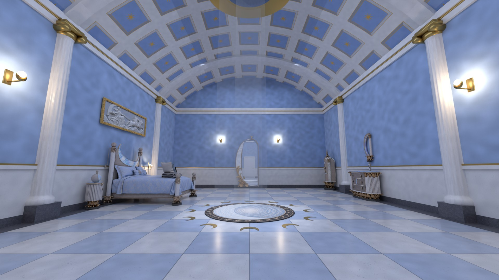
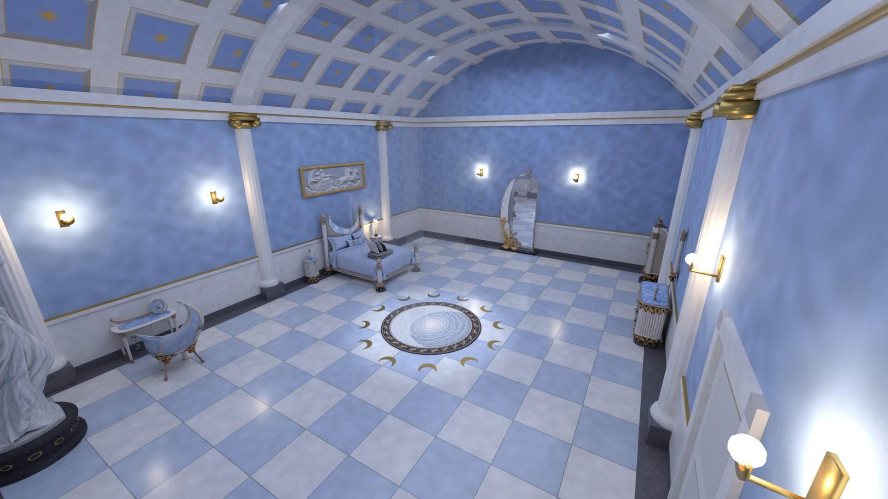
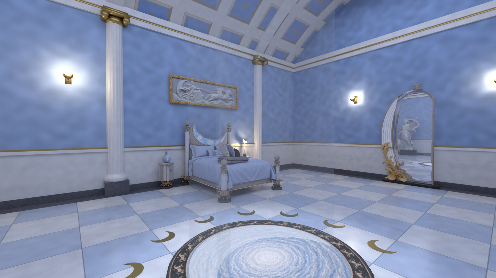
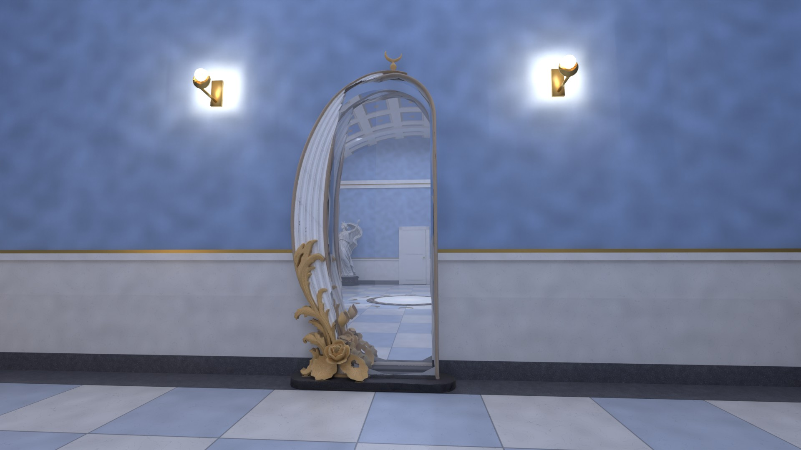

# rdwe_god_selene: Selene, The Moon Gallery

The second of the six Right Door, Wrong Exit god rooms (`docs/BLENDER_AREAS.md` section 7; the design plan's room 4.2, chapter I), built the way `rdwe_god_nyx` was. A Blender-first scene: a white marble bedchamber 8 x 11 m, walls 4.2 m, a coffered barrel vault to 6.0 m with a round oculus, Ionic half-columns on the long walls, moon-blue plaster, dressed with the owner's NINETY-NINE Nocturne Selene set (13 pieces, as reduced game copies) and three Higgsfield props, baked at night (R1 lightmaps plus base colour) and exported as art only.

The trick, "the mirror is a door": the pier mirror at the centre of the north wall is open. Behind it is the room's reflection, the same room mirrored about the north wall (y = 5.5), real space the walker walks into with no teleport. The real room's oculus shows a crescent moon and its moonlight lies on the rug as a crescent; in the reflection the moon is full and so is its pool of light. On the real room's east wall a door is only paint (`decor_painted_door`, at (4, -2.5)): no knob to turn, a painted shadow at its foot. In the reflection the same door, at (4, 13.5), is real (`DoorLeaf_Selene_Painted`): a knob, and light under it. It is the exit, to Hypnos.

| File | What it is |
|---|---|
| `world/rdwe_god_selene.glb` | the art: 7.53 MB, 260 681 triangles in the file (520 650 drawn with the reflection), 73 draw calls, Draco geometry, WebP textures |
| `world/lightmaps/rdwe_god_selene_0.webp` .. `_3.webp` | the baked light, four maps on the second UV set (`TEXCOORD_1`) |
| `blender/scenes/rdwe_god_selene.blend` | the saved scene (33 MB, Git LFS): `Art`, `Export` (merged by material, with the lightmap UVs), `Reflection` (`grp_reflection` and its mirrored twins), `Layout` (the exporter's objects), `Lights` and `Lights_Refl` |
| `blender/models/rdwe_selene/*_game.glb`, `ledger.csv` | the 16 reduced game copies (13 furniture pieces, 3 props) and their ledger |
| `tools/blender/build_rdwe_selene.py` | the re-runnable build: copies, art, bake, export, render (built on `build_rdwe_nyx.py`) |
| `docs/renders/rdwe_god_selene/` | the four review stills (this folder) |

Nothing shared was changed: `tools/webp_glb.py` is used as it is on `main`; `index.html`, `shared/`, the manifest, the tests and `games/rdwe/` are untouched. `.gitignore` gains `blender/work/` (the build's work folder and the local copy of the originals; neither is committed).

## Review stills (Cycles on a rented GPU, 128 samples adaptive, OIDN, 1920 x 1080 JPEG, no metadata)

The page draws baked materials unlit with no tone mapping, so the stills use the Standard view transform at exposure 0, with the lights at the energies the lightmaps were normalised to. They are Blender path-traced: they show gloss, reflections and the glass's sheen that the page will not.

| | |
|---|---|
| `1_arrival.jpg` (265 KB) | the arrival point (0, -4.6) inside the south door, at the walker's eye 0.95 m, facing north, 72 degrees vertical; the pier mirror at the far end already shows the room going on |
| `2_wide.jpg` (274 KB) | the whole room from high in the south-east |
| `3_bedchamber.jpg` (261 KB) | the bed under the chariot relief, the crescent lamp, the moon flask; the pier mirror on the right |
| `4_mirror.jpg` (167 KB) | the trick: at the pier mirror, eye height. Through the glass, the reflection: the reflected way in and the statue at its far end, the rug with its full-moon pool |






Five more were made for the owner sheet and are not committed: the real oculus (crescent) and the reflection's (full moon) seen from below, the painted door, the real door in the reflection, and a plan cut at 4.1 m.

## Sources and licences

| What | Source | Licence / owner |
|---|---|---|
| The 13 furniture pieces SE-00 .. SE-12 | the owner's Higgsfield NINETY-NINE Nocturne Selene set | the owner's own models; reduced copies made here by the owner's ruling ("God furniture: reduce it"); the originals were only read |
| P3 crescent pier mirror, P8 statue of Selene, P19 chariot relief | Higgsfield image-to-3D props bought for the god rooms (plan section 7); nothing new was bought | the owner's |
| Floor marble, granite, white marble, moon-blue plaster, the vault's coffer, the placard, the painted door, the two sky discs | generated with numpy in `build_rdwe_selene.py` from fixed seeds | own work |
| All architecture: shell, vault and ribs, oculus, Ionic half-columns, mouldings, doors and casings, sconces, the placard light, the floor's gilt crescents, the crescent on its granite block, the mirror glass, the moonlight shafts and pools | modelled by the script | own work |

No Poly Haven or other download, no photograph, no Meshy, no paid service. Tools: Blender 5.2.1 LTS (GPL) with Cycles, OpenImageDenoise and the glTF I/O add-on, on a rented cloud GPU; Python with numpy and Pillow.

## The reduced game copies

`--stage copies` reads each original (about 2 M triangles and 70 MB for the big pieces), welds a copy and collapses it in two passes to its budget (Nyx's ledger budgets), gives it a fresh UV0 (smart project), and bakes the original's base colour onto it (Cycles, selected to active, as emission). The props come normalised to 1.9 m and are scaled to the plan: the mirror and the statue by height (2.7 m, 2.5 m), the relief by width (2.2 m, keeping its proportions: 0.73 m tall). Normal and metal-rough maps are dropped (R1). Each copy is centred, standing on z = 0. Two copies needed more than a decimation:

- **P3, the pier mirror:** the generator filled the opening with a flat grey panel, as the plan foresaw. Before decimating, the copy loses every face of that panel inside the opening (up to the crescent's inner edge, read from the original's front view, and under the arch), so the frame is open; the plinth is kept (a 10 cm threshold with no collider). The bake still reads the original, so the frame keeps its colour.
- **SE-09, the hourglass:** the manifest notes a sliver and a fragment left under it; the copy drops the loose part outside the main body (the hourglass itself is 0.07 x 0.10 x 0.28 m).

| Code | Piece | Original triangles | Game triangles | Base colour | GLB |
|---|---|---|---|---|---|
| SE-00 | crescent lamp | 1 985 258 | 15 000 | 1024 | 1.23 MB |
| SE-01 | bedside table (placed twice, two meshes) | 1 927 097 | 15 000 | 1024 | 1.02 MB |
| SE-02 | crescent armchair | 1 863 989 | 17 999 | 1024 | 1.21 MB |
| SE-03 | dresser | 1 914 390 | 18 000 | 1024 | 1.21 MB |
| SE-04 | tall cabinet | 1 964 668 | 17 999 | 1024 | 1.23 MB |
| SE-05 | bed | 1 940 214 | 24 000 | 2048 | 2.48 MB |
| SE-06 | crescent wall mirror | 1 976 892 | 15 000 | 1024 | 1.01 MB |
| SE-07 | writing desk | 1 930 259 | 17 999 | 1024 | 1.16 MB |
| SE-08 | moon-phase clock | 585 377 | 14 999 | 512 | 0.54 MB |
| SE-09 | hourglass | 719 364 | 15 000 | 512 | 0.58 MB |
| SE-10 | moon flask | 797 179 | 14 999 | 512 | 0.63 MB |
| SE-11 | round rug with horses (a flat 12 mm slab: 2k triangles, below the 15k floor on purpose, as Nyx's runner) | 322 652 | 2 000 | 1024 | 0.39 MB |
| SE-12 | textiles | 1 441 309 | 14 999 | 1024 | 0.73 MB |
| P3 | crescent pier mirror (1.30 x 2.70 x 0.33 m) | 30 151 | 11 999 | 1024 | 0.82 MB |
| P8 | statue of Selene (2.5 m) | 30 623 | 11 999 | 1024 | 0.80 MB |
| P19 | chariot relief (2.2 x 0.73 m) | 30 234 | 7 991 | 1024 | 0.76 MB |

`ledger.csv` has the same with dimensions, offsets, scales and each file's bytes. Each GLB comes out of the copies stage with its baked base colour as JPEG and then went through `python tools/webp_glb.py <copy> <copy> 90`.

## Budgets (measured)

| | Limit | Measured |
|---|---|---|
| `world/rdwe_god_selene.glb`, lightmaps aside | at most 8 MB | **7.53 MB** (11.6 MB from Blender with Draco, then `tools/webp_glb.py` q85: textures 8.5 to 4.44 MB, geometry bytes asserted identical) |
| triangles | at most 300 000 | **260 681 in the file**, every mesh held once; **520 650 drawn**, as the reflection draws each of the room's meshes a second time. `glb_inspect.py --budget tris=300000,mb=8`: tris OVER (it counts drawn triangles: 520 650), mb pass (7.18 MB) |
| draw calls | at most 250 | **73** (36 materials, 39 meshes: the room merged by material, the door leaves and the `decor_` nodes, then the 31 twins under `grp_reflection`) |
| textures | WebP | **25 images, all `image/webp`** (bed 2048, floor 1024, the rest 1024 or 512) |
| lightmaps | at most 4, at most 2048, WebP q90 | **4**: 113 + 45 + 150 + 100 KB |

The reflection is instanced as the plan asks: `grp_reflection` (game translation (0, 0, -11), matrix diag(1, 1, -1), a mirror; three.js flips the winding of a negative-determinant node) holds 31 nodes, each reusing a mesh of the real room, so the file holds the furniture once. The plan counts it once (the trees rule of BLENDER.md); `glb_inspect` counts it twice. That is the coordinator's call (see Open).

| Map | Page | Texel density | `lightmap_intensity` | On it |
|---|---|---|---|---|
| `_0` | 1280 | 39.6 px/m | 4.1423 | floor, border, walls, dado, mouldings, gilt, doors, casings, reveals, the painted door, the placard |
| `_1` | 768 | 45.3 px/m | 4.0619 | the vault, its ribs, the columns, the crescent sculpture |
| `_2` | 1024 | 78.8 px/m | 4.2148 | bed, bedside tables, armchair, dresser, cabinet, desk, wall mirror, rug |
| `_3` | 768 | 81.2 px/m | 3.9635 | lamp, clock, hourglass, moon flask, textiles, the three props |

Bake: Cycles on the GPU (OptiX), 512 samples, diffuse direct and indirect, 8 px margin, OIDN; 34 + 22 + 14 + 12 s. The bake runs with the reflection and its mirrored lights in the scene, so the light through the mirror's opening is counted; the twins share the real meshes' lightmap texels, and the light is mirrored with them.

### How bright: what the page will show

Displayed value = base colour x lightmap texel x `lightmap_intensity` / pi, no tone mapping; 1.0 is white. The bake measures it per material (200 000 points by area); `scratchpad/lab_display.py` on the uncompressed export with the same lightmaps gives the same figures to the second decimal. One exposure k for all maps: the brightest main p90 to `--target 0.9` unless a main surface's p99 would pass `--clip-cap 0.98`. Here the cap binds (the rug under the moonlight, p99 0.98): k = 1.0228. Unlike Nyx's first pass, the room reads: **the walls' plaster p50 0.34, the floor's marble p50 0.43, the vault 0.27**. Main surfaces are the shell's (floor, plaster, white marble, vault, columns) and every furniture piece and prop, the lamp's own body aside.

| Material | p50 | p90 | p99 |
|---|---|---|---|
| Selene_SE-11_rug | 0.000 | 0.749 | 0.980 |
| Floor_Marble | 0.426 | 0.543 | 0.863 |
| Column_Marble | 0.334 | 0.476 | 0.906 |
| White_Marble | 0.279 | 0.466 | 0.579 |
| Wall_Plaster | 0.340 | 0.456 | 0.796 |
| Selene_SE-05_bed | 0.073 | 0.444 | 0.562 |
| Selene_SE-07_writing_desk | 0.085 | 0.381 | 0.472 |
| Selene_SE-10_moon_flask | 0.188 | 0.366 | 0.501 |
| Vault_Coffers | 0.273 | 0.353 | 0.388 |
| Selene_SE-03_dresser | 0.029 | 0.350 | 0.551 |
| Selene_P19_chariot_relief | 0.029 | 0.344 | 0.528 |
| Selene_P3_pier_mirror | 0.108 | 0.308 | 0.558 |
| Selene_SE-08_clock | 0.160 | 0.299 | 0.368 |
| Selene_SE-02_armchair | 0.147 | 0.298 | 0.426 |
| Selene_SE-09_hourglass | 0.118 | 0.290 | 0.385 |
| Selene_SE-06_wall_mirror | 0.071 | 0.287 | 0.507 |
| Selene_P8_statue_selene | 0.113 | 0.278 | 0.407 |
| Selene_SE-01_bedside_table | 0.055 | 0.247 | 0.926 |
| Selene_SE-12_textiles | 0.043 | 0.231 | 0.346 |
| Selene_SE-04_tall_cabinet | 0.022 | 0.181 | 0.354 |
| not held: Selene_SE-00_lamp | 0.141 | 0.665 | 0.875 |
| not held: Door_White | 0.000 | 0.443 | 0.497 |
| not held: Painted_Door | 0.367 | 0.422 | 0.470 |
| not held: Placard | 0.309 | 0.338 | 0.354 |
| not held: Gold_Trim | 0.009 | 0.192 | 0.434 |
| not held: Granite | 0.037 | 0.067 | 0.106 |
| not held: Reveal_Dark | 0.000 | 0.000 | 0.000 |

**What clips:** nothing at p99 (the highest main p99 is the rug's 0.980, the cap). A p50 of 0 (the rug, the door leaves) is their unlit undersides and backs, which are half their area. Gilt reads darker on the page than in the stills (its p50 is the backs of capitals and ring faces turned from the light). The granite (border, skirting, plinths) is a dark grey by design; its generated colour was lifted once (p50 0.011 to 0.037).

**The light:** the moonlight is a 900 W cool spot in the oculus on the rug; a 260 W cool area light under the crown is the even part; six 12 W warm crescent sconces (two each on the west and east walls, two flanking the mirror), the crescent lamp at 10 W, and a 0.09 W picture light on the placard. Each has a mirrored copy in `Lights_Refl`. Light levels are constants in the script; the bake resets them first and saves them times k.

Materials without a lightmap, which the page keeps as exported: `Lamp_Emit` (the sconce globes and the lamp's glow), `Sconce_Gilt`, `Picture_Light_Emit`, `Door_Glow` (the light beyond the real door, emissive 4), `Moon_Crescent` and `Moon_Full` (the sky discs, emissive texture), `Mirror_Glass` (alpha 0.10), `Moon_Shaft` (alpha 0.07, emissive) and `Moon_Pool` (alpha 0.45, emissive). The glass, shafts, pools, discs and glows are camera-only in the bake: they light nothing.

## The checks

`world/rdwe_god_selene.glb` read as the page would (JSON level; no three.js run here):

```
PASS GLB 7.53 MB (at most 8 MB, lightmaps aside)
PASS 260681 triangles in the file, 520650 drawn (at most 300 000)
PASS 73 draw calls (primitives over nodes), 36 materials, 39 meshes
PASS 25 images, all {'image/webp'}
PASS Draco geometry (KHR_draco_mesh_compression required: the loader needs a DRACOLoader)
PASS material extras carry only ['lightmap', 'lightmap_intensity']
PASS no extras on nodes, meshes, scenes or the asset (0)
PASS world/lightmaps/rdwe_god_selene_0.webp exists (113 KB), 9 materials
PASS world/lightmaps/rdwe_god_selene_1.webp exists (45 KB), 2 materials
PASS world/lightmaps/rdwe_god_selene_2.webp exists (150 KB), 8 materials
PASS world/lightmaps/rdwe_god_selene_3.webp exists (100 KB), 8 materials
PASS 4 lightmaps (at most four)
PASS every lightmapped primitive has TEXCOORD_1
PASS door leaves are their own nodes: DoorLeaf_Selene_In, DoorLeaf_Selene_Painted
PASS grp_reflection: matrix [[1, 0, 0], [0, 1, 0], [0, 0, -1]] (a mirror in game z; Blender y -> 11 - y), translation [0, 0, -11], 31 children
PASS every reflected node reuses a real node's mesh (31 shared meshes; the file holds them once)
INFO own nodes: decor_mirror, decor_mirror_refl, decor_moon_crescent, decor_moon_full, decor_moonpool_crescent, decor_moonpool_full, decor_moonshaft_crescent, decor_moonshaft_full, decor_painted_door, decor_refl_door_in
INFO materials without a lightmap: Door_Glow, Lamp_Emit, Mirror_Glass, Moon_Crescent, Moon_Full, Moon_Pool, Moon_Shaft, Picture_Light_Emit, Sconce_Gilt
PASS no layout object (COL_, Zone_, Marker_, Link_, Arrive_, Spot_) in the GLB
PASS: all checks
```

(The triangle line passes on the file count, the plan's rule; on the drawn count it would not.) Privacy: the GLB, the lightmaps, the copies, the stills and the decompressed `.blend` hold no user name, absolute path, host or session id (the `.blend`'s only image paths are `//generated/*.png`); the stills carry no JPEG comment or APP1 segment.

**`world/rdwe_god_selene.json` and `worlddoc check`:** not produced; `tools/blender/export_scene.py` is not on `main`. The exporter's objects are in the `.blend`'s `Layout` collection, named as BLENDER_AREAS part 2 asks:

- **`COL_` boxes**, real room: the floor, the W and E walls, the S wall in three round the way in plus `COL_door_in` (the way in stays shut), one per standing piece (bed, both bedside tables, dresser, cabinet, desk, armchair, statue), one per half-column, the crescent block. The reflection's are real mirrored boxes, `COL_r_*` (applied, invisible): the far wall at y 16.5 is solid (the reflected way in is a picture) and so is its east wall (the real door is reached through its zone). The mirror wall, y = 5.5, shared: `COL_wall_N_a` and `_b` either side of the opening and `COL_wall_N_head` over it, 0.36 m deep each side so they hold both frames. **The opening (x -0.42 .. 0.42, 2.45 m to the arch's top) has no collider.**
- `Marker_Spawn` (0, -4.6) facing N; `Marker_Entrance` (0, -5.2); `Marker_Exit` (3.7, 13.5) facing E; `Arrive_Selene_In` (0, -4.6) facing N.
- `Link_Selene_Painted` (3.65, 13.5), `to_scene` = `rdwe_god_hypnos`, `to_arrive` = `Arrive_Hypnos_In`.
- `Zone_trigger_mirror` (the glass, x -0.42 .. 0.42, y 5.3 .. 5.7, up to the spring 2.13 m: informational, the walk-through needs no teleport); `Zone_trigger_painted` (in front of the real door, x 3.55 .. 4.0, y 13.08 .. 13.92); `Zone_reflection` (the whole reflection, y 5.5 .. 16.5).
- `Spot_painted_door` (3.65, -2.5), `Spot_mirror` (0, 4.9).
- Door leaves in the art: `DoorLeaf_Selene_In` (south wall, origin on its west edge, closed) and `DoorLeaf_Selene_Painted` (reflection, east wall at (4, 13.5), origin on its south edge, closed, swings out to the east, `swing_deg` -90).

Layout coordinates are Blender (x east, y north); game = (x, z, -y). The GLB's bounds are x -4.2 .. 4.36, game y 0 .. 6.9 (the sky discs), game z -16.86 .. 5.9 (Blender y -5.9 .. 16.86, the reveals behind the doors included).

## Choices the plan left open

- **The horse head.** The plan names Poly Haven's `horse_head` (CC0) on a granite block at (2.6, -4.7). Nothing was downloaded for this room, so the block carries a white marble crescent moon, horns up (own geometry), at (2.6, -4.85). The horses are on the rug's border and in the chariot relief. The head can replace the crescent later with no other change.
- **The real door and the painted one.** The east wall has the same opening in both halves (one mesh). In the real room a flat painted panel (`decor_painted_door`) covers it; in the reflection a real leaf with a knob, a 2 cm gap at its foot, and a glowing back wall behind (`Door_Glow`: the line of light under the door). The painted knob sits on the south edge, so the real one, mirrored, is on the north edge, hinged on the south.
- **The moon's shape.** Both halves share one lightmap, so the moonlight baked on both rugs is the same round pool. The crescent and the full moon are told by the sky discs and by `decor_moonpool_*` and `decor_moonshaft_*`: a faint crescent of light on the real rug and up the shaft, a full disc in the reflection. These, the two moons, the painted door and its real twin have no twin under `grp_reflection`; everything else does, with `DoorLeaf_Selene_In`'s twin renamed `decor_refl_door_in` and the glass's `decor_mirror_refl`.
- **The mirror's plinth** crosses the opening as a 10 cm granite threshold; it has no collider.
- **The placard** reads mirror-wise in the reflection, as it should.

## What the coordinator must wire

RDWE does not load through the Farway manifest, so `shared/farway.manifest.js` and its test are not changed here.

1. **The Blender-room loader** (plan section 6a), the same as for Nyx: GLTFLoader with a **DRACOLoader** and `EXT_texture_webp`, then the `applyLightmaps` treatment for the 27 materials whose extras carry `lightmap` and `lightmap_intensity` (unlit `MeshBasicMaterial`, `lightMap` on channel 1, sRGB, `flipY = false`). The loader must apply it to **every node that uses those materials, the twins under `grp_reflection` included** (they share the meshes, so swapping the material on the shared mesh does both). Keep node transforms as they are: three.js handles the negative-determinant node.
2. **`walk.js` `SCENES`:** `rdwe_god_selene: () => import('./scenes/rdwe_god_selene.js')` after `rdwe_god_nyx` (chain order, plan 2.1), and `RDWE_ORDER` in `index.html` likewise. The scene module, with `meta.chapter` I ("The Moon Gallery", "The Reflection", rot 0.8deg, stamp "MOON: FULL (IN THE GLASS)", the caption and log of plan 2.4), objective "FIND THE WAY OUT", arrive "THROUGH", is not part of this PR.
3. **The trick in scene code:** nothing to teleport. The walker walks through the mirror's opening (no collider there) into `Zone_reflection`; the exit is `Zone_trigger_painted` in front of the real door, which becomes `built.trigger` (or the door leaf swings -90 degrees about its south edge on the exit). `Spot_painted_door` may be a play.js target that answers that it is paint. Hide nothing at build: every node is shown.
4. **Colliders:** the reflection's are the `COL_r_*` boxes plus the three shared `COL_wall_N_*`; the bounds are the whole 8 x 22 m.
5. **Lights:** add none; the sconces, the lamp, the moonlight and the vault's glow are in the lightmaps.

## Rebuild

From the repo root, with Blender 5.2 and Python with numpy and Pillow (every Blender stage ran on the rented GPU with `--device auto`, OptiX):

```
# the 13 originals and P3, P8, P19 into the git-ignored blender/work/selene_source/ (read only)
blender -b --factory-startup --python tools/blender/build_rdwe_selene.py -- --stage copies
blender -b --factory-startup --python tools/blender/build_rdwe_selene.py -- --stage all --samples 512     # art, bake, export, render
for f in blender/models/rdwe_selene/*_game.glb; do python tools/webp_glb.py $f $f 90; done
python -c "from PIL import Image; import glob,os; [Image.open(p).convert('RGB').save('world/lightmaps/'+os.path.basename(p)[:-4]+'.webp','WEBP',quality=90,method=6) for p in glob.glob('blender/work/farway_rdwe_god_selene/rdwe_god_selene_[0-9].png')]"
python tools/webp_glb.py blender/work/farway_rdwe_god_selene/rdwe_god_selene_raw.glb world/rdwe_god_selene.glb 85
```

The `all` stage reads the copies as the copies stage writes them (JPEG base colours); convert them to WebP after it, as above. Timings on the box: copies 16 pieces in about 15 min; art, bake (about 1.5 min), export and the nine stills together about 8 min. The committed outputs: the copies from one `--stage copies` run (P3 re-run alone with `--only P3` after the cut was made to follow the crescent's edge), the rest from the second `--stage all` run (the first one's granite was too dark and its moon pools too faint; nothing else changed).

## Open

- **Triangles drawn.** 260 681 in the file, 520 650 drawn: the reflection draws the room twice. The plan asked the coordinator to rule whether an instance counts once (BLENDER.md's trees rule); `glb_inspect.py` counts drawn triangles and fails the 300k budget. If it must count twice, the fix is to halve the furniture budgets (or drop the reflection's smalls), and a phone draw test should decide.
- **The horse head** (see above): pending a download, if wanted.
- **Gilt on the page** is a dull brown (it is drawn unlit; the stills show it with Cycles' metal).
- **The coordinator's choices from the plan still open:** chapter letter I, the audio and the clips (`I.mp3`, `i.MP4`, `I.mp4`).
