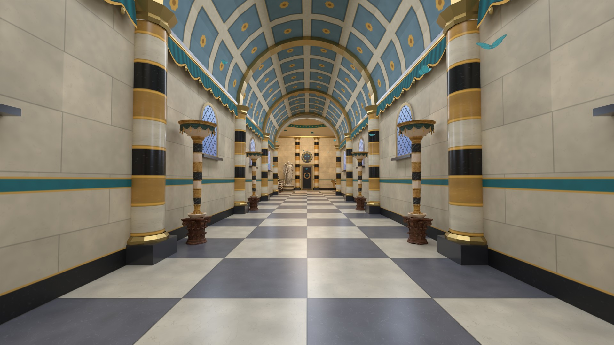
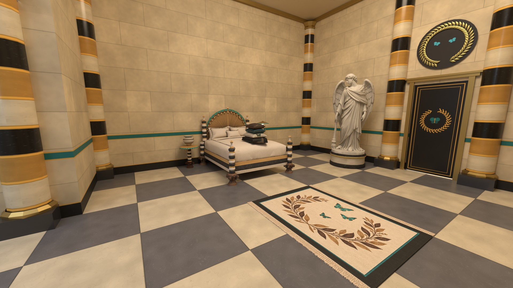
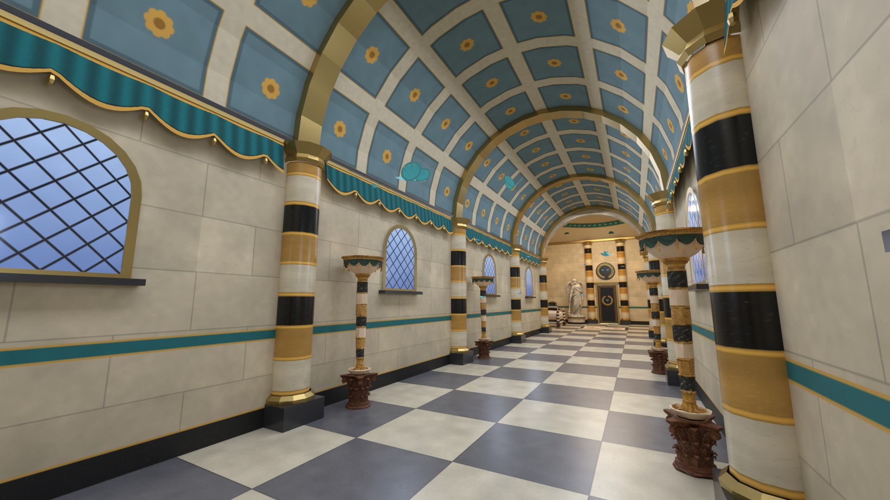
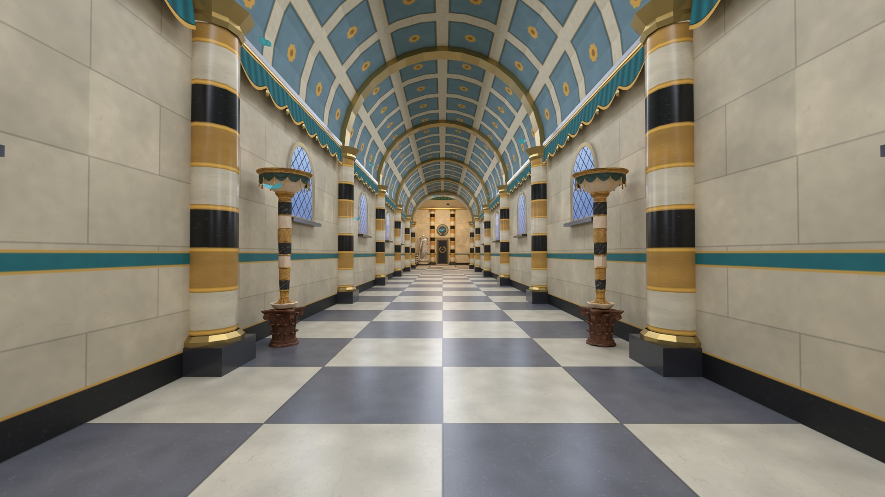

# rdwe_god_thanatos: Thanatos, The Quiet Nave

The last of the six Right Door, Wrong Exit god rooms (`docs/BLENDER_AREAS.md` section 7; the design plan's room 4.6, chapter M). A Blender-first scene built the way the Nyx and Hypnos rooms were: a long nave (4 x 16 m, a 5 m barrel vault) with a bedchamber apse at its end (8 x 7 m, a shallow dome to 6 m). It is dressed with the owner's NINETY-NINE Nocturne Thanatos set (13 pieces, as reduced game copies) and two Higgsfield props, baked (R1 lightmaps plus base colour) and exported as art only.

The look:
- **The nave:** four bays of black, cream and gold banded columns (the set's striped drums) with gilt transverse ribs; cream ashlar walls with a black skirting and a teal dado band; a coffered grey-teal vault; a cream and slate checker floor; teal scalloped valances with gold teardrops between the columns; a round-headed moonlit window in every bay; six inverted-torch torcheres.
- **The apse,** through a wide arch at the end: warm light, the bed and the set round it, and the statue of Thanatos with his torch turned down beside a black door under a gilt laurel wreath, with a line of morning light under it.
- Calm and still: no bodies, no skulls.

The nave is the one painted in the Hypnos room's mirror (`HY-06`). The banded column pairs, the teal valances, the checker floor and the warm glow at the far end all read from the entrance.

The set piece (only the still arrive):
- The apse and everything in it is one group, `grp_apse`. The scene code slides it north when the walker hurries, up to 12 m.
- The nave grows in front of it out of six 2 m segments (`grp_nave_ext_0 .. 5`) that continue the bays exactly.
- Walking slowly, or standing, brings it back.

| File | What it is |
|---|---|
| `world/rdwe_god_thanatos.glb` | the art: 7.36 MB, 278 315 triangles, 93 draw calls, Draco geometry, WebP textures |
| `world/lightmaps/rdwe_god_thanatos_0.webp` .. `_3.webp` | the baked light, four maps on the second UV set (`TEXCOORD_1`) |
| `blender/scenes/rdwe_god_thanatos.blend` | the saved scene (34 MB, Git LFS), with these collections: `Art` (holding `Art_Apse` and `Art_Ext_0 .. 5`), `Export` (merged by group and material, with the lightmap UVs), `Layout` (the exporter's objects), `Lights`, `Lights_Ext` |
| `blender/models/rdwe_thanatos/*_game.glb`, `ledger.csv` | the 15 reduced game copies (13 furniture pieces, 2 props) and their ledger |
| `tools/blender/build_rdwe_thanatos.py` | the re-runnable build: copies, art, bake, export, render (adapted from `build_rdwe_hypnos.py`, itself from `build_rdwe_nyx.py`) |
| `docs/renders/rdwe_god_thanatos/` | the four review stills (this folder) |

Nothing shared was changed:
- `tools/webp_glb.py` is used as it is on `main`.
- `index.html`, `shared/`, the manifest, the tests and `games/rdwe/` are untouched.
- `.gitignore` gains `blender/work/` (the build's work folder and the local copy of the originals; neither is committed).

## Review stills (Cycles on a rented GPU, 128 samples adaptive, OIDN, 1920 x 1080 JPEG, no metadata)

The page draws baked materials unlit with no tone mapping, so the stills use the Standard view transform at exposure 0. The lights are at the energies the lightmaps were normalised to. The stills are path-traced, so they show gloss the page will not.

| | |
|---|---|
| `1_arrival.jpg` (276 KB) | the arrival point (0, -10) at the walker's eye 0.95 m, facing north: the whole nave, the apse lit warm at its end |
| `2_apse.jpg` (312 KB) | the bedchamber from inside the arch: the bed against the west wall with its bedside tables and lamp, the laurel rug, the statue and the exit door under the wreath |
| `3_nave.jpg` (317 KB) | the nave from its south-east corner: columns, ribs, a moon window, valances, the torcheres |
| `4_slide.jpg` (278 KB) | the set piece from (0, -6) at eye height: the apse slid 12 m north and the six segments of the growing hall showing. The bedroom is now 23 m off instead of 11 |






More stills were made for the owner sheet and are not committed: the same view as `4_slide` at rest and at 5 m, the exit door close up, and the plan.

## Sources and licences

| What | Source | Licence / owner |
|---|---|---|
| The 13 furniture pieces TH-00 .. TH-12 | the owner's Higgsfield NINETY-NINE Nocturne Thanatos set | the owner's own models; reduced copies made here by the owner's ruling ("God furniture: reduce it"); the originals were only read |
| P5 statue of Thanatos, P13 inverted-torch torchere (placed six times) | Higgsfield image-to-3D props bought for the god rooms (plan section 7); nothing new was bought | the owner's |
| Floor, walls, vault coffers, dome, column bands, valances, windows, the two door leaves, the placard, the butterflies | generated with numpy in `build_rdwe_thanatos.py` from fixed seeds | own work |
| All architecture: shell, vault, dome, columns, ribs, valances and teardrops, windows, arch, vestibule, laurel wreath, placard and its light, butterflies | modelled by the script | own work |

No Poly Haven or other download, no photograph, no Meshy, no paid service. Tools: Blender 5.2.1 LTS (GPL) with Cycles, OpenImageDenoise and the glTF I/O add-on, on a rented cloud GPU; Python with numpy and Pillow.

## The reduced game copies

`--stage copies` does what the Nyx and Hypnos builds do:
1. It reads each original (about 1.9 M triangles and 70 MB for the big pieces).
2. It welds a copy and collapses it in two passes to its budget (plan section 5).
3. It gives the copy a fresh UV0 and bakes the original's base colour onto it (Cycles, selected to active, as emission).

The props are scaled to the plan's height. Normal and metal-rough maps are dropped (R1).

Hypnos's sliver lesson is built in. Zero-area slivers are cut before the UV. Any piece whose islands pack to under 20 % of the square is cut harder and packed again without island averaging. No piece needed it this time; the torchere, with its tassels, came closest at 20.4 %.

| Code | Piece | Original triangles | Game triangles | Base colour | GLB |
|---|---|---|---|---|---|
| TH-00 | lamp | 1 823 418 | 14 999 | 1024 | 1.27 MB |
| TH-01 | bedside table (placed twice, two meshes) | 1 960 280 | 15 000 | 1024 | 1.18 MB |
| TH-02 | armchair | 1 953 159 | 17 998 | 1024 | 1.30 MB |
| TH-03 | dresser | 1 901 737 | 17 999 | 1024 | 1.41 MB |
| TH-04 | tall cabinet | 1 900 227 | 17 996 | 1024 | 1.42 MB |
| TH-05 | bed | 1 966 673 | 24 000 | 2048 | 2.42 MB |
| TH-06 | wall mirror | 1 956 258 | 15 000 | 1024 | 1.16 MB |
| TH-07 | writing desk | 1 915 999 | 17 999 | 1024 | 1.50 MB |
| TH-08 | mantel clock (stopped, as made) | 645 844 | 14 999 | 512 | 0.64 MB |
| TH-09 | hourglass (sand held mid-fall, as made) | 1 144 686 | 15 000 | 512 | 0.68 MB |
| TH-10 | urn vase | 1 004 584 | 14 999 | 512 | 0.56 MB |
| TH-11 | laurel and butterfly rug (a flat 12 mm slab: 2k triangles, below the 15k floor on purpose, as Nyx's runner) | 315 356 | 2 000 | 1024 | 0.41 MB |
| TH-12 | textiles | 1 188 580 | 15 000 | 1024 | 0.76 MB |
| P5 | statue of Thanatos, torch turned down (2.5 m) | 30 430 | 15 000 | 1024 | 0.94 MB |
| P13 | inverted-torch torchere (1.8 m; placed six times, all drawn, so 5k each) | 31 156 | 4 999 | 512 | 0.40 MB |

`ledger.csv` has the same with dimensions, offsets and scales. Each copy's base colour went through `python tools/webp_glb.py <copy> <copy> 90`.

## Budgets (measured)

| | Limit | Measured |
|---|---|---|
| `world/rdwe_god_thanatos.glb`, lightmaps aside | at most 8 MB | **7.36 MB**. Blender with Draco wrote 11.6 MB; `tools/webp_glb.py` at q82, as Hypnos, took the textures from 7.7 to 3.5 MB and asserted the geometry bytes identical |
| triangles | at most 300 000 | **278 315** in the file and **278 315 drawn**. Nothing is instanced, so every copy counts: the bedside pair twice, the six torcheres at 30 000, and the growing hall's 12 m in full though it is hidden at rest. Furniture and props make about 263 000; architecture, the growing hall, the wreath and the butterflies about 15 300. `glb_inspect.py --budget tris=300000,mb=8`: pass, pass (it counts 7.02 MiB) |
| draw calls | at most 250 | **93** with 41 materials. The room is merged by group and material (the static nave, `grp_apse`, six hall segments); the two door leaves and the 12 butterflies are their own nodes |
| textures | WebP | **26, all `image/webp`** (bed 2048, the rest 1024 or smaller) |
| lightmaps | at most 4, at most 2048, WebP q90 | **4**: 226 + 165 + 113 + 204 KB |

| Map | Page | Texel density | `lightmap_intensity` | Baked with | On it |
|---|---|---|---|---|---|
| `_0` | 2048 | 38.9 px/m | 9.0406 | the apse at rest | the nave and the apse: floor, walls, vault, dome, columns, valances, gilt and black trim, the laurel wreath, the vestibule, both door leaves, the placard |
| `_1` | 1280 | 36.5 px/m | 3.1985 | the apse 12 m north | the growing hall (the six segments `grp_nave_ext_0 .. 5`, with their own `Ext_` materials) |
| `_2` | 768 | 60.6 px/m | 3.6009 | the apse at rest | bed, bedside tables, armchair, dresser, cabinet, desk, mirror, rug |
| `_3` | 1024 | 80.0 px/m | 3.6772 | the apse at rest | lamp, clock, hourglass, vase, textiles, the statue, the six torcheres |

How it was baked:
- Cycles on the GPU (OptiX), 512 samples, diffuse direct and indirect, 8 px margin, OIDN.
- Two passes. Map 1 was baked with the apse slid 12 m north and the growing hall shown, so the hall carries the light it is seen in. The other three were baked with the apse home and the hall hidden.
- The butterflies are not lightmapped.
- The furniture's lightmap UV is each piece's own UV0 layout, shelf-packed per placed copy, as in Nyx. The bedside pair and the six torcheres each get their own squares, found by the nearest placed copy.
- The room's own lightmap UVs are packed by Smart UV Project itself. Blender's separate island pack collapsed these merged groups to a point on the box, so it is not used.

### How bright: what the page will show

The page shows a baked material as base colour x lightmap x intensity, unlit, with no tone mapping; 1.0 is white.

The exposure rule is Nyx's (`--target 0.9`, `--clip-cap 0.98`): the brightest main p90 goes to 0.9, unless a main surface's p99 would pass 0.98. Here the cap binds on the rug (the pale field of the laurel rug under the apse's dome light), so k = 0.73662. Measured again on the exported GLB with `lab_display.py` (on the non-Draco twin, same textures), the numbers match within 0.01.

The room was made to read in the game:
- cream walls and a cream and pale-slate floor;
- an even light: a long soft panel under the crown of the vault, a cool area light in every window, a warm disc under the dome, the lamp under its shade.

**The walls' p50 is 0.32 and the floor's 0.15.** The floor's p50 falls on the slate squares; its cream squares are near 0.5.

| Material | Map | p50 | p90 | p99 |
|---|---|---|---|---|
| Thanatos_TH-11_rug | 2 | 0.000 | 0.854 | 0.980 |
| Thanatos_TH-05_bed | 2 | 0.074 | 0.621 | 0.771 |
| Floor_Checker | 0 | 0.148 | 0.593 | 0.680 |
| Wall_Cream | 0 | 0.319 | 0.464 | 0.752 |
| Thanatos_P13_torchere | 3 | 0.041 | 0.445 | 0.708 |
| Thanatos_P5_thanatos_statue | 3 | 0.147 | 0.404 | 0.725 |
| Thanatos_TH-06_wall_mirror | 2 | 0.107 | 0.403 | 0.555 |
| Vault_Coffer | 0 | 0.140 | 0.368 | 0.458 |
| Thanatos_TH-10_vase | 3 | 0.148 | 0.349 | 0.466 |
| Thanatos_TH-04_tall_cabinet | 2 | 0.075 | 0.341 | 0.507 |
| Thanatos_TH-03_dresser | 2 | 0.030 | 0.325 | 0.438 |
| Dome_Laurel | 0 | 0.252 | 0.315 | 0.368 |
| Thanatos_TH-01_bedside_table | 2 | 0.054 | 0.289 | 0.420 |
| Thanatos_TH-02_armchair | 2 | 0.090 | 0.287 | 0.524 |
| Thanatos_TH-09_hourglass | 3 | 0.073 | 0.267 | 0.326 |
| Thanatos_TH-08_clock | 3 | 0.001 | 0.227 | 0.413 |
| Thanatos_TH-12_textiles | 3 | 0.008 | 0.167 | 0.444 |
| Thanatos_TH-07_writing_desk | 2 | 0.027 | 0.134 | 0.393 |
| not held: Dawn_Plaster | 0 | 2.249 | 2.475 | 2.475 |
| not held: Ext_Floor_Checker | 1 | 0.174 | 0.578 | 0.625 |
| not held: Valance_Teal | 0 | 0.093 | 0.486 | 0.595 |
| not held: Ext_Column_Band | 1 | 0.080 | 0.462 | 0.595 |
| not held: Column_Band | 0 | 0.002 | 0.458 | 1.341 |
| not held: Ext_Valance_Teal | 1 | 0.102 | 0.455 | 0.573 |
| not held: Laurel_Gilt | 0 | 0.409 | 0.447 | 0.470 |
| not held: Ext_Wall_Cream | 1 | 0.303 | 0.399 | 0.467 |
| not held: Ext_Vault_Coffer | 1 | 0.153 | 0.379 | 0.469 |
| not held: Ext_Gold_Trim | 1 | 0.150 | 0.303 | 0.362 |
| not held: Gold_Trim | 0 | 0.138 | 0.300 | 0.386 |
| not held: Thanatos_TH-00_lamp | 3 | 0.143 | 0.291 | 0.553 |
| not held: Placard | 0 | 0.001 | 0.090 | 0.386 |
| not held: Leaf_In | 0 | 0.001 | 0.071 | 0.382 |
| not held: Ext_Black_Stone | 1 | 0.004 | 0.031 | 0.037 |
| not held: Black_Stone | 0 | 0.003 | 0.028 | 0.057 |
| not held: Leaf_Exit | 0 | 0.002 | 0.010 | 2.038 |

**What clips:**
- Under 1 % of the rug, the walls and the floor.
- `Column_Band` shows 3 % over 1.0 in the sample. Those texels are on the back halves of the engaged columns, inside the walls, lit through the open arch-wall slab; they are never seen.
- `Dawn_Plaster` (the vestibule) and the back of `Leaf_Exit` are meant to blow out: they are the morning behind the exit door, seen only when it opens.
- The rug's p50 of 0 is its underside, as with Nyx's runner.

Materials without a lightmap, which the page keeps as exported:
- `Window_Moon`: the moonlit glass, with its own emission.
- `Butterfly`: alpha-blended, double-sided, with a small teal emission.
- `Lamp_Emit`: the lamp's bulb glow.
- `Dawn_Emit`: the vestibule's back wall and the line of light under the exit door.
- `Picture_Light_Emit` and `Brass_Fixture`: the placard light.

## The checks

`world/rdwe_god_thanatos.glb` read as the page would (JSON level; no three.js run here):

```
PASS GLB 7.36 MB (at most 8 MB, lightmaps aside)
PASS 278315 triangles in the file, 278315 drawn (at most 300 000)
PASS 93 draw calls (primitives over nodes), 41 materials, 93 meshes
PASS 26 images, all {'image/webp'}
PASS Draco geometry (KHR_draco_mesh_compression required: the loader needs a DRACOLoader)
PASS material extras carry only ['lightmap', 'lightmap_intensity']
PASS no extras on nodes, meshes, scenes or the asset (0)
PASS world/lightmaps/rdwe_god_thanatos_0.webp .. _3.webp exist; 4 lightmaps (at most four); 35 lightmapped materials
PASS every lightmapped primitive has TEXCOORD_1
PASS door leaves are their own nodes: DoorLeaf_Thanatos_In, DoorLeaf_Thanatos_Exit
PASS grp_apse at the origin with 26 descendants (the bedchamber, its furniture, the exit leaf)
PASS grp_nave_ext with six segment groups grp_nave_ext_0 .. 5, each with children
INFO own nodes: decor_butterfly_00 .. decor_butterfly_11
INFO materials without a lightmap: Brass_Fixture, Butterfly, Dawn_Emit, Lamp_Emit, Picture_Light_Emit, Window_Moon
PASS no layout object (COL_, Zone_, Marker_, Link_, Arrive_, Spot_) in the GLB
PASS privacy: no user name, absolute path or session id in the GLB's JSON, the copies or the decompressed .blend; the stills carry no COM or APP1 segment
```

**`world/rdwe_god_thanatos.json` and `worlddoc check`:** not produced, as with Nyx and Hypnos, because `tools/blender/export_scene.py` is not on `main`. The exporter's objects are in the `.blend`'s `Layout` collection, named as BLENDER_AREAS part 2 asks. There are 53 `COL_` boxes:
- static: the floor; the nave's two walls and its ten column bases; the south wall; the six torcheres;
- `COL_apse_*`: the arch wall's two sides, the apse's three walls, the two columns by the exit and the eight standing pieces;
- `COL_ext_<i>_*`: each hall segment's two walls and its column bases.

Then the markers, the link, the zones and the spot below. Layout coordinates are Blender (x east, y north); game = (x, z, -y).

## What the coordinator must wire

RDWE does not load through the Farway manifest: its rooms are `games/rdwe/scenes/*.js`, registered in `walk.js` `SCENES` and played in `index.html` `RDWE_ORDER`. So `shared/farway.manifest.js` and `shared/manifest.test.js` are not changed here.

1. **The Blender-room loader** (plan section 6a), the same as Nyx's and Hypnos's:
   - GLTFLoader with a **DRACOLoader** and `EXT_texture_webp`.
   - The 35 materials whose extras carry `lightmap` and `lightmap_intensity` become unlit `MeshBasicMaterial` with `lightMap` on channel 1 (sRGB, `flipY = false`).
   - `Butterfly` stays alpha-blended and double-sided (`depthWrite = false` advised).
2. **Registry and order:**
   - `walk.js` `SCENES`: `rdwe_god_thanatos: () => import('./scenes/rdwe_god_thanatos.js')` after `rdwe_god_oneiros` and before `grocery` (chain order, plan 2.1).
   - **`RDWE_ORDER`** the same.
   - The scene module is not part of this PR. It carries `meta.chapter` M (plan 2.4: "The Quiet Nave", "The Stillness", rot 0.5deg, stamp "HEARTBEAT: SLOW", the caption and log), objective "REACH THE ROOM" and arrive "REST".
3. **At load, hide the growing hall.** The six nodes `grp_nave_ext_0 .. 5` (children of `grp_nave_ext`) must start hidden, and the colliders `COL_ext_<i>_*` must start out of the list. Otherwise their walls stand inside the apse.
4. **The set piece** (plan 4.6, 6e, 6g). Each tick, compare `v` (distance moved over the last 0.5 s, divided by 0.5) with `walk`, the walk speed at the RDWE scale (2.2 / 1.7 = 1.29 m/s, from `MOVE_SPEED`'s rule):
   - **The slide `d`:**
     - `v > 0.8 x walk`: `d` grows at 1.5 m/s, to at most 12 m.
     - `v <= 0.55 x walk`: `d` shrinks at 1.5 m/s, to 0.
     - In between, it holds.
   - **The apse:** set `grp_apse.position.z = -d` (game; the slide is Blender +Y, north). Move the `COL_apse_*` boxes, `Zone_trigger_exit`, `Marker_Exit` and `Link_Thanatos_Exit` by the same amount; their bounds are given at rest. The collider list is held by reference, so shift the boxes in place.
   - **The hall:** segment `i` covers Blender y 5 + 2i .. 7 + 2i. While `d > 2 i`, show `grp_nave_ext_<i>` and put its `COL_ext_<i>_*` boxes in the list; otherwise hide it and take them out. The hall's floor sits 3 mm under the apse's, so where the two overlap the apse's floor wins.
   - **Failsafe:** after the second slide the objective reads "SLOWLY". After 4 s standing still, `d` returns all the way to 0.
   - `Zone_trigger_still` covers the nave and the hall (x -2 .. 2, y -11 .. 17, Blender) for the speed rule.
5. **The butterflies:** `decor_butterfly_00 .. 11` are their own nodes, with origins at their bodies (wings hinged on local Y). Fly them slowly. Below `0.55 x walk`, let some land on or near the walker, as the hint.
6. **The way out:**
   - `Zone_trigger_exit`, in front of the exit door (x -0.6 .. 0.6, y 11.25 .. 12.0 at rest, height 2.2), is the room's `built.trigger`. It can only be reached with the apse home.
   - `Link_Thanatos_Exit` names `grocery`. Grocery is a code room, so arrive at its `meta.start`.
   - `DoorLeaf_Thanatos_Exit` is a child of `grp_apse`, with its origin on its west hinge, closed as baked. It may swing 90 degrees north as the exit begins, onto the lit vestibule.
   - `DoorLeaf_Thanatos_In` (south wall, closed) is the way in from Oneiros's horn gate.
7. **Markers:**
   - `Marker_Spawn` and `Arrive_Thanatos_In` at (0, -10), facing north.
   - `Marker_Entrance` at (0, -10.6).
   - `Marker_Exit` at (0, 11.5).
   - `Spot_apse_home` at (0, 5) marks `grp_apse`'s place at rest.
8. **Lights:** add none for the room. The windows, the fill, the dome's glow, the lamp and the morning are in the lightmaps.

## Rebuild

From the repo root, with Blender 5.2 and Python with numpy and Pillow. Every Blender stage ran on the rented GPU with `--device auto` (OptiX).

```
# the 13 originals and P5, P13 into the git-ignored blender/work/thanatos_source/ (read only)
blender -b --factory-startup --python tools/blender/build_rdwe_thanatos.py -- --stage copies
blender -b --factory-startup --python tools/blender/build_rdwe_thanatos.py -- --stage all --samples 512     # art, bake, export, render
for f in blender/models/rdwe_thanatos/*_game.glb; do python tools/webp_glb.py $f $f 90; done
python -c "from PIL import Image; import glob,os; [Image.open(p).convert('RGB').save('world/lightmaps/'+os.path.basename(p)[:-4]+'.webp','WEBP',quality=90,method=6) for p in glob.glob('blender/work/farway_rdwe_god_thanatos/rdwe_god_thanatos_[0-9].png')]"
python tools/webp_glb.py blender/work/farway_rdwe_god_thanatos/rdwe_god_thanatos_raw.glb world/rdwe_god_thanatos.glb 82
```

Timings on the box:
- copies: 15 pieces in about 20 min;
- art: about 1 min;
- bake: about 2 min (two passes);
- stills: about 2 min.

The light levels are constants (`MOON_W`, `NAVE_FILL_W`, `EXT_FILL_W`, `APSE_GLOW_W`, `LAMP_W`, `DAWN_W`, `PLACARD_W`); `--target` and `--clip-cap` set the exposure. A failed stage now exits non-zero (Blender itself exits 0 after a script error).

## Choices made here (the plan left them open)

- **How the hall grows.** The plan says the bays "repeat in front" of the sliding apse.
  - Here the 12 m of nave the apse can uncover is real geometry in six 2 m segments. They stand still where the apse stands at rest, and each is hidden until the apse has moved past it. The columns do not slide, so the hall is simply longer.
  - Segments of 2 m (not 4 m bays) keep the part of a shown segment that is still inside the apse to 2 m at most.
  - The hall has its own lightmap, baked with the apse 12 m away, and its own `Ext_` copies of the room's materials, because a material holds one lightmap.
- **The arch** into the apse is the nave's full 4 m width, with a round head to 4.7 m (a gilt-edged crescent of wall under the vault's end). So the bed's foot, the rug, the statue and the exit read from the entrance.
- **The apse's walls are 4.8 m** and its dome is a shallow one to 6 m, so the arch fits under the dome's edge.
- **The torcheres are 5k triangles each**, not the plan's 10k: there are six and all are drawn. They stand just north of the first three column pairs, clear of the windows' light; under the windows they were the hottest surface and held the exposure down.
- **A small lit vestibule** behind the exit door, for the log's "I think it's morning on the other side": a line of light under the closed door, and a bright room when it opens.
- **The windows** are moonlit glass panels on the walls (their own light) with a gilt frame, not openings: there is no outside to model.
- **The clock and the hourglass** are the copies as made: the clock's painted hands are still and the hourglass's sand is fixed mid-fall, as the plan asks, so there are no code hands.
- **Brightness over night.** To meet the brief's "must read in the game", the nave is lit evenly and fairly bright. The night is in the moon windows' blue and the vault's colour rather than in darkness.

## Open

- **The scene module** (the speed rule, the slide, the hall's visibility, the butterflies, the exit) is the coordinator's. Item 3 above (hide the hall at load) is the one that must not be missed.
- **Map 0 is 2048** for the nave and the apse at 39 px/m. On the walls this shows as soft light, which suits them.
- **The coordinator's choices from the plan still open:** chapter letter M, the audio and the clips (`M.mp3`, `m.MP4`, `M.mp4`).
