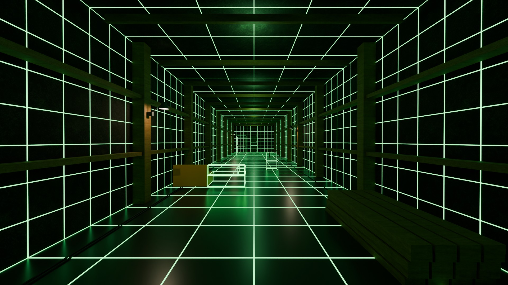
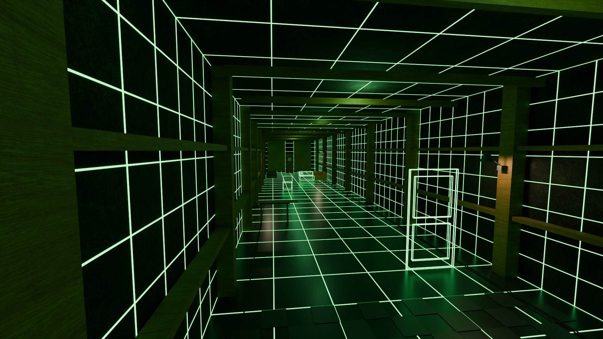
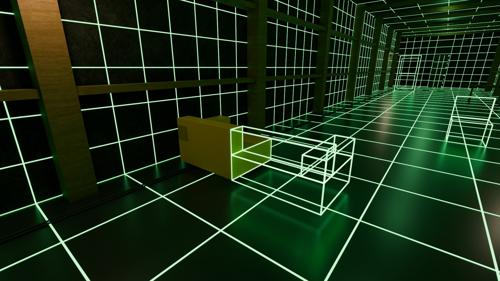

# rdwe_green_grid: Inside the wall: the green grid

Right Door, Wrong Exit, Phase C room 18 (the teal wing), dressed and lit (`docs/BLENDER_AREAS.md`, section 7, step 2), round its greybox (`tools/blender/build_rdwe_greybox.py`, `c_green_grid()`). 6 m by 30 m, 4 m high. The room, from `ROOMS.md`: Environmental storytelling: the space behind the teal room's wallpaper, a glowing green wireframe between studs; the rooms are being built from here.

Behind the teal room's wallpaper: black voids between pine studs, and a glowing green wireframe drawing the rooms: lines on every wall, the floor and the ceiling, a sofa half built (leather to the middle, wireframe after), a door and a chair drawn in wire, the Ames room's checker floor half filled in. At the south end, the back of the teal room's paper. The grid is the light.

Built in Blender 5.2.1 by `tools/blender/build_rdwe_rooms2.py` (the room's `dress_` function and spec) with the shared kit `tools/blender/rdwe_rooms2_kit.py`, baked on the GPU and graded by `tools/blender/rdwe_rooms2_pack.py`. There are no reference photos: it follows the room's line in `ROOMS.md` and the style of `docs/WORLD.md` (Super Liminal: nearly ordinary, saturated, a little wrong).

| File | What it is |
|---|---|
| `world/rdwe_green_grid.glb` | the art: 1.26 MB, 5100 triangles, 17 materials, 15 nodes (one mesh per material; the door leaves as their own nodes), 5 WebP textures |
| `world/rdwe_green_grid.json` | the layout, written by `tools/blender/export_scene.py` from the `.blend`: 31 colliders, 2 doors, 2 links, 3 spots; the same as `build_rdwe_greybox.py --preview` writes |
| `world/lightmaps/rdwe_green_grid_0.webp` | set `main` (`lightmap`): struct page, 2048 px, about 67.0 px/m |
| `world/lightmaps/rdwe_green_grid_1.webp` | set `main` (`lightmap`): props page, 1024 px, about 26.6 px/m |
| `blender/scenes/rdwe_green_grid.blend` | the saved scene (Git LFS): `Art` (one object per collider, unmerged), `Doors` (the leaves, origin at the hinge), `Layout` (`COL_` boxes, the empties), `Export` (merged by material, with the lightmap UVs), `Lights_*` (one collection per light set, and `Lights_all`) |
| `docs/renders/rdwe_green_grid/` | this README and the three review stills |





Review stills: Cycles, 96 samples adaptive, OIDN, 1920 x 1080 JPEG, AgX medium high contrast. They are Blender's renders with Blender's lights; the page shows the lightmaps (see Brightness).

## The trick's spots (for the page)

- `Spot_grid_1` at (0, 4), facing (0, -1): the grid is still drawing the room you left
- `Spot_grid_2` at (0, -8), facing (0, -1): the grid is drawing the next room here: the Ames room's checker floor, half done
- `Spot_grid_3` at (-0.9, 6.9), facing (-1, 0): the teal room's sofa, half built: leather to the middle, wireframe after

## Doors

- `DoorLeaf_seam` (0.86 x 2.4 m): a seam in the grid, pulled open like a door. The leaf is built from its look (form, finish, handle), so it is visibly unlike every other door in the set.
- `DoorLeaf_teal2` (0.82 x 2.3 m): porthole birch door, glass knob. The leaf is built from its look (form, finish, handle), so it is visibly unlike every other door in the set.

## Light

| Set | Material properties | Maps |
|---|---|---|
| `main` | `lightmap`, `lightmap_intensity` | `rdwe_green_grid_0`, `rdwe_green_grid_1` |

Emissive materials (not baked, drawn as they are): `Grid_Emit`, `Lamp_Emit`. `Lamp_Emit` is every ordinary lamp's glow.

## Sources and licences

| File (`blender/textures/rdwe_rooms2/`) | Source | Licence | Used by |
|---|---|---|---|
| `concrete_floor_02_diff_1k.jpg` | Poly Haven, Concrete Floor 02 | CC0 | Grid_Wall |
| `plywood_diff_1k.jpg` | Poly Haven, Plywood | CC0 | Door_Birch, Plywood, Stud_Pine |

Every other material is a flat colour, or a picture the build generates with numpy (fixed seeds, own work, no licence needed): `Brass`, `Checker_Black`, `Checker_White`, `Glass_Door`, `Grid_Black`, `Grid_Emit`, `Grid_Floor`, `Iron`, `Leather_Orange`, `Paper_Back`, `Rubber`.
No Meshy, no Higgsfield, nothing bought.

## Brightness

Graded by `rdwe_rooms2_pack.py`: texel = G L / (C + G L), intensity = pi C (C = 1.15), G set so the shell page's median texel in the reference set is 1.5 (shared G); the page shows texture x base colour x texel x intensity / pi. The tables below are `lab_display.py` on the packed GLB.

```
brightness, set main (`lightmap`): lab_display.py (shown = texel x intensity / pi x base colour)
material                m2           map       k    p50    p90    p99     >=1
Grid_Wall            486.4 rdwe_green_grid_0  3.6128  0.011  0.025  0.045   0.00%
Grid_Floor           194.6 rdwe_green_grid_0  3.6128  0.027  0.033  0.046   0.00%
Stud_Pine            145.1 rdwe_green_grid_1  3.6128  0.065  0.100  0.181   0.00%
Paper_Back            15.6 rdwe_green_grid_1  3.6128  0.142  0.152  0.161   0.00%
Checker_White          6.3 rdwe_green_grid_1  3.6128  0.556  0.568  0.580   0.00%
Door_Birch             4.6 rdwe_green_grid_1  3.6128  0.003  0.086  0.114   0.00%
Grid_Black             4.4 rdwe_green_grid_1  3.6128  0.017  0.028  0.029   0.00%
Leather_Orange         4.2 rdwe_green_grid_1  3.6128  0.259  0.394  0.508   0.00%
Rubber                 3.9 rdwe_green_grid_1  3.6128  0.030  0.036  0.043   0.00%
Checker_Black          3.0 rdwe_green_grid_1  3.6128  0.036  0.039  0.041   0.00%
Plywood                0.7 rdwe_green_grid_1  3.6128  0.077  0.106  0.133   0.00%
Iron                   0.5 rdwe_green_grid_1  3.6128  0.053  0.082  0.095   0.00%
Brass                  0.3 rdwe_green_grid_1  3.6128  0.000  0.000  0.000   0.00%
Glass_Door             0.2 rdwe_green_grid_1  3.6128  0.001  0.397  0.411   0.00%
```

## Gates

```
## python tools/blender/build_rdwe_greybox.py --check .
GATE links: 54 pairs with both sides built (108 sides, the one-way ones included), 2 that loop on their own room, 5 that leave the set; 115 links in the files, every one accounted for
GATE navigable: 43 of 43 rooms reachable from rdwe_dining; 42 can get back to it (no true exit: the finale's one way out is the ending)
GATE overlaps: 0 interpenetrating collider pairs of 35141 checked (none allowed)
GATE clearances: 344 links, arrivals, spots and spawns clear by 0.28 m with a floor under them; 248 door-front points (0.5 and 1 m in) clear
GATE steps: 56 step boxes in 6 flights, one box a step; the highest rise 0.250 m (at most 0.27 m)
GATE corridors: 14 corridor rects, the narrowest 2.00 m (at least 1.6 m), none blocked
GATE extent: the largest room is 50.4 m across (a store floor, about 52 m, at most)
GATE spots: every room has its trick's spot and the ones it needs; 10 SecCam; agent x6, beacon x1, book x3, buttons x3, cake x1, cart x1, change x3, clock x2, computer x4, dark x3, frame x1, grid x6, hide x12, hum x1, lamp x1, lap x1, locker x3, map x3, monitor x2, moon x2, note x1, notes x1, photo x5, scuff x1, seeker x1, statue x3, switch x4, ticket x3, tin x3, trick x21, tv x3, view x6, watch x1, window x1
GATE doors: 124 door leaves, no two with the same look; 103 exits with one Link_ each, 4 arrival-only, 17 that never open; every exit fixed
GATES PASS

## world/rdwe_green_grid.json (export_scene.py, from the .blend) against build_rdwe_greybox.py --preview
SAME (to 2.5 mm): 31 colliders, 2 doors, 2 links, 0 zones, 3 spots, 0 markers, 0 cameras

## node tools/worlddoc.mjs check world/rdwe_green_grid.json
warning: scene rdwe_green_grid is not in the world manifest yet: a new scene to add
  warning: link seam: the manifest has no link from this door yet: a new link to add
  warning: link teal2: the manifest has no link from this door yet: a new link to add
OK world/rdwe_green_grid.json: 31 colliders, 2 doors, 0 markers, 2 links, 0 zones, 3 spots, 0 errors, 3 warnings

## tools/blender/check_layout.py (rules COVER, STRAY, CLEAR on the Art collection; run on the box)
layout check: scene rdwe_green_grid, run on the box (check_layout.check on the Art collection; points: every link arrival and F spot, every Spot_)
PASS: 39 of 39 checks passed

## glb_inspect world/rdwe_green_grid.glb --budget tris=300000,mb=8
materials  17: Checker_Black, Checker_White, Grid_Black, Grid_Emit, Brass, Door_Birch, Glass_Door, Grid_Floor, Grid_Wall, Iron, Lamp_Emit, Leather_Orange, Paper_Back, Plywood, Rubber, Stud_Pine, Void_Black
textures   5, images: 1024x1024, 1024x1024, 256x512
bbox       6.4 x 4.056 x 31.1 (x, y up, z), min [-3.2, -0.05, -15.55]
requires   EXT_texture_webp
pass       tris: 5100 triangles, budget 300000
pass       mb: 1.20 MB, budget 8

## node --test shared/*.test.js
tests 297
pass 297
fail 0

## sizes
world/rdwe_green_grid.glb  1.26 MB
world/rdwe_green_grid.json  0.01 MB
blender/scenes/rdwe_green_grid.blend  0.36 MB
world/lightmaps/rdwe_green_grid_0.webp  0.23 MB
world/lightmaps/rdwe_green_grid_1.webp  0.17 MB
docs/renders/rdwe_green_grid/1_arrival.jpg  0.37 MB
docs/renders/rdwe_green_grid/2_wide.jpg  0.39 MB
docs/renders/rdwe_green_grid/3_detail.jpg  0.39 MB

## privacy grep (user names, absolute paths, session ids, e-mail; the .blend decompressed)
privacy grep: 9 files, 0 with hits

```

Nothing is wired: the manifest, `games/rdwe/`, `index.html`, `shared/` and the tests are untouched.
