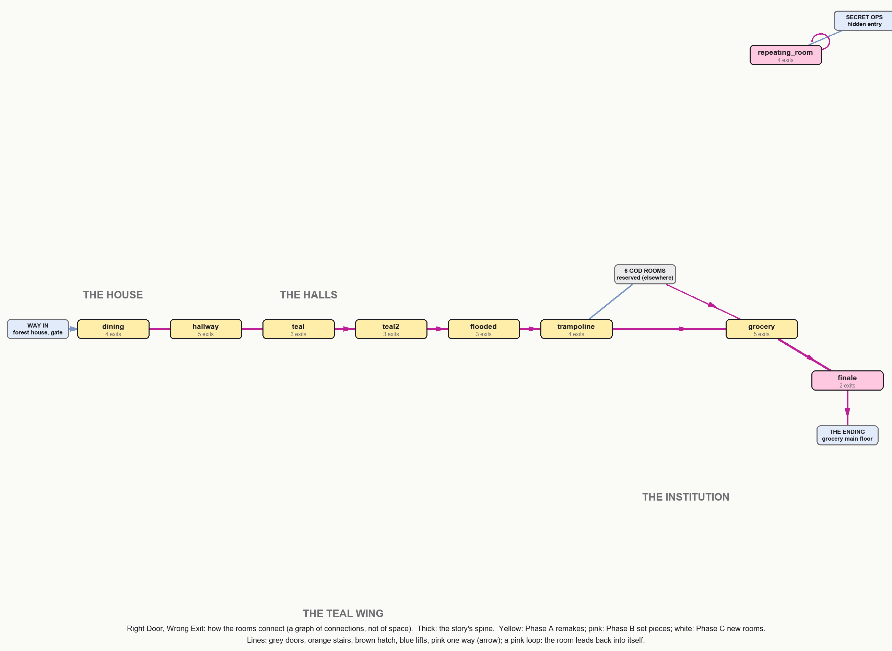

# Right Door, Wrong Exit greybox (docs/BLENDER_AREAS.md, section 7, step 1)

Plain boxes, to scale, for the Right Door, Wrong Exit rooms: the seven that exist remade larger and psychedelic (Phase A), the set pieces (Phase B: the finale's hide-and-seek map; the repeating room with the door seen from one angle) and 34 proposed new rooms, one minimal greybox each (Phase C, listed one line a room in `ROOMS.md`). Nothing is dressed and nothing is wired.

- Built by `tools/blender/build_rdwe_greybox.py` on the rented box: it writes `world/<scene>.json` through `tools/blender/export_scene.py`, the GLB, the plans and the stills. These sheets come from `tools/blender/rdwe_greybox_sheets.py`.
- `python tools/blender/build_rdwe_greybox.py --check .` runs the gates on the committed files: links meet on both sides (or are one way, or loop, or leave the set on purpose), every room is reachable and can get back (no true exit), no colliders overlap, every link, arrival, spot and spawn has clearance and a floor, steps rise at most 0.27 m, corridors are 1.6 m or wider, each room has the spots it needs, every door is different and every exit has its one Link_.
- `CHECKS.txt`: the gates and `node tools/worlddoc.mjs check` on every file.
- `graph.png`: how the rooms connect. For each scene, `<scene>_plan.jpg` (top-down: doors, links, spots and cameras labelled, a scale bar) and `<scene>_still.jpg` (eye height, 1.55 m).

## Rulings (mine, under the owner's "go with your judgment")

1. Ids: `rdwe_<room>` for every scene, so they never clash with the hotel's `dining` (world/dining.json) or the grocery's scenes. The six god rooms keep their own ids (their PRs); the graph reserves `rdwe_nyx` to `rdwe_thanatos` between the trampoline park and the grocery.
2. Count: 7 remakes + 2 set pieces + 34 new rooms + 6 god rooms = 49 rooms, the "about 50" of docs/WORLD.md. Section 7's "about 43 new" is the 2 + 34 + 6 + 1 (the hide-and-seek map counted with its wings).
3. The story stays the spine: dining > hallway > teal > teal2 > flooded > trampoline > (the god rooms) > grocery, with each room's present exit kept. Sleeping, the arch, the grate and the red glow are one way (they were one-way moments in the clips); the green stairs and the well go both ways. The grocery's EXIT is the loop back to the dining room, as in the game today.
4. The finale is entered through the grocery's locked entrance doors once every room is done (the doors behind you in the clip). Its only way out, `win`, opens when every camera is off and leads to grocery.main_floor: the manifest's `rdwe.finale>grocery`, the one ending. That is the only exit from the set besides the Secret Operations door; everywhere else, every room can reach every other (gated).
5. New exits on the remakes, for multi-choice: the dining room's pantry; three of the hallway's side doors (the other six never open); the teal room's black doorway; teal2's peeled wallpaper; a frame in the flooded corridor; a padded vent in the trampoline park; the grocery's stockroom. Each remake also has its present exit unchanged.
6. The red door in the flooded corridor still never opens (it is the lure); the vending room's EXIT door and the hallway's and the hall of doors' wrong doors are leaves with `opens: never`.
7. Every door is different: each leaf carries `look` (a form, a finish and a handle; the story doors have their own words) and a width and height from a small set; the gate fails on two leaves with the same look. Exits that are not doors (the couch, the grate, the red glow, the attic hatch) are a Link_ alone.
8. The repeating room's north door (`again`) arrives through its own south door, so you are back in the same room; the stair loop's top door arrives at the foot of its own stairs. Both are links inside one scene (SELF).
9. The door seen from one angle is a lilac door at the end of a 2 m recess on the repeating room's east wall, hidden behind a free-standing baffle; Spot_view_1 marks the one place it shows from. Its link `secret_ops` is the manifest's `rdwe.repeating_room>secret_ops`.
10. The finale's map is 48 m by 44 m: a hall and four wings (offices, a house, a server room, aisles), Spot_computer x4 (one a wing), ten SecCam_ (the exporter now writes cameras), Spot_hide x12, Spot_agent x6 at the vents (the late swarm), Spot_seeker x1, and the server room as Zone_restricted.
11. Psychedelic in greybox means saturated flat colours per room (cream and shag green, teal, orange, tile white, padded orange, loud pinks and acids for the new rooms) and the remakes at 1.2x to 3x their old size, with distorted key objects (the 4.4 m dining table, the 5.6 m sofa). The look itself is the dressing pass.
12. The trampoline park is built once, 30 m by 50 m; the page still wraps you to make it go on forever. The beds are art with a Zone_trigger over them, so the page can bounce you.

## Scenes

| Scene | Phase | Size | Exits (door: where it goes) | Colliders, doors, spots |
|---|---|---|---|---|
| `rdwe_dining` | A | 16 m by 20 m, 4.2 m high (was 5.4 by 6.4 by 2.45); the stairwell climbs 3 m to the dark door | `house`: the forest house's door, and the Overworld gate (the way in); `pantry`: rdwe_long_table; `loop`: arrival only: the grocery's EXIT door comes back here (the loop); `stairs`: rdwe_hallway (the corridor the stairs never reached) | 52 colliders, 4 doors; spots: lamp x1, photo x3 |
| `rdwe_hallway` | A | a corridor 38 m by 3.2 m, 3.4 m high, from a lower landing up 6 steps; the mossy well goes 2 m down at the far end | `dining`: rdwe_dining (back down the green stairs); `door_a`: rdwe_kids_bedroom; `door_c`: rdwe_door_hall; `door_b`: rdwe_upside_room; `well`: rdwe_teal (down the well, into the teal room) | 65 colliders, 10 doors; spots: hum x1 |
| `rdwe_teal` | A | 14 m by 18 m, 4 m high (was 5.2 by 7.4 by 2.5) | `well`: rdwe_hallway (up the well); `void`: rdwe_void_room; `sleep`: rdwe_teal2 (close your eyes on the couch, just for a minute) | 17 colliders, 2 doors; spots: watch x1, window x1 |
| `rdwe_teal2` | A | 8 m by 22 m, 5.5 m high (was 3.8 by 6.6 by 2.6): narrower and wrong | `arch`: rdwe_flooded (through the arch before it finishes); `grid`: rdwe_green_grid; `sleep`: arrival only: you wake beside the sofa (from rdwe_teal's couch) | 15 colliders, 2 doors; spots: grid x3 |
| `rdwe_flooded` | A | a corridor 50 m by 5 m, 4 m high (was 34 by 3.2 by 2.9), water over the floor | `arch`: arrival only: out of rdwe_teal2's arch; `frame`: rdwe_changing_rooms; `grate`: rdwe_trampoline (the grate gives way: the fall down the shaft) | 21 colliders, 3 doors; spots: frame x1, photo x1 |
| `rdwe_trampoline` | A | 30 m by 50 m, 9 m high (one cell was 14 by 28; the page repeats it) | `gods`: the six god rooms (reserved: Nyx, Selene, Hypnos, Morpheus, Oneiros, Thanatos, built elsewhere); `bounce`: rdwe_crossroads; `vent`: arrival only: you fall out of the vent from rdwe_flooded's grate; `glow`: rdwe_grocery (walk to the red glow: the anomaly) | 18 colliders, 2 doors; spots: beacon x1, scuff x1 |
| `rdwe_grocery` | A | 50 m by 50 m, 5 m high (was 38 by 46 by 4): a maze of shelving, 10 by 10 aisles of 5 m | `entrance`: rdwe_finale (the locked entrance doors open once every room is done); `exit`: rdwe_dining (the loop: you are back at the start); `gods`: arrival only (reserved): the last god room comes out here; `stockroom`: rdwe_vending_room; `glow`: arrival only: from rdwe_trampoline's red glow (the locked doors behind you) | 189 colliders, 4 doors; spots: cart x1, tin x3 |
| `rdwe_repeating_room` | B | 12 m by 12 m, 3.2 m high; a recess 2 m deep behind a baffle on the east wall | `lift`: rdwe_elevator_lobby (lift 3); `library`: rdwe_melting_library; `again`: this room again: you come back in by the south door (it repeats); `secret_ops`: secret_ops.hidden_entry (rdwe.repeating_room>secret_ops: the one entrance with no clearance) | 31 colliders, 5 doors; spots: change x3, view x1 |
| `rdwe_finale` | B | 48 m by 44 m, 4.5 m high: a hall and four wings (offices, the house, the server room, the aisles) | `grocery`: arrival only: through the grocery's entrance doors, once the map is complete; `win`: grocery.main_floor (rdwe.finale>grocery: the one ending; opens when every camera is off) | 67 colliders, 2 doors, 10 cameras; spots: agent x6, computer x4, hide x12, seeker x1 |
| `rdwe_long_table` | C | 8 m by 34 m, 3.2 m high | `dining`: rdwe_dining; `kitchen`: rdwe_tiny_kitchen; `party`: rdwe_birthday_party | 24 colliders, 3 doors; spots: trick x1 |
| `rdwe_tiny_kitchen` | C | 10 m by 8 m, 3 m high | `table`: rdwe_long_table; `back`: rdwe_giant_chair | 14 colliders, 2 doors; spots: trick x1 |
| `rdwe_birthday_party` | C | 14 m by 10 m, 3.2 m high | `table`: rdwe_long_table; `attic`: rdwe_attic | 13 colliders, 2 doors; spots: cake x1 |
| `rdwe_attic` | C | 12 m by 8 m, 2.6 m high | `party`: rdwe_birthday_party; `hatch`: rdwe_kids_bedroom (down through the hatch) | 13 colliders, 1 doors; spots: photo x1 |
| `rdwe_kids_bedroom` | C | 8 m by 8 m, 2.8 m high | `closet`: rdwe_hallway (a side door); `hatch`: arrival from rdwe_attic's hatch (and back up it) | 11 colliders, 1 doors; spots: notes x1 |
| `rdwe_giant_chair` | C | 16 m by 14 m, 8 m high | `kitchen`: rdwe_tiny_kitchen; `high`: rdwe_upside_room | 28 colliders, 2 doors; spots: trick x1 |
| `rdwe_upside_room` | C | 10 m by 10 m, 3.4 m high | `chair`: rdwe_giant_chair; `hall`: rdwe_hallway (a side door) | 13 colliders, 2 doors; spots: trick x1 |
| `rdwe_door_hall` | C | 6 m by 44 m, 3.4 m high | `hallway`: rdwe_hallway (a side door); `d3`: rdwe_stretching_hall; `d9`: rdwe_painted_door; `d6`: rdwe_three_doors | 46 colliders, 13 doors; spots: trick x1 |
| `rdwe_stretching_hall` | C | 4 m by 46 m, 3 m high | `doors`: rdwe_door_hall; `far`: rdwe_bending_hall | 24 colliders, 2 doors; spots: trick x1 |
| `rdwe_bending_hall` | C | 20 m by 20 m, 3 m high | `start`: rdwe_stretching_hall; `lap`: rdwe_stair_loop | 13 colliders, 2 doors; spots: lap x1 |
| `rdwe_stair_loop` | C | 8 m by 14 m, 6.4 m high; one flight to a landing at y 3 | `hall`: rdwe_bending_hall; `top`: this room again: you arrive at the foot of the stairs; `landing`: rdwe_tilted_hall | 31 colliders, 3 doors; spots: trick x1 |
| `rdwe_tilted_hall` | C | 6 m by 30 m, 4 m high | `stairs`: rdwe_stair_loop; `end`: rdwe_crossroads | 19 colliders, 2 doors; spots: trick x1 |
| `rdwe_three_doors` | C | 12 m by 10 m, 3.4 m high | `back`: rdwe_door_hall; `left`: rdwe_mirror_room; `middle`: rdwe_waiting_room; `right`: rdwe_lights_out | 19 colliders, 4 doors; spots: note x1 |
| `rdwe_painted_door` | C | 6 m by 24 m, 3.4 m high | `doors`: rdwe_door_hall; `painted`: rdwe_anamorphic_room | 13 colliders, 2 doors; spots: view x1 |
| `rdwe_anamorphic_room` | C | 14 m by 14 m, 4 m high | `painted`: rdwe_painted_door; `word`: rdwe_ames_room | 14 colliders, 2 doors; spots: view x1 |
| `rdwe_void_room` | C | 10 m by 10 m, 4 m high | `teal`: rdwe_teal (back through the black); `lit`: rdwe_lights_out | 15 colliders, 2 doors; spots: dark x3 |
| `rdwe_lights_out` | C | 12 m by 12 m, 3.2 m high | `void`: rdwe_void_room; `three`: rdwe_three_doors | 18 colliders, 2 doors; spots: switch x3, trick x1 |
| `rdwe_green_grid` | C | 6 m by 30 m, 4 m high | `teal2`: rdwe_teal2; `seam`: rdwe_ames_room | 31 colliders, 2 doors; spots: grid x3 |
| `rdwe_ames_room` | C | 14 m by 10 m, 4.5 m high | `word`: rdwe_anamorphic_room; `grid`: rdwe_green_grid; `small`: rdwe_shrink_hall | 24 colliders, 3 doors; spots: view x3 |
| `rdwe_shrink_hall` | C | 6 m by 24 m, 3.6 m high | `ames`: rdwe_ames_room; `small`: rdwe_moon_window | 22 colliders, 2 doors; spots: trick x2 |
| `rdwe_moon_window` | C | 10 m by 12 m, 3.6 m high | `hall`: rdwe_shrink_hall; `sill`: rdwe_mirror_room | 19 colliders, 2 doors; spots: moon x2, switch x1 |
| `rdwe_mirror_room` | C | 16 m by 10 m, 3.4 m high | `three`: rdwe_three_doors; `moon`: rdwe_moon_window; `reflection`: rdwe_dont_look | 27 colliders, 3 doors; spots: trick x3 |
| `rdwe_dont_look` | C | 14 m by 10 m, 4 m high | `mirror`: rdwe_mirror_room; `statue`: rdwe_wrong_clock | 19 colliders, 2 doors; spots: statue x3 |
| `rdwe_waiting_room` | C | 14 m by 10 m, 3 m high | `three`: rdwe_three_doors; `number`: rdwe_wrong_clock | 21 colliders, 2 doors; spots: ticket x3 |
| `rdwe_wrong_clock` | C | 12 m by 12 m, 4.5 m high | `gallery`: rdwe_dont_look; `waiting`: rdwe_waiting_room; `hands`: rdwe_crossroads | 30 colliders, 3 doors; spots: clock x2 |
| `rdwe_crossroads` | C | 32 m by 32 m, 4 m high | `west`: rdwe_tilted_hall; `north`: rdwe_wrong_clock; `south`: rdwe_trampoline (the padded vent); `east`: rdwe_elevator_lobby | 31 colliders, 4 doors; spots: trick x2 |
| `rdwe_changing_rooms` | C | 14 m by 10 m, 3 m high | `flooded`: rdwe_flooded (the frame door); `locker`: rdwe_laundromat | 22 colliders, 2 doors; spots: locker x3 |
| `rdwe_laundromat` | C | 16 m by 8 m, 3.2 m high | `lockers`: rdwe_changing_rooms; `drum`: rdwe_motel_room | 24 colliders, 2 doors; spots: trick x2 |
| `rdwe_motel_room` | C | 6 m by 10 m, 2.8 m high | `drum`: rdwe_laundromat; `bathroom`: rdwe_office_night | 20 colliders, 2 doors; spots: tv x3 |
| `rdwe_office_night` | C | 24 m by 20 m, 3 m high | `stairs`: rdwe_motel_room; `lift`: rdwe_elevator_lobby | 72 colliders, 2 doors; spots: monitor x2 |
| `rdwe_elevator_lobby` | C | 18 m by 10 m, 3.6 m high | `crossroads`: rdwe_crossroads; `lift_1`: rdwe_office_night; `lift_2`: rdwe_map_room; `lift_3`: rdwe_repeating_room; `lift_4`: rdwe_vending_room | 29 colliders, 5 doors; spots: buttons x3 |
| `rdwe_map_room` | C | 12 m by 12 m, 3.4 m high | `lift`: rdwe_elevator_lobby; `door`: rdwe_melting_library | 17 colliders, 2 doors; spots: map x3 |
| `rdwe_vending_room` | C | 8 m by 8 m, 3 m high | `lift`: rdwe_elevator_lobby; `machine`: rdwe_grocery (the stockroom) | 22 colliders, 3 doors; spots: trick x3 |
| `rdwe_melting_library` | C | 14 m by 14 m, 5 m high | `map`: rdwe_map_room; `arch`: rdwe_repeating_room | 22 colliders, 2 doors; spots: book x3 |

## How the rooms connect

Each line is a room and its exits (`door > where it goes`). Pressing F at one side's `Link_<door>` puts you at the other side's `Arrive_<door>`, facing its -Y axis. A one-way link's far side is an arrival door that does not open back.

- **dining**: stairs > hallway; loop < grocery (arrival); pantry > long_table; house > the way in
- **hallway**: dining > dining; well > teal; door_a > kids_bedroom; door_b > upside_room; door_c > door_hall
- **teal**: well > hallway; sleep > teal2 (one way); void > void_room
- **teal2**: sleep < teal (arrival); arch > flooded (one way); grid > green_grid
- **flooded**: arch < teal2 (arrival); grate > trampoline (one way); frame > changing_rooms
- **trampoline**: vent < flooded (arrival); glow > grocery (one way); bounce > crossroads; gods > rdwe_nyx, the first god room; the god rooms' own doors decide their order
- **grocery**: glow < trampoline (arrival); exit > dining (one way); entrance > finale (one way); stockroom > vending_room; gods > rdwe_thanatos, the last god room, comes out here
- **repeating_room**: lift > elevator_lobby; library > melting_library; again > itself; secret_ops > secret_ops.hidden_entry
- **finale**: grocery < grocery (arrival); win > grocery.main_floor
- **long_table**: dining > dining; kitchen > tiny_kitchen; party > birthday_party
- **tiny_kitchen**: table > long_table; back > giant_chair
- **birthday_party**: table > long_table; attic > attic
- **attic**: party > birthday_party; hatch > kids_bedroom
- **kids_bedroom**: hatch > attic; closet > hallway
- **giant_chair**: kitchen > tiny_kitchen; high > upside_room
- **upside_room**: chair > giant_chair; hall > hallway
- **door_hall**: hallway > hallway; d3 > stretching_hall; d6 > three_doors; d9 > painted_door
- **stretching_hall**: doors > door_hall; far > bending_hall
- **bending_hall**: start > stretching_hall; lap > stair_loop
- **stair_loop**: hall > bending_hall; landing > tilted_hall; top > itself
- **tilted_hall**: stairs > stair_loop; end > crossroads
- **three_doors**: back > door_hall; left > mirror_room; middle > waiting_room; right > lights_out
- **painted_door**: doors > door_hall; painted > anamorphic_room
- **anamorphic_room**: painted > painted_door; word > ames_room
- **void_room**: teal > teal; lit > lights_out
- **lights_out**: three > three_doors; void > void_room
- **green_grid**: teal2 > teal2; seam > ames_room
- **ames_room**: word > anamorphic_room; grid > green_grid; small > shrink_hall
- **shrink_hall**: ames > ames_room; small > moon_window
- **moon_window**: hall > shrink_hall; sill > mirror_room
- **mirror_room**: three > three_doors; moon > moon_window; reflection > dont_look
- **dont_look**: mirror > mirror_room; statue > wrong_clock
- **waiting_room**: three > three_doors; number > wrong_clock
- **wrong_clock**: gallery > dont_look; waiting > waiting_room; hands > crossroads
- **crossroads**: west > tilted_hall; north > wrong_clock; south > trampoline; east > elevator_lobby
- **changing_rooms**: flooded > flooded; locker > laundromat
- **laundromat**: lockers > changing_rooms; drum > motel_room
- **motel_room**: drum > laundromat; bathroom > office_night
- **office_night**: stairs > motel_room; lift > elevator_lobby
- **elevator_lobby**: crossroads > crossroads; lift_1 > office_night; lift_2 > map_room; lift_3 > repeating_room; lift_4 > vending_room
- **map_room**: lift > elevator_lobby; door > melting_library
- **vending_room**: lift > elevator_lobby; machine > grocery
- **melting_library**: map > map_room; arch > repeating_room

### Every link

| From | To | Kind | Note |
|---|---|---|---|
| `rdwe_dining.stairs` | `rdwe_hallway.dining` | stairs | the green stairs up to the corridor they never reached |
| `rdwe_hallway.well` | `rdwe_teal.well` | stairs | down the mossy well into the teal room |
| `rdwe_teal.sleep` | `rdwe_teal2.sleep` | one_way | close your eyes on the couch: you wake in the arched room |
| `rdwe_teal2.arch` | `rdwe_flooded.arch` | one_way | through the arch before it finishes; it seals behind you |
| `rdwe_flooded.grate` | `rdwe_trampoline.vent` | one_way | the grate gives way: the fall down the shaft, out of a vent |
| `rdwe_trampoline.glow` | `rdwe_grocery.glow` | one_way | walk to the red glow: the anomaly |
| `rdwe_grocery.exit` | `rdwe_dining.loop` | one_way | the EXIT closes the loop: you are back in the dining room |
| `rdwe_grocery.entrance` | `rdwe_finale.grocery` | one_way | the locked entrance opens once the map is complete: the finale |
| `rdwe_dining.pantry` | `rdwe_long_table.dining` | doors |  |
| `rdwe_long_table.kitchen` | `rdwe_tiny_kitchen.table` | doors |  |
| `rdwe_long_table.party` | `rdwe_birthday_party.table` | doors |  |
| `rdwe_birthday_party.attic` | `rdwe_attic.party` | stairs | a door to the attic stairs |
| `rdwe_attic.hatch` | `rdwe_kids_bedroom.hatch` | hatch | down through the floor hatch (and back up) |
| `rdwe_kids_bedroom.closet` | `rdwe_hallway.door_a` | doors | the closet opens on the hallway |
| `rdwe_tiny_kitchen.back` | `rdwe_giant_chair.kitchen` | doors |  |
| `rdwe_giant_chair.high` | `rdwe_upside_room.chair` | doors | the door 3 m up the wall |
| `rdwe_upside_room.hall` | `rdwe_hallway.door_b` | doors |  |
| `rdwe_hallway.door_c` | `rdwe_door_hall.hallway` | doors |  |
| `rdwe_door_hall.d3` | `rdwe_stretching_hall.doors` | doors |  |
| `rdwe_door_hall.d6` | `rdwe_three_doors.back` | doors |  |
| `rdwe_door_hall.d9` | `rdwe_painted_door.doors` | doors |  |
| `rdwe_stretching_hall.far` | `rdwe_bending_hall.start` | doors |  |
| `rdwe_bending_hall.lap` | `rdwe_stair_loop.hall` | doors | the door that is there on the third lap |
| `rdwe_stair_loop.landing` | `rdwe_tilted_hall.stairs` | doors |  |
| `rdwe_tilted_hall.end` | `rdwe_crossroads.west` | doors |  |
| `rdwe_three_doors.left` | `rdwe_mirror_room.three` | doors |  |
| `rdwe_three_doors.middle` | `rdwe_waiting_room.three` | doors |  |
| `rdwe_three_doors.right` | `rdwe_lights_out.three` | doors |  |
| `rdwe_painted_door.painted` | `rdwe_anamorphic_room.painted` | doors | the painted door, from its mark |
| `rdwe_anamorphic_room.word` | `rdwe_ames_room.word` | doors | the door the shards draw |
| `rdwe_teal.void` | `rdwe_void_room.teal` | doors | into the black square doorway |
| `rdwe_void_room.lit` | `rdwe_lights_out.void` | doors |  |
| `rdwe_teal2.grid` | `rdwe_green_grid.teal2` | doors | behind the peeled wallpaper |
| `rdwe_green_grid.seam` | `rdwe_ames_room.grid` | doors |  |
| `rdwe_ames_room.small` | `rdwe_shrink_hall.ames` | doors |  |
| `rdwe_shrink_hall.small` | `rdwe_moon_window.hall` | doors |  |
| `rdwe_moon_window.sill` | `rdwe_mirror_room.moon` | doors |  |
| `rdwe_mirror_room.reflection` | `rdwe_dont_look.mirror` | doors | the door in the reflection |
| `rdwe_dont_look.statue` | `rdwe_wrong_clock.gallery` | doors |  |
| `rdwe_waiting_room.number` | `rdwe_wrong_clock.waiting` | doors |  |
| `rdwe_wrong_clock.hands` | `rdwe_crossroads.north` | doors |  |
| `rdwe_flooded.frame` | `rdwe_changing_rooms.flooded` | doors | the frame door |
| `rdwe_changing_rooms.locker` | `rdwe_laundromat.lockers` | doors |  |
| `rdwe_laundromat.drum` | `rdwe_motel_room.drum` | doors | through the drum |
| `rdwe_motel_room.bathroom` | `rdwe_office_night.stairs` | doors |  |
| `rdwe_trampoline.bounce` | `rdwe_crossroads.south` | doors | the padded vent |
| `rdwe_crossroads.east` | `rdwe_elevator_lobby.crossroads` | doors |  |
| `rdwe_elevator_lobby.lift_1` | `rdwe_office_night.lift` | lift |  |
| `rdwe_elevator_lobby.lift_2` | `rdwe_map_room.lift` | lift |  |
| `rdwe_elevator_lobby.lift_3` | `rdwe_repeating_room.lift` | lift |  |
| `rdwe_elevator_lobby.lift_4` | `rdwe_vending_room.lift` | lift |  |
| `rdwe_vending_room.machine` | `rdwe_grocery.stockroom` | doors | the vending machine swings open on the stockroom |
| `rdwe_map_room.door` | `rdwe_melting_library.map` | doors |  |
| `rdwe_melting_library.arch` | `rdwe_repeating_room.library` | doors |  |

Links inside one room, and links that leave the set:

- `rdwe_stair_loop.top` (loop): the top door arrives at the foot of the same stairs (a Penrose loop)
- `rdwe_repeating_room.again` (loop): the north door arrives through the south door: the same room, changed
- `rdwe_dining.house` (doors): the way in: the dreamcore house's door in the meadow, and the gate on L4; they arrive here, facing the stairs. Manifest: built: forest.house>rdwe and the Overworld gate DoorLeaf_Gate_RDW (both arrive in room dining)
- `rdwe_finale.win` (doors): grocery.main_floor: the one ending, once every camera is off. Manifest: planned: rdwe.finale>grocery (its `from` names room grocery; the coordinator may move it to rdwe_finale)
- `rdwe_repeating_room.secret_ops` (gate): secret_ops.hidden_entry: the one entrance with no clearance. Manifest: planned: rdwe.repeating_room>secret_ops
- `rdwe_trampoline.gods` (doors): rdwe_nyx, the first god room; the god rooms' own doors decide their order. Manifest: reserved: the six god rooms (chapters H to M, built elsewhere)
- `rdwe_grocery.gods` (doors): rdwe_thanatos, the last god room, comes out here. Manifest: reserved: the arrival from the last god room

## Notes for the coordinator

- Nothing is wired: no manifest change, and `games/rdwe/` is untouched. How a Blender room loads in the RDWE engine is still the coordinator's to design (section 7); these files are in the same format as everything else. The greybox GLBs are in `glb/` here, not in world/.
- `world/rdwe_*.json`: 43 layout files. `node tools/worlddoc.mjs check` gives 0 errors on each; the warnings say a scene or a link is new.
- The manifest's `rdwe.finale>grocery` names `from: {room: "grocery"}`; the greybox puts that ending on `rdwe_finale.win`. The grocery's own way on is `rdwe_grocery.entrance` (to the finale) and `exit` (the loop).
- export_scene.py now writes `SecCam_<nn>` empties to `cameras` in world/L1.json's shape (a separate commit); index.html's aimFeed can read them as they are.
- Door leaves carry `exit` (their link's door id), `look`, and either `opens: never` or `arrival_of: <scene>.<door>` (the arrival side of a one-way link, which does not open back). `opens_when` marks the finale's two locked doors.
- The god rooms' doors are reserved: `rdwe_trampoline.gods` (out) and `rdwe_grocery.gods` (in). Their PRs decide their own order.

## Open questions for the owner

1. Which Phase C rooms should be dressed first? My pick for a first five: the hall of doors, the Ames room, the moon in the window, the mirror room and the elevator lobby (one of each kind of trick). See ROOMS.md.
2. The god rooms: should they sit between the trampoline park and the grocery (as the graph reserves), or hang off one room as a wing?
3. The finale is entered from the grocery's entrance once every room is done. Is "every room" right, or a number of rooms (say 20)?
4. Sleeping, the arch, the grate and the red glow are one way. Should any of them go back (for co-op friends who join late)?
5. The repeating room is reached by lift 3 of the elevator lobby or through the melting library. Deep enough, or should it be further in?
6. The hallway keeps six doors that never open. Should some of them open later (as gates for the room mini-games)?

## Not done here

- Dressing, light baking and review renders (step 2), one room at a time, for the rooms the owner picks.
- The page-side tricks (the arch growing, the moving statue, the lap counter, the moon's scale, the cameras going off) are the coordinator's code; the greybox marks where each goes with a Spot_ and its `what`.
- The Blender-side layout check (`tools/blender/check_layout.py`) needs each scene's .blend; the greybox builds into an empty file per scene and keeps no .blend.
