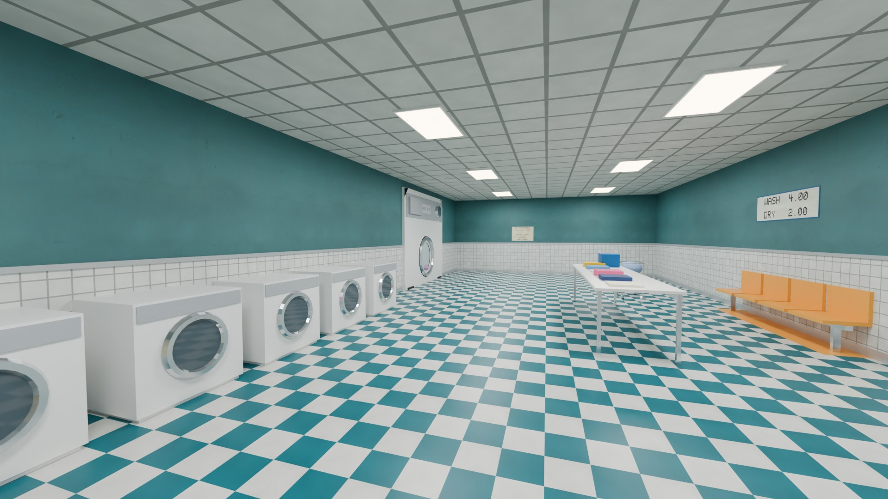
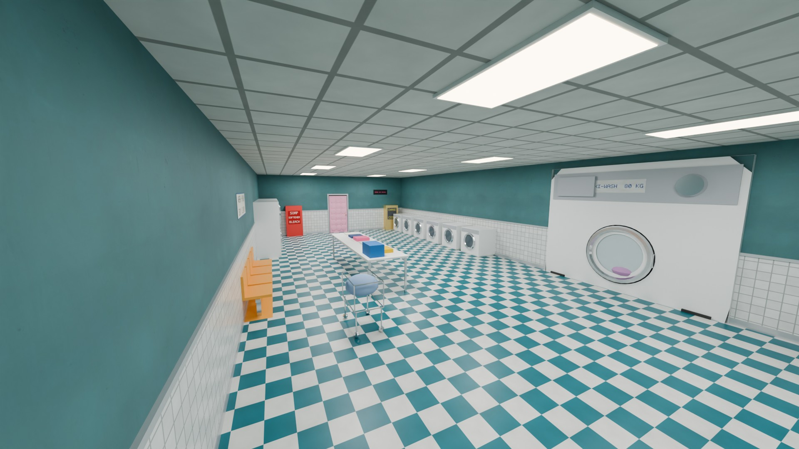
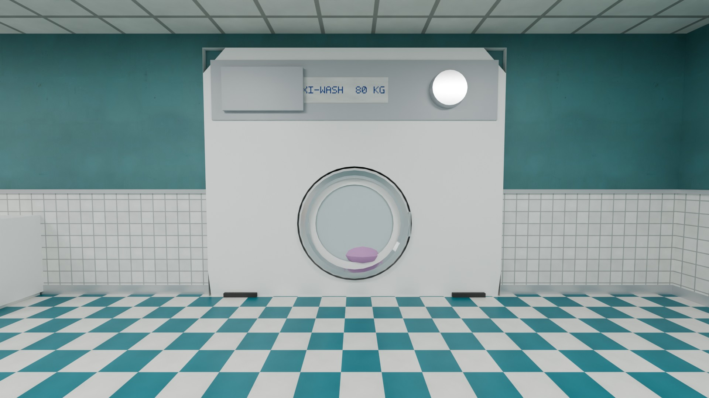

# rdwe_laundromat: The laundromat: the drum is a door

Right Door, Wrong Exit, Phase C room 28 (the institution), dressed and lit (`docs/BLENDER_AREAS.md`, section 7, step 2), round its greybox (`tools/blender/build_rdwe_greybox.py`, `c_laundromat()`). 16 m by 8 m, 3.2 m high. The room, from `ROOMS.md`: Object distortion: a row of washers and one machine the size of a car; its round door is the way on, the drum still turning.

A late laundromat in cyan and white: a checker floor, white tile to 1.3 m, a row of front-loaders, a bank of dryers, orange chairs on a beam, a folding table with folded washing, a wire cart, the change and soap machines, the notices; and on the north wall a washer the size of a car, MAXI-WASH, whose round glass door is the way on. Its drum, behind the glass, is its own object (the page turns it); not baked.

Built in Blender 5.2.1 by `tools/blender/build_rdwe_rooms2.py` (the room's `dress_` function and spec) with the shared kit `tools/blender/rdwe_rooms2_kit.py`, baked on the GPU and graded by `tools/blender/rdwe_rooms2_pack.py`. There are no reference photos: it follows the room's line in `ROOMS.md` and the style of `docs/WORLD.md` (Super Liminal: nearly ordinary, saturated, a little wrong).

| File | What it is |
|---|---|
| `world/rdwe_laundromat.glb` | the art: 1.07 MB, 12848 triangles, 25 materials, 24 nodes (one mesh per material; the door leaves, the moving objects as their own nodes), 8 WebP textures |
| `world/rdwe_laundromat.json` | the layout, written by `tools/blender/export_scene.py` from the `.blend`: 24 colliders, 2 doors, 2 links, 2 spots; the same as `build_rdwe_greybox.py --preview` writes |
| `world/lightmaps/rdwe_laundromat_0.webp` | set `main` (`lightmap`): struct page, 2048 px, about 79.9 px/m |
| `world/lightmaps/rdwe_laundromat_1.webp` | set `main` (`lightmap`): props page, 1024 px, about 50.0 px/m |
| `blender/scenes/rdwe_laundromat.blend` | the saved scene (Git LFS): `Art` (one object per collider, unmerged), `Doors` (the leaves, origin at the hinge), `Layout` (`COL_` boxes, the empties), `Export` (merged by material, with the lightmap UVs), `Lights_*` (one collection per light set, and `Lights_all`) |
| `docs/renders/rdwe_laundromat/` | this README and the three review stills |





Review stills: Cycles, 96 samples adaptive, OIDN, 1920 x 1080 JPEG, AgX medium high contrast. They are Blender's renders with Blender's lights; the page shows the lightmaps (see Brightness).

## The trick's spots (for the page)

- `Spot_trick_1` at (4, -1.6), facing (0, -1): the big drum turns once every time you look away
- `Spot_trick_2` at (4, -3), facing (0, -1): the round door, 1.4 m across: the drum behind the glass is still turning

## Doors

- `DoorLeaf_drum` (1.4 x 1.8 m): a washing machine's round glass door, 1.4 m across. The leaf is built from its look (form, finish, handle), so it is visibly unlike every other door in the set.
- `DoorLeaf_lockers` (1 x 2.1 m): quilted pink laminate door, brass knob. The leaf is built from its look (form, finish, handle), so it is visibly unlike every other door in the set.

## Light

| Set | Material properties | Maps |
|---|---|---|
| `main` | `lightmap`, `lightmap_intensity` | `rdwe_laundromat_0`, `rdwe_laundromat_1` |

Emissive materials (not baked, drawn as they are): `Lamp_Emit`. `Lamp_Emit` is every ordinary lamp's glow.

## What the page moves (own nodes)

- `decor_Drum_Clothes` (not baked, `unbaked: true`; origin at its pivot): the washing in the drum: turns with it
- `decor_Drum` (not baked, `unbaked: true`; origin at its pivot): turns about its axis (the round door's centre); a turn each time you look away

## Sources and licences

| File (`blender/textures/rdwe_rooms2/`) | Source | Licence | Used by |
|---|---|---|---|
| `Metal048A_color_512.jpg` | ambientCG, Metal048A | CC0 | Steel |
| `plastered_wall_04_diff_1k.jpg` | Poly Haven, Plastered Wall 04 | CC0 | Paint_Cyan |

Every other material is a flat colour, or a picture the build generates with numpy (fixed seeds, own work, no licence needed): `Brass`, `Ceiling_Tiles`, `Chrome`, `Clothes`, `Clothes_Move`, `Door_Pink_Laminate`, `Drum_Steel`, `Glass_Dark`, `Glass_Door`, `Laminate_White`, `Paint_Palette`, `Paint_Red`, `Panel_Grey`, `Plastic_Orange`, `Rubber`, `Signs_Laundry`, `Tile_White`, `Trim_Steel`, `Trim_White`, `Vinyl_Checker`, `Washer_Enamel`.
No Meshy, no Higgsfield, nothing bought.

## Brightness

Graded by `rdwe_rooms2_pack.py`: texel = G L / (C + G L), intensity = pi C (C = 1.15), G set so the shell page's median texel in the reference set is 1.7 (shared G); the page shows texture x base colour x texel x intensity / pi. The tables below are `lab_display.py` on the packed GLB.

```
brightness, set main (`lightmap`): lab_display.py (shown = texel x intensity / pi x base colour)
material                m2           map       k    p50    p90    p99     >=1
Paint_Cyan           133.8 rdwe_laundromat_0  3.6128  0.119  0.173  0.190   0.00%
Ceiling_Tiles        128.0 rdwe_laundromat_0  3.6128  0.417  0.470  0.771   0.00%
Vinyl_Checker        114.8 rdwe_laundromat_0  3.6128  0.189  0.645  0.672   0.00%
Tile_White            59.6 rdwe_laundromat_0  3.6128  0.337  0.630  0.664   0.00%
Washer_Enamel         53.9 rdwe_laundromat_1  3.6128  0.546  0.725  0.771   0.00%
Chrome                12.3 rdwe_laundromat_1  3.6128  0.000  0.000  0.000   0.00%
Door_Pink_Laminate    11.2 rdwe_laundromat_1  3.6128  0.000  0.766  0.798   0.00%
Trim_Steel            10.6 rdwe_laundromat_0  3.6128  0.463  0.538  0.549   0.00%
Panel_Grey             8.2 rdwe_laundromat_1  3.6128  0.005  0.407  0.420   0.00%
Trim_White             7.6 rdwe_laundromat_1  2.9987  0.863  0.870  0.878   0.00%
Plastic_Orange         4.5 rdwe_laundromat_1  3.6128  0.749  0.781  0.789   0.00%
Laminate_White         4.3 rdwe_laundromat_1  3.6128  0.811  0.852  0.860   0.00%
Paint_Red              2.9 rdwe_laundromat_1  3.6128  0.494  0.581  0.630   0.00%
Glass_Dark             2.8 rdwe_laundromat_1  3.6128  0.120  0.126  0.133   0.00%
Signs_Laundry          2.8 rdwe_laundromat_1  3.6128  0.462  0.669  0.795   0.00%
Steel                  2.7 rdwe_laundromat_1  3.6128  0.528  0.667  0.689   0.00%
Paint_Palette          2.2 rdwe_laundromat_1  3.6128  0.515  0.756  0.794   0.00%
Glass_Door             1.5 rdwe_laundromat_1  3.6128  0.395  0.527  0.527   0.00%
Clothes                0.5 rdwe_laundromat_1  3.6128  0.521  0.575  0.581   0.00%
Rubber                 0.2 rdwe_laundromat_1  3.6128  0.028  0.041  0.042   0.00%
Brass                  0.1 rdwe_laundromat_1  3.6128  0.001  0.495  0.537   0.00%
```

## Gates

```
## python tools/blender/build_rdwe_greybox.py --check .
GATE links: 54 pairs with both sides built (108 sides, the one-way ones included), 2 that loop on their own room, 5 that leave the set; 115 links in the files, every one accounted for
GATE navigable: 43 of 43 rooms reachable from rdwe_dining; 42 can get back to it (no true exit: the finale's one way out is the ending)
GATE overlaps: 0 interpenetrating collider pairs of 35141 checked (none allowed)
GATE clearances: 344 links, arrivals, spots and spawns clear by 0.28 m with a floor under them; 248 door-front points (0.5 and 1 m in) clear
GATE steps: 56 step boxes in 6 flights, one box a step; the highest rise 0.250 m (at most 0.27 m)
GATE corridors: 14 corridor rects, the narrowest 2.00 m (at least 1.6 m), none blocked
GATE extent: the largest room is 50.4 m across (a store floor, about 52 m, at most)
GATE spots: every room has its trick's spot and the ones it needs; 10 SecCam; agent x6, beacon x1, book x3, buttons x3, cake x1, cart x1, change x3, clock x2, computer x4, dark x3, frame x1, grid x6, hide x12, hum x1, lamp x1, lap x1, locker x3, map x3, monitor x2, moon x2, note x1, notes x1, photo x5, scuff x1, seeker x1, statue x3, switch x4, ticket x3, tin x3, trick x21, tv x3, view x6, watch x1, window x1
GATE doors: 124 door leaves, no two with the same look; 103 exits with one Link_ each, 4 arrival-only, 17 that never open; every exit fixed
GATES PASS

## world/rdwe_laundromat.json (export_scene.py, from the .blend) against build_rdwe_greybox.py --preview
SAME (to 2.5 mm): 24 colliders, 2 doors, 2 links, 0 zones, 2 spots, 0 markers, 0 cameras

## node tools/worlddoc.mjs check world/rdwe_laundromat.json
warning: scene rdwe_laundromat is not in the world manifest yet: a new scene to add
  warning: link drum: the manifest has no link from this door yet: a new link to add
  warning: link lockers: the manifest has no link from this door yet: a new link to add
OK world/rdwe_laundromat.json: 24 colliders, 2 doors, 0 markers, 2 links, 0 zones, 2 spots, 0 errors, 3 warnings

## tools/blender/check_layout.py (rules COVER, STRAY, CLEAR on the Art collection; run on the box)
layout check: scene rdwe_laundromat, 57 visible meshes, 24 colliders
PASS  COVER  Beyond_drum: 1 mesh(es) cover it (1260 sample points, every one within 5 cm of art)
PASS  COVER  Beyond_lockers: 1 mesh(es) cover it (1152 sample points, every one within 5 cm of art)
PASS  COVER  Chairs: 4 mesh(es) cover it (1116 sample points, every one within 5 cm of art)
PASS  COVER  Change_Machine: 3 mesh(es) cover it (720 sample points, every one within 5 cm of art)
PASS  COVER  Dryers: 3 mesh(es) cover it (9261 sample points, every one within 5 cm of art)
PASS  COVER  Folding_Table: 3 mesh(es) cover it (4510 sample points, every one within 5 cm of art)
PASS  COVER  Laundry_Cart: 2 mesh(es) cover it (540 sample points, every one within 5 cm of art)
PASS  COVER  Room_Ceiling: 9 mesh(es) cover it (42075 sample points, every one within 5 cm of art)
PASS  COVER  Room_Floor: 20 mesh(es) cover it (56100 sample points, every one within 5 cm of art)
PASS  COVER  Room_Wall_E_1: 5 mesh(es) cover it (8019 sample points, every one within 5 cm of art)
PASS  COVER  Room_Wall_N_1: 11 mesh(es) cover it (11484 sample points, every one within 5 cm of art)
PASS  COVER  Room_Wall_N_2: 4 mesh(es) cover it (720 sample points, every one within 5 cm of art)
PASS  COVER  Room_Wall_N_3: 5 mesh(es) cover it (3564 sample points, every one within 5 cm of art)
PASS  COVER  Room_Wall_S_1: 7 mesh(es) cover it (16335 sample points, every one within 5 cm of art)
PASS  COVER  Room_Wall_W_1: 6 mesh(es) cover it (3564 sample points, every one within 5 cm of art)
PASS  COVER  Room_Wall_W_2: 4 mesh(es) cover it (432 sample points, every one within 5 cm of art)
PASS  COVER  Room_Wall_W_3: 6 mesh(es) cover it (3564 sample points, every one within 5 cm of art)
PASS  COVER  Soap_Machine: 3 mesh(es) cover it (765 sample points, every one within 5 cm of art)
PASS  COVER  Washer_1: 3 mesh(es) cover it (1089 sample points, every one within 5 cm of art)
PASS  COVER  Washer_2: 3 mesh(es) cover it (1089 sample points, every one within 5 cm of art)
PASS  COVER  Washer_3: 3 mesh(es) cover it (1089 sample points, every one within 5 cm of art)
PASS  COVER  Washer_4: 3 mesh(es) cover it (1089 sample points, every one within 5 cm of art)
PASS  COVER  Washer_5: 3 mesh(es) cover it (1089 sample points, every one within 5 cm of art)
PASS  COVER  Washer_6: 3 mesh(es) cover it (1089 sample points, every one within 5 cm of art)
PASS  STRAY  21 tall solid mesh(es), each over a collider; 31 decor_* mesh(es) exempt
PASS  CLEAR  links.drum.arrive (4.00, -2.10): clear within 0.28 m
PASS  CLEAR  links.drum.at (4.00, -3.25): clear within 0.28 m
PASS  CLEAR  links.lockers.arrive (-6.10, 0.00): clear within 0.28 m
PASS  CLEAR  links.lockers.at (-7.25, 0.00): clear within 0.28 m
PASS  CLEAR  spots.Spot_trick_1.at (4.00, -1.60): clear within 0.28 m
PASS  CLEAR  spots.Spot_trick_2.at (4.00, -3.00): clear within 0.28 m
PASS: 31 of 31 checks passed

## glb_inspect world/rdwe_laundromat.glb --budget tris=300000,mb=8
materials  25: Ceiling_Tiles, Chrome, Clothes, Clothes_Move, Drum_Steel, Glass_Door, Washer_Enamel, Brass, Door_Pink_Laminate, Glass_Dark, Laminate_White, Lamp_Emit, Paint_Cyan, Paint_Palette, Paint_Red, Panel_Grey, Plastic_Orange, Rubber, Signs_Laundry, Steel, Tile_White, Trim_Steel, Trim_White, Vinyl_Checker, Void_Black
textures   8, images: 256x256, 256x256, 1024x1024, 128x128, 1024x1024, 512x512, 256x256, 256x256
bbox       16.55 x 3.25 x 8.55 (x, y up, z), min [-8.55, -0.05, -4.55]
requires   EXT_texture_webp
pass       tris: 12848 triangles, budget 300000
pass       mb: 1.02 MB, budget 8

## node --test shared/*.test.js
tests 297
pass 297
fail 0

## sizes
world/rdwe_laundromat.glb  1.07 MB
world/rdwe_laundromat.json  0.00 MB
blender/scenes/rdwe_laundromat.blend  0.78 MB
world/lightmaps/rdwe_laundromat_0.webp  0.06 MB
world/lightmaps/rdwe_laundromat_1.webp  0.09 MB
docs/renders/rdwe_laundromat/1_arrival.jpg  0.30 MB
docs/renders/rdwe_laundromat/2_wide.jpg  0.29 MB
docs/renders/rdwe_laundromat/3_detail.jpg  0.20 MB

## privacy grep (user names, absolute paths, session ids, e-mail; the .blend decompressed)
privacy grep: 9 files, 1 with hits (the only hit is a drive-letter-like three-byte run inside a lightmap's compressed image data: not text)

```

Nothing is wired: the manifest, `games/rdwe/`, `index.html`, `shared/` and the tests are untouched.
