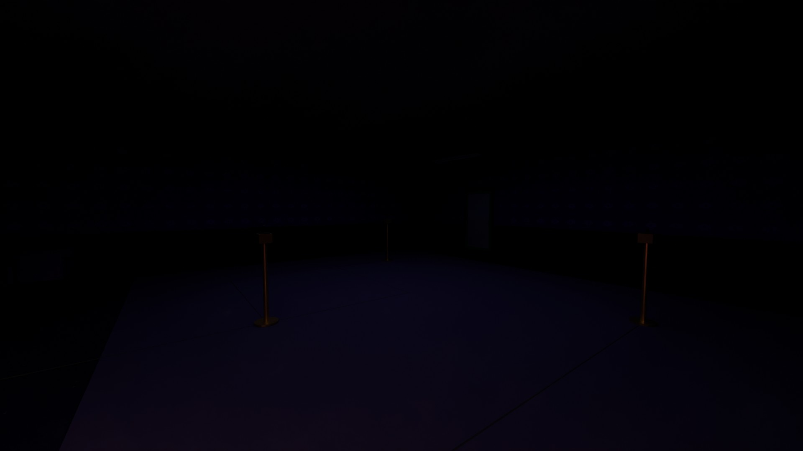
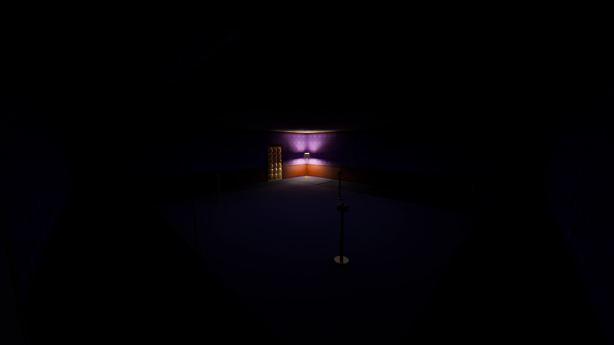
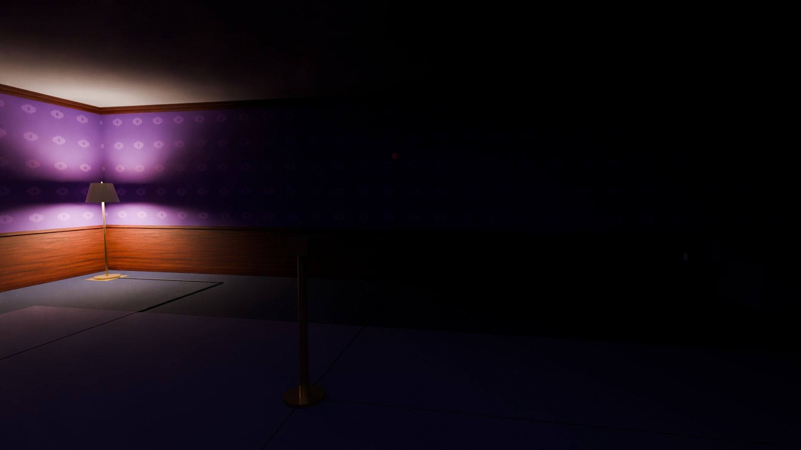

# rdwe_lights_out: Lights out: switches show different doors

Right Door, Wrong Exit, Phase C room 17 (the teal wing), dressed and lit (`docs/BLENDER_AREAS.md`, section 7, step 2), round its greybox (`tools/blender/build_rdwe_greybox.py`, `c_lights_out()`). 12 m by 12 m, 3.2 m high. The room, from `ROOMS.md`: Psychological puzzle: a dark room of three switches; each lights the room differently and shows a different door, and the door you take is the one lit when you reach it.

A dark sitting room in violet damask over a navy star carpet. Three switches on brass posts, each with its cord across the floor to its lamp: switch 1 the standard lamp by the steel door (the void), switch 2 the tube batten over the green mirror door (the way to the three doors), switch 3 a red bulb on a cord and a door of light on the bare north wall that leads nowhere. Each is its own bake.

Built in Blender 5.2.1 by `tools/blender/build_rdwe_rooms2.py` (the room's `dress_` function and spec) with the shared kit `tools/blender/rdwe_rooms2_kit.py`, baked on the GPU and graded by `tools/blender/rdwe_rooms2_pack.py`. There are no reference photos: it follows the room's line in `ROOMS.md` and the style of `docs/WORLD.md` (Super Liminal: nearly ordinary, saturated, a little wrong).

| File | What it is |
|---|---|
| `world/rdwe_lights_out.glb` | the art: 0.90 MB, 7604 triangles, 23 materials, 20 nodes (one mesh per material; the door leaves as their own nodes), 9 WebP textures |
| `world/rdwe_lights_out.json` | the layout, written by `tools/blender/export_scene.py` from the `.blend`: 18 colliders, 2 doors, 2 links, 4 spots; the same as `build_rdwe_greybox.py --preview` writes |
| `world/lightmaps/rdwe_lights_out_0.webp` | set `switch_1` (`lightmap`): struct and props page, 2048 px, about 63.9 px/m |
| `world/lightmaps/rdwe_lights_out_1.webp` | set `switch_2` (`lightmap_switch_2`): struct and props page, 2048 px, about 63.9 px/m |
| `world/lightmaps/rdwe_lights_out_2.webp` | set `switch_3` (`lightmap_switch_3`): struct and props page, 2048 px, about 63.9 px/m |
| `blender/scenes/rdwe_lights_out.blend` | the saved scene (Git LFS): `Art` (one object per collider, unmerged), `Doors` (the leaves, origin at the hinge), `Layout` (`COL_` boxes, the empties), `Export` (merged by material, with the lightmap UVs), `Lights_*` (one collection per light set, and `Lights_all`) |
| `docs/renders/rdwe_lights_out/` | this README and the three review stills |





Review stills: Cycles, 96 samples adaptive, OIDN, 1920 x 1080 JPEG, AgX medium high contrast. They are Blender's renders with Blender's lights; the page shows the lightmaps (see Brightness).

## The trick's spots (for the page)

- `Spot_switch_1` at (-3, 2.6), facing (0, -1): switch 1, the brass toggle: the standard lamp by the steel door comes on (lightmap); the void door is lit
- `Spot_switch_2` at (0, -1.4), facing (0, -1): switch 2, the cord pull: the tube over the green mirror door flickers on (lightmap_switch_2); the way to the three doors is lit
- `Spot_switch_3` at (3, 2.6), facing (0, -1): switch 3, the push button: the red bulb on the north wall, and a door of light on the bare wall (lightmap_switch_3); it is not a door
- `Spot_trick_1` at (0, -4.2), facing (0, -1): the door of light: switch 3 draws a door here on the bare north wall

## Doors

- `DoorLeaf_three` (1.12 x 2.1 m): mirror-faced bottle green door, ring pull. The leaf is built from its look (form, finish, handle), so it is visibly unlike every other door in the set.
- `DoorLeaf_void` (1.12 x 2.24 m): quilted brushed steel door, chrome lever. The leaf is built from its look (form, finish, handle), so it is visibly unlike every other door in the set.

## Light

| Set | Material properties | Maps |
|---|---|---|
| `switch_1` | `lightmap`, `lightmap_intensity` | `rdwe_lights_out_0` |
| `switch_2` | `lightmap_switch_2`, `lightmap_switch_2_intensity` | `rdwe_lights_out_1` |
| `switch_3` | `lightmap_switch_3`, `lightmap_switch_3_intensity` | `rdwe_lights_out_2` |

The first set (`switch_1`) is `lightmap`, the one the page shows by default; the page swaps to another set by reading its own key. Every set is baked on the same lightmap UVs.

Emissive materials (not baked, drawn as they are): `Lamp_S1`, `Lamp_S2`, `Lamp_S3`. `Lamp_Emit` is every ordinary lamp's glow.

## Sources and licences

| File (`blender/textures/rdwe_rooms2/`) | Source | Licence | Used by |
|---|---|---|---|
| `Metal048A_color_512.jpg` | ambientCG, Metal048A | CC0 | Door_Brushed_Steel |
| `dark_wood_diff_1k.jpg` | Poly Haven, Dark Wood | CC0 | Panel_Dark, Trim_Dark, Wood_Dark |
| `plastered_wall_04_diff_1k.jpg` | Poly Haven, Plastered Wall 04 | CC0 | Ceiling_Plaster |
| `rough_linen_diff_512.jpg` | Poly Haven, Rough Linen | CC0 | Rug_Plum, Velvet_Plum |

Every other material is a flat colour, or a picture the build generates with numpy (fixed seeds, own work, no licence needed): `Bakelite`, `Brass`, `Carpet_Stars`, `Chrome`, `Door_Bottle_Green`, `Glass_Door`, `Iron`, `Lamp_S1`, `Lamp_S2`, `Lamp_S3`, `Mirror`, `Paper_Violet`, `Rubber`, `Shade_Silk`, `Trim_White`.
No Meshy, no Higgsfield, nothing bought.

## Brightness

Graded by `rdwe_rooms2_pack.py`: texel = G L / (C + G L), intensity = pi C (C = 1.15), G set so the shell page's median texel in the reference set is 0.9 (each G); the page shows texture x base colour x texel x intensity / pi. The tables below are `lab_display.py` on the packed GLB.

```
brightness, set switch_1 (`lightmap`): lab_display.py (shown = texel x intensity / pi x base colour)
material                m2           map       k    p50    p90    p99     >=1
Paper_Violet         151.3 rdwe_lights_out_0  3.6128  0.105  0.209  0.302   0.00%
Ceiling_Plaster      144.0 rdwe_lights_out_0  3.6128  0.072  0.178  0.254   0.00%
Carpet_Stars         142.8 rdwe_lights_out_0  3.6128  0.001  0.038  0.050   0.00%
Rug_Plum              70.3 rdwe_lights_out_0  3.6128  0.122  0.135  0.145   0.00%
Panel_Dark            41.5 rdwe_lights_out_0  3.6128  0.030  0.066  0.112   0.00%
Trim_Dark             26.4 rdwe_lights_out_0  3.6128  0.012  0.056  0.107   0.00%
Door_Brushed_Steel    13.5 rdwe_lights_out_0  3.6128  0.000  0.731  0.945   0.00%
Mirror                 7.5 rdwe_lights_out_0  3.6128  0.000  0.451  0.478   0.00%
Door_Bottle_Green      7.4 rdwe_lights_out_0  3.6128  0.000  0.015  0.102   0.00%
Velvet_Plum            5.9 rdwe_lights_out_0  3.6128  0.018  0.093  0.123   0.00%
Brass                  1.8 rdwe_lights_out_0  3.6128  0.394  0.713  0.713   0.00%
Rubber                 1.2 rdwe_lights_out_0  3.6128  0.030  0.046  0.057   0.00%
Wood_Dark              0.8 rdwe_lights_out_0  3.6128  0.023  0.050  0.084   0.00%
Trim_White             0.6 rdwe_lights_out_0  3.2154  0.140  0.171  0.319   0.00%
Shade_Silk             0.5 rdwe_lights_out_0  3.1648  0.815  0.862  0.878   0.00%
Bakelite               0.1 rdwe_lights_out_0  3.6128  0.035  0.054  0.060   0.00%
Chrome                 0.1 rdwe_lights_out_0  3.6128  0.000  0.000  0.001   0.00%
Iron                   0.0 rdwe_lights_out_0  3.6128  0.000  0.000  0.039   0.00%
Glass_Door             0.0 rdwe_lights_out_0  3.6128  0.242  0.346  0.359   0.00%
```
```
brightness, set switch_2 (`lightmap_switch_2`): lab_display.py (shown = texel x intensity / pi x base colour)
material                m2           map       k    p50    p90    p99     >=1
Paper_Violet         151.3 rdwe_lights_out_1  3.6128  0.105  0.256  0.376   0.00%
Ceiling_Plaster      144.0 rdwe_lights_out_1  3.6128  0.073  0.163  0.210   0.00%
Carpet_Stars         142.8 rdwe_lights_out_1  3.6128  0.001  0.043  0.051   0.00%
Rug_Plum              70.3 rdwe_lights_out_1  3.6128  0.116  0.146  0.157   0.00%
Panel_Dark            41.5 rdwe_lights_out_1  3.6128  0.035  0.073  0.109   0.00%
Trim_Dark             26.4 rdwe_lights_out_1  3.6128  0.014  0.056  0.097   0.00%
Door_Brushed_Steel    13.5 rdwe_lights_out_1  3.6128  0.000  0.351  0.440   0.00%
Mirror                 7.5 rdwe_lights_out_1  3.6128  0.002  0.881  0.881   0.00%
Door_Bottle_Green      7.4 rdwe_lights_out_1  3.6128  0.000  0.184  0.271   0.00%
Velvet_Plum            5.9 rdwe_lights_out_1  3.6128  0.030  0.130  0.148   0.00%
Brass                  1.8 rdwe_lights_out_1  3.6128  0.165  0.570  0.675   0.00%
Rubber                 1.2 rdwe_lights_out_1  3.6128  0.029  0.052  0.057   0.00%
Wood_Dark              0.8 rdwe_lights_out_1  3.6128  0.022  0.059  0.103   0.00%
Trim_White             0.6 rdwe_lights_out_1  3.2154  0.802  0.862  0.862   0.00%
Shade_Silk             0.5 rdwe_lights_out_1  3.1648  0.075  0.321  0.339   0.00%
Bakelite               0.1 rdwe_lights_out_1  3.6128  0.026  0.064  0.066   0.00%
Chrome                 0.1 rdwe_lights_out_1  3.6128  0.000  0.000  0.000   0.00%
Iron                   0.0 rdwe_lights_out_1  3.6128  0.000  0.001  0.095   0.00%
Glass_Door             0.0 rdwe_lights_out_1  3.6128  0.228  0.443  0.474   0.00%
```
```
brightness, set switch_3 (`lightmap_switch_3`): lab_display.py (shown = texel x intensity / pi x base colour)
material                m2           map       k    p50    p90    p99     >=1
Paper_Violet         151.3 rdwe_lights_out_2  3.6128  0.074  0.131  0.274   0.00%
Ceiling_Plaster      144.0 rdwe_lights_out_2  3.6128  0.074  0.186  0.245   0.00%
Carpet_Stars         142.8 rdwe_lights_out_2  3.6128  0.000  0.025  0.043   0.00%
Rug_Plum              70.3 rdwe_lights_out_2  3.6128  0.082  0.105  0.120   0.00%
Panel_Dark            41.5 rdwe_lights_out_2  3.6128  0.030  0.058  0.094   0.00%
Trim_Dark             26.4 rdwe_lights_out_2  3.6128  0.021  0.054  0.092   0.00%
Door_Brushed_Steel    13.5 rdwe_lights_out_2  3.6128  0.000  0.624  0.666   0.00%
Mirror                 7.5 rdwe_lights_out_2  3.6128  0.000  0.363  0.372   0.00%
Door_Bottle_Green      7.4 rdwe_lights_out_2  3.6128  0.000  0.005  0.062   0.00%
Velvet_Plum            5.9 rdwe_lights_out_2  3.6128  0.014  0.081  0.114   0.00%
Brass                  1.8 rdwe_lights_out_2  3.6128  0.234  0.469  0.621   0.00%
Rubber                 1.2 rdwe_lights_out_2  3.6128  0.023  0.049  0.056   0.00%
Wood_Dark              0.8 rdwe_lights_out_2  3.6128  0.032  0.091  0.132   0.00%
Trim_White             0.6 rdwe_lights_out_2  3.2154  0.138  0.373  0.453   0.00%
Shade_Silk             0.5 rdwe_lights_out_2  3.1648  0.202  0.623  0.663   0.00%
Bakelite               0.1 rdwe_lights_out_2  3.6128  0.033  0.065  0.068   0.00%
Chrome                 0.1 rdwe_lights_out_2  3.6128  0.000  0.000  0.001   0.00%
Iron                   0.0 rdwe_lights_out_2  3.6128  0.000  0.000  0.033   0.00%
Glass_Door             0.0 rdwe_lights_out_2  3.6128  0.292  0.476  0.500   0.00%
```

## Gates

```
## python tools/blender/build_rdwe_greybox.py --check .
GATE links: 54 pairs with both sides built (108 sides, the one-way ones included), 2 that loop on their own room, 5 that leave the set; 115 links in the files, every one accounted for
GATE navigable: 43 of 43 rooms reachable from rdwe_dining; 42 can get back to it (no true exit: the finale's one way out is the ending)
GATE overlaps: 0 interpenetrating collider pairs of 35141 checked (none allowed)
GATE clearances: 344 links, arrivals, spots and spawns clear by 0.28 m with a floor under them; 248 door-front points (0.5 and 1 m in) clear
GATE steps: 56 step boxes in 6 flights, one box a step; the highest rise 0.250 m (at most 0.27 m)
GATE corridors: 14 corridor rects, the narrowest 2.00 m (at least 1.6 m), none blocked
GATE extent: the largest room is 50.4 m across (a store floor, about 52 m, at most)
GATE spots: every room has its trick's spot and the ones it needs; 10 SecCam; agent x6, beacon x1, book x3, buttons x3, cake x1, cart x1, change x3, clock x2, computer x4, dark x3, frame x1, grid x6, hide x12, hum x1, lamp x1, lap x1, locker x3, map x3, monitor x2, moon x2, note x1, notes x1, photo x5, scuff x1, seeker x1, statue x3, switch x4, ticket x3, tin x3, trick x21, tv x3, view x6, watch x1, window x1
GATE doors: 124 door leaves, no two with the same look; 103 exits with one Link_ each, 4 arrival-only, 17 that never open; every exit fixed
GATES PASS

## world/rdwe_lights_out.json (export_scene.py, from the .blend) against build_rdwe_greybox.py --preview
SAME (to 2.5 mm): 18 colliders, 2 doors, 2 links, 0 zones, 4 spots, 0 markers, 0 cameras

## node tools/worlddoc.mjs check world/rdwe_lights_out.json
warning: scene rdwe_lights_out is not in the world manifest yet: a new scene to add
  warning: link three: the manifest has no link from this door yet: a new link to add
  warning: link void: the manifest has no link from this door yet: a new link to add
OK world/rdwe_lights_out.json: 18 colliders, 2 doors, 0 markers, 2 links, 0 zones, 4 spots, 0 errors, 3 warnings

## tools/blender/check_layout.py (rules COVER, STRAY, CLEAR on the Art collection; run on the box)
layout check: scene rdwe_lights_out, 38 visible meshes, 18 colliders
PASS  COVER  Armchair: 3 mesh(es) cover it (1331 sample points, every one within 5 cm of art)
PASS  COVER  Beyond_three: 1 mesh(es) cover it (1296 sample points, every one within 5 cm of art)
PASS  COVER  Beyond_void: 1 mesh(es) cover it (1404 sample points, every one within 5 cm of art)
PASS  COVER  Floor_Lamp: 3 mesh(es) cover it (684 sample points, every one within 5 cm of art)
PASS  COVER  Room_Ceiling: 9 mesh(es) cover it (46875 sample points, every one within 5 cm of art)
PASS  COVER  Room_Floor: 14 mesh(es) cover it (62500 sample points, every one within 5 cm of art)
PASS  COVER  Room_Wall_E_1: 5 mesh(es) cover it (11979 sample points, every one within 5 cm of art)
PASS  COVER  Room_Wall_N_1: 5 mesh(es) cover it (12375 sample points, every one within 5 cm of art)
PASS  COVER  Room_Wall_S_1: 5 mesh(es) cover it (8712 sample points, every one within 5 cm of art)
PASS  COVER  Room_Wall_S_2: 4 mesh(es) cover it (468 sample points, every one within 5 cm of art)
PASS  COVER  Room_Wall_S_3: 5 mesh(es) cover it (2772 sample points, every one within 5 cm of art)
PASS  COVER  Room_Wall_W_1: 5 mesh(es) cover it (2574 sample points, every one within 5 cm of art)
PASS  COVER  Room_Wall_W_2: 4 mesh(es) cover it (429 sample points, every one within 5 cm of art)
PASS  COVER  Room_Wall_W_3: 5 mesh(es) cover it (8514 sample points, every one within 5 cm of art)
PASS  COVER  Side_Table: 3 mesh(es) cover it (252 sample points, every one within 5 cm of art)
PASS  COVER  Switch_Post_1: 2 mesh(es) cover it (208 sample points, every one within 5 cm of art)
PASS  COVER  Switch_Post_2: 2 mesh(es) cover it (208 sample points, every one within 5 cm of art)
PASS  COVER  Switch_Post_3: 2 mesh(es) cover it (208 sample points, every one within 5 cm of art)
PASS  STRAY  15 tall solid mesh(es), each over a collider; 17 decor_* mesh(es) exempt
PASS  CLEAR  links.three.arrive (3.00, 4.10): clear within 0.28 m
PASS  CLEAR  links.three.at (3.00, 5.25): clear within 0.28 m
PASS  CLEAR  links.void.arrive (-4.10, -3.00): clear within 0.28 m
PASS  CLEAR  links.void.at (-5.25, -3.00): clear within 0.28 m
PASS  CLEAR  spots.Spot_switch_1.at (-3.00, 2.60): clear within 0.28 m
PASS  CLEAR  spots.Spot_switch_2.at (0.00, -1.40): clear within 0.28 m
PASS  CLEAR  spots.Spot_switch_3.at (3.00, 2.60): clear within 0.28 m
PASS  CLEAR  spots.Spot_trick_1.at (0.00, -4.20): clear within 0.28 m
PASS: 27 of 27 checks passed

## glb_inspect world/rdwe_lights_out.glb --budget tris=300000,mb=8
materials  23: Bakelite, Brass, Carpet_Stars, Ceiling_Plaster, Door_Bottle_Green, Iron, Mirror, Chrome, Door_Brushed_Steel, Glass_Door, Lamp_S1, Lamp_S2, Lamp_S3, Panel_Dark, Paper_Violet, Rubber, Rug_Plum, Shade_Silk, Trim_Dark, Trim_White, Velvet_Plum, Void_Black, Wood_Dark
textures   9, images: 512x512, 1024x1024, 512x512, 1024x1024, 512x512, 512x512
bbox       12.55 x 3.25 x 12.55 (x, y up, z), min [-6.55, -0.05, -6.0]
requires   EXT_texture_webp
pass       tris: 7604 triangles, budget 300000
pass       mb: 0.86 MB, budget 8

## node --test shared/*.test.js
tests 297
pass 297
fail 0

## sizes
world/rdwe_lights_out.glb  0.90 MB
world/rdwe_lights_out.json  0.00 MB
blender/scenes/rdwe_lights_out.blend  0.61 MB
world/lightmaps/rdwe_lights_out_0.webp  0.20 MB
world/lightmaps/rdwe_lights_out_1.webp  0.15 MB
world/lightmaps/rdwe_lights_out_2.webp  0.22 MB
docs/renders/rdwe_lights_out/1_arrival.jpg  0.04 MB
docs/renders/rdwe_lights_out/2_wide.jpg  0.05 MB
docs/renders/rdwe_lights_out/3_detail.jpg  0.08 MB

## privacy grep (user names, absolute paths, session ids, e-mail; the .blend decompressed)
privacy grep: 10 files, 1 with hits (the only hit is a drive-letter-like three-byte run inside compressed image data (a lightmap, or a picture packed in the .blend): not text)

```

Nothing is wired: the manifest, `games/rdwe/`, `index.html`, `shared/` and the tests are untouched.
