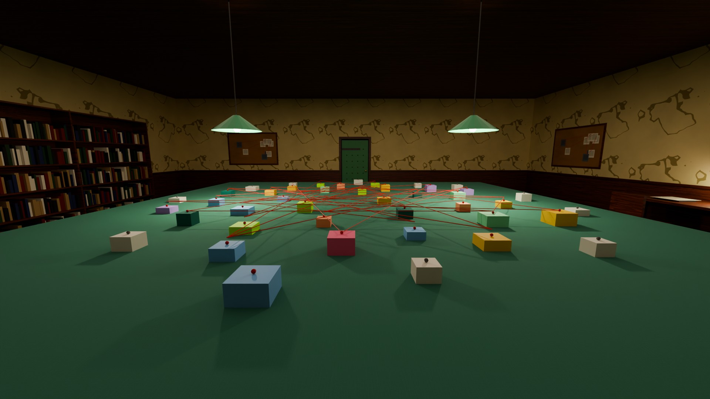
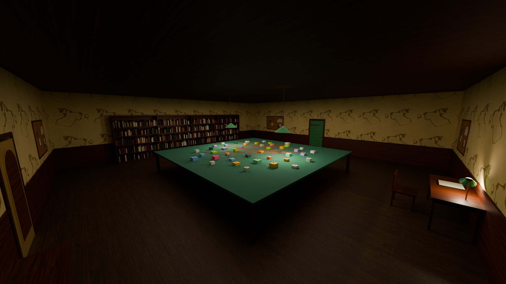
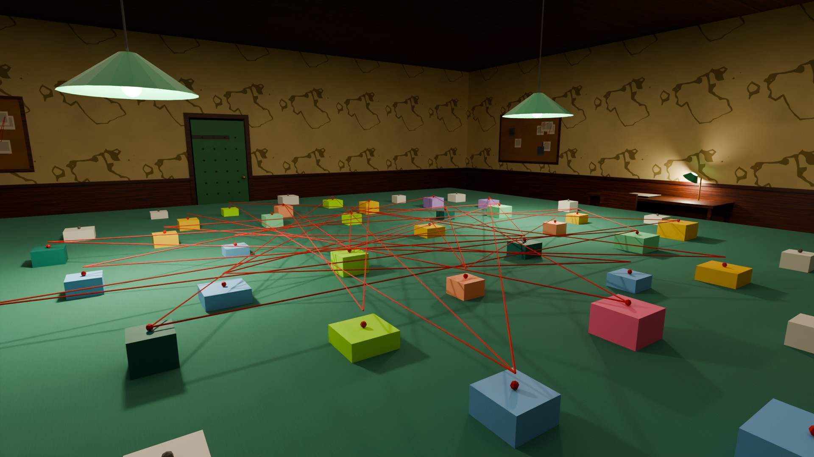

# rdwe_map_room: The map room: the notebook on a table

Right Door, Wrong Exit, Phase C room 32 (the institution), dressed and lit (`docs/BLENDER_AREAS.md`, section 7, step 2), round its greybox (`tools/blender/build_rdwe_greybox.py`, `c_map_room()`). 12 m by 12 m, 3.4 m high. The room, from `ROOMS.md`: Environmental storytelling: a table-sized model of the rooms you have seen, joined by string not by space, the notebook made real; the rooms you have not found are blank.

The notebook made real: a big table under green lamps with a model of every room you have found, each a little coloured block, joined by red string where a door joins them (G.PAIRS: connections, not space); the rooms not found are blank white blocks. Shelves of binders, a desk with the notebook, a plan chest, pinboards of photographs and string.

Built in Blender 5.2.1 by `tools/blender/build_rdwe_rooms2.py` (the room's `dress_` function and spec) with the shared kit `tools/blender/rdwe_rooms2_kit.py`, baked on the GPU and graded by `tools/blender/rdwe_rooms2_pack.py`. There are no reference photos: it follows the room's line in `ROOMS.md` and the style of `docs/WORLD.md` (Super Liminal: nearly ordinary, saturated, a little wrong).

| File | What it is |
|---|---|
| `world/rdwe_map_room.glb` | the art: 1.86 MB, 16458 triangles, 16 materials, 16 nodes (one mesh per material; the door leaves as their own nodes), 10 WebP textures |
| `world/rdwe_map_room.json` | the layout, written by `tools/blender/export_scene.py` from the `.blend`: 17 colliders, 2 doors, 2 links, 3 spots; the same as `build_rdwe_greybox.py --preview` writes |
| `world/lightmaps/rdwe_map_room_0.webp` | set `main` (`lightmap`): struct page, 2048 px, about 84.1 px/m |
| `world/lightmaps/rdwe_map_room_1.webp` | set `main` (`lightmap`): props page, 1024 px, about 11.7 px/m |
| `blender/scenes/rdwe_map_room.blend` | the saved scene (Git LFS): `Art` (one object per collider, unmerged), `Doors` (the leaves, origin at the hinge), `Layout` (`COL_` boxes, the empties), `Export` (merged by material, with the lightmap UVs), `Lights_*` (one collection per light set, and `Lights_all`) |
| `docs/renders/rdwe_map_room/` | this README and the three review stills |





Review stills: Cycles, 96 samples adaptive, OIDN, 1920 x 1080 JPEG, AgX medium high contrast. They are Blender's renders with Blender's lights; the page shows the lightmaps (see Brightness).

## The trick's spots (for the page)

- `Spot_map_1` at (0, 4), facing (0, -1): the map: a graph of connections, not of space
- `Spot_map_2` at (-4.2, 0), facing (1, 0): the blank rooms: white blocks where the rooms you have not found will be
- `Spot_map_3` at (4.2, 1.5), facing (-1, 0): the string: red where you went through a door, none where the rooms only touch

## Doors

- `DoorLeaf_door` (0.9 x 2.04 m): studded bottle green door, brass knob. The leaf is built from its look (form, finish, handle), so it is visibly unlike every other door in the set.
- `DoorLeaf_lift` (0.94 x 2.04 m): round-topped brushed steel door, no handle. The leaf is built from its look (form, finish, handle), so it is visibly unlike every other door in the set.

## Light

| Set | Material properties | Maps |
|---|---|---|
| `main` | `lightmap`, `lightmap_intensity` | `rdwe_map_room_0`, `rdwe_map_room_1` |

Emissive materials (not baked, drawn as they are): `Lamp_Emit`. `Lamp_Emit` is every ordinary lamp's glow.

## Sources and licences

| File (`blender/textures/rdwe_rooms2/`) | Source | Licence | Used by |
|---|---|---|---|
| `Metal048A_color_512.jpg` | ambientCG, Metal048A | CC0 | Door_Brushed_Steel |
| `dark_wood_diff_1k.jpg` | Poly Haven, Dark Wood | CC0 | Ceiling_Wood, Panel_Dark, Trim_Dark, Wood_Dark |
| `old_wood_floor_diff_1k.jpg` | Poly Haven, Old Wood Floor | CC0 | Floor_Oak |
| `rough_linen_diff_512.jpg` | Poly Haven, Rough Linen | CC0 | Felt_Green |

Every other material is a flat colour, or a picture the build generates with numpy (fixed seeds, own work, no licence needed): `Brass`, `Door_Bottle_Green`, `Iron`, `Paint_Palette`, `Paper_Map`, `Pinboard`, `Shade_Green`.
No Meshy, no Higgsfield, nothing bought.

## Brightness

Graded by `rdwe_rooms2_pack.py`: texel = G L / (C + G L), intensity = pi C (C = 1.15), G set so the shell page's median texel in the reference set is 1.2 (shared G); the page shows texture x base colour x texel x intensity / pi. The tables below are `lab_display.py` on the packed GLB.

```
brightness, set main (`lightmap`): lab_display.py (shown = texel x intensity / pi x base colour)
material                m2           map       k    p50    p90    p99     >=1
Paint_Palette        171.3 rdwe_map_room_1  3.6128  0.001  0.040  0.733   0.00%
Ceiling_Wood         144.0 rdwe_map_room_0  3.6128  0.037  0.057  0.082   0.00%
Paper_Map            142.2 rdwe_map_room_0  3.6128  0.302  0.509  0.577   0.00%
Wood_Dark            113.7 rdwe_map_room_1  3.6128  0.014  0.061  0.118   0.00%
Floor_Oak            104.0 rdwe_map_room_0  3.6128  0.062  0.088  0.140   0.00%
Panel_Dark            46.5 rdwe_map_room_0  3.6128  0.044  0.084  0.119   0.00%
Felt_Green            37.4 rdwe_map_room_1  3.6128  0.160  0.178  0.192   0.00%
Trim_Dark             13.0 rdwe_map_room_0  3.6128  0.041  0.070  0.095   0.00%
Door_Brushed_Steel     8.7 rdwe_map_room_1  3.6128  0.000  0.329  0.722   0.00%
Pinboard               6.4 rdwe_map_room_1  3.6128  0.251  0.387  0.651   0.00%
Door_Bottle_Green      3.9 rdwe_map_room_1  3.6128  0.075  0.188  0.196   0.00%
Shade_Green            0.7 rdwe_map_room_1  3.6128  0.325  0.338  0.344   0.00%
Iron                   0.5 rdwe_map_room_1  3.6128  0.000  0.000  0.067   0.00%
Brass                  0.1 rdwe_map_room_1  3.6128  0.000  0.407  0.500   0.00%
```

## Gates

```
## python tools/blender/build_rdwe_greybox.py --check .
GATE links: 54 pairs with both sides built (108 sides, the one-way ones included), 2 that loop on their own room, 5 that leave the set; 115 links in the files, every one accounted for
GATE navigable: 43 of 43 rooms reachable from rdwe_dining; 42 can get back to it (no true exit: the finale's one way out is the ending)
GATE overlaps: 0 interpenetrating collider pairs of 35141 checked (none allowed)
GATE clearances: 344 links, arrivals, spots and spawns clear by 0.28 m with a floor under them; 248 door-front points (0.5 and 1 m in) clear
GATE steps: 56 step boxes in 6 flights, one box a step; the highest rise 0.250 m (at most 0.27 m)
GATE corridors: 14 corridor rects, the narrowest 2.00 m (at least 1.6 m), none blocked
GATE extent: the largest room is 50.4 m across (a store floor, about 52 m, at most)
GATE spots: every room has its trick's spot and the ones it needs; 10 SecCam; agent x6, beacon x1, book x3, buttons x3, cake x1, cart x1, change x3, clock x2, computer x4, dark x3, frame x1, grid x6, hide x12, hum x1, lamp x1, lap x1, locker x3, map x3, monitor x2, moon x2, note x1, notes x1, photo x5, scuff x1, seeker x1, statue x3, switch x4, ticket x3, tin x3, trick x21, tv x3, view x6, watch x1, window x1
GATE doors: 124 door leaves, no two with the same look; 103 exits with one Link_ each, 4 arrival-only, 17 that never open; every exit fixed
GATES PASS

## world/rdwe_map_room.json (export_scene.py, from the .blend) against build_rdwe_greybox.py --preview
SAME (to 2.5 mm): 17 colliders, 2 doors, 2 links, 0 zones, 3 spots, 0 markers, 0 cameras

## node tools/worlddoc.mjs check world/rdwe_map_room.json
warning: scene rdwe_map_room is not in the world manifest yet: a new scene to add
  warning: link door: the manifest has no link from this door yet: a new link to add
  warning: link lift: the manifest has no link from this door yet: a new link to add
OK world/rdwe_map_room.json: 17 colliders, 2 doors, 0 markers, 2 links, 0 zones, 3 spots, 0 errors, 3 warnings

## tools/blender/check_layout.py (rules COVER, STRAY, CLEAR on the Art collection; run on the box)
layout check: scene rdwe_map_room, 44 visible meshes, 17 colliders
PASS  COVER  Beyond_door: 1 mesh(es) cover it (1080 sample points, every one within 5 cm of art)
PASS  COVER  Beyond_lift: 1 mesh(es) cover it (1152 sample points, every one within 5 cm of art)
PASS  COVER  Chair_E: 3 mesh(es) cover it (420 sample points, every one within 5 cm of art)
PASS  COVER  Desk_E: 4 mesh(es) cover it (1512 sample points, every one within 5 cm of art)
PASS  COVER  Map_Table: 3 mesh(es) cover it (37210 sample points, every one within 5 cm of art)
PASS  COVER  Plan_Chest: 4 mesh(es) cover it (1840 sample points, every one within 5 cm of art)
PASS  COVER  Room_Ceiling: 9 mesh(es) cover it (46875 sample points, every one within 5 cm of art)
PASS  COVER  Room_Floor: 12 mesh(es) cover it (62500 sample points, every one within 5 cm of art)
PASS  COVER  Room_Wall_E_1: 7 mesh(es) cover it (12705 sample points, every one within 5 cm of art)
PASS  COVER  Room_Wall_N_1: 5 mesh(es) cover it (6195 sample points, every one within 5 cm of art)
PASS  COVER  Room_Wall_N_2: 4 mesh(es) cover it (495 sample points, every one within 5 cm of art)
PASS  COVER  Room_Wall_N_3: 5 mesh(es) cover it (6195 sample points, every one within 5 cm of art)
PASS  COVER  Room_Wall_S_1: 5 mesh(es) cover it (6090 sample points, every one within 5 cm of art)
PASS  COVER  Room_Wall_S_2: 4 mesh(es) cover it (495 sample points, every one within 5 cm of art)
PASS  COVER  Room_Wall_S_3: 6 mesh(es) cover it (6090 sample points, every one within 5 cm of art)
PASS  COVER  Room_Wall_W_1: 6 mesh(es) cover it (12705 sample points, every one within 5 cm of art)
PASS  COVER  Shelves_W: 3 mesh(es) cover it (10125 sample points, every one within 5 cm of art)
PASS  STRAY  14 tall solid mesh(es), each over a collider; 23 decor_* mesh(es) exempt
PASS  CLEAR  links.door.arrive (0.00, -4.10): clear within 0.28 m
PASS  CLEAR  links.door.at (0.00, -5.25): clear within 0.28 m
PASS  CLEAR  links.lift.arrive (0.00, 4.10): clear within 0.28 m
PASS  CLEAR  links.lift.at (0.00, 5.25): clear within 0.28 m
PASS  CLEAR  spots.Spot_map_1.at (0.00, 4.00): clear within 0.28 m
PASS  CLEAR  spots.Spot_map_2.at (-4.20, 0.00): clear within 0.28 m
PASS  CLEAR  spots.Spot_map_3.at (4.20, 1.50): clear within 0.28 m
PASS: 25 of 25 checks passed

## glb_inspect world/rdwe_map_room.glb --budget tris=300000,mb=8
materials  16: Brass, Ceiling_Wood, Door_Bottle_Green, Iron, Door_Brushed_Steel, Wood_Dark, Felt_Green, Floor_Oak, Lamp_Emit, Paint_Palette, Panel_Dark, Paper_Map, Pinboard, Shade_Green, Trim_Dark, Void_Black
textures   10, images: 1024x1024, 512x512, 512x512, 1024x1024, 128x128, 512x512, 384x256
bbox       12.0 x 3.45 x 13.1 (x, y up, z), min [-6.0, -0.05, -6.55]
requires   EXT_texture_webp
pass       tris: 16458 triangles, budget 300000
pass       mb: 1.78 MB, budget 8

## node --test shared/*.test.js
tests 297
pass 297
fail 0

## sizes
world/rdwe_map_room.glb  1.86 MB
world/rdwe_map_room.json  0.00 MB
blender/scenes/rdwe_map_room.blend  0.82 MB
world/lightmaps/rdwe_map_room_0.webp  0.09 MB
world/lightmaps/rdwe_map_room_1.webp  0.21 MB
docs/renders/rdwe_map_room/1_arrival.jpg  0.19 MB
docs/renders/rdwe_map_room/2_wide.jpg  0.19 MB
docs/renders/rdwe_map_room/3_detail.jpg  0.25 MB

## privacy grep (user names, absolute paths, session ids, e-mail; the .blend decompressed)
privacy grep: 9 files, 0 with hits

```

Nothing is wired: the manifest, `games/rdwe/`, `index.html`, `shared/` and the tests are untouched.
